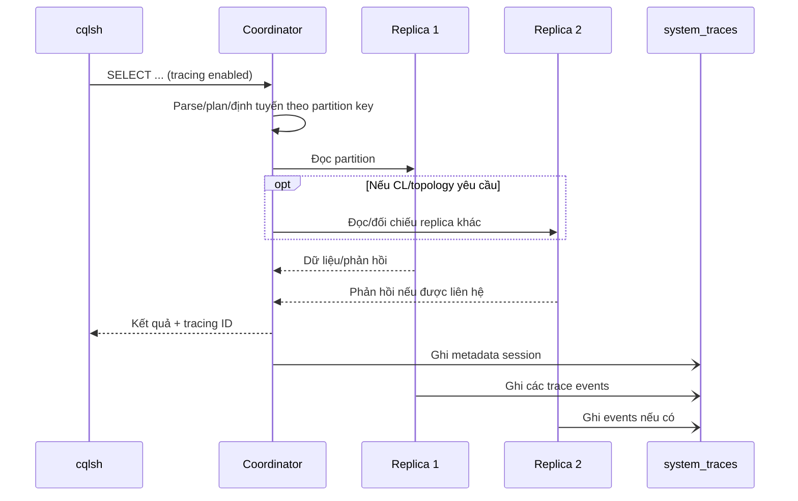

# `TRACING ON/OFF` và thu thập một truy vấn mẫu bằng `cqlsh` trong Apache Cassandra

> **Chương:** Tracing và chẩn đoán  
> **Mô-đun:** `DATABASE_ENGINE_WIDE_COLUMN_CASSANDRA` — tìm hiểu kiến trúc phân tán và mô hình wide-column của Apache Cassandra, đặc biệt partition key, thiết kế bảng theo truy vấn, consistency đọc/ghi, replication, compaction, repair, xử lý lỗi và ứng dụng Java. Bài thực hành tập trung vào **truy vết một truy vấn CQL bằng `cqlsh`** và diễn giải dữ liệu trace để điều tra độ trễ.

## 1. Mục tiêu và kết quả cần thu được

Khi một API Java báo rằng truy vấn Cassandra chậm, chỉ biết câu `SELECT` và thời gian HTTP không đủ để xác định nguyên nhân. Độ trễ có thể nằm ở việc chọn coordinator, truy cập replica, đọc memtable/SSTable, hòa giải dữ liệu và tombstone, chờ một consistency level, hoặc đường mạng giữa ứng dụng và Cassandra.

Apache Cassandra có khả năng **request tracing**: ghi lại một chuỗi sự kiện của *một yêu cầu CQL cụ thể*. Trong `cqlsh`, ta có thể bật chế độ này bằng `TRACING ON`, chạy **một truy vấn mẫu**, sau đó tắt bằng `TRACING OFF`. Công cụ sẽ hiển thị hoạt động của truy vấn kèm một **trace session ID** để kiểm tra lại.

Sau bài học, bạn sẽ thực hiện được:

1. Chuẩn bị một keyspace/bảng nhỏ và truy vấn theo partition key.
2. Bật/tắt tracing đúng phiên `cqlsh`, tránh ghi trace cho hàng loạt câu lệnh không cần thiết.
3. Lưu **CQL, consistency level, kết quả, session ID và thời điểm chạy**.
4. Đọc chi tiết từ `system_traces.sessions` và `system_traces.events` theo ID.
5. Nhận biết khác biệt giữa **latency phía client**, **thời gian xử lý phía Cassandra** và các dấu hiệu trên coordinator/replica.
6. Từ trace đặt giả thuyết kiểm chứng được, thay vì kết luận ngay rằng một event là nguyên nhân gốc.

> **Giới hạn:** Tracing là công cụ chẩn đoán có overhead, **không phải metric lấy mẫu liên tục** hay hệ phân tán tracing end-to-end của HTTP/Java. Chỉ bật cho số ít truy vấn trong môi trường an toàn và tắt ngay sau khi thu thập đủ dữ liệu.

## 2. Request tracing hoạt động ở đâu?

Mỗi lần client gửi truy vấn đến Cassandra, một node đóng vai trò **coordinator**. Coordinator xác định partition/token cần truy cập và trao đổi với các **replica** theo consistency level được yêu cầu. Khi tracing được bật cho request, các thành phần có tham gia có thể phát sinh sự kiện kèm timestamp, node nguồn và thông tin thời gian.



Sơ đồ trên thể hiện **luồng khái niệm**, không khẳng định Cassandra luôn gửi mọi truy vấn đến hai replica hay mọi event đều xuất hiện. Số replica tham gia tùy **replication factor, consistency level, trạng thái node và loại thao tác**. Các trace event được lưu trong keyspace hệ thống `system_traces` và việc ghi/lấy lại chúng cũng diễn ra trên hệ phân tán.

Một trace session ID dùng để gom sự kiện của **một request**. Nó khác với `CqlSession` trong Java Driver (đối tượng kết nối dài hạn) và khác với HTTP correlation ID. Đừng nhầm ba loại định danh này.

## 3. Điều kiện trước khi thực hành

Bạn cần quyền kết nối vào một **Cassandra cluster lab/staging** qua `cqlsh`, quyền tạo keyspace/bảng hoặc một bảng thí nghiệm sẵn có, và quyền đọc trace nếu muốn truy vấn `system_traces` trực tiếp.

```bash
# Ví dụ kết nối khi cqlsh có trên máy và server ở localhost.
cqlsh 127.0.0.1 9042
```

Với cluster có authentication/TLS, sử dụng cấu hình truy cập do tổ chức cung cấp; không đưa password vào tài liệu hoặc bản chụp trace. Có thể lấy một số thông tin cụm từ `cqlsh`:

```sql
SELECT cluster_name, release_version, data_center, host_id
FROM system.local;
```

`system.local` mô tả node mà coordinator truy vấn đang kết nối, không phải toàn bộ cấu hình cluster. Cần biết **phiên bản Cassandra, datacenter, RF và consistency level**, vì các thông tin này quyết định ý nghĩa của trace. Nếu đang dùng cluster nhiều node/đa datacenter, điều chỉnh phần khởi tạo bên dưới cho topology phù hợp, thay vì sao chép `SimpleStrategy` vào production.

### Quy tắc an toàn khi đo

- Chạy truy vấn **nhỏ, có partition key rõ ràng**, không chọn ngẫu nhiên một truy vấn quét cả bảng lớn trên production.
- Không mở nhiều phiên `cqlsh` tracing đồng thời để “lấy nhiều mẫu cho chắc” nếu chưa đánh giá overhead.
- Bật `TRACING ON` **ngay trước truy vấn cần đo** và `TRACING OFF` **ngay sau đó**.
- Ghi nhận **phiên bản, CL, thời điểm, node liên hệ, schema và CQL**; thiếu ngữ cảnh sẽ khó so sánh hai trace.
- Đừng nhầm trace với đo đạc không can thiệp: tracing có thể **tăng độ trễ** và ghi thêm dữ liệu vào `system_traces`.

## 4. Tạo keyspace/bảng lab theo đường truy vấn

Ví dụ dưới đây dành cho **một node Cassandra cục bộ**. `SimpleStrategy` với RF=1 chỉ để học, **không** phải cấu hình HA. Cụm nhiều datacenter nên dùng chiến lược replication phù hợp, thường là `NetworkTopologyStrategy` với RF theo datacenter.

```sql
CREATE KEYSPACE IF NOT EXISTS tracing_lab
WITH replication = {
    'class': 'SimpleStrategy',
    'replication_factor': 1
};

CREATE TABLE IF NOT EXISTS tracing_lab.events_by_account (
    account_id uuid,
    event_id int,
    event_type text,
    detail text,
    PRIMARY KEY ((account_id), event_id)
) WITH CLUSTERING ORDER BY (event_id DESC);

INSERT INTO tracing_lab.events_by_account
    (account_id, event_id, event_type, detail)
VALUES (11111111-1111-4111-8111-111111111111, 1, 'LOGIN', 'web');

INSERT INTO tracing_lab.events_by_account
    (account_id, event_id, event_type, detail)
VALUES (11111111-1111-4111-8111-111111111111, 2, 'VIEW', 'partition-key');

INSERT INTO tracing_lab.events_by_account
    (account_id, event_id, event_type, detail)
VALUES (11111111-1111-4111-8111-111111111111, 3, 'VIEW', 'repair');
```

Trong `PRIMARY KEY ((account_id), event_id)`, `account_id` là **partition key**; `event_id` là **clustering key** sắp theo chiều giảm dần. Vì biết chính xác `account_id`, truy vấn sau có thể tìm đúng partition và dùng điều kiện range trên clustering key:

```sql
SELECT event_id, event_type, detail
FROM tracing_lab.events_by_account
WHERE account_id = 11111111-1111-4111-8111-111111111111
  AND event_id >= 2
LIMIT 2;
```

Kết quả logic kỳ vọng có hai hàng với `event_id` **3 và 2**. Nếu dữ liệu lab có thay đổi từ một lượt chạy trước, cần kiểm tra trạng thái bảng thay vì mặc định output luôn giống hệt. `LIMIT 2` giới hạn **hàng kết quả**, không có tác dụng phân trang một collection chứa trong một hàng.

## 5. Ba lệnh trọng tâm: `TRACING ON` → `SELECT` → `TRACING OFF`

Trong cùng phiên `cqlsh`, thực hiện trình tự sau. Với lab RF=1, đặt consistency `ONE` để dễ hiểu. `CONSISTENCY` và `TRACING` là **lệnh điều khiển của `cqlsh`**, không phải CQL mà Java Driver gửi như một `SELECT` hoặc `UPDATE`.

```sql
CONSISTENCY ONE;

TRACING ON;

SELECT event_id, event_type, detail
FROM tracing_lab.events_by_account
WHERE account_id = 11111111-1111-4111-8111-111111111111
  AND event_id >= 2
LIMIT 2;

TRACING OFF;
```

Khi `TRACING ON` có hiệu lực, `cqlsh` yêu cầu tracing cho các câu CQL tiếp theo của **phiên làm việc đó**. Sau truy vấn mẫu, `cqlsh` thường in bảng trace bên cạnh kết quả dữ liệu và dòng có **tracing session ID**. Khi `TRACING OFF`, những câu lệnh sau không còn được phiên `cqlsh` đó yêu cầu trace theo chế độ này.

**Không để tracing bật** rồi chạy một file hàng nghìn `INSERT` hoặc thao tác điều tra khác: lượng events, overhead và khả năng lộ thông tin trong trace có thể tăng nhanh. Nếu phiên `cqlsh` bị ngắt sau truy vấn, chế độ bật theo phiên cũng chấm dứt, nhưng các event đã ghi vào `system_traces` vẫn có vòng đời lưu trữ riêng.

### Output mẫu để biết cần lưu gì

Ví dụ sau **chỉ minh họa hình dạng output**, không phải bản trace đo từ một cluster thật. Text event, node, thứ tự và microsecond sẽ khác theo phiên bản/đường truy vấn:

```text
cqlsh> TRACING ON;
Now Tracing is enabled

cqlsh> SELECT ... WHERE account_id = ... AND event_id >= 2 LIMIT 2;

 event_id | event_type | detail
----------+------------+---------------
        3 | VIEW       | repair
        2 | VIEW       | partition-key

Tracing session: 3ed3fbf0-0aef-11f0-8b3a-0242ac120002

 activity                        | timestamp | source     | source_elapsed | client
---------------------------------+-----------+------------+----------------+--------
 Executing single-partition ... | ...       | 127.0.0.1  | ...            | ...
 ...                              | ...       | ...        | ...            | ...
 Request complete                | ...       | 127.0.0.1  | ...            | ...

cqlsh> TRACING OFF;
Now Tracing is disabled
```

**Bằng chứng tối thiểu của một lần đo:** ghi lại câu `SELECT` nguyên văn, `CONSISTENCY ONE`, phiên bản server, thời điểm chạy và **trace UUID thật do `cqlsh` trả**. Không copy UUID minh họa vào lệnh truy vấn rồi kết luận “trace không tồn tại”.

## 6. Lấy lại trace bằng session ID

Nếu `cqlsh` của bạn hỗ trợ lệnh tiện ích `SHOW SESSION`, có thể hiển thị lại trace đã ghi:

```text
-- Dạng cú pháp cqlsh; thay UUID bằng ID thật từ output.
SHOW SESSION 3ed3fbf0-0aef-11f0-8b3a-0242ac120002;
```

`SHOW SESSION` là **lệnh của cqlsh**, không phải CQL chuẩn dùng trong prepared statement. Nếu phiên bản `cqlsh` không hỗ trợ hoặc không tìm được session, hãy đọc dữ liệu trong `system_traces` theo hai truy vấn CQL ở phần tiếp theo.

### `system_traces.sessions`: metadata của một request

Sau khi **đã `TRACING OFF`**, dùng session ID thật:

```sql
-- UUID dưới đây chỉ để minh họa, phải thay bằng tracing session ID thật.
SELECT session_id, coordinator, started_at, duration, request, parameters
FROM system_traces.sessions
WHERE session_id = 3ed3fbf0-0aef-11f0-8b3a-0242ac120002;
```

Tùy phiên bản, bảng `system_traces.sessions` chứa những trường như `session_id`, `coordinator`, `started_at`, `duration`, `request`, `parameters`, `client`. `duration` thường thể hiện **microsecond** của thời gian request theo hệ thống trace, không phải toàn bộ thời gian HTTP hoặc thời gian ứng dụng chờ từ đầu tới cuối. Có thể có trường vắng/không được điền ở một số request.

### `system_traces.events`: các sự kiện của cùng request

```sql
SELECT event_id, activity, source, source_elapsed, thread
FROM system_traces.events
WHERE session_id = 3ed3fbf0-0aef-11f0-8b3a-0242ac120002;
```

`session_id` là partition key của dữ liệu trace, vì vậy truy vấn có **đường định tuyến rõ ràng**. `event_id` thường là timeuuid phục vụ thứ tự sự kiện; `source` là node phát sinh event; `thread` và `activity` cho biết một số thao tác đã diễn ra. `source_elapsed` thường biểu thị thời gian tính bằng microsecond từ mốc trace trên **node phát sinh**, cần thận trọng khi so sánh trực tiếp giữa các node do khác biệt đồng hồ và lịch phát sự kiện.

**Các dòng vừa có thể đến trễ:** thao tác ghi trace là một luồng công việc riêng; ngay sau khi query chính hoàn thành, đọc `system_traces` có thể chưa thấy đầy đủ events do ghi/replication/độ trễ. Nếu thiếu sự kiện, thử tra lại **một số lần có giới hạn** và kiểm tra trạng thái node/consistency. Không suy diễn “không có event = replica chắc chắn không xử lý”.

## 7. Trace ID, metadata session và event khác nhau ra sao?

| Dữ liệu | Câu hỏi trả lời được | Điều **không** được suy diễn |
| --- | --- | --- |
| **Trace session ID** | Những sự kiện nào thuộc cùng một request? | Đây là HTTP trace ID hoặc Java `CqlSession` ID |
| **Coordinator** | Node nào nhận/điều phối request? | Node đó nhất định lưu toàn bộ partition |
| **`request`** | Loại request CQL được trace | Luôn có đủ bind values hoặc toàn bộ SQL/log nghiệp vụ |
| **`parameters`** | Một số metadata/giá trị tham số của trace | Đầy đủ và an toàn để công khai thông tin nhạy cảm |
| **`started_at`** | Mốc thời gian trace phía server | Đồng hồ tất cả node đồng bộ tuyệt đối |
| **`duration`** | Thời lượng request mà tracing ghi nhận | Latency end-to-end của HTTP và Java client |
| **Event `activity`** | Bước xử lý được Cassandra ghi nhận | Mọi CPU cycle/I/O/GC đều được đo đầy đủ |
| **`source`** | Node nào tạo sự kiện? | Đây chắc chắn là node gây nghẽn |
| **`source_elapsed`** | Mốc thời gian tương đối trong trace từ một source | Có thể luôn lấy hiệu hai node làm latency mạng chính xác |

Một sự kiện có tên gần với “read SSTable”, “fetching replica” hoặc “request complete” là **manh mối**. Muốn kết luận nguyên nhân, phải kết hợp số đo latency phía client, metric Cassandra, log node, dữ liệu schema/partition và độ tải cluster cùng thời điểm.

## 8. Cách đọc timeline không nhầm coordinator với replica

Một cách phân tích đơn giản là chia timeline của request thành các giai đoạn **khái niệm**:

1. **Khởi động/chuẩn bị** ở coordinator: nhận CQL, parse/prepare, xác định câu lệnh và consistency level.
2. **Định tuyến**: xác định token/partition và replica thích hợp.
3. **Trao đổi replica**: gửi đọc/ghi; chờ phản hồi theo CL; có thể thêm công việc đối chiếu phiên bản hoặc read repair tùy tình huống/phiên bản.
4. **Đọc/ghi lưu trữ**: memtable, cache, SSTable, tombstone, commit log hoặc các bước cụ thể tùy loại request.
5. **Hoàn tất**: coordinator tổng hợp kết quả và trả response.

```text
Client              Coordinator           Replica
  |                     |                    |
  | SELECT              |                    |
  |-------------------->| parse + route      |
  |                     |---- request ------>|
  |                     |                    | read storage
  |                     |<--- response ------|
  |<--------------------| response           |
  |                     |                    |
```

Sơ đồ không có tỷ lệ thời gian. Thứ tự và tên event thực khác nhau theo Cassandra version, CL và việc replica có trùng node coordinator hay không. Ở lab **RF=1 và chỉ một node**, coordinator và replica có thể chính là **cùng địa chỉ IP**; đừng mong chắc chắn trace có hai node hoặc nhiều RPC mạng.

### Một bảng ghi chép khi so sánh trace

| Mốc quan sát | Thông tin cần ghi | Câu hỏi chẩn đoán |
| --- | --- | --- |
| Trước gửi request | CQL, token/partition key, CL, node liên hệ | Query có đi đúng partition không? |
| Coordinator bắt đầu | Source và event đầu | Thời gian parse/route có bất thường? |
| Replica bắt đầu xử lý | Node source khác hoặc cùng coordinator | Có bao nhiêu replica được liên hệ? |
| Hoạt động đọc | Event storage nếu có | Có dấu hiệu đọc nhiều SSTable/tombstone? |
| Hoàn tất | Duration và event cuối | Phần nào của chuỗi xử lý chiếm nhiều thời gian? |
| Java/API nhận phản hồi | Client-side latency riêng | Chênh lệch server/client do mạng, queue, deserialize hay app? |

Không bắt buộc event nào cũng tồn tại; tracing là **quan sát có chọn lọc**, không phải profiler ghi từng syscall. Nếu trace thiếu thông tin cho một giả thuyết, phải tìm số đo bổ trợ thay vì tự điền các bước “hẳn đã xảy ra”.

## 9. Phân biệt latency phía Java và duration của Cassandra

Giả sử một request Java đo được 45 ms còn `system_traces.sessions.duration` thể hiện khoảng 7 ms. Không thể kết luận **38 ms là lỗi mạng** ngay lập tức. Thời gian phía Java có thể gồm:

- Xếp hàng/chờ connection hoặc backpressure ở driver.
- Thời gian gửi/nhận dữ liệu qua mạng, TLS và hệ thống trung gian.
- Retry hoặc speculative execution nếu được cấu hình và phù hợp ngữ nghĩa câu lệnh.
- Deserialize result set và công việc xử lý tại Java service.
- Thời điểm bắt đầu/kết thúc bộ đo Java khác mốc của tracing.
- **Overhead của tracing**, vốn có thể làm thay đổi chính request đang đo.

Vì vậy, chỉ **so sánh tương quan**, không trừ hai số rồi gán chênh lệch cho một thành phần cụ thể nếu chưa có telemetry hỗ trợ. Khi ứng dụng có HTTP distributed tracing, ghi lại correlation ID của request Java và truy vấn CQL tương ứng; trace ID của Cassandra có thể được liên kết bằng log metadata, nhưng không tự phát sinh thành một span HTTP hoàn chỉnh.

## 10. Thử một `UPDATE` mẫu: tracing không chỉ dành cho `SELECT`

Sau khi đo `SELECT`, có thể dùng một request ghi nhỏ trên **đúng hàng lab** để so sánh loại event; nhớ tắt tracing sau mỗi lần:

```sql
TRACING ON;

UPDATE tracing_lab.events_by_account
SET detail = 'repair-session'
WHERE account_id = 11111111-1111-4111-8111-111111111111
  AND event_id = 3;

TRACING OFF;
```

Trong đường ghi, các event có thể liên quan coordinator phân phát mutation, replica áp dụng mutation, commit log/memtable và xác nhận đủ mức consistency. Không dùng trace một câu `UPDATE` nhỏ để suy luận ngay **compaction đã hoàn thành**, vì compaction là công việc nền và có thể diễn ra lâu sau khi request trả về.

Với RF=1, `ONE` là lựa chọn hợp lý cho lab; trong cluster RF=3, cùng câu ghi ở `LOCAL_QUORUM` có thể cần nhiều replica xác nhận hơn. Các trace không nên so sánh đơn thuần bằng số event khi CL khác nhau. Không dùng một lệnh ghi vào production chỉ để lấy trace nếu nó có tác động nghiệp vụ; chọn request **read-only** hoặc hàng thử nghiệm.

## 11. So sánh consistency level và replication cho đúng điều kiện

Consistency level quyết định **số và phạm vi replica cần phản hồi** để một request được coi là thành công; không thay đổi partition key. Tracing giúp quan sát *một số bước* trao đổi replica nhưng không thay thế hiểu biết về topology.

| Môi trường | Ví dụ CL có ý nghĩa | Điều cần hiểu |
| --- | --- | --- |
| Lab một node, RF=1 | `ONE` | Coordinator và replica thường là cùng node; không đo được quorum nhiều replica |
| Một datacenter, RF=3 | `ONE`, `LOCAL_QUORUM` | Có thể so sánh yêu cầu xác nhận, kết quả trace và latency khi mọi node khỏe |
| Nhiều datacenter | `LOCAL_ONE`, `LOCAL_QUORUM`, `QUORUM` tùy schema/phiên bản | Phân biệt phạm vi local và toàn cluster; cẩn trọng với đường truyền liên DC |
| LWT với `IF` | CL thường + **serial consistency** | Trace có thể có thêm các pha đồng thuận; không giống `UPDATE` thường |

Ví dụ trong `cqlsh` trên môi trường RF=3 được thiết kế riêng:

```sql
-- Chỉ chạy nếu replication/topology hỗ trợ CL này.
CONSISTENCY LOCAL_QUORUM;
TRACING ON;

SELECT event_id, event_type
FROM tracing_lab.events_by_account
WHERE account_id = 11111111-1111-4111-8111-111111111111
LIMIT 2;

TRACING OFF;
```

**Không** sao chép test này sang lab RF=1 rồi kết luận rằng truy vấn đã thử khả năng chịu lỗi của quorum; RF=1 dù dùng CL quorum theo định nghĩa vẫn không có nhiều bản sao chịu lỗi. Muốn nghiên cứu replica failure, repair hay consistency khi node rớt mạng, phải có cluster nhiều node và kịch bản thử nghiệm được cô lập.

## 12. Tracing hỗ trợ đặt giả thuyết về truy vấn chậm như thế nào?

| Triệu chứng | Dấu hiệu trace có thể hỗ trợ | Cần kiểm tra thêm |
| --- | --- | --- |
| `SELECT` theo partition key chậm | Thời gian giữa gửi request và hoàn tất, sự kiện trên replica | Partition size, SSTable count, tombstones, CPU/disk |
| Read timeout ở CL cao | Coordinator chờ đủ phản hồi, sự kiện ở các replica nếu được ghi | RF, DC, trạng thái node, mạng, speculative retry |
| `UPDATE list[index]` chậm | Có thể quan sát thêm đường đọc trước khi tạo mutation | Cơ chế read-before-write, kích thước list, tranh chấp |
| Query trả nhiều dữ liệu | Hoạt động xử lý nhiều rows và thời gian hoàn tất | Result size, driver paging, schema có collection quá lớn |
| Chậm sau compaction/repair | Trace request thay đổi cùng thời điểm | Metric compaction/repair, disk saturation, log hệ thống |
| Chậm chỉ từ Java | Duration Cassandra nhỏ hơn latency client | Driver pool, timeout, retry, JVM GC, TLS/mạng và ứng dụng |
| Một partition nóng | Một số truy vấn cùng khóa thường chậm | Tần suất ghi, token ownership, hotspot và bucket design |

**Không đảo chiều nhân quả:** Trace có event “đọc SSTable” không chứng minh mọi thời gian chậm là do compaction; chậm xuất hiện khi repair chạy không chứng minh repair luôn là nguyên nhân. Cần kết hợp **thời điểm, metric và thử nghiệm có kiểm soát**.

## 13. Những nguyên nhân làm trace bị thiếu hoặc khó đọc

### 13.1. Không thấy tracing ID trong `cqlsh`

Kiểm tra `TRACING ON` đã được bật **trong đúng phiên `cqlsh`** trước khi chạy câu lệnh, câu lệnh có thực sự gửi thành công đến server hay không, và phiên bản `cqlsh`/server có hỗ trợ tính năng đó. Nếu câu CQL lỗi cú pháp trước khi được server xử lý, không kỳ vọng luôn có một trace session đầy đủ.

### 13.2. Truy vấn `system_traces` trả 0 hàng

Nguyên nhân có thể là dùng nhầm UUID minh họa, events chưa được ghi/lan truyền kịp, bản ghi đã hết thời gian lưu, quyền truy cập hạn chế, hoặc đang kết nối cluster khác với cluster tạo trace. Thử kiểm tra chính xác session ID, cluster, quyền và đọc lại có giới hạn; không quét bảng `system_traces.events` toàn cluster để tìm ID bằng `ALLOW FILTERING`.

### 13.3. Có session nhưng thiếu events

Trace writes có thể bị chậm hoặc mất một phần khi node chịu tải/lỗi; TTL và replication của keyspace hệ thống cũng ảnh hưởng khả năng thu thập. Thiếu event **không đủ chứng minh** bước đó không xảy ra. Không dùng traces làm cơ chế audit đầy đủ hoặc bằng chứng tuyệt đối rằng một ghi đã/không thành công.

### 13.4. Timestamp trông ngược hoặc lệch giữa hai node

`timestamp` và `source_elapsed` cần được diễn giải trong ngữ cảnh clock của **source** và cách hệ thống tạo event. Đồng hồ node lệch, hoạt động ghi trace bất đồng bộ và mốc tương đối có thể tạo cảm giác sự kiện đảo thứ tự. Không lấy hiệu timestamp của hai source khác nhau làm **thời gian mạng chính xác tuyệt đối**.

### 13.5. Tracing làm request chậm hơn

Đó là một tác động được dự kiến: thu thập/gửi/lưu event tiêu thụ tài nguyên. Đo SLO bình thường bằng **metric request chưa bật tracing**; dùng trace của một số request đại diện để phân tích đường đi, không dùng toàn bộ latency của các request bị trace làm số liệu baseline production.

## 14. Lưu và chia sẻ trace sao cho an toàn

Metadata `system_traces.sessions` và `events` có thể chứa thông tin về câu CQL, tham số, địa chỉ IP node/client, timestamp và thread. Trong một số tình huống dữ liệu truy vấn có thể nhạy cảm; vì thế:

- Không đưa mật khẩu, token, dữ liệu cá nhân hay tham số bí mật vào ảnh chụp/log trace chia sẻ công khai.
- Khi tạo ticket chẩn đoán, có thể lưu **trace ID, phiên bản, CL, duration và các event đã được che thông tin nhạy cảm**.
- Dùng **thời hạn lưu và quyền truy cập** của hệ thống trace/log phù hợp chính sách tổ chức.
- Không coi `system_traces` là kho lịch sử không giới hạn. Các bản ghi trace có **TTL/retention phụ thuộc cấu hình/phiên bản**; sao chép thông tin cần thiết vào hệ thống quan trắc được phê duyệt nếu cần lưu dài hạn.
- Nếu không có quyền đọc keyspace hệ thống, nhờ người có quyền xuất **một trace đã khử thông tin nhạy cảm**, thay vì cấp quyền toàn cluster cho mọi developer.

## 15. So sánh truy vấn tốt và truy vấn có thiết kế partition chưa phù hợp

Với bảng `events_by_account`, query biết `account_id` là partition key và `event_id` là clustering key sẽ truy cập dữ liệu có giới hạn rõ. Trái lại, nếu ứng dụng muốn “toàn bộ sự kiện `VIEW` trong mọi account”, bảng hiện tại không có đường phân vùng theo `event_type`.

```sql
-- Truy vấn này KHÔNG phải đường đọc được thiết kế cho bảng lab.
-- Không chạy trên bảng lớn chỉ để tạo trace.
SELECT account_id, event_id
FROM tracing_lab.events_by_account
WHERE event_type = 'VIEW'
ALLOW FILTERING;
```

`ALLOW FILTERING` có thể cho phép lọc tốn kém tùy CQL/schema, **không tạo partition key hay index**. Trace có thể cho thấy đường truy vấn phức tạp, nhưng **tracing không sửa được schema**. Nếu “tìm VIEW theo ngày” là truy vấn thường xuyên, cần một **bảng theo event type và bucket thời gian**, với clustering key phục vụ thứ tự và paging.

Ví dụ thiết kế bảng đọc riêng (không cần chạy để hoàn thành bài tracing):

```sql
CREATE TABLE tracing_lab.events_by_type_day (
    event_type text,
    event_day date,
    occurred_at timeuuid,
    account_id uuid,
    detail text,
    PRIMARY KEY ((event_type, event_day), occurred_at, account_id)
) WITH CLUSTERING ORDER BY (occurred_at DESC, account_id ASC);
```

Bảng mới cho phép truy vấn **đúng partition** khi biết `event_type` và `event_day`. Tuy nhiên, thêm bảng denormalized đòi ứng dụng ghi/đồng bộ dữ liệu theo nhiều chiều, xử lý retry và giới hạn kích thước bucket. Tracing giúp xác nhận đường thực thi nhưng việc chọn partition/clustering key vẫn là **bài toán thiết kế theo truy vấn**.

## 16. Liên hệ với Java Driver 4.x và telemetry ứng dụng

Trong Java, đo latency ở nơi **request bắt đầu và hoàn tất** để có baseline độc lập với tracing của `cqlsh`. Ví dụ đơn giản (không bật server-side tracing, dùng session và prepared statement đã khởi tạo):

```java
import com.datastax.oss.driver.api.core.CqlSession;
import com.datastax.oss.driver.api.core.cql.PreparedStatement;
import com.datastax.oss.driver.api.core.cql.Row;
import java.util.UUID;
import java.util.concurrent.TimeUnit;

class EventReader {
    private final CqlSession session;
    private final PreparedStatement byAccount;

    EventReader(CqlSession session) {
        this.session = session;
        this.byAccount = session.prepare(
            "SELECT event_id, event_type FROM tracing_lab.events_by_account " +
            "WHERE account_id = ? LIMIT 2"
        );
    }

    void read(UUID accountId) {
        long started = System.nanoTime();
        Row first = session.execute(byAccount.bind(accountId)).one();
        long elapsedMicros = TimeUnit.NANOSECONDS.toMicros(
            System.nanoTime() - started
        );
        System.out.println("client_elapsed_us=" + elapsedMicros);
        if (first != null) {
            System.out.println("first_event=" + first.getInt("event_id"));
        }
    }
}
```

Đoạn Java đo **đường gọi phía client** trong phạm vi `session.execute(...).one()`; không thay thế profiler, distributed tracing hoặc đo toàn bộ các trang kết quả. Cụ thể, nếu application đọc nhiều trang, cần đo cả vòng lặp trang để tránh kết luận sai rằng query chỉ tốn thời gian lấy trang đầu.

Trong Java Driver 4.x, request tracing và thông tin execution có các API riêng tùy phiên bản, nhưng bài thực hành này chủ động dùng `cqlsh` để **có trace dễ quan sát và truy vấn theo ID**. Đối với hệ thống thật, log câu CQL nhận diện an toàn, consistency level, host/coordinator, retry count, timeout và correlation ID ở ứng dụng để nối với một trace Cassandra khi cần.

## 17. Checklist một lượt điều tra có thể tái lập

1. **Chọn mục tiêu:** Một câu truy vấn đủ nhỏ, an toàn, đã biết partition key và triệu chứng cần điều tra.
2. **Ghi bối cảnh:** Phiên bản server/driver, RF/datacenter, CL, schema, kích thước partition và thời điểm chạy.
3. **Chạy baseline:** Đo latency thông thường từ Java hoặc `cqlsh` không bật tracing; tránh so sánh số đo ở tải khác nhau.
4. **Bật tracing:** Dùng `TRACING ON` trong đúng phiên `cqlsh`.
5. **Chạy duy nhất một truy vấn đại diện:** Giữ nguyên key/CL để kết quả có thể đối chiếu.
6. **Tắt ngay:** `TRACING OFF` trước khi làm thí nghiệm tiếp hoặc đọc bảng hệ thống.
7. **Lưu trace ID thật:** Cùng truy vấn, thời gian, output, CL và node.
8. **Đọc trace:** Dùng output cqlsh, `SHOW SESSION` khi hỗ trợ hoặc `system_traces.sessions/events` theo ID.
9. **Đối chiếu:** Phân biệt coordinator/replica và metric phía client; tránh suy diễn duration từ timestamp khác node.
10. **Đặt giả thuyết:** Ví dụ partition quá lớn, tombstone nhiều, RF/CL chờ replica, hoặc driver queueing.
11. **Kiểm chứng bằng metric khác:** `nodetool tablestats`, `tablehistograms`, tracing chọn lọc, log replica, CPU/I/O/compaction/repair tùy phiên bản.
12. **Kết thúc:** Lưu kết luận, che thông tin nhạy cảm, không để tracing bật và không thay đổi cấu hình cluster chỉ từ một mẫu.

## 18. Bài tập thực hành

**Bài 1 — thu một trace:** Dùng đúng bảng `tracing_lab.events_by_account`, bật `TRACING ON`, chạy `SELECT` với `account_id` và `event_id >= 2`, rồi `TRACING OFF`.  
**Kỳ vọng:** Lưu câu CQL, hai hàng có `event_id` 3 và 2, CL, trace ID thật và các event do `cqlsh` hiển thị.

**Bài 2 — truy vấn lại trace:** Dựa vào ID vừa nhận, đọc `system_traces.sessions` và `system_traces.events`. Nếu thấy session nhưng chưa thấy đủ events, làm gì?  
**Gợi ý:** Kiểm tra đúng ID/cluster, quyền truy cập và độ trễ ghi trace; đọc lại có giới hạn. Không kết luận ngay rằng replica không thực thi.

**Bài 3 — local RF=1:** Trace cho thấy chỉ địa chỉ `127.0.0.1`. Có phải Cassandra không có replica?  
**Gợi ý:** Không. Trên lab RF=1, coordinator và replica có thể cùng node. Phải đối chiếu RF/topology thay vì đếm IP rồi suy ra số replica logic.

**Bài 4 — client 50 ms, trace 8 ms:** Có thể khẳng định 42 ms còn lại là mạng?  
**Gợi ý:** Không. Đo client có thể gồm chờ connection, TLS, retry, deserialize, queueing và thời điểm lấy mẫu khác nhau.

**Bài 5 — CL:** Với cluster RF=3, bạn chuyển từ `ONE` sang `LOCAL_QUORUM` để so sánh. Có thể dùng kết quả làm bằng chứng rằng `QUORUM` luôn chậm hơn?  
**Gợi ý:** Không. Chỉ kết luận cho workload và điều kiện thử; latency còn tùy cache, replica, mạng, tải và consistency path.

**Bài 6 — query sai chiều:** API phải tìm mọi `event_type='VIEW'` trong một ngày. Vì sao thêm `TRACING ON` không đủ để truy vấn nhanh?  
**Gợi ý:** Tracing quan sát query, không thay partition key. Cần thiết kế bảng theo `event_type, event_day` hoặc index phù hợp workload.

**Bài 7 — tombstone:** Một trace có event liên quan SSTable trong khi read latency tăng. Bạn sẽ kiểm tra gì trước khi khẳng định nguyên nhân là tombstone?  
**Gợi ý:** Xem thống kê tombstone, SSTable count, p95/p99, compaction backlog, kích thước partition, GC/I/O và các request tương tự.

**Bài 8 — bảo mật:** Một trace có query parameters và IP node. Có nên đính kèm nguyên output lên diễn đàn công khai?  
**Gợi ý:** Không. Che giá trị nhạy cảm, dùng hệ thống ticket được cấp quyền và giới hạn retention.

## 19. Lỗi thường gặp và cách tránh

| Sai lầm | Hệ quả | Cách xử lý |
| --- | --- | --- |
| Bật `TRACING ON` rồi quên tắt | Trace mọi request của phiên, overhead và dữ liệu phụ tăng | Bật ngay trước một query, tắt ngay sau đó |
| Dùng UUID ví dụ thay ID thật | Không tìm thấy session trace | Copy tracing ID từ output `cqlsh` của lượt chạy đó |
| So sánh hai trace khác CL/RF | Kết luận sai về replica và latency | Ghi bối cảnh và so sánh cùng điều kiện |
| Giả định mọi event có cùng định dạng ở mọi bản Cassandra | Diễn giải sai, parser hỏng khi nâng cấp | Xem field/tên event thực và kiểm tra phiên bản |
| Coi `source_elapsed` giữa các node là đồng hồ chung chính xác | Suy ra sai latency mạng | Phân tích theo source và đối chiếu thời gian server/client |
| Coi một trace là bằng chứng tuyệt đối | Bỏ sót jitter/tải, event bị thiếu | Đo nhiều request có chọn lọc và xem metrics/log |
| Đọc `system_traces` khi tracing vẫn bật | Tạo thêm trace cho truy vấn điều tra | `TRACING OFF` trước khi truy vấn keyspace hệ thống |
| Dùng `ALLOW FILTERING` để chữa query chậm | Quét nhiều partition và phát sinh tải | Thiết kế schema/index theo chiều truy vấn |
| Dùng trace để thay metric compaction/repair | Không thấy diễn biến nền toàn cluster | Kết hợp `nodetool`, metrics và logs |
| Công khai trace chưa khử dữ liệu | Rò rỉ IP, tham số hoặc thông tin nội bộ | Kiểm soát quyền và che thông tin nhạy cảm |

## 20. Ghi nhớ

- `TRACING ON` và `TRACING OFF` là **lệnh `cqlsh`** giúp thu thập trace cho các request trong phiên đang dùng; chúng **không bật tracing toàn cluster cho mọi client**.
- Quy trình tối thiểu: **chọn query an toàn → bật tracing → chạy một query → tắt tracing → lưu session ID**.
- `system_traces.sessions` lưu metadata request; `system_traces.events` lưu hoạt động theo **cùng `session_id`**. Sự kiện có thể đến chậm/thiếu và không được giữ vĩnh viễn.
- Khi đọc timeline, phân biệt **coordinator, replica, partition key, RF, CL** và source của event; không đồng nhất duration Cassandra với latency Java/HTTP.
- Tracing là **công cụ chẩn đoán có overhead**, không phải profiler hoặc hệ đo end-to-end; chỉ rút ra giả thuyết cần kiểm chứng bằng metrics/logs.
- Một query có đường partition key không phù hợp, partition quá lớn, nhiều tombstone, compaction/repair hoặc replica bị tải nặng vẫn cần **thiết kế bảng theo truy vấn và vận hành đúng**, không thể sửa chỉ bằng `TRACING ON`.
- Luôn tắt tracing, bảo vệ thông tin trong trace và báo cáo kết quả có đủ **CQL, thời điểm, server version, CL, trace ID và bối cảnh workload**.
