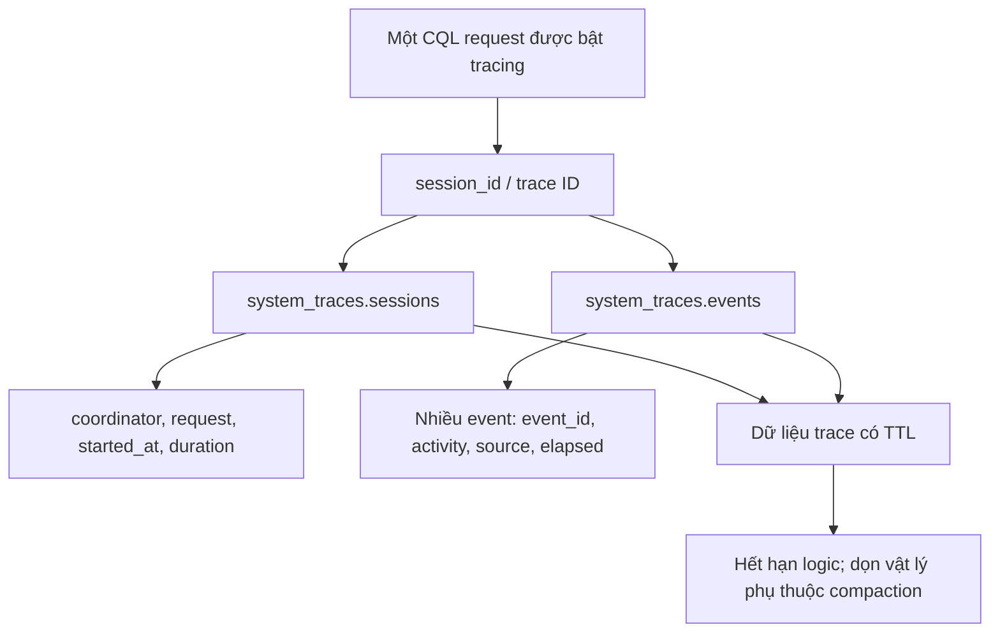
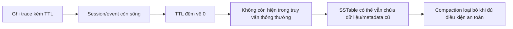
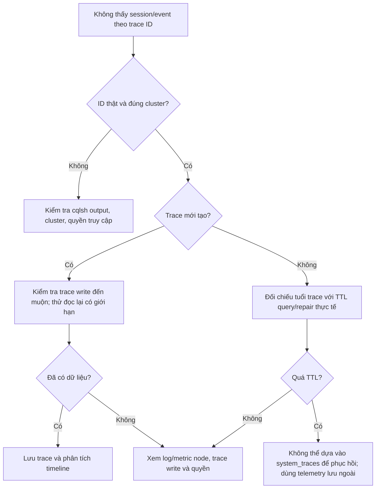

# `system_traces`: session, event và thời gian lưu trace trong Apache Cassandra

> **Chương:** Tracing và chẩn đoán  
> **Mô-đun:** `DATABASE_ENGINE_WIDE_COLUMN_CASSANDRA` — tìm hiểu kiến trúc phân tán và mô hình wide-column của Apache Cassandra, khóa phân vùng, thiết kế bảng theo truy vấn, consistency đọc/ghi, replication, compaction, repair, xử lý lỗi và kết nối ứng dụng Java. Bài học tập trung vào cách **trace request được ghi trong `system_traces`, liên kết session–event và hết hạn theo TTL**.

## 1. Vì sao một trace có hai loại bản ghi?

Khi một truy vấn CQL chậm, chúng ta cần biết **yêu cầu nào đã được trace** và **những hoạt động nào đã xảy ra bên trong yêu cầu đó**. Cassandra thường lưu hai nhóm dữ liệu trong keyspace hệ thống `system_traces`:

- **`system_traces.sessions`**: một hàng metadata cho một phiên truy vết *request*; có ID, coordinator, thời điểm bắt đầu, thời lượng và một số thông tin về yêu cầu.
- **`system_traces.events`**: các hàng sự kiện thuộc cùng trace; mỗi hàng mô tả một hoạt động, node phát sinh, thread và thời gian tương đối.

Từ **một `session_id`**, có thể đọc metadata của request và tập event chi tiết. Đây là một cách tổ chức dữ liệu đúng tinh thần Cassandra: biết **partition key** thì đọc được nhóm hàng liên quan, không cần quét toàn cluster để tìm một event theo mô tả.



**Không nhầm ba loại session:**

1. `session_id` trong `system_traces` là **định danh một request được trace**.
2. `CqlSession` của Java Driver là **đối tượng kết nối dài hạn** với cluster.
3. Session đăng nhập/API hoặc distributed-tracing span của HTTP là **ngữ cảnh phía ứng dụng**.

Chúng không tự động có cùng ID. Muốn nối Cassandra trace với HTTP trace, ứng dụng phải **ghi nhận mapping/correlation** theo quy định quan trắc của hệ thống.

## 2. Cấu trúc dữ liệu và khóa chính của hai bảng

Để hiểu cách truy vấn, hãy xem một mô hình giản lược của schema hệ thống. **Không chạy `CREATE TABLE` dưới đây**: `system_traces` là keyspace nội bộ do Cassandra quản lý, tên cột/kiểu/DDL có thể khác theo phiên bản.

```text
system_traces.sessions
  session_id     timeuuid    PRIMARY KEY
  coordinator    inet
  started_at     timestamp
  duration       int        (thường microsecond)
  request        text
  parameters     map<text,text>
  client         inet       (khi schema/phiên bản có cột này)

system_traces.events
  session_id     timeuuid    PARTITION KEY
  event_id       timeuuid    CLUSTERING KEY
  activity       text
  source         inet
  source_elapsed int        (thường microsecond)
  thread         text
```

Tùy phiên bản Cassandra hoặc bản phân phối, bảng sessions có thể chứa các trường bổ sung, ví dụ `command`, và một số giá trị có thể `null`. Vì vậy, **kiểm tra schema thực tế trước khi copy một truy vấn SELECT**.

| Khía cạnh | `sessions` | `events` |
| --- | --- | --- |
| Đơn vị bản ghi | Một request có trace | Một hoạt động trong request |
| Partition key | `session_id` | `session_id` |
| Clustering key | Không, trong mô hình điển hình | `event_id` (timeuuid) |
| Cardinality theo trace | Thường một hàng | Nhiều hàng, có thể thiếu hoặc tới trễ |
| Truy vấn hiệu quả | Theo **đúng `session_id`** | Theo **đúng `session_id`**, tùy cần giới hạn số event |
| Chức năng | Bối cảnh và thời lượng request | Chi tiết timeline hoạt động/node/thread |

Do `events` được phân vùng theo `session_id`, tất cả sự kiện của một trace thuộc cùng **partition logic**. `event_id` là clustering key giúp sắp thứ tự các event theo khóa; điều này **không bảo đảm thứ tự nhân quả tuyệt đối giữa các node khác đồng hồ**.

## 3. Bắt đầu từ một truy vấn mẫu trong `cqlsh`

Để có `session_id` thật, cần **phát sinh một request được trace**. Không tự tạo UUID rồi tìm trong `system_traces`: một ID ngẫu nhiên chưa từng có trace tất nhiên không có dữ liệu.

Ví dụ thực hành sau dùng một keyspace riêng, phù hợp **cluster lab một node**. `SimpleStrategy` RF=1 chỉ để học; production nhiều datacenter cần replication theo topology, thường là `NetworkTopologyStrategy`.

```sql
CREATE KEYSPACE IF NOT EXISTS trace_storage_lab
WITH replication = {
    'class': 'SimpleStrategy',
    'replication_factor': 1
};

CREATE TABLE IF NOT EXISTS trace_storage_lab.events_by_user (
    user_id uuid,
    event_no int,
    event_type text,
    detail text,
    PRIMARY KEY ((user_id), event_no)
) WITH CLUSTERING ORDER BY (event_no DESC);

INSERT INTO trace_storage_lab.events_by_user
    (user_id, event_no, event_type, detail)
VALUES (11111111-1111-4111-8111-111111111111, 1, 'LOGIN', 'web');

INSERT INTO trace_storage_lab.events_by_user
    (user_id, event_no, event_type, detail)
VALUES (11111111-1111-4111-8111-111111111111, 2, 'VIEW', 'partition');

INSERT INTO trace_storage_lab.events_by_user
    (user_id, event_no, event_type, detail)
VALUES (11111111-1111-4111-8111-111111111111, 3, 'VIEW', 'repair');
```

`user_id` là **partition key**, `event_no` là **clustering key**. Truy vấn theo `user_id` có đường định tuyến rõ ràng, nên phù hợp làm mẫu ban đầu; không cần `ALLOW FILTERING` hoặc secondary index chỉ để lấy trace.

Trong **cùng phiên `cqlsh`**, chạy:

```sql
CONSISTENCY ONE;
TRACING ON;

SELECT event_no, event_type, detail
FROM trace_storage_lab.events_by_user
WHERE user_id = 11111111-1111-4111-8111-111111111111
  AND event_no >= 2
LIMIT 2;

TRACING OFF;
```

`TRACING ON` và `TRACING OFF` là **lệnh của `cqlsh`**, không phải một tùy chọn bật vĩnh viễn cho toàn Cassandra. Sau `TRACING ON`, `cqlsh` thường hiển thị bảng trace và dòng `Tracing session: ...` bên cạnh kết quả truy vấn. **Chép ID thật đó** cùng thời điểm, câu CQL, CL và phiên bản server.

Kết quả logic từ dữ liệu mẫu là hai hàng `event_no = 3` và `2`, theo clustering order `DESC`. Nếu bảng lab đã bị sửa bởi một lượt thử khác, hãy xác minh lại dữ liệu thay vì mặc định kết quả luôn giống nhau.

## 4. Thu thập bộ chứng cứ tối thiểu của một trace

Một ảnh chụp chỉ có bảng event nhưng không có câu CQL và context sẽ rất khó chẩn đoán. Hãy tạo một ghi chú có các thông tin:

| Trường ghi nhận | Ví dụ hoặc cách lấy | Vì sao quan trọng |
| --- | --- | --- |
| Trace ID | UUID thực từ `Tracing session: ...` | Khóa nối `sessions` và `events` |
| Thời điểm đo | UTC và timezone khi diễn giải | Đối chiếu metric/log cùng khoảng thời gian |
| Câu CQL | `SELECT ... WHERE user_id = ...` | Phân biệt truy vấn một partition với truy vấn quét |
| Bind parameters | Giá trị đã **khử thông tin nhạy cảm** | Biết partition/trường dữ liệu bị truy vấn |
| Consistency level | `ONE`, `LOCAL_QUORUM`, ... | Xác định yêu cầu xác nhận replica |
| Cassandra version và datacenter | Cụm lab/production cụ thể | Tên event, cột schema và đường xử lý có thể khác |
| Replication factor | RF theo keyspace/DC | Diễn giải số replica có thể tham gia |
| Result count và response size | Số hàng/byte khi có metric | Phân biệt query chậm vì nhiều dữ liệu |
| Client-observed latency | Driver/JVM hoặc telemetry API | Đối chiếu với duration ở `sessions` |

Đừng chép trực tiếp passwords, tokens hoặc dữ liệu người dùng vào ticket. Trace có thể chứa chuỗi request, tham số và IP; chỉ lưu thông tin cần thiết theo quy định bảo mật của hệ thống.

## 5. Truy vấn `system_traces.sessions` theo ID

Sau khi đã **`TRACING OFF`**, thay UUID minh họa bằng ID *thật* từ output. UUID dưới đây chỉ minh họa cú pháp và **không phải** trace được tạo bởi bài học:

```sql
SELECT session_id, coordinator, started_at, duration,
       request, parameters
FROM system_traces.sessions
WHERE session_id = 8cbe0000-e581-11f1-8e9a-0242ac120002;
```

Vì `session_id` là **primary key**, truy vấn chỉ nhắm tới một request. Không dùng `SELECT * FROM system_traces.sessions` không giới hạn để tìm “các trace gần nhất”: mô hình bảng không tối ưu cho quét theo thời gian toàn cluster và có thể gây tải không cần thiết.

### Diễn giải từng trường chính

- `session_id`: **timeuuid** định danh trace, không phải ID của người dùng/transaction nghiệp vụ.
- `coordinator`: IP node điều phối request; **không nhất thiết** là node lưu tất cả dữ liệu của partition được truy cập.
- `started_at`: thời điểm bắt đầu request theo thông tin tracing phía server; khi so sánh nhiều node cần xét đồng bộ đồng hồ.
- `duration`: thời lượng request mà trace ghi nhận, **thường tính theo microsecond**; ví dụ `7500` tương đương khoảng `7,5 ms`, không phải `7500 ms`.
- `request`: mô tả loại yêu cầu; không giả định lúc nào cũng có SQL đầy đủ và mọi bind value.
- `parameters`: một số metadata/giá trị được ghi khi tracing; nội dung và sự hiện diện có thể phụ thuộc phiên bản, đường xử lý và lệnh.

**Cẩn thận khi `duration` chưa có hoặc bằng `null`:** session metadata và event có thể được ghi theo tiến trình bất đồng bộ. Nếu vừa thu trace xong mà một cột chưa xuất hiện, đọc lại sau một khoảng ngắn có giới hạn; không tự biến `null` thành “request hoàn tất ngay lập tức”.

## 6. Truy vấn `system_traces.events` theo `session_id`

```sql
SELECT event_id, activity, source, source_elapsed, thread
FROM system_traces.events
WHERE session_id = 8cbe0000-e581-11f1-8e9a-0242ac120002;
```

Đây là **truy vấn theo partition key**, tránh lọc toàn bảng. `event_id` là clustering key kiểu timeuuid, nên các hàng được tổ chức theo thứ tự khóa. Có thể kiểm soát số event hiển thị để tránh một trace quá dài:

```sql
-- Trả tối đa 100 hàng sự kiện trong partition của trace.
SELECT event_id, activity, source, source_elapsed, thread
FROM system_traces.events
WHERE session_id = 8cbe0000-e581-11f1-8e9a-0242ac120002
LIMIT 100;
```

**Lưu ý:** `LIMIT 100` chỉ là **giới hạn số hàng**, không phải lời khẳng định trace có đúng 100 event. Nếu cần đầy đủ, cần xem tiếp các hàng còn lại hoặc thực hiện paging đúng cách. Trong Java Driver, `setPageSize` cũng chỉ giới hạn **hàng mỗi trang**, không giới hạn tổng sự kiện hay số byte của một hàng chứa collection lớn.

### Ý nghĩa của các cột event

| Cột | Ý nghĩa | Cạm bẫy diễn giải |
| --- | --- | --- |
| `event_id` | Định danh timeuuid cho một event, thường dùng làm clustering key | Không đảm bảo nhân quả tuyệt đối giữa mọi node |
| `activity` | Dòng mô tả thao tác đang được trace | Cách diễn đạt thay đổi theo phiên bản và request |
| `source` | IP node tạo sự kiện | Nhiều event cùng source không chứng minh chỉ có một replica |
| `source_elapsed` | Thời gian tương đối, thường microsecond | Không mặc định đồng bộ chính xác giữa các node khác clock |
| `thread` | Thread thực thi khi tạo event | Thread name không phải định danh nghiệp vụ ổn định |

Một trace có thể gồm event từ **coordinator và một số replica**. Ở cluster lab RF=1, coordinator và replica có thể nằm trên **cùng node/IP**, nên ít source khác nhau là điều bình thường. Không suy đoán replication factor bằng cách đếm số địa chỉ IP trong kết quả trace.

## 7. `SHOW SESSION` trong `cqlsh`: tiện nhưng có giới hạn

Ở các phiên bản `cqlsh` có lệnh này, sau khi tracing đã tắt có thể truy vấn lại thông tin một request bằng:

```text
SHOW SESSION 8cbe0000-e581-11f1-8e9a-0242ac120002;
```

Đây là **lệnh tiện ích của `cqlsh`**, không phải CQL chạy trực tiếp từ prepared statement Java. Nếu `SHOW SESSION` không được hỗ trợ hoặc bản ghi đã hết TTL, cần dùng bảng `system_traces` khi có quyền hoặc xem output đã thu từ lần chạy trước.

**Không dùng lệnh này như biện pháp khôi phục vô hạn:** nếu session/event đã hết hạn và không còn bản sao, `SHOW SESSION` cũng không thể tái tạo lại request. Muốn lưu bằng chứng dài hạn, phải sao chép bản trace đã được khử thông tin nhạy cảm vào hệ thống observability được cấp quyền **khi trace còn tồn tại**.

## 8. Thời gian lưu trace: TTL là gì và vì sao phải quan tâm?

**TTL (*time-to-live*)** là thời hạn mà một giá trị được coi là còn sống sau khi ghi. Trace được thiết kế để phục vụ **chẩn đoán ngắn hạn**, không phải lưu toàn bộ lịch sử CQL mãi mãi. Bản ghi của `system_traces.sessions` và `system_traces.events` thường được ghi với TTL do Cassandra quy định/cấu hình theo loại trace.

Ở một số phiên bản/cấu hình Cassandra, người quản trị có thể gặp các tham số với ý nghĩa tương tự:

```text
# Ví dụ tên cấu hình phổ biến ở một số phiên bản cassandra.yaml:
tracetype_query_ttl: 86400
tracetype_repair_ttl: 604800
```

**Chỉ là ví dụ tham khảo, không phải cấu hình bắt buộc hoặc ngưỡng cố định cho mọi phiên bản**. `86400` giây tương ứng **24 giờ**, `604800` giây tương ứng **7 ngày**. Có bản phân phối đổi tên, thay giá trị mặc định hoặc quản lý cấu hình theo cách khác. Tên tham số, phạm vi áp dụng, khả năng chỉnh sửa và giá trị hiện hành phải được kiểm tra trong tài liệu/cấu hình **phiên bản đang vận hành**.

| Loại thông tin | Mục đích thường gặp | Điều nên xác minh |
| --- | --- | --- |
| Tracing truy vấn CQL | Điều tra request đọc/ghi, latency, replica | TTL dành cho **query trace**, quyền đọc và cách giữ bằng chứng |
| Tracing liên quan repair | Theo dõi sự kiện repair ở phiên bản hỗ trợ | TTL **repair trace** có thể khác query trace |
| Trace metadata session | Tổng quan một request | TTL cột/hàng thực tế; thời điểm được ghi/cập nhật |
| Trace events | Những hoạt động con của request | TTL từng event; event có đến muộn hoặc thiếu không |

**Không đồng nhất `gc_grace_seconds` với trace TTL.** TTL xác định khi giá trị **hết hiệu lực logic**; `gc_grace_seconds` và compaction liên quan cách xử lý thông tin xóa trong SSTable/replica. Chỉnh grace không tự biến TTL một ngày thành bảy ngày.

## 9. Kiểm tra TTL còn lại bằng CQL

Ở các phiên bản cho phép hàm `TTL(...)` trên những cột thường tương ứng, bạn có thể quan sát TTL còn lại **khi bản ghi trace vẫn còn sống**:

```sql
-- Thay bằng session ID thật, chạy sau TRACING OFF.
SELECT session_id, request, duration,
       TTL(request) AS request_ttl_seconds,
       TTL(duration) AS duration_ttl_seconds
FROM system_traces.sessions
WHERE session_id = 8cbe0000-e581-11f1-8e9a-0242ac120002;

-- TTL của hoạt động trong các event còn sống.
SELECT event_id, activity,
       TTL(activity) AS activity_ttl_seconds
FROM system_traces.events
WHERE session_id = 8cbe0000-e581-11f1-8e9a-0242ac120002
LIMIT 20;
```

Những câu lệnh trên dùng `TTL(...)` với **cột dữ liệu thường**, không phải primary key `session_id` hoặc `event_id`. Tùy phiên bản và trạng thái cột, TTL có thể trả về một số giây, `null` (ví dụ cột không có giá trị/không gắn TTL) hoặc bản ghi không còn xuất hiện. Một số cột session có thể được ghi vào thời điểm khác nhau; **TTL của chúng không nhất thiết giống nhau đến từng giây**.

Nếu `TTL(request)` không trả kết quả mong muốn, hãy **kiểm tra schema và cột thực**; không kết luận toàn bộ `system_traces` không có TTL chỉ từ một cột null. Sự hiện diện và khả năng truy vấn một field phụ thuộc Cassandra version. Không thực hiện quét toàn bảng để tính TTL trung bình cho mọi trace.

### TTL còn lại thay đổi theo thời gian

Ví dụ một event được ghi với TTL 86.400 giây:

```text
T0:      event được ghi                     TTL ≈ 86.400 s
T0+1h:   event vẫn truy vấn được             TTL ≈ 82.800 s
T0+24h:  event hết hạn logic                SELECT có thể không còn trả hàng
Sau đó:  byte/tombstone cũ có thể còn trong SSTable đến khi dọn an toàn
```

Thời điểm chính xác còn phụ thuộc clock, thời gian ghi cell, sai số thời gian đo và quá trình Cassandra lưu trace. Không dùng phép tính sơ đồ như một cam kết rằng sau đúng 24 giờ dữ liệu vật lý đã bị xóa khỏi mọi node/disk/backup.

## 10. TTL hết hạn không đồng nghĩa dữ liệu vật lý biến mất ngay

Cassandra ghi vào memtable/commit log rồi tạo các SSTable bất biến. Khi TTL của một cell hết hạn, cell đó **không còn được coi là giá trị sống** ở đường đọc phù hợp. Tuy nhiên, phiên bản đã hết hạn và thông tin xóa liên quan vẫn có thể tồn tại trong SSTable cho đến khi **compaction** xử lý theo các điều kiện an toàn.



Đây là điểm quan trọng khi ước lượng dung lượng `system_traces`: **TTL ngắn không bảo đảm lượng đĩa giảm ngay tức khắc**. Nhiều request bị trace có thể tạo rất nhiều hàng event và tăng I/O, lưu trữ, compaction, ngay cả khi mỗi hàng chỉ sống trong thời gian giới hạn.

**Không chỉnh trực tiếp** table options, xóa/truncate bảng `system_traces`, hoặc thay replication/grace của system keyspace chỉ để “dọn trace nhanh” mà chưa có hướng dẫn chính thức của đúng Cassandra version và quy trình vận hành được phê duyệt. Đây là dữ liệu hệ thống phục vụ chẩn đoán; can thiệp sai có thể ảnh hưởng các thao tác chẩn đoán khác.

## 11. Vì sao có session mà không thấy event, hoặc ngược lại?

Việc ghi dữ liệu tracing có thể diễn ra **bất đồng bộ và qua nhiều node**. Thực tế có thể thấy các trạng thái tạm thời hoặc kéo dài:

| Hiện tượng | Giả thuyết hợp lý | Hướng xác minh |
| --- | --- | --- |
| Có hàng `sessions` nhưng `events` đang rỗng | Event chưa ghi xong, mất một phần, đã hết hạn hoặc quyền/phiên bản khác | Kiểm tra ID, thời điểm, đọc lại có giới hạn, node status |
| Có vài event nhưng thiếu bước kết thúc | Trace write chậm/mất, request lỗi/timeout hoặc retention | Đối chiếu exception, server log, metrics, không kết luận chỉ từ event thiếu |
| Không tìm thấy session sau khi có output `Tracing session` | Sai cluster/ID, TTL hết, không đọc được, ghi trace không đầy đủ | Xem cluster đang kết nối, quyền, khoảng thời gian, thử lại có giới hạn |
| Có events nhưng session metadata không đầy đủ | Metadata chưa cập nhật hoặc đã hết TTL khác thời điểm | Kiểm tra `duration`, TTL của từng cột và tuổi trace |
| `SHOW SESSION` không hỗ trợ | Khác phiên bản `cqlsh` hoặc phương thức truy cập | Dùng CQL trực tiếp nếu được cấp quyền |
| TTL trả `null` | Cột null, không có TTL, hoặc phiên bản/codec có khác biệt | Chọn cột sống khác, xem schema và sample mới |

Các khả năng trên **không thay thế** việc chẩn đoán nguồn gốc lỗi. Trace là dữ liệu quan sát, không phải ledger đảm bảo đúng-một-lần hay audit log đầy đủ. Khi request timeout, một số mutation có thể vẫn đã được replica chấp nhận dù trace kết thúc không đầy đủ.

## 12. Phân tích timeline: `event_id` và `source_elapsed`

Một trường hợp hay bị hiểu sai là nhìn hai hàng event rồi lấy hiệu `source_elapsed` để kết luận chính xác “RPC mạng mất 5 ms”. `source_elapsed` thường là **thời gian tương đối tính bằng microsecond trong context tracing** và có thể gắn với mốc/clock của node phát sinh. Một số sự kiện được gửi/lưu bất đồng bộ; đồng hồ hai node có thể lệch.

Do đó:

1. Bắt đầu từ **`started_at`, `duration`, coordinator`** trong session.
2. Đọc toàn bộ event theo cùng `session_id`, xác định **`source`** của từng event.
3. Nhóm hoạt động thành các pha **khởi động/định tuyến, gửi replica, xử lý, phản hồi**, tùy event thực có sẵn.
4. So sánh những mốc **cùng source** và một số điểm liên hệ giữa source khác nhau; không coi timeline đa node là đồng hồ tuyệt đối chính xác.
5. Đối chiếu với latency phía client, log/metrics node, network, GC, SSTable/tombstone và CL/RF.

Nếu một trace có event `request complete`, điều đó chỉ cho biết Cassandra đã ghi nhận một giai đoạn hoàn tất; **không đảm bảo** HTTP request phía trên đã trả kết quả đúng hay mọi event đều đã có mặt trong `system_traces`.

### Ví dụ nhận xét đúng và nhận xét quá mức

**Phù hợp:** “Trong trace X, coordinator là node A; các event đã có cho thấy một replica B tham gia. Duration phía Cassandra khoảng 8 ms; client ghi nhận 35 ms. Cần kiểm tra thêm driver queueing và network.”

**Quá mức:** “Chênh lệch 27 ms chắc chắn do mạng; replica B là nút thắt vì có event dài nhất.” Không có metric bổ sung, kết luận này chưa được trace bảo đảm.

## 13. Consistency, replication và sự hoàn chỉnh của trace

Trên một cluster RF=3, truy vấn `ONE` và `LOCAL_QUORUM` có thể có yêu cầu xác nhận và luồng replica khác nhau. **Cùng một CQL** chưa chắc tạo cùng event nếu khác coordinator, cache, trạng thái replica hoặc CL.

| Yếu tố | Ảnh hưởng đến đường request/trace |
| --- | --- |
| Partition key | Xác định token và nhóm replica; query biết key thường dễ chẩn đoán hơn |
| Replication factor | Số bản sao được duy trì và nhóm node có thể tham gia |
| `ONE`/`LOCAL_QUORUM`/`QUORUM` | Mức xác nhận đọc/ghi và phạm vi replica cần phản hồi |
| Datacenter | Có thể ảnh hưởng đường truyền và việc chọn local replica |
| Node lỗi/timeout | Event có thể thiếu do request hỏng hoặc trace write không hoàn chỉnh |
| Repair | Giúp replica đồng bộ dữ liệu gốc và tombstone; cũng tạo tải nền khi chạy |
| Compaction | Tác động I/O/đọc SSTable; không được trace request phản ánh đầy đủ |

Không đếm source trong `system_traces.events` để kết luận **RF bằng số node có event**: có replica không được liên hệ theo CL, có source không kịp ghi trace hoặc coordinator đồng thời là replica. Muốn biết RF, hãy kiểm tra schema keyspace thực tế và topology, không suy luận từ một trace.

## 14. Một ví dụ có điều kiện `IF`: trace LWT có thể dài hơn

Nếu muốn quan sát khác biệt giữa mutation thường và **lightweight transaction (LWT)**, sử dụng **bảng lab** và một hàng biết trước:

```sql
-- Chuẩn bị trước trạng thái đọc/ghi bình thường.
UPDATE trace_storage_lab.events_by_user
SET detail = 'repair'
WHERE user_id = 11111111-1111-4111-8111-111111111111
  AND event_no = 3;

TRACING ON;

-- LWT: điều kiện kiểm tra giá trị hiện tại của cột detail.
UPDATE trace_storage_lab.events_by_user
SET detail = 'repair-checked'
WHERE user_id = 11111111-1111-4111-8111-111111111111
  AND event_no = 3
IF detail = 'repair';

TRACING OFF;
```

Với `IF`, Cassandra thực hiện kiểm tra có điều kiện theo cơ chế đồng thuận (Paxos) và trả cột `[applied]`. Đây có thể là đường request nhiều pha hơn so với `UPDATE` thường, và trace có thể cho thấy các sự kiện liên quan. **Không** dựa vào số hàng event để suy ra chính xác số RPC hoặc latency luôn cao hơn một lượng cố định.

Với lab RF=1, bài học chủ yếu minh họa **khác biệt ngữ nghĩa**; muốn quan sát Paxos đa replica, phải có cluster đủ replica và serial consistency hợp lý. Nếu `[applied] = false`, không có nghĩa Cassandra bị lỗi: điều kiện không đúng; với timeout, kết quả chấp nhận mutation có thể chưa rõ, cần kiểm tra trạng thái.

## 15. Java Driver 4.x: liên kết trace ID với telemetry client

Ở ứng dụng Java, tracing có thể được kích hoạt **cho một request được chọn**, rồi lấy trace ID qua execution info nếu driver/phiên bản hỗ trợ. Ví dụ minh họa API thường gặp của Java Driver 4.x:

```java
import com.datastax.oss.driver.api.core.CqlSession;
import com.datastax.oss.driver.api.core.cql.BoundStatement;
import com.datastax.oss.driver.api.core.cql.PreparedStatement;
import com.datastax.oss.driver.api.core.cql.ResultSet;
import java.util.UUID;

class TraceSampleRepository {
    private final CqlSession session;
    private final PreparedStatement select;

    TraceSampleRepository(CqlSession session) {
        this.session = session;
        this.select = session.prepare(
            "SELECT event_no, event_type FROM trace_storage_lab.events_by_user " +
            "WHERE user_id = ? LIMIT 2"
        );
    }

    void sampleOneRequest(UUID userId) {
        BoundStatement statement = select.bind(userId)
            .setTracing(true);
        long start = System.nanoTime();
        ResultSet result = session.execute(statement);
        long clientMicros = (System.nanoTime() - start) / 1_000;

        UUID traceId = result.getExecutionInfo().getTracingId();
        System.out.println("client_elapsed_us=" + clientMicros);
        System.out.println("cassandra_trace_id=" + traceId);
    }
}
```

Khi có trace ID, operator có thể dùng ID đó tra `system_traces.sessions/events` như trong `cqlsh`. **Không tự bật tracing cho mọi query production** chỉ vì Java API hỗ trợ `.setTracing(true)`; hãy chọn một số request an toàn, giới hạn tần suất và bảo vệ trace metadata.

`client_elapsed_us` trong code đo khoảng thời gian từ trước `execute` đến khi driver có `ResultSet` ban đầu; không nhất thiết bao gồm việc duyệt toàn bộ nhiều trang kết quả hoặc xử lý HTTP ở tầng trên. Nó **không bằng** `sessions.duration`, vì hai số đo có mốc bắt đầu/kết thúc và chi phí khác nhau. Khi driver retry/speculative execution, cần xem execution info chi tiết và ý nghĩa trace ID tương ứng, không giả định một truy vấn logic luôn chỉ có một lần thực thi mạng.

## 16. Cần giữ trace lâu hơn TTL mặc định thì làm gì?

Nếu tổ chức muốn xem trace sau vài tuần, giải pháp không phải mặc định tăng TTL của system keyspace lên vô hạn. Hãy xác định mục đích và tần suất:

- **Điều tra sự cố ngay:** Lấy session ID, events và metrics trong **cửa sổ TTL đang còn**; lưu vào ticket nội bộ đã che thông tin nhạy cảm.
- **So sánh hiệu năng dài hạn:** Dùng metrics request, p95/p99, timeout, driver tracing/telemetry và logs có retention thích hợp. Một vài trace đại diện là dữ liệu giải thích, không phải chuỗi số liệu cho thống kê hàng tháng.
- **Audit nghiệp vụ:** Thiết kế audit/event log chuyên dụng có retention/quyền truy cập riêng. `system_traces` không bảo đảm ghi đủ tất cả request hay chống sửa dữ liệu theo chuẩn audit.
- **Cần thay TTL vì mục đích vận hành:** Xem tính năng/cấu hình được hỗ trợ của **đúng phiên bản và bản phân phối**, dự toán số request trace × số event × byte/event × RF, và thực hiện theo change management. Không trực tiếp `ALTER TABLE system_traces.events` hoặc `TRUNCATE` như một mẹo.

Nếu phải giữ một trace ngoài cluster, nên lưu **ID, UTC time, câu truy vấn đã ẩn tham số, CL/RF, coordinator, duration, bảng events đã khử nhạy cảm và các metric liên quan**. Chỉ định một thời hạn và nhóm người được phép truy cập, tránh sao chép bản raw không kiểm soát.

## 17. Công thức ước lượng tác động lưu trữ của tracing

Để ước lượng tải **thô** do bật tracing, giả sử:

- (Q): request được trace mỗi giây.
- (E): số event trung bình/request.
- (B_s): kích thước metadata session (byte).
- (B_e): kích thước trung bình mỗi event (byte).
- (T): thời gian trace còn sống (giây).

Khi tốc độ đều và chưa tính chênh lệch TTL, dữ liệu logic còn sống gần đúng:

\[
D_{\text{logic}} \approx Q \times T \times (B_s + E \times B_e).
\]

Ví dụ **chỉ để tính toán minh họa**: 5 request trace/giây, 20 event/request, metadata session 300 byte, một event 200 byte và TTL một ngày:

\[
D_{\text{logic}} \approx 5 \times 86.400 \times (300 + 20\times200)
= 1.857.600.000\ \text{byte} \approx 1,86\ \text{GB}.
\]

Con số này **chưa tính replication factor, chỉ mục/metadata lưu trữ, compaction, tombstone, nén, dữ liệu cũ chưa được dọn và phân bố không đều giữa node**. Vì vậy nếu vô tình trace toàn bộ request của một dịch vụ có tải cao, việc ghi trace có thể trở thành **một workload Cassandra thứ cấp đáng kể**.

Không lấy công thức trên thay cho quan trắc disk utilization và compaction thực. Đối với query trace và repair trace có TTL khác nhau, nên tính riêng từng nhóm rồi cộng theo workload phù hợp.

## 18. Quy trình xử lý sự cố khi trace biến mất sớm



Đừng vội tăng TTL hoặc điều chỉnh replication của `system_traces` khi phát hiện trace thiếu. Trước hết kiểm tra **sai ID, sai cluster, sai keyspace, quyền đọc, độ trễ ghi event và tuổi trace**. Nếu xảy ra node failure, áp lực I/O hoặc request timeout, có thể mất một số dữ liệu tracing mà không mất dữ liệu nghiệp vụ; cần kiểm tra hai mặt độc lập.

## 19. Những lỗi phổ biến cần tránh

| Sai lầm | Vì sao nguy hiểm | Cách làm đúng |
| --- | --- | --- |
| Gọi `session_id` là ID của Java `CqlSession` | Lẫn định danh request với connection pool | Gọi rõ **trace session ID** |
| Truy vấn events theo `activity` mà không có `session_id` | Không theo partition key, có thể cần quét/lọc toàn hệ thống | Lấy **ID từ output**, truy vấn theo `session_id` |
| Chạy `TRACING ON` rồi truy vấn `system_traces` trước khi tắt | Phát sinh thêm trace và tải không cần thiết | `TRACING OFF` ngay sau request mẫu |
| Đếm event source rồi kết luận RF | Không phải mọi replica tạo được event quan sát được | Đọc replication schema và topology thực |
| Coi `duration` là millisecond | Có thể sai lệch kết luận hiệu năng hàng nghìn lần | Kiểm tra đơn vị **microsecond** của cột/version |
| Lấy hiệu `source_elapsed` giữa node như độ trễ mạng chính xác | Có sai số clock/asynchronous trace | Đọc theo source, kết hợp metrics/network |
| Coi `TTL(request)` là TTL chắc chắn của mọi event | Session/event và cột có thời điểm ghi khác nhau | Kiểm tra TTL event riêng, tuổi trace, version |
| Coi TTL hết là disk đã được giải phóng | SSTable và tombstone có thể còn | Phân biệt logical expiry và compaction |
| Sao chép giá trị TTL ví dụ vào mọi bản Cassandra | Cấu hình khác phiên bản/bản phân phối | Xác minh configuration thực tế |
| Dùng trace làm audit log bắt buộc | Event có thể thiếu, trễ hoặc hết TTL | Dùng audit/event log riêng |
| Bật tracing toàn bộ lưu lượng dài ngày | Tăng CPU/I/O, network, SSTable và lượng dữ liệu nhạy cảm | Chọn mẫu nhỏ, bật có giới hạn |
| Tự chỉnh `system_traces` để kéo dài TTL | Rủi ro can thiệp keyspace nội bộ | Theo quy trình/cấu hình chính thức của phiên bản |

## 20. Bài tập thực hành

**Bài 1 — xác định khóa chính.** Vì sao `SELECT ... FROM system_traces.events WHERE session_id = ?` hiệu quả hơn tìm `activity = '...'` trên toàn bảng?  
**Gợi ý:** `session_id` là partition key; event của cùng request được gom trong một partition. `activity` không tự là đường phân vùng.

**Bài 2 — thu trace thật.** Chạy `TRACING ON`, một truy vấn `SELECT` trong lab, rồi `TRACING OFF`. Cần ghi lại những gì để người khác tra lại kết quả?  
**Gợi ý:** Trace ID thật, câu CQL, bind params đã ẩn nhạy cảm, server version, CL, thời điểm và topology.

**Bài 3 — hai bảng.** `sessions` có một hàng nhưng `events` chỉ có vài dòng. Có thể kết luận mọi hoạt động còn thiếu đều không xảy ra không?  
**Gợi ý:** Không. Trace events có thể được ghi trễ, thiếu hoặc hết hạn.

**Bài 4 — đơn vị thời gian.** `duration = 12500` nên diễn giải ra sao nếu cột tính microsecond?  
**Gợi ý:** Khoảng 12,5 ms phía tracing, không phải 12.500 ms phía HTTP.

**Bài 5 — TTL.** Một event `TTL(activity) = 1800` có nghĩa disk sẽ xóa byte của event sau chính xác 1.800 giây không?  
**Gợi ý:** Không. TTL là thời gian sống logic còn lại, compaction quyết định dọn vật lý khi an toàn.

**Bài 6 — session ID lỗi.** Bạn copy UUID từ ví dụ bài học và `SELECT` ra không hàng. Lý do nào phải kiểm tra đầu tiên?  
**Gợi ý:** UUID ví dụ không phải ID trace thật. Cần thu ID từ `cqlsh` khi request được trace.

**Bài 7 — CL.** Lab RF=1 chỉ có một node/IP trong events. Có đủ kết luận trace tương tự RF=3 `LOCAL_QUORUM` không?  
**Gợi ý:** Không. Chỉ quan sát đường xử lý của lab; muốn thử đa replica phải có cluster và CL tương ứng.

**Bài 8 — retention.** Tổ chức cần giữ chứng cứ sự cố ba tháng. Có nên coi `system_traces` là hệ lưu chính không?  
**Gợi ý:** Không. Dùng hệ observability/ticket có retention và quyền phù hợp, chỉ trích xuất các trace cần thiết khi còn sống.

**Bài 9 — tính chi phí.** Nếu tăng từ 5 lên 50 request trace/giây, trong công thức gần đúng khi các tham số khác giữ nguyên, dữ liệu logic tăng thế nào?  
**Gợi ý:** Gần **10 lần**. Còn chi phí replica, compaction và tombstone cũng cần đánh giá riêng.

**Bài 10 — Java client.** Java đo 40 ms, `sessions.duration` là 6 ms. Điều gì cần làm trước khi quy 34 ms còn lại cho mạng?  
**Gợi ý:** Kiểm tra queueing, connection pool, retry, serialization, TLS, thời điểm lấy mẫu, page fetch và telemetry thực tế.

## 21. Checklist triển khai an toàn

- [ ] Xác định đúng **phiên bản Cassandra, bản phân phối và schema `system_traces` thực tế**.
- [ ] Có một truy vấn **theo partition key**, đủ nhỏ, an toàn để bật tracing.
- [ ] Dùng **`TRACING ON` → một request → `TRACING OFF`** trong cùng phiên `cqlsh`.
- [ ] Chép **trace session ID thật**, không dùng UUID minh họa để tìm dữ liệu.
- [ ] Đọc `sessions`/`events` **theo `session_id`**, tránh quét system keyspace.
- [ ] Phân biệt **thời lượng server (microsecond)**, `source_elapsed` và latency phía Java/HTTP.
- [ ] Biết **RF, CL, datacenter** trước khi kết luận về coordinator/replica.
- [ ] Đã kiểm tra **TTL query trace/repair trace** theo đúng cấu hình/phiên bản, không dựa vào giá trị ví dụ.
- [ ] Phân biệt **TTL hết hạn logic** với dọn vật lý trong SSTable/compaction.
- [ ] Xử lý trace thiếu/trễ bằng **đọc lại có giới hạn** và đối chiếu log/metrics, không xem trace là audit đầy đủ.
- [ ] Không chỉnh sửa hoặc truncate `system_traces` tùy tiện; có kế hoạch quan trắc overhead/tracing rate.
- [ ] Chỉ chia sẻ trace đã **khử thông tin nhạy cảm** và lưu bằng chứng cần thiết theo retention/phân quyền.

## 22. Ghi nhớ

- **`system_traces.sessions`** lưu metadata một request được trace; **`system_traces.events`** lưu các hoạt động của request đó, cùng được liên kết bởi **`session_id`**.
- `session_id` là **timeuuid/partition key** để truy vấn trực tiếp; `event_id` thường là **timeuuid/clustering key** của một event, không thay thế correlation ID nghiệp vụ.
- `started_at`, `duration`, `source_elapsed`, `source` và `activity` phải được diễn giải theo **đơn vị, node và Cassandra version**. `duration` phía server **không bằng** latency phía Java/HTTP.
- Trace có **TTL/retention**, thường phân biệt loại query và repair tùy cấu hình. Giá trị ví dụ 24 giờ/7 ngày **không phải cam kết cho mọi cluster**.
- Có thể kiểm tra TTL còn lại bằng `TTL(cột_dữ_liệu)` khi bản ghi còn sống, nhưng TTL của session và event có thể khác; **hết TTL logic không đồng nghĩa byte đã biến mất khỏi SSTable**.
- Tracing có overhead và event có thể đến muộn/thiếu. **Không** dùng `system_traces` thay audit log hoặc hệ đo long-term; phải bổ sung metrics, logs và thông tin replication/consistency.
- Khi chẩn đoán, giữ **query theo partition key, trace ID thật, CL/RF, thời điểm, context tải**; tắt tracing ngay sau lượt đo và không can thiệp keyspace hệ thống tùy tiện.
