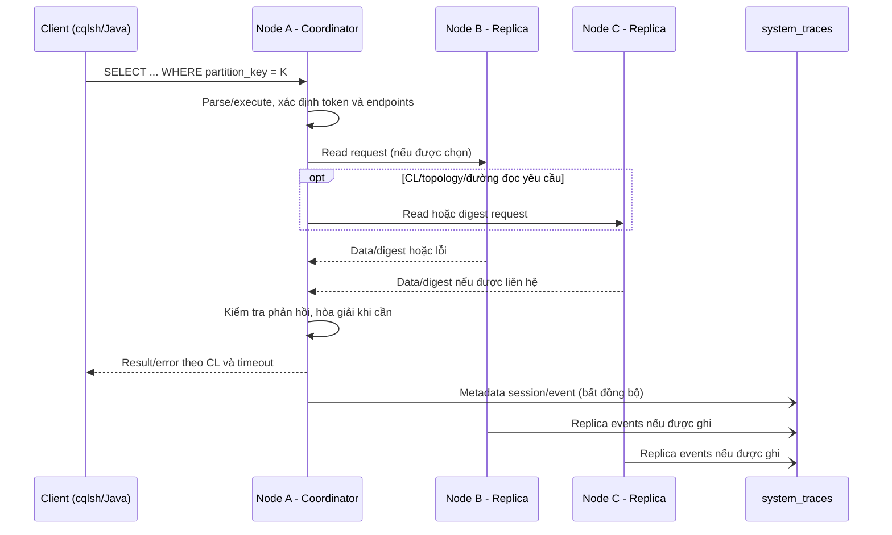
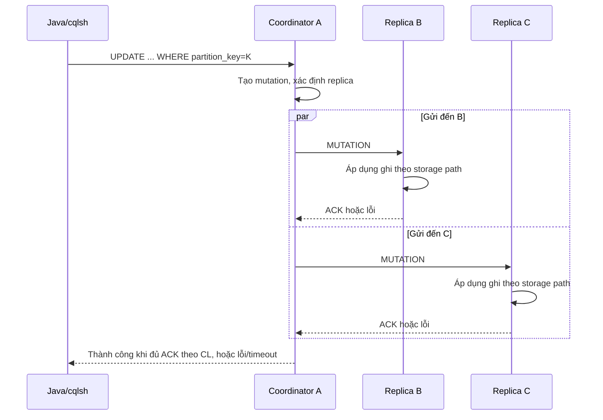

# Nhận diện coordinator, replica và các bước xử lý trong trace của Apache Cassandra

> **Chương:** Tracing và chẩn đoán  
> **Mô-đun:** `DATABASE_ENGINE_WIDE_COLUMN_CASSANDRA` — hiểu kiến trúc phân tán và mô hình wide-column của Apache Cassandra, khóa phân vùng, thiết kế bảng theo truy vấn, mức nhất quán đọc/ghi, replication, compaction, repair, xử lý lỗi và kết nối Java. Bài này hướng dẫn **đọc một request trace để phân biệt coordinator, replica, các pha xử lý và giới hạn của bằng chứng trace**.

## 1. Mục tiêu: nhìn đúng vai trò của từng node

Một truy vấn từ ứng dụng Java có thể đi đến node A, nhưng dữ liệu của partition lại được lưu trên B, C và D. Node A nhận request là **coordinator**; những node lưu bản sao dữ liệu của partition là **replica**. Nếu A cũng thuộc tập replica, nó có thể đồng thời làm cả hai vai trò. Không được mặc định coordinator luôn là một node riêng đứng ngoài nhóm replica.

Khi tracing được bật, Cassandra tạo **một trace session cho một request**, cùng nhiều event từ những thành phần phát sinh hoạt động. Cần ghép ba câu hỏi:

1. **Coordinator là ai?** Node nào nhận và điều phối CQL request?
2. **Replica nào tham gia?** Node nào thực hiện đọc/ghi hoặc phản hồi trong lần xử lý này?
3. **Các bước diễn ra thế nào?** Định tuyến partition, trao đổi replica, xử lý SSTable/memtable, hòa giải dữ liệu, đợi đủ phản hồi rồi trả kết quả?

Nhận diện được những điều trên giúp phân biệt một **hot partition**, một replica phản hồi chậm, chi phí đọc SSTable/tombstone, chờ consistency level và phần thời gian nằm ngoài Cassandra ở Java Driver. Nhưng trace không phải máy ghi đầy đủ mọi RPC, syscall hay hoạt động nền; chỉ những gì **được instrument và lưu thành công** mới xuất hiện.

### Kết quả học tập

- Tự tạo truy vấn lab có **partition key** và thu `Tracing session` bằng `cqlsh`.
- Đọc `system_traces.sessions` và `system_traces.events` theo cùng `session_id`.
- Xác định coordinator, phân biệt `source` của event với node lưu dữ liệu và kết luận có điều kiện về replica tham gia.
- Phân tích đường **read**, **write** và **LWT** ở mức khái niệm; không suy diễn tên event phải giống trên mọi phiên bản.
- Liên hệ trace với **RF, consistency level, dữ liệu wide-column, repair/compaction** và latency của Java Driver.

## 2. Bốn khái niệm nền tảng trước khi nhìn trace

| Khái niệm | Định nghĩa | Điều dễ nhầm |
| --- | --- | --- |
| **Client** | `cqlsh`, Java Driver hoặc dịch vụ gọi CQL | Không phải coordinator, trừ khi ứng dụng chạy trên cùng máy (vẫn là tiến trình khác) |
| **Coordinator** | Node Cassandra mà client gửi một CQL request tới; điều phối xử lý và phản hồi | Không nhất thiết là replica; không phải node trung tâm cố định của cluster |
| **Replica** | Node chịu trách nhiệm giữ bản sao partition theo token/replication topology | Không phải mọi replica của partition đều nhất định được yêu cầu phản hồi cho một đọc ở CL thấp |
| **Trace event source** | Node/địa chỉ phát sinh một event được ghi vào `system_traces.events` | Không nhất thiết mọi replica đều có event được lưu thành công |

Trong Cassandra, **bất kỳ node phù hợp mà client kết nối** có thể làm coordinator cho một request. Driver thường chọn coordinator dựa trên chính sách load balancing, local datacenter, trạng thái host, kết nối và các thông số khác. Cassandra không có một leader toàn cụm cố định tiếp nhận mọi CQL request.

**Đơn vị định tuyến:** partition key được băm thành token; chiến lược replication quyết định tập replica chịu trách nhiệm. Với bảng có composite partition key, **đủ toàn bộ thành phần partition key** mới xác định chính xác partition. Clustering key sắp xếp hàng trong partition, không chọn nhóm replica riêng.

## 3. Sơ đồ request từ Java/cqlsh đến replica



Sơ đồ là **một kịch bản có thể xảy ra**, không phải lịch biểu cố định. Với consistency level `ONE`, coordinator có thể nhận đủ một phản hồi để trả kết quả, nhưng số endpoint liên hệ thực tế còn do cơ chế đọc và tình trạng node. Với `LOCAL_QUORUM`, yêu cầu số phản hồi trong local datacenter cao hơn trong những topology có RF lớn hơn một. Một node có thể đồng thời là coordinator và replica, nên sơ đồ có thể thu gọn thành ít địa chỉ IP hơn.

**Tracing không tạo replication:** RF được cấu hình ở keyspace; tracing chỉ quan sát một số hoạt động của một request vốn đã được định tuyến theo replication đó.

## 4. Tạo schema và dữ liệu lab để trace có thể tái lập

Các ví dụ này dành cho Cassandra cục bộ một node. Keyspace lab sử dụng `SimpleStrategy`, RF=1 **chỉ để học**. Trong production nhiều datacenter, thường dùng `NetworkTopologyStrategy` và RF phù hợp từng datacenter; không sao chép cấu hình lab sang cụm vận hành.

```sql
CREATE KEYSPACE IF NOT EXISTS trace_steps_lab
WITH replication = {
    'class': 'SimpleStrategy',
    'replication_factor': 1
};

CREATE TABLE IF NOT EXISTS trace_steps_lab.events_by_user_day (
    user_id uuid,
    event_day date,
    event_no int,
    event_type text,
    detail text,
    PRIMARY KEY ((user_id, event_day), event_no)
) WITH CLUSTERING ORDER BY (event_no DESC);

INSERT INTO trace_steps_lab.events_by_user_day
    (user_id, event_day, event_no, event_type, detail)
VALUES (
    11111111-1111-4111-8111-111111111111,
    '2026-11-21', 1, 'LOGIN', 'web'
);

INSERT INTO trace_steps_lab.events_by_user_day
    (user_id, event_day, event_no, event_type, detail)
VALUES (
    11111111-1111-4111-8111-111111111111,
    '2026-11-21', 2, 'VIEW', 'partition-key'
);

INSERT INTO trace_steps_lab.events_by_user_day
    (user_id, event_day, event_no, event_type, detail)
VALUES (
    11111111-1111-4111-8111-111111111111,
    '2026-11-21', 3, 'VIEW', 'repair'
);
```

Ở đây `(user_id, event_day)` là **composite partition key**, `event_no` là **clustering key**. Tất cả sự kiện của cùng user/ngày thuộc một partition; hàng được tổ chức theo `event_no DESC`. Một truy vấn biết `user_id` nhưng **thiếu `event_day`** không có đường định tuyến đầy đủ đến partition này.

### Truy vấn mẫu

```sql
SELECT event_no, event_type, detail
FROM trace_steps_lab.events_by_user_day
WHERE user_id = 11111111-1111-4111-8111-111111111111
  AND event_day = '2026-11-21'
  AND event_no >= 2
LIMIT 2;
```

Với dữ liệu mẫu không bị sửa, kết quả logic là **hàng event_no 3 rồi 2**. Đây là một truy vấn theo partition đã biết, không yêu cầu lọc toàn bảng. `LIMIT 2` giới hạn **hai hàng**, không liên quan trực tiếp đến số node được liên hệ.

## 5. Thu trace bằng `cqlsh` và chép đúng session ID

Kết nối đến cluster lab bằng `cqlsh` theo thông tin của môi trường, rồi trong **cùng phiên** chạy:

```sql
CONSISTENCY ONE;
TRACING ON;

SELECT event_no, event_type, detail
FROM trace_steps_lab.events_by_user_day
WHERE user_id = 11111111-1111-4111-8111-111111111111
  AND event_day = '2026-11-21'
  AND event_no >= 2
LIMIT 2;

TRACING OFF;
```

`TRACING ON/OFF` và `CONSISTENCY` là **lệnh tiện ích của `cqlsh`**, không phải CQL chuẩn gửi vào prepared statement của Java Driver. `TRACING ON` yêu cầu server trace các request tiếp theo từ phiên `cqlsh` đó; `TRACING OFF` dừng yêu cầu trace cho những lệnh sau. Không để tracing bật rồi chạy hàng trăm câu `INSERT` trên production chỉ để có nhiều mẫu.

`cqlsh` thường in một dòng **`Tracing session: <UUID>`** và bảng event khi request được trace. **Phải dùng UUID thật** từ output; các UUID trong bài chỉ để minh họa. Lưu kèm phiên bản Cassandra, thời điểm UTC, CQL, CL, node liên hệ và kết quả truy vấn để có đủ bối cảnh.

### Ví dụ output minh họa, không phải trace đã đo

```text
cqlsh> TRACING ON;
Now Tracing is enabled

cqlsh> SELECT event_no, event_type, detail FROM ...;

 event_no | event_type | detail
----------+------------+---------------
        3 | VIEW       | repair
        2 | VIEW       | partition-key

Tracing session: 8cbe0000-e581-11f1-8e9a-0242ac120002

 activity                         | source    | source_elapsed
----------------------------------+-----------+---------------
 Executing single-partition ...  | 127.0.0.1 | ...
 ...                               | ...       | ...
 Request complete                 | 127.0.0.1 | ...

cqlsh> TRACING OFF;
Now Tracing is disabled
```

**Không dựa vào tên event trong bảng minh họa để viết parser cứng.** Activity text, thứ tự, timestamp và node thực tế khác nhau theo Cassandra version, CL, loại câu lệnh và khả năng ghi trace.

## 6. Đọc hai bảng hệ thống và xác định coordinator

Sau khi đã **`TRACING OFF`**, truy vấn bằng `session_id` thật:

```sql
-- Thay UUID minh họa bằng tracing session ID thật.
SELECT session_id, coordinator, started_at, duration,
       request, parameters
FROM system_traces.sessions
WHERE session_id = 8cbe0000-e581-11f1-8e9a-0242ac120002;

SELECT event_id, activity, source, source_elapsed, thread
FROM system_traces.events
WHERE session_id = 8cbe0000-e581-11f1-8e9a-0242ac120002;
```

Trường **`coordinator`** trong `system_traces.sessions` là bằng chứng trực tiếp về node điều phối **request có trace đó**. `system_traces.events.source` là node phát sinh **từng event**, không phải cột thay thế cho coordinator. Nếu `source == coordinator`, event đó được ghi trên cùng địa chỉ node. Nếu khác, event đến từ một node khác, có thể là replica tham gia hoặc thành phần xử lý có liên quan; cần **đọc activity và ngữ cảnh** trước khi gán vai trò.

| Trường | Bảng | Ý nghĩa | Không được suy ra |
| --- | --- | --- | --- |
| `session_id` | `sessions`, `events` | Khóa liên kết mọi event của một trace | ID của Java `CqlSession` hoặc HTTP request |
| `coordinator` | `sessions` | Node điều phối request | Node duy nhất có dữ liệu hoặc node chậm nhất |
| `duration` | `sessions` | Thời lượng request theo tracing, thường microsecond | Tổng latency của HTTP/Java |
| `started_at` | `sessions` | Thời điểm bắt đầu được ghi nhận | Đồng hồ mọi node hoàn toàn đồng bộ |
| `source` | `events` | Node phát sinh một event | Mọi source đều là replica giữ partition |
| `activity` | `events` | Mô tả một bước được instrument | Danh sách hoàn chỉnh mọi RPC/IO |
| `source_elapsed` | `events` | Mốc thời gian tương đối, thường microsecond | Latency mạng chính xác khi lấy hiệu giữa hai node |
| `thread` | `events` | Thread tạo event | Định danh giao dịch/khóa hàng |

`session_id` là partition key trong `events`, `event_id` thường là clustering key dạng `timeuuid`; nhờ đó, việc đọc toàn bộ event **theo ID** thuận lợi. Không quét `system_traces.events` bằng `ALLOW FILTERING` trên `activity` để tìm trace “chậm nhất toàn cluster”; schema không được thiết kế cho đường truy vấn đó.

### Nếu `sessions` không có hàng ngay

Trace write có thể bất đồng bộ, có TTL và chịu lỗi node/replica. Hãy xác minh ID thật, cluster, quyền đọc, thời điểm và thử lại **một số lần có giới hạn**. Việc có ID trong output `cqlsh` không bảo đảm mọi event đã được lưu/đọc ngay lập tức. Đừng coi trace thiếu là bằng chứng rằng yêu cầu CQL chưa từng thực thi.

## 7. Coordinator: nhận request, định tuyến và quyết định lúc hoàn tất

Ở mức khái niệm, coordinator phải:

1. Nhận CQL request từ client hoặc lệnh execute của prepared statement.
2. Xác định bảng, ràng buộc primary key và consistency level.
3. Tính/tra token theo **partition key** để biết partition đích.
4. Xác định các **replica phù hợp** theo topology, RF, trạng thái node và đường read/write.
5. Gửi yêu cầu tới những endpoint cần thiết và thu phản hồi.
6. Hòa giải dữ liệu/đánh giá điều kiện khi thuật toán đọc/ghi yêu cầu.
7. Trả result hoặc error khi thỏa điều kiện hoàn tất hoặc timeout.

Không phải mọi bước đều phát sinh event rõ tên như `Calculate token` trong mỗi trace. Một câu CQL được `PREPARE` sẵn, một truy vấn nhỏ được cache hoặc một đường code khác có thể tạo **số lượng và tên event khác nhau**. Tracing giúp quan sát các bước đã instrument, không phải bản in đầy đủ source code Cassandra.

**Coordinator không phải leader dữ liệu** theo nghĩa quản lý phiên bản duy nhất của partition. Cassandra duy trì replica và hòa giải các phiên bản cell theo metadata/timestamp; coordinator làm vai trò điều phối **cho request hiện tại**.

## 8. Replica: node thực sự đọc/ghi partition

Để nhận diện replica có tham gia, cần kết hợp:

- `sessions.coordinator`: node điều phối.
- `events.source`: địa chỉ phát sinh hoạt động.
- `events.activity`: mô tả như *sending READ message*, *reading partition*, *received response* hoặc các bước liên quan, **chỉ là ví dụ ngữ nghĩa**, tên thực không cố định.
- **Replication topology và token ownership** từ schema/công cụ vận hành tương ứng.

Nếu một event từ IP B ghi nhận công việc **đọc dữ liệu partition** và trace thuộc truy vấn trên khóa K, có cơ sở xem B là **node tham gia thực thi đọc ở replica path**. Nhưng thiếu event của C **không** chứng minh C không phải replica của K: C có thể không được coordinator chọn ở CL đó, event chưa được ghi, bị mất, đến trễ hoặc hết TTL.

Một coordinator cũng có thể là replica của K. Khi đó, hoạt động định tuyến và đọc dữ liệu cục bộ có thể đều xuất hiện với **cùng source IP**. Không đếm số IP khác nhau để tính RF.

### Phân biệt với các vai trò khác

- **Driver contact point**: địa chỉ client dùng để khám phá/kết nối cluster; không mặc định là coordinator của **mọi** query sau đó.
- **Coordinator**: node nhận **request cụ thể**; thay đổi giữa các request.
- **Replica owner**: node lưu bản sao của **partition cụ thể** theo token/replication.
- **Node phát event**: quan sát được từ `source`; chưa đủ gán vai trò độc lập với `activity`.
- **Repair/streaming participant**: node có thể làm việc nền cùng lúc; trace query đơn lẻ không ghi đầy đủ công việc repair/streaming đó.

## 9. Đường đọc: các pha nhận dạng trong một `SELECT`

Đọc một partition có thể diễn ra theo các pha khái niệm sau:

| Pha | Coordinator/replica làm gì? | Manh mối trace có thể xuất hiện | Điều cần kiểm chứng thêm |
| --- | --- | --- | --- |
| **Tiếp nhận** | Coordinator nhận/giải mã request CQL | Bắt đầu thực thi, type READ/SELECT | Latency driver trước khi gửi |
| **Định tuyến** | Tính token và chọn endpoint replica | Sự kiện liên hệ replica hoặc local execution | Partition key, RF, DC, topology |
| **Lấy dữ liệu** | Replica đọc memtable/cache/SSTable | Event đọc partition/storage nếu được instrument | SSTable count, cache, disk I/O |
| **Nhận phản hồi** | Coordinator nhận data/digest hoặc error | Sự kiện response từ replica | CL, node timeout, network |
| **Hòa giải** | So sánh các phản hồi/version khi cần | Digest mismatch, reconciliation/read repair nếu xảy ra | Replica divergence, Cassandra version |
| **Hoàn tất** | Đủ điều kiện CL, trả result | Request complete/finish | Client latency và payload |

**Không phải pha nào cũng hiển thị** ở mọi trace. Một local replica read trong cụm đơn node có thể không phát sinh RPC mạng. Một query cache hit có thể khác query phải đọc nhiều SSTable. Tương tự, query trả ít hàng chưa chắc rẻ nếu một partition lớn chứa nhiều tombstone hoặc nhiều bản ghi bị loại bởi điều kiện.

### Data request và digest request

Trong một số đường đọc đa replica, Cassandra có thể lấy **dữ liệu đầy đủ** từ ít nhất một replica và lấy **digest** (dấu kiểm tra nội dung) từ replica khác để đối chiếu. Nếu digest không khớp, coordinator có thể phải thu thập thêm dữ liệu và hòa giải theo cơ chế/version.

- **Data response:** mang dữ liệu cần để trả cho client.
- **Digest response:** tóm tắt nội dung để kiểm tra tính nhất quán, không đủ một mình để trả toàn bộ hàng.
- **Digest mismatch:** dấu hiệu replicas có nội dung chưa hội tụ hoặc snapshot đọc khác nhau; cần kiểm tra thêm, không tự kết luận corrupt SSTable.

Tên request/response cụ thể và việc có digest phụ thuộc Cassandra version, CL và read path. **Không giả định một truy vấn `ONE` luôn tạo data + digest từ nhiều replica**, cũng không mặc định `LOCAL_QUORUM` bắt buộc có đúng một data request cộng một digest request.

## 10. Nhận diện read repair và phân biệt với repair định kỳ

Nếu các replica được đọc cho thấy dữ liệu khác nhau, Cassandra có thể áp dụng cơ chế **read repair/reconciliation** theo phiên bản và cấu hình bảng để đưa một số bản sao về trạng thái phù hợp. Trace có thể chứa các hoạt động liên quan việc đọc bổ sung, so sánh digest hoặc sửa dữ liệu.

**Read repair trong đường đọc** khác với tác vụ **`nodetool repair`**:

| Read repair/reconciliation | Anti-entropy repair định kỳ |
| --- | --- |
| Phát sinh trong/ngữ cảnh một đường đọc khi điều kiện phù hợp | Công việc vận hành nền/có chủ đích để đồng bộ replica |
| Có thể tác động độ trễ của request đang trace | Có thể tác động tải I/O/network trong thời gian dài |
| Phụ thuộc CL, divergence và Cassandra version/table settings | Có lịch, phạm vi keyspace/table/token, tiến độ và lỗi riêng |
| Không thay thế lịch repair của toàn cluster | Không thay thế cơ chế đọc/hòa giải của từng request |

Ví dụ Cassandra 4.x có những cơ chế điều khiển read repair khác các phiên bản cũ. Vì vậy không nên dựa vào một thông báo trace `digest mismatch` rồi khẳng định luôn có blocking read repair theo một thuật toán cố định. **Kiểm tra phiên bản, table configuration và metrics** trước khi kết luận.

## 11. Đường ghi: coordinator chờ ACK, replica ghi mutation

Với một `UPDATE`, quá trình xử lý không giống `SELECT`. Coordinator tạo/định tuyến mutation đến tập replica liên quan; replica thực thi ghi theo cơ chế lưu trữ của Cassandra (ví dụ commit log, memtable) rồi trả ACK theo đường xử lý. Coordinator quyết định khi nào đã có **đủ phản hồi theo consistency level** để trả thành công.



**Quan trọng:** `CL=ONE` thường nói về **số ACK cần để coordinator hoàn tất**, không có nghĩa Cassandra chỉ **gửi ghi tới đúng một replica** rồi bỏ mặc các bản sao khác. RF và trạng thái endpoint vẫn quyết định công việc nhân bản. Với RF=3, có thể có nhiều replica xử lý mutation ngay cả khi client nhận phản hồi sau một ACK phù hợp.

### Ví dụ trace một lần ghi nhỏ

```sql
-- Trạng thái ban đầu đã có event_no=3 từ ví dụ lab.
TRACING ON;

UPDATE trace_steps_lab.events_by_user_day
SET detail = 'repair-topic-updated'
WHERE user_id = 11111111-1111-4111-8111-111111111111
  AND event_day = '2026-11-21'
  AND event_no = 3;

TRACING OFF;
```

Khi phân tích trace UPDATE, tìm những sự kiện có ý nghĩa **mutation sent/received/acknowledged** và công việc lưu trữ nếu xuất hiện. Không suy luận rằng việc `UPDATE` hoàn tất đã **compaction xong**: compaction là công việc nền xảy ra sau này và có metric/log riêng.

## 12. Đọc vs ghi: so sánh theo cùng RF/CL và workload

| Khía cạnh | `SELECT` | `INSERT`/`UPDATE` thường |
| --- | --- | --- |
| Kết quả chính | Dữ liệu/hàng | Xác nhận mutation theo CL |
| Công việc replica | Đọc dữ liệu, version, cache/SSTable khi cần | Ghi mutation, commit log/memtable theo đường lưu trữ |
| Mức xác nhận | Số/phạm vi phản hồi đọc được yêu cầu | Số/phạm vi ACK ghi được yêu cầu |
| Có thể thấy hòa giải? | Digest mismatch, reconcile/read repair trong tình huống phù hợp | Mutation được replica hợp nhất sau đó theo metadata/timestamp |
| Khi timeout | Có thể chưa thu đủ dữ liệu/ACK đọc | Ghi có thể đã áp dụng ở một số replica |
| Bằng chứng trace | Chỉ các event được ghi thành công | Chỉ các event được ghi thành công |

Đừng so sánh một `SELECT` ở `ONE` trên partition nhỏ với một `UPDATE` ở `LOCAL_QUORUM` trên cluster đang repair rồi kết luận đọc luôn nhanh hơn ghi. Muốn phân tích nguyên nhân, **giữ cùng RF, topology, tải, consistency và kích thước partition** ở mức có thể.

## 13. LWT: trace có thể chứa các pha đồng thuận

Lightweight transaction (LWT) với `IF` yêu cầu kiểm tra điều kiện có phối hợp đồng thuận, không giống mutation không điều kiện. LWT gắn với cơ chế Paxos/serial consistency; đường xử lý có thể có các pha chuẩn bị, đề xuất/chấp nhận và commit hoặc các biến thể tối ưu theo phiên bản.

```sql
-- Ví dụ chỉ chạy trên hàng lab, điều kiện phụ thuộc trạng thái hiện có.
TRACING ON;

UPDATE trace_steps_lab.events_by_user_day
SET detail = 'lwt-accepted'
WHERE user_id = 11111111-1111-4111-8111-111111111111
  AND event_day = '2026-11-21'
  AND event_no = 3
IF detail = 'repair-topic-updated';

TRACING OFF;
```

Kết quả có cột **`[applied]`**. Nếu điều kiện không đúng, `[applied] = false` là **kết quả nghiệp vụ**, không có nghĩa request CQL bị lỗi. Khi timeout, không được suy ra một giao dịch chắc chắn chưa được chấp nhận; cần kiểm tra trạng thái, không retry mù quáng.

Khi xem trace LWT, hãy so sánh **các bước đồng thuận và số phản hồi** với đường ghi thông thường, nhưng tránh gán cứng số pha hay event. Cassandra version, CL/serial CL, trạng thái replica và tối ưu hóa có thể thay đổi luồng thực hiện. Trên lab RF=1, trace chỉ giúp hình dung ngữ nghĩa; nó không đại diện cho chi phí Paxos trên RF=3.

## 14. RF, datacenter và consistency level định hình sự hiện diện của replica

### Replication factor không phải số IP bắt buộc trong trace

Giả sử keyspace production dùng `NetworkTopologyStrategy` với RF=3 trong một datacenter. Một partition sẽ có tập replica theo topology/token. Nhưng request `SELECT` ở `ONE` có thể chỉ cần **một** phản hồi phù hợp, `LOCAL_QUORUM` thường yêu cầu **hai** phản hồi tại DC có RF=3, còn `QUORUM` có ngữ nghĩa quorum trên phạm vi replica tương ứng với CL. Dù vậy, do cơ chế coordinator/replica chọn endpoint, retry/speculation hay read repair, **số node được liên hệ không thể suy ra cứng từ công thức đếm ACK**.

| CL / trường hợp | Điều được yêu cầu | Điều không suy ra được từ một trace |
| --- | --- | --- |
| `ONE`, RF=1 lab | Một replica đủ trả lời; không có chịu lỗi node | Có đường xử lý quorum đa node |
| `ONE`, RF=3 | Một phản hồi đọc/ghi phù hợp là đủ để hoàn tất theo CL | Chỉ một replica tham gia toàn bộ request |
| `LOCAL_QUORUM`, RF=3 ở local DC | Quorum local, thường là hai replica | Luôn hiện đúng hai IP trong events |
| `QUORUM`, multi-DC | Quorum trên tổng số bản sao theo CL | Không có trao đổi cross-DC hoặc latency luôn cao hơn |
| `LOCAL_ONE` | Một phản hồi từ local DC theo cấu hình hợp lệ | Mọi request chạy 100% trên đúng một node |
| LWT `SERIAL`/`LOCAL_SERIAL` | Phạm vi serial consistency cho điều kiện | Tương đương một `UPDATE` thường cùng CL |

Không đổi CL tùy tiện trong production chỉ để có nhiều event trace hơn: CL ảnh hưởng **độ trễ, tính sẵn sàng và mức nhất quán** của nghiệp vụ. Nếu muốn thử mô hình nhiều replica, cần cluster staging có RF/topology đủ để quan sát và một kịch bản đo được kiểm soát.

## 15. Timeline: `event_id`, `source_elapsed` và thứ tự có ý nghĩa gì?

`system_traces.events` thường có `event_id` kiểu timeuuid, `activity`, `source`, `source_elapsed`, `thread`. Các event cùng `session_id` được tổ chức theo clustering key; điều này **không biến trace thành một đồng hồ đơn tuyệt đối chính xác cho mọi node**.

### Một ví dụ timeline giả lập

| Thứ tự quan sát | Source | Activity (minh họa ý nghĩa) | Giải thích thận trọng |
| --- | --- | --- | --- |
| 1 | A | Bắt đầu đọc partition K | A là coordinator theo `sessions.coordinator` |
| 2 | A | Gửi request đến B | B là endpoint được A liên hệ trong lần này |
| 3 | B | Đọc dữ liệu local của K | B có dấu hiệu tham gia đường replica đọc |
| 4 | B | Trả dữ liệu/phản hồi | B phản hồi một phần đường xử lý |
| 5 | A | Hoàn tất request | A trả kết quả theo CL khi đủ điều kiện |

**Đây không phải output từ Cassandra thật.** Một trace thực có thể đảo một số mốc hiển thị hoặc thiếu sự kiện do xử lý bất đồng bộ, clock skew, caching hay tối ưu đường xử lý. Không lấy hiệu `source_elapsed` giữa event của A và B rồi tuyên bố đó là **latency mạng chính xác**.

### Quy trình phân tích timeline đáng tin cậy hơn

1. Lấy **coordinator** từ `sessions`, không đoán từ event đầu tiên.
2. Nhóm events theo **`source`** để nhận ra mỗi node đã instrument những bước nào.
3. Xác định **request type** (SELECT, UPDATE, LWT) và **consistency level** từ context.
4. Khoanh vùng **đoạn chờ/phản hồi** dựa trên activity thực có sẵn, không thêm event tưởng tượng.
5. Đối chiếu **`duration` phía Cassandra** (thường microsecond) với latency Java/cqlsh, phân biệt mốc đo.
6. Nếu một pha đáng ngờ, kiểm tra **metrics/logs**: CPU, disk I/O, queue, SSTable, tombstones, GC, network, repair và compaction.

`source_elapsed` là thời gian tương đối gắn với trace event và source; cơ chế tính, độ chính xác và độ đồng bộ cần được xem theo phiên bản Cassandra. Dù `event_id` có thể giúp xếp hàng theo timeuuid, **thứ tự timeuuid không đủ chứng minh thứ tự nhân quả mọi RPC** khi clock ở các máy khác nhau.

## 16. Session duration khác gì thời gian client quan sát?

Ví dụ `sessions.duration = 7000` trong một phiên bản mà đơn vị là **microsecond** tương ứng khoảng **7 ms** ở tracing phía server. Nếu Java đo 40 ms cho lệnh gọi, **không thể kết luận 33 ms còn lại chắc chắn do mạng**.

Thời gian client có thể gồm:

- Chờ connection pool, backpressure hoặc queue trong Java Driver.
- DNS/TLS/network và vận chuyển request/response.
- Retry, speculative execution hoặc host failover khi được cấu hình.
- Deserialize, xử lý dữ liệu và tải trang kết quả tiếp theo.
- GC/JVM scheduling hoặc logic bên trên `session.execute`.
- Overhead riêng của tracing, khiến request mẫu không còn đúng baseline.

Đặc biệt, nếu ứng dụng có **paging**, `session.execute(...).one()` hoặc nhận trang đầu không đồng nghĩa đã đọc mọi hàng. Khi đo end-to-end cho API phải định nghĩa phạm vi rõ, đo đủ vòng lặp/trang và dùng metric driver phù hợp.

## 17. Trace cho phép chẩn đoán điều gì, và cần chứng cứ bổ trợ nào?

| Triệu chứng | Dấu hiệu trace có thể liên quan | Chứng cứ bổ trợ cần thu |
| --- | --- | --- |
| Một truy vấn đọc chậm bất thường | Replica storage path kéo dài, phản hồi muộn | p95/p99, disk I/O, SSTable count, tombstone metrics |
| CL cao gặp timeout | Coordinator chưa có đủ phản hồi đúng hạn | RF, datacenter, node status, network, logs, timeout config |
| Một node thường chậm | Event từ source đó kéo dài trong nhiều trace | CPU, GC, disk, queue, load imbalance, token ownership |
| Nhiều lần digest mismatch | Đường hòa giải dữ liệu xuất hiện | Repair history, replica divergence, version/table read-repair |
| Ghi timeout nhưng sau đó dữ liệu xuất hiện | ACK chưa đủ trước timeout | Trạng thái trên replica, idempotence, retry policy |
| LWT chậm | Nhiều pha điều phối/đồng thuận | Contention cùng partition, serial CL, Paxos metrics |
| Chậm khi compaction/repair đang chạy | Trace request trùng thời điểm nền I/O cao | Compaction backlog, repair progress, disk/network saturation |
| Chỉ Java chậm, server duration nhỏ | Chưa thấy nhiều thời gian trong trace server | Driver pool, retry, TLS, JVM GC, app telemetry |
| Truy vấn quét/partition lớn | Nhiều dữ liệu phải đọc/hòa giải | Schema, partition size, clustering range, filtering |

Một trace là **một mẫu quan sát**, không phải thống kê hiệu năng. Muốn kết luận tình trạng có hệ thống, so sánh vài mẫu được chọn hợp lý trong khoảng tải tương tự và đối chiếu với metrics. Không để `TRACING ON` suốt buổi thử tải; tracing có chi phí CPU/I/O/dung lượng và có thể làm thay đổi độ trễ đang điều tra.

## 18. Các lỗi đọc trace thường gặp

### Lỗi 1: “Coordinator = node có event đầu tiên”

Sai: event đầu có thể đến muộn hoặc bị thiếu. Hãy lấy `coordinator` từ `system_traces.sessions` khi trường này có sẵn và đối chiếu trace ID đúng request.

### Lỗi 2: “Ba replica theo RF=3 nên trace phải có đúng ba source”

Sai: số nguồn event không phải số replica sở hữu partition, cũng không phải số replica được yêu cầu ACK. Kiểm tra RF, token/topology và CL.

### Lỗi 3: “Không có event của replica C nên C không được ghi dữ liệu”

Sai: event có thể chưa được instrument, bị mất/đến trễ/hết TTL. Trace không phải audit log ghi bảo đảm mọi replica.

### Lỗi 4: “`source_elapsed(B) - source_elapsed(A)` = chính xác thời gian mạng”

Sai: mốc và đồng hồ giữa các source khác nhau có sai số; còn queueing và các event không được ghi.

### Lỗi 5: “`TRACING ON` cho phép đo tốc độ production không có overhead”

Sai: request tracing có chi phí; số liệu baseline lấy từ query bình thường và metrics, trace dùng phân tích cấu trúc một số request.

### Lỗi 6: “Request hoàn tất là các replica đã được repair/compacted xong”

Sai: write acknowledgement, read repair, anti-entropy repair và compaction là những cơ chế khác nhau. Truy vấn hoàn tất không chứng minh các công việc nền đã xong.

### Lỗi 7: “Có timeout thì UPDATE chắc chắn chưa được áp dụng”

Sai: một số replica có thể đã áp dụng mutation. Retry với câu lệnh non-idempotent (như append list) có thể sinh phần tử trùng; xử lý theo ngữ nghĩa mutation.

## 19. Java Driver 4.x: bật tracing chọn lọc và lấy ID

Java Driver 4.x có cơ chế bật tracing **theo một statement**. Ví dụ này giả định session đã được cấu hình contact points, local datacenter và auth/TLS phù hợp. Repository chuẩn bị statement một lần, không tạo session mới cho mỗi request:

```java
import com.datastax.oss.driver.api.core.CqlSession;
import com.datastax.oss.driver.api.core.cql.BoundStatement;
import com.datastax.oss.driver.api.core.cql.PreparedStatement;
import com.datastax.oss.driver.api.core.cql.ResultSet;
import java.time.LocalDate;
import java.util.UUID;

class TraceReader {
    private final CqlSession session;
    private final PreparedStatement select;

    TraceReader(CqlSession session) {
        this.session = session;
        this.select = session.prepare(
            "SELECT event_no, event_type FROM trace_steps_lab.events_by_user_day " +
            "WHERE user_id = ? AND event_day = ? LIMIT 2"
        );
    }

    void traceOneRead(UUID userId, LocalDate day) {
        BoundStatement stmt = select.bind(userId, day)
            .setTracing(true);

        long started = System.nanoTime();
        ResultSet rs = session.execute(stmt);
        long clientElapsedUs = (System.nanoTime() - started) / 1_000;

        UUID traceId = rs.getExecutionInfo().getTracingId();
        System.out.println("trace_id=" + traceId);
        System.out.println("client_elapsed_us=" + clientElapsedUs);
        // Thu thêm host/CL/retries từ execution info và telemetry
        // theo API đúng phiên bản driver đang triển khai.
    }
}
```

Chỉ bật `.setTracing(true)` cho **request mẫu**; không mặc định trace mọi request của API nhiều nghìn QPS. Nếu `traceId == null`, kiểm tra cấu hình/khả năng tracing và lần thực thi thực tế, không tự tạo UUID thay thế. Khi retry/speculative execution xảy ra, phải xem thông tin **attempts** và host theo driver/phiên bản; một request logic tại Java có thể phát sinh nhiều network attempts.

**Phân biệt ba mốc đo:** Java đo khoảng `session.execute` trả về `ResultSet`, Cassandra ghi `sessions.duration`, còn API HTTP đo toàn bộ request nghiệp vụ. Chúng không cùng phạm vi; chênh lệch chỉ là hướng điều tra.

## 20. Thiết kế bảng theo truy vấn: tracing không sửa partition key sai

Truy vấn lab được thiết kế **đúng chiều**: biết `(user_id, event_day)` nên coordinator định tuyến tới một partition. Nếu ứng dụng lại cần “tất cả hoạt động `VIEW` của mọi người dùng trong một ngày”, bảng theo user hiện tại không phục vụ đường đọc đó:

```sql
-- PHẢN VÍ DỤ: không chạy trên bảng lớn trong production.
SELECT user_id, event_no
FROM trace_steps_lab.events_by_user_day
WHERE event_type = 'VIEW'
ALLOW FILTERING;
```

Ngay cả khi CQL phiên bản cho phép `ALLOW FILTERING`, truy vấn có thể phải đọc nhiều partition. Trace có thể chỉ ra những bước thực thi tốn kém nhưng **không tự tạo index hay thay partition key**. Một bảng theo chiều truy vấn có thể dùng:

```sql
CREATE TABLE trace_steps_lab.events_by_type_day (
    event_type text,
    event_day date,
    event_time timeuuid,
    user_id uuid,
    detail text,
    PRIMARY KEY ((event_type, event_day), event_time, user_id)
) WITH CLUSTERING ORDER BY (event_time DESC, user_id ASC);
```

Trong bảng mới, `(event_type, event_day)` là **partition key**, còn `(event_time, user_id)` là **clustering key**. Đường đọc theo loại sự kiện/ngày sẽ rõ ràng hơn. Tuy nhiên, một loại sự kiện rất phổ biến có thể khiến partition ngày quá lớn, cần bucket nhỏ hơn/shard; hệ thống phải duy trì bảng denormalized và xử lý retry. Trong Cassandra, **schema theo truy vấn** là cơ sở; tracing dùng để kiểm chứng hành vi, không thay thế thiết kế.

## 21. Bài tập tình huống

**Bài 1 — nhận diện coordinator.** `sessions.coordinator = A`, events có source A và B. Node nào chắc chắn làm coordinator của trace?  
**Gợi ý:** A, theo metadata session. B là source event khác; cần activity/topology để xác định vai trò B.

**Bài 2 — lab một node.** Tất cả event có `source=127.0.0.1`, nhưng truy vấn vẫn đọc được dữ liệu. Có phải truy vấn không cần replica?  
**Gợi ý:** Không. Trong RF=1, coordinator có thể cũng là replica. Một IP có thể đảm nhận cả hai vai trò.

**Bài 3 — RF=3, CL=ONE.** Trace cho thấy node B và C có event. Có phải dữ liệu đã được xác nhận ở hai replica trước khi trả thành công?  
**Gợi ý:** Không suy ra số ACK đã được yêu cầu/thỏa chỉ từ số source. CL=ONE và đường liên hệ replica là hai khái niệm khác nhau.

**Bài 4 — digest mismatch.** Trace có hoạt động liên quan digest mismatch. Có thể kết luận SSTable bị hỏng không?  
**Gợi ý:** Không. Có thể là bản sao chưa hội tụ; cần xem repair/read-repair, version, logs và metrics.

**Bài 5 — source elapsed.** Event A có `source_elapsed=1000`, event B có `source_elapsed=6000`. Có thể kết luận network A→B mất chính xác 5 ms không?  
**Gợi ý:** Không. Khác node/clock, event bất đồng bộ và mốc tương đối; cần metric mạng/thời gian bổ trợ.

**Bài 6 — write timeout.** Một `UPDATE` báo timeout ở `LOCAL_QUORUM`; sau đó `SELECT` thấy dữ liệu mới. Có mâu thuẫn không?  
**Gợi ý:** Không. Mutation có thể đã được một số replica áp dụng nhưng thiếu ACK theo thời hạn. Phải xử lý retry theo ngữ nghĩa câu ghi.

**Bài 7 — LWT.** `UPDATE ... IF detail='repair'` trả `[applied]=false`. Có phải replica không hoạt động?  
**Gợi ý:** Không. Điều kiện không đúng là kết quả hợp lệ. Xem state và khả năng xung đột, không ép ghi vô điều kiện.

**Bài 8 — server 8 ms, Java 42 ms.** Có thể khẳng định 34 ms là network không?  
**Gợi ý:** Không. Cần xem pool queue, retry, TLS, GC, deserialize, paging và cách đo.

**Bài 9 — tracing bị thiếu.** Có session, nhưng thiếu event của B. Hãy nêu ít nhất ba giải thích.  
**Gợi ý:** B không được liên hệ, event chưa được lưu, ghi trace lỗi, trace đã hết TTL hoặc bước đó không được instrument.

**Bài 10 — schema.** API cần 20 sự kiện VIEW mới nhất theo ngày từ hàng triệu user. Có nên dùng `TRACING ON` kết hợp `ALLOW FILTERING` thay bảng riêng?  
**Gợi ý:** Không. Thiết kế bảng theo `(event_type,event_day)` và clustering theo thời gian, giới hạn partition và đo fan-out khi cần.

## 22. Checklist một lần điều tra trace

- [ ] Ghi **CQL đầy đủ, bind values đã che nhạy cảm, partition key**, CL và thời điểm.
- [ ] Xác nhận **Cassandra version, RF, datacenter/topology** trước khi diễn giải node.
- [ ] Bật `TRACING ON` cho **một request nhỏ và an toàn**, tắt ngay bằng `TRACING OFF`.
- [ ] Lưu **tracing session ID thật**, không copy ID mẫu trong tài liệu.
- [ ] Đọc `system_traces.sessions` và `system_traces.events` **theo cùng `session_id`**.
- [ ] Lấy **coordinator từ metadata session**, không đoán từ event đầu tiên.
- [ ] Nhóm **events theo `source`**, đọc activity rồi mới gán vai trò replica khi có bằng chứng.
- [ ] Phân biệt **read data/digest/reconciliation**, **write mutation/ACK** và **LWT consensus** theo request type.
- [ ] Không xem **số IP nguồn event là RF** hoặc số ACK thực tế.
- [ ] Không trừ thời gian từ các **node khác nhau** để tuyên bố latency mạng chính xác.
- [ ] Đối chiếu `duration` server với **Java Driver latency**, timeouts, retries, paging và telemetry.
- [ ] Kiểm tra **partition size, tombstones, SSTable/cache, compaction và repair** khi cần giải thích độ trễ.
- [ ] Xử lý trace thiếu/trễ/TTL bằng kiểm tra lại có giới hạn; không lấy làm audit đảm bảo đầy đủ.
- [ ] Không bật tracing hàng loạt trên production; che dữ liệu nhạy cảm và lưu bằng chứng theo quyền/retention.

## 23. Ghi nhớ

- **Coordinator** là node nhận và điều phối một request; **replica** là node giữ bản sao partition theo RF/token. Hai vai trò **có thể trùng cùng node**.
- `system_traces.sessions.coordinator` xác định node điều phối; `system_traces.events.source` chỉ ra **nơi phát sinh một event**, không tự chứng minh tất cả source đều là replica hoặc tất cả replica đều xuất hiện.
- **Read path** thường liên quan định tuyến, đọc dữ liệu/digest, đối chiếu và trả kết quả; **write path** liên quan mutation, replica ACK; **LWT** có thêm phối hợp điều kiện/đồng thuận.
- **Consistency level quy định mức phản hồi cần thiết**, không phải số event hay số IP bắt buộc trong trace. Phải biết RF, DC và version trước khi diễn giải.
- `event_id`, `source_elapsed` và `duration` là thông tin timeline hữu ích nhưng **không phải đồng hồ toàn cụm chính xác tuyệt đối**. Tracing có overhead, có thể thiếu/delay event và có TTL.
- Từ trace chỉ nên hình thành **giả thuyết** về replica chậm, SSTable/tombstone, network, queue hay read repair; kiểm chứng bằng metrics/logs, Java telemetry và thử nghiệm có kiểm soát.
- Trong Cassandra, **partition key và thiết kế bảng theo truy vấn** quyết định đường dữ liệu. Tracing giúp nhìn đường thực thi và xử lý lỗi, nhưng không tự sửa một schema có partition quá lớn hoặc truy vấn sai chiều.
