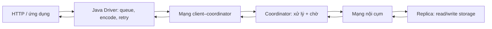
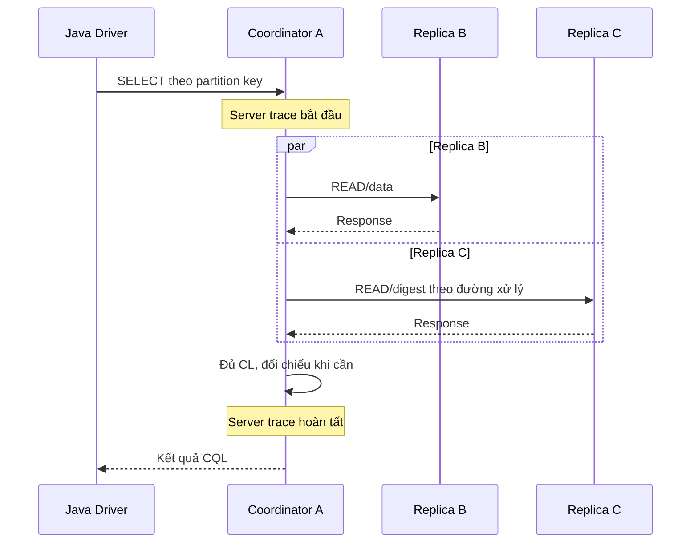
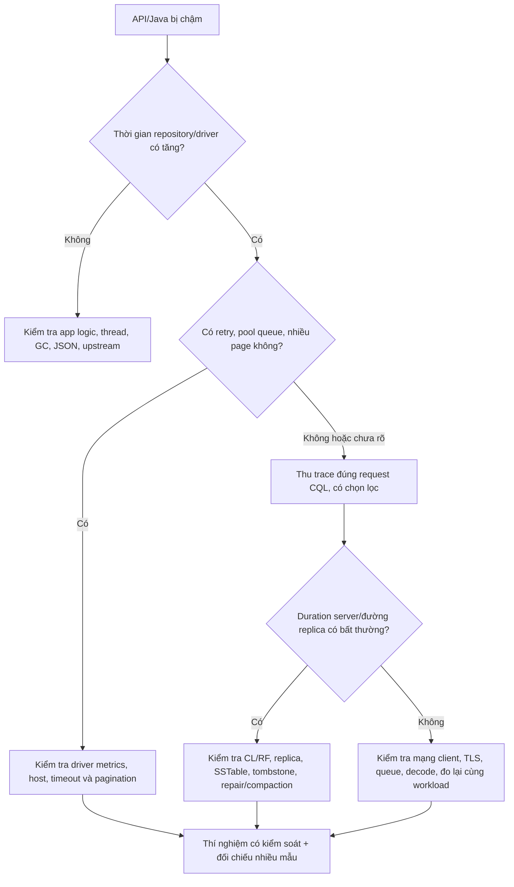

# Phân biệt thời gian phía ứng dụng, mạng và phía server khi chẩn đoán Apache Cassandra

> **Chương:** Tracing và chẩn đoán  
> **Mô-đun:** `DATABASE_ENGINE_WIDE_COLUMN_CASSANDRA` — hiểu kiến trúc phân tán và mô hình wide-column của Apache Cassandra, đặc biệt partition key, thiết kế bảng theo truy vấn, replication, mức nhất quán đọc/ghi, compaction, repair, xử lý lỗi và kết nối ứng dụng Java. Bài học hướng dẫn **đo và diễn giải độ trễ nhiều lớp**, kết hợp Java Driver 4.x, `cqlsh`, `system_traces` và telemetry vận hành.

## 1. Một API mất 120 ms không có nghĩa Cassandra xử lý 120 ms

Giả sử API `GET /users/{id}/events` trả về trong 120 ms. Nhóm Java ghi nhận lệnh gọi Cassandra mất 55 ms, nhưng một trace của Cassandra cho biết `duration` khoảng 8 ms. Có thể kết luận **47 ms là độ trễ mạng** không?

**Không.** Cần phân biệt ít nhất các thành phần:

- **Ứng dụng:** xác thực, xử lý request, kiểm tra cache, ánh xạ domain object, serialization JSON, logic khác và thời gian chờ thread.
- **Java Driver:** lấy connection, hạn mức in-flight/backpressure, encode CQL, chọn host, thời gian gửi request, retry/speculative execution, giải mã dữ liệu và nạp trang tiếp theo.
- **Mạng giữa ứng dụng và coordinator:** truyền request/response, TLS, queue/kernel, packet loss/retransmission và các thành phần hạ tầng nếu có.
- **Cassandra phía server:** coordinator nhận request, định tuyến partition, trao đổi với replica, truy xuất memtable/SSTable, xử lý tombstone/cache, hòa giải dữ liệu và chờ đủ phản hồi theo consistency level.
- **Mạng nội bộ cluster:** RPC coordinator ↔ replica. Phần này có thể **nằm trong thời gian coordinator chờ xử lý request** và không được phép gán đồng loạt vào “thời gian mạng client–server”.

Một request logic có thể phát sinh **nhiều lần gửi CQL thực** khi driver retry hoặc speculative execution. Vì vậy tổng thời gian không phải lúc nào cũng là tổng tuyến tính của một lần gửi, một lần xử lý và một lần trả về.

**Mục tiêu:** sau bài này, bạn có thể dựng phép đo có mốc rõ ràng, phân biệt số liệu **client-observed** với **server tracing**, thu trace theo session ID và đưa ra giả thuyết kiểm chứng được về network, driver hoặc replica thay vì gán nguyên nhân theo phép trừ đơn giản.

## 2. Mô hình thời gian ba lớp — và nơi mô hình đơn giản bị sai

Trong một request *đơn giản*, không retry và không paging bổ sung, có thể hình dung:

```text
ỨNG DỤNG JAVA                                 CASSANDRA

t0 HTTP vào
   | xử lý API, validation, cache, mapping
t1 bắt đầu session.execute()
   | driver chọn host, chờ connection/encode
   |---------------- request trên mạng ------> t2 coordinator nhận
   |                                           | định tuyến, RPC replica
   |                                           | storage + chờ phản hồi
   |<--------------- response qua mạng ------- t3 coordinator trả
   | driver decode, tạo ResultSet
t4 execute() trả về / nhận trang đầu
   | duyệt result, fetch trang tiếp nếu có
   | ánh xạ DTO + tạo JSON
t5 HTTP hoàn tất
```

Các đại lượng quan sát **ở cùng đồng hồ Java** có thể tính:

\[
T_{\text{API}} = t_5 - t_0,
\qquad T_{\text{execute}} = t_4 - t_1.
\]

Nếu `t1` và `t4` bao trọn cùng lời gọi, có thể tách tổng API thành các khoảng **không chồng lấn** do Java tự đo: trước lời gọi, trong lời gọi, sau lời gọi. Nhưng **không** thể lấy `t4 - t1` rồi trừ trực tiếp `t3 - t2` của server để suy ra chính xác network, vì:

1. Mốc `t2`, `t3` không chắc trùng phạm vi của `sessions.duration`.
2. Server duration ở coordinator **có thể bao gồm đợi RPC liên node**, chứ không phải chỉ CPU thuần của server.
3. Một request logic có thể có **retry/speculation**, nhiều coordinator/attempts, timeout hoặc nhiều trang.
4. Thời gian ứng dụng còn có **decode, scheduling, GC và queue**, không đơn thuần truyền gói tin.
5. Đồng hồ phía Java và các node Cassandra không đảm bảo đồng bộ ở mức microsecond để trừ timestamp tuyệt đối với nhau.

### Sơ đồ vị trí quan trắc



Mũi tên đi/về không có tỷ lệ thời gian. Mục đích của hình là thấy **nhiều ranh giới quan trắc** và phần chờ giữa coordinator–replica, không khẳng định mọi truy vấn đều đi qua đúng số node như hình.

## 3. Tạo từ điển thời gian trước khi đọc dashboard

| Số đo | Điểm bắt đầu và kết thúc điển hình | Bao gồm gì? | Không được hiểu là gì? |
| --- | --- | --- | --- |
| **HTTP request latency** | HTTP ingress → response hoàn tất | App logic, DB, mạng, JSON, hàng đợi tầng ứng dụng | Chỉ riêng latency Cassandra |
| **Repository method latency** | Vào → ra method truy vấn | Logic mapping, một/vài truy vấn, xử lý kết quả | Một lần server execute duy nhất |
| **Driver observed request latency** | Driver đo request/attempt theo cơ chế metric | Queue/connection/network/protocol theo định nghĩa metric | Tự động chính xác bằng server duration |
| **`session.execute()` wall time** | `System.nanoTime()` trước → sau gọi | Thực thi đồng bộ đến lúc có result ban đầu hoặc lỗi | Toàn bộ thời gian duyệt mọi trang |
| **Full result consumption** | Trước gửi → duyệt xong tất cả rows | Có thể gồm fetch nhiều trang và mapping | Chỉ thời gian cho trang đầu |
| **`system_traces.sessions.duration`** | Mốc server tracing của một request | Server/coordinator request path theo phiên bản, có thể gồm đợi replica | HTTP end-to-end hay pure CPU time |
| **`source_elapsed` trong events** | Mốc tương đối của event trong trace | Một phần timeline từ node/source | Thời gian mạng tuyệt đối bằng hiệu giữa hai node |
| **Disk/CPU/GC metrics** | Cửa sổ lấy mẫu của node | Tải nền, tài nguyên và công việc đồng thời | Phân rã chính xác thời gian của một request |

Khi báo “DB latency 50 ms”, phải ghi rõ **đo ở đâu, đơn vị gì, từ mốc nào đến mốc nào, tính cả pagination hay không, đo một attempt hay nhiều attempts**. Nếu không có định nghĩa, hai dashboard cùng hiển thị “DB latency” có thể không so sánh được.

## 4. Một ví dụ con số để tránh phép trừ sai

Giả sử thu được những số đo minh họa sau trong **một request HTTP**:

| Quan sát | Giá trị minh họa |
| --- | ---: |
| HTTP end-to-end | 120 ms |
| Xử lý ứng dụng trước khi gọi repository | 28 ms |
| `session.execute()` đến trang kết quả đầu | 55 ms |
| Đọc thêm trang, ánh xạ DTO, tạo response | 37 ms |
| `sessions.duration` của một request CQL có tracing | 8.000 µs (khoảng 8 ms) |

Ba khoảng **28 + 55 + 37 = 120 ms** có thể là một phân rã hợp lệ nếu cùng đồng hồ Java và đo **liền nhau, không trùng phạm vi**. Nhưng **55 − 8 = 47 ms không phải số đo network**. Con số 47 ms chỉ là *phần khác nhau giữa hai phạm vi quan trắc* trong tình huống giả định. Nó có thể chứa driver queue, round-trip client–coordinator, việc đợi fetch/deserialize, scheduling và sai khác về request được trace.

Ngay cả nếu có tracing ID tương ứng với attempt này, duration phía coordinator cũng có thể bao gồm **đợi replica qua mạng nội cụm**. Muốn ước lượng network, cần số liệu ở socket/TCP, host/client telemetry, độ trễ RPC, hệ thống quan trắc hoặc thử nghiệm có kiểm soát — **không chỉ một phép trừ**.

## 5. Chuẩn bị môi trường Cassandra lab theo partition key

Ví dụ dưới đây giả định `cqlsh` kết nối được một cụm Cassandra để học. `SimpleStrategy` RF=1 **chỉ phù hợp lab một node**; production đa datacenter nên chọn `NetworkTopologyStrategy` và RF/consistency tương ứng với yêu cầu chịu lỗi.

```sql
CREATE KEYSPACE IF NOT EXISTS latency_lab
WITH replication = {
    'class': 'SimpleStrategy',
    'replication_factor': 1
};

CREATE TABLE IF NOT EXISTS latency_lab.events_by_user_day (
    user_id uuid,
    event_day date,
    event_no int,
    event_type text,
    payload text,
    PRIMARY KEY ((user_id, event_day), event_no)
) WITH CLUSTERING ORDER BY (event_no DESC);

INSERT INTO latency_lab.events_by_user_day
    (user_id, event_day, event_no, event_type, payload)
VALUES (
    11111111-1111-4111-8111-111111111111,
    '2026-11-21', 1, 'LOGIN', 'web'
);

INSERT INTO latency_lab.events_by_user_day
    (user_id, event_day, event_no, event_type, payload)
VALUES (
    11111111-1111-4111-8111-111111111111,
    '2026-11-21', 2, 'VIEW', 'partition'
);

INSERT INTO latency_lab.events_by_user_day
    (user_id, event_day, event_no, event_type, payload)
VALUES (
    11111111-1111-4111-8111-111111111111,
    '2026-11-21', 3, 'VIEW', 'repair'
);
```

Trong `PRIMARY KEY ((user_id, event_day), event_no)`, `(user_id, event_day)` là **composite partition key**, `event_no` là **clustering key**. Cùng một user/ngày được đưa vào một partition, vì vậy truy vấn mẫu dưới đây biết **đủ partition key**:

```sql
SELECT event_no, event_type, payload
FROM latency_lab.events_by_user_day
WHERE user_id = 11111111-1111-4111-8111-111111111111
  AND event_day = '2026-11-21'
  AND event_no >= 2
LIMIT 2;
```

Kết quả mong đợi khi không có ghi khác là hai hàng `event_no = 3` rồi `2`. Chúng ta chọn query nhỏ để đo **đường xử lý cơ bản**, không dùng truy vấn toàn cluster với `ALLOW FILTERING` khiến load tăng chỉ vì muốn tạo trace.

## 6. Dùng `cqlsh` để lấy trace server của chính truy vấn mẫu

Trong **cùng một phiên `cqlsh`**, chạy:

```sql
CONSISTENCY ONE;
TRACING ON;

SELECT event_no, event_type, payload
FROM latency_lab.events_by_user_day
WHERE user_id = 11111111-1111-4111-8111-111111111111
  AND event_day = '2026-11-21'
  AND event_no >= 2
LIMIT 2;

TRACING OFF;
```

`CONSISTENCY`, `TRACING ON` và `TRACING OFF` là **lệnh của `cqlsh`**, không phải CQL cho prepared statements Java. `cqlsh` thường hiển thị dòng **`Tracing session: <UUID>`** cùng bảng event phía server sau truy vấn. Lưu **trace ID thật**, câu CQL, CL, timestamp, phiên bản server và node đã kết nối.

**Không để tracing bật** trong lúc chạy một loạt truy vấn hoặc tải thực tế: việc tạo/lưu trace có overhead CPU, mạng, I/O và có thể ảnh hưởng latency. Dữ liệu trace cũng có thể chứa IP/tham số nhạy cảm; chỉ dùng trên lab/staging hoặc truy vấn sản xuất được cho phép và có chọn lọc.

### Vì sao đo cùng truy vấn trong Java vẫn có thể khác `cqlsh`?

`cqlsh` và Java Driver có thể chọn **coordinator khác nhau**, consistency level khác nhau, payload/prepared statement khác nhau hoặc mức độ cache khác nhau. `cqlsh` hiển thị trace được thu khi **tracing bật**, còn Java thường đo không tracing. Vì vậy, so sánh nên chú thích đây là **hai mẫu cùng loại workload**, chưa phải một request giống hệt tại mọi mốc.

Nếu cần đối chiếu server trace với **đúng request Java**, có thể bật tracing chọn lọc **trên chính statement Java** và lấy trace ID của execution info, thay vì nối nhầm trace ID của một query `cqlsh` sang request HTTP khác.

## 7. Đọc `system_traces.sessions` và `system_traces.events`

Sau khi đã `TRACING OFF`, thay UUID ví dụ bằng ID vừa nhận:

```sql
-- ID sau chỉ minh họa cú pháp, không phải một trace đã thu thật.
SELECT session_id, coordinator, started_at, duration,
       request, parameters
FROM system_traces.sessions
WHERE session_id = 8cbe0000-e581-11f1-8e9a-0242ac120002;

SELECT event_id, activity, source, source_elapsed, thread
FROM system_traces.events
WHERE session_id = 8cbe0000-e581-11f1-8e9a-0242ac120002;
```

`system_traces.sessions` có metadata của **một request**; `system_traces.events` gồm **nhiều event** của request đó. `session_id` là khóa partition để truy vấn trực tiếp. Trường `coordinator` cho biết node nhận request; `source` trong event cho biết nơi sự kiện phát sinh, không nhất thiết là coordinator.

### Đơn vị và độ chính xác

- `duration` ở bảng sessions trên các phiên bản Cassandra phổ biến thường là **microsecond**. Ví dụ `8000` tương đương khoảng **8 ms**, không phải 8.000 ms.
- `source_elapsed` thường là **microsecond tương đối** trong context trace; so sánh chênh lệch giữa các node có thể sai vì đồng hồ khác nhau và ghi sự kiện bất đồng bộ.
- `started_at` là timestamp phía server; **không trừ trực tiếp** với `System.currentTimeMillis()` của Java rồi suy ra hàng đợi hoặc network mà không đồng bộ clock và thống nhất mốc.
- Trace events có thể **tới trễ, thiếu hoặc hết TTL**. Thiếu event không chứng minh một bước không xảy ra.

| Trường trace | Hữu ích để làm gì? | Không đủ để kết luận gì? |
| --- | --- | --- |
| `sessions.coordinator` | Biết node điều phối request cụ thể | Mọi chi phí đều nằm tại node đó |
| `sessions.duration` | Thời lượng server tracing của request | CPU thuần hay latency HTTP |
| `events.activity` | Hiểu bước read/write/replica nếu được instrument | Mọi syscall và mọi RPC đều được ghi |
| `events.source` | Nhóm sự kiện theo node phát sinh | Số replica của partition bằng số IP xuất hiện |
| `events.source_elapsed` | Khoanh các pha thời gian tương đối | RTT mạng A↔B chính xác bằng hiệu hai mốc |

### Khi `sessions` còn mà `events` thiếu

Trace write có thể bất đồng bộ, ghi trên các node khác nhau và có TTL. Hãy kiểm tra ID thật, quyền truy cập, cluster, thời điểm truy vấn, đọc lại **một vài lần có giới hạn** nếu mới tạo. Nếu vẫn thiếu, lấy log/metrics bổ trợ; đừng diễn giải absence của event là bằng chứng về absence của một RPC.

## 8. Coordinator duration có thể bao gồm thời gian mạng nội cụm

Đây là chỗ dễ gây hiểu lầm nhất. Trên cluster RF=3, coordinator A nhận một `SELECT` ở `LOCAL_QUORUM` và có thể phải đợi phản hồi từ các replica B/C. Khoảng đợi đó có thể bao gồm:

- Coordinator gửi request và xếp hàng ở network stack.
- Mạng nội datacenter truyền gói tin đến replica.
- Replica chờ thread/CPU/disk, đọc SSTable/memtable, tạo response.
- Mạng chuyển response về coordinator.
- Coordinator đối chiếu dữ liệu, hòa giải khi cần và hoàn tất theo CL.

Tất cả có thể nằm **bên trong cửa sổ thời gian của request phía coordinator**, tùy tracing và cách đo phiên bản server. Vì vậy, **“server duration” không đồng nghĩa “thời gian tính toán CPU của Cassandra”**, cũng không loại trừ độ trễ mạng. Nếu gọi mọi khoảng chênh `client − server` là network, bạn sẽ bỏ qua **mạng nội cụm đã được bao trong server** và **chi phí Java Driver ở ngoài server**.



Sơ đồ minh họa trường hợp đa replica. Không giả định mọi `SELECT` sẽ gửi đúng hai RPC, luôn dùng digest hay coordinator không thể đồng thời là replica. **Số node và bước thực tế phụ thuộc RF, CL, topology, phiên bản Cassandra, caching và node health.**

## 9. Thời gian mạng: đo gì và không nên dùng gì?

Từ “network latency” cần làm rõ **đoạn mạng nào**:

1. **Ứng dụng ↔ coordinator:** đường mạng bên ngoài Cassandra, có thể qua NAT, TLS, routing, firewall và các tầng ảo hóa.
2. **Coordinator ↔ replica:** đường truyền trong cluster, có thể xuyên rack/datacenter tùy topology và CL.
3. **Replica ↔ replica khi repair/streaming:** công việc nền không nhất thiết nằm trong request đang trace, nhưng có thể tranh chấp băng thông/disk.

Các công cụ thu thập có ích:

- **Driver telemetry:** request latency, timeout, retry, pool/in-flight/backpressure và host theo loại operation (tên metric tùy driver/version).
- **OS/network metrics:** RTT, retransmission, packet loss, throughput, NIC errors, socket queue; theo đúng host và thời điểm.
- **Cassandra inter-node metrics/logs:** kết nối messaging, queue, timeout/drop, GC, replica read/write latency và trạng thái cluster theo phiên bản.
- **Thử nghiệm so sánh có kiểm soát:** cùng CQL/CL và dữ liệu, chạy từ client ở **cùng datacenter** rồi từ vị trí khác, ghi lại host và p95/p99.

`ping` hoặc kiểm tra TCP kết nối có thể cho tín hiệu sơ bộ về đường đi, **không đại diện** cho độ trễ thực của CQL có serialization, TLS, coordinator/replica, GC hoặc congestion theo luồng ứng dụng. Không quy toàn bộ p99 spike cho network chỉ vì một lần ping chậm.

## 10. Java Driver: hàng đợi, connection pool và backpressure

Trước khi request rời tiến trình Java, driver có thể thực hiện:

- Chọn coordinator theo **load balancing policy**, DC và trạng thái host.
- Lấy kết nối đang mở, chờ đủ khả năng gửi hoặc bị giới hạn bởi số request **in-flight**.
- Encode bind variables và frame giao thức.
- Đặt request vào hàng đợi nội bộ khi tốc độ gọi vượt khả năng kết nối/server; tùy cấu hình có thể nhận **busy/timeout errors**.
- Thực hiện retry hoặc speculative execution khi policy cho phép và statement được đánh dấu idempotent phù hợp.

Vì vậy, một thời gian Java `execute()` lớn hơn nhiều so với trace duration có thể xuất phát từ **queueing trong tiến trình**, không phải mạng. Nếu lỗi tăng theo số thread/QPS trong khi server p99 ổn định, hãy quan sát pool utilization, in-flight count, request throttling/queue và Java thread/JVM metrics trước khi thay đổi replication hoặc compaction.

**Prepared statements:** Nên prepare lúc khởi tạo repository rồi tái sử dụng. Nếu benchmark vô tình bao cả `session.prepare()` mỗi request, con số “Cassandra read latency” sẽ lẫn **chuẩn bị câu lệnh và metadata/network round trip**. Hãy đo riêng startup/prepare và execute thường xuyên.

## 11. Java Driver 4.x: đo `execute()` và toàn bộ vòng duyệt kết quả

Ví dụ dưới đây dùng `System.nanoTime()` làm đồng hồ đơn điệu để đo **độ dài khoảng thời gian trong cùng JVM**, tránh lấy hiệu các timestamp wall-clock khác máy. Giả định schema lab ở mục 5 tồn tại và `CqlSession` đã cấu hình contact points, local datacenter, TLS/auth khi cần.

```java
import com.datastax.oss.driver.api.core.CqlSession;
import com.datastax.oss.driver.api.core.cql.BoundStatement;
import com.datastax.oss.driver.api.core.cql.PreparedStatement;
import com.datastax.oss.driver.api.core.cql.ResultSet;
import com.datastax.oss.driver.api.core.cql.Row;
import java.time.LocalDate;
import java.util.UUID;
import java.util.concurrent.TimeUnit;

class TimedEventRepository {
    private final CqlSession session;
    private final PreparedStatement query;

    TimedEventRepository(CqlSession session) {
        this.session = session;
        this.query = session.prepare(
            "SELECT event_no, event_type, payload " +
            "FROM latency_lab.events_by_user_day " +
            "WHERE user_id = ? AND event_day = ?"
        );
    }

    void measure(UUID userId, LocalDate day) {
        BoundStatement statement = query.bind(userId, day)
            .setPageSize(2); // Để minh họa các lần fetch khi có >2 hàng.

        long start = System.nanoTime();
        ResultSet result = session.execute(statement);
        long firstPage = System.nanoTime();

        int rows = 0;
        for (Row row : result) {
            String eventType = row.getString("event_type");
            if (eventType != null) rows++;
        }
        long consumed = System.nanoTime();

        System.out.println("execute_us=" +
            TimeUnit.NANOSECONDS.toMicros(firstPage - start));
        System.out.println("fetch_and_iterate_us=" +
            TimeUnit.NANOSECONDS.toMicros(consumed - firstPage));
        System.out.println("overall_us=" +
            TimeUnit.NANOSECONDS.toMicros(consumed - start));
        System.out.println("rows=" + rows);
    }
}
```

Với Java Driver 4.x đồng bộ, `session.execute(statement)` trả `ResultSet` và thường đã lấy trang đầu; vòng lặp `for (Row row : result)` **có thể tự nạp thêm trang**. Vì vậy:

- `execute_us` là số đo **phía client đến kết quả/trang đầu** trong ví dụ, không phải server duration.
- `fetch_and_iterate_us` gồm **duyệt, decode/map dữ liệu và có thể fetch các trang sau**; không phải chỉ thời gian CPU Java.
- `overall_us` đo hết phạm vi đoạn code, nhưng chưa gồm serialization JSON và HTTP response bên ngoài method.
- Với tập dữ liệu lab chỉ có **ba hàng**, `setPageSize(2)` giúp thấy sự khác biệt khi thực sự duyệt ba hàng. Số trang phụ thuộc cấu hình driver/server và cách trả dữ liệu, không nên dùng test này để suy ra hiệu năng của các query lớn.

`System.nanoTime()` phù hợp đo elapsed time trong một process, **không phải timestamp UTC** để ghép với logs server. Muốn ghép trace, lưu thêm thời điểm UTC riêng và correlation ID, nhưng không lấy hiệu trực tiếp giữa đồng hồ các máy.

## 12. Bật server tracing ngay trên đúng câu lệnh Java

Khi cần so sánh **một request Java cụ thể** với trace Cassandra, Java Driver 4.x hỗ trợ bật tracing cho statement. Không bật cho mọi request production vì sẽ phát sinh thêm event và tải trên `system_traces`.

```java
import com.datastax.oss.driver.api.core.cql.BoundStatement;
import com.datastax.oss.driver.api.core.cql.ResultSet;
import java.time.LocalDate;
import java.util.UUID;

void traceSelectedRequest(UUID userId, LocalDate day) {
    BoundStatement statement = query.bind(userId, day)
        .setTracing(true)
        .setPageSize(20);

    long started = System.nanoTime();
    ResultSet results = session.execute(statement);
    long elapsedUs = (System.nanoTime() - started) / 1_000;

    UUID cassandraTraceId = results.getExecutionInfo().getTracingId();
    System.out.println("client_execute_us=" + elapsedUs);
    System.out.println("cassandra_trace_id=" + cassandraTraceId);
}
```

Đoạn code trên là một method nằm trong repository đã có hai field `session` và `query` ở mục 11; không phải file Java standalone độc lập. Với trace ID trả về, bạn có thể tra `system_traces.sessions/events` của **chính request đó**, không cần nối nhầm với một lượt `cqlsh` khác.

**Chú ý nhiều attempts và nhiều pages:** `ExecutionInfo` mô tả lần thực thi/trang theo phạm vi API driver; retry hoặc speculative execution có thể khiến một request logic có nhiều attempt. Tracing ID không nhất thiết đại diện toàn bộ HTTP request nhiều query hoặc tất cả các trang. Khi có nghi ngờ, cần ghi log execution info/attempts theo API driver phiên bản đang chạy và đối chiếu từng trace tương ứng.

## 13. Retry và speculative execution phá vỡ mô hình “một request = một timeline”

Ví dụ Java thực hiện một `SELECT` và coordinator A phản hồi chậm. Driver có thể được cấu hình retry hoặc speculative execution gửi thêm attempt đến coordinator B. Client quan sát tổng thời gian 70 ms, trong khi một trace phía server cho thấy request trên B chỉ 9 ms.

```text
Java request logic
  |---- attempt 1 -> Coordinator A ---- chậm/timeout ----|
                |---- attempt 2 -> Coordinator B -- 9 ms --|
  |---------------- client wall time 70 ms ------------------|
```

Không thể kết luận mạng mất 61 ms; thời gian đó có thể bao gồm **đợi trước attempt thứ hai**, queue, timeout budget, response của các attempt và xử lý Java.

Khi điều tra:

1. Ghi **request ID phía ứng dụng**, CQL + bind keys đã khử nhạy cảm.
2. Ghi **idempotence** và retry/speculative policy của statement.
3. Xác định số **attempts, host, lỗi/timeout** từ driver execution info/metrics/logs.
4. Đối chiếu trace ID theo **attempt** nếu thực tế có truy vết; không ép một trace đại diện tất cả.
5. Phân biệt request thất bại tại client với mutation **có thể đã áp dụng** trên một số replica.

**Không retry mù quáng các mutation không lũy đẳng:** Ví dụ `UPDATE list_col = list_col + ['x']` có thể thêm phần tử nhiều lần khi retry; gọi `setIdempotent(false)` phù hợp giúp những cơ chế tự động của driver không coi phép nối là an toàn khi lặp, nhưng không ngăn logic ứng dụng tự gửi lại. Với LWT, kiểm tra `[applied]` và tình trạng sau timeout.

## 14. Pagination, response size và decode thường tạo “phần chậm” khó thấy

Một `SELECT` trả hàng nghìn hàng khác với `SELECT ... LIMIT 2`. Tương tự, `LIMIT 20` trên bảng có cột `list<UDT>` chứa hàng trăm nghìn phần tử **giới hạn hàng**, không cắt nhỏ phần tử của một collection trong cùng hàng.

Các nơi phát sinh chi phí phía client:

- Nhận nhiều byte qua mạng cho một row/collection lớn.
- Decode `List`, `Map`, `UdtValue`, allocate object và áp lực GC.
- Chuyển `Row` sang DTO, lọc/kết hợp dữ liệu trong Java.
- Fetch nhiều trang của `ResultSet` và chờ mạng cho các trang tiếp.
- Serialize JSON/Protobuf và ghi HTTP response.

Trước khi quy lỗi cho Cassandra server, hãy đo **result count, byte payload, page count nếu công cụ cung cấp, thời gian duyệt/map và HTTP serialization**. Một query có server duration nhỏ nhưng API lớn có thể do việc tạo/serializing kết quả ở Java, đặc biệt khi collection không giới hạn.

**Thiết kế lại dữ liệu nếu cần:** Dùng bảng nhiều hàng theo partition/clustering key với bucketing thời gian cho lịch sử/sự kiện thay vì nhét mọi item vào một collection lớn. Java Driver paging phân trang **hàng CQL**, không phải từng UDT trong một cột.

## 15. So sánh Java, `cqlsh` và server bằng cùng một bảng ghi chép

Một bảng điều tra nên lưu cả bối cảnh và **đơn vị**:

| Nhóm | Dữ liệu cần ghi | Hướng phân tích |
| --- | --- | --- |
| Ứng dụng | HTTP p50/p95/p99, method span, JVM GC, thread pool | Chậm trước/sau DB hay bên trong DB? |
| Driver | Request wall time, host, in-flight/queue, retry, timeout | Có hàng đợi hoặc nhiều attempts? |
| Mạng client | Đường kết nối DC/zone, RTT/retransmit/TLS | Có packet loss, địa lý xa hoặc congestion? |
| Server trace | `session_id`, coordinator, duration µs, event sources | Coordinator đang chờ replica hay xử lý local? |
| Replica | Read/write latency, SSTable, tombstone, CPU, disk, GC | Một replica bị tải hơn các node khác? |
| Tải nền | Compaction, repair, streaming, backup | Có tranh chấp I/O/network cùng thời điểm? |
| Mô hình dữ liệu | PK, clustering, partition size, result size, TTL | Query có đi đúng partition và trả dữ liệu giới hạn? |

Đừng so p99 Java của 15 phút cao điểm với một trace server lúc nửa đêm để kết luận nguyên nhân. Cố gắng thu **cùng khoảng thời gian, cùng truy vấn và mức tải tương đương**; khi không thể, đánh dấu rõ hạn chế của dữ liệu.

## 16. Phương pháp chẩn đoán từng lớp từ ngoài vào trong



Đây là **trình tự đặt câu hỏi**, không phải bộ phân loại lỗi chắc chắn. Ví dụ server duration cao và driver queue cùng lúc đều có thể xảy ra: khi server chậm, requests bị tích tụ trên driver; nguyên nhân và hậu quả phải được tách bằng timeline và metric đồng thời.

### Quy trình thực hành 8 bước

1. Định nghĩa **SLO và loại latency** đang bất thường (HTTP, repository, driver, server, từng trang).
2. Ghi **query, primary key, RF, datacenter, CL, result size và phiên bản driver/server**.
3. Đo các khoảng **không trùng nhau** trong Java bằng `System.nanoTime()`; dùng metrics tổng hợp nhiều mẫu để tìm p95/p99.
4. Kiểm tra driver pool, queue, retry, speculative execution và số trang kết quả.
5. Bật tracing **một vài request an toàn** bằng `cqlsh` hoặc statement Java có trace ID.
6. Phân tích `sessions.coordinator`, `sessions.duration` và `events.source/activity` theo **cùng session ID**.
7. Đối chiếu metrics của coordinator/replica, mạng client và các tác vụ nền.
8. Đưa ra **giả thuyết + thí nghiệm kiểm chứng**; chỉ sau đó mới thay index, schema, timeout, RF/CL hay driver config.

## 17. Một số tình huống chẩn đoán theo mẫu

### Tình huống A — server trace ngắn, Java `execute()` dài

Giả sử `execute()` p99 = 90 ms nhưng một số trace Cassandra tương ứng chỉ khoảng 6–10 ms. **Giả thuyết:** chờ connection/queue, network client–coordinator, TLS, retry/attempt delay hoặc mất thời gian decode. **Bước tiếp:** đo queue/in-flight, truy vấn host/attempts, socket metrics, GC và so sánh một client gần cluster với client ở xa.

**Không kết luận:** “mạng chắc chắn 80 ms”. Một request có thể chưa được gửi ngay do driver queueing.

### Tình huống B — cả server duration và Java cùng tăng

Một replica có disk I/O bão hòa, nhiều SSTable hoặc tombstone. Coordinator chờ replica chậm, `sessions.duration` tăng và Java cũng chậm. **Bước tiếp:** kiểm tra node metrics, memtable/SSTable, compaction backlog, partition size, tombstone warnings và RF/CL. Nếu chỉ một partition bị nóng, cần cân nhắc **bucket/shard** theo workload thay vì tăng timeout vô hạn.

**Không kết luận:** mọi sự kiện `reading SSTable` là lỗi của compaction. Cần chứng cứ tải nền và các query tương tự.

### Tình huống C — HTTP chậm, driver và server ổn định

Repository query p95 vẫn 8 ms, server trace không bất thường, nhưng API p95 nhảy lên 300 ms. **Bước tiếp:** đo JSON serialization, xử lý DTO, thread pool, khóa đồng bộ, upstream dependencies và JVM GC. Không vội đổi consistency level Cassandra hoặc tăng RF chỉ vì API chậm.

### Tình huống D — write timeout nhưng dữ liệu đã tồn tại

`UPDATE` trả timeout cho Java; sau đó `SELECT` thấy giá trị mới. **Giải thích có thể:** một hoặc nhiều replica đã nhận/áp dụng mutation nhưng coordinator không thu đủ ACK theo CL trước thời hạn. Đây **không phải mâu thuẫn**. Kiểm tra write consistency, node status, retry policy và **idempotence** của câu ghi; không mặc định timeout đồng nghĩa rollback.

### Tình huống E — kết quả lớn, trang đầu nhanh nhưng API chậm

`session.execute()` lấy trang đầu nhanh, nhưng vòng lặp qua mọi trang và serialize response tốn 2 giây. Server trace một trang không phản ánh toàn bộ công việc của API. **Bước tiếp:** dùng phân trang API thực sự, giảm result size, đo page fetch và thiết kế bảng có clustering key phù hợp.

## 18. CQL, mô hình wide-column và chi phí đọc thực tế

Một schema không đi đúng đường truy vấn sẽ khó được cứu bằng tracing hay timeout. Ví dụ bảng `events_by_user_day` phục vụ tốt đường đọc **sự kiện của user trong ngày**. Nếu API cần **mọi sự kiện loại `VIEW` của tất cả user trong ngày**, lọc theo `event_type` không phải partition key:

```sql
-- PHẢN VÍ DỤ: không dùng làm đường đọc production trên bảng lớn.
SELECT user_id, event_no
FROM latency_lab.events_by_user_day
WHERE event_type = 'VIEW'
ALLOW FILTERING;
```

`ALLOW FILTERING` không tạo index và có thể khiến Cassandra đọc nhiều partition. Một bảng đọc riêng theo truy vấn sẽ rõ hơn:

```sql
CREATE TABLE latency_lab.events_by_type_day (
    event_type text,
    event_day date,
    event_time timeuuid,
    user_id uuid,
    payload text,
    PRIMARY KEY ((event_type, event_day), event_time, user_id)
) WITH CLUSTERING ORDER BY (event_time DESC, user_id ASC);

SELECT event_time, user_id, payload
FROM latency_lab.events_by_type_day
WHERE event_type = 'VIEW' AND event_day = '2026-11-21'
LIMIT 20;
```

Ở bảng mới, `(event_type, event_day)` là partition key, `(event_time, user_id)` là clustering key. Nếu một event type/ngày có hàng triệu sự kiện, vẫn cần bucket nhỏ hơn hoặc shard để tránh hot/large partition, đổi lại ứng dụng phải ghép nhiều bucket. Bảng denormalized yêu cầu quy trình ghi/đồng bộ, retry và reconciliation thích hợp.

**Điểm liên hệ với latency:** thiết kế partition key/clustering key giúp giảm số partition/row cần đọc, tăng khả năng paging đúng chỗ. Trong Cassandra, giải pháp căn cơ cho một query sai chiều thường là **mô hình dữ liệu theo truy vấn**, không phải thêm tracing lâu hơn.

## 19. Consistency, replication và nền tảng server-side latency

Replication factor cho biết số bản sao dữ liệu theo keyspace/datacenter, còn consistency level định nghĩa **mức phản hồi cần thiết** để một request thành công. Với RF=3 trong một DC, `LOCAL_QUORUM` thường yêu cầu hai replica phù hợp phản hồi; điều đó có thể làm thời gian đợi coordinator khác `ONE` trong điều kiện nhất định.

| Yếu tố | Ảnh hưởng đến thời gian | Điều cần tránh suy luận |
| --- | --- | --- |
| RF và số datacenter | Tập replica/cửa sổ liên hệ, chi phí lưu và sửa dữ liệu | RF=3 thì mọi read luôn phải chờ đủ 3 node |
| `ONE` | Mức xác nhận thấp, có thể giảm đợi | Không đồng nghĩa replication chỉ xảy ra ở một replica |
| `LOCAL_QUORUM` | Đủ quorum trong DC local, có thể đợi thêm replica | Không bảo đảm latency luôn gấp đôi `ONE` |
| `QUORUM` đa DC | Có thể cần phạm vi replica khác local | Không cộng thêm một RTT cố định cho mọi topology |
| LWT/serial consistency | Phối hợp điều kiện/Paxos, có thể nhiều pha | Không giống `UPDATE` thường cùng CL |
| Repair/compaction | Tải nền CPU/disk/network có thể ảnh hưởng query | Một trace request là trace của cả job repair |

**RF=1 lab không đo được chi phí quorum đa replica.** Dù cqlsh cho chạy một CL có tên quorum phù hợp RF1, môi trường không có tính chịu lỗi node hay đường RPC giống production RF3. Khi so sánh CL, giữ nguyên loại query, kích thước dữ liệu, tải và thử trên topology đại diện.

## 20. Quan trắc tổng hợp: p50/p95/p99 và độ chọn lọc mẫu

Một trace là **một request**, trong khi SLO/alert thường dựa trên **phân phối độ trễ**. Nếu p99 Java xấu nhưng lấy ngẫu nhiên một trace lúc server rảnh, số đo không đại diện cho nhóm request bị chậm.

- Thu metric p50/p95/p99 **theo operation, endpoint, consistency và request size** khi có thể.
- Gắn **trace/correlation ID** vào những request được lấy mẫu, tránh trace toàn bộ traffic.
- Giữ context **host/coordinator, token/partition key đã ẩn nhạy cảm, page count, retry count, error type**.
- Đối chiếu histogram của driver, latency server, CPU, disk, GC và mạng **trong cùng cửa sổ thời gian**.
- Tách nhóm query theo kích thước kết quả; một request trả 1 hàng không thể so sánh trực tiếp với một request trả 10.000 hàng.
- Sau khi sửa schema hoặc pool configuration, so lại **baseline và tail latency ở tải tương đương**, không chỉ một truy vấn chạy đơn lẻ.

Không cộng p95 của các lớp để suy ra p95 tổng: percentile **không cộng tuyến tính**, nhất là khi các giai đoạn tương quan hoặc chạy đồng thời. Nếu muốn biết một request xấu đi do giai đoạn nào, cần **cùng correlation ID / cùng sample** và đo span rõ ràng.

## 21. Lỗi phổ biến khi chia latency thành ba phần

| Sai lầm | Vì sao sai? | Sửa như thế nào? |
| --- | --- | --- |
| `T_network = T_java − sessions.duration` | Driver queue/decode/retry và scope server khác nhau | Gọi đó là chênh số đo, thu network/driver metrics bổ trợ |
| Coi coordinator duration là CPU server thuần | Bao gồm đợi replica/RPC trong nhiều đường xử lý | Nhìn events, replica metrics và mạng nội cụm |
| Dùng `System.currentTimeMillis()` hai máy để trừ trực tiếp | Clock skew/NTP và không cùng mốc | Dùng `nanoTime()` cho elapsed trong JVM, correlation thay vì trừ clock |
| So `cqlsh` trace với request Java khác host/CL | Đường mạng, coordinator, cache khác nhau | Bật tracing chọn lọc trên đúng request Java khi cần |
| Xem `execute()` là thời gian tải toàn bộ result set | Paging có thể fetch sau khi `execute()` trả | Đo cả vòng lặp/serialize; quản lý paging |
| Chỉ xem một trace ID khi driver retry | Nhiều attempts có thể gửi nhiều request | Đối chiếu execution info/host/attempts và trace liên quan |
| Bật `TRACING ON` suốt load test | Overhead làm sai baseline, tạo nhiều event | Trace ít mẫu, đo SLO trên traffic không tracing |
| Coi `ping` là CQL round-trip | Không gồm protocol/TLS/coordinator/replica | Dùng telemetry CQL, OS metrics và thử nghiệm có kiểm soát |
| Số `source` event bằng RF | Replica có thể không được liên hệ hoặc event thiếu | Xem schema RF, topology và CL |
| `LIMIT 20` cắt một collection lớn còn 20 phần tử | LIMIT hạn chế hàng, không phải phần tử trong cột | Thiết kế nhiều hàng theo clustering key |
| Timeout ghi đồng nghĩa rollback | Replica có thể đã áp dụng mutation | Xử lý retry theo idempotence và đối chiếu trạng thái |
| Kéo dài timeout là chữa được mọi latency | Che hotspot, queue, tombstone, query sai PK | Xác định root cause bằng trace + metrics + mô hình dữ liệu |

## 22. Bài tập thực hành

**Bài 1 — ba mốc thời gian.** API mất 120 ms, `execute()` mất 55 ms, `sessions.duration=8000` microsecond. Có thể nói 47 ms là mạng không?  
**Gợi ý:** Không; 8.000 µs khoảng 8 ms ở scope server, nhưng chênh 47 ms còn có queue/driver/TLS/decode/attempts. Cần dữ liệu bổ trợ.

**Bài 2 — coordinator và mạng nội cụm.** Trace có coordinator A, event đọc dữ liệu ở B và C. Đợi phản hồi từ B/C có thể nằm trong duration server không?  
**Gợi ý:** Có. Server request path có thể gồm RPC và đợi replica; không gọi toàn bộ đó là client–server network.

**Bài 3 — paging.** Java đo `execute()=10 ms`, vòng lặp kết quả tốn thêm 500 ms. Có thể kết luận server chỉ tốn 10 ms cho toàn truy vấn logic không?  
**Gợi ý:** Không; vòng lặp có thể fetch nhiều trang. Đo result count/size và thời gian từng trang.

**Bài 4 — `System.nanoTime()`.** Vì sao nên dùng để đo elapsed trong một JVM thay vì trừ timestamp wall-clock của client và server?  
**Gợi ý:** Đồng hồ đơn điệu phù hợp khoảng thời gian trong process; hai host có clock skew và mốc đo khác nhau.

**Bài 5 — retry.** Driver gửi attempt A, rồi attempt B trả nhanh. `sessions.duration` của B chỉ 7 ms nhưng Java mất 80 ms. Có thể bỏ qua attempt A khi tìm nguyên nhân không?  
**Gợi ý:** Không. Khoảng đợi/retry queue là phần quan trọng của request logic; phải đối chiếu tất cả attempts/host.

**Bài 6 — CL.** Lab RF1 ở `ONE`, production RF3 ở `LOCAL_QUORUM`. Có thể so trực tiếp latency và quy cho “mạng của production chậm hơn” không?  
**Gợi ý:** Không. Khác topology, số replica, dữ liệu, CL và tải. Cần test đại diện.

**Bài 7 — tombstone.** Server duration tăng trong cùng lúc compaction backlog cao. Kết luận nguyên nhân gốc đã xác nhận chưa?  
**Gợi ý:** Chưa. Kiểm tra SSTable/tombstone, disk I/O, p95/p99, partition size và tương quan thời gian.

**Bài 8 — app-only slow.** API p99 tăng 300 ms, repository p99 gần như không đổi. Nên sửa Cassandra consistency đầu tiên không?  
**Gợi ý:** Không. Đo thêm logic app, JSON serialization, thread pool, GC, upstream.

**Bài 9 — query sai chiều.** Muốn tìm `VIEW` của mọi user trong ngày bằng bảng theo `(user_id,event_day)`. Tracing có giải quyết đường truy vấn không?  
**Gợi ý:** Không. Cần bảng theo `(event_type,event_day)` hoặc index được đánh giá đúng workload.

**Bài 10 — phân phối latency.** Có thể cộng p95 ứng dụng + p95 driver + p95 server để có p95 tổng không?  
**Gợi ý:** Không. Percentile không cộng tuyến tính và phạm vi các số đo có thể chồng lấn.

## 23. Checklist chẩn đoán trước khi chỉnh cấu hình

- [ ] Đã xác định **SLO và phạm vi metric**: HTTP, repository, Java Driver, fetch trang, server trace.
- [ ] Có **CQL, partition key đầy đủ, result size, CL, RF, datacenter và Cassandra version**.
- [ ] Đã đo Java bằng **đồng hồ đơn điệu** với các mốc không chồng lấn khi cần phân rã.
- [ ] Đã tách thời gian **prepare**, `execute`, duyệt/paging, DTO mapping và JSON/HTTP serialization.
- [ ] Đã kiểm tra **connection pool, in-flight, queueing, retry, speculation và timeout** của driver.
- [ ] Đã thu **trace đúng request** bằng `cqlsh` hoặc `.setTracing(true)` chọn lọc; lưu ID thật.
- [ ] Đã tra `system_traces.sessions` và `events` bằng cùng `session_id`, đọc đơn vị microsecond chính xác.
- [ ] Đã phân biệt **client–coordinator network** với **coordinator–replica RPC** trong server path.
- [ ] Không lấy hiệu clock của Java và Cassandra hoặc `source_elapsed` khác node như RTT tuyệt đối.
- [ ] Đã đối chiếu **host, replica metrics, CPU, GC, network, SSTable, tombstone, compaction và repair**.
- [ ] Đã phân loại **timeout đọc/ghi, idempotence và LWT** trước khi thay retry policy.
- [ ] Đã đánh giá **query-driven schema, partition size và bucketing** nếu truy vấn sai chiều hoặc trả quá nhiều dữ liệu.
- [ ] Đã so sánh **cùng workload, cùng cửa sổ thời gian, p95/p99 và điều kiện đo** trước/sau thay đổi.
- [ ] Đã tắt tracing, khử thông tin nhạy cảm và lưu kết luận dưới dạng **giả thuyết + bằng chứng + thí nghiệm xác nhận**.

## 24. Ghi nhớ

- **Latency ứng dụng**, **thời gian Java Driver**, **mạng client–coordinator** và **duration server** là những phạm vi **khác nhau**, có thể chồng lấn hoặc bao chứa nhau.
- **`sessions.duration` không phải CPU thuần**: coordinator có thể đợi mạng và replica. Không đặt `network = client − server` khi chưa có dữ liệu xác nhận.
- **`System.nanoTime()`** phù hợp đo elapsed trong Java; timestamp wall-clock của các máy không nên trừ trực tiếp vì clock skew và khác mốc.
- **`TRACING ON/OFF`, `system_traces.sessions/events` và trace ID Java** giúp thấy một request server, nhưng tracing có overhead, TTL và có thể thiếu events.
- **Retry, speculative execution và paging** khiến một request logic có nhiều attempt/trang; số đo trang đầu không đại diện toàn bộ request.
- Muốn chẩn đoán mạng, dùng **driver/OS/network và inter-node metrics** cộng thí nghiệm có kiểm soát; ping và một phép trừ đơn giản không đủ.
- Luôn đặt thời gian trong bối cảnh **partition key, RF, CL, datacenter, SSTable/tombstone, compaction, repair, result size và schema theo truy vấn**. Kết luận phải dựa trên nhiều nguồn chứng cứ cùng thời điểm.
