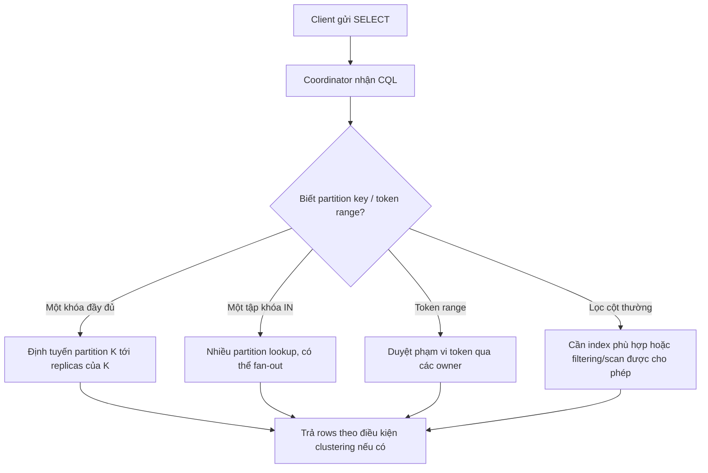

# Trace cho truy vấn một phân vùng so với truy vấn quét nhiều vùng trong Apache Cassandra

> **Chương:** Tracing và chẩn đoán  
> **Mô-đun:** `DATABASE_ENGINE_WIDE_COLUMN_CASSANDRA` — tìm hiểu kiến trúc phân tán và mô hình wide-column của Apache Cassandra, đặc biệt partition key, thiết kế bảng theo truy vấn, mức nhất quán đọc/ghi, replication, compaction, repair, xử lý lỗi và kết nối từ ứng dụng Java. Bài này dùng **CQL request tracing** để đối chiếu đường đọc một partition với những truy vấn liên quan nhiều partition hoặc quét phạm vi rộng.

## 1. Một câu `SELECT` ngắn chưa chắc là một truy vấn rẻ

Giả sử ứng dụng bán hàng có bảng `orders_by_customer`. Ba câu hỏi sau trông khá giống nhau ở tầng API nhưng có chi phí định tuyến rất khác:

1. **Khách hàng A có những đơn nào?** Đã biết `customer_id`; Cassandra có thể định tuyến thẳng tới nhóm replica sở hữu partition A.
2. **Hai khách hàng A và B có những đơn nào?** Biết một tập nhỏ partition key; Cassandra có thể thực hiện nhiều partition lookup, không nhất thiết quét cả cluster.
3. **Đơn nào có `order_type='RETURN'` trên toàn hệ thống?** Nếu `order_type` không phải khóa/index phù hợp, Cassandra có thể phải lọc lượng dữ liệu rất lớn hoặc từ chối truy vấn.

**Request tracing** giúp quan sát coordinator, các replica và những sự kiện được instrument khi Cassandra thực thi từng câu CQL. Nhưng một trace không tự trả lời chính xác “đã quét bao nhiêu partition?” hay “đã đọc bao nhiêu byte?” nếu không có metrics bổ trợ. Một truy vấn nhiều partition không luôn là *full scan*, và một truy vấn một partition vẫn có thể rất chậm nếu partition đó khổng lồ.

### Mục tiêu học tập

- Đọc schema để nhận ra **partition key** và phân biệt điều kiện lọc theo primary key với điều kiện trên cột thường.
- Thu trace cho **single-partition lookup**, **multi-partition `IN`** và **lọc rộng `ALLOW FILTERING`** trong một lab an toàn.
- Đọc `system_traces.sessions` và `system_traces.events` theo đúng `session_id` để so sánh coordinator, nguồn event và các pha xử lý.
- Hiểu thêm trường hợp **token-range scan** dành cho những tác vụ có chủ đích.
- Không dùng `LIMIT`, Java Driver paging hoặc một trace đơn lẻ để che giấu rủi ro **fan-out, tombstone, large partition, CPU/I/O và tail latency**.
- Biết khi nào phải chuyển sang **bảng theo truy vấn có partition/clustering key** hoặc index được kiểm chứng theo phiên bản.

## 2. Partition key quyết định đường định tuyến, không phải độ dài câu CQL

Trong Cassandra, **partition key** được đưa qua partitioner để xác định token; chiến lược replication kết hợp token ring/topology xác định các replica chịu trách nhiệm. **Coordinator** là node nhận request CQL từ client, sau đó điều phối công việc đến những replica cần thiết. Coordinator có thể đồng thời là một replica của partition được đọc.



Sơ đồ diễn tả **các dạng đường truy cập**, không khẳng định Cassandra thực hiện đúng một RPC cho mỗi partition hoặc luôn phải liên hệ tất cả replica. Số node gửi yêu cầu/đợi phản hồi tùy consistency level, replication, topology, cache, lỗi và phiên bản.

**Clustering key** giúp xác định và sắp thứ tự hàng **bên trong một partition**. Nếu cần phân trang hàng theo thời gian, `PRIMARY KEY ((customer_id), order_seq)` phục vụ một loại query hoàn toàn khác với chỉ có cột `customer_id` bình thường mà không đưa vào khóa.

## 3. So sánh bốn kiểu truy vấn để không đánh đồng mọi fan-out

| Hình thức | Điều kiện mẫu | Không gian cần xét | Rủi ro chủ yếu |
| --- | --- | --- | --- |
| **Một partition** | `customer_id = A` | Partition A và các replica của A | Partition quá rộng, clustering scan dài, nhiều tombstone |
| **Nhiều partition đã biết** | `customer_id IN (A, B)` | Hai partition đã nêu, không phải tự động tất cả partition | Fan-out khi danh sách lớn, response ordering/paging, timeout |
| **Lọc rộng không có index** | `order_type='RETURN' ALLOW FILTERING` | Có thể phải kiểm tra nhiều partition/rows để tìm kết quả | Scan tốn kém, không dự đoán được chi phí theo `LIMIT` |
| **Quét token range** | `token(customer_id)` thuộc một khoảng | Các partition trong phạm vi token, có thể qua nhiều owner | Scan có chủ đích, chi phí I/O/network và xử lý checkpoint |

Một query dùng **secondary index** hoặc Storage-Attached Index (SAI) là trường hợp thứ năm: đường truy cập phụ khác với quét lọc không index, nhưng vẫn cần đo tính chọn lọc, phạm vi tìm kiếm và khả năng phiên bản. Không được tự gọi mọi query không có partition key là *full scan* nếu engine có index hỗ trợ.

## 4. Tạo dữ liệu thực hành với partition key rõ ràng

Ví dụ sau dành cho Cassandra lab một node. Keyspace dùng `SimpleStrategy` replication factor 1 **chỉ để học**, không phải cấu hình khuyến nghị cho cụm nhiều node/production. Cụm thực cần `NetworkTopologyStrategy` và RF theo datacenter.

```sql
CREATE KEYSPACE IF NOT EXISTS trace_partition_lab
WITH replication = {
    'class': 'SimpleStrategy',
    'replication_factor': 1
};

CREATE TABLE IF NOT EXISTS trace_partition_lab.orders_by_customer (
    customer_id uuid,
    order_seq int,
    order_type text,
    total_cents bigint,
    note text,
    PRIMARY KEY ((customer_id), order_seq)
) WITH CLUSTERING ORDER BY (order_seq DESC);

-- Partition A: ba đơn hàng.
INSERT INTO trace_partition_lab.orders_by_customer
    (customer_id, order_seq, order_type, total_cents, note)
VALUES (11111111-1111-4111-8111-111111111111, 1, 'SALE', 120000, 'first');

INSERT INTO trace_partition_lab.orders_by_customer
    (customer_id, order_seq, order_type, total_cents, note)
VALUES (11111111-1111-4111-8111-111111111111, 2, 'RETURN', 25000, 'refund');

INSERT INTO trace_partition_lab.orders_by_customer
    (customer_id, order_seq, order_type, total_cents, note)
VALUES (11111111-1111-4111-8111-111111111111, 3, 'SALE', 400000, 'repeat');

-- Partition B: hai đơn hàng.
INSERT INTO trace_partition_lab.orders_by_customer
    (customer_id, order_seq, order_type, total_cents, note)
VALUES (22222222-2222-4222-8222-222222222222, 1, 'SALE', 80000, 'gift');

INSERT INTO trace_partition_lab.orders_by_customer
    (customer_id, order_seq, order_type, total_cents, note)
VALUES (22222222-2222-4222-8222-222222222222, 2, 'RETURN', 10000, 'cancel');

-- Partition C: một đơn hàng.
INSERT INTO trace_partition_lab.orders_by_customer
    (customer_id, order_seq, order_type, total_cents, note)
VALUES (33333333-3333-4333-8333-333333333333, 1, 'SALE', 60000, 'single');
```

Mỗi `customer_id` xác định **một partition**; `order_seq` là clustering key để các đơn trong cùng partition có thể được đọc theo thứ tự giảm dần. Tất cả dữ liệu trong bài có dung lượng rất nhỏ, vì vậy thời gian trace quan sát được ở lab không đại diện cho hiệu năng bảng production có nhiều triệu hàng.

### Kiểm tra cơ sở trước khi trace

```sql
SELECT customer_id, order_seq, order_type, total_cents
FROM trace_partition_lab.orders_by_customer
WHERE customer_id = 11111111-1111-4111-8111-111111111111;
```

Kỳ vọng ba hàng `order_seq` là **3, 2, 1** khi dữ liệu lab chưa bị thay đổi. Đừng bật trace chỉ để xác định bảng tồn tại: xác nhận schema và hàng mẫu trước, sau đó chọn chính xác câu `SELECT` định phân tích.

## 5. Mẫu A — `SELECT` trong đúng một partition

Đường đọc phù hợp với schema:

```sql
SELECT order_seq, order_type, total_cents
FROM trace_partition_lab.orders_by_customer
WHERE customer_id = 11111111-1111-4111-8111-111111111111
  AND order_seq >= 2
LIMIT 2;
```

Coordinator đã biết partition key `customer_id=A`. Cassandra có thể tìm replica của partition A, truy cập các hàng theo clustering condition `order_seq >= 2`, rồi trả tối đa hai hàng với `order_seq = 3, 2`.

Để lấy trace qua `cqlsh`:

```sql
CONSISTENCY ONE;
TRACING ON;

SELECT order_seq, order_type, total_cents
FROM trace_partition_lab.orders_by_customer
WHERE customer_id = 11111111-1111-4111-8111-111111111111
  AND order_seq >= 2
LIMIT 2;

TRACING OFF;
```

`CONSISTENCY`, `TRACING ON` và `TRACING OFF` là **lệnh của `cqlsh`**, không phải CQL để đưa vào Java prepared statement. `cqlsh` thường hiển thị `Tracing session: <UUID>` cùng bảng event. **Chép UUID thực** từ request; UUID minh họa ở phần sau không phải trace đã đo.

**Điều cần ghi nhận:** query biết **đủ partition key**, số hàng trả, CL=`ONE`, coordinator của session, event source, thời lượng và số/kích thước dữ liệu. Ở lab RF=1 một node, coordinator và replica có thể cùng một IP; không kỳ vọng có RPC sang hai node khác nhau.

## 6. Mẫu B — `IN` trên partition key: nhiều lookup, chưa phải quét toàn bảng

Khi cần dữ liệu của **hai khách hàng đã biết**, Cassandra cho phép dạng `IN` trên một partition key đơn trong những phiên bản hỗ trợ CQL tương ứng:

```sql
SELECT customer_id, order_seq, order_type, total_cents
FROM trace_partition_lab.orders_by_customer
WHERE customer_id IN (
    11111111-1111-4111-8111-111111111111,
    22222222-2222-4222-8222-222222222222
);
```

Với dữ liệu lab, câu lệnh có thể trả **5 hàng** trên **2 partition đã biết**. CQL không cam kết thứ tự toàn cục theo `order_seq` khi lấy hàng từ nhiều partition; ứng dụng không nên dựa vào thứ tự quan sát tình cờ trên một node. Nếu cần “20 đơn mới nhất toàn bộ khách hàng”, `IN` trên danh sách khách hàng không tự có sắp xếp thời gian toàn cục.

Thử trace cho chính câu lệnh này:

```sql
TRACING ON;

SELECT customer_id, order_seq, order_type, total_cents
FROM trace_partition_lab.orders_by_customer
WHERE customer_id IN (
    11111111-1111-4111-8111-111111111111,
    22222222-2222-4222-8222-222222222222
);

TRACING OFF;
```

So với mẫu A, coordinator có thể xử lý nhiều partition/replica endpoint hơn; **nhưng trong lab một node, các partition có thể cùng một replica**, vì thế số IP trong trace vẫn chỉ là một. Trong cluster phân tán, danh sách `IN` lớn có thể lan sang nhiều node, tăng RPC, bộ nhớ và tail latency. Không dùng `IN` với hàng nghìn/hàng triệu khóa như một cách phân trang hay một lệnh quét thay thế.

### `IN` không giống `ALLOW FILTERING`

- `customer_id IN (A,B)`: **đã có khóa của các partition** cần truy cập.
- `order_type='RETURN' ALLOW FILTERING`: **không biết từ `order_type` những partition nào chứa hàng phù hợp** nếu thiếu đường index/bảng đọc; engine có thể phải đọc rồi loại bỏ nhiều hàng.

Hai câu lệnh đều có thể “liên quan hơn một partition” nhưng phạm vi và khả năng dự đoán chi phí **không giống nhau**.

## 7. Mẫu C — lọc trên cột thường không có index

Giả sử API cần tìm **mọi đơn RETURN của tất cả khách hàng**, nhưng bảng `orders_by_customer` phân vùng theo khách hàng, không theo `order_type`. Trong lab nhỏ, một ví dụ *cố ý không phù hợp để làm đường đọc production* là:

```sql
-- PHẢN VÍ DỤ: chỉ thử trên bảng lab nhỏ, không dùng trên bảng lớn.
SELECT customer_id, order_seq, order_type, total_cents
FROM trace_partition_lab.orders_by_customer
WHERE order_type = 'RETURN'
ALLOW FILTERING;
```

`ALLOW FILTERING` cho phép Cassandra thực hiện một số truy vấn cần lọc tốn kém **nếu phiên bản/CQL chấp nhận cú pháp và kế hoạch thực thi**. Nó **không tạo index** cho `order_type`, không biến cột này thành partition key và không bảo đảm chỉ truy cập hai partition chứa đơn RETURN. Trong lab có dữ liệu đã tạo, kết quả logic có hai hàng RETURN; nhưng trên bảng rất lớn, hệ thống có thể phải xét nhiều partition/hàng không khớp trước khi tìm đủ dữ liệu.

Nếu cần thử trace để thấy sự khác biệt trong lab:

```sql
TRACING ON;

SELECT customer_id, order_seq, order_type, total_cents
FROM trace_partition_lab.orders_by_customer
WHERE order_type = 'RETURN'
ALLOW FILTERING;

TRACING OFF;
```

**Lưu ý quan trọng:** Một số kiểu truy vấn bị từ chối ngay nếu thiếu partition key/index hoặc `ALLOW FILTERING`; một số kiểu **không thể sửa bằng `ALLOW FILTERING`** khi toán tử không được hỗ trợ. Tracing chỉ có đầy đủ event khi request thật sự đến server và được xử lý; một lỗi parser/validation không nhất thiết tạo trace chứa toàn bộ read path. **Không chạy phản ví dụ này trên production lớn** để tìm hiểu nó có chậm hay không.

### Vì sao `LIMIT 2` không giải quyết nguyên nhân?

```sql
-- Vẫn chỉ là phản ví dụ trên lab.
SELECT customer_id, order_seq
FROM trace_partition_lab.orders_by_customer
WHERE order_type = 'RETURN'
LIMIT 2
ALLOW FILTERING;
```

`LIMIT 2` giới hạn **số hàng kết quả**, không đặt giới hạn cứng “chỉ đọc hai partition, hai SSTable hay hai row”. Nếu hai kết quả phù hợp rất hiếm, coordinator/replica có thể phải duyệt lượng dữ liệu lớn hơn nhiều để tìm đủ hai hàng. `LIMIT` cũng không cho ứng dụng bảo đảm **thứ tự toàn cục** theo thời gian khi query không có clustering order phù hợp.

## 8. Mẫu D — token-range scan có chủ đích khác gì full scan tùy tiện?

Có những công việc vận hành/batch cần duyệt một phần token ring: kiểm tra dữ liệu, backfill có checkpoint hoặc công cụ đọc phân tán. Cassandra cho phép điều kiện trên **`token(partition_key)`** ở những trường hợp/phiên bản tương ứng:

```sql
-- MINH HỌA trên lab, không bảo đảm trả ra một số hàng cụ thể.
SELECT customer_id, order_seq, order_type
FROM trace_partition_lab.orders_by_customer
WHERE token(customer_id) > token(11111111-1111-4111-8111-111111111111)
  AND token(customer_id) <= token(33333333-3333-4333-8333-333333333333);
```

**Mấu chốt:** token của UUID **không tăng theo chuỗi UUID**. Nếu token của mốc đầu lớn hơn mốc cuối, câu truy vấn ví dụ có thể trả rỗng vì khoảng theo thứ tự không phù hợp; ring còn có vấn đề **wrap-around**. Cần xác định token thực theo partitioner đang chạy, lập ranh giới phù hợp, chia vùng không trùng/lọt, checkpoint và kiểm soát paging. Không dùng các UUID ví dụ làm mốc quét tự động cho job sản xuất.

Quét token range là **chủ ý đọc nhiều partition trong một khoảng**, khác hẳn query biết một partition key. Nó cũng khác với `ALLOW FILTERING` kiểu “tìm dữ liệu dựa vào một cột không định tuyến”: token range có **phạm vi token xác định**, phù hợp để phân chia công việc batch; điều kiện lọc khác, nếu có, vẫn cần xét tính khả thi của CQL.

```text
Token ring (minh họa, không theo tỷ lệ)

  ...  [vùng của node A] [vùng của node B] [vùng của node C] ...
                         ^      ^
                     start    end

  Single partition: tìm token(K), đến owners của K
  IN (K1,K2): tìm owners của K1 và K2
  Range scan: duyệt các partition có token nằm trong khoảng
```

Một scan theo token range **có thể** liên quan nhiều node nhưng không mặc nhiên cần mỗi node trả toàn bộ dữ liệu. Với các tác vụ lâu, phải điều tiết concurrency/paging, giới hạn lượng đọc, checkpoint, và xử lý node failure/compaction/repair gây biến động. Tracing một request token-range đơn lẻ không thay thế metrics của toàn bộ job batch.

## 9. So sánh trace: đừng diễn giải “số dòng event” như chi phí I/O

Sau khi chạy bốn mẫu ở môi trường phù hợp, bạn có thể ghi:

| Dấu hiệu | Một partition | `IN` hai khóa | `ALLOW FILTERING` | Token range |
| --- | --- | --- | --- | --- |
| Có khóa định tuyến đầy đủ? | Có | Có, cho từng khóa | Không, với `order_type` | Có ranh giới token, không phải một khóa |
| Phạm vi partition logic | Một | Hai đã biết | Có thể rất rộng | Các partition trong khoảng |
| Kỳ vọng số hàng của dữ liệu lab | Hai | Năm | Hai RETURN | Phụ thuộc token order |
| Số IP event trên lab RF1 | Có thể một | Có thể vẫn một | Có thể vẫn một | Có thể vẫn một |
| Dấu hiệu định tuyến/scan | Đọc một khóa và clustering range | Nhiều key lookups | Filter/scan nếu được thực thi | Duyệt token range |
| `LIMIT` bảo đảm số partition đọc? | Không, nhưng PK đã cố định một partition | Không | Không | Không |
| Phù hợp API online thường xuyên? | Thường tốt nếu partition nhỏ | Tùy tập khóa rất nhỏ và SLO | Thường không trên dữ liệu lớn | Thường không, chủ yếu batch có kiểm soát |

Số dòng `events` phụ thuộc **mức instrument, timing, paging, cách coordinator gộp công việc, đồng bộ clock và việc ghi trace**. Hai query cùng số event **không chứng minh** chúng đọc cùng lượng dữ liệu. Ngược lại, query trace có nhiều event hơn không phải bằng chứng chắc chắn rằng nó đã quét toàn bộ cluster.

### Một timeline minh họa chỉ để biết cách đọc

```text
Request A: single-partition SELECT K1
  coordinator -> replica owner của K1 -> trả rows

Request B: SELECT WHERE partition_key IN (K1,K2)
  coordinator -> xử lý K1 và K2 -> gom rows

Request C: SELECT WHERE non_key = X ALLOW FILTERING
  coordinator -> duyệt/lọc dữ liệu theo kế hoạch cho phép -> trả rows khớp

Request D: SELECT WHERE token(partition_key) trong một khoảng
  coordinator -> đọc các partition trong token range -> trả rows
```

Đây là **sơ đồ khái niệm**, không phải output thực đo từ Cassandra và không áp đặt thứ tự RPC. Trên cluster thật, coordinator có thể là replica; các request có thể chạy song song, phát sinh read/digest/reconciliation hoặc bị timeout.

## 10. Đọc `system_traces.sessions` và `events` theo từng request

Khi `cqlsh` hiển thị `Tracing session: ...`, ghi lại **ID riêng cho từng mẫu A/B/C/D**. Sau `TRACING OFF`, truy vấn metadata và events với ID thực:

```sql
-- UUID minh họa; thay bằng tracing session ID được cqlsh in ra.
SELECT session_id, coordinator, started_at, duration,
       request, parameters
FROM system_traces.sessions
WHERE session_id = 8cbe0000-e581-11f1-8e9a-0242ac120002;

SELECT event_id, activity, source, source_elapsed, thread
FROM system_traces.events
WHERE session_id = 8cbe0000-e581-11f1-8e9a-0242ac120002;
```

`system_traces.sessions` lưu metadata **một request được trace**; `system_traces.events` lưu các hoạt động gắn cùng **partition key `session_id`** của hệ thống trace. Với bản Cassandra thông thường, `duration` và `source_elapsed` thường được diễn giải theo **microsecond**; kiểm tra cột/version trước khi so sánh vì nhầm µs với ms dẫn tới sai lệch 1.000 lần.

**Đừng nhầm `session_id` của trace với partition key dữ liệu nghiệp vụ.** Một trace của query quét rộng vẫn thường có **một trace session ID**, không phải mỗi partition nghiệp vụ một session ID riêng. Ngược lại, fetch **nhiều trang** có thể phát sinh các request/traces riêng tùy cách client gửi và bật tracing.

### Cách lấy coordinator và nhóm event

1. Đọc **`sessions.coordinator`** để biết node điều phối request cụ thể.
2. Nhóm các `events` theo **`source`** để thấy event phát sinh ở node nào.
3. Xem `activity` để tìm dấu hiệu định tuyến, gửi/nhận READ, đọc storage, lọc/hòa giải và hoàn tất, nếu phiên bản có ghi.
4. Dùng `source_elapsed` cùng **context node** và thứ tự `event_id`, nhưng không coi timeline giữa các node là đồng hồ tuyệt đối.
5. Đối chiếu với RF, CL, datacenter và metrics, **không suy ra số partition từ số source IP**.

Nếu trace vừa được tạo mà `events` chưa đầy đủ, có thể do thao tác ghi trace bất đồng bộ, node lỗi hoặc TTL. Thử đọc lại có giới hạn, kiểm tra ID/cluster/quyền và đối chiếu log. **Không xem event bị thiếu là bằng chứng một bước xử lý không xảy ra.**

## 11. Coordinator, replica và CL: cùng schema nhưng trace có thể khác

Trong Cassandra, node nhận request từ client là **coordinator**, còn **replica** giữ bản sao partition theo token và replication topology. Hai vai trò có thể trùng nhau. Trên cluster nhiều replica, một `SELECT` ở CL thấp có thể hoàn thành khi nhận ít phản hồi hơn so với CL cao; nhưng cơ chế chọn endpoint, digest, retry và read repair khiến số RPC thực không đơn giản bằng số ACK yêu cầu.

| Điều kiện | Tác động cần ghi nhận khi đọc trace |
| --- | --- |
| Lab một node, RF=1, `ONE` | Coordinator và replica thường là cùng node; nhiều partition vẫn có cùng `source` |
| RF=3 một datacenter, `ONE` | Một phản hồi phù hợp có thể đủ theo CL, nhưng không khẳng định chỉ một replica xử lý |
| RF=3 một datacenter, `LOCAL_QUORUM` | Thường cần hai phản hồi local; số event source không bắt buộc đúng hai |
| Nhiều datacenter | Đường replica được chọn có thể ảnh hưởng RPC liên DC tùy CL/topology |
| Một replica chậm/offline | Coordinator có thể chờ, chọn endpoint khác, nhận timeout và trace có thể thiếu sự kiện |
| LWT/Paxos | Đường đồng thuận có nhiều bước hơn mutation thường, không đem so trực tiếp với SELECT |

**Đừng kết luận “query IN chạm ba node nên RF=3”** hoặc “ALLOW FILTERING một node nên nó đọc đúng một partition”. `source` chỉ nói **ai ghi event**, không nói toàn bộ tài nguyên đọc và cũng không đại diện chính xác token ownership.

## 12. `LIMIT`, paging và quét rộng: chi phí không biến mất

Hai dạng giới hạn thường gây hiểu nhầm:

```sql
-- Giới hạn hai hàng trong đúng partition A.
SELECT order_seq, order_type
FROM trace_partition_lab.orders_by_customer
WHERE customer_id = 11111111-1111-4111-8111-111111111111
LIMIT 2;

-- Giới hạn hai hàng sau khi phải xét điều kiện không định tuyến.
-- Chỉ minh họa trên lab nhỏ.
SELECT customer_id, order_seq
FROM trace_partition_lab.orders_by_customer
WHERE order_type = 'RETURN'
LIMIT 2
ALLOW FILTERING;
```

Cùng `LIMIT 2`, nhưng query thứ nhất có thể định vị partition A và đọc hàng đầu theo clustering order; query thứ hai có thể phải xem nhiều partition/row để tìm hai kết quả RETURN. **Số rows trả về không phải số rows đã xem** và không phải số partition đã đi qua.

Với Java Driver, `.setPageSize(100)` là **yêu cầu kích thước trang tính theo số hàng**, không giới hạn tổng query và không cắt những phần tử nằm bên trong một collection lớn của một hàng. Vòng lặp `for (Row r : resultSet)` ở API đồng bộ có thể tự tải các trang tiếp theo, tạo thêm network requests.

Đặc biệt, một query trả **một partition cực lớn** có thể vẫn tốn nhiều tài nguyên; một query trả **nhiều partition nhưng mỗi partition chỉ một hàng** có thể phù hợp nếu tập khóa nhỏ. **Đánh giá cùng số hàng, byte trả về, fan-out và kích thước partition** mới có ý nghĩa.

## 13. Ảnh hưởng của tombstone, TTL, SSTable, compaction và repair

Trace cho một `SELECT` ở một partition lớn có thể chậm do:

- Hàng trăm nghìn clustering rows trong cùng partition.
- Nhiều **tombstone** do delete, TTL hết hạn hoặc thay collection/UDT.
- Nhiều SSTable cần xem và dữ liệu không nằm trong cache.
- Compaction/repair/streaming đồng thời gây áp lực disk, CPU hoặc network.
- Replica chưa hội tụ, phát sinh công việc hòa giải khi cơ chế/version yêu cầu.

Trong khi đó, một query quét rộng có thể chậm do phải **thăm nhiều partition** ngay cả khi mỗi partition nhỏ. Cả hai cùng có thể dẫn tới read timeout, nhưng **nguyên nhân không giống nhau**.

| Triệu chứng | Một partition | Quét nhiều partition |
| --- | --- | --- |
| p99 chỉ xấu trên một customer ID | Nghi hot/large partition, tombstone hoặc node owner | Ít phù hợp làm kết luận đầu tiên |
| p99 tăng theo số lượng ID trong `IN` | Có thể tăng fan-out và kết quả | Cần giới hạn danh sách khóa/đổi API |
| p99 tăng dù `LIMIT` nhỏ khi lọc không index | Không áp dụng nếu PK đã cố định một partition | Có thể phải quét nhiều rows/partitions để tìm kết quả |
| Disk I/O cao khi repair/compaction | Tăng chi phí storage ngay tại owners | Tăng chi phí khi tác vụ quét lan rộng |
| Timeout ở CL cao | Chờ đủ replica của partition | Có thể cộng thêm nhiều nhóm replica/đầu mối phải chờ |

**Trace chỉ là một nguồn chứng cứ.** Muốn khẳng định tombstone hay compaction là nút thắt, đối chiếu p95/p99 latency, SSTable/tombstone metrics, disk I/O, heap/GC, compaction backlog, repair progress và kích thước partition cùng thời điểm. Không hạ `gc_grace_seconds` tùy tiện để “giảm tombstone” khi replica có thể bỏ lỡ delete và dữ liệu cũ có nguy cơ xuất hiện lại.

## 14. Khi nào dùng index, khi nào tạo bảng theo truy vấn?

Nếu `order_type='RETURN'` là truy vấn thật sự quan trọng, đừng dựa vào `ALLOW FILTERING` như giải pháp lâu dài. Có ba hướng cần đánh giá:

1. **Bảng theo truy vấn**: lưu đơn hàng theo `order_type` và thời gian/bucket để đọc đúng partition, phù hợp đường đọc chính có SLO/ordering rõ.
2. **Secondary index**: nếu engine/phiên bản hỗ trợ và điều kiện đủ chọn lọc, có thể phù hợp truy vấn thưa không yêu cầu sắp thứ tự phức tạp.
3. **Hệ tìm kiếm chuyên dụng**: nếu cần full-text, ranking, nhiều điều kiện động hoặc lọc/aggregation không phù hợp với Cassandra.

**Index không phải một khái niệm đồng nhất giữa các phiên bản.** Legacy secondary index và SAI có đường lưu/index và tính năng khác nhau; Cassandra OSS 5.x và các bản phân phối có thể khác khả năng. Luôn kiểm tra **server version, index engine, toán tử hỗ trợ, build status và chi phí ghi/xóa/index maintenance** trước khi kết luận rằng query không có partition key luôn là full scan.

## 15. Thiết kế lại: bảng `returns_by_day` cho đường đọc ngược

Giả sử API cần “20 đơn hoàn trả mới nhất trong ngày”. Một bảng đọc theo chiều query rõ ràng hơn:

```sql
CREATE TABLE trace_partition_lab.returns_by_day (
    return_day date,
    return_time timeuuid,
    customer_id uuid,
    order_seq int,
    total_cents bigint,
    PRIMARY KEY ((return_day), return_time, customer_id, order_seq)
) WITH CLUSTERING ORDER BY (
    return_time DESC, customer_id ASC, order_seq ASC
);

-- Một hàng demo; return_time phải là UUID version 1 (timeuuid).
INSERT INTO trace_partition_lab.returns_by_day (
    return_day, return_time, customer_id, order_seq, total_cents
) VALUES (
    '2026-11-21',
    8cbe0000-e581-11f1-8e9a-0242ac120002,
    11111111-1111-4111-8111-111111111111,
    2, 25000
);

SELECT return_time, customer_id, order_seq, total_cents
FROM trace_partition_lab.returns_by_day
WHERE return_day = '2026-11-21'
LIMIT 20;
```

Ở bảng này, `return_day` là partition key, `(return_time, customer_id, order_seq)` là clustering key. Truy vấn theo ngày có đường định tuyến rõ; `LIMIT 20` tận dụng thứ tự clustering để đọc những hàng đầu trong partition, **không phải lọc toàn bảng theo `order_type`**.

**Đánh đổi:** ứng dụng ghi một đơn RETURN cần cập nhật bảng nguồn và bảng lookup; khi trạng thái hoàn trả đổi, phải xóa/cập nhật bản ghi lookup tương ứng. Cassandra không tự thực hiện join/sync hai bảng thủ công. Cần **retry có ID ổn định, reconciliation, thiết kế consistency** và xử lý thất bại từng bước.

Nếu mỗi ngày có hàng triệu đơn RETURN, partition theo ngày vẫn có thể quá lớn/nóng. Hãy thử bucket theo giờ hoặc thêm shard, với chi phí fan-out đọc nhiều bucket. **Không có bucket hoàn hảo cho mọi workload**; phải đo row/partition size và p99 ở tải thực.

## 16. Java Driver 4.x: so sánh lookup một khóa với `IN` hai khóa

Java Driver có thể đo thời gian của request từ phía client, nhưng không tự biến một bảng không có index thành query hiệu quả. Ví dụ dùng **prepared statements tái sử dụng** và `CqlSession` đã được cấu hình đúng local datacenter/auth/TLS:

```java
import com.datastax.oss.driver.api.core.CqlSession;
import com.datastax.oss.driver.api.core.cql.BoundStatement;
import com.datastax.oss.driver.api.core.cql.PreparedStatement;
import com.datastax.oss.driver.api.core.cql.ResultSet;
import com.datastax.oss.driver.api.core.cql.Row;
import java.util.UUID;
import java.util.concurrent.TimeUnit;

class PartitionTraceRepository {
    private final CqlSession session;
    private final PreparedStatement oneCustomer;
    private final PreparedStatement twoCustomers;

    PartitionTraceRepository(CqlSession session) {
        this.session = session;
        this.oneCustomer = session.prepare(
            "SELECT customer_id, order_seq, order_type " +
            "FROM trace_partition_lab.orders_by_customer " +
            "WHERE customer_id = ?"
        );
        this.twoCustomers = session.prepare(
            "SELECT customer_id, order_seq, order_type " +
            "FROM trace_partition_lab.orders_by_customer " +
            "WHERE customer_id IN (?, ?)"
        );
    }

    void inspectOne(UUID customerId) {
        executeAndTrace(oneCustomer.bind(customerId));
    }

    void inspectTwo(UUID first, UUID second) {
        executeAndTrace(twoCustomers.bind(first, second));
    }

    private void executeAndTrace(BoundStatement bound) {
        // Chỉ bật cho ít request lab/staging được chọn.
        BoundStatement sampled = bound.setTracing(true).setPageSize(100);
        long start = System.nanoTime();
        ResultSet rs = session.execute(sampled);
        long firstResult = System.nanoTime();

        int count = 0;
        for (Row ignored : rs) {
            count++;
        }
        long consumed = System.nanoTime();

        System.out.println("trace_id_first_result=" +
            rs.getExecutionInfo().getTracingId());
        System.out.println("execute_us=" +
            TimeUnit.NANOSECONDS.toMicros(firstResult - start));
        System.out.println("consume_us=" +
            TimeUnit.NANOSECONDS.toMicros(consumed - firstResult));
        System.out.println("rows=" + count);
    }
}
```

`execute_us` là **thời gian phía Java đến kết quả/trang đầu**, `consume_us` còn gồm việc duyệt và có thể tải thêm các trang. Trace ID lấy từ execution info phải được gắn với request/page tương ứng; nếu driver phát sinh **nhiều pages, retry hoặc speculative execution**, một ID hiển thị không nhất thiết mô tả toàn bộ các attempt và trang của một HTTP request logic.

### Vì sao không benchmark bằng cách bật tracing toàn bộ?

Tracing làm Cassandra ghi thêm session/events và có thể thay đổi chính latency đang đo. Hãy dùng **metric latency bình thường** làm baseline, bật tracing chọn lọc để hiểu đường xử lý. Với hai query dùng khác số partition hoặc kết quả khác số hàng, cần **chuẩn hóa workload**, đo thêm byte trả về và số rows rồi mới quy chênh lệch cho fan-out.

## 17. Đọc trace khi Java có retry hoặc nhiều trang

Trong ứng dụng production, không nhất thiết mỗi lời gọi repository chỉ có **một CQL request thực**. Ví dụ client truy vấn nhiều partition, coordinator A chậm, driver retry sang B hoặc speculative execution được cấu hình. Có thể xuất hiện nhiều server request (và nếu bật tracing thì có thể có nhiều trace ID):

```text
Java HTTP request
  Query IN (A,B)
      attempt 1 -> coordinator X (slow/timeout)
           attempt 2 -> coordinator Y (success)
      page 1 hoàn tất -> page 2 nếu còn rows
  Ánh xạ DTO -> HTTP response
```

Khi latency Java lớn hơn `sessions.duration` của một trace, **đừng lấy hiệu và khẳng định đó là mạng**. Khoảng chênh có thể chứa driver queueing, retry delay, network client–coordinator, decode và các page requests khác. Ngược lại, `sessions.duration` ở coordinator có thể bao gồm **mạng coordinator–replica**.

Một báo cáo có thể tái lập nên lưu **CQL, bind values đã khử nhạy cảm, CL/RF, số key của `IN`, trace ID, coordinator, attempt host, page count, result bytes và client latency**. Xem API execution info/metrics theo đúng Java Driver 4.x/bản phân phối đang sử dụng.

## 18. Cách đo công bằng giữa A, B, C và D

Không thể so sánh bốn loại query chỉ bằng một mẫu chạy lúc đầu và quyết định query nào luôn nhanh hơn. Thử nghiệm chẩn đoán cần:

1. **Schema và dữ liệu đã biết:** đếm số partition/hàng của lab trước khi trace. Với production, dùng thống kê/query metrics và sample được phê duyệt, không quét để đếm.
2. **Bối cảnh thống nhất:** Cassandra version, RF, datacenter, CL, driver/cqlsh version, mức tải và trạng thái cluster.
3. **Kích thước kết quả:** ghi số hàng, số byte, page count, kết quả có lọc hay không; đừng so hai rows với năm rows mà coi chỉ khác đường định tuyến.
4. **Warm-up có chủ đích:** cache, JIT Java và prepared statements có thể ảnh hưởng lượt đầu; giữ điều kiện đo rõ ràng.
5. **Tính chọn lọc:** query có `order_type='RETURN'` hiếm khác một loại xuất hiện trên 90% hàng.
6. **Trace mẫu chọn lọc:** dùng cùng cách capture, không bật tracing suốt load test.
7. **Nhiều mẫu và percentiles:** đo p50/p95/p99 theo workload, phân tích tail latency thay vì một duration riêng lẻ.
8. **Node metrics:** quan sát CPU, disk I/O, SSTable count, tombstone warnings, compaction, repair, queue, RPC/network và driver pool.

**Quan trọng:** p95 của các giai đoạn không cộng tuyến tính thành p95 của tổng. Muốn giải thích request chậm, cần các span/measurement của **cùng request/correlation ID**, không phải cộng p95 của hai dashboard độc lập.

## 19. Bảng chẩn đoán khi trace trông “lạ”

| Triệu chứng | Cách hiểu thận trọng | Bước tiếp theo |
| --- | --- | --- |
| `IN` có hai key nhưng chỉ một IP trong events | Hai partition có thể cùng owner hoặc event khác bị thiếu | Xem RF, token ownership, CL và activity |
| Query một partition chậm hơn filter lab | Một partition có thể lớn/hot; lab quá nhỏ, cache khác | So p95/p99, partition size, tombstone, SSTables |
| `ALLOW FILTERING LIMIT 2` chạy nhanh trên bảng sáu hàng | Dataset quá nhỏ, không chứng minh được SLO ở quy mô lớn | Tránh production scan, dựng bảng/query index phù hợp |
| Tracing một query không có `session_id` | Chưa bật tracing đúng phiên, request bị từ chối sớm | Kiểm tra `cqlsh`, syntax, ID và server logs |
| Session có nhưng events thiếu | Ghi trace bất đồng bộ, lỗi node/TTL | Kiểm tra lại có giới hạn, quyền/cluster, metrics |
| Trace có nhiều event nhưng read nhanh | Số event không tỉ lệ tuyến tính với CPU/I/O | Đo duration, bytes, rows, replica latency |
| Coordinator trace ngắn, Java chậm | Có thể queue/driver/network/retry/paging | Xem driver attempts, network, JVM, page fetch |
| `LIMIT 20` nhưng đọc một list rất lớn | LIMIT giới hạn rows, không cắt phần tử collection | Chuyển dữ liệu thành các hàng có clustering key |
| `token()` range trả 0 hàng | Token bounds không như thứ tự UUID, có thể range rỗng | Kiểm tra token thật, wrap-around và partitioner |
| Read timeout khi quét rộng | Có thể quá nhiều dữ liệu/RPC/replica slow | Dừng query nguy hiểm, xem schema và cluster load |

## 20. Bài tập thực hành

**Bài 1 — tìm đúng partition.** Vì sao truy vấn `WHERE customer_id=A AND order_seq>=2 LIMIT 2` thường có đường định tuyến rõ hơn `WHERE order_type='RETURN'`?  
**Gợi ý:** `customer_id` là partition key; clustering filter giới hạn phạm vi bên trong partition. `order_type` là cột thường, không tự xác định partition.

**Bài 2 — hai khóa `IN`.** Với A có 3 hàng, B có 2 hàng, `customer_id IN (A,B)` dự kiến trả bao nhiêu hàng nếu dữ liệu không đổi? Đây có phải full scan không?  
**Gợi ý:** 5 hàng trên hai partition được biết trước; không mặc nhiên là quét toàn bộ bảng.

**Bài 3 — số IP trong trace.** Lab RF1 cho cả mẫu A và B chỉ một `events.source`. Kết luận cả hai query đều đọc một partition được không?  
**Gợi ý:** Không. Nhiều partition có thể nằm ở cùng một node; trace source không đếm partition.

**Bài 4 — filtering và LIMIT.** `WHERE order_type='RETURN' LIMIT 2 ALLOW FILTERING` trả hai hàng. Cassandra có bảo đảm chỉ đọc hai hàng và hai partition không?  
**Gợi ý:** Không. Có thể phải xem nhiều dữ liệu không phù hợp trước khi tìm đủ kết quả.

**Bài 5 — token range.** Vì sao `token(customer_id)` không nên được suy ra từ thứ tự từ điển của UUID?  
**Gợi ý:** Partitioner băm partition key thành token; khoảng token có thể khác thứ tự ID và có wrap-around.

**Bài 6 — các dạng tracing.** `system_traces.sessions` có một hàng và `events` có nhiều hàng. Điều đó có chứng minh truy vấn chỉ đọc một partition?  
**Gợi ý:** Không. Trace session định danh một **request**, không phải một partition nghiệp vụ.

**Bài 7 — chi phí.** Một partition A chứa một triệu hàng/tombstone, còn query `IN` tới hai partition mỗi partition mười hàng. Loại nào chắc chắn nhanh hơn?  
**Gợi ý:** Không thể kết luận chỉ từ số partition; cần xét kích thước, SSTable, cache, CL, fan-out, tải và kết quả.

**Bài 8 — đường đọc mới.** API cần 20 đơn hoàn trả mới nhất trong ngày. Nên dùng `ALLOW FILTERING` hay bảng `returns_by_day`?  
**Gợi ý:** Bảng theo `return_day` và clustering theo `return_time` là đường đọc dễ dự đoán hơn; cần quản lý đồng bộ dữ liệu và bucket nếu partition lớn.

**Bài 9 — driver.** Java `.setPageSize(100)` có biến một `map` chứa 100.000 entry thành 1.000 trang không?  
**Gợi ý:** Không. Paging áp dụng cho **CQL rows**, không phải entry trong một cột map.

**Bài 10 — phân tích sự cố.** Query `ALLOW FILTERING` chậm đúng lúc compaction chạy. Có đủ bằng chứng khẳng định compaction là nguyên nhân gốc chưa?  
**Gợi ý:** Chưa. Cần đo I/O/CPU, số partition/row scan, workload, metrics và thử nghiệm so sánh có kiểm soát.

**Bài 11 — request Java nhiều attempts.** Driver retry một `SELECT IN` và HTTP mất 90 ms, nhưng một trace chỉ có `duration=7000 µs`. Có thể quy 83 ms cho mạng không?  
**Gợi ý:** Không. Còn retry budget, driver queue, paging, decode và các attempts khác.

**Bài 12 — đồng bộ replica.** CL `ONE` và RF3 có nghĩa query chỉ luôn chạm đúng một replica không?  
**Gợi ý:** Không. CL đặt mức phản hồi đủ để hoàn tất; đường thực thi có thể có nhiều endpoint/digest/retry.

## 21. Checklist trước khi tối ưu truy vấn

- [ ] Đã xác định **partition key và clustering key** từ schema, không suy ra từ tên cột hoặc URL API.
- [ ] Phân biệt **một partition**, **nhiều partition đã biết qua `IN`**, **quét token range** và **lọc không có index**.
- [ ] Đã kiểm tra **Cassandra version/index engine** trước khi gọi truy vấn không có PK là full scan hay khẳng định `ALLOW FILTERING` luôn hợp lệ.
- [ ] Bật `TRACING ON` trong đúng phiên `cqlsh`, chạy **một câu an toàn**, `TRACING OFF` ngay sau đó.
- [ ] Lưu **trace ID thật**, CQL, kết quả, CL, RF/datacenter, thời điểm, schema và phiên bản server.
- [ ] Đọc `system_traces.sessions/events` bằng **cùng `session_id`**, nhận diện coordinator và node phát event.
- [ ] Không lấy **số IP/source/event** làm số partition hoặc byte đã quét; đối chiếu replica topology/metrics.
- [ ] Không dùng `LIMIT` hay Java Driver page size để tuyên bố scan đã bị chặn ở đúng N partition/rows đọc.
- [ ] Đã đo **result rows, result bytes, partition size, p95/p99, fan-out, tombstone/SSTable, CPU/I/O**.
- [ ] Khi so query A/B/C, giữ cùng **RF, CL, tải, cache state và điều kiện benchmark**.
- [ ] Không chạy **`ALLOW FILTERING` hoặc token scan rộng** trên production mà không có giới hạn, quyền và kế hoạch tải.
- [ ] Xem xét **bảng theo truy vấn/index phù hợp, bucket/shard, retry/reconciliation** cho đường đọc trọng yếu.
- [ ] Tính đến **Java retry, speculative execution, nhiều pages** khi ghép trace với latency API.
- [ ] Không hạ `gc_grace_seconds` hoặc đổi compaction/repair policy chỉ vì một trace; phải có chứng cứ vận hành.

## 22. Ghi nhớ

- **Single-partition lookup** định tuyến bằng **đầy đủ partition key**; điều kiện clustering và `LIMIT` giúp giới hạn hàng bên trong partition phù hợp.
- `IN` với một **tập nhỏ partition key xác định** là **nhiều lookup**, không đồng nghĩa quét tất cả partition. Nhưng `IN` lớn vẫn có thể gây fan-out và timeout.
- `ALLOW FILTERING` **không tạo đường truy cập theo khóa/index**; `LIMIT` giới hạn số hàng trả về chứ không cam kết chỉ đọc N partition hay N hàng trước khi lọc.
- **Token-range scan** cố ý duyệt một phạm vi token; không lấy thứ tự UUID làm thứ tự token, phải tính ranh giới, wrap-around, checkpoint và tải.
- `system_traces.sessions` chứa **một request trace**, `system_traces.events` chứa những bước được ghi cho request đó. **Số event/source không phải số partition/RF**.
- Coordinator có thể đồng thời là replica; CL quy định mức phản hồi, không bảo đảm đúng từng ấy node được liên hệ. Tracing có overhead, events có thể thiếu/trễ/TTL.
- Một partition lớn với tombstone nhiều cũng có thể chậm hơn nhiều partition nhỏ. Kết luận hiệu năng cần **p95/p99, result size, partition size, SSTable, compaction/repair, replication và Java Driver telemetry**.
- Đường đọc chính cần truy vấn ngược thường nên dùng **bảng thiết kế theo truy vấn với partition/clustering key** hoặc index đã được kiểm chứng; không dùng tracing để thay thế thiết kế dữ liệu.
