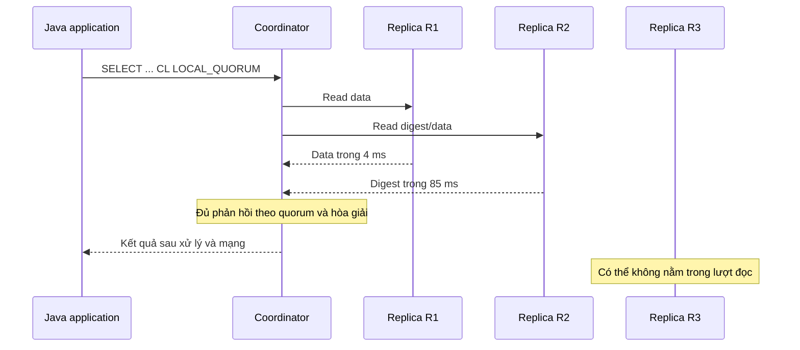
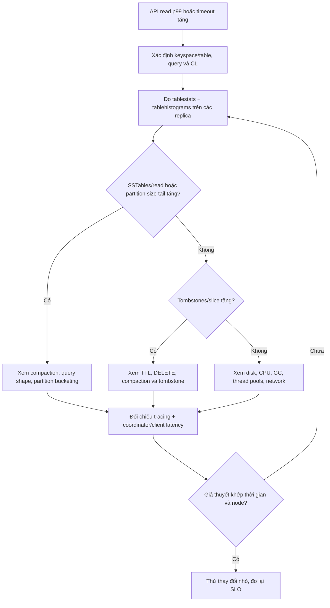

# `nodetool tablestats`, `tablehistograms` và cách diễn giải số liệu Cassandra

## 1. Mục tiêu và phạm vi quan sát

Apache Cassandra là cơ sở dữ liệu **wide-column phân tán**, trong đó dữ liệu được đặt theo **partition key**, sắp xếp trong partition bằng clustering key và sao chép lên các **replica** theo replication factor (RF). Ứng dụng Java gửi CQL tới coordinator với consistency level (CL) như `LOCAL_ONE` hoặc `LOCAL_QUORUM`; coordinator có thể phải làm việc với nhiều replica.

Khi một truy vấn chậm, các câu hỏi quan trọng là:

- Bảng nào và node nào đang tốn thời gian?
- Một partition có quá lớn hoặc chứa quá nhiều cell/tombstone không?
- Một lần đọc phải kiểm tra bao nhiêu SSTable?
- Độ trễ phát sinh **trên replica**, **ở coordinator**, trên đường mạng hay **trong Java Driver**?
- Số liệu chỉ tăng tức thời do một đợt ingest, hay là xu hướng kéo dài?

Hai lệnh có ích cho bước đầu:

```bash
nodetool tablestats <keyspace>.<table>
nodetool tablehistograms <keyspace> <table>
```

**Khác biệt cốt lõi:**

| Lệnh | Nội dung chính | Trả lời tốt câu hỏi nào? |
| --- | --- | --- |
| `tablestats` | Các thống kê tổng hợp của bảng trên node: SSTable, dung lượng, memtable, đọc/ghi, Bloom filter, tombstone… | “Bảng đang tiêu thụ tài nguyên và có dấu hiệu gì bất thường?” |
| `tablehistograms` | Các phân bố/percentile ước lượng: số SSTable cho một lần đọc, read/write latency, partition size, cell count… | “Đuôi phân bố xấu tới đâu, thay vì chỉ nhìn trung bình?” |

**Quan trọng:** Hai lệnh truy vấn thông tin từ **node Cassandra mà `nodetool` đang kết nối**, không tự tổng hợp mọi replica trong toàn DC hoặc cluster. Một partition có thể được nhiều replica lưu; một node chậm không nhất thiết phản ánh tất cả các node.

## 2. Xác định đúng node, keyspace, table và phiên bản

Trước khi đọc chỉ số, xác định nơi request thực sự đi qua:

1. **Ứng dụng gọi bảng nào?** Ví dụ `shop.orders_by_customer_day`.
2. **Partition key** và **clustering predicate** của truy vấn là gì? Có đọc một ngày hay cả năm dữ liệu?
3. **RF, DC và CL** đang áp dụng? Với RF = 3, `LOCAL_QUORUM` cần đủ hai phản hồi địa phương nhưng coordinator có thể liên hệ nhiều replica.
4. Node nào là **coordinator** và node nào là **replica** có thể phục vụ partition?
5. Những node đó có cùng phần cứng, SSTable count và compaction backlog không?

Lệnh tham khảo:

```bash
nodetool status
nodetool help tablestats
nodetool help tablehistograms
```

Ví dụ các lệnh quan sát một bảng (thay tên thực tế):

```bash
nodetool tablestats shop.orders_by_customer_day
nodetool tablehistograms shop orders_by_customer_day
```

Tham số, tên trường, định dạng, đơn vị và sự sẵn có của một số metric **thay đổi giữa Cassandra 3.x, 4.x và 5.x**. `nodetool help` và output đúng phiên bản triển khai là nguồn tham chiếu để đọc giá trị, không mặc định mọi ví dụ trong bài sẽ xuất hiện y hệt.

### Tại sao phải đo nhiều node?

```text
                  Coordinator C
                    /       \
              Replica A    Replica B      Replica D (có thể không tham gia)
              p99 4 ms     p99 90 ms      p99 6 ms
              SSTable 7    SSTable 94     SSTable 9

Một lần đọc quorum chậm có thể liên quan Replica B,
dù tablestats trên Replica A trông hoàn toàn khỏe.
```

Các con số là **minh họa**, không phải công thức xác định p99 của coordinator từ p99 replica. Cần quan sát cả nhiều node và các request thực sự được định tuyến.

## 3. `tablestats`: đọc các nhóm chỉ số theo cơ chế lưu trữ

`tablestats` thường trình bày thống kê theo keyspace/table. Có những nhóm số liệu thường gặp:

| Nhóm | Metric/nhãn thường thấy | Câu hỏi chẩn đoán |
| --- | --- | --- |
| SSTable | `SSTable count`, `SSTables in each level` (nếu phù hợp) | Có nhiều SSTable cần xét khi đọc không? |
| Dung lượng | `Space used (live)`, `Space used (total)` | Dữ liệu sống và các tệp liên quan chiếm bao nhiêu trên node? |
| Memtable | `Memtable cell count`, `Memtable data size`, `Memtable switch count`, `Pending flushes` | Flush có theo kịp workload ghi không? |
| Read | `Local read count`, `Local read latency` | Replica đã phục vụ bao nhiêu đọc và trung bình chậm thế nào? |
| Write | `Local write count`, `Local write latency` | Tải ghi cục bộ và chi phí ghi ra sao? |
| Bloom filter | `Bloom filter false positives`, `Bloom filter false ratio`, `Bloom filter space used` | Bộ lọc hỗ trợ tránh lookup không cần thiết hiệu quả không? |
| Partition | Các ước lượng `minimum/maximum/mean partition bytes` | Có partition cực lớn hoặc lệch phân bố không? |
| Cells/tombstones | `Average/Maximum live cells per slice`, `Average/Maximum tombstones per slice` | Truy vấn đang lấy quá nhiều cell hoặc quét nhiều dữ liệu xóa không? |
| Compression/storage | `Compression ratio`, off-heap memory nếu có | Chi phí đĩa/bộ nhớ phụ trợ có đổi đáng kể không? |

Tên metric ở bảng trên mang tính **gợi ý**, không phải API ổn định giữa mọi bản Cassandra. Một số thống kê phụ thuộc chiến lược compaction, trạng thái SSTable, quá trình sampling hoặc phiên bản.

### 3.1. SSTable count không phải số lần truy cập đĩa

Một SSTable là tệp dữ liệu **bất biến** sinh ra từ flush hoặc compaction. Partition có thể có nhiều phiên bản nằm rải trên nhiều SSTable.

- SSTable count tăng bền vững có thể là dấu hiệu compaction chưa theo kịp flush/ingest.
- SSTable count cao **không đồng nghĩa** mỗi lần đọc phải mở tất cả tệp.
- Bloom filter, partition index, key cache, điều kiện clustering và chiến lược compaction giúp giới hạn tập SSTable cần đọc.
- Với **TWCS**, nhiều SSTable chứa những time window không liên quan một truy vấn có thể ít gây hại hơn số lượng tệp tuyệt đối gợi ý.
- Với **LCS**, cấu trúc level có mục tiêu giảm chồng lấp đọc, nhưng thường đổi lấy write amplification.

Vì vậy, hãy đối chiếu `SSTable count` trong `tablestats` với **SSTables per read** của `tablehistograms` trước khi quy kết read latency cao cho nhiều file.

### 3.2. `Space used (live)` khác `Space used (total)`

Hai số liệu có thể chênh nhau do trạng thái tệp, compaction, snapshot/hard link hoặc chi tiết phiên bản:

- **Live:** dung lượng mà node thống kê là đang được dữ liệu SSTable hiện hành của bảng sử dụng.
- **Total:** tổng dung lượng theo phạm vi đo của lệnh, có thể bao gồm những tệp không còn thuộc tập live hoặc thành phần được tính riêng theo phiên bản.

**Không dùng hai số này thay thế trực tiếp `df` của hệ điều hành.** Disk free thực tế còn chịu ảnh hưởng filesystem, snapshot, commit log, tệp tạm, logs và bảng khác. Trong một đợt compaction, SSTable đầu vào và đầu ra có thể cùng tồn tại một thời gian.

### 3.3. Memtable và pending flushes

Memtable giữ mutation trong bộ nhớ trước khi **flush thành SSTable**. `Memtable cell count` và `Memtable data size` tăng khi ghi mới; giảm/đổi sau flush. `Memtable switch count` thường là số lần chuyển memtable (một thống kê tích lũy, cần xem thời điểm reset).

`Pending flushes` tăng liên tục cùng disk latency cao có thể gợi ý đường ghi/flush đang nghẽn. Nhưng một thời điểm pending tăng sau burst ingest **không đủ** kết luận có sự cố; xem xu hướng vài cửa sổ và log/metrics đĩa.

### 3.4. Local read/write latency: trung bình cục bộ, không phải SLA ứng dụng

Một ví dụ minh họa output được rút gọn:

```text
Table: orders_by_customer_day
SSTable count: 37
Space used (live): 11.2 GiB
Local read count: 520000
Local read latency: 1.8 ms
Local write count: 1900000
Local write latency: 0.4 ms
Pending flushes: 0
```

Các giá trị và cách hiển thị **được dựng để giải thích**, không phải output bảo đảm của bất kỳ phiên bản nào.

`Local read latency = 1.8 ms` ở một node **không có nghĩa** API Java có p99 = 1.8 ms. Đó là số trung bình thống kê trên node, còn request từ client có thể gồm:

- Chờ connection, serialization/deserialization ở driver.
- Mạng client ↔ coordinator và coordinator ↔ replica.
- Quorum, replica chậm nhất liên quan, digest mismatch và read repair.
- Phân trang, truy vấn phụ, logic nghiệp vụ và hàng đợi ở service.

Ngoài ra, “local read/write count” là số hoạt động đo ở cấp node/table theo cách Cassandra instrument, **không phải luôn là số logical API requests**. Một request ở CL cao có thể tạo hoạt động trên nhiều replica.

### 3.5. Bloom filter false positives

Bloom filter có thể nói “**có thể** có partition này” hoặc “**chắc chắn không**” theo tính chất bộ lọc. **False positive** là trường hợp nó báo có thể có nhưng kiểm tra tiếp cho thấy không có dữ liệu cần tìm.

Không được suy ra false positive là **kết quả CQL sai**: Cassandra vẫn kiểm tra index/tệp để xác nhận dữ liệu.

- False positive cao có thể tạo I/O không cần thiết, nhất là truy vấn nhiều partition không tồn tại.
- Tỷ lệ false positive cần đọc cùng **số lần kiểm tra** và dạng workload; một số đếm lớn tích lũy có thể do tải cao.
- Thay đổi tham số như `bloom_filter_fp_chance` phải cân đối **bộ nhớ và I/O**, đồng thời xét các SSTable đã tồn tại; đừng chỉnh trong production chỉ vì một lần xem `tablestats`.

### 3.6. Thống kê cell/tombstone theo slice

**Cell** trong wide-column Cassandra là đơn vị dữ liệu cột; một partition có thể chứa nhiều clustering row/cell. **Tombstone** ghi nhận dữ liệu xóa/hết hiệu lực để reconciliation và replica đồng bộ an toàn.

Chỉ số như “average tombstones per slice” và “maximum tombstones per slice” phản ánh các phép đọc được đo trong phạm vi/chế độ của phiên bản. Chúng **không phải tổng số tombstone đang nằm trên đĩa**.

Nếu một truy vấn quét rất nhiều tombstone:

1. Replica phải đọc/hòa giải nhiều dữ liệu hơn số hàng trả về.
2. Read latency và CPU/I/O có thể tăng.
3. Có thể gặp cảnh báo hoặc lỗi liên quan ngưỡng tombstone nếu cấu hình/phiên bản áp dụng.

**Đừng giảm `gc_grace_seconds` tùy tiện để “chữa” tombstone count.** Tombstone đóng vai trò bảo vệ tính đúng đắn của delete giữa replica; giảm cửa sổ giữ quá sớm khi chưa repair an toàn có nguy cơ dữ liệu đã xóa xuất hiện lại.

## 4. `tablehistograms`: đọc phân bố thay vì chỉ nhìn trung bình

Lệnh `tablehistograms` thường cung cấp các percentile ước lượng, ví dụ 50%, 75%, 95%, 98%, 99% và một số mốc khác tùy phiên bản, cho những đại lượng sau:

| Cột thường thấy | Ý nghĩa | Cách diễn giải |
| --- | --- | --- |
| `SSTables` | Số SSTable liên quan trong các lần đọc được quan sát | Đuôi tăng có thể biểu thị read amplification |
| `Write Latency` | Phân bố độ trễ ghi cục bộ trên node/bảng | p99 chậm hơn p50 nhiều có thể có tail latency |
| `Read Latency` | Phân bố độ trễ đọc cục bộ | Phát hiện request chậm mà mean che khuất |
| `Partition Size` | Phân bố kích thước partition được ước lượng/ghi nhận | Đuôi lớn có thể là large partition |
| `Cell Count` | Phân bố số cell của partition được đo | Giúp nhận biết partition có quá nhiều dữ liệu |

Tùy Cassandra, output có thể bổ sung cột hoặc dùng các nhãn/đơn vị khác. Các thống kê kích thước partition và cell count thường dựa trên **SSTable/metadata và sampling**, không phải một câu lệnh quét toàn bộ partition hiện tại để tính chính xác tuyệt đối.

### Percentile p50, p95, p99 nói gì?

Nếu ta có một tập giá trị độ trễ, percentile `p99` là ngưỡng mà **xấp xỉ 99% quan sát nằm không lớn hơn ngưỡng đó** trong phân bố được đo. Ví dụ:

```text
Read latency (minh họa, cùng đơn vị ms)
p50  =   1.2 ms
p75  =   2.1 ms
p95  =   8.0 ms
p99  =  48.0 ms
Max  = 180.0 ms
```

Nhìn mỗi “local read latency trung bình ~2 ms” sẽ bỏ lỡ đuôi `p99 = 48 ms`. Với ứng dụng có SLO p99 thấp, phần đuôi này có thể đáng quan tâm. Nhưng **p99 từ `tablehistograms` là phân bố đo ở node/table**, không phải p99 đầu-cuối của API.

Lưu ý thêm:

- Percentile có thể là **ước lượng từ histogram/reservoir**, không phải sắp xếp tất cả request từ khi hệ thống khởi động.
- **Không cộng/trung bình p99** của các node để lấy p99 cluster; muốn p99 đúng cho một tập request phải dùng phân bố gộp thích hợp.
- So sánh hai lần đo cần biết thời gian quan sát, số sample, khối lượng và trạng thái reset của metrics.
- Một p99 cao khi chỉ có rất ít mẫu **không vững** như p99 cao kéo dài với hàng triệu request.

## 5. Đọc đúng đơn vị và thang đo

Tùy phiên bản và công cụ, một bảng có thể hiển thị latency bằng **microseconds (µs)** hoặc **milliseconds (ms)**; kích thước bằng bytes, KiB hay dạng dễ đọc. Trước khi đưa lên dashboard, chuẩn hóa:

```text
1 ms = 1.000 µs
1 s  = 1.000 ms

1 KiB = 1.024 bytes
1 MiB = 1.024 KiB
1 GiB = 1.024 MiB
```

Ví dụ nếu một bản output cho `Read Latency p99 = 12500 µs`, giá trị chuẩn hóa là **12,5 ms**, không phải 12.500 ms. Nếu một exporter xuất `12500` nhưng bỏ đơn vị, dashboard có thể đưa ra cảnh báo sai lệch hàng nghìn lần.

Đối với `SSTables` và `Cell Count`, đó là **số lượng** chứ không phải kích thước bytes. Đối với `Partition Size`, cần xác minh bảng dùng bytes hay định dạng đơn vị khác.

### Phân biệt counter, gauge, rate, histogram

| Loại metric | Ví dụ | Cách xem theo thời gian |
| --- | --- | --- |
| **Counter** | Read count, write count, Bloom false-positive count | Tính delta/rate theo thời gian, xử lý restart/reset |
| **Gauge** | SSTable count, memtable size, pending flushes | Xem giá trị hiện tại và xu hướng |
| **Histogram** | Partition bytes, latency, SSTables per read | Xem phân bố/percentile cùng sample volume |
| **Derived ratio** | Bloom false-positive ratio, read timeout ratio | Xem tử số/mẫu số, tránh mẫu quá nhỏ |

Một counter tăng từ 100.000 lên 101.500 trong 5 phút tương ứng khoảng **5 hoạt động/giây** trong khoảng đó nếu không có reset:

```text
delta = 1.500
duration = 300 giây
rate = 1.500 / 300 = 5 / giây
```

Không suy ra “hiện tại cluster phục vụ 101.500 request/giây” từ một giá trị counter tích lũy.

## 6. Kết hợp `tablestats` và `tablehistograms` trong cùng bảng

Giả sử giám sát bảng `shop.orders_by_customer_day` tại một node:

| Metric | Baseline tuần trước | Hiện tại | Diễn giải ban đầu |
| --- | ---: | ---: | --- |
| SSTable count | 15 | 72 | Tệp tích tụ hoặc compaction/flush thay đổi |
| SSTables/read p99 | 3 | 16 | Read amplification ở đuôi tăng |
| Local read mean | 1.8 ms | 7.6 ms | Replica xử lý đọc chậm hơn |
| Local read p99 | 12 ms | 95 ms | Đuôi latency xấu đáng kể |
| Max partition size ước lượng | 4 MiB | 280 MiB | Có khả năng large partition |
| Pending flushes | 0 | 0 | Chưa thấy bằng chứng flush backlog ở thời điểm đo |

**Đây là dữ liệu giả định để luyện cách đặt giả thuyết.** Không được kết luận duy nhất “compaction gây lỗi” chỉ từ sáu giá trị. Có thể lưu lượng ghi tăng, xuất hiện một partition nóng, thay đổi truy vấn hoặc storage bị chậm.

Một cách đọc hợp lý:

1. SSTable count tăng và SSTables/read p99 tăng **cùng lúc** → nên kiểm tra compaction backlog và kiểu SSTable overlap.
2. Max partition size tăng lớn → tìm partition key nóng, bucket quá rộng hoặc unbounded clustering rows.
3. Local read mean và p99 cùng xấu → xem disk I/O, GC và query shape.
4. Pending flushes = 0 ở một ảnh chụp **không loại trừ** các thời điểm trước có flush chậm.
5. Đối chiếu dữ liệu từ các replica khác, từ coordinator và từ ứng dụng Java trước khi tối ưu.

## 7. Nhận diện large partition và hot partition

Hai khái niệm này **không đồng nghĩa**:

- **Large partition:** số hàng/cell hoặc dung lượng của một partition rất lớn; thường làm đọc range, compaction, streaming và repair nặng.
- **Hot partition:** một partition nhận tần suất đọc/ghi rất cao; có thể chỉ chứa vài KB nhưng vẫn gây quá tải replica chịu trách nhiệm.

Một bảng sự kiện dùng `PRIMARY KEY ((customer_id), event_time)` mà không chia bucket thời gian có nguy cơ partition lớn vô hạn với khách hàng hoạt động lâu. Phân vùng theo ngày/tháng có thể hạn chế. Đoạn DDL dưới đây giả định keyspace `shop` đã tồn tại; nếu thực hành tuần tự, hãy tạo keyspace theo hướng dẫn ở mục 13 trước:

```sql
CREATE TABLE IF NOT EXISTS shop.events_by_customer_day (
    customer_id text,
    bucket_day date,
    event_time timestamp,
    event_id uuid,
    event_type text,
    PRIMARY KEY ((customer_id, bucket_day), event_time, event_id)
) WITH CLUSTERING ORDER BY (
    event_time DESC,
    event_id ASC
);
```

Khi nhìn `Partition Size p99` hay `Cell Count p99` cao, kiểm tra xem một số partition thực sự lớn hay thống kê phản ánh skew do workload. **Chỉ số ước lượng trên SSTable không cho biết chính xác partition key nào lớn nhất**; cần kết hợp application logs, schema, phân bố request và công cụ/diagnostic thích hợp trong môi trường có kiểm soát.

Không tạo một partition giả cực lớn trên production để “kiểm tra giới hạn”. Các ngưỡng partition size cần được xác định bằng SLA, loại truy vấn, node hardware và kiểm thử thực tế.

## 8. Tombstone và dữ liệu trả ít nhưng đọc chậm

Giả sử ứng dụng ghi dữ liệu phiên có TTL ngắn và truy vấn:

```sql
SELECT event_time, event_type
FROM shop.events_by_customer_day
WHERE customer_id = 'customer-42'
  AND bucket_day = '2026-11-20'
LIMIT 20;
```

Một kết quả chỉ có 20 hàng **không có nghĩa Cassandra chỉ xử lý 20 cell**. Nếu partition có nhiều bản ghi đã xóa/hết TTL, replica có thể phải quét nhiều tombstone trước khi tìm được 20 hàng hợp lệ.

Các dấu hiệu kết hợp:

- `Average/Maximum tombstones per slice` tăng.
- Local read latency p95/p99 tăng, nhất là các query gần thời gian hết TTL.
- Đĩa/CPU tăng dù kết quả trả ít.
- Logs có cảnh báo tombstone-related nếu vượt ngưỡng đã cấu hình.

Biện pháp đánh giá:

1. Xem lý do delete/TTL, query shape và thời gian giữ dữ liệu.
2. Kiểm tra các chiến lược compaction phù hợp workload, ví dụ TWCS cho dữ liệu theo thời gian khi đáp ứng điều kiện.
3. Đối chiếu `gc_grace_seconds` và lịch anti-entropy repair trước khi điều chỉnh tombstone lifetime.
4. Tách **phòng ngừa tombstone** khỏi **khắc phục đọc chậm**; việc compaction có dọn dữ liệu hay không còn phụ thuộc điều kiện an toàn.

## 9. Bloom filter, cache và SSTables/read: tránh suy luận máy móc

Ví dụ: `Bloom filter false-positive ratio` cao nhưng `SSTables per read p99` thấp. Có phải mọi read đều chậm vì Bloom filter?

Không chắc. Có thể workload chủ yếu truy vấn partition không tồn tại nhưng cấu trúc khác vẫn giúp bỏ qua phần lớn I/O; cũng có thể sample hoặc khoảng đo chưa đủ.

| Hiện tượng | Ý nghĩa khả dĩ | Cần kiểm chứng |
| --- | --- | --- |
| Nhiều SSTable, SSTables/read thấp | Compaction strategy, Bloom/index giúp bỏ qua tệp | CQL latency và request thực tế |
| SSTables/read p99 cao | Nhiều tệp/chồng lấp phải xét khi truy vấn | Độ trễ, I/O, compaction backlog |
| Bloom false positives tăng | Một số lookup tệp không cần thiết | FP ratio, query misses, I/O |
| Cache hit rate thấp | Nhiều lần phải đọc cấu trúc/đĩa hơn | Loại cache, workload, hit/miss, RAM |
| Local read latency thấp nhưng API p99 cao | Vấn đề có thể nằm ở coordinator/quorum/network/driver | Tracing và app metrics |

Đừng cố “tối ưu Bloom filter” trước khi biết truy vấn có thật sự chịu I/O không cần thiết hay không. Thay đổi index, cache, compaction hoặc schema cần có baseline và thử nghiệm riêng.

## 10. Liên hệ với consistency level và replication

`tablestats`/`tablehistograms` chỉ nhìn **nội bộ từng node**. Nhưng thời gian ứng dụng chờ kết quả còn phụ thuộc CL và cách coordinator chọn replica.



Số thời gian là minh họa. Trong các phiên bản Cassandra khác nhau, coordinator có thể chọn data/digest khác, speculative read, read repair hoặc các tối ưu hóa khác.

**Hệ quả:** local read p99 của R1 không phản ánh đầy đủ thời gian coordinator chờ R2. Khi một DC có RF = 3 và CL `LOCAL_QUORUM`, cần quan sát ít nhất các replica có thể tham gia và metrics của coordinator.

Trong multi-DC:

- `LOCAL_QUORUM` đánh giá phản hồi địa phương; chỉ số từ DC khác không tự thay thế chỉ số ở DC của coordinator.
- `QUORUM` toàn keyspace có thể phụ thuộc replica tại nhiều DC, tăng chi phí mạng tùy topology.
- Đọc từ một DC khỏe không chứng minh DC khác đã đồng bộ; **anti-entropy repair** vẫn cần theo kế hoạch.

## 11. `tablehistograms` khác tracing: khi nào dùng loại nào?

| Công cụ | Dạng quan sát | Điểm mạnh | Giới hạn |
| --- | --- | --- | --- |
| `tablestats` | Tổng hợp bảng tại một node | Nhìn sức khỏe và lưu trữ cục bộ | Có thể che đuôi và không thấy coordinator/client |
| `tablehistograms` | Phân bố ước lượng của một node/table | Nhìn p95/p99, size/cell tail | Không trực tiếp giải thích một request cụ thể |
| `cqlsh TRACING ON` | Một luồng CQL có trace | Thấy một số bước request đi qua coordinator/replica | Overhead; không phải end-to-end Java trace |
| `nodetool proxyhistograms` | Latency ở coordinator theo bản hỗ trợ | Phân biệt một phần local và coordinator | Vẫn không phải HTTP/API end-to-end |
| Metrics Java Driver | Latency, attempts, retries, timeout, pool | Thấy trải nghiệm từ client Cassandra | Không tự chỉ ra SSTable/cell root cause |
| Distributed tracing tại API | HTTP/service spans, DB call, side effects | Tìm độ trễ xuyên tầng | Không luôn truy vào bên trong Cassandra replica |

Để điều tra một request cụ thể trong `cqlsh`:

```text
CONSISTENCY LOCAL_QUORUM;
TRACING ON;
```

Sau đó chạy truy vấn có partition key:

```sql
SELECT event_time, event_type
FROM shop.events_by_customer_day
WHERE customer_id = 'customer-42'
  AND bucket_day = '2026-11-20'
LIMIT 20;
```

Và tắt tracing:

```text
TRACING OFF;
```

Truy vấn trace có thể cho biết những bước nào được thực hiện, nhưng **không được suy ra một dòng trace “read from disk” chính xác bằng toàn bộ I/O thực tế**. Trong production, sampling trace có chủ đích; tránh bật tracing hàng loạt làm tăng tải và làm số liệu sai khác so với baseline.

## 12. Playbook: từ bảng chậm đến nguyên nhân có thể kiểm chứng



### Bước 1 — Chốt khoảng thời gian và triệu chứng

Ghi thời điểm p99/timeout tăng, QPS, keyspace/table, query shape, DC, CL, lỗi `ReadTimeout`/`Unavailable`, các thay đổi ingest hoặc deploy gần đây.

Không so một histogram đo sau restart với baseline từ tuần trước mà không biết cùng cách lấy mẫu. Nếu node khác phiên bản hoặc tải khác nhau, cần ghi rõ điều kiện so sánh.

### Bước 2 — Lấy snapshot từ nhiều node phục vụ bảng

```bash
nodetool status
nodetool tablestats shop.orders_by_customer_day
nodetool tablehistograms shop orders_by_customer_day
nodetool compactionstats
nodetool tpstats
```

Chạy trên những node liên quan hoặc thông qua hệ thống quan sát tập trung. Nếu dùng tham số kết nối remote `-h`/`-p`, cần xác minh quyền JMX và cấu hình bảo mật; không mở JMX công khai trên mạng không tin cậy.

### Bước 3 — Chẩn đoán theo một giả thuyết tại một thời điểm

| Nếu quan sát thấy… | Giả thuyết | Phép kiểm tra tiếp theo |
| --- | --- | --- |
| SSTables/read p99 tăng cùng SSTable count | Compaction debt/read amplification | `compactionstats`, tốc độ flush, disk util, compaction strategy |
| Partition Size p99/cell count p99 cao | Partition bucket quá lớn | Schema PRIMARY KEY, query filters, workload theo key |
| Tombstones/slice tăng cùng read p99 | TTL/delete làm tăng lượng scan | Logs, TTL, tombstone warnings, thiết kế cửa sổ thời gian |
| Local write latency xấu và pending flush tăng | Flush/commit log/disk tranh chấp | Disk latency, memtable size, commit log và node load |
| Local read p99 tốt nhưng API p99 xấu | Chờ quorum/network/driver/service | `TRACING ON`, proxyhistograms, driver spans/retries |
| Chỉ một node có p99 xấu | Hạ tầng/GC/disk hoặc phân bố token trên node đó | CPU/heap, GC pauses, hardware, metrics node bên cạnh |
| Bloom FP ratio tăng nhưng p99 không đổi | Có false positives nhưng chưa chứng minh tác động | I/O, read miss pattern, sample và xu hướng |

**Tương quan không phải chứng minh nguyên nhân.** Một đợt ingest lớn có thể làm đồng thời tăng SSTable count, compaction backlog, local p99 và API p99. Cần thử thay đổi một biến, đo lại trong điều kiện gần tương đương.

### Bước 4 — Không “chữa số đẹp” mà gây hại production

Đừng chạy `nodetool compact` hàng loạt, giảm `gc_grace_seconds`, nâng compaction throughput vô hạn hoặc hạ CL từ `LOCAL_QUORUM` xuống `ONE` chỉ để biểu đồ tốt hơn.

Những thao tác đó có thể làm I/O tăng, thay đổi bảo đảm nhất quán hoặc gây nguy cơ dữ liệu xóa hồi sinh. Cần áp dụng runbook theo phiên bản, staging và rollback plan.

### Bước 5 — Xác minh kết quả qua SLO ứng dụng

Sau thay đổi, đừng chỉ so `SSTable count`. Một cải tiến đáng tin cậy cần:

1. Local read/write latency và phân bố p95/p99 ở các replica không xấu hơn.
2. API latency và error rate/timeout được cải thiện theo mục tiêu.
3. Không phát sinh flush/compaction backlog hoặc áp lực đĩa vượt mức.
4. Replication, repair và tính đúng đắn dữ liệu vẫn được bảo vệ.

## 13. Thực hành CQL trên lab: tạo workload có thể giải thích

Ví dụ yêu cầu cluster test có DC tên `dc1` và đủ replica cho RF = 3. Thay tên DC và RF cho phù hợp hạ tầng; một lab một node không thể đáp ứng `LOCAL_QUORUM` nếu cấu hình RF3 mà không có đủ replica.

### Bước 1 — Tạo keyspace và bảng

```sql
CREATE KEYSPACE IF NOT EXISTS shop
WITH replication = {
    'class': 'NetworkTopologyStrategy',
    'dc1': 3
}
AND durable_writes = true;

CREATE TABLE IF NOT EXISTS shop.orders_by_customer_day (
    customer_id text,
    order_day date,
    created_at timestamp,
    order_id uuid,
    status text,
    total_cents bigint,
    PRIMARY KEY ((customer_id, order_day), created_at, order_id)
) WITH CLUSTERING ORDER BY (
    created_at DESC,
    order_id ASC
);
```

Khóa `(customer_id, order_day)` tạo **partition theo khách hàng/ngày**, tránh gom lịch sử vô hạn vào một partition. Thứ tự clustering hỗ trợ đọc đơn hàng mới nhất theo ngày.

### Bước 2 — Ghi và đọc mẫu

Trong `cqlsh`:

```text
CONSISTENCY LOCAL_QUORUM;
```

Sau đó:

```sql
INSERT INTO shop.orders_by_customer_day (
    customer_id, order_day, created_at, order_id, status, total_cents
) VALUES (
    'customer-42', '2026-11-20', '2026-11-20 10:00:00+0000',
    11111111-1111-4111-8111-111111111111, 'CREATED', 125000
);

INSERT INTO shop.orders_by_customer_day (
    customer_id, order_day, created_at, order_id, status, total_cents
) VALUES (
    'customer-42', '2026-11-20', '2026-11-20 10:02:00+0000',
    22222222-2222-4222-8222-222222222222, 'PAID', 78000
);

SELECT created_at, order_id, status, total_cents
FROM shop.orders_by_customer_day
WHERE customer_id = 'customer-42'
  AND order_day = '2026-11-20'
LIMIT 20;
```

### Bước 3 — Đo trước/sau, không suy ra từ hai dòng mẫu

```bash
nodetool tablestats shop.orders_by_customer_day
nodetool tablehistograms shop orders_by_customer_day
```

Với hai hàng, phần lớn histogram có thể chưa cung cấp một phân bố có ý nghĩa. Đặc biệt, **partition-size/cell-count statistics có thể được cập nhật từ SSTable sampling/flush/compaction, không phản ánh ngay mọi mutation mới trong memtable**.

Trong lab, hãy dùng công cụ tạo tải có giới hạn và partition key phân bố đều, đo cả **số request, latency, disk, compaction và số mẫu**, rồi chờ đủ thời gian để thống kê ổn định. Không dùng `nodetool flush` hay major compaction trên production chỉ để buộc histogram thay đổi.

### Bước 4 — So sánh query shape

Giữ nguyên workload và so hai kiểu đọc:

```sql
-- Một ngày cho một khách hàng, chỉ lấy 20 đơn gần nhất.
SELECT created_at, order_id, status
FROM shop.orders_by_customer_day
WHERE customer_id = 'customer-42'
  AND order_day = '2026-11-20'
LIMIT 20;

-- Cùng partition, đọc toàn bộ dữ liệu trong ngày.
SELECT created_at, order_id, status
FROM shop.orders_by_customer_day
WHERE customer_id = 'customer-42'
  AND order_day = '2026-11-20';
```

Nếu trong lab có nhiều hàng trong partition, truy vấn thứ hai có thể tải nhiều dữ liệu hơn. So `tablehistograms` và client latency theo **cùng phân bố partition keys**, không dùng vài truy vấn ngẫu nhiên rồi khẳng định đã xác định nguyên nhân.

## 14. Java Driver 4.x: đo end-to-end để đối chiếu local metrics

Java Driver 4.x có thể đặt CL, prepared statement và thu thập metrics tại client. Ví dụ đơn giản sau đo **thời gian thực thi và duyệt toàn bộ các page** của một `SELECT`:

```java
import java.time.LocalDate;
import java.util.concurrent.TimeUnit;

import com.datastax.oss.driver.api.core.CqlSession;
import com.datastax.oss.driver.api.core.DefaultConsistencyLevel;
import com.datastax.oss.driver.api.core.cql.BoundStatement;
import com.datastax.oss.driver.api.core.cql.PreparedStatement;
import com.datastax.oss.driver.api.core.cql.ResultSet;
import com.datastax.oss.driver.api.core.cql.Row;

public final class OrderDiagnosticReader {
    private final CqlSession session;
    private final PreparedStatement query;

    public OrderDiagnosticReader(CqlSession session) {
        this.session = session;
        this.query = session.prepare(
            "SELECT created_at, order_id, status " +
            "FROM shop.orders_by_customer_day " +
            "WHERE customer_id = ? AND order_day = ? LIMIT 100"
        );
    }

    public long readAndMeasureMillis(String customerId, LocalDate day) {
        BoundStatement statement = query.bind(customerId, day)
            .setConsistencyLevel(DefaultConsistencyLevel.LOCAL_QUORUM)
            .setPageSize(50)
            .setIdempotent(true);

        long startNanos = System.nanoTime();
        ResultSet resultSet = session.execute(statement);
        long rows = 0;
        for (Row ignored : resultSet) {
            rows++; // Các trang tiếp theo có thể được fetch trong vòng lặp.
        }
        long elapsedNanos = System.nanoTime() - startNanos;

        // Trong ứng dụng thật, gửi rows và elapsed tới metrics;
        // tránh log raw partition keys chứa thông tin nhạy cảm.
        return TimeUnit.NANOSECONDS.toMillis(elapsedNanos);
    }
}
```

Trong thực tế, nên đo thêm:

- Time-to-first-page và total-time-to-consume-all-pages **riêng biệt**.
- Số page/row và bytes trả về, để so truy vấn cùng quy mô.
- Retry/speculative attempts, request timeouts và pool saturation của driver.
- DC, CL, query template, phiên bản ứng dụng và timestamp theo UTC.
- SLO API p95/p99 bên ngoài Java Driver nếu request còn qua HTTP/gRPC.

Chú ý `SELECT LIMIT 100` kết hợp `setPageSize(50)` nghĩa là driver có thể phải lấy nhiều page để nhận đủ tối đa 100 hàng; đo mỗi `session.execute(...)` thường chỉ bao phủ phần trang đầu. Ngoài ra, `LOCAL_QUORUM` không được tùy tiện hạ để làm số benchmark đẹp hơn.

**Không so thẳng** thời gian toàn bộ Java method ở trên với `Local read latency` của `tablestats`: một số liệu gồm network/client/paging, số còn lại đo xử lý tại replica theo cách Cassandra instrument.

## 15. Ví dụ phân tích sự cố thực hành

### Tình huống A — Trung bình tốt nhưng p99 xấu

`tablestats` báo local read mean 2 ms; `tablehistograms` báo p99 150 ms. API gặp spike p99. Vì sao hai công cụ không mâu thuẫn?

**Gợi ý:** Mean che đuôi; histogram phản ánh phân bố (có thể là ước lượng). Kiểm tra sample count, workload và nguyên nhân tail ở một số partition/node thay vì kết luận mean sai.

### Tình huống B — SSTable count rất cao, nhưng SSTables/read thấp

TWCS có 160 SSTable trên node; phần lớn truy vấn chỉ đọc partition theo ngày và histogram SSTables/read p99 = 2. Có nên chạy major compaction ngay?

**Gợi ý:** Không. Số file toàn bảng không quyết định số file phải xét cho mỗi query. Major compaction có thể gây I/O và phá đặc tính nhóm cửa sổ thời gian; xem latency thực và compaction strategy.

### Tình huống C — Partition size đuôi tăng

Partition p99 tăng từ 3 MiB lên 220 MiB, cell count tail cũng tăng, local read p99 cao. Bảng lưu tất cả log theo `PRIMARY KEY ((tenant_id), event_time)`. Hướng cải tiến nào đáng thử?

**Gợi ý:** Xem bucket theo ngày/giờ và những truy vấn nghiệp vụ; đánh giá hotspot, TTL và giới hạn truy vấn. Không mặc định chỉ tăng RAM hoặc giảm consistency level.

### Tình huống D — API chậm nhưng local read vẫn tốt

Các replica có local read p99 dưới 5 ms, API p99 là 400 ms. Ứng dụng dùng `LOCAL_QUORUM`, driver retry tăng và mạng giữa coordinator/replica có packet loss. Nên xem gì?

**Gợi ý:** So coordinator/proxy latency, driver attempts, networking, CL, pooling và tracing. Không đổ lỗi ngay cho kích thước partition khi bằng chứng cục bộ không ủng hộ.

### Tình huống E — Tombstones cao sau đợt xóa

`Average tombstones per slice` tăng, truy vấn chỉ trả vài hàng nhưng mất vài trăm ms. Có nên đặt `gc_grace_seconds = 0`?

**Gợi ý:** Không. Đánh giá điều kiện replica/repair, pattern TTL/delete, schema và compaction trước; giảm `gc_grace_seconds` không đúng điều kiện có thể làm dữ liệu xóa hồi sinh.

### Tình huống F — Histogram hai node khác nhau

R1 có partition size p99 cao, R2 thấp; hai node thuộc RF3. Có nên kết luận R1 chứa toàn bộ partition lớn hơn vì replica không cân?

**Gợi ý:** Chưa đủ. Histogram dựa trên local SSTable/sampling và nhiều token range, thời gian flush/compaction khác nhau. Kiểm tra token ownership, số mẫu, schema, SSTable/compaction state và dữ liệu thực tế.

## 16. Checklist vận hành và các sai lầm cần tránh

- [ ] Xác định đúng **keyspace/table, query shape, partition key, DC, CL, RF** trước khi đọc số liệu.
- [ ] Đo `tablestats` và `tablehistograms` trên **nhiều replica liên quan**, không chỉ một node bất kỳ.
- [ ] Phân biệt **SSTable count toàn bảng** với **SSTables per read**.
- [ ] Đọc cả `Partition Size` và `Cell Count` để phát hiện large partition; không suy ra hot partition chỉ từ kích thước.
- [ ] Hiểu “tombstones per slice” là chỉ số gắn với đọc, không phải tổng tombstone trên đĩa.
- [ ] Không suy ra Bloom filter false positives là kết quả truy vấn sai.
- [ ] Kiểm tra **đơn vị latency và size** trước khi đưa vào dashboard hoặc báo cáo p99.
- [ ] Phân biệt counter tích lũy, gauge và histogram ước lượng; chú ý restart, sampling và số lượng request.
- [ ] Không lấy trung bình p99 các node để tuyên bố p99 toàn cluster.
- [ ] So local read/write latency với **coordinator, Java Driver và API latency** để tìm ranh giới chậm.
- [ ] Dùng `TRACING ON` có chọn lọc để điều tra một truy vấn, không bật đại trà trên production.
- [ ] Đối chiếu compaction/flush, disk, CPU/GC, network, hot partition trước khi điều chỉnh.
- [ ] Không chạy major compaction hoặc giảm `gc_grace_seconds` chỉ để “làm đẹp” số liệu.
- [ ] Đo lại SLO và dữ liệu đúng sau mỗi thay đổi, lưu baseline để so sánh theo thời gian.

**Ghi nhớ:** `nodetool tablestats` trả lời “bảng này đang vận hành ra sao **trên node được hỏi**?”, còn `nodetool tablehistograms` giúp thấy **đuôi phân bố** của độ trễ, kích thước partition, số cell và SSTables/read. Muốn tìm nguyên nhân ứng dụng Java chậm, phải kết hợp **nhiều node + query shape + consistency level + tracing/coordinator + client metrics**, diễn giải đúng đơn vị và giới hạn sampling, rồi kiểm chứng bằng SLO chứ không chỉ một chỉ số riêng lẻ.
