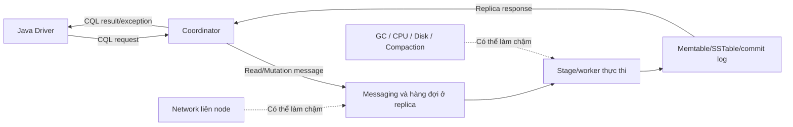

# nodetool tpstats, dropped message và hàng đợi xử lý

> **Chương:** Tracing và chẩn đoán  
> **Phạm vi:** Apache Cassandra, cơ sở dữ liệu phân tán theo mô hình *wide-column*, và ứng dụng Java sử dụng Cassandra Java Driver 4.x. Bài tập trung vào cách đọc `nodetool tpstats`, đánh giá các thông điệp bị bỏ vì quá hạn, và kết nối triệu chứng hàng đợi với đường đọc/ghi, replication, compaction, GC, CPU và I/O.
>
> **Kết quả học tập:** Nhận diện hàng đợi bị nghẽn, phân biệt `pending` với `dropped` và timeout của client, tính tốc độ tăng từ counter, định vị node/tầng có vấn đề và đề xuất biện pháp theo nguyên nhân thay vì tăng timeout một cách máy móc.

## 1. Tình huống mở đầu: request timeout nhưng node vẫn `UN`

Một dịch vụ Java đọc các đơn gần nhất theo `customer_id`. Khi có đợt ghi dữ liệu lớn, API bắt đầu trả timeout:

- p99 đọc tăng từ 80 ms lên 600 ms.
- Một số node báo trạng thái `UN` (*Up/Normal*) trong `nodetool status`.
- `nodetool tpstats` trên một replica xuất hiện `Pending` tăng ở nhóm xử lý request và bộ đếm `Dropped Messages` tăng.
- Disk I/O, GC hoặc compaction có thể cũng đang chịu áp lực.

Câu hỏi quan trọng không phải chỉ là “node còn sống không?”. Cassandra có thể vẫn nhận gossip và trả lời một số request nhưng **không xử lý thông điệp kịp thời trước deadline**. Một thông điệp bị xếp hàng quá lâu có thể bị bỏ mà không thực thi tác vụ đã hết giá trị.

Mô hình tình huống:

```text
Client Java
    |
    | SELECT ... WHERE partition_key = ?
    v
Coordinator C1
    |
    | gửi yêu cầu đọc
    v
Replica R2
    |
    +--> nhận thông điệp / hàng đợi stage
              |
              +--> pending tăng
              |       |
              |       +--> xử lý sau deadline?
              |                 |
              |                 +--> bỏ thông điệp quá hạn
              |                      (dropped message)
              |
              +--> coordinator không đủ phản hồi đúng hạn
                         |
                         +--> read timeout / request timeout
```

Đây là **một nguyên nhân có thể xảy ra**, không phải lời khẳng định mỗi timeout đều có một dropped message tương ứng. Có timeout do network, coordinator, driver hoặc cơ chế khác ngay cả khi các bộ đếm dropped không tăng.

## 2. Đặt `tpstats` vào đường đi của một yêu cầu

Cassandra phân phối dữ liệu bằng cách băm **partition key** thành token, sau đó chọn replica theo `NetworkTopologyStrategy`/RF và topology. Một node làm **coordinator** khi nhận CQL từ client; coordinator gửi thông điệp liên node đến các replica cần tham gia.



`nodetool tpstats` cho biết **tình trạng các thread pool và stage xử lý** trên **node đang chạy lệnh**, cùng phần thống kê dropped messages nếu phiên bản hiển thị. Nó giúp nhận biết công việc đang xử lý, đang chờ và đã hoàn tất, nhưng **không phải packet capture** và không trực tiếp cho biết mọi request đã đi qua những node nào.

Khi phân tích, phải tách ba lớp:

1. **Ứng dụng/driver:** request có được gửi đi không, đang đợi connection/response bao lâu?
2. **Coordinator:** có nhận request, gửi đủ thông điệp đến replica và nhận đủ ACK theo consistency level không?
3. **Replica:** thông điệp có được nhận, xếp hàng và xử lý trước thời hạn không?

Một coordinator nhanh không bảo đảm mọi replica nhanh, và một replica `UN` không bảo đảm hàng đợi của nó luôn trống.

## 3. Các cột trong `nodetool tpstats` nói gì?

Ví dụ chạy **lệnh chỉ đọc trạng thái** trên một node:

```bash
nodetool tpstats
```

Dưới đây là **bảng minh họa**, không phải output được sao chép từ một phiên bản cụ thể:

```text
Pool Name           Active   Pending   Completed   Blocked   All time blocked
ReadStage                8       120     1850000         0                  0
MutationStage            2         4     2400000         0                  0
CompactionExecutor       4        26      128000         0                  0
...

Dropped Messages
Message type           Dropped
READ                       340
MUTATION                    12
...
```

Tên pool, stage, loại message, danh sách cột và việc công cụ có hiển thị thống kê latency của dropped messages **phụ thuộc phiên bản Cassandra và bản phân phối**. Không nên xây cảnh báo chỉ dựa trên chính xác tên `ReadStage` hoặc `READ` trong ví dụ.

### Diễn giải các cột

| Cột | Ý nghĩa thực hành | Điểm cần tránh hiểu sai |
| --- | --- | --- |
| **Active** | Số tác vụ đang được thực thi tại thời điểm lấy mẫu của pool/stage | Không phải tổng request trên node hoặc phần trăm CPU |
| **Pending** | Số tác vụ đã xếp hàng chờ được xử lý ở pool/stage đó | Không tự chứng minh quá hạn; một burst ngắn có thể tự tiêu |
| **Completed** | Counter số tác vụ đã hoàn tất theo thống kê pool, thường tích lũy qua thời gian hoạt động của node/metric | Không phải throughput mỗi giây nếu chỉ xem một mẫu |
| **Blocked** | Số tác vụ/luồng bị chặn theo cơ chế hàng đợi hoặc executor của pool đang xét | Không đồng nghĩa thread Java ở trạng thái `BLOCKED` vì Java monitor/lock |
| **All time blocked** | Counter tình huống blocked đã xảy ra từ trước theo pool và phiên bản | Cần nhìn mức tăng; giá trị lịch sử lớn có thể thuộc sự cố cũ |
| **Dropped** | Số thông điệp thuộc loại tương ứng bị hệ thống ghi nhận là bỏ, thường do quá hạn trước khi xử lý | Không phải số row bị mất, cũng không nhất thiết bằng số lỗi trả về client |

Một số phiên bản có nhiều pool nội bộ hơn, thay đổi thread model hoặc biểu diễn thông điệp theo *verb*. Vì vậy cần **kiểm tra phiên bản và nghĩa của metric được xuất** trước khi so sánh số liệu hai cluster.

### Ý nghĩa của `Pending = 120`

Một hàng đợi có 120 tác vụ chờ có thể xuất hiện vì:

- Trong 200 ms có burst ghi/đọc lớn, sau đó giảm nhanh.
- Executor không xử lý theo kịp trong nhiều phút.
- Worker bị nghẽn I/O, CPU hoặc GC, khiến tác vụ tích lũy.
- Hệ thống đang cố gắng phục hồi một backlog trước đó.

Chỉ snapshot `Pending=120` không đủ phân biệt các trường hợp. Phải thu thập **chuỗi thời gian**: pending tăng, giữ cao hay giảm; đồng thời xem tốc độ completed, dropped, p99 và tài nguyên.

### `Completed` lớn là tốt hay xấu?

Giả sử `Completed = 2.000.000`. Con số này tự nó không chứng minh pool khỏe; node có thể đã chạy nhiều ngày. Chỉ số hữu ích hơn là tốc độ tăng:

```text
t0: Completed = 2.000.000
t1: Completed = 2.006.000, sau 60 giây

Throughput quan sát ≈ (2.006.000 - 2.000.000) / 60
                    ≈ 100 task/giây
```

Đây là throughput **task được pool ghi nhận hoàn tất**, không nhất thiết bằng **100 request CQL/giây**: một request có thể sinh nhiều thông điệp/tác vụ hoặc không đi qua pool đang xem.

Nếu node restart, counter có thể reset; công cụ theo dõi phải phân biệt reset với throughput âm.

## 4. `Dropped Messages` thực chất là gì?

Trong nhiều phiên bản Cassandra, hệ thống gắn deadline cho thông điệp yêu cầu. Khi thông điệp **đã quá hạn trước lúc được xử lý**, thực thi nó có thể không còn giúp request ban đầu hoàn thành đúng thời gian. Cassandra có thể bỏ qua thông điệp đó và tăng bộ đếm dropped tương ứng.

Ví dụ:

```text
09:00:00.000  Coordinator phát yêu cầu READ tới R2
09:00:00.010  R2 nhận và xếp hàng, nhưng stage đang bận
09:00:00.250  Deadline đọc bị vượt qua (giả định)
09:00:00.310  Worker lấy tác vụ khỏi hàng đợi:
              yêu cầu đã hết thời hạn -> ghi nhận dropped
```

Đây là **minh họa**, không phải lời hứa về mốc thời gian mặc định của Cassandra. Việc deadline được xác định, truyền theo message và ghi metric có khác biệt giữa các phiên bản.

### Không đồng nhất ba kiểu “mất”

| Hiện tượng | Nó chứng minh điều gì? | Nó **không** tự chứng minh điều gì? |
| --- | --- | --- |
| **Dropped message** trong `tpstats` | Node/đường messaging ghi nhận một loại thông điệp bị bỏ theo logic nội bộ | Mọi mutation tương ứng đã mất khỏi mọi replica |
| **Read/write timeout** phía Cassandra | Coordinator không thu được đủ phản hồi cần thiết trong thời gian cho phép | Replica chưa thực hiện bất kỳ công việc nào |
| **Driver request timeout** | Driver không có kết quả hoàn tất trong timeout client | Coordinator/replica chưa nhận hoặc chưa áp dụng mutation |
| **Network packet loss** | Gói tin TCP/IP có thể bị mất và phải truyền lại hoặc kết nối bị lỗi | Có một dòng dropped tăng đúng tương ứng trong `tpstats` |
| **Application error** | API không cung cấp kết quả như kỳ vọng | Nguyên nhân chắc chắn nằm ở Cassandra |

**Thông điệp bị dropped không phải số lượng row bị “xóa khỏi database”.** Đặc biệt với ghi có replication, một số replica khác có thể đã áp dụng mutation; coordinator hoặc ứng dụng có thể nhận timeout trong khi kết quả ghi đang ở trạng thái không chắc chắn.

### Dropped `READ` và `MUTATION` khác nhau như thế nào?

- **Read-related dropped:** một công việc đọc đã trở nên quá hạn trước khi được xử lý. Điều này thường liên hệ với read timeout/tail latency, nhưng phải xem tại node nào và coordinator có đủ response từ replica khác hay không.
- **Mutation-related dropped:** một công việc liên quan đến ghi không được xử lý kịp. Nếu replica đó bỏ lỡ mutation, các bản sao khác/hints/repair có thể giúp hội tụ trong điều kiện phù hợp; **không được xem dropped là bằng chứng ghi đã được an toàn**.
- **Response-related hoặc các loại message khác:** cần tra tên message của phiên bản, vị trí ghi nhận metric và vai trò node. Không tự suy ra mọi dòng dropped đều đến từ quá tải `ReadStage`.

Không phải mọi loại thông điệp đều có cùng timeout, ý nghĩa và mức ưu tiên; Cassandra còn có mạng internode và cơ chế backpressure/giới hạn tài nguyên thay đổi theo phiên bản.

## 5. Hàng đợi tăng như thế nào? Một mô hình đơn giản

Một executor có tốc độ tác vụ đến cao hơn tốc độ xử lý lâu dài sẽ tích lũy pending:

```text
Tốc độ đến λ:      1.200 task/giây
Tốc độ xử lý μ:    1.000 task/giây

Trong giai đoạn đều tải:
Backlog tăng xấp xỉ 200 task/giây
Sau 30 giây:       có thể thêm ~6.000 task đang đợi
```

Đây là mô hình minh họa. Thực tế nhiều executor, giới hạn queue, thông điệp quá hạn, retry và luồng đồng thời khiến con số khác.

Khi thời gian chờ trong hàng đợi gần hoặc vượt deadline, dropped có thể tăng **sau** khi pending đã tăng. Lúc burst kết thúc, pending giảm không nhất thiết đồng nghĩa mọi request ban đầu đã thành công: một phần có thể đã quá hạn và bị bỏ.

### Little's Law giúp hiểu nhưng không thay phép đo

Trong hệ ổn định và khi các điều kiện áp dụng được đáp ứng:

```text
L ≈ λ × W
```

Ở đây `L` là số tác vụ trung bình trong hệ đang xét, `λ` là throughput thực tế và `W` là thời gian trung bình tác vụ ở trong hệ. **Pending của một stage không luôn bằng L toàn hệ**, và thời gian đo đọc/ghi của client không bằng W của stage. Mô hình chỉ giúp suy luận vì sao concurrency và latency tăng cùng nhau.

Một cảnh báo hữu ích là `Pending` cao **cùng với** throughput completed không tăng tương ứng và p99/timeout xấu đi, thay vì một ngưỡng pending đơn độc.

### `Active` rất cao có chắc là CPU quá tải?

Không. Worker có thể đang xử lý tác vụ nhưng chờ I/O, lock hoặc phản hồi khác. Khi `Active` gần giới hạn concurrency của pool, cần xem:

- CPU usage, CPU throttling trong container.
- I/O latency/queue và compaction.
- GC pauses.
- Thread dump theo mẫu nếu có dấu hiệu lock contention.
- Network và replica phản hồi.

**Tăng số worker** trong lúc disk đang nghẽn có thể làm nhiều tác vụ cùng tranh I/O, khiến độ trễ tệ hơn.

## 6. Bảng chẩn đoán theo mẫu tín hiệu

| Mẫu quan sát theo thời gian | Giả thuyết ưu tiên | Kiểm chứng thêm |
| --- | --- | --- |
| `Pending READ` tăng, `Dropped READ` tăng, read p99 tăng | Replica đọc xử lý không kịp | SSTable/tombstone, disk await, compaction, GC, read latency theo node |
| `Pending MUTATION` tăng, dropped ghi tăng | Đường ghi/worker nhận mutation bị nghẽn | Write throughput, commit log fsync, memtable flush, disk queue, CPU |
| Pending tăng ngắn rồi về 0, dropped không tăng, SLO ổn | Burst hợp lệ hoặc queue tự hồi phục | Đo thêm nhiều đợt, xem peak và headroom |
| Pending cao, CPU gần 100%, disk ổn | CPU saturation, xử lý/nén hoặc GC chiếm CPU | CPU per-process, throttling, thread pools, GC |
| Pending cao, CPU vừa phải, disk await cao | I/O bottleneck hoặc storage latency | `iostat`, flush/compaction, disk headroom |
| Dropped tăng khi GC pause spike, pending dao động mạnh | Stop-the-world làm trì hoãn xử lý | GC logs, heap sau GC, timestamp tương quan |
| Driver timeout tăng, tpstats bình thường | Coordinator/network/client queue hoặc điểm nghẽn khác | Driver metrics, pool, trace, network, coordinator logs |
| Dropped chỉ trên một node, các node khác bình thường | Nút thắt cục bộ hoặc hot token range | So sánh node, disk, CPU, partitions, rack/DC |
| Các node đồng loạt dropped trong đợt repair | Repair/streaming tranh tài nguyên | `compactionstats`, `netstats`, stream bytes, I/O, SLO |

Đây là **giả thuyết điều tra** chứ không phải ánh xạ chắc chắn 1–1. Một node có thể vừa CPU nghẽn vừa GC cao và disk chậm; phải xác định thời điểm xuất hiện và nguyên nhân gốc.

## 7. Các stage/pool và loại message thường gặp

Cụ thể tên pool có thể thay đổi theo phiên bản hoặc cách Cassandra triển khai hệ thống messaging, nhưng các nhóm khái niệm sau là quan trọng:

| Nhóm | Công việc đặc trưng | Nếu có backlog thì xem gì? |
| --- | --- | --- |
| Đọc (*read stage*) | Xử lý yêu cầu đọc của replica | Disk reads, SSTable count, tombstone, hot partition, GC |
| Mutation/ghi | Áp dụng mutation lên replica | Commit log, memtable, flush, CPU, disk write |
| Request/response | Gửi/nhận phản hồi giữa node, tùy version/pool | Network, coordinator, serialization, scheduler |
| Compaction | Gộp SSTable, xử lý tombstone và dữ liệu cũ | Disk read/write, compaction throughput, headroom |
| Memtable flush | Đưa memtable thành SSTable | Disk write latency, memtable pressure, I/O |
| Streaming/repair | Truyền và đối soát dữ liệu giữa replica | Internode network, disk, repair concurrency |
| Gossip/messaging nội bộ | Thành phần duy trì trạng thái cluster | Network, GC, node responsiveness, internode health |

**Một số hàng là “hoạt động cần liên hệ”, không khẳng định xuất hiện nguyên văn dưới dạng pool cùng tên trong mọi bản `tpstats`.** Đặc biệt, Cassandra 4.x/5.x có nhiều thay đổi nội bộ so với bản trước; cần bám metric thực tế của cluster.

Không nên lấy `Pending` của tất cả pool cộng lại thành “số request khách hàng đang chờ”. Công việc nội bộ như compaction có thể có một queue riêng và số tác vụ không tương ứng CQL request.

## 8. Cách lấy chuỗi thời gian từ `tpstats`

Một lần chụp giúp định vị hiện trạng; **nhiều mẫu có timestamp** giúp phân biệt burst và nghẽn kéo dài.

Trên node thử nghiệm hoặc khi đang chẩn đoán có kiểm soát:

```bash
nodetool tpstats
nodetool tpstats
```

Trong vận hành, lấy mẫu bằng hệ monitoring/JMX hoặc automation quan sát đã được phê duyệt để có timestamp và khoảng lấy mẫu ổn định. Tránh chạy `nodetool` với tần suất quá dày trên mọi node; cơ chế JMX/command cũng có overhead.

### Ví dụ tính tốc độ dropped

Giả sử `READ dropped` là counter tích lũy:

| Thời điểm | READ dropped | Pending đọc tức thời | Read p99 |
| --- | ---: | ---: | ---: |
| 10:00:00 | 120 | 5 | 70 ms |
| 10:01:00 | 120 | 20 | 95 ms |
| 10:02:00 | 210 | 900 | 410 ms |
| 10:03:00 | 330 | 1.100 | 650 ms |
| 10:04:00 | 335 | 90 | 130 ms |

Giữa 10:02 và 10:03 có **120 dropped messages/phút**, tương đương **2/giây**. Đây là phép đo mức tăng của **counter READ trên node đó**, không phải tỷ lệ thất bại toàn cluster. Để tính tỷ lệ dropped có ý nghĩa, phải chọn mẫu số tương ứng (số message cùng loại được tiếp nhận/xử lý, nếu metrics cung cấp) và xét reset counter.

Khi node restart lúc 10:05, counter có thể trở về 0. Dashboard phải **nhận diện reset** thay vì hiểu là có âm 335 dropped hoặc “đã chữa hết lỗi”.

### Vì sao chỉ nhìn tổng dropped là thiếu?

- Node có traffic cao tự nhiên có nhiều cơ hội xuất hiện dropped hơn.
- Pool bị nghẽn 20 giây có thể bị che khuất nếu chỉ lấy trung bình 5 phút.
- Một loại message chiếm phần lớn lỗi, trong khi tổng các loại khác thấp.
- Nếu dùng nhiều DC, số liệu trung bình cluster có thể che node ở một rack bị vấn đề.
- Dashboard chỉ hiển thị tổng cumulative kể từ boot không cho biết sự cố **đang tăng** hay đã dừng.

Nên có đồ thị **rate theo message type, theo node và DC**, đặt cạnh queue depth, latency và tài nguyên.

## 9. Công cụ nào bổ sung cho `tpstats`?

`tpstats` mô tả hàng đợi/executor. Để tìm **vì sao** hàng đợi quá tải, cần quan sát thêm nhiều tầng.

### 9.1. Công cụ `nodetool`

Trên node có quyền truy cập:

```bash
nodetool status
nodetool tpstats
nodetool tablestats lab.orders_by_customer
nodetool compactionstats
nodetool netstats
nodetool gcstats
```

Các lệnh này được dùng để xem:

- `status`: node/DC nào `UN`, `DN` và membership chung.
- `tpstats`: active/pending/completed/blocked và message dropped.
- `tablestats`: trạng thái bảng, SSTable/memtable, tombstone, latency và dung lượng theo phiên bản.
- `compactionstats`: compaction đang chạy hoặc đang chờ.
- `netstats`: hoạt động streaming và một số thống kê network.
- `gcstats`: thông tin GC tổng hợp khi phiên bản hỗ trợ.

Lệnh `nodetool status` chỉ cho biết trạng thái gossip/ownership, **không chứng minh node đáp ứng p99**. Một node có thể `UN` và vẫn có hàng đợi quá hạn.

### 9.2. Hệ điều hành và JVM

Trên Linux với công cụ thích hợp:

```bash
vmstat 1
iostat -xz 1
pidstat -u -p <pid> 1
jcmd <pid> GC.heap_info
```

`<pid>` là PID của Cassandra process; thay bằng giá trị thật khi thao tác. Lệnh này giúp đối chiếu CPU, I/O latency, queue, memory/GC. Với Cassandra chạy container, phải xem cả **CPU throttling và cgroup memory**, vì CPU tổng của host thấp không bảo đảm JVM không bị quota.

Không được kết luận disk bottleneck chỉ từ CPU `iowait` cao; cần đối chiếu `await`, throughput, queue, compaction và read/write p99.

### 9.3. JMX và metrics

Trong môi trường có metrics collector, theo dõi:

- Thread pool active, pending, completed, blocked theo scope/pool.
- Dropped message counter/rate theo loại message/verb mà phiên bản hỗ trợ.
- Client request read/write latency histogram, timeouts, unavailable.
- GC pause, heap sau GC, native memory/RSS, CPU và disk.
- Memtable flush, SSTable count, tombstone scanned và compaction backlog.
- Internode messaging, streaming/repair và network errors.
- Driver request latency, in-flight requests, retries và timeouts.

Tên metric/MBean thay đổi theo Cassandra release, exporter và bản phân phối. Hãy xác minh **đơn vị thời gian, loại counter/gauge và nhãn** trước khi lập công thức Prometheus hay alert.

### 9.4. CQL tracing

Có thể dùng `cqlsh` trong lab:

```cql
TRACING ON;

SELECT order_id, created_at, status
FROM lab.orders_by_customer
WHERE customer_id = aaaaaaaa-aaaa-4aaa-8aaa-aaaaaaaaaaaa
LIMIT 20;

TRACING OFF;
```

Tracing có thể tiết lộ coordinator, replica và trình tự hoạt động của một truy vấn, tùy phiên bản và sampling. Tuy nhiên:

- Trace là **mẫu request**, không phải ảnh chụp toàn bộ queue/dropped trên node.
- Một request nhanh sẽ không nhất thiết đại diện cho p99 đang lỗi.
- Trace có thể tăng overhead và tạo thêm dữ liệu; chỉ bật có kiểm soát.
- Tên event và thông tin chi tiết khác giữa các phiên bản.
- Nếu request thất bại hoặc quá hạn rất sớm, trace có thể không đầy đủ; vẫn phải dùng metrics/log tương quan.

## 10. Thực hành CQL: một truy vấn đúng partition key

Ví dụ dùng keyspace `lab` đã tồn tại trên cluster **thử nghiệm**. Bảng:

```cql
CREATE TABLE IF NOT EXISTS lab.orders_by_customer (
    customer_id uuid,
    created_at timestamp,
    order_id uuid,
    status text,
    total decimal,
    PRIMARY KEY ((customer_id), created_at, order_id)
) WITH CLUSTERING ORDER BY (created_at DESC, order_id ASC);
```

Ghi một hàng để đọc:

```cql
INSERT INTO lab.orders_by_customer
    (customer_id, created_at, order_id, status, total)
VALUES (
    aaaaaaaa-aaaa-4aaa-8aaa-aaaaaaaaaaaa,
    '2026-11-21T03:00:00Z',
    11111111-1111-4111-8111-111111111111,
    'PAID',
    250.00
);
```

Đọc với partition key đầy đủ:

```cql
SELECT order_id, created_at, status, total
FROM lab.orders_by_customer
WHERE customer_id = aaaaaaaa-aaaa-4aaa-8aaa-aaaaaaaaaaaa
LIMIT 20;
```

Truy vấn này có hình dạng tốt hơn quét toàn bảng vì Cassandra biết token của partition. Tuy nhiên, **`LIMIT 20` không bảo đảm chỉ đọc đúng 20 cell vật lý**: tombstone, nhiều SSTable hoặc partition quá lớn vẫn có thể gây chi phí đọc.

Để nghiên cứu `tpstats`, không cần tạo hàng triệu request hoặc làm sập replica. Chỉ nên tạo workload đại diện trong lab và lấy mẫu queue, dropped, latency, disk và CPU theo cùng thời gian.

### Làm thế nào phân biệt bảng chậm với node chậm?

- Nếu **chỉ một bảng/truy vấn** có read latency/tombstone scanned cao, ưu tiên kiểm tra partition key, TTL, tombstone và compaction strategy.
- Nếu **mọi bảng** đi qua cùng một node đều chậm và node có GC pause/CPU/disk bất thường, ưu tiên điểm nghẽn node.
- Nếu **một DC** gặp request timeout cùng thời điểm internode network chậm, xem topology, consistency level, đường liên DC và trạng thái replica.
- Nếu Cassandra metrics khá ổn nhưng **driver timeout** cao, kiểm tra client pool, connection acquisition, event loop, application queue và network client–coordinator.

`tpstats` là một phần của bằng chứng, không thay thế định vị theo **bảng, node, request và thời gian**.

## 11. Đọc kết quả từ Java Driver 4.x

Ứng dụng Java nên ghi nhận thời gian từ góc nhìn client, consistency level, loại lỗi và coordinator đã phục vụ request. Những thông tin này giúp nối triệu chứng API với `tpstats` của node tương ứng.

```java
import java.util.UUID;
import java.util.concurrent.TimeUnit;

import com.datastax.oss.driver.api.core.CqlSession;
import com.datastax.oss.driver.api.core.DefaultConsistencyLevel;
import com.datastax.oss.driver.api.core.cql.BoundStatement;
import com.datastax.oss.driver.api.core.cql.PreparedStatement;
import com.datastax.oss.driver.api.core.cql.ResultSet;
import com.datastax.oss.driver.api.core.metadata.Node;

public final class CassandraReadProbe {
    private final CqlSession session;
    private final PreparedStatement select;

    public CassandraReadProbe(CqlSession session) {
        this.session = session;
        this.select = session.prepare(
            "SELECT order_id, created_at, status " +
            "FROM lab.orders_by_customer " +
            "WHERE customer_id = ? LIMIT ?"
        );
    }

    public int readRecent(UUID customerId) {
        BoundStatement statement = select.bind(customerId, 20)
            .setConsistencyLevel(DefaultConsistencyLevel.LOCAL_QUORUM)
            .setIdempotent(true)
            .setPageSize(20);

        long started = System.nanoTime();
        try {
            ResultSet result = session.execute(statement);
            Node coordinator = result.getExecutionInfo().getCoordinator();

            int rows = 0;
            for (var row : result) {
                rows++;
            }

            long elapsedMs = TimeUnit.NANOSECONDS.toMillis(
                System.nanoTime() - started
            );

            System.out.printf(
                "read_ms=%d rows=%d coordinator_dc=%s%n",
                elapsedMs,
                rows,
                coordinator == null ? "unknown" : coordinator.getDatacenter()
            );
            return rows;
        } catch (RuntimeException ex) {
            long elapsedMs = TimeUnit.NANOSECONDS.toMillis(
                System.nanoTime() - started
            );
            System.err.printf(
                "read_error_ms=%d type=%s%n",
                elapsedMs,
                ex.getClass().getSimpleName()
            );
            throw ex;
        }
    }
}
```

Giả định `CqlSession` đã được cấu hình kết nối, authentication, keyspace và local datacenter đúng, và RF đủ cho `LOCAL_QUORUM`. Ví dụ dùng `var` nên yêu cầu Java phiên bản hỗ trợ; có thể dùng kiểu `Row` nếu cần.

**Cách hiểu đúng:**

- `elapsedMs` đo thời gian thực thi phía Java bao gồm kết nối/driver/network/Cassandra và việc duyệt kết quả; không phải server processing time thuần túy.
- `getCoordinator()` chỉ xác định coordinator cho execution, **không liệt kê toàn bộ replica đã tham gia**.
- `setIdempotent(true)` phù hợp với ví dụ `SELECT` thông thường; không tự bật speculative execution.
- Trong hệ thống thực không in log tất cả request; dùng metrics histogram/tracing lấy mẫu để tránh tự tạo overhead.
- Khi request lỗi, đôi khi không có `ExecutionInfo` thành công; log loại exception, local DC, statement kind và request context, rồi đối chiếu driver/server metrics.

### Phân biệt timeout ở đâu?

| Triệu chứng quan sát từ driver | Có thể bắt nguồn từ | Cần kiểm tra |
| --- | --- | --- |
| Cassandra read timeout response | Coordinator không có đủ phản hồi read theo CL trong hạn | Replica `tpstats`, dropped READ, disk/GC, CL/RF |
| Cassandra write timeout response | Không có đủ ACK write theo CL trong hạn | Mutation queues, commit log, flush, mạng và replica |
| Driver request timeout | Driver hết thời gian đợi kết quả; có thể trước/sau nhiều lần execution | Client pool, network, server traces, retry/speculative policy |
| No node available / connectivity | Driver không tìm được coordinator kết nối phù hợp | Contact points, local DC, node/network, pool |
| Unavailable theo CL | Không đủ replica sống/đủ điều kiện để thỏa CL ngay từ góc nhìn coordinator | RF, `nodetool status`, DC và replica placement |

Không coi một exception class là bằng chứng duy nhất của root cause. Một write timeout **không chứng minh mutation đã bị rollback trên mọi replica**; retry cần xem tính idempotent và đối soát.

## 12. Sự cố mẫu A — Dropped READ tăng do disk/compaction

Giả sử monitoring đo được:

| Thời điểm | Pending READ | Dropped READ (counter) | Disk read await | Read p99 |
| --- | ---: | ---: | ---: | ---: |
| 14:00 | 4 | 15 | 3 ms | 70 ms |
| 14:05 | 90 | 15 | 18 ms | 160 ms |
| 14:10 | 800 | 110 | 75 ms | 590 ms |
| 14:15 | 980 | 300 | 92 ms | 750 ms |

Đây là **số liệu giả định**. Độ trễ disk tăng cùng pending/read p99 và dropped. Bước tiếp theo:

1. Xác nhận `compactionstats` có công việc nặng hay không.
2. Xem `tablestats` của bảng đang lỗi: SSTable count, tombstone scanned, memtable, compaction backlog.
3. Đối chiếu disk headroom, disk IOPS, read/write queue và hoạt động streaming/repair.
4. Kiểm tra query có bám partition key hay quét partition quá lớn không.
5. Giảm tải background hoặc tối ưu truy vấn theo runbook trong môi trường có kiểm soát; đo lại p99 **và** dropped rate.

**Không sửa bằng cách tăng timeout 10 lần ngay lập tức.** Timeout dài có thể làm ít dropped hơn nhưng cũng giữ nhiều request đợi lâu, tăng concurrency và làm API chậm hơn.

## 13. Sự cố mẫu B — Dropped MUTATION tăng trong đợt ghi

Giả sử một pipeline đẩy ghi 5 lần tải bình thường. Sau đó:

- `Pending` của nhóm mutation tăng.
- `Dropped` loại mutation tăng.
- Commit log/fsync hoặc memtable flush chịu áp lực.
- Một số request ở `LOCAL_QUORUM` timeout, trong khi những request khác vẫn thành công.

Các giả thuyết cần kiểm tra:

1. Tốc độ mutation đến vượt năng lực CPU/disk hiện tại.
2. Commit log storage có latency cao hoặc gần đầy.
3. Memtable flush/compaction chậm làm tranh tài nguyên.
4. Partition key khiến tải dồn vào ít token/replica.
5. Một node/đường mạng bị lỗi, khiến coordinator thiếu ACK đúng hạn.

**Không kết luận toàn bộ write bị mất** khi thấy dropped mutation trên một node. RF và CL có thể khiến bản sao khác đã nhận ghi; nhưng cũng không được kết luận tất cả dữ liệu an toàn. Khi request timeout, ứng dụng cần retry có idempotency hợp lệ, đối soát và theo dõi repair/hints.

Cách xử lý bền vững thường gồm điều tiết producer/batch size hợp lý, cải thiện partition distribution, tăng năng lực node hoặc giải quyết I/O, chứ không chỉ tăng kích thước hàng đợi.

## 14. Sự cố mẫu C — GC pause làm queue và dropped tăng

```text
10:00:00  Node R2 bắt đầu GC pause dài
10:00:05  Đường read/response tới R2 tích lũy trong queue
10:00:06  Một số request vượt deadline
10:00:07  R2 tiếp tục xử lý, bỏ công việc đã quá hạn
10:00:08  Dropped READ và timeout tăng
```

Đây là mối liên hệ **có thể kiểm chứng** bằng timestamp:

- GC logs/JVM pause duration cùng node.
- Queue pending trước, trong và sau pause.
- Dropped rate và read timeout của coordinator.
- Heap sau GC, allocation rate, native memory và CPU.

GC count cao **không chứng minh** có pause dài. Cần phân biệt *thời gian dừng luồng* với tổng thời gian collector làm việc. Nếu ổ đĩa và CPU đều khỏe nhưng pause spike rõ ràng trùng sự cố, tuning JVM/memory hoặc giảm allocation hợp lý có thể cần thiết.

## 15. Sự cố mẫu D — Network hoặc coordinator gây timeout dù dropped thấp

Giả sử Java request timeout tăng, nhưng `tpstats` trên các replica không có dropped đáng kể và pending rất thấp.

Các khả năng:

- Driver không lấy được connection hoặc bị queue phía client.
- Coordinator chậm/GC, dù replica khỏe.
- Mạng client → coordinator hoặc coordinator → replica bị đứt/chập chờn.
- Cấu hình local DC không khớp, request đi qua WAN.
- Consistency level yêu cầu ACK từ datacenter xa hoặc từ nhiều replica không khả dụng.
- Phân trang, serialization hoặc xử lý ứng dụng gây trễ sau khi server trả kết quả.

Lúc này kiểm tra `ExecutionInfo`, metrics driver, coordinator node, TCP/network, RF và CL; đừng cố tăng thread pool replica khi không có bằng chứng queue bị nghẽn.

## 16. Tracing theo từng request hay metric theo toàn node?

Hai nguồn quan sát bổ sung cho nhau:

| Nguồn | Mạnh ở điểm nào? | Giới hạn |
| --- | --- | --- |
| `tpstats` | Snapshot queue và counter dropped trên một node | Không gắn sẵn với request ID và không giải thích root cause |
| JMX/Prometheus | Xu hướng theo thời gian, node, DC, message type | Phụ thuộc exporter, sampling và nhãn |
| CQL tracing | Bước xử lý của một truy vấn mẫu trên coordinator/replica | Có overhead, một trace không đại diện mọi request |
| Java Driver metrics | Góc nhìn client, coordinator và request timeout | Không nhìn trực tiếp toàn bộ worker/queue của replica |
| OS/JVM telemetry | Phân biệt CPU/GC/disk/memory bottleneck | Cần ghép thời gian và vị trí với request |
| Log Cassandra | Lỗi chi tiết như timeout, GC, network, disk/streaming | Có thể rất nhiều log và chưa đủ nếu không có metric thời gian |

Tốt nhất dùng **một mốc thời gian thống nhất**. Đồng bộ đồng hồ node (ví dụ NTP) và có nhãn cluster/DC/node giúp đối chiếu một read timeout ở client với dropped của replica và sự kiện GC/disk tương ứng.

### Không lấy trung bình p99 các node

Ví dụ node A có p99=20 ms, node B p99=200 ms. Trung bình hai con số là 110 ms, nhưng **không phải p99 của tất cả request**. Cần histogram có thể tổng hợp đúng hoặc đo trực tiếp trên luồng request đầy đủ. Điều tương tự áp dụng khi so sánh client p99 và server p99: không trừ trực tiếp hai phân vị để kết luận “p99 network”.

## 17. Quy trình chẩn đoán nhanh khi dropped tăng

**Bước 1 — Xác minh sự kiện:** lấy khoảng thời gian lỗi, bảng/query bị ảnh hưởng, RF/CL, datacenter và node có tăng dropped.

**Bước 2 — Tách loại thông điệp:** READ, MUTATION hoặc loại khác; xác định tên metric thực của phiên bản. Phân biệt `Dropped` (counter) và `Pending` (gauge).

**Bước 3 — Tính tốc độ:** lấy chênh lệch dropped/completed giữa các mẫu, nhận diện restart/reset; không dùng counter tích lũy làm ngưỡng tức thời.

**Bước 4 — Nhìn queue:** `Active`, `Pending`, `Blocked` và xu hướng, theo pool/stage cụ thể. Không cộng mọi pool thành số CQL request đang đợi.

**Bước 5 — Đối chiếu latency:** API/driver/server p95/p99, read/write timeout, coordinator và replica. Kiểm tra dropped tăng **trước, cùng lúc hay sau** latency spike.

**Bước 6 — Kiểm tra tài nguyên:** CPU/throttling, JVM GC pause, heap/native, disk await, commit log, flush và compaction. Với multi-DC, xem network và CL.

**Bước 7 — Phân biệt nguồn tải:** request mới tăng, hot partition, query không khớp partition key, repair/streaming, compaction hay sự cố node.

**Bước 8 — Thử giả thuyết an toàn:** thay đổi **một yếu tố một lần** ở lab/canary (giảm concurrency, khắc phục I/O hoặc tối ưu query), rồi đo p99, dropped rate, pending và throughput.

**Bước 9 — Kiểm tra phục hồi:** xác nhận dropped **không còn tăng bất thường**, pending về vùng ổn định và SLO được khôi phục. Xem lại request timeout/mutation bị thiếu theo nhu cầu nghiệp vụ.

**Bước 10 — Phòng ngừa:** đặt alert theo tốc độ dropped, queue kéo dài và thời gian compaction/repair; ghi root cause, giới hạn tải và quy trình xử lý lần sau.

## 18. Dashboard và cảnh báo nên thiết kế thế nào?

Một dashboard tối thiểu nên có:

| Hàng biểu đồ | Nhãn đề nghị | Ý nghĩa |
| --- | --- | --- |
| Dropped messages / giây | Cluster, DC, node, loại message | Có loại thông điệp đang quá hạn ở node nào? |
| Pending tasks theo stage | Cluster, DC, node, pool | Hàng đợi nào đang tích lũy? |
| Active tasks + completed / giây | Node, pool | Worker có đang theo kịp tải không? |
| Read/write latency p95/p99 | Node, table, operation khi metric cho phép | SLO bị ảnh hưởng ở đâu? |
| Read/write timeout và unavailable | Node, operation, CL nếu thu được | Có yêu cầu không đủ replica/ACK? |
| GC pause + CPU + throttling | Node/process/container | Scheduler/GC có gây chậm xử lý không? |
| Disk await + compaction backlog | Node/device | Storage có nghẽn? |
| Driver latency + errors | App, region, coordinator DC/host | Client đang gặp lỗi ở đâu? |

### Cách đặt alert

Một cảnh báo có ý nghĩa hơn `Dropped > 1000` tích lũy là:

> **Dropped READ tăng liên tục trên một hoặc nhiều node trong vài cửa sổ đo, cùng `Pending READ` kéo dài hoặc read p99/timeout tăng.**

Số ngưỡng cụ thể phụ thuộc baseline và traffic. Một hệ thống có hàng triệu CQL/s cần cách đánh giá khác một cluster nhỏ. Cũng nên cảnh báo:

- Pending tăng liên tục không giảm trong giờ tải bình thường.
- Dropped mutation bất thường trên replica nhận ghi.
- GC pause hoặc disk await tăng đúng lúc dropped bùng phát.
- Một node khác biệt lớn so với các node còn lại cùng DC/rack.
- Công việc repair/streaming trùng cửa sổ tải cao và làm p99 vượt SLO.

**Không đặt nhãn partition key cho mọi metric:** cardinality rất lớn có thể làm hệ giám sát quá tải. Chỉ dùng sampling và công cụ phân tích hot partition khi thật cần.

## 19. Những cách “chữa cháy” sai thường gặp

**“Thấy dropped thì cứ tăng `read_request_timeout_in_ms`.”** Tăng timeout có thể làm một số request ít bị loại hơn nhưng không tăng năng lực xử lý. Khi hệ thống đã bão hòa, request nằm đợi lâu hơn và tiêu tốn thêm tài nguyên. Cần tìm nguyên nhân queue tăng trước.

**“Tăng số thread của mọi stage sẽ xử lý nhanh hơn.”** Không chắc. Nếu disk bão hòa, nhiều worker có thể tranh I/O và lock; nếu CPU bị quota, nhiều thread chỉ tăng scheduling overhead.

**“Dùng `nodetool status` thấy `UN` thì không cần điều tra.”** Sai. Gossip health không đo p99, queue hoặc GC.

**“Một dropped MUTATION nghĩa là một hàng mất vĩnh viễn.”** Sai. Replication/CL/hints/repair quyết định khả năng hội tụ và trạng thái đã ghi; cần đối soát.

**“Không có dropped nghĩa là không có timeout.”** Sai. Timeout có thể xảy ra tại driver, coordinator, network hoặc do CL; không nhất thiết được ghi thành dropped ở node đang xem.

**“Pending cao trong một giây nghĩa là cluster cần thêm node.”** Chưa đủ. Burst ngắn khác với backlog tăng liên tục, cần xét throughput, CPU/I/O và dữ liệu nóng.

**“ReadStage pending cao nên sửa ngay JVM heap.”** Sai nếu root cause là SSTable/tombstone scan hoặc disk latency.

**“Speculative retry luôn giúp khi có dropped.”** Không chắc. Gửi thêm đọc có thể giúp khi một replica đơn lẻ chậm nhưng cũng làm fan-out và tăng tải khi toàn cluster nghẽn.

**“Ép compaction liên tục giúp mọi queue về 0.”** Không đúng. Compaction dùng thêm I/O, có thể làm read/write p99 tệ hơn; cần kế hoạch điều phối.

**“Đọc một trace CQL có thể giải thích mọi dropped trong 10 phút.”** Sai. Trace là một request mẫu; dùng cùng time-series metrics và workload phân phối thực.

**“Restart node để reset counter nghĩa là đã giải quyết sự cố.”** Sai. Counter reset nhưng root cause có thể còn; restart không có kế hoạch còn có thể làm giảm availability, gây streaming/hints và tăng nguy cơ mất dữ liệu.

## 20. Câu hỏi tự kiểm tra và tình huống phỏng vấn

1. `Active=8` và `Pending=1000` ở pool đọc nghĩa là gì? Vì sao chưa thể kết luận CPU đang 100%?
2. `Dropped READ` tăng từ 250 lên 370 trong một phút. Tốc độ tăng bằng bao nhiêu? Đây có phải số CQL request thất bại mỗi giây không?
3. Một node restart làm dropped counter từ 370 về 0. Dashboard cần xử lý thế nào để không hiểu sai?
4. Phân biệt `ReadTimeout` từ Cassandra với driver request timeout và dropped READ ở replica.
5. Tại sao `nodetool status` báo `UN` chưa chứng minh một node đáp ứng SLO?
6. Nếu pending MUTATION và disk write await cùng tăng, bạn sẽ kiểm tra commit log, flush và compaction như thế nào?
7. Khi GC pause tăng cùng dropped READ, cần xem thêm những metric JVM nào để xác nhận?
8. Vì sao một mutation dropped trên một replica không chứng minh dữ liệu đã mất trên toàn bộ RF?
9. Một bảng có nhiều tombstone và `LIMIT 20` nhưng read p99 rất cao. Liên hệ điều này với pending READ và SSTable.
10. Dropped rate bằng 0 nhưng driver timeout tăng sau thay đổi local datacenter. Hướng điều tra nên là gì?
11. Vì sao không cộng `Pending` từ compaction và read pool thành “request khách hàng chưa xử lý”?
12. Kết hợp `tpstats`, CQL tracing, JVM logs và Java Driver metrics để tìm coordinator/replica đang chậm như thế nào?
13. Một đợt repair làm compaction pending và disk await tăng, tiếp đó dropped READ tăng. Nêu kế hoạch giảm tải an toàn.
14. Giải thích vì sao tăng timeout có thể làm triệu chứng bớt xuất hiện mà throughput thực không cải thiện.
15. Hãy thiết kế ba alert để nhận biết sớm queue tăng kéo dài, dropped mutations và node đơn lẻ bị nghẽn.

## 21. Ghi nhớ bằng sơ đồ quyết định

```text
Thấy request chậm / timeout / dropped
                  |
                  v
      Xác định NODE và loại message
                  |
                  v
      Đọc nodetool tpstats theo thời gian
        Active / Pending / Completed
          Blocked / Dropped rate
                  |
         +--------+---------+
         |                  |
   Queue tăng bền vững    Queue không tăng
         |                  |
         v                  v
   Xem GC/CPU/I/O/       Kiểm tra client,
   compaction/hot key    coordinator, CL,
         |               network và trace
         v                  |
   Tìm nguyên nhân         |
   nghẽn thực thi          |
         +--------+---------+
                  |
                  v
       Khắc phục có kiểm soát
                  |
                  v
  Đo lại p99 + pending + dropped rate
          + throughput + lỗi
```

**Kết luận:** `nodetool tpstats` cho thấy **công việc đang chạy, đang chờ và đã hoàn tất** trên một node; `Dropped Messages` cho thấy **thông điệp bị bỏ theo cơ chế nội bộ, thường do quá hạn**, không phải bộ đếm hàng dữ liệu bị mất. Giá trị chẩn đoán đến từ việc đo **tốc độ tăng**, ghép với **tracing, driver timeout, consistency level, GC, CPU, disk I/O, compaction và trạng thái replica** trên cùng mốc thời gian. Đừng chữa một hàng đợi quá tải bằng cách chỉ nới timeout hoặc tăng thread; hãy giảm nguyên nhân khiến nó không thể xử lý kịp.
