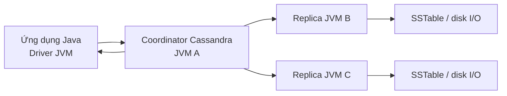

# JFR hoặc profiler JVM trong phạm vi điều tra có kiểm soát

**Chương:** Tracing và chẩn đoán  
**Module:** `DATABASE_ENGINE_WIDE_COLUMN_CASSANDRA` — Apache Cassandra

Khi truy vấn Cassandra bị chậm, CPU một node tăng đột ngột hoặc thời gian dừng GC khiến p99 của ứng dụng tăng, chỉ nhìn biểu đồ read latency thường chưa đủ để biết **thành phần nào trong JVM** đang tiêu tốn tài nguyên. Java Flight Recorder (JFR) và các sampling profiler giúp quan sát hoạt động thực thi, cấp phát bộ nhớ, GC, thread và một số sự kiện I/O của **tiến trình Java**. Tuy nhiên, profiling luôn có chi phí và có thể thu thập thông tin nhạy cảm; trong một hệ phân tán, lấy hồ sơ của sai node hoặc sai thời điểm cũng dễ dẫn tới kết luận sai.

Bài này kết nối kiến thức về kiến trúc Cassandra, partition key, bảng theo truy vấn, consistency level, replication, read/write path, compaction, repair, xử lý lỗi và Java Driver với một quy trình chẩn đoán có kiểm soát: **đặt giả thuyết → chọn JVM và khoảng thời gian → ghi hồ sơ giới hạn → đối chiếu metric/tracing → xác minh hướng khắc phục**.

> **Phạm vi thực hành:** Apache Cassandra 4.1/5.x chạy trên **JDK tương thích với phiên bản đang dùng**, trong cụm thử nghiệm. Lệnh JFR minh họa các JDK hiện đại có công cụ `jcmd`/`jfr`. Tên event, tính năng JFR, khả năng attach, công cụ phân tích và quyền truy cập có thể khác theo JDK/bản phân phối/container. **Không bật profiler lâu dài hoặc thay đổi quyền kernel trên production** chỉ để làm theo ví dụ.

## 1. Mục tiêu học tập

Sau bài này, bạn có thể:

1. Chỉ ra khi nào nên dùng **CQL tracing**, **metrics**, **JFR**, **thread dump** hay **sampling profiler**, thay vì dùng sai công cụ.
2. Chọn đúng JVM của **Cassandra server** hoặc **ứng dụng Java client** để điều tra.
3. Ghi một JFR ngắn, có giới hạn thời gian/dung lượng, xác minh trạng thái và đọc file mà không cần restart Cassandra.
4. Phân biệt **CPU time**, **wall-clock time**, **allocation**, **GC pause**, **blocked/parked thread** và các sự kiện file/socket I/O.
5. Đọc call tree/flame graph để hình thành giả thuyết, tránh diễn giải một stack sample như bằng chứng nhân quả tuyệt đối.
6. Đối chiếu JFR với p95/p99, `nodetool`, CQL tracing, compaction backlog, tombstone scan và trạng thái replica.
7. Kiểm soát quyền profiler, thông tin trong bản ghi, disk headroom và mức ảnh hưởng production.
8. Lập kế hoạch thử lại sau khi tối ưu partition key, truy vấn, GC, compaction hoặc Java client.
9. Viết một báo cáo sự cố có bằng chứng, thời gian đồng bộ và giới hạn của phép đo.

## 2. JFR giải quyết câu hỏi nào, và không giải quyết câu hỏi nào?

### 2.1. Năm lớp quan sát khác nhau

| Lớp | Ví dụ công cụ | Câu hỏi phù hợp | Giới hạn |
| --- | --- | --- | --- |
| Ứng dụng | Java Driver metrics, request ID, elapsed time | User thấy p99 bao nhiêu? Request timeout ở đâu? | Không chỉ ra chính xác method JVM server |
| Cassandra CQL | `TRACING ON`, execution info, warnings | Coordinator/replica nào xử lý truy vấn? Các bước read/write? | Tracing có overhead; không đủ mô tả mọi method CPU |
| Cassandra server | `nodetool tpstats`, `tablestats`, `compactionstats`, JMX metrics | Thread pool/backlog, SSTables/read, tombstones, compaction, GC thay đổi thế nào? | Aggregation theo node/table có thể che một query/hot partition |
| JVM | **JFR**, thread dumps, GC logs | CPU được dùng ở stack nào? Allocation/GC/lock/thread gì bất thường? | Profile mang tính lấy mẫu; không tự biết ý định nghiệp vụ |
| OS/hạ tầng | CPU, disk queue, I/O wait, network, cgroups | Node bị nghẽn ở CPU, đĩa, bộ nhớ hay WAN? | Không giải thích trực tiếp query shape hoặc Cassandra token |

**Đặt đúng câu hỏi trước khi chạy profiler.** Nếu read timeout trùng lúc một node mất mạng, đầu tiên cần kiểm tra topology, CL, logs và `nodetool status`; một CPU flame graph có thể không giúp tìm nguyên nhân. Nếu CPU tăng ở một node khỏe, JFR hoặc CPU profiler là công cụ hợp lý hơn.

### 2.2. JFR là gì?

**Java Flight Recorder** là cơ chế quan sát tích hợp trong JVM, ghi các sự kiện JVM theo cấu hình. Tùy JDK và preset đang dùng, sự kiện có thể gồm:

- Samples thực thi Java/native liên quan CPU.
- Phân bổ bộ nhớ/đối tượng, allocation hot spots.
- Garbage collection, thời gian pause và các giai đoạn GC.
- Thread scheduling, thread park/monitor contention.
- Class loading, compiler/JIT và safepoint.
- Một số sự kiện file/socket I/O nếu được bật và được JDK hỗ trợ.

JFR không phải heap dump đầy đủ. Nó không liên tục ghi **mọi** method call của mọi thread và không bảo đảm mọi allocation đều xuất hiện với độ chi tiết chính xác. Cấu hình recording ảnh hưởng overhead và bộ dữ liệu thu được.

### 2.3. Sampling profiler khác gì?

Sampling profiler như **async-profiler** có thể lấy stack theo CPU hoặc các loại event khác (phụ thuộc nền tảng) và xuất flame graph. Ưu điểm là quan sát stack theo mẫu, thường có chi phí chấp nhận được khi cấu hình thận trọng. Tuy nhiên:

- CPU profiling đo **thời gian thread đang thực thi trên CPU**, không trực tiếp đo tổng thời gian request chờ I/O.
- Wall-clock profiling thường lấy mẫu cả trạng thái chờ; cần hiểu thread đang chờ điều gì mới kết luận.
- Allocation profiling tập trung vào nơi phân bổ đối tượng, không chứng minh đối tượng đó còn sống lâu hay gây OOM.
- Kết quả của một node không đại diện toàn cluster; kết quả một phút không đại diện cả giờ cao điểm.
- Một số profiler yêu cầu quyền attach, `perf_event` hoặc đặc quyền OS không có trong container. **Không tắt cơ chế bảo vệ kernel** chỉ để attach vào production.

### 2.4. Có lúc không cần profiler

Nếu chỉ muốn biết một query đang scan nhiều tombstone:

```sql
TRACING ON

SELECT event_ts, event_id
FROM lab_jfr.events_by_device_day
WHERE device_id = 'sensor-01'
  AND bucket_day = '2026-11-21'
LIMIT 20;

TRACING OFF
```

CQL tracing và `nodetool tablestats` thường là bước đầu phù hợp hơn. Chỉ tăng lên JFR khi cần trả lời **vì sao CPU/GC/thread của JVM tăng** hoặc muốn phân biệt I/O/lock/allocation. Không bật tracing toàn bộ production request như một dạng logging mặc định.

## 3. Xác định tiến trình JVM nào cần profile

Một câu CQL chậm đi qua nhiều thành phần:



**JFR của ứng dụng Java** giúp điều tra: connection pool, serialization, mapping, blocking application thread, retry loop, GC client hoặc xử lý kết quả. **JFR của Cassandra node** giúp điều tra: read/write stages, compaction, streaming, tombstone scanning, allocation và GC trong server. Không có một file JFR duy nhất cho toàn bộ distributed request.

### 3.1. Chọn node bằng bằng chứng

Trước khi profile, đối chiếu:

- Coordinator/replica từ CQL tracing nếu có.
- Node nào có CPU hoặc GC cao bất thường.
- Node nào có p99 read/write, pending tasks, compaction backlog hoặc disk I/O cao.
- Partition key/token và replica placement của query nghi vấn.
- Có incident đang diễn ra hay chỉ còn dữ liệu lịch sử.
- Có node nào vừa bootstrap, repair, stream hoặc thay compaction strategy không.

Nếu `node-a` rảnh nhưng `node-c` đang compact và bị quá tải, profile A có thể cho hồ sơ bình thường dù p99 client đang xấu. Nhiều DC còn có khác biệt network/replica placement: cần gắn hostname, datacenter, rack, Cassandra version và JDK version cho từng bản ghi.

### 3.2. Cùng một triệu chứng, hai hướng điều tra

| Triệu chứng | Nghi vấn ban đầu | Nơi đo trước |
| --- | --- | --- |
| CPU node Cassandra 95%, read p99 tăng | Scan/compaction/GC/serialization CPU-heavy | Server metrics + JFR CPU trên node nóng |
| CPU chỉ 15%, read p99 tăng | Disk I/O, network, queue, lock hoặc timeout | OS I/O/network + thread state/JFR I/O |
| GC pause tăng cùng allocation rate | Đối tượng tạm quá nhiều, heap/GC pressure | JFR GC/allocation + heap/GC metrics |
| Client JVM CPU cao, server bình thường | Deserialization, transform kết quả, retry, paging | JFR ứng dụng + Driver metrics |
| Timeout sau mất replica | CL/quorum, coordinator routing, network | `nodetool status`, tracing và lỗi driver trước |
| Write p99 tăng khi repair | Streaming/compaction tranh CPU/đĩa | `compactionstats`, `netstats`, disk I/O, rồi JFR khi cần |

## 4. Nguyên tắc điều tra có kiểm soát

Một recording là **thao tác quan sát có chủ đích**, không phải một feature flag bật vô hạn.

### 4.1. “Scope card” trước khi chạy

Ghi tối thiểu:

```text
INCIDENT_ID: INC-2026-11-21-014
MUC_TIEU: tìm hot CPU stack khi read p99 tăng
MOI_TRUONG: lab / staging / production (được phê duyệt)
NODE: cassandra-b, dc=dc1, rack=rack2
CASSANDRA_VERSION: [đọc từ cluster]
JDK_VERSION: [java -version]
PID: [jcmd -l]
KHOANG_THOI_GIAN_UTC: [bắt đầu/kết thúc]
CONG_CU: JFR, settings=profile
THOI_LUONG: 60 giây
GIOI_HAN_FILE: 256 MiB
VI_TRI_LUU: filesystem có đủ headroom, phân quyền hạn chế
SO_LIEU_NEN: CPU, GC, p99, I/O, compaction, error rate
DIEU_KIEN_DUNG: p99/error rate xấu hơn ngưỡng hoặc disk sắp đầy
NGUOI_PHE_DUYET / TIEP_NHAN_FILE:
KE_HOACH_XOA_FILE / RETENTION:
```

Trên production, giới hạn phải được xác định từ chính SLO và capacity. **60 giây/256 MiB là ví dụ học tập**, không phải tham số an toàn cho mọi workload. File JFR chứa thông tin kỹ thuật nội bộ; cần quyền đọc và thời hạn giữ phù hợp quy trình bảo mật.

### 4.2. Chi phí thường gặp

| Tác động | Nguồn phát sinh | Cách hạn chế |
| --- | --- | --- |
| CPU overhead | Ghi event, sampling và stack walking | Thu ngắn, dùng preset phù hợp, không bật mọi event |
| Memory/buffer | Buffer sự kiện JFR/profiler | Theo dõi heap/native memory và cgroup |
| Disk | File JFR, snapshot/HTML profile | Giới hạn maxsize, kiểm tra disk free, lưu trên volume phù hợp |
| I/O và p99 | Profiler cạnh tranh với Cassandra threads | Quan sát client p99 và có stop condition |
| Thông tin nhạy cảm | Stack, thread names, paths, metadata hoặc dữ liệu từ event | Phân quyền file, tránh tải lên dịch vụ ngoài chính sách |
| Sai lệch phép đo | Bật profiler quá nặng, warm-up, load không tương đương | So baseline và lúc profile, ghi khác biệt |
| Hệ quả attach | Quyền JVM/container/kernel, lỗi tương thích | Kiểm tra JDK/tool trước, không thay security production mù quáng |

### 4.3. Chọn preset theo câu hỏi

JFR thường cung cấp preset **`default`** (nhẹ hơn, phù hợp quan sát rộng) và **`profile`** (thu dữ liệu chi tiết hơn, thường tốn hơn). Tùy JDK, nội dung hai preset có thể khác. Nên:

1. Xác định mục tiêu (CPU, GC, allocation hay I/O).
2. Xem sự kiện đang bật trong preset của JDK thực tế.
3. Thử trên staging có workload tương tự trước.
4. Giới hạn thời gian và kích thước.
5. Không tự tăng sampling frequency hoặc bật mọi object allocation event trong production khi chưa đo overhead.

JFR có thể có nhiều recording cùng lúc, nên cần `name` rõ ràng và kiểm tra `JFR.check` trước khi bật thêm.

## 5. Chuẩn bị lab Cassandra và truy vấn đối chứng

Mục tiêu của lab là **thu được recording và tương quan dữ liệu**, không cố ý làm node production quá tải. Một vài hàng nhỏ không đủ tạo hot CPU stack có ý nghĩa; chúng chỉ dùng để xác nhận đường đo.

### 5.1. Kiểm tra cluster/JDK

Trên node Cassandra (Linux/container giả định):

```bash
nodetool status
nodetool tpstats
nodetool compactionstats
nodetool info

java -version
jcmd -l
```

`java -version` trong shell có thể không chính là JDK dùng chạy Cassandra nếu service đặt `JAVA_HOME` khác. Kiểm tra **tiến trình mục tiêu** và runtime của nó trước khi attach. Trong container, PID có thể khác so với trên Docker host; thực hiện `jcmd` trong **cùng PID namespace** và tài khoản có quyền phù hợp. `jcmd -l` có thể không liệt kê process nếu quyền hoặc namespace không cho phép.

Chọn PID của Cassandra dựa vào class/command line của tiến trình, **không đoán một PID cố định**:

```bash
# Ví dụ đầu ra khái niệm, không copy PID này sang node khác:
jcmd -l
# 1234 org.apache.cassandra.service.CassandraDaemon ...

# Chỉ sau khi xác minh PID thực:
jcmd 1234 VM.version
jcmd 1234 JFR.check
```

Nếu hệ thống báo lệnh `JFR.*` không tồn tại, cần xác minh JDK hỗ trợ và JVM đã được khởi động với các lựa chọn phù hợp. Không đổi JVM/JDK giữa ca production để bật JFR nếu chưa có kế hoạch restart và tương thích Cassandra.

### 5.2. Bảng và dữ liệu thực hành

Trong `cqlsh`, thay tên datacenter bên dưới bằng tên thực tế nếu khác:

```sql
CREATE KEYSPACE IF NOT EXISTS lab_jfr
WITH replication = {
  'class': 'NetworkTopologyStrategy',
  'datacenter1': 1
}
AND durable_writes = true;

CREATE TABLE IF NOT EXISTS lab_jfr.events_by_device_day (
    device_id text,
    bucket_day date,
    event_ts timestamp,
    event_id uuid,
    status text,
    payload text,
    PRIMARY KEY ((device_id, bucket_day), event_ts, event_id)
) WITH CLUSTERING ORDER BY (event_ts DESC, event_id ASC);

INSERT INTO lab_jfr.events_by_device_day
    (device_id, bucket_day, event_ts, event_id, status, payload)
VALUES (
    'sensor-01', '2026-11-21', '2026-11-21T10:00:00Z',
    10000000-0000-4000-8000-000000000001, 'OK', 'measurement-1'
);

INSERT INTO lab_jfr.events_by_device_day
    (device_id, bucket_day, event_ts, event_id, status, payload)
VALUES (
    'sensor-01', '2026-11-21', '2026-11-21T10:01:00Z',
    10000000-0000-4000-8000-000000000002, 'OK', 'measurement-2'
);

INSERT INTO lab_jfr.events_by_device_day
    (device_id, bucket_day, event_ts, event_id, status, payload)
VALUES (
    'sensor-01', '2026-11-21', '2026-11-21T10:02:00Z',
    10000000-0000-4000-8000-000000000003, 'OK', 'measurement-3'
);
```

Thử truy vấn có khóa đầy đủ:

```sql
SELECT event_ts, event_id, status
FROM lab_jfr.events_by_device_day
WHERE device_id = 'sensor-01'
  AND bucket_day = '2026-11-21'
  AND event_ts >= '2026-11-21T10:00:00Z'
  AND event_ts <  '2026-11-21T11:00:00Z'
LIMIT 20;
```

Không tạo millions of rows bằng một vòng lặp CQL không kiểm soát chỉ để làm JFR “có nhiều stack”. Benchmark CPU/JFR cần workload generator có giới hạn, đủ node/capacity và kế hoạch dừng.

## 6. Quy trình ghi JFR ngắn trên JVM Cassandra

**Chỉ chạy trên node lab đã xác minh process và có đủ disk headroom.** Các lệnh sau minh họa môi trường Linux có `jcmd` từ JDK phù hợp và thư mục ghi mà tài khoản JVM có quyền.

### 6.1. Xác minh process và ghi baseline

```bash
jcmd -l
jcmd <PID_CASSANDRA> VM.version
jcmd <PID_CASSANDRA> JFR.check

nodetool tpstats
nodetool compactionstats
nodetool tablestats lab_jfr.events_by_device_day
```

Trong shell thật, thay `<PID_CASSANDRA>` bằng PID đã xác minh; các dấu `< >` chỉ là placeholder, không gõ nguyên như literal. Kiểm tra `jcmd <pid> help JFR.start` để biết options hiện được hỗ trợ.

### 6.2. Tạo thư mục lưu hồ sơ riêng

```bash
# Chạy với quyền phù hợp trên node lab; không lưu lên volume đã gần đầy.
mkdir -p /var/tmp/cassandra-jfr
df -h /var/tmp/cassandra-jfr
```

Chọn thư mục không ảnh hưởng filesystem đang giữ commit log/SSTable nếu có thể. Quyền file nên giới hạn cho nhóm điều tra; đừng để artifact JFR nằm trên web server hoặc thư mục công khai.

### 6.3. Bắt đầu recording có thời hạn

```bash
# Ví dụ dành cho JDK hỗ trợ các lựa chọn này:
jcmd <PID_CASSANDRA> JFR.start \
  name=cassandra_incident_014 \
  settings=profile \
  duration=60s \
  filename=/var/tmp/cassandra-jfr/incident-014.jfr \
  maxsize=256m
```

Ý nghĩa:

| Tùy chọn | Mục đích | Điều cần kiểm tra |
| --- | --- | --- |
| `name` | Định danh phiên ghi để quan sát/dừng | Không trùng recording hiện có |
| `settings=profile` | Preset có chi tiết profiling hơn `default` | Overhead và tập events theo JDK |
| `duration=60s` | Tự kết thúc sau thời lượng yêu cầu | Phải trùng khoảng incident/tải cần đo |
| `filename=...jfr` | Vị trí file sau khi recording kết thúc/dump | Quyền ghi, disk space và retention |
| `maxsize=256m` | Giới hạn dung lượng recording theo cơ chế JFR | Không suy rằng giới hạn này đủ bảo vệ toàn filesystem khi còn các recording khác |

Trong khi recording chạy, lưu **đồng hồ UTC** và metric trong cùng khung thời gian. Không có workload đáng kể thì CPU samples chủ yếu là hoạt động nền/idle; điều đó không chứng minh query path không có vấn đề.

### 6.4. Kiểm tra, kết thúc và xác minh file

```bash
jcmd <PID_CASSANDRA> JFR.check

# Sau khi duration hoàn tất:
ls -lh /var/tmp/cassandra-jfr/incident-014.jfr

# Dùng JDK có jfr CLI để xem summary:
jfr summary /var/tmp/cassandra-jfr/incident-014.jfr
```

Nếu cần **dừng sớm** khi vượt ngưỡng p99/disk, xác minh recording còn chạy bằng `JFR.check` rồi dùng:

```bash
jcmd <PID_CASSANDRA> JFR.stop name=cassandra_incident_014
```

Hành vi ghi file khi stop phụ thuộc recording options và JDK; kiểm tra file thực tế/CLI output. Nếu file chưa tồn tại, không báo “thu thành công”. Khi dùng recording không có `duration`, có thể dùng `JFR.dump name=... filename=...` rồi `JFR.stop` theo hướng dẫn JDK hiện tại.

### 6.5. Xử lý sự cố không lưu được JFR

Nếu recording báo không thể attach/ghi file:

1. Kiểm tra PID, đúng JVM/JDK và quyền OS.
2. Kiểm tra `jcmd <pid> help JFR.start` và tên options.
3. Kiểm tra dung lượng, quyền thư mục và cgroup/container filesystem.
4. Kiểm tra xem recording cùng tên đã tồn tại.
5. Ghi nguyên văn lỗi rồi dùng metrics/thread dump có giới hạn nếu phù hợp; **không cấp quyền root/ptrace tùy tiện** hoặc restart Cassandra đang phục vụ production chỉ để “thử lại”.

## 7. Đọc recording bằng Java Mission Control hoặc CLI

**Java Mission Control (JMC)** là công cụ phổ biến để mở file JFR ngoại tuyến. Có thể dùng giao diện phù hợp để xem event browser, hot methods/call tree, thread, GC, allocation và I/O. `jfr` CLI có thể liệt kê summary hoặc in một số events ra văn bản.

```bash
jfr summary /var/tmp/cassandra-jfr/incident-014.jfr

# Tên event cần tồn tại trong recording; kiểm tra summary trước:
jfr print --events jdk.CPULoad,jdk.GarbageCollection \
  /var/tmp/cassandra-jfr/incident-014.jfr
```

Không mặc định mọi event đều hiện diện hoặc mọi JDK xuất cùng tên. `jfr summary` giúp biết tập sự kiện được ghi và số lượng; thiếu event có thể do preset không bật, thời lượng ngắn hoặc workload không phát sinh sự kiện đó.

### 7.1. Đọc call tree đúng cách

Nếu JMC hiển thị `Hot Methods` hoặc call tree:

- **Self time/sample:** thời gian mẫu được gán cho bản thân method (không tính con theo cách trình bày công cụ).
- **Total/inclusive:** gồm sample của method và các lời gọi bên dưới.
- **Thread grouping:** thread nào sinh các sample. Server có nhiều thread pools, nên gộp cả JVM có thể che thread chịu tải.
- **Sample count:** số mẫu thu được, không phải số lần method được gọi.
- **Tỷ trọng:** phụ thuộc khoảng profiling, tập thread và cơ chế sampling.

Không diễn giải “method X = 30%” thành “30% thời gian end-to-end của mọi CQL request ở X”. Tỷ trọng CPU samples nói về **CPU thực thi được lấy mẫu trong khoảng ấy**, và có thể gồm compaction, repair, gossip hoặc hoạt động nền không thuộc request đang điều tra.

### 7.2. CPU cao không giống wall-clock cao

Ví dụ:

```text
Request A: 300 ms wall-clock
  10 ms CPU chạy Java
  240 ms chờ disk read
  50 ms queue/network/scheduling

Request B: 300 ms wall-clock
  250 ms CPU xử lý dữ liệu
  50 ms queue/network

CPU flame graph có thể nhấn mạnh B nhưng không chỉ ra phần chờ I/O của A.
```

Để điều tra A, kết hợp JFR thread state, file/socket events (nếu bật), OS I/O wait, Cassandra read latency và tracing. Nếu chỉ có CPU samples và thấy ít stack liên quan, **không được kết luận không có vấn đề hiệu năng**.

### 7.3. GC và allocation

JFR có thể hiển thị:

- Allocation rate và một số vị trí tạo nhiều object tạm thời.
- Số lần GC, pause duration và từng phase.
- Thread/stack liên quan tới allocation nếu sự kiện thích hợp được bật.
- Safepoint/compilation events hỗ trợ phân tích pause/JIT.

Điều cần hiểu:

- **Allocation nhiều** không đồng nghĩa **memory leak**. Đối tượng có thể sống rất ngắn rồi bị GC thu hồi.
- **GC pause dài** không đồng nghĩa toàn bộ p99 đến từ GC; cần trùng khung thời gian và so metric client.
- **Heap dump** và **class histogram** có thể gây ảnh hưởng đáng kể hơn một JFR ngắn; không tự gọi `jcmd GC.heap_dump`/`GC.class_histogram` trên production để trả lời câu hỏi CPU thông thường.
- Nếu nghi memory leak, cần kế hoạch thu thập riêng, đánh giá quyền/dung lượng, công cụ phân tích và được phê duyệt trước.

### 7.4. Lock và thread park

`jdk.JavaMonitorEnter`, `jdk.ThreadPark` và những event liên quan có thể giúp phát hiện contention hoặc các thread chờ theo cấu hình. Nhưng:

- Thread parked có thể **bình thường** vì thread pool đang chờ việc, không phải deadlock.
- Một lock event dài cần nhìn thread, stack, số lượng occurrence và tác động tới request.
- Một recording ngắn có thể bỏ lỡ lock contention hiếm.
- Đừng thay tuning thread pool/GC ngay chỉ vì một hình chụp stack.

## 8. Khi nào dùng async-profiler?

JFR là lựa chọn đầu tiên hợp lý trên JVM được hỗ trợ. Nếu cần CPU flame graph với sampling chi tiết hơn, hoặc cần so CPU/on-CPU với wall-clock, **async-profiler** có thể phù hợp sau khi kiểm tra tương thích JDK/OS/container.

### 8.1. Điều kiện trước khi attach

- Công cụ tải từ nguồn được tổ chức phê duyệt, đã kiểm tra checksum/version.
- Node lab/staging có đủ CPU/disk; biết cách dừng profiler.
- Tài khoản chạy profiler có quyền attach theo chính sách.
- Linux `perf_event`, `ptrace` và container seccomp phù hợp nếu mode cần; **không vô hiệu hóa các cơ chế bảo vệ production**.
- Đã xác định event `cpu`, `wall` hay `alloc` và mục tiêu phân tích.
- Có file output riêng cho từng node/time window, không ghi đè bản hồ sơ cần lưu.

### 8.2. Ví dụ CPU sampling ngắn

Với bản phân phối async-profiler có binary `asprof` và cú pháp tương thích:

```bash
asprof --help

# Chỉ lab/staging, PID đã xác minh:
asprof -e cpu -d 30 \
  -f /var/tmp/cassandra-jfr/cassandra-cpu-014.html \
  <PID_CASSANDRA>
```

Một số phiên bản cũ dùng `profiler.sh` thay vì `asprof`; không tự đổi câu lệnh nếu chưa kiểm tra `--help`. File HTML/flame graph là artifact có thể chứa tên class/method nội bộ; áp dụng chính sách lưu trữ tương tự JFR.

### 8.3. CPU, wall và alloc không hoán đổi

| Mode | Quan sát chính | Khi cân nhắc | Giới hạn |
| --- | --- | --- | --- |
| `cpu` | Mẫu stack khi thread thực thi CPU | CPU node nóng, tìm code path tiêu tốn cycles | Có thể bỏ qua thời gian chờ disk/socket |
| `wall` | Mẫu theo wall-clock, có thể gồm blocked/waiting tùy implementation | Latency cao nhưng CPU không cao | Cần phân biệt idle threads với blocked work; overhead có thể lớn |
| `alloc` | Nguồn phân bổ memory theo cơ chế profiler | Allocation rate/GC pressure | Không tự chứng minh leak hoặc retained heap |

Khi quan sát CPU flame graph, độ **rộng** ô thường tỷ lệ số mẫu, **chiều cao** là độ sâu stack, màu có thể mang tính giao diện. Đừng đọc chiều cao ô như thời gian, và đừng tìm “ô đỏ nhất” mà bỏ qua toàn bộ stack/caller.

## 9. Gắn JVM profile với đường đọc/ghi của Cassandra

Một recording chỉ hữu ích khi gắn với *hiện tượng đang diễn ra*.

### 9.1. Đường đọc: partition và tombstone

Giả sử API đọc `device_id = sensor-01` chậm ở p99. Trước khi profile:

```bash
nodetool tablestats lab_jfr.events_by_device_day
nodetool tablehistograms lab_jfr events_by_device_day
nodetool tpstats
nodetool compactionstats
```

Trong `cqlsh`, bật tracing **chỉ cho truy vấn nghi vấn**:

```sql
TRACING ON

SELECT event_ts, event_id, status
FROM lab_jfr.events_by_device_day
WHERE device_id = 'sensor-01'
  AND bucket_day = '2026-11-21'
LIMIT 20;

TRACING OFF
```

Đối chiếu:

- Tombstones/live cells scanned theo table hoặc warning từ server.
- SSTables per read và kiểu compaction.
- Kích thước partition, time bucket và clustering range.
- JFR CPU stack, GC, blocked thread hoặc file I/O.
- OS disk latency, I/O wait và cache.

**Nếu thấy nhiều tombstone và read path tốn CPU**, hướng xử lý có thể là thiết kế query đọc khoảng clustering hẹp hơn, bucket partition phù hợp, TTL/compaction đúng loại workload. Không tự tăng `tombstone_failure_threshold` hoặc chạy major compaction để làm profiler ít nóng hơn mà chưa đánh giá rủi ro dữ liệu.

### 9.2. Đường ghi: mutation và compaction

Nếu write p99 tăng cùng CPU:

```bash
nodetool tpstats
nodetool compactionstats
nodetool netstats
```

Phân tích thêm commit log/memtable flush, compaction backlog, streaming/repair và disk I/O. JFR có thể cho thấy phần CPU dùng cho serialization, allocation hoặc compaction threads; nhưng **nếu ổ đĩa mới là nút nghẽn**, CPU profile không giải thích đầy đủ độ trễ ghi.

### 9.3. Repair/streaming

Khi `nodetool netstats` có streaming sessions, workload này có thể tranh NIC, CPU, disk và compaction với read/write. Nếu profile trong lúc repair, **ghi rõ điều đó** để không gán CPU của repair thành chi phí của truy vấn CQL.

Không chạy repair chỉ để “tạo tải” cho JFR trên cụm đang phục vụ. Nếu cần so sánh, dùng cluster disposable và ghi thống nhất trạng thái trước/trong/sau repair.

## 10. Quy trình đo chuẩn: baseline → recording → phân tích → kiểm chứng

| Pha | Hành động | Bằng chứng |
| --- | --- | --- |
| P0 — Xác nhận triệu chứng | Xác định endpoint, bảng, query shape, CL, thời điểm p99 tăng | Incident timeline, logs, dashboards |
| P1 — Chọn target | Xác định coordinator/replica/ứng dụng JVM liên quan | Node/DC/rack, PID, JDK |
| P2 — Baseline | Thu metrics trước profile cùng tải | CPU, GC, p99, disk I/O, compaction |
| P3 — Guardrails | Giới hạn recording, permissions, disk, stop thresholds | Scope card và approval |
| P4 — Thu hồ sơ | JFR ngắn hoặc sampling profiler theo mục tiêu | File JFR/HTML, UTC timestamps |
| P5 — Tương quan | So samples/events với CQL tracing và OS metrics | Call tree + timeseries |
| P6 — Giả thuyết | Nêu code path và yếu tố tạo latency | Nguyên nhân có thể, bằng chứng thuận/nghịch |
| P7 — Can thiệp lab | Đổi một biến: query/model/GC/compaction hoặc code | Before/after với workload tương đương |
| P8 — Kết luận | Ghi mức chắc chắn, tác động và việc chưa biết | Báo cáo sự cố + rollback |

Không nhất thiết cần JFR cho mọi incident. Nếu nguyên nhân được chứng minh rõ là WAN partition hoặc coordinator Unavailable, bước P4 có thể bỏ qua.

### 10.1. Đồng bộ mốc thời gian

Mọi file và metric cần có mốc **UTC** hoặc offset rõ ràng, cộng trạng thái NTP/clock. Ví dụ:

```text
10:00:00 UTC  baseline CPU 35%, p99 90 ms
10:02:00 UTC  compaction backlog tăng
10:02:20 UTC  p99 read tăng 600 ms
10:02:30 UTC  JFR.start node-b, 60 giây
10:03:30 UTC  recording kết thúc
10:04:00 UTC  p99 về 120 ms
```

Đây là **timeline giả định**, không phải kết quả lab. Cần xem JFR events trong khoảng 10:02:30–10:03:30, không diễn giải stack của 10:00 thành nguyên nhân của incident 10:03. Nếu client/server clock lệch, correlation theo timestamp có thể sai.

## 11. Thực hành so sánh ba tình huống

### 11.1. Tình huống A: CPU cao do công việc nền

Quan sát giả định:

- CPU node 90% trong 5 phút.
- `nodetool compactionstats` hiển thị nhiều tác vụ.
- JFR CPU samples tập trung ở các stack liên quan compaction.
- Read p99 tăng đúng khi disk I/O/compaction cao.

**Giả thuyết:** compaction tranh CPU/I/O với client requests. Cần kiểm tra lịch compaction, kích thước SSTable, write amplification, disk throughput và chiến lược compaction phù hợp trước khi điều chỉnh. Một hot method có tên giống compaction chưa đủ kết luận nếu p99 read tăng do network.

**Biện pháp kiểm chứng:** trên lab, giữ workload truy vấn/ingest gần giống, điều chỉnh *một biến* (ví dụ concurrency hoặc data model được phê duyệt), đo p99, disk queue và CPU profile lần nữa. Không tắt compaction hoặc repair ở production để làm benchmark.

### 11.2. Tình huống B: p99 cao nhưng CPU thấp

Quan sát giả định:

- CPU chỉ 20%, read p99 800 ms.
- CQL tracing có thời gian chờ replica hoặc read từ SSTable.
- Disk I/O wait hoặc network retry tăng.
- JFR CPU samples không có một hot method nổi bật.

**Giả thuyết:** phần lớn latency nằm ở chờ I/O/network/scheduling, không phải CPU-bound code. Tiếp tục kiểm tra disk read latency, thread state, socket/file I/O events (nếu có), CL và replica health. Không kết luận “JVM không có vấn đề” chỉ vì flame graph CPU trống.

**Biện pháp kiểm chứng:** khắc phục bottleneck hạ tầng/query range theo bằng chứng, so đo trước/sau ở workload tương đương.

### 11.3. Tình huống C: Allocation tăng trên Java client

Quan sát giả định:

- Cassandra server metrics bình thường.
- Java API CPU/GC tăng khi đọc nhiều trang CQL.
- JFR của **ứng dụng**, không phải Cassandra node, cho thấy nhiều allocation khi mapping kết quả.

Hướng điều tra: chuyển đổi row sang object lớn, tạo danh sách không giới hạn, fetch/paging, logging và retry. Điều chỉnh page size, streaming kết quả, phép mapping và cache ở client theo workload. Không đổi `gc_grace_seconds`, keyspace replication hay compaction của Cassandra để chữa một vấn đề nằm ở ứng dụng.

## 12. Java Driver: ghi dấu latency để đối chiếu JFR

Ví dụ Java Driver 4.x đo elapsed time một lần đọc. Dùng chính query đã định trong `lab_jfr`; phần đo này có thể chạy ở ứng dụng lab trong khi JFR ghi trên một node liên quan.

```java
import com.datastax.oss.driver.api.core.CqlSession;
import com.datastax.oss.driver.api.core.DefaultConsistencyLevel;
import com.datastax.oss.driver.api.core.cql.PreparedStatement;
import com.datastax.oss.driver.api.core.cql.ResultSet;
import com.datastax.oss.driver.api.core.cql.Row;
import com.datastax.oss.driver.api.core.data.CqlDate;

import java.time.Instant;
import java.time.LocalDate;
import java.util.UUID;

public final class CassandraJfrCorrelation {
    public static void read(CqlSession session) {
        PreparedStatement query = session.prepare(
            "SELECT event_ts, event_id, status " +
            "FROM lab_jfr.events_by_device_day " +
            "WHERE device_id = ? AND bucket_day = ? " +
            "AND event_ts >= ? AND event_ts < ? LIMIT 20"
        );

        CqlDate day = CqlDate.fromDaysSinceEpoch(
            (int) LocalDate.of(2026, 11, 21).toEpochDay()
        );

        long startNanos = System.nanoTime();
        Instant startedAt = Instant.now();

        try {
            ResultSet result = session.execute(
                query.bind(
                    "sensor-01",
                    day,
                    Instant.parse("2026-11-21T10:00:00Z"),
                    Instant.parse("2026-11-21T11:00:00Z")
                ).setConsistencyLevel(DefaultConsistencyLevel.ONE)
                 .setPageSize(20)
            );

            int rows = 0;
            for (Row row : result) {
                UUID id = row.getUuid("event_id");
                Instant when = row.getInstant("event_ts");
                String status = row.getString("status");
                // Trong benchmark thật không in từng row.
                if (id != null && when != null && status != null) {
                    rows++;
                }
            }

            double millis = (System.nanoTime() - startNanos) / 1_000_000.0;
            System.out.println(
                "startedAt=" + startedAt +
                ", elapsedMs=" + millis +
                ", rows=" + rows
            );
        } catch (RuntimeException ex) {
            double millis = (System.nanoTime() - startNanos) / 1_000_000.0;
            System.err.println(
                "startedAt=" + startedAt +
                ", failedAfterMs=" + millis +
                ", error=" + ex
            );
        }
    }
}
```

**Giới hạn ví dụ:**

- `ONE` chỉ là CL của lab RF=1; production chọn CL theo replication, yêu cầu nhất quán và khả năng chịu lỗi.
- `elapsedMs` bao gồm xử lý client/fetch và có thể nhiều trang; đây **không** phải CPU time của Cassandra server.
- `Instant.now()` để correlate thời gian cần clock đồng bộ; `System.nanoTime()` phù hợp đo elapsed duration trong cùng JVM.
- Một query thành công không chứng minh mọi replica đang đồng bộ.
- Để có p99, cần thu **nhiều request** bằng metrics/benchmark; một lượt `println` chỉ là một điểm đo.
- Không gắn thông tin cá nhân hoặc primary key nhạy cảm vào log/JFR artifact ngoài chính sách bảo vệ dữ liệu.

## 13. Bảo mật và quản lý artifact profile

### 13.1. File JFR có thể chứa những gì?

Tùy event được bật, JFR có thể chứa stack traces, class/method names, thread names, JVM command line, file paths, socket endpoints, exception metadata và các chi tiết vận hành khác. Không nên giả định toàn bộ nội dung đã được ẩn danh.

**Quy định tối thiểu:**

- File chỉ lưu trong thư mục có quyền đọc/ghi hạn chế.
- Không tự upload JFR, flame graph hoặc heap dump lên dịch vụ phân tích công cộng.
- Không đưa file vào Git repository, artifact CI mặc định hoặc bucket công khai.
- Có người chịu trách nhiệm, retention và xóa file theo chính sách.
- Khi chia sẻ với chuyên gia bên ngoài, tuân theo thủ tục đánh giá dữ liệu và loại bỏ thông tin nhạy cảm.
- Khi incident kết thúc, xác nhận không còn recording/profiler chạy kéo dài.

### 13.2. Không mở quyền attach bằng cách phá chính sách OS

Nếu `jcmd`/`asprof` báo permission denied trong container, cần làm việc với người quản trị platform để xác định quyền dự kiến. **Không** chỉ dẫn bật `--privileged`, tắt seccomp hay thay `perf_event_paranoid` trên host production như một workaround mặc định. Cách đó tạo thêm nguy cơ bảo mật và có thể che rủi ro vận hành.

### 13.3. Kết thúc và làm sạch có kiểm soát

Sau khi đã lưu artifact vào nơi được phê duyệt:

1. Kiểm tra `JFR.check` để xác nhận recording đã dừng.
2. Xác nhận file hợp lệ bằng `jfr summary`/JMC.
3. Lưu thông tin hash/kích thước và khoảng UTC cùng incident ID nếu runbook yêu cầu.
4. Thu hồi quyền chia sẻ tạm, xóa bản sao ngoài chính sách.
5. Giữ lại các kết luận và biểu đồ thống kê không nhạy cảm trong báo cáo; không giữ file thô vô hạn.

Không xóa file trước khi xác nhận nhóm điều tra đã nhận được artifact; ngược lại không để file JFR phình ra trên volume node sau khi kết thúc.

## 14. Quyết định tiếp theo dựa trên bằng chứng

| Kết quả profile/tracing | Kiểm tra tiếp | Biện pháp **có thể** phù hợp |
| --- | --- | --- |
| CPU sample nhiều ở đường đọc và tombstone scan cao | Query range, TTL/DELETE, partition size | Thu hẹp clustering range, điều chỉnh data model/retention |
| CPU sample nhiều ở compaction, pending tasks tăng | SSTable count, disk throughput, strategy, write mix | Benchmark compaction strategy và lịch vận hành |
| GC pauses/allocations cao | Heap, allocation hot path, client/server phân biệt | Giảm tạo object, tuning JDK/GC có kiểm soát |
| Ít CPU sample, thread chờ I/O | Disk latency, socket, network, replica health | Sửa nút nghẽn I/O/network hoặc giảm read amplification |
| Client JVM nóng, server bình thường | Mapping, paging, retries, app thread pools | Tối ưu Java client và driver config |
| Profile không trùng thời điểm incident | UTC timeline và metric lưu lịch sử | Thu lại ở cửa sổ có tải phù hợp, không suy đoán |
| Một node nóng, các replica khác bình thường | Token/partition, hot key, compaction state | Đánh giá phân bố tải, consistency, topology |
| Khoảng JFR không phát sinh events mong muốn | Preset, JDK, workload, event config | Điều chỉnh lựa chọn công cụ trong lab, không tăng overhead mù |

**Một recording nên tạo một hoặc vài giả thuyết kiểm chứng được**, chứ không phải danh sách mọi method xuất hiện. Phải chứng minh hướng khắc phục bằng việc p99, error rate và tài nguyên thay đổi trên workload tương đương.

## 15. Câu hỏi tự kiểm tra

1. Vì sao CQL tracing và JFR không hoán đổi cho nhau?
2. Một read chậm do replica đĩa quá tải có nhất thiết xuất hiện là hot CPU method không?
3. Thế nào là khác nhau giữa CPU time và wall-clock time của một truy vấn?
4. Khi nào cần profile JVM của ứng dụng Java thay vì JVM Cassandra server?
5. Vì sao một recording 60 giây trong giờ thấp điểm không chứng minh không có bottleneck vào giờ cao điểm?
6. `settings=default` và `settings=profile` khác nhau về mục tiêu thế nào? Tại sao cần xem preset của JDK thực tế?
7. Trong `jcmd <pid> JFR.start`, vai trò của `duration`, `filename` và `maxsize` là gì?
8. Vì sao sau `JFR.start` cần kiểm tra `JFR.check` và xác minh file bằng `jfr summary`?
9. Khi async-profiler CPU graph gần trống nhưng p99 tăng, bạn nên kiểm tra metric nào tiếp theo?
10. Một method chiếm 40% CPU samples có nghĩa 40% latency mọi request nằm ở method đó không?
11. Allocation rate cao có chứng minh memory leak không? Phải kiểm tra gì thêm?
12. Vì sao thread parked có thể hoàn toàn bình thường?
13. Đâu là rủi ro khi cho phép attach profiler bằng cách tắt bảo vệ kernel/container?
14. Tại sao JFR artifact cần retention, quyền truy cập và chính sách chia sẻ?
15. Khi một Cassandra node đang repair/streaming, profile CPU có thể chứa những công việc nền nào?
16. Nếu tombstone scan và SSTables per read cùng cao, bước điều tra nào nên thực hiện trước khi đổi compaction?
17. Mốc UTC, NTP/clock drift quan trọng thế nào khi correlate JFR với dashboard client?
18. Có thể kết luận toàn cluster gặp cùng bottleneck từ JFR của một node không? Vì sao?
19. Vì sao không nên tự thu heap dump hoặc class histogram trên production chỉ để điều tra CPU nóng?
20. Hãy tạo một scope card có giả thuyết, target PID, recording duration, maxsize, stop condition và người chịu trách nhiệm.
21. Phân biệt điều kiện hoàn tất thu thập (**file hợp lệ**) với hoàn tất điều tra (**giả thuyết được kiểm chứng**).
22. Hãy lập bảng trước/sau cho một giải pháp tối ưu: CPU, GC pauses, read p99, tombstones scanned, compaction backlog và error rate.

### Checklist trước khi thu JFR/profiler trên một node thật

- [ ] Đã xác minh sự cố cần profiling JVM, không phải chỉ cần CQL tracing/metrics.
- [ ] Chọn đúng process server hoặc Java client, PID và Java version.
- [ ] Có scope card, phê duyệt, thời hạn và điều kiện dừng.
- [ ] Có baseline p95/p99, CPU, GC, disk I/O, network và compaction.
- [ ] Đã kiểm tra `JFR.check`, dung lượng và quyền của thư mục output.
- [ ] Dùng preset/sampling mode hợp lý, không bật mọi event trong production.
- [ ] Đồng bộ UTC và gắn recording với incident/request/time window.
- [ ] Có cách dừng bằng `JFR.stop` hoặc cơ chế profiler tương ứng.
- [ ] Artifact được bảo vệ, không upload trái chính sách.
- [ ] Khi phân tích, đã phân biệt CPU, wall, alloc, GC, lock và I/O.
- [ ] Đã đối chiếu stack với CQL tracing, node metrics và request route/CL.
- [ ] Có giả thuyết cụ thể và phép kiểm chứng trước/sau ở workload tương đương.
- [ ] Đã xác minh recording ngừng và xử lý file theo retention policy.
- [ ] Báo cáo nêu rõ điều gì **đã quan sát** và điều gì mới là **suy luận**.

**Ghi nhớ:** JFR và profiler JVM giúp nhìn sâu vào **công việc bên trong tiến trình Java**, nhưng không thay cho CQL tracing, replication/CL, metrics của Cassandra hay kiểm tra tài nguyên hệ điều hành. Thu đúng **node**, đúng **khoảng thời gian**, trong **giới hạn an toàn**, rồi tương quan nhiều lớp dữ liệu là cách sử dụng công cụ profiling hiệu quả và có trách nhiệm.

