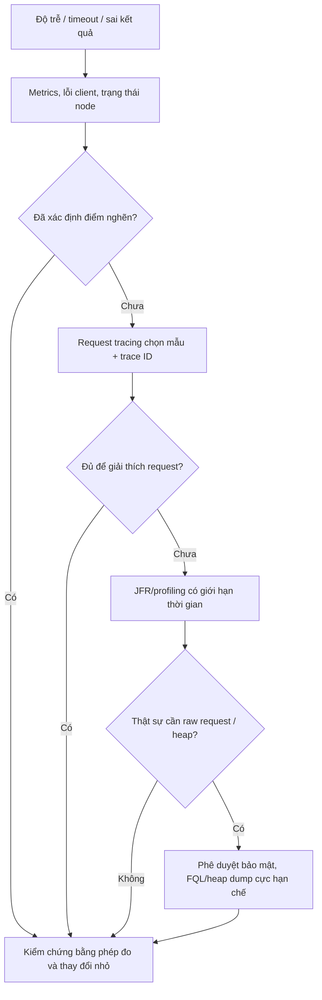
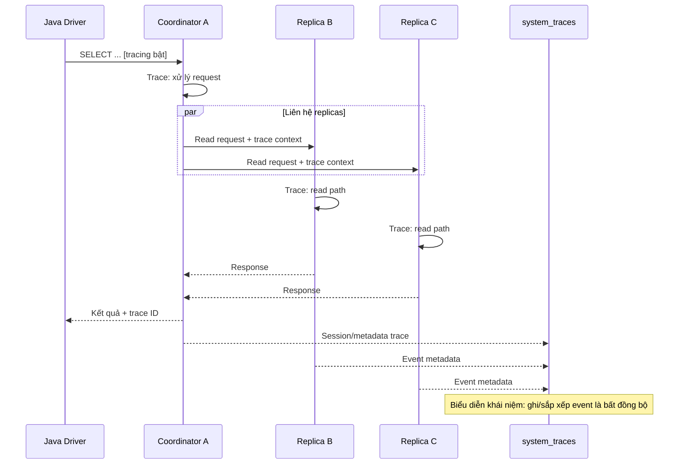

# Chi phí tracing/profiling và bảo vệ dữ liệu nhạy cảm

## 1. Tại sao công cụ chẩn đoán cũng có thể trở thành nguyên nhân gây sự cố?

Apache Cassandra là hệ cơ sở dữ liệu **wide-column phân tán**: một câu CQL có thể đi từ Java Driver tới coordinator, được gửi tới nhiều replica theo partition key, replication factor (RF) và consistency level (CL), rồi mới trả kết quả. Khi gặp p99 latency cao hoặc timeout, người vận hành cần nhìn thấy đường đi của request. **Tracing** có thể cho biết những bước trên coordinator/replica; **profiling** tìm CPU, allocation, lock, GC hoặc I/O bottleneck. Tuy nhiên, cả hai tiêu thụ tài nguyên ngay trên hệ thống đang cần cứu chữa.

Còn một nguy cơ ít được chú ý: một dòng trace hoặc bản ghi profiler có thể chứa **câu CQL, partition key, định danh khách hàng, địa chỉ IP, tên bảng, dữ liệu bind, thông tin nghiệp vụ hoặc nội dung heap**. Sao chép nguyên trace vào ticket, chat hoặc hệ thống log có phạm vi truy cập rộng có thể tạo sự cố bảo mật thứ hai.

Bài thuộc chương **Tracing và chẩn đoán** trong mô-đun `DATABASE_ENGINE_WIDE_COLUMN_CASSANDRA`. Kiến thức liên hệ kiến trúc phân tán, mô hình wide-column, khóa phân vùng, thiết kế bảng theo truy vấn, mức nhất quán đọc/ghi, CQL, replication, compaction, repair, khắc phục lỗi và Java Driver.

Sau bài này, người học cần:

1. Phân biệt **metrics**, **request tracing**, **JVM/OS profiling**, **full query logging** và loại bằng chứng mỗi công cụ cung cấp.
2. Giải thích **chi phí quan sát** về CPU, disk, network, memory, GC, latency và lưu trữ; đặc biệt hiểu tại sao không bật tracing 100% cho production.
3. Dùng CQL tracing có chọn lọc, đọc `system_traces` và đối chiếu với số liệu trên coordinator/replica mà không suy diễn sai.
4. Thiết kế lấy mẫu theo **giới hạn phạm vi, thời gian và ngân sách**, có bước hoàn nguyên cấu hình.
5. Bảo vệ dữ liệu nhạy cảm khi thu thập, chia sẻ, lưu và xóa trace/profiler artifact.

## 2. Chọn công cụ theo câu hỏi cần trả lời

Không có một công cụ “bật hết để biết mọi thứ” vừa miễn phí vừa an toàn.

| Kỹ thuật | Câu hỏi phù hợp | Dữ liệu thu được | Chi phí/rủi ro chính |
| --- | --- | --- | --- |
| **Metrics tổng hợp** (JMX/Prometheus/driver) | Độ trễ đọc/ghi tăng ở node/table/DC nào? | Histogram, counter, queue, throughput | Tương đối thấp nếu scrape hợp lý; có nguy cơ lộ tên bảng/host và gây cardinality cao. |
| **CQL tracing** theo request | Coordinator hỏi replica nào? Giai đoạn nào tốn thời gian? | Trace session, event, nguồn node, thời điểm, mô tả hoạt động | Thêm instrument/event và lưu vào `system_traces`; có thể chứa CQL/identifier nhạy cảm. |
| **Lấy mẫu tracing xác suất** | Xu hướng đường đi của một tỷ lệ request ra sao? | Nhiều trace ở một số request | Tải tăng theo sample rate và request volume; selection bias, dữ liệu nhạy cảm nhiều hơn. |
| **Driver telemetry/metrics** | Client mất thời gian ở queue, network, retry hay chờ page? | Per-node/session pool, timeout, retry, latency | Thường nhẹ hơn ghi toàn bộ request; cần tránh nhãn chứa partition key hoặc query literal. |
| **JVM Flight Recorder (JFR)** | CPU, allocation, thread contention, GC bất thường? | Sự kiện JVM, stack, thread, allocation sample | Overhead và file JFR; stack, exception message, thread name hoặc event có thể nhạy cảm. |
| **Async profiler/OS sampling** | CPU hotspot, off-CPU/blocking stack, native overhead? | Stack samples, flame graph | Phụ thuộc quyền hệ điều hành, tần suất sampling và cách thu thập; stack có thể tiết lộ nghiệp vụ. |
| **Full Query Logging (FQL)** | Cần tái hiện luồng truy vấn và tham số để điều tra sâu? | Bản ghi request/statement, giá trị bind và thời điểm theo khả năng version | **Rủi ro dữ liệu cực cao**, dung lượng ghi lớn, lộ PII/secret; chỉ bật theo quy trình đặc biệt. |
| **Heap dump** | Nghi vấn memory leak/object retention khó xác định bằng metric/JFR? | Ảnh chụp đối tượng trong heap | Có thể rất lớn, gây dừng/ảnh hưởng tiến trình; **có thể chứa secrets và dữ liệu thật**. |

**Thứ tự ưu tiên:** bắt đầu bằng metrics/log lỗi đã có → tracing có chọn lọc trên truy vấn giả lập hoặc được phép → JFR/profiler ở phạm vi có kiểm soát → FQL hoặc heap dump **chỉ khi có nhu cầu điều tra rõ ràng và phê duyệt đặc biệt**.



## 3. CQL tracing tạo thêm công việc ở đâu?

Một CQL request được trace có thể có event phát sinh trên **coordinator** và một số **replica**, tùy loại request/CL, đường đi dữ liệu, phiên bản và giai đoạn được instrument. Các event được ghi nhận rồi lưu/đọc qua các bảng của keyspace hệ thống `system_traces`. Dù hệ thống dùng các cơ chế ghi bất đồng bộ để giảm chặn đường request, việc tạo event, định dạng nội dung, truyền thông tin trace và ghi vào storage **không miễn phí**.



Tác động gồm:

- **CPU/allocation:** tạo event, timestamp, mô tả hoạt động, serialization và xử lý context trace.
- **Disk và compaction:** `system_traces.sessions`/`events` cũng là dữ liệu Cassandra, gây ghi/flush/compaction và chiếm disk theo chính sách TTL/retention.
- **Network:** truyền trace context giữa nodes; nếu dữ liệu trace được ghi hoặc đọc từ những replica khác, tạo thêm message.
- **Queue/GC/latency:** ở tải cao, nhiều trace event có thể tranh CPU, memory, request pool và I/O với request CQL bình thường.
- **Quan sát sai lệch:** request được trace **không còn hoàn toàn giống** request không được trace. Một truy vấn có p99 sát timeout có thể chậm thêm khi bật trace.

**Trace không phải bản ghi đầy đủ của mọi syscall hoặc mọi byte truyền.** Nó cho góc nhìn các sự kiện mà Cassandra instrument; một số phần thời gian có thể nằm ở client/driver, connection pool, queue, JVM, disk hoặc ngoài phạm vi event. Không được cộng từng dòng event như các khoảng thời gian tuần tự để suy ra latency thực.

## 4. Thực hành CQL tracing có giới hạn

### 4.1. Chỉ bật cho truy vấn lab hoặc truy vấn đã được phép

Ví dụ bảng theo khóa phân vùng `device_id + bucket_day`; dùng keyspace lab và dữ liệu giả lập:

```sql
CREATE KEYSPACE trace_lab_ks
WITH replication = {'class': 'NetworkTopologyStrategy', 'dc1': 3};

CREATE TABLE trace_lab_ks.events_by_device (
    device_id text,
    bucket_day date,
    event_ts timestamp,
    event_id uuid,
    payload text,
    PRIMARY KEY ((device_id, bucket_day), event_ts, event_id)
);

INSERT INTO trace_lab_ks.events_by_device
    (device_id, bucket_day, event_ts, event_id, payload)
VALUES ('synthetic-device-7', '2026-11-21',
        '2026-11-21T08:00:00+0000',
        11111111-2222-4333-8444-555555555555,
        'sample-only');
```

Trên `cqlsh`, kiểm tra coordinator/DC đang dùng, chọn CL và chỉ bật trace quanh **một** truy vấn:

```sql
CONSISTENCY LOCAL_QUORUM
PAGING 100
ELAPSED ON
TRACING ON

SELECT event_ts, event_id, payload
FROM trace_lab_ks.events_by_device
WHERE device_id = 'synthetic-device-7'
  AND bucket_day = '2026-11-21'
LIMIT 10;

TRACING OFF
```

**Chú ý:** `CONSISTENCY`, `PAGING`, `ELAPSED` và `TRACING` là **chỉ thị riêng của cqlsh**, nên không cần dấu chấm phẩy như câu CQL chuẩn. Để tránh trace vô tình những thao tác tiếp theo, **tắt `TRACING OFF` ngay sau truy vấn**. Trên môi trường không có `dc1` hoặc RF3, điều chỉnh topology lab trước; không thực thi `CREATE KEYSPACE`/`INSERT` trên production chỉ để quan sát.

Kết quả cqlsh thường hiển thị bảng hoạt động và **session ID** của trace. Giữ ID trong hồ sơ sự cố có kiểm soát thay vì sao chép toàn bộ raw output vào kênh công khai.

### 4.2. Đọc lại một phiên đã biết ID

Nếu có trace UUID (dưới đây **chỉ là UUID minh họa**, không phải session thật):

```sql
-- Trong cqlsh, lệnh riêng của công cụ:
SHOW SESSION 11111111-2222-4333-8444-555555555555

-- CQL để đọc hai bảng hệ thống theo đúng partition key:
SELECT session_id, coordinator, duration, request, started_at, parameters
FROM system_traces.sessions
WHERE session_id = 11111111-2222-4333-8444-555555555555;

SELECT session_id, event_id, activity, source, source_elapsed, thread
FROM system_traces.events
WHERE session_id = 11111111-2222-4333-8444-555555555555;
```

**Không mặc định đủ tất cả event ngay lập tức**: ghi trace có thể đến muộn hoặc gặp lỗi; bản ghi còn phụ thuộc TTL/retention và trạng thái node. Khi cần, chờ một khoảng phù hợp rồi kiểm tra lại trong quy trình lab; không tự suy “thiếu dòng = Cassandra không thực hiện bước đó”. Tên cột/schema có thể khác giữa các phiên bản; xác minh bằng `DESCRIBE TABLE system_traces.sessions`/`events` trong cqlsh nếu cần.

### 4.3. Giới hạn cách diễn giải timestamp

| Thuộc tính | Ý nghĩa hữu ích | Cảnh báo |
| --- | --- | --- |
| `sessions.coordinator` | Node điều phối request | Node Java Driver kết nối có thể khác nếu proxy hoặc lớp routing khác tham gia. |
| `sessions.duration` | Thời lượng phía server của phiên trace (theo đơn vị bảng/version, thường microsecond) | Không thay thế thời gian end-to-end từ Java hoặc HTTP client. |
| `sessions.request`, `parameters` | Ngữ cảnh request, options nếu được ghi | **Có thể là dữ liệu nhạy cảm**; không đổ thẳng vào log/ticket. |
| `events.source`, `thread` | Node/thread phát event | Có thể lộ topology, hostname/IP và thông tin triển khai. |
| `events.activity` | Mô tả bước của đường đọc/ghi | Phụ thuộc version; đôi khi kèm partition key, CQL literal hoặc identifier. |
| `events.source_elapsed` | Độ lệch thời gian được ghi từ phía nguồn trace (thường microsecond) | Không dùng để tính tổng latency bằng phép cộng mọi dòng. |
| `events.event_id`/timestamp | Dùng sắp xếp/đối chiếu event | Đồng hồ giữa các node có thể lệch; không coi timestamp tuyệt đối là thước đo chính xác mọi bước xuyên node. |

Phân biệt **latency ở ứng dụng**, **server trace duration**, **độ trễ riêng coordinator/replica** và **disk I/O**. Chúng là các phép đo khác phạm vi; không thể lấy chênh lệch hai đồng hồ ở các node làm network RTT mà không kiểm chứng đồng bộ thời gian.

## 5. Sampling tracing: ít phần trăm vẫn có thể là rất nhiều

Thay vì `TRACING ON` cho một request, Cassandra có công cụ quản trị điều chỉnh **xác suất trace request** trên node ở các phiên bản có hỗ trợ. Kiểm tra đúng binary:

```bash
nodetool help gettraceprobability
nodetool help settraceprobability
nodetool gettraceprobability
```

Ví dụ **chỉ dành cho lab** sau khi ghi lại giá trị cũ:

```bash
# 0.001 = xác suất mục tiêu 0,1% ở phạm vi node áp dụng.
# CẢNH BÁO: có thay đổi cấu hình runtime; chỉ dùng khi đã được duyệt.
nodetool -h cassandra-lab-a settraceprobability 0.001
nodetool -h cassandra-lab-a gettraceprobability

# Sau cửa sổ đo: khôi phục giá trị đã ghi trước đó.
# Nếu giá trị trước là 0, ví dụ:
nodetool -h cassandra-lab-a settraceprobability 0
```

**Không lấy giá trị `0.001` làm khuyến nghị cho mọi production.** Cấu hình xác suất tác động **request đi qua node đó**, không chỉ một CQL/table/tenant muốn điều tra; throughput cao khiến ngay cả 0,1% vẫn tạo lượng trace lớn. Thay đổi trên node A cũng không cấu hình node B/C; muốn lấy mẫu theo cluster phải hiểu các coordinator xử lý thực tế.

Một phép ước lượng ngân sách:

\[
\text{traces/giây dự kiến} \approx
\text{requests/giây trên phạm vi lấy mẫu} \times p
\]

Nếu có 40.000 requests/s tại coordinator và `p = 0,001` thì trung bình **khoảng 40 traces/s**. Nếu mỗi trace có 30 event, hệ thống có thể tạo **khoảng 1.200 event/s**, chưa tính metadata, replication, WAL/SSTable overhead và ghi ở các node liên quan. Những con số này **chỉ minh họa**: event count thay đổi mạnh theo query, RF, CL và version.

### Bẫy sampling

1. **Phân bố không đồng đều:** trace ngẫu nhiên theo request tổng thể dễ chọn nhiều query rẻ và bỏ sót query chậm hiếm gặp.
2. **Thay đổi tải:** trên môi trường nhiều tenant, một tỷ lệ cố định không đảm bảo có cùng budget event/s ở giờ cao điểm.
3. **Nhiều coordinator:** một node có ít traffic không đại diện cho toàn DC.
4. **Thiên lệch truy vấn:** paging và retry có thể tạo nhiều request/trace cho một hành động ứng dụng, làm mẫu không đại diện một thao tác nghiệp vụ.
5. **Gánh nặng truy vết:** lấy mẫu càng nhiều, càng nhiều session chứa dữ liệu có khả năng nhạy cảm cần lưu/xóa.

Để giảm bias, ưu tiên **lấy mẫu có chủ đích những request được phép**, đo driver metrics phân loại trước, đặt **giới hạn thời gian, số lượng, ngưỡng tải và phê duyệt**, rồi hoàn nguyên. Nếu muốn tìm p99, so sánh p99 từ metric không trace với các trace mẫu cùng query shape/time window; không suy p99 từ một trace duy nhất.

## 6. Profiling JVM/OS: mạnh hơn nhưng không miễn phí

Khi trace chỉ cho thấy “replica chậm” mà không chỉ ra vì sao CPU/GC cao, cần profiling trên **node cụ thể**.

### 6.1. JVM Flight Recorder

JFR ghi sự kiện ở JVM như CPU sampling, allocation, GC, thread và lock tùy profile. Trên những JVM/JDK hỗ trợ và trong phạm vi đã được duyệt, câu lệnh **minh họa**:

```bash
# CHỈ ở lab hoặc production theo runbook đã duyệt.
# PID là tiến trình Cassandra, cần quyền quản trị host/JVM.
jcmd <java-pid> JFR.start name=cassandra-diag settings=profile duration=60s filename=/secure/diag/cassandra-diag.jfr
```

JFR profile có thể tương đối nhẹ trong điều kiện bình thường nhưng **không có overhead bằng 0**. CPU/stack sampling, allocation events và ghi file đều tốn tài nguyên; cấu hình chi tiết hơn có thể làm overhead tăng mạnh. Trên môi trường đĩa gần đầy hoặc CPU bão hòa, ngay cả một lần ghi file 60 giây cũng cần tính toán.

**Không đặt file JFR trong thư mục web, thư mục đồng bộ công cộng hoặc volume chứa data SSTable khi không còn dung lượng dự phòng.** File có thể chứa stack class/method nghiệp vụ, exception messages, host/path, thread names và thông tin môi trường. Đừng mặc định “JFR không có dữ liệu khách hàng” chỉ vì chủ yếu ghi metadata runtime.

### 6.2. CPU profiler và off-CPU

Sampling profiler (ví dụ async-profiler, `perf`, eBPF tùy môi trường) trả lời “CPU đang ở hàm nào?” hoặc “thread đang chờ lock/I/O nào?”. Cần:

- Chọn **một node bị chậm**, thời gian ngắn và sampling rate có giới hạn.
- Phân biệt **on-CPU**, **off-CPU**, allocation và lock profiler; chúng quan sát các hiện tượng khác nhau.
- Đảm bảo quyền truy cập profiler, kernel capabilities/JVM attach đúng chính sách; tránh bật quyền quá rộng trên host đa tenant.
- Đối chiếu với metrics **CPU, GC pause, disk await, compactionstats và CQL p99** cùng thời điểm.

**Flame graph** chỉ thể hiện tỷ lệ stack trong **mẫu đã thu**, không tự đo latency của từng CQL statement. Nếu workload biến động hoặc sampling thay đổi trong khi profile, tỷ lệ có thể gây hiểu nhầm.

### 6.3. Heap dump và thread dump

Thread dump hỗ trợ xem deadlock/blocked threads nhưng có thể để lộ tên thread, class, call stack, đường dẫn. **Heap dump nhạy cảm hơn nhiều**: có thể chứa String với token, mật khẩu, CQL bind values, thông tin người dùng và dữ liệu cached; còn có thể làm gián đoạn GC hoặc chiếm dung lượng lớn.

Quy định thực hành: **không** lấy heap dump production chỉ vì thấy GC tăng. Trước tiên xem GC logs/JFR/heap metrics và cần một lý do phân tích object retention rõ ràng. Nếu thực sự cần heap dump, phải có phê duyệt bảo mật, disk free, vùng lưu mã hóa, người xử lý được cấp quyền và hạn xóa.

## 7. Full Query Logging: công cụ đặc biệt rủi ro

Ở các phiên bản Cassandra hỗ trợ, **Full Query Logging (FQL)** ghi lại các request CQL ở mức chi tiết hơn trace một request; có thể dùng phục vụ điều tra/replay khi thực sự cần. FQL có thể bao gồm **statement text, bind values, loại truy vấn, timestamp và metadata liên quan**, nên rủi ro lộ dữ liệu cá nhân, dữ liệu nghiệp vụ và bí mật cao hơn nhiều dashboard metrics thông thường.

```bash
# Chỉ đọc tài liệu trợ giúp của binary để biết tính năng hiện có:
nodetool help enablefullquerylog
nodetool help disablefullquerylog
nodetool help resetfullquerylog
```

**Không cung cấp một lệnh bật FQL cố định dùng chung mọi môi trường**: các tham số đường dẫn, roll/retention, blocking và cấu hình phiên bản khác nhau. Người vận hành phải xem công cụ đúng version, hiểu **đường dẫn ghi, rotation, hạn lưu, disk cap, phân quyền và hậu quả nếu disk đầy** trước khi bật.

Vì sao không dùng FQL thay metrics?

- Ghi nhiều hơn, có thể tốn disk và CPU đáng kể với workload CQL lớn.
- Nguy cơ giữ **literal CQL và tham số bind của người dùng** ở độ chi tiết không cần thiết.
- Logs thường được chuyển sang tập trung; bản sao ở collector, backup và ticket có thể vượt chính sách retention mong muốn.
- Dữ liệu FQL cho biết request đã đến server nhưng không thay cho CPU flame graph hay anti-entropy repair.

Chỉ dùng khi có **mục tiêu điều tra pháp chứng hoặc replay được duyệt**, giới hạn phạm vi và thời gian, cấu hình thư mục bảo vệ, giám sát disk và có bước tắt/xóa sau khi hoàn tất.

## 8. Ma trận dữ liệu nhạy cảm có thể rơi vào artifact

| Nguồn quan sát | Loại thông tin có thể lộ | Mức kiểm soát cần thiết |
| --- | --- | --- |
| CQL text trong trace hoặc log | Email/điện thoại nếu đưa thẳng vào literal; điều kiện lọc, tên bảng nghiệp vụ | Không đặt raw literal trong ticket; dùng key giả và redaction; kiểm tra loại query trước khi capture |
| Bind values/statement parameters (đặc biệt FQL) | ID khách hàng, thông tin giao dịch, token hoặc dữ liệu cá nhân | Chỉ nhóm đã được duyệt, mã hóa khi lưu/truyền, retention ngắn, tránh xuất raw values |
| Partition key và trace activity | Account ID, device ID, tenant ID, bucket ngày | Coi là dữ liệu có thể định danh; có thể thay bằng token/HMAC do hệ thống an toàn tạo |
| Trace session ID và `system_traces` | Khả năng tra cứu metadata request, node/IP, thời gian, đường đi | Giới hạn quyền đọc bảng hệ thống, không đăng nguyên ID/output công khai |
| Profiler/JFR | Method/class names, exception message, thread name, stack, đường dẫn | ACL, mã hóa, hạn giữ và kiểm tra artifact trước khi chia sẻ |
| Heap dump | Bộ nhớ chứa dữ liệu thật, secrets, credentials, cache | Hạn chế nghiêm ngặt, phê duyệt đặc biệt, vùng chứa cách ly, xóa có kiểm soát |
| Export dashboard/log tập trung | Host/IP, tên keyspace/table, tenant labels, query shapes | Phân quyền theo nhóm, tránh nhãn cardinality cao và PII trong metric label |

**Prepared statements** giúp tránh ghép literal vào chuỗi CQL và tái sử dụng parse/plan, nhưng **không bảo đảm mọi hệ thống trace/FQL tự động ẩn bind values**. Thứ được bảo vệ ở Java source không nhất thiết được bảo vệ khi server hoặc logger thu raw request.

### Chính sách phân loại cụ thể

Trước khi chạy một công cụ, ghi:

1. **Mục đích:** cần chứng minh giả thuyết nào? Có cách dùng metric tổng hợp ít nhạy cảm hơn không?
2. **Loại dữ liệu:** public/internal/confidential/restricted; có PII, thông tin thanh toán, auth token hay dữ liệu định danh tenant không?
3. **Người được truy cập:** on-call, SRE, DBA, security; cấp quyền tối thiểu theo RBAC/ACL.
4. **Nơi lưu:** volume mã hóa, object storage bảo vệ, máy xử lý có quyền hạn, đường truyền TLS; không để trong thư mục tạm dùng chung.
5. **Thời hạn lưu:** giới hạn phù hợp chính sách; nhận biết bản sao ở backup, ticket, CI artifact và log shipper.
6. **Kế hoạch kết thúc:** tắt sampling/profiling, xác minh hoàn nguyên, rà soát/xóa artifact và lưu lại bản **tổng hợp đã ẩn dữ liệu**.

## 9. Biện pháp giảm thiểu: thu ít nhất đủ trả lời câu hỏi

### 9.1. Ưu tiên ngữ cảnh **query shape**, không raw values

Thay vì ghi:

```text
SELECT * FROM users_by_email WHERE email='person@example.invalid';
```

Hồ sơ điều tra có thể lưu:

```text
query_shape = SELECT columns FROM users_by_email WHERE email = ?
keyspace.table = app.users_by_email
client_dc = dc1
consistency = LOCAL_QUORUM
time_window_utc = [2026-11-21T09:00Z, 2026-11-21T09:05Z]
latency_bucket = p99 / timeout
trace_id = <restricted-reference>
```

Thông tin này đủ để phân nhóm triệu chứng mà **không tự đưa email thực** vào ticket. Khi cần liên kết nhiều request của cùng một khách hàng, cân nhắc **HMAC với secret được quản lý an toàn** hoặc một correlation ID không suy ngược được; **hash thường không khóa** trên tập email/ID đoán được không phải ẩn danh mạnh. Đừng in secret HMAC trong log hoặc đưa raw ID vào nhãn metric.

### 9.2. Chẩn đoán trên dữ liệu giả lập trước

Với query nhạy cảm, có thể tái hiện mô hình partition, số clustering rows, TTL/tombstone hoặc kích thước payload ở **cluster lab** bằng dữ liệu tổng hợp. Đo pattern truy vấn bằng prepared statement với partition key giả. Điều này giúp kiểm tra chi phí SSTable/read path mà không buộc thu raw production payload.

Không dùng việc “copy snapshot production sang lab” như giải pháp mặc định: snapshot có thể chứa toàn bộ dữ liệu khách hàng và chính sách truy cập/retention khác production. Nếu cần dữ liệu thực đã ẩn, phải có quy trình tạo dataset đã kiểm chứng de-identification.

### 9.3. Redaction và chia sẻ artifact

- Đừng đẩy nguyên `SHOW SESSION`, heap dump, FQL hay file JFR lên issue tracker không có phân quyền.
- Khi chép trace vào runbook, **thay partition key, CQL literal, IP nội bộ, hostname, trace ID** bằng giá trị giả nhưng giữ cấu trúc thông tin cần thiết.
- Kiểm tra **file attachment**, code block, screenshot, clipboard và bản sao trong chat; không chỉ che trên giao diện rồi upload bản raw.
- Hạn chế logging SQL/CQL từ Java driver/framework ở mức debug toàn hệ thống, đặc biệt khi error handler tự in bind values.
- Nếu artifact đã bị gửi nhầm, thực hiện quy trình ứng phó dữ liệu theo chính sách tổ chức; **xóa một file ở máy nguồn không thu hồi được bản sao đã đồng bộ**.

## 10. Chặn tăng tải và đảm bảo hoàn nguyên

Một kế hoạch tracing/profiling production phải có **ngân sách tài nguyên** và điểm dừng:

| Kiểm soát | Ví dụ cách áp dụng | Sai lầm cần tránh |
| --- | --- | --- |
| Scope | Một query shape, một node/coordinator, một thời gian ngắn | Bật tracing/FQL trên toàn cluster không giới hạn |
| Duration | Cửa sổ capture xác định, ví dụ 30–60 giây trong lab, có lịch dừng rõ | Quên `TRACING OFF` hoặc profiler ghi đến khi disk đầy |
| Sample rate | Dùng metric volume để tính ngân sách event trước | Nghĩ 1% của 100.000 req/s là ít |
| Disk free | Kiểm tra volume trace/JFR/FQL và trạng thái SSTable | Ghi vào volume gần đầy hoặc cạnh tranh với commitlog/SSTable |
| CPU/GC | So p95/p99, CPU, GC, dropped/error rate trước/trong/sau | Kết luận trace không có overhead chỉ vì median ổn |
| Bảo mật | ACL/TLS/encryption, secret-free logs, hạn retention | Upload raw session/JFR lên nơi chia sẻ rộng |
| Hoàn nguyên | Ghi giá trị cũ, lệnh tắt, xác minh sau dừng | Tắt CLI nhưng quên node sampling vẫn khác 0 |

**Ngưỡng dừng nên được quy định trước**, chẳng hạn p99 latency vượt SLO của dịch vụ, CPU/GC queue tăng bất thường, disk free chạm ngưỡng cảnh báo, FQL file tăng nhanh hoặc xuất hiện dữ liệu nhạy cảm ngoài phạm vi đã duyệt. Khi chạm ngưỡng, ưu tiên bảo vệ workload CQL hơn việc thu thêm vài event.

### “Tắt tracing” có nhiều lớp

- Với **cqlsh**, gọi `TRACING OFF` ở đúng phiên làm việc.
- Với **Java Driver**, ngừng set tracing cho statement tiếp theo và xác minh không còn đường request nào bật.
- Với **nodetool sampling**, hoàn nguyên **giá trị xác suất trước đó** trên từng node được thay đổi.
- Với **JFR/profiler**, kết thúc phiên capture bằng cơ chế chuẩn và xác minh không còn ghi file.
- Với **FQL**, tắt bằng công cụ phiên bản hỗ trợ; kiểm tra thư mục/queue/retention, không chỉ tắt flag.

Các phương án không tự tắt lẫn nhau. **Tắt CQL tracing trong cqlsh không làm node-level trace probability trở về 0.**

## 11. Java Driver 4.x: tracing một request được phép và ghi log an toàn

Phần mã minh họa đã có `CqlSession session`, imports tương ứng và một bảng lab. **Không bật theo mặc định cho mọi request production.**

```java
PreparedStatement prepared = session.prepare(
    "SELECT event_ts, payload FROM trace_lab_ks.events_by_device " +
    "WHERE device_id = ? AND bucket_day = ? LIMIT 10"
);

BoundStatement request = prepared.bind(
    "synthetic-device-7", LocalDate.of(2026, 11, 21)
).setConsistencyLevel(DefaultConsistencyLevel.LOCAL_QUORUM)
 .setPageSize(50)
 .setTracing(true); // Chỉ cho một request lab/đã được phép.

long startNs = System.nanoTime();
ResultSet result = session.execute(request);
int rows = 0;
for (Row row : result) {
    rows++;
}
double endToEndMs = (System.nanoTime() - startNs) / 1_000_000.0;

UUID traceId = result.getExecutionInfo().getTracingId();

// Nhật ký nội bộ đã phân quyền; không log device_id, payload, raw CQL.
logger.info(
    "cass_query_shape=events_by_device_lookup cl=LOCAL_QUORUM " +
    "duration_ms={} rows={} traced={}",
    endToEndMs, rows, traceId != null
);
// Trace ID chỉ ghi vào kênh bảo vệ khi quy trình điều tra thực sự cần.
```

**Tại sao không in `traceId` mặc định?** UUID tra cứu được trace metadata trong `system_traces` khi người đọc có quyền CQL thích hợp. Dù bản thân UUID không phải mật khẩu, việc phát tán nó có thể giúp liên kết request với hoạt động, thời gian và dữ liệu riêng tư. Nếu cần correlation, lưu trace ID trong hệ thống incident có RBAC/retention rồi dẫn tham chiếu hạn chế thay vì đưa raw ID vào log công cộng.

Đoạn mã có `LIMIT 10` và page size lớn hơn số hàng để minh họa một truy vấn nhỏ. Với truy vấn **paging thực sự**, mỗi page có thể là **request server riêng** và có execution info/trace riêng; không dùng trace ID page đầu để suy toàn bộ chi phí của việc iterate hết nhiều trang. Mặt khác, driver còn có thời gian connection acquisition, queue, codec/deserialization và retry ngoài scope server trace.

**PreparedStatement không thay thế kiểm soát logging:** tránh cả việc log `BoundStatement` tự động ở debug, stack trace kèm tham số nghiệp vụ hoặc exception chứa thông tin người dùng.

## 12. Runbook điều tra chậm với chính sách an toàn

### Bước 1 — Phân loại sự cố, chưa bật tracing

Ghi SLO, thời điểm UTC, DC, keyspace/table, query shape, partition key pattern (không cần giá trị thật), RF, CL, phiên bản Cassandra/Driver, số request và tỉ lệ timeout. Phân biệt **request chậm**, **Unavailable**, **ReadTimeout/WriteTimeout**, **độ trễ paging**, **retry** hoặc **sai kết quả**.

```bash
# Quan sát không thu raw CQL values:
nodetool status
nodetool tpstats
nodetool compactionstats
nodetool proxyhistograms
```

Lấy driver metrics về p50/p95/p99, in-flight, retry/timeouts và server metrics `ClientRequest`/`Table`/disk/CPU/GC. Đặt cùng khoảng thời gian và biết loại metric: percentile, histogram hay cumulative counter.

### Bước 2 — Tạo giả thuyết và chọn công cụ thấp nhất đủ dùng

Ví dụ: “Chỉ query `events_by_device_lookup` chậm ở dc1 vào giờ compact, có thể do SSTables per read tăng”. Trước tiên kiểm tra `nodetool tablestats` và metrics SSTable/tombstone. Nếu nghi replica chậm, một trace của **dữ liệu giả** hoặc request được duyệt có thể đủ; chưa cần FQL/heap dump.

### Bước 3 — Ghi rõ phạm vi bảo mật và tải

Chọn node, query shape, thời gian capture, CL, sampling và tổng request ước tính. Kiểm tra quyền đọc `system_traces`, nơi cất raw artifact, mã hóa, ai xem, retention, phê duyệt và cách dừng. Chụp **trước** các metric CPU, disk free, p99.

### Bước 4 — Thu một tập nhỏ có kiểm soát

Với `cqlsh`, dùng `TRACING ON` chỉ quanh một truy vấn lab/được phép; với Java, bật `setTracing(true)` cho statement đã chọn. Nếu dùng xác suất trên node, đặt giá trị rất nhỏ theo ngân sách, **không giữ lâu** và xác nhận tất cả node liên quan. FQL và heap dump yêu cầu phê duyệt riêng.

### Bước 5 — Đối chiếu trace với metric và kết quả

Theo dõi:

1. **Client:** latency, timeout, retry, page count, rows/result count, CL.
2. **Coordinator:** trace duration, node tiếp xúc, queue và response.
3. **Replica:** trace activity, source, SSTable/tombstone read metric, compaction/repair và disk I/O.
4. **Hạ tầng:** CPU, GC, network, disk await; so đúng thời điểm trên đúng node.
5. **Tính đúng đắn:** query theo partition key, kết quả business có hợp lệ, tombstone/TTL có làm đổi dữ liệu không.

**Không gán nhân quả chỉ vì hai đồ thị cùng tăng**. Kiểm tra đủ điều kiện: có tăng tải khi capture? Khi tắt tracing, p99 có giảm? Các node không trace có cùng hiện tượng không? Thay đổi workload/query shape/CL giữa hai lần đo có thể gây nhiễu.

### Bước 6 — Dừng, hoàn nguyên, dọn artifact

Tắt trace/profiler/FQL đúng nơi, kiểm tra node probability/config, p99 và disk. Chỉ giữ **báo cáo đã redacted**, đồ thị cần thiết, một reference hạn chế tới raw trace và thời hạn xóa. Xử lý bản sao ở log collector, backups và tickets theo chính sách; không khẳng định xóa một file là đã xóa mọi bản sao.

### Bước 7 — Xác minh biện pháp khắc phục

Nếu nguyên nhân là partition quá rộng, sửa design/bucketing/query paging; nếu tombstone nhiều, đánh giá TTL/repair/compaction; nếu CPU/GC nghẽn, tối ưu runtime/capacity; nếu chỉ do sampling tạo thêm tải, giảm mức quan sát. So sánh **cùng query shape, cùng CL, mức tải gần tương đương, không bật trace** để đánh giá kết quả thật.

## 13. Tình huống phân tích: có trace nhưng p99 còn xấu hơn

**Tình huống giả định (không phải số đo thật):** Một DC có ba replica; bảng `events_by_device` dùng `LOCAL_QUORUM`. Trước điều tra, driver p99 đọc khoảng 120 ms và disk usage cao. Sau khi bật node-level trace probability 10% để “bắt cho chắc”, p99 tăng thành 280 ms, disk write và GC cùng tăng. Một số `system_traces.events` cho thấy replica chờ lâu.

Không thể kết luận ngay “replica chậm là nguyên nhân ban đầu”. Cần xét **chi phí quan sát đã gây thêm tải**:

| Dữ liệu | Giải thích có thể | Cần kiểm chứng |
| --- | --- | --- |
| Tracing 10% ở coordinator lưu lượng lớn | Tạo nhiều trace event và writes hệ thống | Count session/events theo cửa sổ; volume req/s, disk/GC trước và sau bật |
| p99 tăng cùng lúc với trace | Trace có thể **gây nhiễu** workload vốn gần giới hạn | Thử tắt capture theo runbook và quan sát p99 hồi phục |
| Disk write tăng | Trace storage, compaction, workload gốc hoặc nhiều nguyên nhân | Tách system_traces/table metrics, disk IO, compaction backlog |
| Một trace cho thấy replica B chậm | Replica B chậm trong request có trace ấy | So với các request không trace và metric B cùng thời điểm |
| Có partition chứa nhiều tombstone | Read path có thể tốn thêm công việc kể cả không trace | Kiểm tra tombstone/SSTable histograms, query design và TTL/repair |

**Lời giải:** hoàn nguyên trace probability về giá trị ban đầu, tiếp tục đo metric không trace, xác định query shape có p99 cao, sau đó thu **một ít trace có chọn lọc**. Chỉ khi so sánh đủ hai điều kiện mới quyết định tối ưu SSTable/partition hay JVM. Không giữ 10% tracing cho đến khi “tìm được điều gì đó”.

## 14. Checklist bảo mật trước khi gửi kết quả cho nhóm khác

- [ ] Mô tả mục tiêu điều tra và query shape, không chứa raw customer ID/email/token.
- [ ] Trace/JFR/FQL/heap dump đã được **phân loại dữ liệu** và phê duyệt theo mức độ nhạy cảm.
- [ ] Chỉ thu phần tối thiểu; có ghi node, thời gian, sampling rate và giá trị trước khi đổi.
- [ ] Đã tắt tracing ở cqlsh/Java, hoàn nguyên node-level sampling, dừng profiler/FQL.
- [ ] Đã đối chiếu metric workload **không trace** để tránh measurement bias.
- [ ] Raw artifact được mã hóa, kiểm soát RBAC/ACL, truy cập audit và có ngày hết hạn.
- [ ] Đã redaction query literal, bind values, partition key, trace ID, IP/hostname khi cần.
- [ ] Ticket/wiki/chat chỉ có báo cáo đã làm sạch; không đính kèm heap dump hoặc raw FQL ngoài phạm vi cho phép.
- [ ] Dung lượng disk và tình trạng pipeline log/backup đã kiểm tra sau capture.
- [ ] Có người chịu trách nhiệm hoàn tất retention/deletion và xử lý bản sao nếu phát hiện rò rỉ.

## 15. Câu hỏi và bài tập tự kiểm tra

1. Vì sao một trace server `duration=80 ms` và Java client báo `160 ms` không nhất thiết mâu thuẫn? Kể ít nhất ba phần thời gian khác nhau.
2. Tracing 1% trên node xử lý lượng request rất lớn có luôn nhẹ không? Hãy lập công thức ước lượng traces/s và events/s.
3. Vì sao `TRACING OFF` trong cqlsh không bảo đảm đã tắt xác suất trace do `nodetool settraceprobability` cấu hình?
4. Khi trace trên coordinator A có event từ B/C, tại sao không thể cộng tất cả `source_elapsed` để ra tổng request latency?
5. Nêu những trường nào của `system_traces.sessions`/`events` có thể làm lộ danh tính người dùng hoặc topology nội bộ.
6. Prepared statement có giúp ngăn SQL/CQL injection không? Điều đó **có đồng nghĩa** bind values được tự động xóa khỏi FQL/trace không?
7. Khi nào metrics đủ, khi nào cần CQL tracing, khi nào mới cân nhắc JFR/profiler hoặc heap dump?
8. Vì sao một FQL capture chỉ 10 phút vẫn có thể vi phạm chính sách nếu log shipper sao chép sang object storage giữ một năm?
9. Một query có p99 tăng ngay khi sampling bật và giảm sau khi tắt. Bạn sẽ kiểm chứng nguyên nhân bằng những metric nào?
10. Hãy viết quy trình thu một trace lab bằng `TRACING ON`, lấy UUID, `TRACING OFF`, đọc `system_traces` và tạo báo cáo **không lộ raw partition key**.

**Tiêu chí hoàn thành:** người học lựa chọn được công cụ có chi phí thấp nhất đủ trả lời câu hỏi, biết bật/tắt tracing có phạm vi, nối trace với driver/replica metrics mà không ngụy tạo nhân quả, tính được ngân sách sampling, và xử lý trace/profiler artifact như **dữ liệu có thể chứa bí mật**.

## 16. Tài liệu tra cứu

- [Apache Cassandra — Tracing](https://cassandra.apache.org/doc/stable/cassandra/managing/operating/tracing.html): tổng quan cơ chế trace và thực hành chẩn đoán theo phiên bản.
- [Apache Cassandra — cqlsh](https://cassandra.apache.org/doc/stable/cassandra/managing/tools/cqlsh.html): chỉ thị `TRACING ON/OFF`, `SHOW SESSION` và hiển thị session trace.
- [Apache Cassandra — nodetool](https://cassandra.apache.org/doc/stable/cassandra/managing/tools/nodetool/nodetool.html): tra cứu `gettraceprobability`/`settraceprobability` và các lệnh quản trị tương ứng binary.
- [Apache Cassandra — Monitoring metrics](https://cassandra.apache.org/doc/stable/cassandra/managing/operating/metrics.html): ClientRequest, Table, JVM và phạm vi từng metric.
- [Apache Cassandra — Full Query Logging](https://cassandra.apache.org/doc/stable/cassandra/managing/operating/fqllogging.html): lưu ý version, disk, retention và thông tin truy vấn.
- [Apache Cassandra Java Driver 4.x — Tracing](https://apache.github.io/cassandra-java-driver/4.18.0/core/tracing/): bật trace trên statement và đọc trace ID từ execution info.
- [OpenJDK — JDK Flight Recorder](https://docs.oracle.com/en/java/javase/17/jfapi/flight-recorder.html): JVM event recording và cách tiếp cận profiling.

**Kết luận:** Tracing và profiling giúp khám phá đường đi của request Cassandra, nhưng **không miễn phí và không mặc nhiên an toàn cho dữ liệu**. Trước khi bật, cần biết mình muốn xác nhận điều gì, chỉ thu đúng phạm vi trong thời gian ngắn, đo tác động lên p99/CPU/disk và bảo vệ mọi artifact có thể chứa query, bind values, identifier hoặc heap content. Sau điều tra, hãy **hoàn nguyên cấu hình và chỉ chia sẻ bằng chứng đã được làm sạch**; đánh giá hiệu năng cuối cùng bằng workload bình thường **không bị instrument làm nhiễu**.
