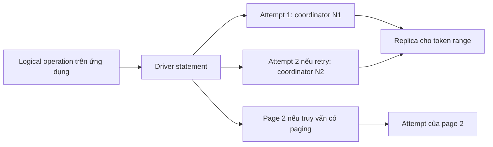

# Lập gói bằng chứng gồm truy vấn, tham số, topology, cấu hình và thời điểm trong Apache Cassandra

## 1. Vì sao chẩn đoán Cassandra cần một “gói bằng chứng”?

Giả sử ứng dụng Java vừa ghi nhận một `ReadTimeoutException` khi đọc đơn hàng. Ngay lập tức xuất hiện nhiều phỏng đoán: coordinator quá tải, một replica chậm, partition quá lớn, tombstone quá nhiều, kết nối Java bị nghẽn, repair đang chạy hoặc sự cố mạng liên DC.

Chỉ một dòng “read timeout lúc 10 giờ” **không phân biệt được các nguyên nhân này**. Một ảnh chụp `nodetool status` cho thấy các node đều `UN` cũng không chứng minh request không bị nghẽn. Để tìm nguyên nhân và tái hiện sự cố, cần thu thập những bằng chứng **đồng bộ về ngữ nghĩa và thời gian**: truy vấn nào, tham số nào, consistency level nào, coordinator/replica nào, cấu hình nào, hệ thống đang thay đổi gì và sự kiện xảy ra chính xác khi nào.

**Gói bằng chứng (evidence package)** là một tập thông tin có cấu trúc, đủ để người khác:

1. Xác định **một logical operation** hoặc một nhóm request gặp cùng vấn đề.
2. Biết truy vấn CQL, partition/key range, tham số và phiên bản schema đã sử dụng.
3. Xác định đường đi từ Java Driver đến coordinator, replica theo topology tại thời điểm lỗi.
4. Ghép timestamp, trace ID, log và metrics từ các máy **trong cùng cửa sổ**.
5. Phân biệt **sự kiện quan sát được**, **giả thuyết** và **kết luận đã kiểm chứng**.
6. Tái hiện có kiểm soát và đo kết quả sau khi sửa, không tiết lộ dữ liệu khách hàng.

Bài thuộc chương **Tracing và chẩn đoán** của mô-đun `DATABASE_ENGINE_WIDE_COLUMN_CASSANDRA`. Kiến thức liên quan là partition key/wide-column, thiết kế bảng theo truy vấn, CQL, mức nhất quán đọc/ghi, replication, compaction, repair, xử lý lỗi và Java Driver. Mục tiêu không phải thu thật nhiều log, mà là thu **đúng những bằng chứng có khả năng kiểm định giả thuyết**.

## 2. Đơn vị điều tra: logical operation, attempt, page, coordinator và replica

Trước khi thu thập, phải quyết định **đang theo dõi đơn vị nào**.

| Đơn vị | Ý nghĩa | Vì sao phải phân biệt? |
| --- | --- | --- |
| **Logical operation** | Một hành động nghiệp vụ, ví dụ “đọc chi tiết đơn hàng” | Có thể gồm nhiều CQL statement, retry hoặc page |
| **CQL statement execution** | Một lần ứng dụng yêu cầu driver thực thi một statement | Driver có thể thực hiện nhiều attempt do retry/speculation |
| **Request attempt** | Một lần driver gửi yêu cầu tới một coordinator cụ thể | Attempt lỗi và attempt thành công có thể thuộc cùng logical operation |
| **Page fetch** | Một request lấy trang dữ liệu trong truy vấn phân trang | Page đầu nhanh, page sau lỗi vẫn làm operation tổng thể thất bại |
| **Coordinator** | Node nhận request và điều phối các replica cho lần attempt đó | Không nhất thiết là replica chứa partition |
| **Replica** | Node được chọn lưu/đọc token range theo RF/topology | Một replica chậm có thể ảnh hưởng CL và tail latency |
| **Trace session** | Phiên tracing của một lần thực thi được bật trace | Một trace không tự đại diện cho mọi lần retry/page |



**Hệ quả:** một trace ID có ích nhưng **không thay thế** application request ID, driver attempt/retry metrics và thời điểm các page được lấy. Khi trace không tồn tại (do chưa bật, bị timeout, hoặc bản ghi hết TTL), vẫn có thể lập gói bằng chứng từ application/driver logs và server metrics.

## 3. Hợp đồng bằng chứng tối thiểu

Một gói đủ dùng phải trả lời **năm câu hỏi bắt buộc** và ghi rõ nguồn chứng minh.

| Câu hỏi | Trường cần thu | Nguồn |
| --- | --- | --- |
| **Truy vấn gì?** | CQL shape/fingerprint, keyspace/table, schema version, loại truy vấn, partition/clustering predicates | App logs, prepared statement, CQL, `system_schema` |
| **Tham số nào?** | Kiểu dữ liệu, giá trị đã ẩn danh hoặc bucket, số lượng phần tử `IN`, dải thời gian, `LIMIT`, page size | App/driver instrumentation |
| **Đi qua đâu?** | Cluster/DC, node/coordinator, token/replica placement, RF, snitch/rack, node `UN/DN` | Driver execution info, `nodetool`, schema |
| **Cấu hình gì?** | Cassandra/driver version, CL, SERIAL CL khi có LWT, timeout, retry/speculation, compaction/TTL/RF | App config, CQL schema, cấu hình server thực có hiệu lực |
| **Xảy ra khi nào?** | UTC timestamp có offset/độ chính xác, duration monotonic, cửa sổ sự cố và trước/sau, clock synchronization | App logs, NTP, tracing, server logs/metrics |

Ngoài năm nhóm, nên giữ **symptom, tác động SLO, request ID/trace ID, kết quả, lỗi, số mẫu, độ tin cậy và dữ liệu còn thiếu**. Không có bằng chứng thì ghi **UNKNOWN**; đừng tự điền giả định thành sự thật.

### 3.1. Gói không phải dump toàn bộ production

Thu thập có mục đích: một tập nhỏ request đại diện, cửa sổ thời gian hữu hạn, các node liên quan, cấu hình có tác động và biểu đồ metric đúng ngữ nghĩa. Tránh đưa cả `cassandra.yaml` có bí mật, toàn bộ parameter chứa PII hoặc log của khách hàng không liên quan vào ticket.

**Nguyên tắc:** đủ thông tin để tái hiện và kiểm tra giả thuyết, **ít dữ liệu nhạy cảm nhất**.

## 4. Nhóm 1 — CQL: giữ nguyên hình dạng truy vấn, không chỉ tên endpoint

Giả sử endpoint `GET /api/events?day=...` bị chậm. Chỉ ghi tên endpoint là không đủ. Cần CQL mà ứng dụng thực sự chạy:

```sql
SELECT event_time, event_id, payload
FROM evidence_lab.events_by_tenant_day
WHERE tenant_id = ?
  AND bucket_day = ?
  AND event_time >= ?
  AND event_time < ?
LIMIT 50;
```

Đây là **query shape** với bind markers, đủ để đánh giá việc dùng partition key và clustering range. Ghi rõ:

1. **Keyspace và table đầy đủ:** truy vấn `SELECT` ở bảng nào, có thêm bảng index/materialized view hay không?
2. **Partition key:** đã cung cấp đủ các thành phần của khóa phân vùng chưa? Một query quét nhiều partition có đặc điểm hoàn toàn khác query đúng một partition.
3. **Clustering predicates:** bắt đầu/kết thúc range, độ rộng cửa sổ; có sử dụng `ORDER BY`, `IN`, `LIMIT`, `ALLOW FILTERING` hay aggregation không?
4. **Phần trả về:** tất cả cột hay một tập cột, có collection lớn hoặc payload kích thước lớn không?
5. **Prepared hay simple statement:** nếu prepared, giữ cả CQL template, kiểu bind và version ứng dụng; đừng chỉ log object `PreparedStatement`.
6. **Batch/LWT:** với `BEGIN BATCH` hoặc `IF ...`, ghi statement và đặc tính protocol tương ứng; LWT có thêm pha Paxos và SERIAL consistency.

### 4.1. Vì sao `LIMIT 50` vẫn có thể chậm?

`LIMIT` giới hạn số hàng được trả về, **không** giới hạn trực tiếp số SSTable, tombstone hoặc replica coordination mà engine phải xử lý. Nếu một partition chứa nhiều dữ liệu đã xóa, Cassandra có thể phải đi qua rất nhiều tombstone để tìm vài hàng sống. Một bằng chứng hữu ích là **clustering range** và các metric **tombstones scanned/SSTables per read**, không chỉ `rows_returned=12`.

### 4.2. Ghi “fingerprint” có độ ổn định

Chuẩn hóa CQL template với bind markers rồi gán một mã `query_fingerprint` (ví dụ HMAC/hash của template chuẩn hóa), kết hợp **application build/schema version**. Không dùng fingerprint thay nội dung query shape trong gói nội bộ có kiểm soát: fingerprint chỉ để nhóm các request cùng mẫu, không cho người khác biết truy vấn gì.

Nếu SQL/CQL được sinh động, lưu đủ mẫu đã normalize và giữ thứ tự cột `WHERE`/các bind positions. Không gom các truy vấn có ý nghĩa khác nhau (một partition so với scan nhiều partition) vào cùng nhãn `SELECT` chung.

## 5. Nhóm 2 — Bind parameters: đủ chi tiết nhưng không lộ dữ liệu

Một query shape có thể chạy rất nhanh ở partition nhỏ và rất chậm ở partition nóng. Bởi vậy **tham số** là bằng chứng then chốt, nhất là partition key, bucket theo thời gian và độ rộng clustering range.

| Loại tham số | Cần ghi | Ví dụ an toàn |
| --- | --- | --- |
| Partition key khách hàng/tenant | Kiểu + mã ẩn danh **ổn định trong cùng incident** | `tenant_id:text, token_alias=tenant_HMAC_42` |
| Clustering time range | Kiểu + mốc UTC hoặc độ rộng nếu quá nhạy cảm | `start=2026-11-21T08:00Z; width=60m` |
| `IN` values | Số phần tử, kiểu, số partition ước tính | `device_ids:list<uuid>, count=120` |
| `LIMIT` và page size | Giá trị cụ thể | `LIMIT=50, page_size=100` |
| Payload ghi | Byte size, shape/số phần tử, hash kiểm tra nếu cần | `payload_bytes=24576` |
| TTL hoặc `USING TIMESTAMP` | Giá trị và đơn vị, nếu statement có | `ttl_seconds=3600` |
| Consistency và timeout | Giá trị đã thực thi trên statement | `CL=LOCAL_QUORUM; request_timeout=2s` |

**Không** log trực tiếp email, số tài khoản, token đăng nhập, mật khẩu, API key hay payload người dùng. Có thể dùng **HMAC với khóa kiểm soát** để sinh alias ổn định cho partition key; **hash thuần** của identifier dễ đoán không phải cơ chế ẩn danh đủ mạnh đối với miền giá trị nhỏ.

Tại môi trường được phép xử lý dữ liệu nhạy cảm, một nhân sự được phân quyền có thể dùng bảng ánh xạ alias→giá trị thật **tách biệt**, với TTL/lưu trữ hạn chế. Gói gửi cho nhóm chẩn đoán chỉ cần alias, token hoặc thông tin kích thước/dải; không kèm khóa HMAC.

### 5.1. Phân biệt giá trị và tính chất gây tải

Nếu lỗi chỉ xảy ra với một tenant, HMAC alias cho phép nhóm sự cố mà không lộ tên tenant. Nếu lỗi xảy ra với mọi truy vấn tìm dữ liệu cũ, **độ rộng thời gian** và **tỷ lệ dữ liệu TTL hết hạn** mới là yếu tố có giá trị. Nếu cần tái hiện một hot partition, phải bảo tồn đặc trưng **số row, số SSTable, tombstone density, mức đọc/ghi**, không chỉ copy một key đã ẩn danh.

## 6. Nhóm 3 — Topology: biết coordinator và những replica nào liên quan

Một truy vấn ở DC1 dùng `LOCAL_QUORUM` khác đáng kể với truy vấn ở DC2 dùng `QUORUM`. Hãy ghi **topology tại thời điểm request**, không chỉ topology lúc điều tra viên mở dashboard hai giờ sau.

Thông tin tối thiểu:

- **Cluster name**, Cassandra version, datacenter, rack, snitch và trạng thái membership (`UN`, `DN`, joining/leaving/moving).
- **Replication strategy/RF từng DC** của keyspace, ví dụ `{'class':'NetworkTopologyStrategy','dc1':3,'dc2':3}`.
- **Coordinator của attempt** theo Driver `ExecutionInfo` nếu có; DC/rack của coordinator.
- **Replica endpoints** chịu trách nhiệm cho partition/token, biết đâu là replica được đọc/ghi và đâu là node không phản hồi nếu log/trace cho thấy.
- **Topology events**: node down/restart/replace, bootstrap, decommission, thêm DC hoặc thay RF gần khoảng lỗi.
- **Schema agreement** và thời điểm đổi schema; một request trong quá trình chuyển đổi topology có thể khác request sau khi ổn định.

### 6.1. Các lệnh quan sát

```bash
# Chạy trên node tương ứng; kết quả mang phạm vi "node và thời điểm".
nodetool status
nodetool describecluster
nodetool ring

# Tải nền có thể làm coordinator/replica chậm.
nodetool netstats
nodetool compactionstats
```

Trong CQL:

```sql
SELECT keyspace_name, replication
FROM system_schema.keyspaces
WHERE keyspace_name = 'evidence_lab';
```

Một số phiên bản hỗ trợ `nodetool getendpoints <keyspace> <table> <partition_key>` để xem replica của khóa mẫu. **Với composite partition key, cách mã hóa khóa đầu vào và các công cụ truy vấn token phụ thuộc phiên bản**, nên không đoán bằng cách nối chuỗi tùy ý. Nếu không xác nhận được tập replica theo khóa, ghi rõ `replica_mapping=UNKNOWN` thay vì suy từ token ownership chung.

**Bẫy quan trọng:** coordinator không nhất thiết là replica. Nếu node A làm coordinator, log/trace có thể cho thấy chậm tại replica B/C; nhìn chỉ CPU của A có thể bỏ sót nguyên nhân.

### 6.2. Topology thay đổi khi sự cố đang diễn ra

Lưu **hai snapshot**: gần **trước/sát thời điểm lỗi** (nếu đã có monitoring) và **sau sự cố**. Nếu một node đã lên lại, snapshot `UN` hiện tại không phủ định việc nó từng `DN` trong cửa sổ lỗi. Đối chiếu sự kiện với log gossip/streaming và rollout/restart trên hệ thống giám sát.

## 7. Nhóm 4 — Cấu hình: lưu trạng thái có hiệu lực, không chỉ giá trị mặc định

Một kết luận dựa trên “mặc định Cassandra là X ms” rất dễ sai vì ứng dụng và cluster có thể override từ nhiều nguồn. Mẫu gói bằng chứng phải tách **cấu hình server**, **schema/table** và **client/driver**.

| Phân lớp | Thông tin nên thu | Vì sao quan trọng? |
| --- | --- | --- |
| **Cassandra server** | Version/distribution/build; read/write/range timeout, native transport, thread/queue giới hạn, môi trường JVM/GC | Xác định deadline và các điểm nghẽn trên node |
| **Keyspace** | `NetworkTopologyStrategy`, RF theo DC, phiên bản/schema agreement | Biết tập replica và quorum cần ACK |
| **Table** | Partition/clustering schema, compaction strategy/options, `gc_grace_seconds`, default TTL, caching | Giải thích range scan, tombstone, SSTable/compaction |
| **Driver 4.x** | Version, local DC, load balancing, request timeout, retry policy, speculative execution, connection pool, paging | Có thể sinh attempt/paging hoặc timeout trước server |
| **Statement cụ thể** | CL, SERIAL CL khi áp dụng, timeout override, idempotence, tracing, page size, timestamp, keyspace | Giá trị của từng request có thể ghi đè cấu hình session |
| **Triển khai/OS** | CPU/heap, disk, file descriptors, TLS/network proxy, timezone/NTP, thay đổi bản phát hành | Nguồn gây latency không nằm trong CQL |

Gói **không cần** kèm nguyên tệp `cassandra.yaml` với thông tin mật. Hãy ghi từng **option liên quan**, giá trị **có hiệu lực khi lỗi xảy ra**, nguồn của nó (server file, system property, deployment config, statement override) và bằng chứng thời điểm áp dụng.

### 7.1. Kiểm tra schema của bảng

```sql
-- CQL trên version hỗ trợ bảng system_schema tương ứng.
SELECT keyspace_name, table_name, compaction,
       gc_grace_seconds, default_time_to_live
FROM system_schema.tables
WHERE keyspace_name = 'evidence_lab'
  AND table_name = 'events_by_tenant_day';
```

`system_schema.tables` có nhiều thuộc tính nhưng **không thay thế đầy đủ DDL**: cần ghi partition/clustering columns bằng `DESCRIBE TABLE evidence_lab.events_by_tenant_day` trong `cqlsh` (là lệnh của cqlsh, **không phải CQL gửi qua Java Driver**) hoặc đọc `system_schema.columns`. Với sự cố query, lưu schema **tại thời điểm request**, tránh dùng DDL hiện tại sau migration làm bằng chứng hồi tố.

### 7.2. Đơn vị và mức override

`request_timeout=2000` có thể là **mili giây** hay cấu hình dạng `2 seconds` tùy nguồn. Mọi giá trị thời gian cần **kèm đơn vị**. Một client timeout 1,5 s và server timeout 5 s có thể tạo lỗi **tại driver trước khi server báo timeout**; chỉ đọc server timeout không thể giải thích đầy đủ.

## 8. Nhóm 5 — Thời điểm: cách nối timeline nhiều máy không tự tạo sai lệch

Một gói chứng cứ không có timeline tin cậy thường dẫn tới kết luận “nguyên nhân xuất hiện sau hậu quả”.

### 8.1. Chuẩn hóa thời gian

Mỗi sự kiện nên có:

```text
event_time_utc  = 2026-11-21T10:15:23.417Z
source          = java-app/pod-7 (hay node cassandra-2)
clock_source    = NTP synchronized / unknown
precision       = milliseconds (hay microseconds nếu thực tế có)
time_window     = [10:15:20Z, 10:15:30Z)
duration_ms     = 1840.2  (tính từ monotonic clock trong cùng process)
```

- **UTC và offset:** dùng timestamp ISO 8601 có `Z` hoặc offset, tránh ghi “10:15” không có timezone.
- **Wall clock vs monotonic clock:** dùng wall clock để đặt sự kiện lên timeline nhiều node; dùng `System.nanoTime()` để đo **khoảng thời gian trong cùng JVM**.
- **Clock skew:** ghi offset/sai lệch NTP của các node; nếu clock của cassandra-2 chạy nhanh 800 ms, không thể suy thứ tự các sự kiện cách nhau 200 ms chỉ nhờ timestamp log.
- **Cửa sổ:** nên có trước–trong–sau sự cố, ví dụ 5 phút trước và 10 phút sau, điều chỉnh theo retention và mức tải; không chọn toàn bộ log nhiều ngày không cần thiết.
- **Timestamp resolution:** hai log cùng mili giây không có nghĩa đã xảy ra đồng thời; thứ tự trong một log khác thứ tự phân tán toàn cụm.

**Không trừ hai giá trị `System.nanoTime()` lấy trên hai máy/process khác nhau**. Trước khi kết luận một sự kiện “đến sau”, xem clock skew, độ trễ log exporter và khả năng buffer của hệ thống thu thập.

### 8.2. Ghi request-start và request-end

Đối với một request:

```text
client_request_started_utc = 2026-11-21T10:15:23.417Z
client_elapsed_ms          = 1840.2
client_result              = ReadTimeoutException
server_trace_started_utc   = 2026-11-21T10:15:23.421Z (nếu trace có)
server_trace_duration_us   = ... (nếu có và hoàn tất)
```

Nếu cần ghi cả attempt/page, đặt các mốc riêng; **không** lấy duration của một attempt server làm duration của logical operation có retry, paging hay thời gian nằm trong driver queue.

## 9. Tracing có giá trị gì và giới hạn ra sao?

**Cassandra tracing** cung cấp các sự kiện trên đường thực thi request, có thể gồm coordinator, gửi thông điệp, đọc SSTable, chờ/nhận phản hồi và những hoạt động tại replica theo phiên bản. Thông tin thường được lưu tại `system_traces.sessions` và `system_traces.events` trong thời gian lưu giới hạn.

Nhưng tracing:

- Có **overhead CPU/I/O và ghi dữ liệu trace**; không nên bật cho toàn bộ production hoặc mọi request chỉ để “phòng sự cố”.
- Có thể chứa **query text, tham số, địa chỉ node, user/tenant**; phải bảo vệ quyền truy cập.
- Không bảo đảm một trace luôn **đầy đủ** nếu request lỗi, tracing write bị chậm hoặc bản ghi trace hết TTL.
- Một trace chỉ mô tả **một lần thực thi có tracing**, không đại diện cho p99 hoặc tất cả các request.
- Có thời gian elapsed tại trace event khác với **end-to-end Java latency**; nên ghép với driver logs và metrics.

### 9.1. Chọn request để trace

Trong production, ưu tiên **sampling có kiểm soát** của một request đại diện, trong thời gian ngắn và được phép, sau khi đã có cảnh báo/query shape. Chọn các request **có cùng CQL và kiểu tham số** với workload gặp lỗi; không bật tracing rồi vô tình làm tăng tải khiến nguyên nhân thay đổi.

Nếu dữ liệu nhạy cảm, tái hiện ở **staging** với schema, phân phối partition, TTL và số SSTable tương đương, hoặc sử dụng chế độ truy vết do tổ chức phê duyệt. Một truy vấn lab nhẹ không đủ tái tạo một hot partition production lớn.

## 10. Thực hành tracing trên cqlsh trong lab

Giả sử đã có cluster Cassandra lab và keyspace `evidence_lab`. Ví dụ dưới đây tạo một bảng theo **partition key ghép (tenant_id, bucket_day)** để thấy rõ ngữ nghĩa lọc theo partition và clustering range:

```sql
CREATE KEYSPACE IF NOT EXISTS evidence_lab
WITH replication = {
    'class': 'NetworkTopologyStrategy',
    'dc1': 3
};

CREATE TABLE IF NOT EXISTS evidence_lab.events_by_tenant_day (
    tenant_id text,
    bucket_day date,
    event_time timestamp,
    event_id uuid,
    payload text,
    PRIMARY KEY ((tenant_id, bucket_day), event_time, event_id)
) WITH CLUSTERING ORDER BY (event_time DESC, event_id ASC);

INSERT INTO evidence_lab.events_by_tenant_day
    (tenant_id, bucket_day, event_time, event_id, payload)
VALUES (
    'tenant_demo', '2026-11-21', '2026-11-21T08:30:00Z',
    11111111-1111-1111-1111-111111111111, 'demo'
);
```

Thao tác **trong cqlsh** (trên cluster test, điều chỉnh tên DC/RF và CL thực tế):

```sql
CONSISTENCY LOCAL_QUORUM;
TRACING ON;

SELECT event_time, event_id, payload
FROM evidence_lab.events_by_tenant_day
WHERE tenant_id = 'tenant_demo'
  AND bucket_day = '2026-11-21'
  AND event_time >= '2026-11-21T08:00:00Z'
  AND event_time <  '2026-11-21T09:00:00Z'
LIMIT 50;

TRACING OFF;
```

`CONSISTENCY` và `TRACING` là **lệnh cqlsh**, không phải CQL statement thông thường mà Java Driver gửi qua `session.execute`. Lệnh `TRACING ON` bật tracing cho **những request cqlsh tiếp theo**; phải tắt ngay sau yêu cầu cần khảo sát.

`cqlsh` thường hiển thị **Tracing session** (UUID) cùng danh sách hoạt động, source, elapsed. Nếu có trace ID, có thể quan sát thông tin phiên:

```sql
-- Thay UUID minh họa bằng tracing session ID thực tế.
SELECT *
FROM system_traces.sessions
WHERE session_id = 22222222-2222-2222-2222-222222222222;

SELECT session_id, event_id, activity, source, source_elapsed, thread
FROM system_traces.events
WHERE session_id = 22222222-2222-2222-2222-222222222222;
```

**Cảnh báo:** trace có thể mất/thiếu khi timeout hoặc hết thời gian lưu. Không truy vấn các bảng trace bằng `SELECT *` không giới hạn trên toàn hệ thống; ở ví dụ trên `WHERE session_id` là điều kiện partition key. Các trường/mô hình lưu tracing có thể thay đổi theo bản Cassandra, nên kiểm tra trên release đang dùng.

### 10.1. Đọc trace theo giả thuyết

| Dấu hiệu trong trace | Giả thuyết cần kiểm tra tiếp | Bằng chứng đi kèm |
| --- | --- | --- |
| Thời gian chờ replica cao | Replica chậm, mạng giữa coordinator–replica, CL phải chờ nhiều ACK | Node read/write metrics, `tpstats`, network |
| Nhiều sự kiện liên quan SSTable/data scan | Nhiều SSTable, partition rộng, tombstone scan, dữ liệu/caching | `tablestats`, `tablehistograms`, query/range |
| Trace không đầy đủ nhưng client timeout | Request bị hủy/chậm, trace writes bị mất hoặc bị giới hạn | Driver error time, server logs, tracing config |
| Nhiều request/page/attempt ứng với một operation | Paging, retry/speculative execution hoặc caller lặp | Driver execution metadata, attempt counters |
| Không thấy vấn đề trong một trace | Request mẫu không đại diện hoặc nghẽn không lặp lại | Phân phối p95/p99, sample nhiều request hợp lệ |

**Trace không tự chứng minh quan hệ nhân quả.** Nó hỗ trợ thu hẹp giả thuyết; phải đặt cạnh metric, topology và timeline cùng thời điểm.

## 11. Java Driver 4.x: lưu request metadata và tracing ID

Trong Java, dùng `PreparedStatement` + `BoundStatement` để ghi rõ query shape, CL, paging và bind types. Với một request **được chọn để trace**, có thể bật `setTracing(true)` rồi lấy `ExecutionInfo` từ kết quả.

Ví dụ Java 17+, Java Driver 4.x; `CqlSession session` giả định đã được cấu hình contact points, local datacenter, authentication/TLS phù hợp:

```java
import com.datastax.oss.driver.api.core.DefaultConsistencyLevel;
import com.datastax.oss.driver.api.core.cql.BoundStatement;
import com.datastax.oss.driver.api.core.cql.ExecutionInfo;
import com.datastax.oss.driver.api.core.cql.PreparedStatement;
import com.datastax.oss.driver.api.core.cql.ResultSet;
import com.datastax.oss.driver.api.core.cql.Row;
import java.time.Instant;
import java.time.LocalDate;
import java.util.UUID;

PreparedStatement ps = session.prepare("""
    SELECT event_time, event_id, payload
    FROM evidence_lab.events_by_tenant_day
    WHERE tenant_id = ?
      AND bucket_day = ?
      AND event_time >= ? AND event_time < ?
    LIMIT 50
    """);

BoundStatement statement = ps.boundStatementBuilder()
    .setString(0, "tenant_demo")
    .setLocalDate(1, LocalDate.of(2026, 11, 21))
    .setInstant(2, Instant.parse("2026-11-21T08:00:00Z"))
    .setInstant(3, Instant.parse("2026-11-21T09:00:00Z"))
    .setConsistencyLevel(DefaultConsistencyLevel.LOCAL_QUORUM)
    .setPageSize(100)
    .setTracing(true) // Chỉ bật cho sample được phép, không mặc định production.
    .build();

Instant requestStartedUtc = Instant.now();
long startedNs = System.nanoTime();
try {
    ResultSet rs = session.execute(statement);
    int rows = 0;
    for (Row row : rs) {
        rows++; // Không đưa payload vào log bằng chứng.
    }
    long elapsedNs = System.nanoTime() - startedNs;
    ExecutionInfo info = rs.getExecutionInfo();
    UUID tracingId = info.getTracingId();

    // Ghi: request-id, query_fingerprint, CL, page size, row count,
    // start UTC, elapsed, coordinator từ info (nếu có), tracingId,
    // warnings, app/driver versions và alias partition key.
    // Tránh log dữ liệu khách hàng hoặc secrets.
} catch (RuntimeException error) {
    long elapsedNs = System.nanoTime() - startedNs;
    // Ghi error class, cause, request-id, thời gian và sample params an toàn.
    // Một lỗi có thể không trả ExecutionInfo/tracing ID; tra server logs.
    throw error;
}
```

**Các giới hạn cần ghi trong bài thực hành:**

- `getExecutionInfo()` của `ResultSet` gắn với thông tin thực thi do API trả, có thể không mô tả mọi page/attempt của toàn bộ vòng lặp. Với paging, cần instrument từng page và kiểm tra API của phiên bản driver để lấy execution info thích hợp.
- `info.getTracingId()` có thể là `null` nếu không có trace ID. Việc bật tracing cũng có thể làm thay đổi latency do overhead.
- Nếu truy vấn **timeout** trước khi có kết quả, code nhánh `catch` có thể chỉ biết loại lỗi và mốc ứng dụng, không được tự tạo trace ID hoặc đoán coordinator.
- `setPageSize(100)` khác với `LIMIT 50`: page size là gợi ý số hàng/page, `LIMIT` là giới hạn kết quả. Không lấy một phép đo với page size khác rồi tuyên bố so sánh tương đương.
- `requestStartedUtc` là wall clock để nối log; `elapsedNs` dùng monotonic clock để đo duration **trong JVM**. Không suy timestamp của replica từ thời gian JVM nếu chưa đồng bộ clock.
- Một **giá trị tenant alias** có thể dùng khi log; ví dụ literal `tenant_demo` ở đây chỉ là dữ liệu lab.

### 11.1. Một request có thể có nhiều attempt

Khi retry/speculative execution được bật, một logical operation có thể được gửi tới nhiều coordinator. Gói bằng chứng nên ghi **retry count, speculative execution count, coordinator được chọn, timeout và error per attempt nếu exporter cho phép**. Không giả định `getExecutionInfo` của lần thành công cuối là lịch sử đầy đủ của mọi attempt; sử dụng driver metrics/logs và request correlation.

## 12. Thu metrics và log ở cùng thời điểm

Một trace cung cấp đường thực thi **một request**; metrics cho biết điều đó có lặp lại và ảnh hưởng bao nhiêu request. Mỗi biểu đồ/ảnh chụp nên kèm **UTC start/end, time resolution, node/DC, source/collector và đơn vị**.

### 12.1. Bộ lệnh quan sát an toàn

```bash
# Membership và schema/topology hiện tại.
nodetool status
nodetool describecluster

# Thread pools, queue, rejected/dropped messages tùy release.
nodetool tpstats

# Phân phối latency ở coordinator.
nodetool proxyhistograms

# Dung lượng, SSTable, latency và nhiều chỉ số theo bảng.
nodetool tablestats evidence_lab.events_by_tenant_day
nodetool tablehistograms evidence_lab events_by_tenant_day

# Hoạt động nền có thể gây nghẽn.
nodetool compactionstats
nodetool netstats
```

Đây là **lệnh chỉ đọc để quan sát**. Không tự chạy `repair`, `cleanup` hoặc major compaction trong lúc điều tra nếu chưa có kế hoạch xử lý riêng; chúng có thể làm thay đổi môi trường và xóa dấu vết nguyên nhân.

### 12.2. Checklist metrics cần lưu

| Cấp | Những chỉ số cần đối chiếu | Lý do |
| --- | --- | --- |
| **Ứng dụng Java** | Accepted/successful RPS, lỗi và timeout theo query shape, p50/p95/p99, retry và paging | Xác định tác động SLO thực và các request bị loại |
| **Driver** | Per-node connections/in-flight, request throttling queue, retry/speculation, client timeout | Phân biệt nghẽn phía client với server |
| **Coordinator** | Read/write/range latency, timeouts/failures/unavailables, request attempts, pending tasks | Xác định node điều phối nào chậm và loại lỗi |
| **Replica/table** | Read/write latency, SSTables per read, tombstones scanned, partition size | Xác định ảnh hưởng data model và SSTable |
| **JVM/OS/node** | CPU, heap/GC pauses, disk I/O latency, network RTT/loss, disk free | Kiểm tra bottleneck hạ tầng |
| **Cluster maintenance** | Compaction backlog, repair/streaming, snapshot, node restart/topology change | Phân biệt tác vụ nền với query lỗi |

**Đừng lấy trung bình p99 các node** để có p99 cụm; dùng histogram/mẫu hợp nhất hợp lệ hoặc giữ p99 theo node với lưu lượng mỗi node. Tách **successful RPS** khỏi **offered RPS** và lỗi: nếu đa số request đã timeout, p99 chỉ của request thành công có thể giảm trong lúc trải nghiệm người dùng xấu đi.

### 12.3. Phân biệt nguồn và độ tin cậy

| Nguồn | Có thể chứng minh | Không thể tự chứng minh |
| --- | --- | --- |
| Java logs | Lỗi/timeout ở client, query shape, duration, ID | Replica cụ thể đã nhận bao nhiêu dữ liệu |
| Driver execution info | Coordinator và trace ID cho lần thực thi được báo cáo (nếu có) | Tất cả attempt/page đều đã được ghi |
| Trace events | Các bước đã được trace ở coordinator/replica | Mọi request hoặc toàn bộ thời gian nằm trong client queue |
| `nodetool status` | Membership/node/DC tại thời điểm chạy | Node luôn khỏe trong cả cửa sổ sự cố |
| `tpstats` | Hàng đợi/stage trên node tại thời điểm đo | Một logical Java operation cụ thể là nguyên nhân |
| Metrics time series | Xu hướng latency, throughput, errors, tài nguyên | Nguyên nhân duy nhất nếu không có correlation |

## 13. Thiết kế cấu trúc gói để người khác đọc lại được

Một gói lý tưởng có **manifest** và các phụ lục liên kết qua request IDs, UTC timeline, node/DC và fingerprint. Cấu trúc dưới đây là **mẫu tài liệu**, không yêu cầu tạo thêm file trong bài:

```text
INC-2026-1121-CASS-001/
  manifest.yaml            # Phạm vi, owner, phiên bản, quyền truy cập
  timeline.csv             # UTC, nguồn, sự kiện, link ID, độ tin cậy
  requests.csv             # Request IDs, query shape, params đã ẩn danh
  topology-snapshot.txt    # RF/DC/rack/nodes trước/sau, thời điểm chụp
  config-summary.yaml      # Các option có hiệu lực, không chứa secrets
  tracing/
    trace-index.csv        # Query/request ID -> Cassandra tracing session ID
    sampled-events.txt    # Chỉ những request trace được phép
  metrics/
    windows.csv            # Node/DC, metric, range, đơn vị, link dashboard
  logs/
    app-redacted.txt       # Theo request ID + thời gian
    cassandra-redacted.txt # Các node liên quan, cùng cửa sổ
  hypotheses.md            # Điều quan sát, giả thuyết, phép thử, kết quả
  hashes.txt               # Checksum các artifact đã đóng gói
```

Không nhất thiết phải có mọi file trong mọi incident. Gói tối thiểu vẫn phải chứa năm nhóm **CQL, parameters, topology, effective config, timeline** và **liên kết đến kết quả/lỗi**. Nếu không có trace, manifest ghi `trace_available=false` và lý do, thay vì để trống một cách khó hiểu.

### 13.1. Mẫu manifest có thể tái sử dụng

```yaml
incident_id: INC-2026-1121-CASS-001
service: DATABASE_ENGINE_WIDE_COLUMN_CASSANDRA
classification: internal-restricted
owner_role: database-oncall
status: collecting   # collecting | investigating | validated | closed
timezone: UTC
window:
  start: "2026-11-21T10:10:00Z"
  end: "2026-11-21T10:30:00Z"
clock_sync:
  source: NTP
  max_known_offset_ms: 35
cluster:
  alias: cluster-prod-alias
  cassandra_version: "RECORD_ACTUAL_VERSION"
  local_dc: dc1
  keyspace: evidence_lab
  table: events_by_tenant_day
query:
  fingerprint: query_hmac_001
  shape_ref: requests.csv
  partition_alias: tenant_hmac_42
  consistency: LOCAL_QUORUM
  page_size: 100
  request_timeout_ms: 2000
topology_snapshot_at: "2026-11-21T10:15:00Z"
trace:
  enabled_for_sample: true
  tracing_session_id: null   # null nếu chưa thu được; không tự tạo ID
artifacts:
  timeline: timeline.csv
  sanitized_logs: logs/
  metrics: metrics/windows.csv
missing_evidence:
  - "Replica endpoints tại thời điểm lỗi chưa xác minh"
privacy:
  redaction_policy: "INCIDENT-HMAC-V1"
  retention_days: 30
```

**Giá trị trong manifest là minh họa**. Trước khi chia sẻ, thay bằng thông tin thật đã xác minh, giữ phiên bản đã ẩn danh và tuân thủ chính sách retention của tổ chức. Không lưu khóa HMAC hoặc token truy cập trong manifest.

## 14. Bảng timeline mẫu: tách FACT, INFERENCE và UNKNOWN

Ví dụ **giả định**: ứng dụng đọc theo partition key đầy đủ với `LOCAL_QUORUM`, driver request timeout 2.000 ms. Một số node ở DC1 đang compaction mạnh.

| UTC | Sự kiện | Nguồn | Nhãn bằng chứng |
| --- | --- | --- | --- |
| 10:14:40.000 | p99 read latency của node N2 tăng lên 380 ms | Metrics coordinator, cửa sổ 1 phút | **FACT**: metric quan sát |
| 10:14:55.000 | Pending tasks ở một stage của N2 tăng bất thường | `tpstats`/exporter tại N2 | **FACT**: queue snapshot |
| 10:15:01.120 | Java app bắt đầu request `req-7f` | App log UTC | **FACT** |
| 10:15:01.126 | Coordinator cho sample request là N1 | Driver execution info/trace nếu có | **FACT** nếu có ID khớp |
| 10:15:01.130 | Trace cho thấy chờ phản hồi replica N2 lâu | Trace session đã xác minh | **FACT** cho sample |
| 10:15:03.122 | Java app ghi `ReadTimeoutException` | App log | **FACT** |
| 10:15:04.000 | Người điều tra nghi I/O N2 gây timeout | Ghép queue + trace + disk metrics | **HYPOTHESIS**, cần kiểm thử |
| 10:15:06.000 | Repair có chạy trên N2 lúc lỗi không? | Chưa thu log/metrics | **UNKNOWN** |

**Không** đổi nhãn HYPOTHESIS thành FACT chỉ vì câu chuyện có vẻ hợp lý. Ví dụ “N2 quá tải do compaction” cần bằng chứng **compaction backlog, disk I/O**, mốc bắt đầu–kết thúc và thử nghiệm/correlation độc lập. Nếu trace ID không có, không được biến dòng giả định “N1 coordinator” thành sự thật.

### 14.1. Phân loại tác động

Báo cáo kèm:

- Query shape bị ảnh hưởng và **tỷ lệ request lỗi**, không chỉ một stack trace.
- Số tenant/partition hoặc phần ứng dụng có biểu hiện bất thường, qua alias đã ẩn danh.
- p50/p95/p99, offered/successful RPS, timeout/unavailable/failure rate trước–trong–sau.
- Khu vực/DC và node ảnh hưởng, có liên quan một replica set/hot partition hay toàn cluster.
- Thao tác thay đổi ngay trước đó: deploy ứng dụng, thay RF/topology, repair, compaction, TTL, Java Driver version, traffic ramp.

Đừng viết “sự cố chỉ ảnh hưởng một key” nếu mới kiểm tra đúng một key. Dùng “đã xác nhận ít nhất một key, phạm vi khác chưa kiểm tra”.

## 15. Quy trình thu thập bằng chứng theo giai đoạn

### Giai đoạn A — Khóa phạm vi và bảo toàn quan sát

1. Ghi incident ID, người phụ trách, mức độ, symptom và **cửa sổ UTC**.
2. Xác định query shape, endpoint, CL, DC và **một vài request đại diện**, đặc biệt request lỗi.
3. Lưu trích xuất metric time series và log trong khoảng phù hợp **trước khi retention hết hạn**.
4. Ghi rõ node status/topology theo thời điểm, bảo tồn log rollout/maintenance.
5. Không bật tracing đại trà hoặc chạy tác vụ thay đổi dữ liệu chỉ để “có thêm bằng chứng”.

### Giai đoạn B — Liên kết request ↔ node ↔ trace

1. Tìm application request ID và fingerprint, bind shapes/types đã ẩn danh.
2. Lấy coordinator/tracing ID từ driver nếu request thành công và có tracing; với lỗi, nối log qua UTC window và thông tin node/attempt có sẵn.
3. Xác nhận replica set theo token/placement và RF/CL; không suy đoán từ node đang là coordinator.
4. Trích trace events **đúng session ID** nếu dữ liệu còn; phân biệt elapsed server với client elapsed.
5. Ghép resource metrics và compaction/repair logs đúng node và thời điểm.

### Giai đoạn C — Kiểm định giả thuyết

1. Liệt kê tối thiểu hai giả thuyết có thể kiểm chứng, ví dụ **driver queue** và **replica disk I/O**.
2. Nêu **bằng chứng ủng hộ**, **bằng chứng phản bác** và **bằng chứng còn thiếu** cho từng giả thuyết.
3. Nếu cần tái hiện, dùng staging hoặc canary giới hạn, cùng query shape, phân phối partition và cấu hình quan trọng.
4. Đánh giá trước/sau bằng cùng SLO và tải; không coi một trace tốt sau sửa là chứng minh p99 đã hết vấn đề.
5. Đóng gói kết luận, action owner, thời điểm và phương án phòng tái phát.

### Giai đoạn D — Đóng và bàn giao

Manifest ghi trạng thái gói, checksum, nơi lưu, retention, danh sách người có quyền, quyết định kỹ thuật và liên kết remediation. **Không xóa bằng chứng gốc trước khi xác minh bản đã ẩn danh** và thời hạn lưu, nhưng cũng không giữ dữ liệu nhạy cảm vô hạn ngoài chính sách.

## 16. Bảng quyết định theo triệu chứng

| Triệu chứng | Ưu tiên thu bằng chứng | Đừng kết luận vội |
| --- | --- | --- |
| `ReadTimeoutException`, server p99 tăng | Query/CL, coordinator trace, replica read metrics, queue, disk | “Do Cassandra network” khi chưa kiểm tra replica |
| Java timeout, server latency bình thường | Driver queue, pool/in-flight, callback/event loop, network client→coordinator | “Server bị nghẽn” chỉ dựa vào lỗi client |
| `UnavailableException` sau node down | RF/CL, node/DC, replica endpoints, timeline node events | “Cứ retry là được” khi thiếu quorum |
| Query trả ít row nhưng chậm | Partition/clustering range, LIMIT, tombstones/SSTable read, paging | “LIMIT nhỏ nên truy vấn rẻ” |
| Chỉ một tenant/partition lỗi | Alias partition, token, replica set, phân phối dữ liệu và hot key | “Toàn cluster chậm” vì một key nóng |
| Sau đổi RF, dữ liệu cũ thiếu | Schema RF, repair/stream coverage, topology trước/sau, sample data | “ALTER thành công nên replica mới đủ dữ liệu” |
| LWT chậm, conflict tăng | CQL `IF`, serial consistency, contended key, retries, Paxos metrics | “SELECT thường nhanh nên LWT phải nhanh” |
| Xóa xong đọc còn thấy cũ | TTL/tombstones, write timestamps, consistency, repair history | “Compaction tự sửa” nếu replica còn stale |
| DC khác đọc stale | CL ghi/đọc, remote replica state, local DC, WAN, time-to-visibility | “Read timeout” và “stale read” là cùng lỗi |

Một gói bằng chứng tốt cũng nêu **nguyên nhân đã loại trừ**, ví dụ `driver_queue_ms` bình thường với nhiều request nhưng disk latency N2 tăng cùng thời điểm. Đây là cách thu hẹp chẩn đoán có trách nhiệm.

## 17. Bảo mật, quyền truy cập và tính toàn vẹn bằng chứng

Gói bằng chứng có thể chứa bí mật hoặc dấu vết nhận dạng người dùng:

- Query literal, bind parameters, cột `payload`, tên table/keyspace nhạy cảm.
- Trace session lưu query text, địa chỉ node, phân vùng hoặc nội dung giao thức.
- File cấu hình có credential, TLS private key, JMX endpoint, token.
- Log ứng dụng có request headers, tenant IDs, email hoặc session tokens.
- Địa chỉ IP, vị trí DC/rack hoặc topology nội bộ.

**Quy trình bảo vệ:**

1. Phân loại `internal-restricted` hoặc nhãn phù hợp; cấp quyền theo **least privilege**.
2. **Redact trước khi chia sẻ**: HMAC hóa key nhạy cảm, ẩn payload, secret/host chi tiết nếu người nhận không cần; giữ các đặc trưng kỹ thuật như kiểu dữ liệu, size, range, CL.
3. Lưu **thời điểm xuất dữ liệu, nguồn, phiên bản collector và chính sách ẩn danh** để có thể kiểm tra phương pháp.
4. Dùng checksum như **SHA-256** cho artifact đã đóng gói nhằm phát hiện sửa đổi; checksum **không** phải mã hóa hay cơ chế ẩn danh.
5. Ghi chain of custody: ai thu, ai chỉnh sửa/redact, lúc nào, lưu ở đâu và ai được xem.
6. Có thời hạn retention/xóa theo chính sách, tránh upload log/trace chứa PII lên dịch vụ công khai không được phê duyệt.

Với bài lab, dùng dữ liệu giả; không sao chép production dataset vào laptop cá nhân chỉ để tái hiện một timeout.

## 18. Tính hoàn chỉnh: tiêu chí PASS/INCOMPLETE của gói

Đánh giá mỗi nhóm:

| Tiêu chí | PASS nếu... | INCOMPLETE nếu... |
| --- | --- | --- |
| **Query** | Có CQL shape, table/schema và xác định loại operation | Chỉ biết tên HTTP endpoint |
| **Parameters** | Có bind type, đặc trưng partition/range, CL/page size và ẩn danh | Không phân biệt hot partition hoặc range |
| **Topology** | Có coordinator/replica set hoặc ghi rõ điều chưa xác định; RF/DC đúng thời điểm | Chỉ có ảnh `status` chụp nhiều giờ sau |
| **Configuration** | Có version và option có hiệu lực liên quan ở client/server/schema | Dựa vào mặc định phỏng đoán |
| **Time** | UTC window, thời gian client, clock source/skew hoặc sai số | Timestamp mơ hồ, không thống nhất timezone |
| **Correlation** | Request ID ↔ trace ID ↔ node/log/metric theo cùng thời gian | Có nhiều file rời rạc không nối được |
| **Quality/privacy** | Phân loại fact/hypothesis, redaction, owner, retention | Log lộ PII hoặc kết luận không có nguồn |
| **Validation** | Có phép thử xác nhận/phản bác và kết quả sau sửa | Chỉ có giả thuyết chưa kiểm tra |

Nếu không thể thu tracing vì sự cố đã qua TTL, nhóm trace **INCOMPLETE nhưng không nhất thiết cả gói vô giá trị**: có thể kết luận trong giới hạn bằng log/metrics và các bằng chứng độc lập. Tuy nhiên, phải mô tả rõ độ chắc chắn và dữ liệu thiếu; không báo “tracing xác nhận” khi không hề có trace.

## 19. Thực hành: lập gói bằng chứng cho một read timeout

### 19.1. Đề bài

Cluster lab ba node ở `dc1`, RF = 3. Ứng dụng Java chạy một prepared `SELECT` với `LOCAL_QUORUM`, page size 100, timeout 2 s. Trong 10 phút, 1,2% request chậm hoặc timeout; phần lớn xảy ra với một tenant alias. Một node đang có compaction backlog và p99 coordinator tăng.

**Yêu cầu thực hành:**

1. Tạo bảng `evidence_lab.events_by_tenant_day` như ví dụ, thêm dữ liệu thử có phân bố **một tenant nóng và nhiều tenant thường**, có khả năng kiểm soát TTL/xóa trong lab.
2. Ghi CQL template, kiểu bind, partition alias, time range, `LIMIT`, CL, paging, timeout, driver/cluster version; giữ dữ liệu fake.
3. Đo client p50/p95/p99 và failure rate **theo fingerprint** trong một cửa sổ UTC có thời gian trước/trong/sau.
4. Thu `status`, `tpstats`, `proxyhistograms`, `tablestats`, `compactionstats` từ node liên quan trong cùng cửa sổ.
5. Bật tracing cho **một số request đại diện**; thu session IDs và event ở `system_traces`, đánh dấu request nào không có trace.
6. Tạo timeline FACT/HYPOTHESIS/UNKNOWN và hai giả thuyết: **partition scan đắt** vs **node/disk bị nghẽn**. Chỉ ra bằng chứng nào có thể phân biệt.
7. Thử cải tiến một yếu tố trong staging, giữ tải/query tương đương và đo lại. Tách thay đổi workload khỏi tác động của sửa chữa.
8. Hoàn thiện manifest, redaction, checksum, mô tả giới hạn và kết luận.

### 19.2. Bốn câu hỏi mà người nhận gói phải trả lời được

- Query nào lỗi, **đúng tham số/range nào**, hay chỉ biết endpoint?
- Lỗi xảy ra trên **node/coordinator/replica nào** trong **cửa sổ UTC nào**?
- **Phiên bản/config/CL** nào thực sự áp dụng lúc đó, và có topology change/repair không?
- Vì sao kết luận “nguyên nhân A” đáng tin hơn “nguyên nhân B”, và **sau sửa** có metric chứng minh không?

Nếu người nhận phải tự đoán một trong bốn câu trả lời, hãy bổ sung bằng chứng hoặc gắn nhãn thông tin chưa xác minh.

## 20. Câu hỏi tự kiểm tra

1. Vì sao một stack trace `ReadTimeoutException` không đủ để quy lỗi cho một replica?
2. Một logical operation khác một request attempt và một page fetch thế nào?
3. Khi lưu CQL prepared statement, vì sao cần cả query shape lẫn kiểu/đặc trưng bind parameters?
4. Vì sao không log trực tiếp tenant ID và payload? HMAC alias giúp điều gì hơn hash thuần?
5. `LOCAL_QUORUM` và replication factor ảnh hưởng thế nào tới tập replica phải phản hồi?
6. Node trong `nodetool status` đang `UN` có chứng minh nó khỏe tại thời điểm lỗi trước đó không?
7. Vì sao `TRACING ON` không nên bật đại trà trên production?
8. `system_traces.events` theo `session_id` cho biết gì, và khi nào trace có thể thiếu?
9. Tại sao `System.nanoTime()` trên hai máy không thể trừ trực tiếp để tính độ trễ?
10. Vì sao phải ghi **effective configuration** và statement overrides thay vì mặc định bản Cassandra?
11. Điều gì sai khi lấy trung bình p99 của các node để suy p99 toàn cụm?
12. Khi Java timeout nhưng server latency bình thường, nên thu thêm bằng chứng ở lớp nào?
13. Điều gì có thể khiến dữ liệu lịch sử ở DC mới thiếu dù RF đã cập nhật?
14. “Có tương quan giữa compaction backlog và timeout” khác “compaction gây timeout” thế nào?
15. Gói chưa có tracing session ID có còn hữu ích không, và phải nêu giới hạn ra sao?

## 21. Kết luận

**Lập gói bằng chứng trong Cassandra là thiết lập mối liên kết có thể kiểm tra giữa truy vấn, tham số, topology, cấu hình và thời gian.** Không thể chẩn đoán một read timeout hoặc stale read chỉ bằng một dòng lỗi; cũng không thể gọi một trace, một ảnh `nodetool` hay một biểu đồ p99 là bằng chứng hoàn chỉnh.

Một gói tốt ghi **CQL shape + bind types/range**, **partition/token và coordinator/replica**, **RF/CL/driver/server settings có hiệu lực**, **timeline UTC và độ lệch đồng hồ**, cùng **request ID, trace ID, logs và metrics**. Mọi nhận định phải được đánh dấu **FACT, HYPOTHESIS hoặc UNKNOWN**, có giới hạn quyền truy cập và ẩn danh dữ liệu. Sau khi sửa, kiểm tra bằng **cùng workload và SLO**. Khi bằng chứng chưa đủ, kết luận đúng là **INCOMPLETE kèm danh sách thiếu**, chứ không phải một nguyên nhân được suy đoán cho có.
