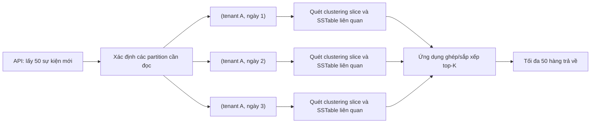
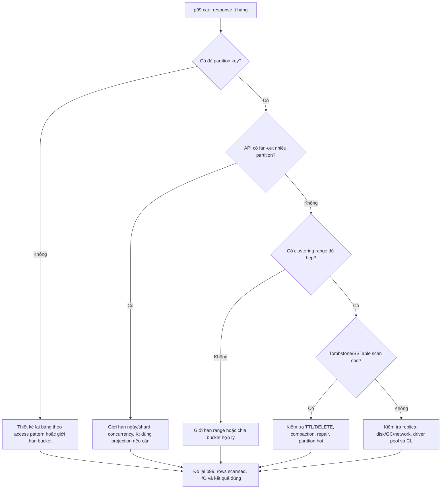

# Giới hạn số phân vùng và số hàng cần đọc

Một câu truy vấn Apache Cassandra trả về **20 hàng** không có nghĩa server chỉ đọc **20 hàng**, và `LIMIT 20` không bảo đảm truy vấn sẽ nhanh. Để có 20 hàng còn sống, Cassandra có thể phải xem nhiều SSTable, bỏ qua các giá trị đã hết TTL, xử lý tombstone hoặc đi qua một vùng khóa quá rộng. Một API khác chỉ trả 50 sự kiện mới nhất nhưng lại mở **hàng trăm partition** song song, khiến rất nhiều replica và coordinator phải xử lý công việc trước khi Java ghép kết quả.

Bài thuộc chương **Tối ưu truy vấn** của mô-đun **DATABASE_ENGINE_WIDE_COLUMN_CASSANDRA**. Trọng tâm là **giới hạn chủ động số partition và số hàng cần đọc** bằng cách thiết kế bảng theo truy vấn, chọn partition key và clustering key, giới hạn dải thời gian, kiểm soát fan-out/paging, rồi đo lượng dữ liệu thực sự được đọc. Tư duy này liên quan trực tiếp đến replication, consistency, SSTable/compaction, tombstone, repair, xử lý lỗi và Java Driver.

**Nguyên tắc cốt lõi:** thay vì chỉ hỏi “SELECT trả mấy hàng?”, hãy hỏi đồng thời:

1. Request phải chạm **bao nhiêu partition**?
2. Trong mỗi partition, server cần xét **phạm vi clustering key nào**?
3. Để tạo ra số hàng sống trả về, server phải duyệt **bao nhiêu row/cell/tombstone**?
4. Mỗi partition/read phải tham khảo **bao nhiêu SSTable/replica**, và ứng dụng tạo **bao nhiêu truy vấn đồng thời**?

## 1. Mục tiêu học tập

Sau bài này, bạn có thể:

1. Phân biệt **partition được truy cập**, **hàng ứng viên**, **hàng thực sự trả về**, **cell/tombstone phải quét** và số request tới replica.
2. Thiết kế `PRIMARY KEY` để một truy vấn điểm hoặc truy vấn thời gian hẹp sử dụng **partition key đầy đủ** và **clustering slice**.
3. Giải thích vì sao `LIMIT`, `PER PARTITION LIMIT`, page size và `ALLOW FILTERING` **không** tự tạo ngân sách I/O hay tombstone scan.
4. Đối chiếu trade-off **partition lớn**, **bucket theo thời gian**, **shard**, **fan-out nhiều partition** và **bảng tổng hợp theo truy vấn**.
5. Viết CQL cho một partition/range và một tác vụ đọc top-K trên nhiều bucket có phạm vi hữu hạn.
6. Sử dụng Java Driver 4.x để đọc nhiều bucket với **giới hạn đồng thời**, số ngày và số hàng mỗi bucket; ghép kết quả top-K mà không gây quét toàn bộ dữ liệu.
7. Dùng tracing, histograms, metrics, latency và benchmark có đối chứng để xác minh hiệu quả thay đổi.

## 2. Mô hình chi phí của một lần đọc Cassandra

Cassandra sắp xếp dữ liệu theo **partition key**, còn các hàng bên trong partition được tổ chức theo **clustering columns**. Partition key được băm thành token để tìm các replica theo replication strategy. Đọc đúng một partition khác đáng kể so với yêu cầu Cassandra xem nhiều partition rải trên token ring.



Mỗi partition được đọc thông qua một coordinator và các replica thích hợp theo consistency level. **Một partition** không nhất thiết tương ứng **một máy**; với RF = 3 và `LOCAL_QUORUM`, coordinator thường cần hai replica trong DC cục bộ phản hồi. Ngược lại, một câu CQL hay một lần gọi Java có thể chạm **nhiều partition**.

### Năm con số phải tách biệt

| Ký hiệu minh họa | Ý nghĩa | Ví dụ |
| --- | --- | --- |
| `P` | Số partition logic mà request phải truy cập. | Đọc một tenant trong bảy ngày: `P = 7` nếu chia ngày. |
| `K` | Số hàng sống tối đa muốn lấy từ mỗi partition. | `LIMIT 50` cho mỗi truy vấn ngày. |
| `R_returned` | Số hàng ứng dụng thật sự nhận. | Sau khi merge, trả `50` hàng. |
| `R_scanned` | Các row/cell/tombstone server phải xét để có kết quả. | Có thể **nhiều hơn 50** do TTL, DELETE, range rộng hoặc dữ liệu cũ. |
| `Q` | Số lượt CQL/request và mức song song do ứng dụng phát. | Bảy query với concurrency cap `3`, không phải bảy query luôn chạy một lúc. |

Với `P = 7` và mỗi partition trả tối đa `K = 50` hàng sống, ứng dụng có thể nhận tối đa **350 hàng trước khi merge**, nhưng không được suy `R_scanned ≤ 350`. Các cell đã bị xóa không được tính như hàng trả về; trên một số đường đọc, có thể cần xét nhiều dữ liệu/SSTable hơn để tìm đủ 50 hàng sống.

Đây là **mô hình suy luận**, không phải công thức dự đoán latency chính xác. Cache, số SSTable chồng lấn, phân bố token, page size, CL, mạng, GC, compaction và độ rộng row cũng ảnh hưởng tới hiệu năng.

## 3. Bắt đầu từ truy vấn: bảng ví dụ theo tenant và ngày

Giả sử hệ thống event có yêu cầu nghiệp vụ:

- Lấy **50 sự kiện mới nhất** của tenant trong **một ngày**.
- Lấy sự kiện giữa **08:00 và 09:00** của một tenant/ngày.
- Lấy **50 sự kiện mới nhất trong bảy ngày**, có thể ghép nhiều partition tại API.
- Không hỗ trợ mặc định “liệt kê toàn bộ lịch sử mọi tenant” trên endpoint tương tác.

Một bảng phù hợp là:

```sql
CREATE KEYSPACE IF NOT EXISTS query_tuning_lab
WITH replication = {
  'class': 'NetworkTopologyStrategy',
  'dc1': 3
}
AND durable_writes = true;

CREATE TABLE IF NOT EXISTS query_tuning_lab.events_by_tenant_day (
  tenant_id text,
  event_day date,
  event_time timestamp,
  event_id uuid,
  event_type text,
  payload text,
  PRIMARY KEY ((tenant_id, event_day), event_time, event_id)
) WITH CLUSTERING ORDER BY (event_time DESC, event_id DESC);
```

Ví dụ dùng **dc1 có ít nhất ba node** để RF = 3 khả dụng; nếu lab chỉ có một node, phải tạo keyspace RF phù hợp với lab thay vì chạy `LOCAL_QUORUM` trên ba replica không tồn tại. Trong sản phẩm thực tế, RF/DC/rack cần phù hợp topology và miền lỗi.

### Đọc cấu trúc khóa

```text
PRIMARY KEY ((tenant_id, event_day), event_time, event_id)
             └────── partition key ──────┘  └── clustering columns ──┘

(tenant-a, 2026-11-21)  ->  1 partition
  15:05:00 / event-id-X
  15:04:50 / event-id-Y
  15:03:00 / event-id-Z

(tenant-a, 2026-11-20)  ->  partition khác
(tenant-b, 2026-11-21)  ->  partition khác
```

Partition key quyết định **vị trí lưu**, còn `CLUSTERING ORDER BY` sắp xếp các hàng **trong cùng partition**. Để đọc mới nhất, cấu trúc DESC giúp lấy một đoạn đầu partition mà không phải sắp xếp toàn bộ lịch sử ở ứng dụng. Cassandra không phải engine cung cấp `ORDER BY` tùy ý trên mọi cột hoặc toàn bộ keyspace.

### Tạo dữ liệu thử nghiệm

```sql
CONSISTENCY LOCAL_QUORUM;

INSERT INTO query_tuning_lab.events_by_tenant_day
  (tenant_id, event_day, event_time, event_id, event_type, payload)
VALUES ('tenant-a', '2026-11-21', '2026-11-21T08:05:00+0000',
        11111111-1111-4111-8111-111111111111, 'OPEN', 'lab-a');

INSERT INTO query_tuning_lab.events_by_tenant_day
  (tenant_id, event_day, event_time, event_id, event_type, payload)
VALUES ('tenant-a', '2026-11-21', '2026-11-21T08:20:00+0000',
        22222222-2222-4222-8222-222222222222, 'UPDATE', 'lab-b');

INSERT INTO query_tuning_lab.events_by_tenant_day
  (tenant_id, event_day, event_time, event_id, event_type, payload)
VALUES ('tenant-a', '2026-11-20', '2026-11-20T23:10:00+0000',
        33333333-3333-4333-8333-333333333333, 'CLOSE', 'lab-c');
```

Các timestamp chỉ nhằm tạo dữ liệu lab. Nếu `event_day` lấy từ ngày UTC của `event_time`, ứng dụng phải **thực thi quy tắc tính ngày thống nhất**; Cassandra không tự kiểm tra hai cột khớp với nhau.

## 4. Truy vấn tốt: một partition và một clustering slice

### Lấy N hàng mới nhất trong một ngày

```sql
SELECT event_time, event_id, event_type
FROM query_tuning_lab.events_by_tenant_day
WHERE tenant_id = 'tenant-a'
  AND event_day = '2026-11-21'
LIMIT 50;
```

**Vì sao đây là điểm bắt đầu tốt?**

1. `tenant_id` và `event_day` tạo thành **đầy đủ partition key**, không cần fan-out sang nhiều partition.
2. Dữ liệu được sắp sẵn theo `event_time DESC`, phù hợp kiểu lấy sự kiện mới nhất.
3. `LIMIT 50` giới hạn tối đa **số hàng sống trả ra**, làm nhỏ response và ngăn một API vô tình trả hàng triệu hàng.
4. Chỉ chọn các cột cần dùng; bớt dữ liệu truyền mạng và giải mã, đặc biệt nếu `payload` lớn.

**Nhưng:** đây vẫn không phải một “budget tối đa 50 row reads”. Nếu đầu partition chứa nhiều tombstone hoặc SSTable chồng lấn, server có thể phải xét thêm dữ liệu để trả được 50 hàng sống.

### Lấy sự kiện trong một giờ

```sql
SELECT event_time, event_id, event_type
FROM query_tuning_lab.events_by_tenant_day
WHERE tenant_id = 'tenant-a'
  AND event_day = '2026-11-21'
  AND event_time >= '2026-11-21T08:00:00+0000'
  AND event_time <  '2026-11-21T09:00:00+0000'
LIMIT 50;
```

Đây là **clustering slice**: sau khi tìm partition, Cassandra giới hạn phạm vi của clustering key. Cách này đặc biệt hữu ích khi client thực sự biết cần khoảng thời gian nào.

```text
Số partition được định vị:        1
Dải clustering cần quan sát:      [08:00, 09:00)
Số hàng sống trả về tối đa:       50
Số cell/tombstone thực sự quét:   phụ thuộc dữ liệu/SSTable thực tế
```

Lưu ý dấu `<` ở mốc cuối tạo khoảng nửa mở, giúp các cửa sổ kế tiếp không chồng lấn khi dùng `>= start AND < end`. Không dùng một câu điều kiện thời gian trên cột thường rồi mong nó tự trở thành clustering slice; điều kiện chỉ hiệu quả khi schema/key phù hợp.

## 5. Ba dạng truy vấn tưởng nhỏ nhưng có thể rất đắt

### Không cung cấp đủ partition key

```sql
-- Không phải truy vấn tương tác được thiết kế tốt cho bảng trên.
SELECT event_time, event_id
FROM query_tuning_lab.events_by_tenant_day
WHERE tenant_id = 'tenant-a'
ALLOW FILTERING;
```

`tenant_id` là **một thành phần** của composite partition key `(tenant_id, event_day)`, không phải toàn bộ key. Truy vấn không xác định duy nhất partition nào; với `ALLOW FILTERING`, Cassandra có thể phải xem dữ liệu rộng hơn nhiều so với kết quả được trả. Câu trên chỉ để phân tích anti-pattern, **không chạy trên bảng lớn/production**.

Thay vào đó, API cần biết phạm vi ngày, giới hạn số bucket hoặc thiết kế **bảng truy vấn khác** nếu nhu cầu là “mọi sự kiện của tenant” không có thời hạn.

### Lọc theo cột thường

```sql
-- event_type không thuộc primary key.
SELECT event_time, event_id
FROM query_tuning_lab.events_by_tenant_day
WHERE tenant_id = 'tenant-a'
  AND event_day = '2026-11-21'
  AND event_type = 'ERROR'
ALLOW FILTERING
LIMIT 20;
```

Ngay cả khi đã xác định đúng **một partition**, lọc theo `event_type` không nằm trong khóa có thể buộc server **xem nhiều hàng trong partition** trước khi tìm được 20 hàng khớp. `LIMIT 20` vẫn là giới hạn kết quả, không phải giới hạn hàng ứng viên được kiểm tra. Với truy vấn thường xuyên theo event_type, cân nhắc thêm bảng:

```sql
CREATE TABLE IF NOT EXISTS query_tuning_lab.events_by_tenant_type_day (
  tenant_id text,
  event_type text,
  event_day date,
  event_time timestamp,
  event_id uuid,
  PRIMARY KEY ((tenant_id, event_type, event_day), event_time, event_id)
) WITH CLUSTERING ORDER BY (event_time DESC, event_id DESC);
```

Đây là **denormalization theo query**: tăng chi phí ghi/bảo trì dữ liệu để làm truy vấn đọc hẹp hơn. Ứng dụng phải bảo đảm hai bảng được cập nhật theo cơ chế idempotency/đối soát phù hợp; ghi hai bảng không tự tạo một giao dịch nguyên tử xuyên partition.

### COUNT(*) không phải thống kê O(1)

```sql
-- Đừng dùng làm API đếm tổng rất lớn theo mỗi request.
SELECT COUNT(*) FROM query_tuning_lab.events_by_tenant_day;
```

Với Cassandra, đếm toàn bảng thường cần **duyệt nhiều dữ liệu/partition**, không phải đọc một bộ đếm metadata có sẵn. Một `COUNT(*)` có thể tốn nhiều tài nguyên và timeout. Nếu dashboard cần đếm liên tục, cân nhắc **bảng tổng hợp trước**, bộ đếm với semantics được kiểm soát hoặc hệ thống phân tích riêng; đánh giá trade-off tính chính xác và consistency.

## 6. LIMIT, PER PARTITION LIMIT, page size: khác nhau thế nào?

| Công cụ | Giới hạn điều gì? | **Không** bảo đảm điều gì? |
| --- | --- | --- |
| `LIMIT N` | Số hàng sống tối đa trả về từ câu SELECT. | Không giới hạn P partition được xét, số tombstone, SSTable hay CPU/I/O. |
| `PER PARTITION LIMIT K` | Số hàng tối đa trả về từ **mỗi partition** khi SELECT hỗ trợ điều khoản này. | Không giới hạn số partition; không biến quét nhiều partition thành đọc điểm. |
| **Driver page size** | Kích thước trang kết quả mỗi lần fetch, thường là mục tiêu/giới hạn phân trang ở protocol. | Không giới hạn tổng số hàng của truy vấn nếu client tiếp tục fetch; không giới hạn tombstone scan trên server. |
| **Clustering range** | Phạm vi dữ liệu được xem trong một partition theo thứ tự key. | Không giải quyết partition rất rộng nếu phạm vi vẫn quá lớn hoặc nhiều tombstone nằm trong chính dải đó. |
| **Application budget** | Số bucket/day, số truy vấn, concurrency, total records/deadline đã thiết kế. | Không thay metadata/cơ chế read bên trong Cassandra, vẫn phải đo metrics. |

### PER PARTITION LIMIT có ích khi nào?

Giả sử bảng khác có khóa `user_id` đơn, với sự kiện được sắp theo thời gian:

```sql
CREATE TABLE IF NOT EXISTS query_tuning_lab.activity_by_user (
  user_id text,
  event_time timestamp,
  event_id uuid,
  summary text,
  PRIMARY KEY ((user_id), event_time, event_id)
) WITH CLUSTERING ORDER BY (event_time DESC, event_id DESC);

-- Chỉ hai partition cụ thể và tối đa năm hàng mỗi partition.
SELECT user_id, event_time, event_id, summary
FROM query_tuning_lab.activity_by_user
WHERE user_id IN ('user-a', 'user-b')
PER PARTITION LIMIT 5;
```

Điểm an toàn ở đây là **danh sách partition đã giới hạn rõ ràng** và `PER PARTITION LIMIT 5` giới hạn kết quả **mỗi partition**. Nếu danh sách `IN` có hàng nghìn user ID, bạn vẫn tạo một truy vấn đa partition rất lớn. Hành vi và ràng buộc `IN`/`PER PARTITION LIMIT` cần kiểm tra trên Cassandra version thực tế; không thay chúng cho một API batch không có giới hạn.

### Vì sao page size nhỏ không làm query “rẻ” một cách tự động?

Ví dụ một SELECT không có `LIMIT` nhưng Java đặt `pageSize=100`. Ứng dụng vẫn duyệt `ResultSet` đến cuối thì tổng số hàng có thể rất lớn, và các page sau tạo thêm request. Page size nhỏ có thể giảm bộ nhớ/response mỗi lần, song tăng số round trip. Với partition chứa nhiều tombstone, một page ít hàng sống vẫn có thể buộc server quét qua nhiều dữ liệu để tìm hàng phù hợp.

**Cách đúng:** dùng page size để kiểm soát truyền/nhớ, **và** dùng `LIMIT`, partition/range budget và timeout để kiểm soát nhu cầu của API. Đừng nhầm một công cụ với toàn bộ kế hoạch giới hạn truy vấn.

## 7. Quét nhiều partition: fan-out phải có ngân sách

Yêu cầu: “lấy **50 event mới nhất** của tenant A trong **7 ngày**”. Bảng theo ngày khiến ứng dụng cần tối đa bảy partition; đây là một trade-off có chủ ý.

```text
Request: last 7 days, global K = 50

  day D0 -> LIMIT 50 -> tối đa 50 candidate
  day D1 -> LIMIT 50 -> tối đa 50 candidate
  day D2 -> LIMIT 50 -> tối đa 50 candidate
  day D3 -> LIMIT 50 -> tối đa 50 candidate
  day D4 -> LIMIT 50 -> tối đa 50 candidate
  day D5 -> LIMIT 50 -> tối đa 50 candidate
  day D6 -> LIMIT 50 -> tối đa 50 candidate

  Merge tối đa 350 hàng sống, sắp xếp theo event_time DESC
  Trả đúng tối đa 50 hàng global (cho phạm vi 7 ngày đã định)

  Partition budget:   P <= 7
  Concurrency budget: C <= 3 hoặc 4 (ví dụ)
  Candidate budget:   <= 7 * 50 = 350 hàng được trả trước merge
  Quét nội bộ:        có thể nhiều hơn 350 do tombstone/SSTable
```

### Vì sao đọc top-K của mỗi partition trước khi merge là đúng?

Với **không có lọc nghiệp vụ bổ sung sau khi lấy dữ liệu**, nếu bạn cần global top `K=50` từ bảy partition, một hàng nằm **ngoài top 50 của partition của nó** không thể nằm trong global top 50: trong cùng partition đã có ít nhất 50 hàng đứng trước nó. Vì vậy, việc lấy **top K mỗi partition**, sau đó merge, cho đủ candidates để xác định top K toàn phạm vi **theo một thứ tự so sánh nhất quán**.

Điều kiện của lập luận:

- Mỗi partition được đọc theo **cùng thứ tự** (event_time DESC, event_id DESC nếu cần tie-break).
- Không có **lọc sau đọc** (ví dụ chỉ hiển thị `event_type='ERROR'`); nếu lọc ở client, top 50 trước lọc có thể không còn đủ 50 hàng hợp lệ.
- Không cố coi các truy vấn đọc riêng lẻ là một **snapshot toàn cục nguyên tử** khi dữ liệu vẫn đang được ghi/xóa đồng thời.
- Cửa sổ thời gian **được nghiệp vụ giới hạn** thật sự; không được tuyên bố đây là “50 sự kiện mới nhất mọi thời đại” nếu chỉ xét bảy ngày.

### Vì sao không đọc tuần tự hàng trăm partition?

Một tenant có thể có 365 ngày hoặc 8.760 bucket giờ mỗi năm. “Mỗi bucket chỉ LIMIT 50” nhưng quét toàn năm có thể tạo nhiều RPC, tăng read amplification, retry và tải lên coordinator/replica. Giới hạn `P` và `C` giúp giảm ảnh hưởng đến cluster và giữ một request không nuốt hết tài nguyên.

**Nếu sản phẩm cần tra cứu không giới hạn lịch sử:** chọn thêm read model `recent_events_by_tenant` theo retention ngắn, index/truy vấn phụ trợ được benchmark, hoặc đưa truy vấn lịch sử lớn sang hệ thống analytics. Không âm thầm tăng `P` lên mức tùy ý.

## 8. Bucket theo thời gian: nhỏ quá cũng có giá

Một ngày có thể phù hợp với tenant nhỏ nhưng không phù hợp khi tenant “nóng” tạo hàng triệu sự kiện/ngày. Chia theo giờ hoặc shard giúp mỗi partition nhỏ hơn:

```sql
CREATE TABLE IF NOT EXISTS query_tuning_lab.events_by_tenant_hour (
  tenant_id text,
  event_day date,
  hour_bucket tinyint,
  event_time timestamp,
  event_id uuid,
  event_type text,
  PRIMARY KEY ((tenant_id, event_day, hour_bucket), event_time, event_id)
) WITH CLUSTERING ORDER BY (event_time DESC, event_id DESC);
```

Để lấy sự kiện từ 08:00 đến 09:00:

```sql
SELECT event_time, event_id, event_type
FROM query_tuning_lab.events_by_tenant_hour
WHERE tenant_id = 'tenant-a'
  AND event_day = '2026-11-21'
  AND hour_bucket = 8
LIMIT 50;
```

**Giá của bucket nhỏ hơn:** đọc nguyên ngày có thể cần mở **24 partition** thay vì một; đọc bảy ngày có thể cần tới **168 partition**. Nếu dữ liệu phân tán ít, đây có thể làm query tổng hợp chậm hơn. Chọn kích thước bucket theo **lưu lượng lớn nhất/tenant**, kích thước row, kiểu truy vấn thường gặp và số partition sẵn sàng fan-out.

### Sharding để tránh hot partition

Nếu một tenant tạo quá nhiều ghi trong cùng một giờ, có thể dùng `shard_id` làm phần partition key. Ví dụ `shard_id = hash(event_id) % S` để phân tán ghi:

```text
PARTITION KEY = (tenant_id, event_day, hour_bucket, shard_id)

S = 4:
  tenant-a/day/hour/shard-0
  tenant-a/day/hour/shard-1
  tenant-a/day/hour/shard-2
  tenant-a/day/hour/shard-3
```

Với mỗi truy vấn đọc toàn giờ, cần merge tối đa `S=4` partition. Nếu dùng shard chỉ để tăng write throughput nhưng không xác định trước **cách đọc có giới hạn**, bạn có thể chuyển nút thắt từ ghi sang đọc. Bảng theo `hash(event_id)` cũng không hỗ trợ tìm theo event_id một mình nếu không có bảng tra cứu riêng phục vụ access pattern đó.

## 9. LIMIT không cứu được vùng có tombstone dày

Tombstone là dấu xóa do `DELETE` hoặc TTL hết hạn (và các trường hợp cập nhật/xóa phù hợp). Cassandra có thể phải phối hợp tombstone với các phiên bản nằm trong SSTable khác để không trả về dữ liệu đã xóa. Một partition có nhiều bản ghi expired xen lẫn hàng sống khiến `LIMIT 10` vẫn buộc server duyệt nhiều entry trước khi tìm đủ 10 hàng còn hiệu lực.

```text
Trong phạm vi query:
  X  X  X  X  X  live  X  X  X  live  X  ...
  X = hàng đã xóa/hết hạn cần xét khi đọc

LIMIT 2 trả hai hàng sống.
Nhưng server có thể phải xét nhiều hơn hai entry và nhiều SSTable.
```

Giải pháp theo nguyên nhân:

| Nguyên nhân | Hướng giảm scan bền vững |
| --- | --- |
| Partition chứa nhiều ngày/giờ đã hết TTL | Bucket đúng vòng đời và thiết kế query gần thời gian hiện tại; giới hạn dải clustering. |
| Thường `DELETE` từng hàng giữa dữ liệu còn sống | Xem lại mô hình retention, phân tách dữ liệu sống/hết hạn hoặc bảng theo query, kiểm soát mức xóa. |
| Time-series append-only có TTL tương đồng | Đánh giá `TimeWindowCompactionStrategy` với điều kiện phù hợp; theo dõi SSTable fully expired. |
| Nhiều SSTable overlap, pending compaction cao | Kiểm tra strategy, disk I/O, CPU và compaction backlog; không dùng major compaction làm “nút sửa” mặc định. |
| Replica còn thiếu xóa/repair trễ | Khắc phục repair/hints và `gc_grace_seconds` theo rủi ro zombie, **không hạ grace vô tội vạ**. |
| Query không biết partition/bucket | Thiết kế bảng mới phù hợp access pattern; `LIMIT` hay `ALLOW FILTERING` không thay đổi phạm vi cần tìm. |

Tăng `tombstone_warn_threshold` hoặc `tombstone_failure_threshold` chỉ đổi **ngưỡng cảnh báo/chặn** khi quét tombstone; nó không làm server đọc ít tombstone hơn. Giảm `gc_grace_seconds` có thể làm mất dấu xóa trước khi replica cũ bắt kịp, dẫn tới dữ liệu đã xóa xuất hiện lại. Những tham số này không thay cho schema/query tuning.

## 10. SSTable, compaction, cache và consistency góp phần vào chi phí

Một request có đúng một partition key vẫn có thể chậm do:

- **Nhiều SSTable liên quan:** STCS/LCS/TWCS tổ chức file khác nhau; read path có thể chạm Bloom filter, partition index, dữ liệu và tombstone trên một số file.
- **Cold cache:** dữ liệu/index chưa có trong cache, phải đọc disk; benchmark phải phân biệt warm/cold cache.
- **Partition cực lớn:** nội dung một partition nằm trên nhiều đoạn/file; range rộng, compression và tombstone khiến query nặng.
- **Compaction/repair/streaming đang chạy:** tranh disk, CPU, network và tạo biến động tail latency.
- **Consistency level:** `LOCAL_QUORUM` với RF=3 cần đủ hai replica trong DC cục bộ, còn `LOCAL_ONE` cần một; độ trễ chịu ảnh hưởng replica và trạng thái cụm. Đổi CL chỉ để nhanh hơn sẽ thay cam kết nhất quán.
- **Coordinator và Java driver:** network, connection pool, request throttling, speculative execution và retry cũng có thể tạo latency cao ngoài phần server scan.

**Không suy luận “càng ít SSTable toàn bảng thì query càng nhanh”.** Quan trọng hơn là số SSTable và phần dữ liệu thực sự bị chạm trên **partition/range cụ thể**, cùng với kích thước hàng, cache, tombstone và tình trạng replica.

## 11. Cách đo partition budget, row scan và latency

### Các lệnh quan sát trên node

Chạy trong lab hoặc môi trường vận hành đã được cấp quyền, kiểm tra cú pháp phiên bản trước:

```bash
nodetool status
nodetool tablestats query_tuning_lab.events_by_tenant_day
nodetool tablehistograms query_tuning_lab events_by_tenant_day
nodetool compactionstats
nodetool tpstats
nodetool netstats
```

| Nhóm đo | Cần đọc để trả lời câu hỏi nào? |
| --- | --- |
| **Truy vấn ứng dụng** | `query_name` nào, `P` dự tính bao nhiêu, dải clustering nào, `LIMIT`, page size, CL và số CQL calls? |
| **Client latency** | p50/p95/p99 theo query_name/tenant class/DC; có retry/speculative execution hoặc queueing ở driver không? |
| **Server read metrics** | Read latency, `SSTablesPerReadHistogram`, `LiveScannedHistogram`, `TombstoneScannedHistogram` (tên theo phiên bản/exporter). |
| **Partition size/rows** | Estimated partition size, số cell/hàng mỗi partition ở bảng hoặc SSTable; tenant nóng khác trung bình ra sao? |
| **Compaction/replica** | Pending compactions, disk read I/O, SSTables, repaired/unrepaired, node DOWN/hints/repair lag. |
| **Host resources** | Disk latency/IOPS, CPU, heap/GC, network throughput và coordinator load. |
| **Phân bố kết quả** | Bao nhiêu row sống được trả, bytes payload, tỷ lệ response empty, page fetch count và deadline. |

Các histogram phần lớn là **số liệu tổng hợp**; một p99 ở bảng không tự chỉ ra partition nào chậm. Kết hợp logging theo `query_name` và **phân loại bucket/partition lớn** mà không đưa PII vào metric labels. `nodetool tablestats` không phải profiler theo từng request và có thể dùng tên/field khác ở các Cassandra release.

### Tracing truy vấn đại diện

Trong `cqlsh`, chỉ bật tracing tạm thời:

```sql
TRACING ON;

SELECT event_time, event_id, event_type
FROM query_tuning_lab.events_by_tenant_day
WHERE tenant_id = 'tenant-a'
  AND event_day = '2026-11-21'
LIMIT 50;

TRACING OFF;
```

Cassandra có thể cung cấp hoạt động của coordinator/replica và các bước truy vấn trong trace. **Tracing có overhead**, ghi bất đồng bộ và có retention riêng; chỉ dùng sampling hoặc lab, không bật cho mọi request production. Không so trace của query tại một thời điểm với một query khác ở thời điểm khác như thể cùng công việc.

### Baseline trước tối ưu

Ghi tối thiểu:

```text
query_name: events_by_day.latest
partition_budget: P <= 1
clustering_filter: không có / hoặc [start,end)
result_limit: 50
page_size: 50 hoặc 100
consistency: LOCAL_QUORUM
client_latency_p50/p95/p99: [đo thực tế]
server_tombstones_scanned: [histogram/tracing]
sstables_per_read: [histogram]
read_iops/throughput: [đo thực tế]
compaction_pending: [đo thực tế]
concurrency: [RPS + số request đang chạy]
```

Không điền số benchmark giả định thành số đo thật. Chỉ kết luận cải thiện sau khi thu dữ liệu ở **cùng tải, kích thước dataset, cache policy, CL, phần cứng và trạng thái repair/compaction**.

## 12. Java Driver 4.x: một partition, một dải, giới hạn kết quả

Ví dụ `CqlSession session` đã kết nối và cấu hình local datacenter; ứng dụng dùng prepared statement để driver có partition key metadata phục vụ token-aware routing:

```java
import java.time.LocalDate;
import java.time.Instant;
import com.datastax.oss.driver.api.core.ConsistencyLevel;
import com.datastax.oss.driver.api.core.cql.BoundStatement;
import com.datastax.oss.driver.api.core.cql.PreparedStatement;
import com.datastax.oss.driver.api.core.cql.ResultSet;
import com.datastax.oss.driver.api.core.cql.Row;

PreparedStatement byHour = session.prepare(
    "SELECT event_time, event_id, event_type " +
    "FROM query_tuning_lab.events_by_tenant_day " +
    "WHERE tenant_id = ? AND event_day = ? " +
    "AND event_time >= ? AND event_time < ? LIMIT 50");

BoundStatement bound = byHour.bind(
        "tenant-a", LocalDate.of(2026, 11, 21),
        Instant.parse("2026-11-21T08:00:00Z"),
        Instant.parse("2026-11-21T09:00:00Z"))
    .setConsistencyLevel(ConsistencyLevel.LOCAL_QUORUM)
    .setPageSize(50)
    .setIdempotent(true); // SELECT này không có side effect.

ResultSet result = session.execute(bound);
for (Row row : result) {
    // Có tối đa 50 hàng sống được trả về cho query này.
}
```

Lệnh được **định vị đúng một partition**, giới hạn một giờ và tối đa 50 hàng trả. Tuy vậy:

- `LIMIT 50` là giới hạn kết quả, **không** khống chế số tombstone phải quét.
- `setPageSize(50)` là cách cấu hình phân trang, **không** phải timeout hay giới hạn I/O cứng.
- `setIdempotent(true)` phù hợp với SELECT không tạo side effect, nhưng nếu toàn workflow chứa thao tác khác thì phải đánh giá riêng.
- `LOCAL_QUORUM` không nên bị hạ xuống `LOCAL_ONE` chỉ để che query scan rộng.
- `PreparedStatement` giúp tránh ghép giá trị trực tiếp vào CQL; nó không làm một bảng thiết kế sai trở nên tự động hiệu quả.

## 13. Java: bounded fan-out và merge top-K qua bảy partition

Trường hợp một endpoint cần **50 sự kiện mới nhất trong bảy ngày**, hãy tạo **bảy truy vấn điểm theo partition key** và chỉ chạy tối đa bốn truy vấn song song. Mã sau dùng Java 17 và Java Driver 4.x; đây là ví dụ nguyên tắc, cần bổ sung timeout, cancellation, logging và xử lý partial failure theo SLA.

```java
import com.datastax.oss.driver.api.core.CqlSession;
import com.datastax.oss.driver.api.core.ConsistencyLevel;
import com.datastax.oss.driver.api.core.cql.PreparedStatement;
import com.datastax.oss.driver.api.core.cql.ResultSet;
import com.datastax.oss.driver.api.core.cql.Row;
import java.time.Instant;
import java.time.LocalDate;
import java.util.ArrayList;
import java.util.Comparator;
import java.util.List;
import java.util.UUID;
import java.util.concurrent.CompletableFuture;
import java.util.concurrent.ExecutorService;
import java.util.concurrent.Executors;

public final class RecentEventsQuery {
    record Event(Instant time, UUID id, String type) {}

    public static List<Event> top50Last7Days(
            CqlSession session, String tenantId, LocalDate todayUtc) {

        final int DAYS = 7;           // Product/API budget.
        final int TOP_K = 50;         // Global top-K và limit mỗi bucket.
        final int MAX_PARALLEL = 4;   // Không tạo 7 hoặc 365 request cùng lúc.

        PreparedStatement select = session.prepare(
            "SELECT event_time, event_id, event_type " +
            "FROM query_tuning_lab.events_by_tenant_day " +
            "WHERE tenant_id = ? AND event_day = ? LIMIT 50");

        ExecutorService pool = Executors.newFixedThreadPool(MAX_PARALLEL);
        try {
            List<CompletableFuture<List<Event>>> tasks = new ArrayList<>();
            for (int offset = 0; offset < DAYS; offset++) {
                LocalDate day = todayUtc.minusDays(offset);
                tasks.add(CompletableFuture.supplyAsync(() -> {
                    ResultSet rs = session.execute(
                        select.bind(tenantId, day)
                            .setConsistencyLevel(ConsistencyLevel.LOCAL_QUORUM)
                            .setPageSize(TOP_K)
                            .setIdempotent(true));

                    List<Event> dayEvents = new ArrayList<>();
                    for (Row row : rs) {
                        dayEvents.add(new Event(
                            row.getInstant("event_time"),
                            row.getUuid("event_id"),
                            row.getString("event_type")));
                    }
                    return dayEvents;
                }, pool));
            }

            List<Event> candidates = new ArrayList<>();
            for (CompletableFuture<List<Event>> task : tasks) {
                candidates.addAll(task.join());
            }
            candidates.sort(Comparator.comparing(Event::time).reversed()
                .thenComparing(Event::id, Comparator.reverseOrder()));

            return new ArrayList<>(
                candidates.subList(0, Math.min(TOP_K, candidates.size())));
        } finally {
            pool.shutdown();
        }
    }
}
```

### Đánh giá đoạn mã

- **Partition budget:** đúng bảy cặp `(tenant_id, event_day)`; không quét tất cả ngày hiện có trong bảng.
- **Result budget:** mỗi partition trả tối đa 50 hàng, sau merge trả tối đa 50 hàng; nhiều nhất 350 ứng viên được chuyển tới Java.
- **Concurrency budget:** thread pool tối đa bốn tasks gọi `execute()` cùng lúc trong ví dụ. Một session driver vẫn có retry/speculation nội bộ theo cấu hình; concurrency ứng dụng **không** phải số request server tuyệt đối.
- **Order:** Cassandra trả `event_time DESC, event_id DESC` trong mỗi partition; Java dùng cùng thứ tự để merge các bucket.
- **Ngày UTC:** ở đây `todayUtc` phải được tính nhất quán theo chính sách bucket của ứng dụng; không trộn ngày local timezone của người dùng với UTC nếu dữ liệu được phân vùng theo UTC.
- **Deadline/partial failures:** mã lab dùng `join()` và có thể ném exception khi một bucket lỗi. Trong production cần tổng deadline và quyết định rõ: **fail toàn endpoint, trả partial có cờ hay fallback**; không âm thầm trả top-50 thiếu ngày rồi ghi là kết quả đầy đủ.
- **Bounded queue:** với đúng bảy tasks, fixed pool là đủ để minh họa. Endpoint production có hàng nghìn request đồng thời cần **global bulkhead/queue bounded**, rate limiting và driver async API để tránh mỗi HTTP request tạo một thread pool mới.
- **Streaming API:** với SLA cao, cân nhắc `executeAsync()` + bounded in-flight hoặc orchestration không blocking. Tuyệt đối không gọi `join()` trên event-loop/I/O thread.

**Giới hạn đúng đắn:** khi có ghi mới/DELETE đồng thời, bảy SELECT không phải snapshot phân tán nguyên tử. Nếu nghiệp vụ đòi “top-K tại một thời điểm duy nhất”, cần xác định snapshot/as-of semantics bằng workflow khác thay vì hứa từ merge thông thường.

## 14. Quyết định chọn một partition lớn hay nhiều partition nhỏ

| Đặc điểm workload | Partition ngày | Partition giờ | Shard/denormalization |
| --- | --- | --- | --- |
| Tenant nhỏ, đọc cả ngày phổ biến | Thường hợp lý, số partition ít. | Có thể gây fan-out không cần thiết. | Thường không đáng chi phí. |
| Tenant có hàng triệu event/ngày | Có nguy cơ partition quá lớn/hot. | Giảm kích thước mỗi partition. | Shard nếu một giờ vẫn quá nóng. |
| Đọc gần nhất trong 10 phút | Slice theo clustering key có thể đủ, tùy tổng tải. | Giới hạn tự nhiên một/vài giờ. | Recent read model có thể hỗ trợ p99 chặt. |
| Đọc nguyên tháng tương tác | Cần fan-out nhiều ngày. | Fan-out nhiều hơn rất nhiều. | Cân nhắc bảng tổng hợp hoặc analytics. |
| Write throughput cao và đều | Tùy per-tenant hot spot. | Phân tán token tốt hơn qua bucket. | Sharding giúp phân tán ghi, nhưng read phải merge. |
| Dữ liệu TTL/DELETE thường xuyên | Phụ thuộc compaction/tombstone và phạm vi đọc. | Có thể tách vòng đời theo thời gian. | Cần tránh tạo thêm quá nhiều tombstone/metadata. |

**Không có một kích thước partition “đúng tuyệt đối” bằng số hàng hoặc MB cho mọi hệ thống.** Cần đo partition size distribution, hot-key throughput, đọc theo clustering range, p99, SSTables/tombstone scanned và khả năng streaming/repair; nên giữ partition đủ nhỏ để vận hành ổn định nhưng không nhỏ đến mức fan-out vượt ngân sách API.

## 15. Khi nào nên tạo bảng truy vấn khác?

Một dấu hiệu của Cassandra data modeling tốt là **mỗi endpoint quan trọng có đường truy cập hẹp**. Nếu phải dùng `ALLOW FILTERING` hoặc quét nhiều ngày chỉ để đáp ứng một loại truy vấn lặp lại, bảng hiện tại có thể không phù hợp.

Ví dụ:

| Endpoint | Cách lưu/query hợp lý để thử |
| --- | --- |
| **Lấy event theo event_id** | Bảng `event_by_id` với `event_id` làm partition key; tránh lục mọi day bucket. |
| **Lấy 50 event mới nhất/tenant trong bảy ngày** | `events_by_tenant_day` + bounded fan-out; nếu quá đắt, cân nhắc `recent_events_by_tenant` có retention/bucket phù hợp. |
| **Lấy 20 event ERROR mới nhất/ngày** | `events_by_tenant_type_day` hoặc index được benchmark trên đúng workload. |
| **Đếm event mỗi giờ trên dashboard** | Bảng projection tổng hợp `event_counts_by_tenant_hour` được cập nhật theo policy idempotency/consistency. |
| **Báo cáo toàn bộ lịch sử nhiều tenant** | Analytics/batch pipeline hoặc mô hình lưu trữ phục vụ scan rộng, không dùng API online đồng bộ không giới hạn. |

Secondary index/SAI có thể hữu ích trong **các phiên bản và workload phù hợp**, nhưng không mặc nhiên loại bỏ fan-out, không tự cấp ORDER BY toàn cục và không thay test hiệu năng. `Materialized view`, khi có dùng, cũng có đánh đổi consistency/vận hành theo version; chọn theo SLA và khả năng kiểm soát pipeline chứ không chỉ vì muốn tránh thêm code ghi.

## 16. Benchmark có đối chứng: chứng minh “ít đọc hơn”

Một thử nghiệm đúng không chỉ so hai số `p99` sau khi đổi `LIMIT`. Phải so **cùng kết quả nghiệp vụ** và số nguồn lực được tiêu thụ để tạo kết quả đó.

### Bốn phương án để so

1. **Bảng ngày, SELECT nguyên partition, LIMIT 50.**
2. **Bảng ngày, SELECT clustering range 1 giờ, LIMIT 50.**
3. **Bảng giờ, SELECT một partition giờ, LIMIT 50.**
4. **Bảng ngày, API top-K 7 ngày, giới hạn concurrency và merge.**

Lưu ý bốn phương án không hoàn toàn cùng access pattern; khi so cùng một yêu cầu, hãy giới hạn tất cả về **cùng tenant, cùng thời gian và cùng tập kết quả mong đợi**. Ví dụ phương án 1 và 2 có thể trả dữ liệu khác nhau nếu yêu cầu “một giờ” được áp dụng chỉ ở phương án 2. Không tuyên bố kết quả sai là tối ưu.

### Bảng ghi số liệu (không điền giả)

| Phương án | P partition/request | Live rows trả | Tombstones scanned | SSTables/read | Read p95/p99 | Disk IOPS | CQL calls/concurrency |
| --- | ---: | ---: | ---: | ---: | ---: | ---: | --- |
| Ngày, một partition | ... | ... | ... | ... | ... | ... | ... |
| Ngày, dải một giờ | ... | ... | ... | ... | ... | ... | ... |
| Giờ, một partition | ... | ... | ... | ... | ... | ... | ... |
| Bảy ngày, bounded merge | ... | ... | ... | ... | ... | ... | ... |

### Cách tổ chức phép thử

1. Tạo dataset có **số tenant, tốc độ ingest, phân bố sự kiện/tenant, row size, TTL và DELETE** giống production dự kiến.
2. Tạo **tenant trung bình, tenant cực nóng và tenant có nhiều tombstone**, không chỉ đo trên partition nhỏ đẹp.
3. Chạy warm-up, xác định warm/cold cache; giữ RF, CL, driver version, node resources và tải khác ổn định.
4. Đo từng query type với cùng **RPS, số concurrent clients và cùng SLA**, sau đó đo mixed workload.
5. Ghi `P` dự đoán từ code và số CQL calls thực tế; dùng tracing/histogram để đánh giá read path server.
6. Tăng tải đến khi xuất hiện tail latency, timeouts hoặc backlog; đánh giá **độ ổn định**, không chỉ throughput cao nhất.
7. Đối chiếu kết quả nghiệp vụ (đúng top-K/range, không sót ngày/tie-break) và tổng tài nguyên cluster (disk/CPU/GC/network).

**Đường cơ sở:** nếu bạn chỉ tăng `LIMIT` từ 50 lên 500 và p99 tăng, đó chưa chứng minh gì về khả năng tối ưu partition; hãy đo riêng hàng sống, tombstone, phạm vi token và read amplification.

## 17. Runbook khi query trả ít hàng nhưng đọc quá chậm



### Câu hỏi chẩn đoán theo thứ tự

1. **CQL nào?** Lấy `query_name`, bind shape, partition key, clustering restrictions, `LIMIT` và page size; tránh log PII.
2. **Đọc mấy partition?** `IN` có bao nhiêu khóa, ngày/giờ/shard được mở rộng ra bao nhiêu, có query chạy song song không?
3. **Tìm bao nhiêu hàng sống?** Kết quả có ít vì không có data, vì TTL/DELETE hay vì lọc post-processing?
4. **Tombstone/SSTable bao nhiêu?** Kiểm tra histograms, trace có chọn lọc, compaction backlog và partition-size distribution.
5. **Replica và CL?** Một replica chậm hoặc một DC gặp lỗi có làm p99 tăng? Driver routing/pool có vấn đề không?
6. **Ứng dụng có retry/fan-out quá mức?** Nhiều lần thử khi timeout có thể khuếch đại tải và gây cascading failure.
7. **Sửa đúng nguồn** và có bằng chứng trước/sau. Không chuyển thẳng từ “p99 cao” sang giảm `gc_grace_seconds`, tăng tombstone threshold hoặc ép major compaction.

### Bảng triệu chứng và hướng xử lý

| Triệu chứng | Chẩn đoán cần ưu tiên | Không nên kết luận vội |
| --- | --- | --- |
| `LIMIT 10` nhưng read timeout | Tombstone dense, partition hot, range không hẹp, SSTable overlap. | “LIMIT chắc chắn chỉ đọc mười hàng”. |
| Endpoint đọc 365 ngày và timeout | Partition fan-out và concurrency; có bị retry theo tầng không? | “Chỉ cần tăng timeout hoặc page size”. |
| Một tenant chậm hơn toàn bộ tenant khác | Phân bố row/partition, hot key, write/delete rate, GC/disk trên replica. | “Cassandra cluster đều chậm”. |
| Sau TTL expiry p99 tăng | Tombstone scanned, compaction, fully expired SSTable và repair. | “Hạ gc grace xuống 0 là an toàn”. |
| `COUNT(*)` toàn bảng quá chậm | Scan toàn dataset và aggregation cost. | “COUNT(*) lấy trực tiếp từ metadata”. |
| Đọc ổn trước khi tăng shard, sau đó chậm | Số partition mở mỗi request tăng và merge/routing cost. | “Shard nhiều hơn luôn tốt”. |
| `LOCAL_ONE` nhanh hơn `LOCAL_QUORUM` | Khác số replica phản hồi/rủi ro consistency. | “Có thể hạ CL không cần xem SLA”. |

## 18. Bài tập thực hành

### Bài A — Đếm đúng “đọc bao nhiêu”

Endpoint lấy top 30 sự kiện trong 14 ngày, bảng bucket theo ngày. Với mỗi ngày, Java chạy `LIMIT 30`:

1. `P` tối đa bao nhiêu?
2. Tổng hàng sống ứng viên chuyển về Java tối đa bao nhiêu?
3. Nếu 90% hàng trong dải mới nhất đã hết TTL, có thể kết luận server chỉ xét đúng con số ứng viên không? Vì sao?
4. Nếu business cần **top 30 mọi thời đại**, phương án 14 ngày có đúng yêu cầu không?
5. Đề xuất concurrency cap và các chỉ số cần đo khi API có 1.000 request đồng thời.

### Bài B — Sửa truy vấn thiếu partition key

Bảng có khóa `PRIMARY KEY ((tenant_id, event_day), event_time, event_id)`. Một query:

```sql
SELECT * FROM query_tuning_lab.events_by_tenant_day
WHERE tenant_id = 'tenant-a'
ALLOW FILTERING
LIMIT 20;
```

Hãy phân tích vì sao `LIMIT 20` không ngăn Cassandra cần xem nhiều ngày/partition. Thiết kế API nhận `start_date/end_date` với giới hạn tối đa và phương án bảng khác nếu người dùng thường xuyên truy vấn toàn lịch sử. Trình bày cả **ngân sách số partition** lẫn **đúng đắn khi có dữ liệu ngoài cửa sổ**.

### Bài C — Chia bucket và hot partition

Một tenant có 5 triệu event/ngày, kích thước row trung bình 1 KB. Hãy ước tính thô **dữ liệu logic** trong partition ngày (chưa gồm overhead/tombstone/replica): xấp xỉ 5 GB theo đơn vị thập phân. So sánh thiết kế theo giờ, và nếu thêm bốn shard/giờ thì số partition một truy vấn **nguyên ngày** phải xem là bao nhiêu. Giải thích đây chỉ là ước tính, còn dữ liệu thực tế cần đo SSTable compression, metadata và phân bố ingest theo giờ.

### Bài D — Top-K merge và lọc sau truy vấn

Java lấy top 50 mỗi ngày cho bảy ngày rồi lọc chỉ `event_type='ERROR'` trong memory. Tại sao có thể trả thiếu 50 ERROR dù cơ sở dữ liệu chứa đủ? Thiết kế bảng `events_by_tenant_type_day` hoặc giải pháp khác để lọc **trước khi giới hạn top-K**. Trình bày trade-off ghi thêm bảng và độ trễ cập nhật projection.

### Bài E — Phân trang

Một Java service đặt `pageSize=100` và lặp toàn bộ `ResultSet` trên partition có hàng triệu row. Service khẳng định “chỉ có 100 row được đọc”. Hãy phản biện, phân biệt `pageSize`, `LIMIT` và số hàng/cell/tombstone scanned, đề xuất giới hạn theo API và cách đo paging count.

### Bài F — Runbook incident

Query theo một `tenant_id + event_day` trả năm hàng nhưng thường mất hai giây. Tracing cho thấy nhiều tombstone scanned; `compactionstats` có backlog. Đội vận hành muốn nâng tombstone failure threshold và hạ `gc_grace_seconds`.

Hãy viết một phương án điều tra và sửa theo thứ tự: range/partition, TTL/DELETE, chiến lược compaction, an toàn repair, kiểm chứng p99 và data correctness. Chỉ ra vì sao hai thay đổi cấu hình trên không phải giải pháp mặc định và có rủi ro availability/correctness khác nhau.

### Bài G — Bảo vệ trước regression

Thiết kế bài kiểm thử tải sau mỗi thay đổi schema/Java endpoint. Đầu vào bao gồm tenant nhỏ, tenant nóng, tombstone-dense, cold cache; đầu ra gồm số partition tối đa, số CQL calls, số row trả, p95/p99, timeouts và sự đúng đắn của top-K. Nêu tiêu chí fail build hoặc chặn deploy khi giới hạn fan-out bị phá.

### Tiêu chí hoàn thành

Học viên phải chứng minh được một phương án tối ưu bằng **ba loại bằng chứng**:

1. **Phạm vi đọc có thể giải thích:** partition key đầy đủ, clustering slice, số bucket/shard và concurrency cap.
2. **Dữ liệu thật sự đọc được đo:** live rows vs tombstone scan, SSTables/read, disk I/O và latency dưới workload đại diện.
3. **Kết quả nghiệp vụ đúng:** top-K/range/tie-break, chính sách khi dữ liệu đang thay đổi, hành vi khi timeout hoặc mất bucket.

## 19. Câu hỏi tự kiểm tra

1. Vì sao `LIMIT 20` không có nghĩa Cassandra chỉ đọc 20 hàng trên disk?
2. Khi một bảng có composite partition key `(tenant_id, event_day)`, chỉ cung cấp `tenant_id` có xác định đúng một partition không?
3. Clustering range giúp giới hạn công việc trong partition bằng cơ chế nào?
4. `PER PARTITION LIMIT` khác `LIMIT` ra sao khi có nhiều partition được chọn?
5. Driver page size có phải tổng số hàng tối đa của API không?
6. Nếu global K=50 qua bảy partition, vì sao top 50 ở mỗi partition đủ ứng viên trước khi merge khi **không có post-filter**?
7. Tại sao chia bucket từ ngày sang giờ có thể giảm hot partition nhưng tăng fan-out?
8. `COUNT(*)` trên toàn bảng Cassandra có luôn là phép đếm hằng thời gian không?
9. Vì sao tăng tombstone threshold có thể chỉ chuyển lỗi “bị chặn” thành timeout hoặc tải node cao hơn?
10. Khi benchmark hai cách đọc, vì sao phải giữ CL, dataset, cache và tải hệ thống tương đương?
11. Một request đọc bảy partition ở `LOCAL_QUORUM` có nghĩa chỉ bảy node thực hiện công việc không?
12. Khi nào cần một bảng read model mới thay vì cố sửa câu `ALLOW FILTERING`?

## 20. Tài liệu tham khảo

- [Apache Cassandra — CQL SELECT](https://cassandra.apache.org/doc/latest/cassandra/developing/cql/dml.html): `WHERE`, partition key, clustering restrictions, `LIMIT` và `PER PARTITION LIMIT` theo phiên bản.
- [Apache Cassandra — Data modeling](https://cassandra.apache.org/doc/latest/cassandra/developing/data-modeling/): thiết kế bảng theo truy vấn, partition và clustering columns.
- [Apache Cassandra — Storage engine](https://cassandra.apache.org/doc/latest/cassandra/architecture/storage_engine.html): memtable, SSTable, read path và compaction.
- [Apache Cassandra — Tombstones](https://cassandra.apache.org/doc/latest/cassandra/managing/operating/compaction/tombstones.html): TTL, DELETE, grace và chi phí quét dấu xóa.
- [Apache Cassandra — nodetool](https://cassandra.apache.org/doc/latest/cassandra/managing/tools/nodetool/): `tablestats`, `tablehistograms`, `compactionstats` và node health.
- [Apache Cassandra Java Driver 4.x](https://apache.github.io/cassandra-java-driver/): prepared statements, fetch size/paging, connection pool, retry và token-aware routing.

**Ghi nhớ:** trong Cassandra, giới hạn **số hàng trả về** chỉ là một phần của tối ưu đọc. Cần định vị **ít partition đúng truy vấn**, thu hẹp **clustering range**, kiểm soát **fan-out/concurrency** và đo **tombstone, SSTable, replica và latency**. `LIMIT`/page size không biến một quét rộng thành truy vấn rẻ. Schema theo query, bucket đúng mức, truy vấn top-K có ngân sách và Java Driver có giới hạn đồng thời là những công cụ thiết thực để giữ p99 ổn định mà không đánh đổi tính đúng đắn dữ liệu.
