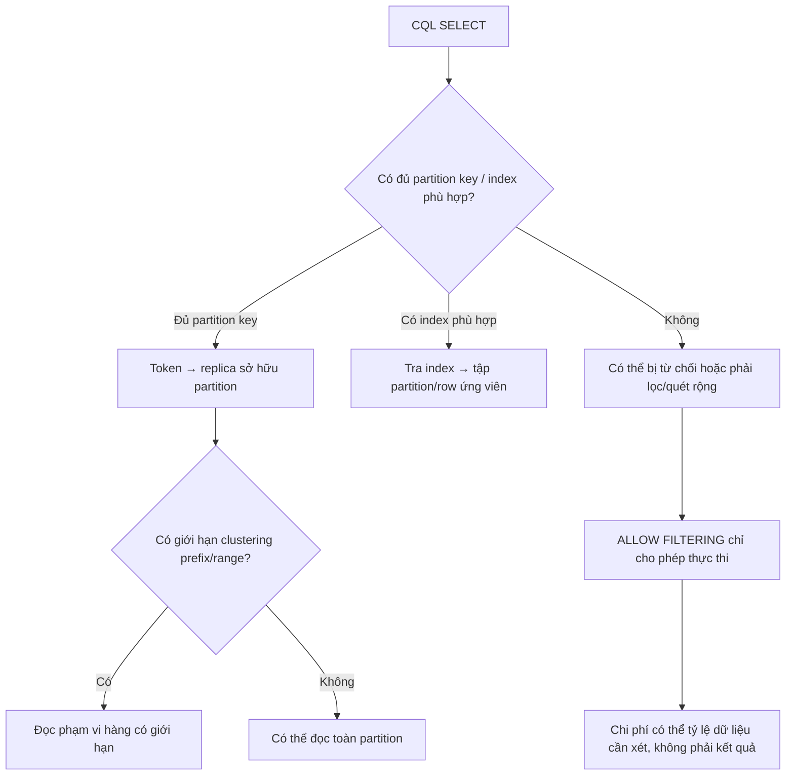
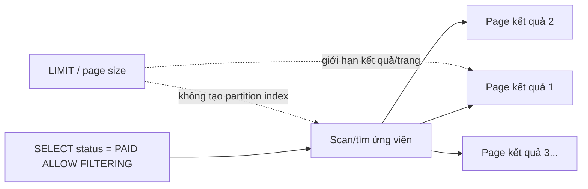
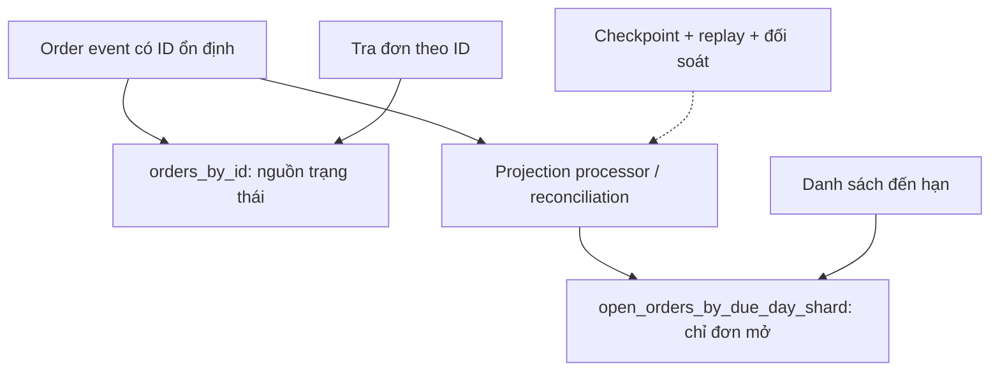
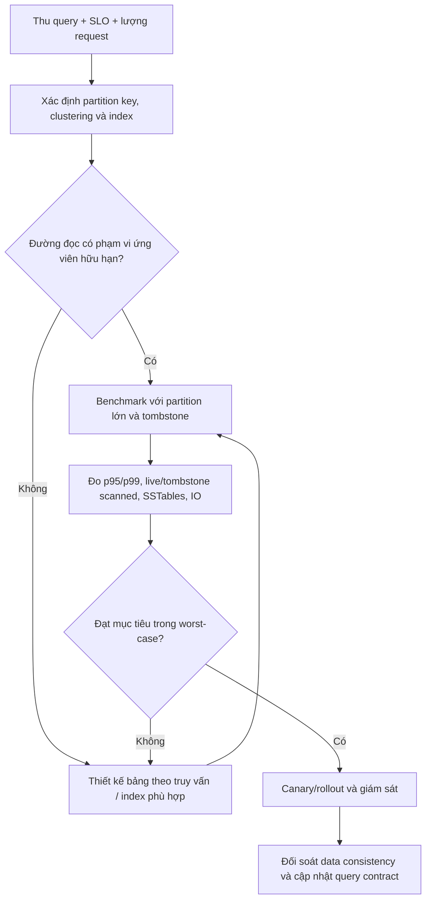

# Tránh quét rộng và hiểu chi phí ALLOW FILTERING

> **Chương:** Tối ưu truy vấn  
> **Học phần:** `DATABASE_ENGINE_WIDE_COLUMN_CASSANDRA` — Apache Cassandra

Một bảng Cassandra lưu hàng triệu đơn hàng có thể trả lại **10 kết quả** nhưng vẫn phải xem xét **hàng triệu bản ghi ứng viên**. Nguyên nhân thường không nằm ở số dòng trả về, mà ở cách câu lệnh `SELECT` tiếp cận dữ liệu. Với hệ thống phân tán theo mô hình **wide-column**, partition key định tuyến truy vấn đến replica, clustering columns sắp xếp bản ghi trong partition, còn compaction/SSTable và tombstone quyết định chi phí đọc thực tế.

`ALLOW FILTERING` là một chỉ thị CQL cho phép chạy một số truy vấn mà Cassandra thường từ chối vì **không dự đoán được lượng dữ liệu phải đọc**. Nó **không tạo chỉ mục**, không làm partition key trở nên có chọn lọc hơn và không bảo đảm câu lệnh được tối ưu. Khi dùng sai, nó có thể biến một truy vấn trả về ít hàng thành lượt quét rộng làm tăng CPU, đĩa, mạng, GC, latency p99 và nguy cơ timeout. **Cách sửa ưu tiên** là thiết kế bảng theo truy vấn, xác định phạm vi partition trước rồi mới xét `ALLOW FILTERING` cho trường hợp được giới hạn rõ ràng.

Bài học hướng dẫn cách đánh giá phạm vi quét, hiểu ý nghĩa của `LIMIT` và paging, viết CQL đọc bằng primary key, thiết kế bảng phục vụ một truy vấn mới, xem xét Storage-Attached Indexing (SAI) và đo hiệu quả từ ứng dụng Java. Nội dung áp dụng cho Apache Cassandra; các tính năng chỉ mục và ngưỡng vận hành cần kiểm tra theo phiên bản triển khai.

**Mục tiêu**

- Phân biệt **partition lookup**, **bounded clustering-range scan**, **lọc bên trong partition** và **quét rộng qua nhiều partition**.
- Giải thích tại sao `ALLOW FILTERING` không bảo đảm truy vấn rẻ kể cả khi `LIMIT 10`.
- Tái thiết kế schema theo truy vấn, chọn bucket và giới hạn partition size.
- Biết khi nào thử SAI, khi nào dùng projection/materialized read model hoặc hệ thống phân tích/search riêng.
- Đo query latency, scan amplification, tombstone, SSTable và hiệu quả của giới hạn paging trong Java Driver.
- Có checklist trước khi đưa một câu `ALLOW FILTERING` vào production.

## 1. Cassandra tìm dữ liệu theo đường nào?

### 1.1. Partition key là điểm khởi đầu

Partition key được Cassandra băm thành **token**; hệ thống dùng token và replication strategy (thường `NetworkTopologyStrategy`) để tìm replica của partition. Query cung cấp đầy đủ khóa phân vùng thường có phạm vi định tuyến rõ ràng. Ngược lại, chỉ biết một cột bình thường như `status` hay `region` thường **không đủ thông tin** để định vị partition tương ứng.

Bảng CQL có cấu trúc:

```sql
-- Giả định keyspace commerce đã được tạo với replication phù hợp.
CREATE TABLE commerce.orders_by_customer_month (
    tenant_id text,
    customer_id uuid,
    order_month text,
    placed_at timestamp,
    order_id uuid,
    status text,
    region text,
    total_amount decimal,
    PRIMARY KEY ((tenant_id, customer_id, order_month),
                 placed_at, order_id)
) WITH CLUSTERING ORDER BY (placed_at DESC, order_id DESC);
```

- **Partition key ghép:** `(tenant_id, customer_id, order_month)`. Thông thường phải giới hạn các thành phần này để truy cập đúng partition. Một số tính năng index có thể thay đổi khả năng truy vấn, nhưng đó là đường đọc riêng.
- **Clustering columns:** `placed_at` rồi `order_id`. Hàng trong mỗi partition được sắp theo thứ tự clustering đã khai báo, cho phép đọc theo khoảng thời gian và ưu tiên bản mới.
- **Regular columns:** `status`, `region`, `total_amount` không mặc nhiên có index. Cassandra không thể trực tiếp định vị mọi hàng có `status = 'PAID'` chỉ dựa vào schema này.
- `order_month` là bucket được ứng dụng tính theo thời điểm của đơn hàng, ví dụ `2026-11`. Nếu một khách có rất nhiều đơn/tháng, cân nhắc bucket nhỏ hơn hoặc shard có thể xác định từ khóa truy vấn.



### 1.2. Clustering key giúp đọc liên tục, không phải chỉ mục tùy ý

Với partition key đã biết, Cassandra có thể đọc theo các phần đầu liên tục của clustering key. Ví dụ tìm đơn hàng của một khách trong một khoảng ngày:

```sql
SELECT order_id, placed_at, total_amount, status
FROM commerce.orders_by_customer_month
WHERE tenant_id = 'tenant-a'
  AND customer_id = 11111111-1111-4111-8111-111111111111
  AND order_month = '2026-11'
  AND placed_at >= '2026-11-01T00:00:00Z'
  AND placed_at < '2026-12-01T00:00:00Z'
LIMIT 25;
```

Truy vấn xác định **một partition** và khoảng clustering theo `placed_at`; số hàng cần đọc được chặn thêm bởi giới hạn kết quả và điều kiện range. Độ lớn partition, lượng SSTable chồng lấn và tombstone vẫn ảnh hưởng chi phí, nhưng đường truy cập có tính dự đoán hơn một lượt tìm trên toàn cụm.

Ngược lại, chỉ đặt `WHERE order_id = ...` không tận dụng được partition key, dù `order_id` nằm trong primary key với vai trò **clustering column**. Primary key không đồng nghĩa mọi cột của nó được tra độc lập như index toàn cục.

**Trường hợp cần thận trọng:** với partition key ghép, việc bỏ thiếu một thành phần thường làm truy vấn không thể định tuyến trực tiếp. Với nhiều clustering columns, điều kiện cần tôn trọng thứ tự và tính liên tục của clustering prefix/range. Không thể tùy ý thêm `WHERE region = ...` hoặc đổi thứ tự cột rồi cho rằng Cassandra tìm kiếm giống SQL B-tree.

## 2. `ALLOW FILTERING` thực sự làm gì?

CQL thường từ chối những truy vấn mà việc tìm hàng có thể đòi hỏi **lọc quá nhiều ứng viên**. Khi thêm `ALLOW FILTERING`, bạn đang nói với Cassandra: *chấp nhận thực thi truy vấn mặc dù chi phí lọc có thể rất lớn hoặc khó dự báo*.

Ví dụ bảng trên chưa có index `status`:

```sql
-- Không có partition key hay index trên status.
-- Truy vấn có thể bị Cassandra từ chối vì cần lọc/quét.
SELECT order_id, status
FROM commerce.orders_by_customer_month
WHERE status = 'PAID';
```

Thêm chỉ thị:

```sql
-- Minh họa một truy vấn nguy hiểm: KHÔNG chạy trên production lớn.
SELECT order_id, status
FROM commerce.orders_by_customer_month
WHERE status = 'PAID'
ALLOW FILTERING;
```

Cassandra có thể phải xem dữ liệu trên rất nhiều partition/replica để biết hàng nào đạt điều kiện. Tại một cụm nhiều node, chi phí không chỉ là CPU lọc mà còn bao gồm disk reads, SSTable lookup, coordinator fan-out, phản hồi qua mạng và garbage collection.

**Điểm tinh tế quan trọng:**

- `ALLOW FILTERING` **không phải luôn đồng nghĩa toàn bộ bảng bị scan**. Nếu partition key đã giới hạn một partition nhỏ, việc lọc regular column có thể chỉ cần quét hàng trong partition đó.
- Nhưng **nếu thiếu partition key hoặc chỉ có điều kiện không được hỗ trợ bởi index**, phạm vi ứng viên có thể trải rộng nhiều partition. Một số kết hợp index + regular column còn thực hiện **post-filtering** trên tập hàng ứng viên do index tìm ra.
- `ALLOW FILTERING` **không biến một điều kiện không thể hỗ trợ thành index** và không bảo đảm mọi hình dạng câu truy vấn sẽ được CQL chấp nhận.
- `SELECT * FROM table` không có `WHERE` vẫn có thể tạo một lượt quét bảng lớn **mà không cần `ALLOW FILTERING`**. Vì vậy vấn đề gốc là *scan rộng*, không chỉ sự xuất hiện của từ khóa.

### 2.1. Lọc trong partition nhỏ khác xa quét toàn bảng

Xem hai truy vấn:

```sql
-- A: chỉ đọc một partition theo customer + month,
-- rồi lọc trên regular column status.
SELECT order_id, status
FROM commerce.orders_by_customer_month
WHERE tenant_id = 'tenant-a'
  AND customer_id = 11111111-1111-4111-8111-111111111111
  AND order_month = '2026-11'
  AND status = 'PAID'
ALLOW FILTERING;

-- B: không giới hạn partition; có nguy cơ đi qua phần lớn bảng.
SELECT order_id, status
FROM commerce.orders_by_customer_month
WHERE status = 'PAID'
ALLOW FILTERING;
```

Ở A, tập ứng viên **nằm trong partition đã xác định**. Nếu partition thực tế có khoảng 30–100 đơn hàng và không bị tombstone nặng, phép lọc có thể nằm trong một ngân sách có thể đo được. Nếu một khách có **hai triệu đơn hàng trong tháng**, A vẫn có thể rất tệ. Ở B, số ứng viên có thể tăng theo tổng dữ liệu cụm.

Không đánh giá bằng câu “có partition key là luôn tốt” mà phải biết **phân phối kích thước partition (p95/p99/max)**. Thiết kế bucket có giới hạn giúp bảo đảm A vẫn có chi phí hữu hạn khi hệ thống phát triển.

### 2.2. Mô hình chi phí: ứng viên vs kết quả

Gọi:

- `N` = số hàng/cell ứng viên phải xét trong phạm vi thực thi;
- `M` = số hàng được trả về;
- `S` = khối lượng byte đọc thực tế, chịu ảnh hưởng nén/caching/SSTable;
- `F` = số node/replica tham gia và số request/round-trip;
- `T` = số tombstone và phiên bản dữ liệu phải xử lý.

Một cách tư duy về chi phí:

\[
\text{Work} \approx
\text{lookup/scan}(N, S, T)
+ \text{coordination}(F)
+ \text{network}(M, F)
\]

Không có quan hệ bắt buộc `N ≈ M` khi dùng filtering. Ví dụ truy vấn trả về **10** đơn hàng đã thất bại nhưng phải xem xét **1.000.000** ứng viên:

\[
\text{Scan amplification} = \frac{N}{\max(M,1)} =
\frac{1{,}000{,}000}{10} = 100{,}000
\]

Đây chỉ là **tỷ lệ logic minh họa**, không phải lượng I/O byte chính xác (cache, SSTable index và early termination có thể làm số đọc thực tế khác). Nhưng nó cho thấy vì sao câu truy vấn trả về ít dữ liệu vẫn có thể tốn rất nhiều công việc.

| Tình huống | `N` có thể tăng theo | Hệ quả |
| --- | --- | --- |
| Đúng partition + range clustering | Một đoạn dữ liệu trong một partition | Có thể dự đoán khi partition và khoảng thời gian được giới hạn. |
| Đúng partition + regular column filtering | Kích thước partition hoặc đoạn được chọn | Có thể chấp nhận cho partition nhỏ, nhưng tăng theo hot partition. |
| Chỉ lọc regular column không index | Dữ liệu của nhiều partition/toàn bảng | Chi phí khó dự báo, tăng theo quy mô cụm. |
| Index có chọn lọc + post-filter | Số ứng viên do index trả về | Có thể tốt hơn quét bảng, vẫn cần đo selectivity và data skew. |
| Quét nhiều partition với tombstone lớn | Ứng viên sống + tombstone cần reconciliation | Latency và read amplification tăng mạnh dù `M` nhỏ. |

## 3. `LIMIT`, `PER PARTITION LIMIT` và paging không phải “thuốc chữa”

### 3.1. `LIMIT 10` chỉ giới hạn kết quả

```sql
-- Vẫn nguy hiểm nếu chỉ có ít hàng PAID trong tập cần quét.
SELECT order_id
FROM commerce.orders_by_customer_month
WHERE status = 'PAID'
LIMIT 10 ALLOW FILTERING;
```

`LIMIT 10` đặt giới hạn **số hàng trả về**, không cam kết đọc đúng 10 hàng/cell. Nếu điều kiện hiếm, Cassandra có thể xét rất nhiều ứng viên trước khi tìm đủ 10 kết quả. Nếu không tìm thấy, chi phí có thể đặc biệt lớn. Một vài lần thử trên dữ liệu nhỏ hoặc cache nóng cho p50 thấp không chứng minh p99 ổn định khi dữ liệu tăng.

Điều đó **không có nghĩa** `LIMIT` vô ích: ở truy vấn đúng partition và clustering order, `LIMIT` có thể giúp kết thúc sớm, giảm byte và read work. Nó chỉ không sửa được **đường truy cập sai**.

### 3.2. `PER PARTITION LIMIT` không giới hạn số partition phải chạm

`PER PARTITION LIMIT` giới hạn **số hàng trả về trên mỗi partition**. Khi câu truy vấn vẫn quét nhiều partition, tùy chọn này không tự tạo routing tới ít partition hơn. Kết hợp với `LIMIT` có thể giúp chặn kích cỡ kết quả, nhưng không thay thế câu hỏi: *bao nhiêu partition/ứng viên đã được tra cứu?*

### 3.3. Driver paging giảm kích thước một trang, không tự hạn chế tổng quét

Java Driver hỗ trợ page size để server gửi từng phần kết quả, giúp hạn chế memory và network burst cho client. Nhưng:

- `setPageSize(50)` là **gợi ý kích thước trang**; server không cam kết đúng 50 hàng trong mọi trường hợp.
- Lặp qua toàn bộ `ResultSet` có thể **tự động fetch các trang tiếp theo** với API đồng bộ.
- Paging **không biến toàn bảng scan thành truy vấn theo partition**. Nó chỉ chia kết quả thành các đợt truyền và có thể phân bổ tải theo thời gian.
- Paging state không phải một cơ chế offset-based analytics an toàn hoặc snapshot nhất quán tuyệt đối khi có concurrent updates/deletes. Không trả paging state cho client khác hoặc câu CQL không tương ứng.



## 4. Thiết kế dữ liệu theo truy vấn để thay filtering

Với Cassandra, câu hỏi đúng thường không phải “làm sao thêm WHERE vào bảng hiện tại?”, mà là **“truy vấn này cần truy cập theo khóa nào?”**. Cần xác định số partition/tổng hàng tối đa mà một request có thể chạm.

Giả sử ứng dụng thương mại cần ba màn hình:

| Query ID | Nghiệp vụ | Đầu vào đã biết | Cách thiết kế |
| --- | --- | --- | --- |
| Q1 | Danh sách đơn của một khách trong tháng, mới nhất trước | Tenant, customer ID, month, range ngày | `orders_by_customer_month` với partition ghép và clustering theo thời gian. |
| Q2 | Lấy 25 đơn **đang mở, đến hạn hôm nay** cho một tenant để xử lý | Tenant, due date, shard | Projection `open_orders_by_due_day_shard`, chỉ lưu đơn còn mở. |
| Q3 | Xem một đơn theo ID | Tenant và order ID | Bảng `orders_by_id` làm nguồn trạng thái theo khóa ổn định. |

Một bảng dùng mọi điều kiện lọc thường ép ứng dụng quét những dữ liệu không liên quan. **Nhiều bảng theo truy vấn là lựa chọn có chủ đích** trong Cassandra, đổi thêm chi phí ghi/đối soát để giảm chi phí đọc không thể kiểm soát.

### 4.1. Q1: lịch sử khách hàng theo tháng

Bảng `orders_by_customer_month` ở phần trước đáp ứng query bằng partition key và clustering prefix:

```sql
SELECT order_id, placed_at, status, total_amount
FROM commerce.orders_by_customer_month
WHERE tenant_id = 'tenant-a'
  AND customer_id = 11111111-1111-4111-8111-111111111111
  AND order_month = '2026-11'
  AND placed_at >= '2026-11-01T00:00:00Z'
  AND placed_at < '2026-12-01T00:00:00Z'
LIMIT 25;
```

Khi một trang lùi sang tháng trước, ứng dụng chuyển **partition/bucket có chủ đích** (ví dụ `2026-10`) thay vì quét mọi tháng theo `tenant_id`. Nếu số đơn tăng nhanh, dùng bucket tuần/ngày hoặc shard với kế hoạch fan-out giới hạn và cơ chế hợp nhất kết quả.

### 4.2. Q3: lookup theo ID từ bảng nguồn

```sql
CREATE TABLE commerce.orders_by_id (
    tenant_id text,
    order_id uuid,
    customer_id uuid,
    placed_at timestamp,
    status text,
    total_amount decimal,
    due_at timestamp,
    PRIMARY KEY ((tenant_id, order_id))
);

SELECT order_id, status, total_amount
FROM commerce.orders_by_id
WHERE tenant_id = 'tenant-a'
  AND order_id = 33333333-3333-4333-8333-333333333333;
```

Đây là một lookup theo **khóa ổn định**. Thay đổi `status` không cần di chuyển hàng sang partition có status mới; chỉ update cột thường. Nó vẫn tạo phiên bản dữ liệu cần compaction, nhưng tránh nhiều thao tác `DELETE + INSERT` khi status nằm trong primary key.

### 4.3. Q2: projection chứa đúng tập công việc đang mở

Nếu sản phẩm thật sự cần “25 đơn đến hạn của tenant hôm nay”, hãy tạo mô hình truy vấn riêng thay vì lọc mọi đơn đã hoàn thành:

```sql
CREATE TABLE commerce.open_orders_by_due_day_shard (
    tenant_id text,
    due_day date,
    shard smallint,
    due_at timestamp,
    order_id uuid,
    customer_id uuid,
    total_amount decimal,
    PRIMARY KEY ((tenant_id, due_day, shard), due_at, order_id)
) WITH CLUSTERING ORDER BY (due_at ASC, order_id ASC);

SELECT order_id, customer_id, due_at, total_amount
FROM commerce.open_orders_by_due_day_shard
WHERE tenant_id = 'tenant-a'
  AND due_day = '2026-11-21'
  AND shard = 3
  AND due_at < '2026-11-22T00:00:00Z'
LIMIT 25;
```

Ở đây chỉ lưu **đơn đang mở** trong projection; khi hoàn tất, xóa row khỏi projection theo quy trình đồng bộ. `shard` được tính **ổn định từ `order_id`** hoặc bucket logic khác; ứng dụng cần truy vấn **số shard hữu hạn** (ví dụ 16) rồi trộn kết quả theo `due_at` nếu muốn “top 25 toàn tenant”. Không được lấy 25 dòng từ một shard rồi kết luận đó là top 25 toàn tenant.

Các đánh đổi thực tế:

- **Thêm ghi:** tạo đơn mới cần cập nhật bảng nguồn và projection.
- **Xóa vẫn tồn tại:** hoàn thành đơn tạo tombstone tại projection. Tuy nhiên không phải quét hàng triệu đơn đã đóng để tìm vài đơn còn mở.
- **Consistency giữa bảng:** Cassandra không tự biến hai ghi ở hai partition thành một giao dịch cô lập toàn cục. Cần event ID, outbox/queue/consumer có idempotence, retry và đối soát projection.
- **Dữ liệu đến trễ/thay đổi due date:** cập nhật index/projection theo thứ tự và quy tắc nghiệp vụ; không để đơn cũ nằm trong hai ngày đến hạn.
- **Không lạm dụng projection:** nếu trường trạng thái thay đổi hàng trăm lần/giây, cần cân nhắc queue/scheduler chuyên dụng và kiểm soát hot partition.



**Nguyên tắc:** tránh một scan tốn 10 triệu ứng viên bằng việc chủ động duy trì một read model; phải tính **toàn bộ** chi phí write amplification, disk và eventual consistency để chứng minh thiết kế mới thực sự tốt hơn.

## 5. Khi nào dùng chỉ mục thay vì bảng projection?

Không phải mọi truy vấn ngoài primary key đều buộc thiết kế một bảng mới. Cassandra có cơ chế **secondary indexing**, nhưng chi phí và tập toán tử được hỗ trợ khác nhau theo phiên bản.

### 5.1. SAI và điều kiện phiên bản

**Storage-Attached Indexing (SAI)** xuất hiện trong bản Apache Cassandra **5.0** và cung cấp chỉ mục gắn với SSTable, hỗ trợ nhiều loại điều kiện trên các cột không phải partition key. Cụm Apache Cassandra 4.1 chính thức **không có SAI**; phải kiểm tra binary/phân phối trước khi dùng cú pháp.

Ví dụ chỉ dành cho Cassandra 5.0+ có hỗ trợ:

```sql
-- Chỉ tạo sau benchmark và duyệt write/storage overhead.
CREATE INDEX orders_status_sai
ON commerce.orders_by_customer_month (status)
USING 'sai';

-- Có thể dùng index trên status thay vì quét toàn bảng thuần túy.
SELECT order_id, status
FROM commerce.orders_by_customer_month
WHERE status = 'FAILED'
LIMIT 25;
```

**Nhưng:** một giá trị thấp về cardinality như `PAID` có thể khớp hàng triệu đơn hàng. Index giúp tìm ứng viên, không làm tập kết quả lớn biến mất, cũng không biến truy vấn đa node thành lookup một partition. SAI cần CPU, disk và công việc duy trì index khi ghi/flush/compaction. Khi dữ liệu skew hoặc thêm nhiều điều kiện không index, Cassandra có thể cần **post-filtering**.

Ví dụ một câu có SAI trên `status` nhưng thêm cột `region` chưa index:

```sql
-- Chỉ minh họa post-filter; không mặc định coi là truy vấn tối ưu.
SELECT order_id
FROM commerce.orders_by_customer_month
WHERE status = 'FAILED'
  AND region = 'APAC'
ALLOW FILTERING;
```

Trong tình huống này, hệ thống có thể dùng index lọc ứng viên theo `status` rồi kiểm tra `region` trên phần ứng viên đó; vẫn phải đo số lượng ứng viên thực tế. Tạo index thứ hai trên `region` có thể giúp một số dạng truy vấn kết hợp **nếu phiên bản và toán tử hỗ trợ**, nhưng không nên tạo index vô điều kiện cho mọi cột.

### 5.2. Secondary index truyền thống và hệ thống search/analytics

- **2i (secondary index truyền thống)** có mặt ở các phiên bản Cassandra cũ, thường hoạt động như index cục bộ của từng replica. Hiệu quả phụ thuộc cardinality, fan-out và phạm vi partition; không nên giả định nó là global B-tree giống RDBMS.
- **SAI (5.0+)** phù hợp nhiều tình huống tra theo cột hơn, nhưng cần đo query cost, số kết quả phù hợp, selectivity, disk/CPU, write load và topology.
- **Bảng projection theo truy vấn** thường tốt nếu access pattern quan trọng, ổn định và phải đáp ứng p99 rất thấp với khả năng dự báo phạm vi đọc.
- **Search/analytics engine chuyên dụng** phù hợp nhu cầu tìm kiếm đa điều kiện linh hoạt, ad hoc, sắp xếp toàn tập hoặc aggregation theo bảng rất lớn; cần chấp nhận chi phí truyền/đồng bộ dữ liệu giữa hệ thống.

Không có lựa chọn nào miễn phí. Thiết kế phải bắt đầu bằng **query contract**: những bộ lọc nào cho phép, độ trễ mục tiêu, mức nhất quán, kích cỡ kết quả, thứ tự, retention và tỷ lệ ghi/đọc.

## 6. Đo chi phí thật thay vì phỏng đoán bằng số dòng trả về

### 6.1. Nhóm tín hiệu cần thu

| Tầng | Chỉ số/tín hiệu | Dùng để trả lời |
| --- | --- | --- |
| **Java/API** | p50/p95/p99 theo query ID, errors, request rate, timeout, retries, kích thước kết quả, paging count | Người dùng chịu độ trễ nào, đường query nào gây lỗi? |
| **Cassandra coordinator** | `ClientRequest.Read.Latency`, timeouts, failures; `CoordinatorReadLatency`/`CoordinatorScanLatency` theo table khi khả dụng | Độ trễ phát sinh khi coordinator phục vụ read hay scan? |
| **Table/partition** | `ReadLatency`, `RangeLatency`, `LiveScannedHistogram`, `TombstoneScannedHistogram` | Cần xét nhiều live cells/tombstones không? |
| **SSTable** | `SSTablesPerReadHistogram`, `LiveSSTableCount`, `PendingCompactions` | Truy vấn chạm bao nhiêu SSTable, compaction có backlog? |
| **Tài nguyên node** | Disk I/O/await, CPU, GC, network, memory pressure, pending read tasks | Scan cạnh tranh tài nguyên với request khác? |
| **Định tuyến & topology** | RF/CL, replica của partition, DC/rack, hot keys, load skew | Có chạy nhiều node/remote DC hoặc bị hot partition? |

Tên metric ở trên là **tên logic/JMX được mô tả trong tài liệu Cassandra**, không phải cam kết tên Prometheus metric sau exporter. Metric phát ra trên từng node; phải tổng hợp đúng, phân biệt **counters, gauges và histograms**, đặc biệt **không tính p99 toàn cụm bằng trung bình p99 từng node**.

### 6.2. CQL tracing có chọn lọc

Trong `cqlsh`:

```sql
TRACING ON;

SELECT order_id, placed_at, total_amount
FROM commerce.orders_by_customer_month
WHERE tenant_id = 'tenant-a'
  AND customer_id = 11111111-1111-4111-8111-111111111111
  AND order_month = '2026-11'
LIMIT 25;

TRACING OFF;
```

Trace giúp quan sát các giai đoạn của một execution và node liên quan, nhưng **không phải công cụ EXPLAIN PLAN giống RDBMS**. Không bật tracing cho mọi request production: nó có overhead và có thể ghi dữ liệu về statement/partition, cần kiểm soát quyền truy cập và retention.

Quan sát node và table bằng các lệnh đọc:

```bash
nodetool status
nodetool tpstats
nodetool compactionstats
nodetool tablestats commerce.orders_by_customer_month
nodetool proxyhistograms
```

Khi điều tra scan rộng:

1. Ghi rõ query ID, CQL, bind parameters (đã ẩn thông tin nhạy cảm), CL, load, trang và `LIMIT`.
2. So sánh **đúng cùng một mẫu truy vấn** với dữ liệu nhiều/ít và các partition có kích thước khác nhau.
3. Đo **p95/p99 theo tải thực**, không chỉ một lần trace thành công.
4. Đối chiếu `LiveScannedHistogram`/`TombstoneScannedHistogram`, read latency và disk I/O; tìm tác động tới query khác dùng chung replica.
5. Lặp lại sau khi thay data model/index, so sánh bằng workload và cache warmup gần tương đương.

### 6.3. Một thí nghiệm minh họa

Giả sử cùng một bảng có 10 triệu hàng, phân bố như sau:

| Test | Hình dạng truy vấn | Kết quả | Chi phí cần nghi ngờ |
| --- | --- | --- | --- |
| T1 | Partition chính xác, range clustering hẹp, `LIMIT 25` | Trả 25 hàng | Thấp nếu partition không quá lớn và SSTable/tombstone hợp lý. |
| T2 | Partition chính xác nhưng `status` không index, `ALLOW FILTERING` | Trả 10 hàng | Có thể quét phần lớn partition; p99 cao ở khách hàng “cá voi”. |
| T3 | Chỉ `status`, không index, `ALLOW FILTERING LIMIT 10` | Trả 10 hàng | Có thể quét nhiều partition dù payload nhỏ; tăng khi dữ liệu lớn. |
| T4 | `status` được index SAI | Trả 10 hàng | Index giảm candidate space khi selectivity tốt; giá trị phổ biến vẫn có fan-out/IO. |
| T5 | Projection chứa chỉ đơn đang mở, partition theo ngày/shard | Trả 10 hàng | Truy vấn có phạm vi hữu hạn, đổi lấy chi phí duy trì projection. |

**Không chỉ benchmark bằng `LIMIT 10` khi dữ liệu thử quá nhỏ.** Phải có cả trường hợp điều kiện *rất hiếm* hoặc **không có hàng khớp**, partition nóng, nhiều tombstone, replica vừa compaction và thời điểm disk I/O cao. Những tình huống này phơi bày scan amplification.

## 7. Java Driver 4.x: query theo key, giới hạn kết quả và paging

Ví dụ Java chạy query lịch sử của một khách bằng **prepared statement có khóa phân vùng đầy đủ**, range thời gian và `LIMIT 25`. Khi dùng Java Driver 4.x, `timestamp` của Cassandra thường được bind bằng `java.time.Instant`; ở đây `order_month` là chuỗi bucket được tính ổn định từ thời điểm event.

```java
import java.time.Instant;
import java.util.ArrayList;
import java.util.List;
import java.util.UUID;

import com.datastax.oss.driver.api.core.CqlSession;
import com.datastax.oss.driver.api.core.DefaultConsistencyLevel;
import com.datastax.oss.driver.api.core.cql.BoundStatement;
import com.datastax.oss.driver.api.core.cql.PreparedStatement;
import com.datastax.oss.driver.api.core.cql.Row;

public final class OrdersReader {
    private final CqlSession session;
    private final PreparedStatement byCustomerMonth;

    public OrdersReader(CqlSession session) {
        this.session = session;
        this.byCustomerMonth = session.prepare(
            "SELECT order_id FROM commerce.orders_by_customer_month " +
            "WHERE tenant_id = ? AND customer_id = ? AND order_month = ? " +
            "AND placed_at >= ? AND placed_at < ? " +
            "LIMIT 25");
    }

    public List<UUID> recentIds(String tenantId, UUID customerId,
                                String month, Instant from, Instant until) {
        BoundStatement stmt = byCustomerMonth.bind(
                tenantId, customerId, month, from, until)
            .setConsistencyLevel(DefaultConsistencyLevel.LOCAL_QUORUM)
            .setPageSize(25)
            .setIdempotent(true);

        List<UUID> result = new ArrayList<>();
        for (Row row : session.execute(stmt)) {
            result.add(row.getUuid("order_id"));
        }
        return result;
    }
}
```

Vì query có `LIMIT 25`, việc iterating toàn bộ result set trong ví dụ chỉ lấy tối đa 25 hàng hợp lệ; page size là **hint**, không tạo bảo đảm “server chỉ đọc đúng 25 cells” và không thay query plan. `setIdempotent(true)` đúng với truy vấn đọc thông thường này.

Cần nhớ khi triển khai thực tế:

- **Đừng ghép động `ALLOW FILTERING` từ input user** để vượt qua lỗi “Invalid query”. Hãy duyệt trước tập query template được phép.
- Nếu trả 100 trang lịch sử cho UI, **ứng dụng phải giới hạn số trang/yêu cầu**, không tự duyệt `ResultSet` đến hết hàng triệu dòng.
- Nếu query trải nhiều tháng/bucket, hạn chế số bucket có thể chạm trong một request, bảo đảm thứ tự merge đúng và có giới hạn tổng.
- Chọn local DC/CL theo replication và yêu cầu nghiệp vụ; CL không biến một scan rộng thành truy vấn có chọn lọc.
- Đừng dùng retry để che timeout của filtering; retry quét rộng làm áp lực lên replica nặng hơn và lan rộng sự cố.

### Một query contract an toàn hơn cho API

| Thành phần | Quy tắc gợi ý |
| --- | --- |
| `tenantId`, `customerId` | Bắt buộc và xác thực quyền truy cập; là phần partition key. |
| `month` | Bắt buộc, bucket hợp lệ, giới hạn số tháng mỗi request. |
| `from`/`until` | Chỉ nhận range hợp lệ và không quá cửa sổ đã thiết kế. |
| `limit` | Trần thấp hợp lý ở API; không tin giá trị client gửi tùy ý. |
| `cursor/paging` | Từ server/driver đúng statement và người dùng, không dùng offset scan. |
| Query template | Đã benchmark với partition lớn, tombstone và throughput đại diện. |

## 8. Có tình huống nào `ALLOW FILTERING` chấp nhận được không?

Có, nhưng phải **đặt điều kiện rõ ràng**. Ví dụ một bảng chỉ lưu vài cấu hình mỗi tenant, partition luôn có số row nhỏ có giới hạn, team biết kích thước tối đa và câu query không thuộc hot path. Lọc thêm regular column **trong một partition đó** có thể chấp nhận sau khi benchmark.

Checklist đánh giá:

| Câu hỏi | Tiêu chí để cân nhắc |
| --- | --- |
| Có khóa phân vùng đầy đủ không? | Ưu tiên có; nếu không, phải biết index/scan scope rõ ràng. |
| Có ràng buộc vật lý cho số ứng viên không? | Có quota/bucket/cap thực thi, không chỉ `LIMIT` kết quả. |
| Worst-case partition size và tombstones? | Được đo ở p99/max, không chỉ trung bình. |
| Query chạy bao nhiêu lần/giây? | Không chiếm tài nguyên gây lỗi cho query quan trọng khác. |
| Có data skew hoặc điều kiện khớp rất ít? | Đã thử cả trường hợp “không kết quả”. |
| Có phương án redesign/index không? | Đã so sánh latency, chi phí ghi, consistency và vận hành. |
| Có circuit breaker/timeouts/monitoring? | Có guardrail ở ứng dụng, nhưng không dùng guardrail thay thiết kế. |
| Có sự thay đổi data volume trong tương lai? | Có dự báo và lịch benchmark/đánh giá lại. |

Một truy vấn chỉ dùng trong **batch offline đã được kiểm soát tải** có thể chấp nhận scan rộng hơn online API, nhưng vẫn phải có quota/throttling, thời gian chạy, phân vùng công việc và khả năng dừng. Truy vấn lọc server-side trên tập dữ liệu không có giới hạn, được gọi trực tiếp bởi request user, gần như luôn cần xem lại data model.

## 9. Quy trình tối ưu từng bước



**Bước 1 — xác định query contract.** Ghi input nào chắc chắn có ở thời điểm API gọi, yêu cầu order, trang tối đa, lượng kết quả, latency SLO, CL, phạm vi DC.

**Bước 2 — xem primary key.** Có đủ thành phần partition key chưa? Clustering prefix/range có tương ứng truy vấn không? Có quét một partition quá lớn hoặc nhiều bucket không?

**Bước 3 — chọn giải pháp.** Sửa partition/bucket; thêm bảng projection; cân nhắc SAI ở 5.0+; dùng search/analytics ngoài nếu nhu cầu ad hoc. Không mặc định bật `ALLOW FILTERING` hoặc tạo index cho mọi cột.

**Bước 4 — tạo dữ liệu đại diện.** Dùng khách hàng có volume p99, đa dạng status, TTL, tombstones, insert/update concurrency, mô phỏng số node/RF và query throughput.

**Bước 5 — đo và canary.** Đo client p99, errors và server scanning/I/O, đối chiếu khi compaction/repair hoạt động. Rollout một nhóm nhỏ, theo dõi ảnh hưởng lên write latency và công việc duy trì projection/index.

**Bước 6 — đối soát và ghi nhận.** Nếu thêm bảng theo truy vấn, xác minh key mới/cũ, backfill, dual-write hoặc event processor, lag, idempotence và kế hoạch rollback. Không drop bảng cũ trước khi mọi query consumer đã chuyển và dữ liệu mới được kiểm tra.

## 10. Hiểu lầm thường gặp

**“Thêm `ALLOW FILTERING` là bật chế độ optimizer.”**  
Không. Nó cho phép thực thi truy vấn có thể tốn scan; không bổ sung index hoặc làm database biết giá trị nằm ở partition nào.

**“`LIMIT 10` nghĩa là chỉ đọc 10 hàng.”**  
Không. Nó giới hạn số hàng **trả về**; Cassandra có thể phải đọc rất nhiều hàng/cell mới tìm đủ bản ghi khớp.

**“Có partition key thì luôn nhanh.”**  
Không. Partition có thể khổng lồ, chứa nhiều SSTable/tombstone hoặc bị hot partition. Cần bucket/quota và kiểm tra phân phối dữ liệu.

**“Dùng page size nhỏ sẽ giảm chi phí tất cả scan.”**  
Không. Page size điều chỉnh việc truyền từng trang, không tự giảm số ứng viên cần xét cho toàn kết quả. Đồng bộ Java Driver có thể tự lấy tiếp trang khi code iterate.

**“Secondary index biến Cassandra thành SQL database.”**  
Không. Chỉ mục vẫn có giới hạn selectivity, toán tử, dữ liệu phân tán và overhead; Cassandra không có join/optimizer tổng quát như RDBMS.

**“Chỉ cần một bảng cho tất cả màn hình.”**  
Không cần. Bảng theo truy vấn và denormalization là mô hình phổ biến ở Cassandra; phải trả thêm chi phí write/storage và đồng bộ để tránh scans không dự đoán được.

**“`ALLOW FILTERING` luôn quét toàn bảng.”**  
Không hẳn. Nếu đã có partition key/index phù hợp, lọc có thể chỉ diễn ra trên một tập ứng viên. Nhưng vẫn cần xác định **tập đó lớn đến đâu**; trong trường hợp thiếu khóa/index, quét rất rộng là nguy cơ thực tế.

## 11. Bài tập và tự kiểm tra

**Câu 1.** Với bảng `orders_by_customer_month` ở mục 1, vì sao truy vấn theo `customer_id` và `order_month` nhưng **không có `tenant_id`** không phải lookup một partition thông thường?

**Câu 2.** Một câu `SELECT ... WHERE status='FAILED' LIMIT 10 ALLOW FILTERING` trả 10 hàng ở staging. Production có 500 triệu hàng và `FAILED` chiếm 0,001%. Có thể kết luận câu truy vấn luôn nhanh không? Vì sao?

**Câu 3.** Hai khách có cùng query “đơn PAID tháng 11”: một khách có 30 đơn, một khách có 2 triệu đơn. Nếu đều cung cấp đủ partition key rồi thêm `AND status='PAID' ALLOW FILTERING`, vì sao p99 khác nhau nhiều?

**Câu 4.** Product yêu cầu lấy “25 đơn OPEN đến hạn sớm nhất của tenant hôm nay” nhưng bảng chỉ lưu theo `orders_by_customer_month`. Hãy đề xuất partition key và clustering key cho bảng read model mới; nêu một đánh đổi.

**Câu 5.** Trên Cassandra 4.1, team muốn chạy `CREATE INDEX ... USING 'sai'`. Có được không? Giải pháp thay thế nào nên đánh giá?

**Câu 6.** Một Java service `setPageSize(50)` và lặp tất cả hàng trả về từ scan nhiều triệu record. Vì sao page size không cứu được truy vấn này? Cần giới hạn ở đâu?

**Câu 7.** Tại sao `SELECT COUNT(*) FROM commerce.orders_by_customer_month` không có `WHERE` có thể đắt dù không hề chứa `ALLOW FILTERING`?

**Câu 8.** Khi benchmark query mới, hãy nêu bốn tín hiệu ngoài số hàng trả về cần đo để kết luận đã tối ưu đúng.

<details>
<summary>Gợi ý đáp án</summary>

1. Partition key ghép yêu cầu định vị theo cả `tenant_id, customer_id, order_month`. Thiếu một thành phần không cho biết chính xác token/partition; cần index thích hợp hoặc đổi thiết kế.
2. Không. Trả 10 kết quả không giới hạn số ứng viên phải scan; dữ liệu lớn, kết quả hiếm và skew làm latency rất khó dự đoán.
3. Query vẫn phải xét hàng trong partition để lọc regular column. Partition 2 triệu hàng có scan amplification và SSTable/tombstone khác hẳn partition 30 hàng.
4. Dùng `((tenant_id, due_day, shard), due_at, order_id)`, chỉ giữ OPEN; query số shard cố định rồi merge theo due_at. Đổi lấy extra writes, tombstone khi đóng và nhu cầu đối soát projection.
5. SAI được giới thiệu trong Apache Cassandra 5.0. Với 4.1, cân nhắc bảng theo truy vấn, cơ chế 2i phù hợp hoặc nâng cấp theo kế hoạch; không tự backport bằng lệnh CQL.
6. Page size chỉ chia kết quả thành từng frame; iterate hết sẽ lấy các trang tiếp, trong khi scan vẫn lớn. Giới hạn partition/bucket, số trang, `LIMIT` kết quả, quota/tải và đặc biệt thiết kế query theo khóa.
7. Toàn bộ bảng có thể phải được duyệt/đếm; không có điều kiện giúp định vị một tập nhỏ. `ALLOW FILTERING` không phải thước đo duy nhất của scan.
8. Có thể chọn p95/p99 client, server Read/RangeLatency, LiveScanned/TombstoneScanned histograms, SSTablesPerRead, disk I/O, CPU, coordinator fan-out, timeout rate và mức skew theo partition.

</details>

## Ghi nhớ

- **Partition key** định tuyến tới replica; **clustering key** giúp đọc phạm vi có thứ tự trong partition. Hãy viết schema theo *truy vấn thật* trước khi tối ưu config.
- `ALLOW FILTERING` **cho phép filtering**, không tự tạo index hay giới hạn công việc. Nó có thể lọc trong partition nhỏ hoặc quét nhiều partition; điều quyết định là **phạm vi ứng viên**.
- **`LIMIT` và page size** kiểm soát kết quả/trang, không đảm bảo số bản ghi cần quét tương ứng nhỏ.
- Nếu phải tìm theo trường khác primary key, hãy cân nhắc **projection**, index (SAI từ Cassandra 5.0) hoặc nền tảng search/analytics phù hợp; đánh giá thêm chi phí ghi, storage và đồng bộ.
- Benchmark phải bao gồm **partition lớn, không có kết quả, tombstone nhiều và giờ cao điểm**, rồi theo dõi latency, scan amplification, disk/network và error rate.
- Tối ưu truy vấn không thay thế thiết kế RF/CL, repair, compaction hay retry an toàn từ Java; những yếu tố đó vẫn ảnh hưởng độ đúng và p99.

### Tài liệu tham khảo

- [Apache Cassandra — Data Manipulation: WHERE, LIMIT, ALLOW FILTERING](https://cassandra.apache.org/doc/stable/cassandra/developing/cql/dml.html)
- [Apache Cassandra — Indexing concepts (2i, SAI và phiên bản)](https://cassandra.apache.org/doc/stable/cassandra/developing/cql/indexing/indexing-concepts.html)
- [Apache Cassandra — Working with SAI](https://cassandra.apache.org/doc/stable/cassandra/developing/cql/indexing/sai/sai-working-with.html)
- [Apache Cassandra — SAI FAQ: post-filtering](https://cassandra.apache.org/doc/stable/cassandra/developing/cql/indexing/sai/sai-faq.html)
- [Apache Cassandra — Metrics: read/scan, SSTable và tombstone](https://cassandra.apache.org/doc/stable/cassandra/managing/operating/metrics.html)
- [DataStax Java Driver 4.x — Paging](https://docs.datastax.com/en/developer/java-driver/4.17/manual/core/paging/index.html)

