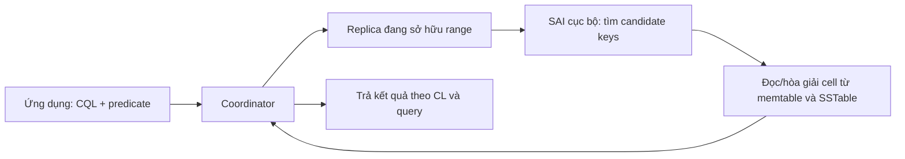
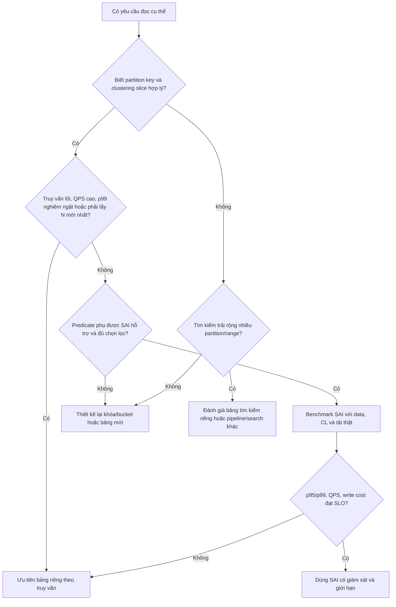

# Chọn bảng truy vấn riêng hoặc SAI khi có điều kiện phù hợp trong Cassandra

## 1. Vấn đề thiết kế: tối ưu đường đọc nào và trả giá ở đâu?

Apache Cassandra là hệ quản trị cơ sở dữ liệu **wide-column phân tán**. Dữ liệu được phân vùng bằng **partition key**, các hàng trong một partition được sắp theo **clustering key**, rồi sao chép lên những **replica** theo replication factor (RF). Một truy vấn CQL chạy nhanh nhất khi Cassandra định vị được partition cần đọc và lấy một lát cắt clustering nhỏ, thay vì tìm dữ liệu trên nhiều node hoặc đọc lượng lớn dữ liệu để lọc.

Ví dụ ứng dụng bán hàng cần các API:

- `GET /tenants/{tenant}/orders?month=2026-11` — xem đơn hàng gần nhất trong tháng.
- `GET /tenants/{tenant}/orders?month=2026-11&status=PAID` — xem đơn đã thanh toán.
- `GET /tenants/{tenant}/orders?month=2026-11&status=REVIEW&minTotal=1000000` — tìm đơn cần rà soát và giá trị lớn.

Ba API đọc dữ liệu gần giống nhau nhưng **hình dạng truy vấn (query shape)** khác nhau. Hai lựa chọn tiêu biểu:

1. **Bảng riêng theo truy vấn (*table-per-query*):** chủ động nhân bản một phần dữ liệu thành bảng có partition/clustering key khớp mẫu đọc quan trọng.
2. **Storage-Attached Index (SAI):** tạo index trên cột được hỗ trợ, giúp thực hiện thêm điều kiện lọc mà không phải xây bảng riêng cho mọi tổ hợp.

**Không có lựa chọn thắng trong mọi tình huống.** Bảng riêng thường dễ dự đoán đường đọc và thứ tự trong partition nhưng thêm chi phí ghi, đồng bộ dữ liệu; SAI linh hoạt hơn về điều kiện lọc nhưng phải trả chi phí index, có thể fan-out và không thay thế một mô hình phân vùng phù hợp.

Mục tiêu của bài là biết **khi nào nên chọn mỗi cách**, cách kiểm tra bằng CQL và cách đo độ trễ p95/p99 từ ứng dụng Java. Không sử dụng `ALLOW FILTERING` như câu trả lời mặc định cho một truy vấn chưa được mô hình hóa.

## 2. Bắt đầu bằng hợp đồng truy vấn, không bắt đầu từ schema

Trước khi tạo bảng hoặc index, mô tả mỗi truy vấn bằng một hợp đồng cụ thể:

| Thuộc tính | Câu hỏi cần trả lời |
| --- | --- |
| Phạm vi tenant | Mọi truy vấn đều có `tenant_id`, hay có tìm kiếm toàn hệ thống? |
| Phạm vi thời gian | Một ngày, một tháng hay không giới hạn? |
| Điều kiện | Bằng nhau, khoảng số, kết hợp `AND`, hay tìm kiếm tự do? |
| Cardinality | Cột có bao nhiêu giá trị phân biệt? |
| Selectivity | Trong phạm vi cần xét, bao nhiêu phần trăm hàng phù hợp? |
| Thứ tự | Cần `20 đơn mới nhất`, hay bất kỳ `20 đơn phù hợp`? |
| Kích thước kết quả | Vài hàng, vài nghìn hay xuất toàn bộ dữ liệu? |
| Tần suất | 1 request/ngày hay hàng nghìn request/giây? |
| Tốc độ cập nhật | `status` thay đổi liên tục hay thuộc tính hầu như bất biến? |
| SLA | p95/p99, timeout, QPS đỉnh và consistency level được phép? |

**Cardinality khác selectivity.** Cardinality là số giá trị phân biệt, ví dụ `status` có năm trạng thái; selectivity là tỷ lệ bản ghi thỏa điều kiện, ví dụ `status = 'REVIEW'` chỉ chiếm 0,4% trong phạm vi tìm kiếm. Một cột có cardinality thấp vẫn có **một giá trị rất chọn lọc**; ngược lại, một cột nhiều giá trị khác nhau không tự bảo đảm mọi truy vấn range sẽ ít kết quả.

Giả sử có 5 triệu đơn/tháng:

| Predicate giả định | Số hàng phù hợp | Selectivity | Cần xem gì? |
| --- | ---: | ---: | --- |
| `status = 'PAID'` | 3.750.000 | 75% | Rất rộng; index có thể tạo lượng candidate lớn |
| `status = 'REVIEW'` | 20.000 | 0,4% | Chọn lọc hơn, có thể đáng thử SAI |
| `total_cents >= 1000000` | 250.000 | 5% | Range có thể hữu ích nhưng cần xét chi phí lấy dữ liệu |
| `status = 'REVIEW' AND total_cents >= 1000000` | 900 | 0,018% | Tổ hợp có thể chọn lọc, nếu index/phiên bản hỗ trợ |

Đây là **số giả định**, không phải thống kê Cassandra. Khi đo thực tế phải tính selectivity trên **phạm vi truy vấn và phân bố tenant**, vì một tenant có thể có 90% đơn `REVIEW` trong khi trung bình toàn hệ thống chỉ 0,4%.

## 3. Bảng so sánh nhanh: bảng riêng hay SAI?

| Tiêu chí | Bảng riêng theo truy vấn | SAI trên bảng hiện có |
| --- | --- | --- |
| Truy vấn được biết trước | Rất phù hợp, nhất là API cốt lõi | Phù hợp nếu predicate được hỗ trợ |
| Nhiều tổ hợp điều kiện tùy chọn | Có thể nổ số lượng bảng/luồng ghi | Thường linh hoạt hơn với cột được index |
| Đọc theo một partition đã xác định | Có thể dùng trực tiếp partition/clustering key | Có thể hỗ trợ lọc thêm trong phạm vi đó |
| Đọc qua nhiều partition | Có thể thiết kế partition theo tiêu chí tìm kiếm | Có thể phải tìm trên nhiều replica/token range |
| Thứ tự, tìm N bản ghi gần nhất | Clustering order hỗ trợ tự nhiên trong partition | Index không phải cơ chế sắp xếp toàn cục tùy ý |
| Độ trễ p99 nghiêm ngặt ở QPS lớn | Thường dễ kiểm soát hơn khi phân vùng tốt | Phải benchmark theo selectivity, fan-out và tài nguyên |
| Chi phí ghi | Ghi nhiều bảng/denormalization | Ghi và duy trì cấu trúc index trên replica |
| Trạng thái dữ liệu | Ứng dụng phải giữ các bảng đồng bộ | Index gắn với dữ liệu bảng gốc trên replica |
| Dung lượng | Lưu thêm các bản ghi theo view | Dùng thêm dung lượng cho index |
| Thay đổi điều kiện tìm kiếm | Cần thêm bảng hoặc luồng cập nhật mới | Có thể thêm index được hỗ trợ, nhưng phải build/giám sát |
| Phiên bản | Mẫu dữ liệu Cassandra cơ bản | Phụ thuộc Apache Cassandra 5.x/distribution có SAI |

**Nguyên tắc khởi đầu:** ưu tiên khóa phân vùng và clustering key cho truy vấn quan trọng, dự đoán được. Xem xét SAI khi cần **lọc bổ sung có giới hạn**, lợi ích về số lượng bảng/độ linh hoạt lớn hơn chi phí index và hiệu năng đã đo đáp ứng SLO.

## 4. Thiết kế bảng gốc để biết rõ phạm vi đọc

Ví dụ lab dùng DC tên `dc1` có ít nhất ba replica sẵn sàng. Trong cluster một node, hãy sửa RF và consistency level theo hạ tầng thực trước khi chạy:

```sql
CREATE KEYSPACE IF NOT EXISTS sales_lab
WITH replication = {
    'class': 'NetworkTopologyStrategy',
    'dc1': 3
}
AND durable_writes = true;

CREATE TABLE IF NOT EXISTS sales_lab.orders_by_tenant_month (
    tenant_id text,
    month_bucket text,
    created_at timestamp,
    order_id uuid,
    customer_id text,
    status text,
    total_cents bigint,
    PRIMARY KEY ((tenant_id, month_bucket), created_at, order_id)
) WITH CLUSTERING ORDER BY (
    created_at DESC,
    order_id ASC
);
```

Partition key là `(tenant_id, month_bucket)`. Các đơn trong mỗi partition được sắp theo `created_at` giảm dần, rồi `order_id` để phân biệt đơn trùng thời điểm. Câu lệnh thuận lợi:

```sql
SELECT created_at, order_id, customer_id, status, total_cents
FROM sales_lab.orders_by_tenant_month
WHERE tenant_id = 'tenant-01'
  AND month_bucket = '2026-11'
LIMIT 20;
```

Đường đọc có phạm vi partition rõ ràng và kết quả theo thứ tự clustering trong partition. Không cần SAI cho truy vấn này. Chọn bucket theo tháng chỉ hợp lý khi partition của từng tenant/tháng có kích thước được kiểm soát; tenant lớn có thể phải bucket theo ngày hoặc shard có chủ đích, đổi lại ứng dụng phải xử lý nhiều partition.

### Truy vấn khó hơn: thêm trạng thái

Ứng dụng muốn `20 đơn PAID trong tháng`:

```sql
-- Minh họa ý định nghiệp vụ; nếu status chưa có index,
-- điều kiện này không mặc nhiên là truy vấn CQL hợp lệ/tối ưu.
SELECT created_at, order_id, total_cents
FROM sales_lab.orders_by_tenant_month
WHERE tenant_id = 'tenant-01'
  AND month_bucket = '2026-11'
  AND status = 'PAID'
LIMIT 20;
```

Vì `status` không thuộc khóa chính, Cassandra không thể dùng riêng clustering order để nhảy thẳng tới những hàng có trạng thái này. Có thể thiết kế **bảng mới** hoặc dùng **SAI**, nếu điều kiện được hỗ trợ và chi phí phù hợp.

`ALLOW FILTERING` không biến việc lọc trở nên hiệu quả; nó chỉ cho phép một số truy vấn mà Cassandra bình thường có thể từ chối do cần lọc nhiều dữ liệu. Đừng thêm `ALLOW FILTERING` để né việc thiết kế đường đọc.

## 5. Phương án A: bảng riêng theo truy vấn

Với API rất phổ biến “20 đơn mới nhất theo trạng thái trong một tháng”, tạo bảng có `status` nằm trong partition key:

```sql
CREATE TABLE IF NOT EXISTS sales_lab.orders_by_tenant_status_month (
    tenant_id text,
    status text,
    month_bucket text,
    created_at timestamp,
    order_id uuid,
    customer_id text,
    total_cents bigint,
    PRIMARY KEY (
        (tenant_id, status, month_bucket),
        created_at, order_id
    )
) WITH CLUSTERING ORDER BY (
    created_at DESC,
    order_id ASC
);
```

Truy vấn:

```sql
SELECT created_at, order_id, customer_id, total_cents
FROM sales_lab.orders_by_tenant_status_month
WHERE tenant_id = 'tenant-01'
  AND status = 'PAID'
  AND month_bucket = '2026-11'
LIMIT 20;
```

Ở đây, **điều kiện trạng thái giúp định vị partition**, còn **clustering order** cho phép lấy dữ liệu mới nhất mà không quét qua những đơn `PENDING` hay `CANCELLED` trong partition gốc. Đây là lý do bảng theo truy vấn thường có lợi cho endpoint thường xuyên, có SLA thấp và thứ tự rõ ràng.

### Chi phí của phương án A: cập nhật hai biểu diễn dữ liệu

Cassandra **không tự đồng bộ** hai bảng chỉ vì chúng lưu thông tin cùng `order_id`. Ví dụ đơn đổi từ `PENDING` sang `PAID`:

1. Cập nhật `status` ở bảng gốc.
2. Xóa hàng trong bảng projection có partition `(tenant-01, PENDING, 2026-11)`.
3. Thêm hàng trong partition `(tenant-01, PAID, 2026-11)` của bảng projection.
4. Theo dõi kết quả từng ghi, thực hiện đối soát khi có timeout/failure.

Ví dụ thao tác CQL:

```sql
UPDATE sales_lab.orders_by_tenant_month
SET status = 'PAID'
WHERE tenant_id = 'tenant-01'
  AND month_bucket = '2026-11'
  AND created_at = '2026-11-20 09:00:00+0000'
  AND order_id = 11111111-1111-4111-8111-111111111111;

DELETE FROM sales_lab.orders_by_tenant_status_month
WHERE tenant_id = 'tenant-01'
  AND status = 'PENDING'
  AND month_bucket = '2026-11'
  AND created_at = '2026-11-20 09:00:00+0000'
  AND order_id = 11111111-1111-4111-8111-111111111111;

INSERT INTO sales_lab.orders_by_tenant_status_month (
    tenant_id, status, month_bucket, created_at,
    order_id, customer_id, total_cents
) VALUES (
    'tenant-01', 'PAID', '2026-11',
    '2026-11-20 09:00:00+0000',
    11111111-1111-4111-8111-111111111111,
    'customer-42', 125000
);
```

Đây là **minh họa luồng cập nhật**, không phải giao dịch nguyên tử xuyên hai bảng. Logged batch có thể hỗ trợ cơ chế phát tán batch trong những điều kiện cụ thể, nhưng **không cung cấp isolation/transaction ACID tùy ý giữa các bảng và partition**. LWT trên một row cũng không tự làm hai bảng cập nhật nguyên tử. Trong production cần:

- Ghi mutation có **operation ID** và semantics idempotent phù hợp.
- Điều phối đồng bộ hoặc bất đồng bộ (event/CDC/outbox phù hợp) có xử lý retry và trùng sự kiện.
- Xử lý thứ tự cập nhật và trạng thái cũ để xóa đúng projection row; các thay đổi đồng thời cần quy tắc rõ.
- Đối soát/chạy lại projection nếu một bảng đã cập nhật nhưng bảng kia chưa.
- Đồng bộ TTL, delete/tombstone và chính sách retention giữa các biểu diễn.

Một bảng riêng làm đọc nhanh hơn nhưng có thể làm **write amplification**, chi phí lưu trữ và độ phức tạp vận hành tăng đáng kể.

## 6. Phương án B: Storage-Attached Index (SAI) là gì?

**SAI** là loại chỉ mục gắn với lưu trữ Cassandra, được cung cấp trong **Apache Cassandra 5.x** và có mặt ở một số bản phân phối khác theo lộ trình riêng. Không giả định cluster Apache Cassandra 3.x/4.x có SAI chỉ vì đã hỗ trợ loại *secondary index* cũ.

Về mặt mô hình:

- Index được duy trì **cục bộ tại replica**, gắn với dữ liệu bảng/SSTable thay vì một máy chủ index toàn cục duy nhất.
- Cassandra quản lý thông tin index cho dữ liệu trong memtable/SSTable theo triển khai của phiên bản, duy trì cấu trúc index khi flush và compaction.
- Truy vấn dùng predicate được SAI hỗ trợ để tìm **ứng viên** thỏa điều kiện, sau đó đọc/hòa giải dữ liệu thực tế theo cơ chế Cassandra.
- Nhiều điều kiện được index có thể được phối hợp để giảm tập ứng viên trong những tình huống phiên bản hỗ trợ.
- Thông tin index phải trả chi phí **dung lượng, CPU, bộ nhớ, I/O và thời gian build**; không xuất hiện miễn phí.



Sơ đồ là **khái niệm**, không mô tả giao thức nội bộ cố định. Nếu truy vấn không nêu partition key, coordinator có thể phải liên hệ nhiều replica/token range. Một index cục bộ **không biến truy vấn toàn cluster thành một lookup của duy nhất một node**.

SAI khác với:

- **Bảng theo truy vấn:** có primary key và clustering order riêng do ứng dụng thiết kế.
- **Legacy secondary index (2i):** cơ chế cũ, không đồng nhất về cấu trúc và khả năng với SAI.
- **Materialized view:** cơ chế duy trì view theo quy tắc riêng; không phải tên gọi khác của SAI.
- **Search engine/full-text/ranked search:** SAI không thay thế mặc nhiên join, xếp hạng tìm kiếm, tìm kiếm ngôn ngữ tự nhiên hoặc tổng hợp OLAP.

### Giới hạn theo phiên bản

Cú pháp `CREATE INDEX`, loại cột được phép index, toán tử `=`, range, tổ hợp điều kiện, cách xử lý collection/text analyzer, số index tối đa, quá trình build và công cụ quan sát có thể **khác theo phiên bản/distribution**. Hãy đối chiếu phiên bản Cassandra của cluster và kiểm tra lệnh CQL thực tế trên **lab** trước khi rollout.

## 7. CQL với SAI: lọc có điều kiện, không thay đổi primary key

Trong lab **Apache Cassandra 5.x có SAI**, dạng cú pháp minh họa thường gặp:

```sql
CREATE INDEX IF NOT EXISTS idx_orders_status_sai
ON sales_lab.orders_by_tenant_month (status)
USING 'sai';

CREATE INDEX IF NOT EXISTS idx_orders_total_sai
ON sales_lab.orders_by_tenant_month (total_cents)
USING 'sai';
```

Một số bản phân phối/phiên bản diễn đạt tạo SAI bằng cú pháp `CREATE CUSTOM INDEX ... USING 'StorageAttachedIndex'`; **không thực thi cả hai dạng trên cùng index**. Chọn cú pháp được phiên bản Cassandra đang dùng xác nhận, thay vì trộn cú pháp từ các tài liệu khác nhau.

Sau khi index đã được xây dựng/sẵn sàng theo cơ chế phiên bản, có thể thử:

```sql
-- Có partition key: phạm vi tenant/tháng cụ thể.
SELECT created_at, order_id, customer_id, status, total_cents
FROM sales_lab.orders_by_tenant_month
WHERE tenant_id = 'tenant-01'
  AND month_bucket = '2026-11'
  AND status = 'REVIEW'
LIMIT 20;

-- Hai điều kiện được index trong một phạm vi partition xác định.
SELECT created_at, order_id, customer_id, status, total_cents
FROM sales_lab.orders_by_tenant_month
WHERE tenant_id = 'tenant-01'
  AND month_bucket = '2026-11'
  AND status = 'REVIEW'
  AND total_cents >= 1000000
LIMIT 20;
```

SAI không yêu cầu tạo bảng `orders_by_tenant_review_high_value_month` cho riêng tổ hợp trên. Tuy nhiên:

1. Từng predicate, kiểu dữ liệu và phép kết hợp phải nằm trong **tập hỗ trợ của phiên bản**.
2. SAI giúp lọc candidates; câu lệnh vẫn trả chi phí đọc dữ liệu của candidate và phối hợp trên replica.
3. `LIMIT 20` **không bảo đảm tìm đúng 20 hàng mới nhất trên toàn hệ thống**; cần phân biệt điều kiện lọc với yêu cầu thứ tự.
4. Điều kiện không được index hoặc không tương thích có thể khiến query bị từ chối; `ALLOW FILTERING` không phải cách sửa hiệu năng.
5. Index chỉ nên được đánh giá sau khi quá trình **build trên dữ liệu hiện có** hoàn thành và sức khỏe các node ổn định.

### Không có partition key: rủi ro fan-out

Xét yêu cầu tìm đơn `REVIEW` từ mọi tenant:

```sql
-- Minh họa truy vấn có nguy cơ fan-out/rộng.
SELECT tenant_id, month_bucket, order_id, total_cents
FROM sales_lab.orders_by_tenant_month
WHERE status = 'REVIEW'
LIMIT 20;
```

Về mặt ý định đây là tìm kiếm toàn bảng; khi SAI hỗ trợ predicate, Cassandra có thể dùng index nhưng vẫn phải phân phối công việc đến nhiều vùng token/replica. Nếu tập ứng viên lớn hoặc SLO nghiêm ngặt, query có thể kém ổn định hơn một bảng theo truy vấn có phân vùng phù hợp.

**Không nên dùng index toàn bảng như cơ chế kiểm soát truy cập tenant.** Ứng dụng đa tenant phải bảo vệ `tenant_id` trong mô hình dữ liệu và lớp authorization, không coi việc tồn tại SAI là ranh giới bảo mật.

## 8. Selectivity, cardinality và chi phí trả kết quả

Để đánh giá predicate, ước lượng:

```text
N = số hàng nằm trong phạm vi tìm kiếm thực tế
M = số hàng thỏa điều kiện
s = M / N  (selectivity theo nghĩa tỷ lệ khớp)

Ví dụ: N = 100.000, M = 250
s = 250 / 100.000 = 0,0025 = 0,25%
```

Lưu ý nhiều tài liệu dùng từ “selectivity cao” để nói predicate **lọc bỏ nhiều hàng**, tức `s` thấp trong ký hiệu trên. Hãy luôn ghi rõ đang nói về **tỷ lệ khớp** hay **mức độ chọn lọc**.

Tương quan chi phí khái niệm:

| Đường đọc | Những công việc chính |
| --- | --- |
| Bảng riêng với partition key đúng | Định vị replica/partition → đọc lát cắt clustering → trả page |
| SAI có partition key | Định vị partition → tìm ứng viên qua index cục bộ → lấy hàng/cell → trả page |
| SAI thiếu partition key | Phân phối tìm kiếm tới nhiều vùng token → index lookup ở nhiều replica → gộp kết quả |
| Lọc không có mô hình/index phù hợp | Có thể bị từ chối hoặc phải scan/lọc lượng lớn dữ liệu |

Đây không phải công thức hiệu năng thực thi: số SSTable, dung lượng mỗi row, cache, phân bố token, số replica cần phản hồi, compaction, tombstone và tình trạng network quyết định chi phí thực tế.

### Ví dụ ba workload khác nhau

**A — Tra cứu đơn mới nhất theo trạng thái.** Một tenant có 100.000 đơn/tháng, 75.000 đơn `PAID`. API cần 20 đơn `PAID` mới nhất, gọi 1.000 lần/giây. Bảng `orders_by_tenant_status_month` phù hợp để thử trước vì có partition và clustering order trực tiếp, tránh thao tác index rộng ở QPS cao.

**B — Bộ lọc hiếm trong màn hình quản trị.** `REVIEW` chỉ chiếm 0,4%, điều kiện `total_cents >= 1000000` làm tập ứng viên nhỏ thêm; API gọi vài lần/phút và có tenant/tháng cụ thể. SAI có thể đáng thử, vì không cần bảo trì một bảng view cho mỗi tổ hợp.

**C — Xuất 10 triệu đơn qua nhiều tháng.** Dù có SAI, đây là workload **export/analytics**, không phải tìm 20 hàng. Đọc qua nhiều token range, phân trang lớn và tổng hợp dữ liệu có thể vượt khả năng SLA của truy vấn tương tác; nên thiết kế pipeline/export riêng.

Quyết định phải dựa trên **độ trễ p95/p99 và read/write throughput dưới tải thật**, không dựa vào việc `CREATE INDEX` thành công.

## 9. Thứ tự kết quả: yêu cầu “mới nhất” thay đổi lựa chọn

Cassandra sắp xếp dữ liệu **trong từng partition** theo clustering order; nó không cung cấp một `ORDER BY` toàn cục tùy ý kiểu hệ quản trị quan hệ cho mọi truy vấn phân tán.

Với bảng theo truy vấn:

```sql
SELECT created_at, order_id, total_cents
FROM sales_lab.orders_by_tenant_status_month
WHERE tenant_id = 'tenant-01'
  AND status = 'PAID'
  AND month_bucket = '2026-11'
LIMIT 20;
```

Partition đã khớp `tenant+status+tháng`; clustering key phục vụ thứ tự mới nhất theo ngày. Đường đọc có thể lấy một lát cắt đầu partition.

Với SAI, việc có index trên `status` không tự tạo một **danh sách toàn cục được sắp xếp theo `created_at`**. Một truy vấn gồm nhiều partition/tenant/tháng cần thiết kế fan-out và merge có chủ đích nếu nghiệp vụ đòi thứ tự thời gian trên toàn tập.

Đừng khẳng định `LIMIT 20` luôn giảm chi phí thành “đọc đúng 20 cell”. Trong một số query, hệ thống vẫn phải xác định candidates, bỏ qua tombstone, đối chiếu replica hoặc đọc nhiều hàng trước khi trả được 20 hàng hợp lệ.

### Nếu phải đọc nhiều tháng

Truy vấn 3 tháng gần nhất trên bảng bucket tháng thường là **3 partition**. Một giải pháp thường dùng là ứng dụng gửi số request có kiểm soát, mỗi request lấy phần đầu phù hợp rồi **merge theo thời gian** ở service. Phải xử lý thứ tự tổng thể, phân trang, duplicate, mức nhất quán và giới hạn đồng thời.

Không tạo một partition chứa **mọi tháng của một tenant** chỉ để né việc merge nếu điều đó làm partition tăng vô hạn.

## 10. Cây quyết định lựa chọn phương án



Cây quyết định không phải thuật toán của Cassandra. Nó nhắc rằng **index là một khả năng thực thi**, còn chất lượng thiết kế phải được đo bằng kết quả nghiệp vụ và vận hành.

## 11. Chi phí vận hành: đọc nhanh hơn nhưng ai trả tiền?

### Bảng riêng theo truy vấn

- **Write fan-out:** một sự kiện nghiệp vụ có thể tạo nhiều CQL mutation.
- **Dung lượng tăng:** lưu thêm các cột/row ở bảng projection và nhiều replica theo RF.
- **Độ lệch giữa bảng:** cập nhật không cùng lúc có thể làm một API thấy trạng thái mới, API kia thấy trạng thái cũ.
- **TTL và tombstone:** xóa status cũ, chuyển partition, dữ liệu hết hạn cần đồng bộ đúng; tạo nhiều tombstone có thể ảnh hưởng read path.
- **Repair/backup:** mỗi bảng là dữ liệu thật, cần chính sách replication, repair và restore.
- **Tải ứng dụng:** cần luồng event/CDC/đối soát và giám sát liveness của projection.

### SAI

- **Index footprint:** chiếm đĩa và tài nguyên phụ trợ trên replica.
- **Chi phí index khi ghi/flush/compaction:** dữ liệu thay đổi phải duy trì cấu trúc index theo phiên bản.
- **Index build:** thêm index vào bảng đã lớn có thể cần xử lý SSTable hiện có, tạo tải nền; phải giám sát quá trình build và điều kiện sẵn sàng.
- **Latency biến thiên theo selectivity:** predicate trả nhiều candidate có thể tốn I/O/CPU và thời gian gộp kết quả.
- **Fan-out:** index cục bộ không đảm bảo loại bỏ việc tìm trên nhiều token range khi truy vấn không có partition key.
- **Giới hạn schema/index:** không phải mọi kiểu dữ liệu, toán tử hoặc tổ hợp predicate đều được hỗ trợ.

Đừng suy diễn rằng SAI **không có chi phí ghi** vì không tạo bảng projection; cũng đừng suy ra bảng riêng **luôn đắt hơn về đĩa** vì cần xét cột được nhân bản, index size, update frequency và RF.

### Chọn theo tổng chi phí, không chỉ latency một SELECT

Một tiêu chí tổng hợp thực tế có thể xem là:

```text
Chi phí vận hành =
  read latency + read CPU/I/O
  + write amplification + index/projection maintenance
  + disk/network/repair/backup
  + độ phức tạp giữ đúng dữ liệu và triển khai thay đổi
```

Đây là **khung đánh giá định tính**, không phải công thức đo vật lý. Mỗi workload cần đặt trọng số theo SLA và ngân sách của tổ chức.

## 12. Lab đối chiếu công bằng trên Cassandra 5.x

### Bước 1 — Xác minh phiên bản và topology

```bash
nodetool version
nodetool status
nodetool help tablestats
nodetool help tablehistograms
```

Xác minh môi trường có SAI trước khi thử `CREATE INDEX ... USING 'sai'`, và thống nhất CL cho các lần đo. Trên môi trường phiên bản không có SAI, chỉ làm phần thiết kế bảng riêng và **không thay bằng legacy 2i rồi coi kết quả tương đương**.

### Bước 2 — Tạo dữ liệu mẫu đại diện

Sau khi tạo schema ở mục 4/5/7, ghi thử:

```sql
INSERT INTO sales_lab.orders_by_tenant_month (
    tenant_id, month_bucket, created_at, order_id,
    customer_id, status, total_cents
) VALUES (
    'tenant-01', '2026-11',
    '2026-11-20 09:00:00+0000',
    11111111-1111-4111-8111-111111111111,
    'customer-42', 'PAID', 125000
);

INSERT INTO sales_lab.orders_by_tenant_status_month (
    tenant_id, status, month_bucket, created_at, order_id,
    customer_id, total_cents
) VALUES (
    'tenant-01', 'PAID', '2026-11',
    '2026-11-20 09:00:00+0000',
    11111111-1111-4111-8111-111111111111,
    'customer-42', 125000
);
```

Hai dòng là **sanity check**, chưa đủ để benchmark. Trong cluster lab nên sinh dữ liệu với phân bố tenant, trạng thái, kích thước partition, TTL/delete, update rate và số lượng hàng gần workload dự kiến. Dùng ID ổn định, không biến retry thành ghi trùng không mong muốn.

### Bước 3 — Đo cả đường đọc lẫn ghi

Trong `cqlsh`:

```text
CONSISTENCY LOCAL_QUORUM;
TRACING ON;
```

Chạy một truy vấn qua bảng projection và một truy vấn SAI trên cùng tập dữ liệu, cùng payload và `LIMIT`; quan sát trace rồi:

```text
TRACING OFF;
```

Đo thêm:

```bash
nodetool tablestats sales_lab.orders_by_tenant_month
nodetool tablehistograms sales_lab orders_by_tenant_month
nodetool tablestats sales_lab.orders_by_tenant_status_month
nodetool tablehistograms sales_lab orders_by_tenant_status_month
nodetool tpstats
nodetool compactionstats
```

Các lệnh này phản ánh **node được hỏi**; thu thập từ các replica liên quan, đồng thời ghi app/driver latency. Tracing có chi phí, nên chỉ bật có chọn lọc. Những bản khác nhau có tên metric và output khác; đừng chép nguyên cách gọi chỉ số giữa chúng.

### Bước 4 — Bộ thí nghiệm tối thiểu

| Thí nghiệm | Biến thay đổi | Đo đầu ra |
| --- | --- | --- |
| Q1: `status = PAID` (match rộng) | Projection vs SAI | p50/p95/p99, rows, disk/CPU, request fan-out |
| Q2: `status = REVIEW` (match hiếm) | Projection vs SAI | Latency và candidates |
| Q3: `status + total_cents` | Hai điều kiện được index | Mức cải thiện lọc và độ ổn định |
| Q4: Truy vấn thiếu bucket/tenant | Scope rất rộng | Node/range được liên hệ, p99, load |
| Q5: Cập nhật `PENDING → PAID` liên tục | Write-heavy | Write throughput, compaction, index/projection cost |
| Q6: Một replica chậm | CL `LOCAL_QUORUM` | Latency, timeout, replica khác nhau |

Chỉ tạo fault injection trong **lab cô lập**, không cố tình gián đoạn node production.

### Bước 5 — Cách đọc kết quả

Không kết luận chỉ từ một `SELECT` trên dữ liệu mới tạo. Nên đo nhiều cửa sổ, khi cache ấm và khi dữ liệu cold, khi index build hoàn tất, dưới concurrent requests và có ghi nền. Giữ ổn định hardware, RF, CL, page size, số hàng/cột trả về, thời điểm compaction và phân bố khóa.

**Không cộng trung bình p99 các node để lấy p99 của ứng dụng.** Dùng client/API histogram cho latency end-to-end; so với replica metrics/tracing để tìm vị trí tốn thời gian.

## 13. Java Driver 4.x: hai PreparedStatement, cùng CL

Ứng dụng có thể chọn đường đọc theo API mà không để caller tự gửi CQL tùy ý. Ví dụ hai repository method dùng `LOCAL_QUORUM` và pagination ở mức giới hạn:

```java
import java.util.ArrayList;
import java.util.List;
import java.util.UUID;

import com.datastax.oss.driver.api.core.CqlSession;
import com.datastax.oss.driver.api.core.DefaultConsistencyLevel;
import com.datastax.oss.driver.api.core.cql.BoundStatement;
import com.datastax.oss.driver.api.core.cql.PreparedStatement;
import com.datastax.oss.driver.api.core.cql.ResultSet;
import com.datastax.oss.driver.api.core.cql.Row;

public final class OrderQueryRepository {
    private final CqlSession session;
    private final PreparedStatement byStatusTable;
    private final PreparedStatement bySai;

    public OrderQueryRepository(CqlSession session) {
        this.session = session;
        this.byStatusTable = session.prepare(
            "SELECT order_id FROM sales_lab.orders_by_tenant_status_month " +
            "WHERE tenant_id = ? AND status = ? AND month_bucket = ? " +
            "LIMIT 20"
        );
        this.bySai = session.prepare(
            "SELECT order_id FROM sales_lab.orders_by_tenant_month " +
            "WHERE tenant_id = ? AND month_bucket = ? AND status = ? " +
            "LIMIT 20"
        );
    }

    // Đọc theo bảng projection: kết quả nằm trong một partition
    // với clustering order theo created_at đã định nghĩa.
    public List<UUID> newestByStatus(
            String tenantId, String month, String status) {
        BoundStatement statement = byStatusTable.bind(tenantId, status, month)
            .setConsistencyLevel(DefaultConsistencyLevel.LOCAL_QUORUM)
            .setPageSize(20)
            .setIdempotent(true);
        return collectIds(session.execute(statement));
    }

    // Đọc qua SAI: hữu ích khi predicate/index được hỗ trợ;
    // không dùng hàm này để hứa thứ tự mới nhất toàn cục.
    public List<UUID> findBySai(
            String tenantId, String month, String status) {
        BoundStatement statement = bySai.bind(tenantId, month, status)
            .setConsistencyLevel(DefaultConsistencyLevel.LOCAL_QUORUM)
            .setPageSize(20)
            .setIdempotent(true);
        return collectIds(session.execute(statement));
    }

    private static List<UUID> collectIds(ResultSet result) {
        List<UUID> ids = new ArrayList<>();
        for (Row row : result) {
            ids.add(row.getUuid("order_id"));
        }
        return ids;
    }
}
```

Ví dụ trên giả định schema/index đã được triển khai hợp lệ. `setIdempotent(true)` dùng cho **SELECT không có side effect nghiệp vụ**, không phải công thức tự áp dụng cho mọi thao tác ghi. Nếu hệ thống yêu cầu paging token, phải thiết kế API phân trang riêng; không dùng `OFFSET` như SQL quan hệ.

Trên production:

- Dùng lại `CqlSession` và prepared statements, không mở session mới theo mỗi request.
- Đo p95/p99, timeout, retries, speculative executions, rows per request và số page.
- Gắn metric vào **query template**, không đưa toàn bộ `tenant_id` nhạy cảm vào label/cardinality cao.
- Đặt deadline, giới hạn concurrency và retry có điều kiện; không hạ CL để che một query bị fan-out.
- Không suy ra hai method trả cùng `20` ID nếu một bên có semantics “mới nhất”, bên kia chỉ có semantics lọc.

## 14. Tính nhất quán, replica và độ tươi của index/projection

### SAI vẫn đi theo replication và consistency level của Cassandra

SAI cục bộ tại replica **không phải dịch vụ search độc lập có một bản dữ liệu chuẩn toàn cluster**. Một mutation được áp dụng trên replica sẽ tham gia những cơ chế index của replica đó theo phiên bản. Nếu replica bỏ lỡ mutation, bản sao và index tương ứng cũng có thể chưa phản ánh trạng thái mới.

Khi client đọc với `LOCAL_QUORUM`, coordinator vẫn phải đáp ứng semantics CL/reconciliation tương ứng. **Có SAI không làm tất cả replica đồng bộ tức thời**, cũng không thay thế anti-entropy repair, hinted handoff hoặc quy tắc tombstone.

### Bảng projection là hai nguồn dữ liệu vật lý cần quản lý

Bảng theo truy vấn là một bảng độc lập. Nếu một event chuyển trạng thái nhưng projection lag, người dùng có thể thấy:

- `orders_by_tenant_month` đã báo `PAID`.
- `orders_by_tenant_status_month` vẫn chứa hàng dưới `PENDING`.
- Một lần đọc quorum trong **mỗi bảng** không tự đảm bảo hai bảng khớp nhau.

Đây là lý do cần **reconciliation job**, giám sát độ trễ projection và chiến lược cập nhật có xử lý replay/idempotency. Nếu SLA yêu cầu tính nhất quán ngay lập tức qua nhiều biểu diễn dữ liệu, phải xem lại thiết kế nghiệp vụ và giới hạn transaction của Cassandra.

### Thay đổi status và tombstone

Khi `status` là thành phần partition key của projection, đổi trạng thái nghĩa là **xóa hàng cũ và ghi hàng mới**, có tombstone. Với SAI trên cột `status` của bảng gốc, ứng dụng không cần tự di chuyển hàng giữa hai bảng, nhưng Cassandra vẫn phải xử lý mutation, tombstone/TTL và cấu trúc index tương ứng.

Với cả hai cách, **không giảm `gc_grace_seconds` tùy tiện** để “dọn index nhanh”; quy tắc delete và repair vẫn quan trọng để tránh dữ liệu đã xóa xuất hiện lại.

## 15. Rollout từ lab lên production

Không nên bật index mới trên bảng hàng TB rồi chuyển 100% traffic ngay. Một kế hoạch an toàn:

1. **Phân loại query shape:** endpoint, điều kiện, thứ tự, phân bố tenant, QPS và SLO.
2. **Dựng lab dữ liệu đại diện:** có hot tenant, giá trị match rộng/hiếm, TTL, update status và phân trang.
3. **Đo cả hai phương án:** p95/p99, read amplification, write latency/throughput, disk/CPU/network, repair/compaction.
4. **Chọn tiêu chí thành công:** ví dụ API p99 phải dưới SLO ở tải đỉnh và index/projection không làm write p99 vượt ngưỡng.
5. **Thực hiện build/backfill có kiểm soát:** với SAI, giám sát index build; với projection, backfill dữ liệu lịch sử và tránh mất thay đổi đến trong lúc backfill.
6. **So sánh kết quả:** shadow query với tỷ lệ mẫu nhỏ, kiểm tra record count, thứ tự, phân trang và trạng thái update/delete.
7. **Tăng traffic theo giai đoạn:** có canary, dashboard, ngưỡng dừng và cách quay về query path cũ.
8. **Duy trì quan sát lâu dài:** sau compaction, tăng dữ liệu, một node lỗi hoặc tăng RF, p99 có thể đổi.

Lưu ý: **tạo index trên dữ liệu hiện có** có thể tốn thời gian và tài nguyên. Trạng thái schema được công bố chưa chắc đồng nghĩa mọi thao tác backfill/index building đã sẵn sàng cho benchmark; phải xác minh theo logs/metrics/công cụ của **đúng phiên bản**.

### Những thay đổi không nên gộp cùng đợt

Tránh đồng thời: đổi partition key, đổi RF, thêm SAI, thay compaction strategy, chạy repair lớn và nâng phiên bản. Khi p99 xấu đi, sẽ rất khó xác định nguyên nhân và rollback an toàn.

## 16. Tình huống tự đánh giá

**A — API “20 đơn PAID mới nhất” chạy 2.000 QPS.** Trong một tenant/tháng, 80% đơn là `PAID`. Chọn gì trước?

**Đáp án định hướng:** Thử bảng `orders_by_tenant_status_month` với clustering theo thời gian; điều kiện phổ biến có tỷ lệ khớp lớn và cần thứ tự, nên SAI không phải lựa chọn đầu tiên để cam kết p99 thấp. Tính thêm chi phí đồng bộ projection.

**B — Dashboard thỉnh thoảng cần lọc `REVIEW` và `total_cents >= ...`.** Hai điều kiện có tập kết quả nhỏ, truy vấn luôn giới hạn tenant/tháng. Chọn gì?

**Đáp án định hướng:** Benchmark SAI trên các cột/toán tử được phiên bản hỗ trợ. Tránh tạo bảng mới cho từng tổ hợp nếu chi phí projection lớn hơn lợi ích; nhưng không triển khai nếu p99 hoặc write overhead vượt SLO.

**C — Người vận hành thấy `CREATE INDEX` thành công.** API lập tức chạy tìm kiếm toàn cluster và timeout. Có kết luận index không hoạt động không?

**Đáp án định hướng:** Chưa. Kiểm tra trạng thái index build, điều kiện không có partition key, số token range/replica được liên hệ, selectivity, số ứng viên, CL và tải đĩa/CPU. Index có thể hoạt động đúng nhưng query quá rộng.

**D — Hai bảng trả status khác nhau.** Bảng gốc đã `PAID`, bảng projection còn `PENDING`. Tăng CL lên `ALL` có tự giải quyết không?

**Đáp án định hướng:** Không. Hai bảng được ghi/đồng bộ riêng; CL cao trong từng bảng không tạo một transaction xuyên bảng. Cần cơ chế cập nhật projection và đối soát.

**E — SAI trên cột có hàng triệu giá trị phân biệt.** Mọi truy vấn là range lấy 40% bảng. Cardinality cao có bảo đảm index hiệu quả không?

**Đáp án định hướng:** Không. Range match nhiều hàng thì selectivity thấp theo nghĩa lọc bỏ ít dữ liệu. Cần giới hạn partition/time bucket, xem lại query shape hoặc pipeline thích hợp.

**F — Bảng projection tăng tombstone sau nhiều lần đổi status.** Có nên đặt `gc_grace_seconds = 0` để giảm đọc chậm?

**Đáp án định hướng:** Không. Phân tích thiết kế cập nhật, TTL/delete, lịch repair và compaction; không phá cửa sổ bảo vệ tombstone chỉ để làm đẹp một metric.

## 17. Checklist quyết định

- [ ] Ghi rõ **truy vấn nào**, QPS, p95/p99 và thứ tự nghiệp vụ cần.
- [ ] Biết partition key, clustering key và kích thước partition dự kiến.
- [ ] Phân biệt **cardinality** với **tỷ lệ hàng khớp predicate (selectivity)**.
- [ ] Nếu cần `N mới nhất` và endpoint cực kỳ phổ biến, đánh giá bảng riêng theo truy vấn trước.
- [ ] Nếu nhiều tổ hợp điều kiện phụ hiếm dùng, đánh giá SAI khi phiên bản/toán tử cho phép.
- [ ] Không coi `ALLOW FILTERING` hoặc `LIMIT` là công cụ sửa truy vấn fan-out.
- [ ] Không giả định SAI là global index hay tạo được `ORDER BY` tùy ý.
- [ ] Kiểm tra rõ phiên bản: Apache Cassandra 5.x và khả năng SAI của distribution.
- [ ] Đo index build, disk footprint, write amplification và compaction cạnh read p99.
- [ ] Với bảng projection, xử lý trạng thái cũ, delete, TTL, replay và idempotent write.
- [ ] Dùng `LOCAL_QUORUM`/CL đúng nghiệp vụ, không thay đổi CL chỉ để benchmark nhanh.
- [ ] Dùng prepared statement, giới hạn page/rows, giám sát attempts và timeout trong Java.
- [ ] So sánh hai cách trên **dữ liệu và tải đại diện**, không lấy một query mẫu làm kết luận.
- [ ] Triển khai có canary, rollback path, reconciliation và giám sát sau khi dữ liệu tăng.

**Ghi nhớ:** **Bảng riêng theo truy vấn** là lựa chọn mạnh khi đường đọc quan trọng, biết trước, cần partition/clustering order chính xác và p99 dễ dự đoán; cái giá là nhân bản dữ liệu và phải duy trì projection. **SAI** hữu ích khi cần linh hoạt lọc trên cột được hỗ trợ với tập ứng viên đủ nhỏ, đặc biệt trong phạm vi partition/tenant/thời gian đã giới hạn; cái giá là index và khả năng fan-out. Tối ưu Cassandra phải dựa vào **query shape, selectivity, RF/CL, read/write load và benchmark end-to-end**, không chỉ vào việc một câu `SELECT` hợp lệ.
