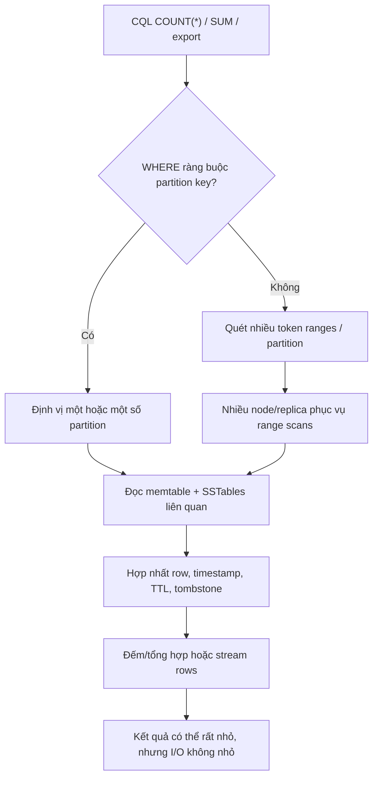
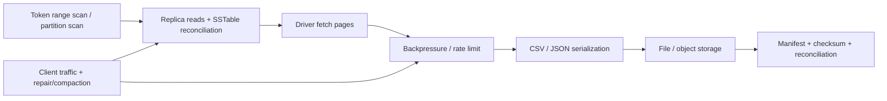
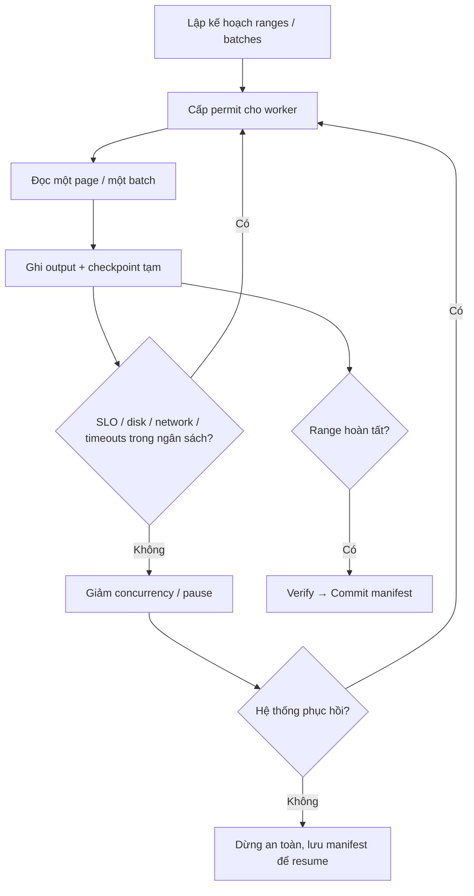

# Giới hạn tải của COUNT, tổng hợp và tác vụ xuất dữ liệu

> **Chương:** Tối ưu truy vấn  
> **Mô-đun:** `DATABASE_ENGINE_WIDE_COLUMN_CASSANDRA` — Apache Cassandra, hệ cơ sở dữ liệu wide-column phân tán.  
> **Chủ đề:** Khi nào `COUNT(*)`, `SUM`, `AVG`, `GROUP BY` hay xuất toàn bảng trở thành truy vấn quét lớn; cách đặt ngân sách tài nguyên, thiết kế bảng theo truy vấn, giới hạn tốc độ, chia token range và kiểm chứng kết quả.

Một truy vấn CQL trả về **một số duy nhất** vẫn có thể buộc Cassandra đọc **hàng triệu hàng**. Điển hình là:

```sql
SELECT COUNT(*) FROM app.events;
```

Kết quả chỉ là một ô, nhưng Cassandra không có bộ đếm chính xác, luôn sẵn có và không tốn công quét cho mọi bảng, ở mọi thời điểm. Với bảng lớn, một phép đếm toàn bảng có thể kéo theo công việc đọc trải nhiều token range, nhiều node và rất nhiều SSTable.

Tương tự, `GROUP BY` hay `SUM(amount)` không tự biến Cassandra thành hệ thống OLAP; bộ máy vẫn phải xử lý **những hàng được truy vấn bao phủ**. Tác vụ xuất CSV/JSON có phân trang cũng có thể gây tải bền bỉ hàng giờ, cạnh tranh đĩa, CPU, mạng và replica với lưu lượng giao dịch.

**Nguyên tắc xuyên suốt bài học:** Phải đánh giá chi phí bằng **số partition, số hàng/byte thực phải đọc, phạm vi token, số replica tham gia, thời gian và độ đồng thời**, không bằng kích thước kết quả cuối cùng.

## 1. Mục tiêu học tập

Sau bài này, bạn có thể:

1. Phân biệt `COUNT(*)` theo **một partition** với `COUNT(*)` **toàn bảng** về đường đọc và rủi ro hiệu năng.
2. Giải thích tại sao `GROUP BY` của CQL bị ràng buộc bởi **primary key** và không thay cho câu lệnh analytics tùy ý của SQL truyền thống.
3. Xây dựng phương án thay thế count/aggregate lặp lại: bảng tổng hợp theo truy vấn, event processing, counter với cảnh báo, batch analytics hoặc số liệu ước lượng.
4. Tính ngân sách đọc/ghi, băng thông, thời gian và đồng thời cho export theo số liệu workload.
5. Hiểu phân trang, token-range scans, retry/chống trùng, checkpoint, TTL và tính nhất quán của một lần quét dài.
6. Dùng `cqlsh COPY TO`, công cụ bulk export và Java Driver một cách có giới hạn; biết khi nào chuyển sang hạ tầng phân tích.
7. Thiết lập metrics/alerts dựa trên read latency, range scan, tombstone, SSTables, GC, disk I/O, network và client SLO.
8. Viết runbook preflight → chạy thí nghiệm → điều tiết → đối soát → đóng tác vụ an toàn.

## 2. Tại sao Cassandra không có phép COUNT toàn bảng “miễn phí”?

### 2.1. LSM-tree và dữ liệu phân tán

Cassandra ghi vào commit log, memtable rồi flush thành **SSTable bất biến**. Các cập nhật và xóa tiếp theo có thể nằm trong SSTable khác, với timestamp, TTL và tombstone; đường đọc phải **hợp nhất dữ liệu** để trả về trạng thái còn sống.

Ngoài ra:

- Một **partition key** được băm thành token và phân bố trên ring.
- Với replication factor RF, một partition có nhiều replica.
- Mỗi node sở hữu những khoảng token tương ứng; bảng có thể trải khắp cụm.
- Số hàng live thay đổi khi ghi, xóa, TTL hết hạn hoặc repair; một file-size counter không trả lời chính xác “hiện có bao nhiêu hàng theo điều kiện này?”.

Vì vậy, muốn có **kết quả đếm chính xác tại một thời điểm theo truy vấn**, hệ thống phải xác định những hàng nào **thực sự thỏa điều kiện đọc**. Nếu phạm vi là toàn bảng, lượng công việc có thể rất lớn dù kết quả chỉ là một số.



Sơ đồ mô tả xu hướng đường đọc; chi tiết điều phối request, CL và tối ưu hóa thay đổi theo Cassandra version, truy vấn và dữ liệu.

### 2.2. Cỡ kết quả khác với cỡ dữ liệu đã xử lý

Hai truy vấn cùng trả **một hàng**:

```sql
-- Hữu ích trong lab: chỉ bao phủ các hàng thuộc một partition.
SELECT COUNT(*)
FROM lab_tuning.events_by_tenant_day
WHERE tenant_id = 11111111-1111-1111-1111-111111111111
  AND event_day = '2026-11-21';

-- NGUY HIỂM trên bảng production lớn: không có partition key.
SELECT COUNT(*)
FROM lab_tuning.events_by_tenant_day;
```

| Đặc điểm | COUNT một partition | COUNT toàn bảng |
|---|---|---|
| Phạm vi token | Một token/partition | Toàn bộ token ranges của bảng |
| Node tham gia | Replica chứa partition theo CL | Nhiều node/ranges trong cluster |
| Hàng cần xét | Số hàng trong partition được chọn | Toàn bộ hàng live trong phạm vi |
| Độ trễ | Phụ thuộc kích thước partition, SSTables/tombstone | Có thể rất lớn, phụ thuộc quy mô cả bảng |
| Rủi ro sản xuất | Partition lớn/hot vẫn đắt | Fan-out, read I/O, timeouts và ảnh hưởng p99 |
| Phù hợp | Đếm giới hạn trong lab hoặc partition nhỏ đã định cỡ | Job offline hiếm hoi có ngân sách/giới hạn rõ |

**Ngay cả COUNT trên một partition không phải O(1).** Nếu partition có hàng triệu clustering rows hoặc tombstone rất nhiều, một phép đếm vẫn có thể tốn nhiều I/O.

### 2.3. “Đếm partition” không phải “đếm row”

Các chỉ số như `EstimatedPartitionCount` hoặc ước lượng trong `nodetool tablestats` có mục đích giám sát **số partition**, không phải đếm chính xác tất cả clustering rows.

Ví dụ một partition chứa 30.000 event rows, thì:

\[
\text{partition count}=1,\qquad
\text{live row count}=30.000.
\]

Không dùng chỉ số số lượng partition để tính “tổng event” nếu bảng có nhiều hàng/partition. Tương tự, dung lượng SSTable chia cho kích thước hàng trung bình chỉ là **ước lượng**, bị ảnh hưởng bởi compression, tombstone, metadata, dữ liệu sai lệch và kích thước row không đều.

## 3. Ví dụ schema theo truy vấn để đo thử

### 3.1. Một bảng sự kiện có bucket theo tenant/ngày

Trong lab có datacenter `dc1` và đủ ba full replica nếu dùng RF=3:

```sql
CREATE KEYSPACE IF NOT EXISTS lab_tuning
WITH replication = {
  'class': 'NetworkTopologyStrategy',
  'dc1': 3
};

CREATE TABLE IF NOT EXISTS lab_tuning.events_by_tenant_day (
    tenant_id uuid,
    event_day date,
    hour_bucket tinyint,
    event_time timestamp,
    event_id timeuuid,
    event_type text,
    amount_cents bigint,
    payload text,
    PRIMARY KEY (
        (tenant_id, event_day),
        hour_bucket, event_time, event_id
    )
) WITH CLUSTERING ORDER BY (
    hour_bucket ASC,
    event_time DESC,
    event_id DESC
);
```

Ý nghĩa:

- `(tenant_id, event_day)` là **partition key**. Mọi sự kiện cùng tenant và ngày nằm trong một partition.
- `hour_bucket` là clustering column đầu tiên, giúp chia nhóm dữ liệu theo giờ trong cùng ngày.
- `event_time, event_id` là clustering columns tiếp theo để truy vấn theo thời gian và định danh duy nhất.
- `event_type, amount_cents, payload` là regular columns; dùng `GROUP BY event_type` trực tiếp **không phải** một nhóm tùy ý được Cassandra hỗ trợ như SQL warehouse.

Một partition theo ngày có thể vẫn quá lớn nếu tenant có lượng event cực cao. Khi đó cân nhắc bucket nhỏ hơn, chẳng hạn tenant/giờ hoặc shard có kiểm soát; đổi lại truy vấn nhiều giờ/ngày phải **fan-out rồi merge ở ứng dụng**.

### 3.2. Nạp bộ dữ liệu nhỏ

```sql
CONSISTENCY LOCAL_QUORUM;

INSERT INTO lab_tuning.events_by_tenant_day (
    tenant_id, event_day, hour_bucket, event_time,
    event_id, event_type, amount_cents, payload
) VALUES (
    11111111-1111-1111-1111-111111111111,
    '2026-11-21', 8, '2026-11-21 08:00:00+0000',
    7c627d5a-a6b0-11ef-8ae8-0242ac120002,
    'checkout', 2500, 'demo-a'
);

INSERT INTO lab_tuning.events_by_tenant_day (
    tenant_id, event_day, hour_bucket, event_time,
    event_id, event_type, amount_cents, payload
) VALUES (
    11111111-1111-1111-1111-111111111111,
    '2026-11-21', 8, '2026-11-21 08:02:00+0000',
    8c627d5a-a6b0-11ef-8ae8-0242ac120002,
    'checkout', 3200, 'demo-b'
);

INSERT INTO lab_tuning.events_by_tenant_day (
    tenant_id, event_day, hour_bucket, event_time,
    event_id, event_type, amount_cents, payload
) VALUES (
    11111111-1111-1111-1111-111111111111,
    '2026-11-21', 9, '2026-11-21 09:10:00+0000',
    9c627d5a-a6b0-11ef-8ae8-0242ac120002,
    'browse', 0, 'demo-c'
);
```

Các UUID và timestamp chỉ phục vụ lab. Bản ghi `event_id` kiểu timeuuid thường gắn với thời điểm tạo; đây là dữ liệu thử, không dựa vào nội dung timeuuid để xác định khoảng thời gian xử lý. Trong hệ thật, nên bảo đảm `event_time` và bucket tương ứng từ pipeline có kiểm soát.

### 3.3. Đi từ truy vấn hẹp tới truy vấn đắt

Một truy vấn phù hợp partition và clustering bounds:

```sql
SELECT hour_bucket, event_time, event_id, event_type, amount_cents
FROM lab_tuning.events_by_tenant_day
WHERE tenant_id = 11111111-1111-1111-1111-111111111111
  AND event_day = '2026-11-21'
  AND hour_bucket = 8
LIMIT 50;
```

Những truy vấn có điều kiện đầy đủ như trên giúp hạn chế phạm vi. Ngược lại, `COUNT(*)` toàn bảng phải xét nhiều ranges. Việc đặt `LIMIT 50` trên một **truy vấn lấy hàng** chỉ giới hạn số hàng trả về/được chọn theo semantics CQL; **không tạo một index tổng hợp** hay bảo đảm mọi truy vấn lọc kém được thực hiện với rất ít I/O.

## 4. COUNT theo khoảng: cách tính tải và giới hạn

### 4.1. Công thức chi phí đọc sơ bộ

Cho một scan cần xử lý:

- \(R\): số **hàng live cần xét**.
- \(b\): số byte dữ liệu trung bình được quét/giải mã trên mỗi hàng, theo định nghĩa đo.
- \(A\): hệ số hiệu chỉnh do tombstone, SSTable overlap, index/metadata và write version, **không phải hệ số Cassandra cố định**.
- \(B_{\mathrm{phys}}\): lượng đọc/giải mã cần thiết, ước lượng thô.

\[
B_{\mathrm{phys}}\approx R\times b\times A.
\]

**Đây là mô hình capacity planning, không phải công thức read path nội bộ**. Hệ thống có thể đọc block nén, skip SSTable nhờ bloom filter hoặc tốn thêm read do dữ liệu cũ. Vì vậy cần kiểm chứng bằng **disk read bytes, latency và số partitions/rows thực tế**.

Giả sử một phép COUNT phải đi qua 200 triệu hàng, cỡ xử lý quy đổi \(b=300\) bytes/hàng, tạm giả định \(A=1{,}5\):

\[
B_{\mathrm{phys}}\approx
200.000.000\times300\times1{,}5
=90\ \text{GB (thập phân)}
\]

Con số này lớn dù kết quả chỉ là `200000000`. Nếu query không biết khóa phân vùng, công việc trải nhiều replica/node, còn phát sinh CPU điều phối, kết nối và tombstone reconciliation.

### 4.2. COUNT một partition lớn cũng có thể tốn phút

Ví dụ một tenant lưu 2 triệu event rows trong một partition/ngày và có nhiều updates:

```sql
SELECT COUNT(*)
FROM lab_tuning.events_by_tenant_day
WHERE tenant_id = 11111111-1111-1111-1111-111111111111
  AND event_day = '2026-11-21';
```

Điều kiện partition key **định vị đúng partition**, nhưng không cắt giảm số row phải đếm. Nếu một partition quá lớn, phải kiểm tra:

- Kích thước partition, clustering range thực sự cần đếm.
- SSTables-per-read và read amplification.
- Tombstone scanned, TTL đã hết hạn và xóa nhiều cell.
- Page size/timeouts của client, GC và disk.
- Số truy vấn đồng thời trên cùng partition nóng.

Nếu nghiệp vụ chỉ cần số event trong **một giờ**, cân nhắc thêm clustering restriction:

```sql
SELECT COUNT(*)
FROM lab_tuning.events_by_tenant_day
WHERE tenant_id = 11111111-1111-1111-1111-111111111111
  AND event_day = '2026-11-21'
  AND hour_bucket = 8;
```

Phạm vi nhỏ hơn giúp giảm công việc nếu các giờ chia dữ liệu đủ đều. Nó vẫn là phép quét những row của giờ đó, không phải đọc count đã materialize.

### 4.3. Vì sao tăng timeout không chữa câu COUNT đắt?

Nếu request thường xuyên vượt deadline:

- **Tăng timeout** có thể cho một số scan chậm hoàn tất nhưng giữ tài nguyên lâu hơn.
- **Tăng concurrency** khiến nhiều scans lớn cạnh tranh I/O và tạo timeouts nghiêm trọng hơn.
- **Đổi CL** có thể thay số replica đáp ứng và tính đúng đắn đọc, nhưng không biến COUNT thành O(1).
- **Thêm node** có thể giúp tổng throughput dài hạn, nhưng mỗi job toàn bảng vẫn phải xử lý khối lượng dữ liệu lớn; đồng thời tăng số ranges/peers phức tạp.

Ưu tiên **đổi cách đặt câu hỏi hoặc mô hình dữ liệu** trước khi thay timeout toàn cụm.

### 4.4. Đừng dùng LIMIT như phép tối ưu đếm chính xác

Không có mẹo `SELECT COUNT(*) ... LIMIT n` nào vừa buộc hệ thống **chỉ đọc ít** vừa trả **tổng chính xác của một tập dữ liệu lớn**. `LIMIT`, `PER PARTITION LIMIT` và grouping có ngữ nghĩa CQL riêng; nếu ràng buộc tập hàng được xét, kết quả không còn là count của toàn bộ dữ liệu.

Hãy phân biệt mục tiêu:

- **Đếm toàn bộ chính xác:** phải trả giá quét hoặc duy trì số liệu riêng.
- **Đếm tối đa n / kiểm tra có ít nhất n hàng:** đổi yêu cầu ứng dụng để chỉ lấy/kiểm tra giới hạn phù hợp.
- **Ước lượng quy mô:** dùng metrics/sampling với sai số được công bố.
- **Báo cáo hàng giờ:** pre-aggregate theo giờ, không scan toàn lịch sử mỗi khi tải trang.

## 5. GROUP BY trong Cassandra không phải GROUP BY tự do của SQL

### 5.1. Quy tắc quan trọng

CQL hỗ trợ `GROUP BY` nhưng gắn với **các cột primary key theo thứ tự hợp lệ**; nếu primary-key columns được cố định bằng equality restriction thì chúng không cần lặp lại trong `GROUP BY`. `GROUP BY` không phải phương tiện nhóm tùy ý theo một regular column như `event_type` trên một bảng bất kỳ.

Giả sử `hour_bucket` là clustering column đầu tiên:

```sql
SELECT hour_bucket, COUNT(*) AS events_count
FROM lab_tuning.events_by_tenant_day
WHERE tenant_id = 11111111-1111-1111-1111-111111111111
  AND event_day = '2026-11-21'
GROUP BY hour_bucket;
```

Truy vấn nhóm theo các giá trị `hour_bucket` trong **partition đã chọn**. Nó cần xét các row trong phạm vi để tính mỗi nhóm; chỉ trả vài hàng không đồng nghĩa số hàng xử lý nhỏ.

Ngược lại, đây **không phải truy vấn nhóm tùy ý được hỗ trợ** trên schema trên:

```sql
-- Không chạy: event_type là regular column, không thuộc primary key.
SELECT event_type, COUNT(*)
FROM lab_tuning.events_by_tenant_day
GROUP BY event_type;
```

Cách đúng là **thiết kế bảng phụ theo query** hoặc tổng hợp ngoài Cassandra, không dùng `ALLOW FILTERING` để biến `event_type` thành grouping key tùy ý.

### 5.2. GROUP BY trên nhiều partition vẫn có rủi ro scan rộng

Ngay cả khi grouping hợp lệ về cú pháp, một truy vấn bao phủ nhiều partition/ranges có thể tiêu tốn đọc phân tán lớn. Quy tắc ở đây:

1. Xác định **partition key** trong `WHERE`.
2. Xác định số **partition/rows** có thể được duyệt.
3. Xem grouping làm giảm số **result rows**, không nhất thiết giảm số **input rows**.
4. Nếu cần nhóm theo một trường nghiệp vụ khác primary key, hãy chọn schema/aggregation pipeline tương ứng.

### 5.3. Các hàm aggregate cũng phải duyệt dữ liệu

Cassandra có native aggregate functions `COUNT`, `MIN`, `MAX`, `SUM`, `AVG`, ngoài khả năng cấu hình user-defined aggregate khi được phép. Ví dụ:

```sql
SELECT
    COUNT(*) AS events_count,
    SUM(CAST(amount_cents AS VARINT)) AS amount_total
FROM lab_tuning.events_by_tenant_day
WHERE tenant_id = 11111111-1111-1111-1111-111111111111
  AND event_day = '2026-11-21';
```

`CAST(amount_cents AS VARINT)` trong ví dụ giúp giảm nguy cơ overflow so với việc `SUM` trả về số cùng cỡ với kiểu đầu vào `bigint`. Việc đếm/tổng hợp vẫn phải xử lý các row được chọn.

Một điểm ít chú ý: khi `GROUP BY` kết hợp chọn cột **không được aggregate**, CQL có thể trả giá trị từ một trong các row đầu tiên được gặp trong nhóm theo semantics tài liệu, **không phải một giá trị tùy ý có ý nghĩa thống kê**. Không dùng kiểu chọn này để báo cáo trạng thái, amount, category hay giá trị cuối cùng mà chưa thiết kế rõ.

### 5.4. User-defined aggregates không miễn phí

Bật user-defined functions/aggregates có rủi ro triển khai, sandbox/bảo mật và chi phí CPU trên node; mặc định hỗ trợ có thể bị tắt. Một custom `median()` hoặc `count_distinct()` không tự loại bỏ nhu cầu quét dữ liệu và không biến cluster OLTP thành data warehouse.

Nếu cần phân tích lượng lớn, thực hiện trong hệ thống phù hợp sau khi trích xuất dữ liệu có kiểm soát.

## 6. Lựa chọn đúng cho số liệu đếm/tổng hợp

| Nhu cầu | Cách tiếp cận ưu tiên | Đánh đổi cần chấp nhận |
|---|---|---|
| Kiểm tra một partition nhỏ có bao nhiêu row | `COUNT(*)` trong partition đã định cỡ | Có đọc những row cần đếm |
| Dashboard event count cập nhật mỗi phút | Bảng tổng hợp theo tenant/time bucket | Đồng bộ/đối soát, độ trễ cập nhật |
| Số liệu phân tích lịch sử rất dài | Batch/Spark/warehouse/OLAP | Pipeline, chi phí lưu trữ và freshness |
| Sizing sơ bộ / capacity | EstimatedPartitionCount, metrics, sampling | Có sai số, khác row count |
| Kiểm toán chính xác tại mốc cố định | Job snapshot/cutoff + source of truth + đối soát | Cần quy trình snapshot/cutoff và bằng chứng đầy đủ |
| COUNT toàn bảng một lần hiếm hoi | Job quét có ngân sách, theo dõi cluster | Vẫn đắt, phải lập lịch và giới hạn |
| Tổng theo category không trong primary key | Thiết kế bảng theo category hoặc projection | Write amplification, nhất quán cập nhật |
| Số lượng đơn hàng cần tránh mất/trùng | Event log + aggregator idempotent + reconciliation | Phức tạp hơn một COUNT CQL |

**Không có lựa chọn “tốt nhất” không cần ngữ cảnh.** Điểm quyết định là **tần suất truy vấn, độ trễ cho phép, tính chính xác, dung lượng dữ liệu và SLO của cụm đang phục vụ giao dịch**.

## 7. Pre-aggregation: đổi chi phí đọc lấy ghi và vận hành

### 7.1. Bảng tổng hợp theo tenant/ngày

Với dashboard chỉ cần tổng số và tổng tiền của một ngày, có thể tạo bảng:

```sql
CREATE TABLE IF NOT EXISTS lab_tuning.daily_summary_by_tenant (
    tenant_id uuid,
    event_day date,
    event_count bigint,
    amount_total_cents varint,
    source_watermark timestamp,
    updated_at timestamp,
    PRIMARY KEY ((tenant_id, event_day))
);
```

Một job ngoài Cassandra nhận events từ nguồn có định danh, tổng hợp rồi **ghi snapshot đã tính**:

```sql
INSERT INTO lab_tuning.daily_summary_by_tenant (
    tenant_id, event_day, event_count, amount_total_cents,
    source_watermark, updated_at
) VALUES (
    11111111-1111-1111-1111-111111111111,
    '2026-11-21', 3, 5700,
    '2026-11-21 09:10:00+0000',
    '2026-11-21 09:11:00+0000'
);

SELECT event_count, amount_total_cents, source_watermark
FROM lab_tuning.daily_summary_by_tenant
WHERE tenant_id = 11111111-1111-1111-1111-111111111111
  AND event_day = '2026-11-21';
```

Đọc giờ là truy vấn **một partition có một row**, không cần scan ba hay ba triệu events. Nhưng:

- **Không có transaction đa bảng tự động** giữa bảng events và summary.
- Nếu có nhiều writers, snapshot cũ có thể đến sau snapshot mới; cần bảo vệ thứ tự/monotonic version bằng workflow hoặc LWT khi phù hợp.
- Replay event, retry hoặc duplicate delivery có thể gây **double count** nếu aggregator không idempotent.
- Delete/TTL/update một event phải được phản ánh vào tổng hợp bằng logic nghiệp vụ, không tự xảy ra.
- `source_watermark` diễn tả mốc dữ liệu đã xử lý, không bảo đảm mọi nguồn đều hoàn tất nếu không có protocol.

### 7.2. Có nên dùng CQL counter column?

CQL hỗ trợ bảng với `counter` column, ví dụ:

```sql
CREATE TABLE IF NOT EXISTS lab_tuning.daily_event_counter (
    tenant_id uuid,
    event_day date,
    event_count counter,
    PRIMARY KEY ((tenant_id, event_day))
);

UPDATE lab_tuning.daily_event_counter
SET event_count = event_count + 1
WHERE tenant_id = 11111111-1111-1111-1111-111111111111
  AND event_day = '2026-11-21';
```

Counter có những semantics riêng, khác với regular column: tăng/giảm không phải phép set idempotent đơn giản, retry khi timeout có thể làm số đếm sai, các ràng buộc tính nhất quán và việc xóa/reset rất cần thận trọng. Nó không phải giải pháp “exactly-once counter” mặc định.

**Chỉ chọn CQL counter khi chấp nhận được đặc tính đó**, có cách xử lý duplicate/dropped events và đối soát. Với số liệu tài chính, kiểm toán hoặc quota nghiêm ngặt, thường cần **nguồn sự kiện có thẩm quyền**, logic idempotency và kiểm chứng độc lập.

### 7.3. Windowed aggregations

Thay vì một tổng tăng mãi theo tenant, có thể tổng hợp theo:

- Tenant + ngày.
- Tenant + giờ.
- Tenant + loại event + ngày.
- Tenant + shard + bucket thời gian.

Chọn bucket có giới hạn kích thước và khớp truy vấn. Nhiều shard giảm hot partition nhưng làm truy vấn dashboard phải đọc nhiều shards và cộng kết quả. Số shard phải được đo và cấu hình, không tăng vô hạn.

**Đánh đổi LSM:** tạo thêm bảng tổng hợp làm tăng write amplification, SSTable, repair và backup volume. Nhưng nếu tránh hàng nghìn scan toàn bảng mỗi giờ, tổng chi phí hệ thống có thể giảm đáng kể.

## 8. Xuất dữ liệu: “có paging” không đồng nghĩa “nhẹ”

### 8.1. Chi phí end-to-end của export

Xuất một bảng lớn cần:

1. Tìm/đọc các partition trong token ranges được chọn.
2. Reconcile dữ liệu live với SSTables/tombstones, theo CL.
3. Chuyển các pages/rows qua network tới exporter.
4. Serialize CSV/JSON, nén, mã hóa và ghi vào đĩa/object storage.
5. Retry các page/range lỗi, đối soát và hoàn tất manifest.



**Output có thể nhỏ hơn hoặc lớn hơn dữ liệu SSTable:** CSV/JSON thường có overhead text, compression khác với SSTable; chỉ đếm rows không ước lượng chính xác byte output. Với dữ liệu nhạy cảm, export còn cần encryption, retention, access controls và audit.

### 8.2. Paging hạn chế bộ nhớ, không hạn chế tổng tải

Ví dụ một export có 50 triệu hàng và `page size = 500`. Số pages (giả định đúng 500 rows/page để tính thô):

\[
N_{\mathrm{pages}}=50.000.000/500=100.000.
\]

Driver chỉ giữ một số pages tại một thời điểm, tránh nạp cả 50 triệu row vào RAM, **nhưng vẫn phải yêu cầu và xử lý khoảng 100.000 pages** để xuất toàn bộ dữ liệu. Page size không phải **giới hạn tổng rows** và không quyết định băng thông một mình.

- Page lớn: giảm overhead request, nhưng response/memory/timeout lớn.
- Page nhỏ: giảm kích cỡ mỗi response, nhưng tăng round trips và state overhead.
- Page size tối ưu phụ thuộc row width, network, token range, latency, GC và phiên bản driver.
- Muốn giảm **tổng tải** phải thu hẹp dữ liệu xuất, giảm tốc độ, giới hạn job thời gian hoặc chuyển workload sang hạ tầng khác.

### 8.3. Không có OFFSET pagination kiểu SQL truyền thống

Cassandra CQL không hỗ trợ mô hình `OFFSET 100000` để nhảy tùy ý qua hàng của toàn bảng. Với truy vấn có partition key và clustering order, có thể dùng **keyset pagination** dựa trên clustering bound, hoặc paging state của driver. Với export toàn bảng, một phương án là chia **token ranges**, không quét lặp từ đầu rồi bỏ qua N hàng.

**Lưu ý:** Paging state gắn với truy vấn/schema/protocol và trạng thái dữ liệu; không coi một token/offset bất kỳ là checkpoint chính xác của mọi tình huống. Trong job phục hồi được, dùng manifest theo range với quy tắc retry/dedup rõ ràng.

## 9. Xuất bằng `cqlsh COPY TO` trong lab

`cqlsh` cung cấp lệnh `COPY TO` để xuất CSV từ bảng. Tài liệu chính thức mô tả các tùy chọn như `PAGESIZE`, `MAXREQUESTS`, `BEGINTOKEN`, `ENDTOKEN` và `MAXOUTPUTSIZE`.

Ví dụ chỉ trong **lab**:

```sql
COPY lab_tuning.events_by_tenant_day (
    tenant_id, event_day, hour_bucket, event_time, event_id,
    event_type, amount_cents
) TO '/tmp/lab-tuning-events.csv'
WITH HEADER = TRUE
AND PAGESIZE = 500
AND MAXREQUESTS = 2;
```

Giải thích:

- `PAGESIZE=500`: yêu cầu số rows/page; **không** có nghĩa chỉ xuất 500 rows.
- `MAXREQUESTS=2`: giới hạn số token ranges được fetch song song trong cơ chế `COPY TO`, không phải 2 rows hoặc 2 pages cho cả job.
- `HEADER=TRUE`: tạo header CSV.
- Nếu không chọn cột, lệnh có thể xuất cả `payload`, làm file lớn hơn và tăng rủi ro dữ liệu nhạy cảm.
- File path nằm trên **máy chạy cqlsh**, không phải tự động trên server Cassandra.

Với dataset lớn hoặc job lặp, `cqlsh COPY TO` có thể không phải công cụ orchestration tốt nhất. Cần hiểu failure handling, token-range splits, output files, checkpoint và tốc độ theo phiên bản.

### 9.1. Những giới hạn cần quan sát

Trong thử nghiệm:

1. Chọn bảng nhỏ và **giữ concurrency thấp**.
2. Ghi thời gian bắt đầu/kết thúc, file size, số rows xuất, QPS và read latency của cluster.
3. Quan sát network/CPU/disk trên cả node Cassandra và máy xuất.
4. Thử giới hạn columns để giảm bytes.
5. Kiểm tra lỗi timeout hoặc malformed CSV; **không suy từ file tồn tại rằng export hoàn tất**.
6. Chọn đường lưu trữ có đủ dung lượng và quyền truy cập thích hợp.

`COPY TO` của cqlsh sử dụng đường quét riêng; không mặc nhiên áp đặt cùng consistency level, điều kiện retry hoặc tính nhất quán mà bạn suy từ một lệnh `SELECT` thủ công. Xác nhận behavior trên công cụ và phiên bản thực tế.

### 9.2. Dữ liệu đang thay đổi và tính nhất quán

Xuất toàn bảng bằng một vòng quét không cung cấp **global transaction snapshot** xuyên toàn cluster khi ứng dụng tiếp tục ghi/xóa. Hàng được đọc sớm và hàng đọc muộn có thể phản ánh **những thời điểm khác nhau**.

Nếu cần “snapshot đúng tới 12:00 UTC” cho kiểm toán:

- Dùng nguồn sự kiện/snapshot/backup có protocol phù hợp.
- Có thể tạm **đóng window** theo thời gian, xuất những bucket bất biến.
- Hoặc kết hợp full export với CDC/change log và **cutoff watermark** có khả năng đối soát.
- Ghi rõ định nghĩa nhất quán; `LOCAL_QUORUM` không tự cung cấp snapshot isolation toàn bảng.

## 10. DSBulk và các công cụ bulk export

Đối với export nhiều dữ liệu, một công cụ chuyên dụng như **DataStax Bulk Loader (DSBulk)** (nếu được tổ chức chấp nhận, tương thích phiên bản và đã thử trong lab) hỗ trợ `unload`, chia token ranges và giới hạn số query đồng thời.

Ví dụ cú pháp nền tảng:

```bash
# Minh họa trên máy có dsbulk; cấu hình kết nối/auth theo môi trường.
dsbulk unload \
  -k lab_tuning \
  -t events_by_tenant_day \
  -url /exports/lab-tuning \
  --engine.maxConcurrentQueries 4
```

Chú ý:

- `-url` là thư mục/đích output; phải kiểm tra khả năng ghi và bảo mật.
- `--engine.maxConcurrentQueries` giới hạn số query đồng thời; giá trị `4` **chỉ là điểm bắt đầu lab**, không phải mặc định phù hợp mọi cluster.
- `--schema.splits` có thể quyết định cách chia token ranges; tăng splits không có nghĩa cứ tăng song song tùy ý.
- Kết nối, TLS, authentication và các driver settings bắt buộc cấu hình theo môi trường; ví dụ trên **không đủ để chạy trên cluster có bảo mật** nếu chưa thêm các tùy chọn đó.
- Một số khả năng (ví dụ continuous paging) phụ thuộc backend/protocol; đừng mặc định Apache Cassandra nào cũng hỗ trợ.
- Tài liệu DSBulk thay đổi theo version; cần tra tham số chính xác trước khi triển khai production.

### 10.1. Vì sao concurrency là một “công tắc rủi ro”?

Nếu một page trung bình tiêu thụ 512 KiB đọc và mạng/đĩa cho phép **40 MiB/s** cho tác vụ export:

\[
\text{page throughput budget}
\approx\frac{40\times1024\ \mathrm{KiB/s}}{512\ \mathrm{KiB/page}}
=80\ \mathrm{pages/s}.
\]

Nếu mỗi page mất trung bình 250 ms end-to-end (0,25 giây), theo định luật Little ở trạng thái ổn định, số query/page in-flight gần:

\[
C\approx80\times0{,}25=20.
\]

Đây là ví dụ **ước lượng ngân sách**, không phải cấu hình 20 queries đồng thời được Cassandra bảo đảm an toàn. Đĩa có thể phải đọc **nhiều hơn 512 KiB** để tạo một page vì tombstone/overlap; phân bố latency đuôi dài, retries và tài nguyên mỗi node có thể khiến concurrency 20 quá cao.

Bắt đầu nhỏ, đo thực, tăng từng bước và theo dõi **client SLO**. Không đặt concurrency dựa duy nhất trên số core của máy exporter.

### 10.2. Khi nào nên dùng hệ phân tích khác?

Nếu truy vấn cần:

- `GROUP BY` theo nhiều regular columns.
- JOIN giữa nhiều bảng hoặc nhiều nguồn.
- COUNT DISTINCT, percentile, top-K, window functions trên hàng tỷ events.
- Scan toàn bộ lịch sử liên tục nhiều lần mỗi ngày.
- Tổng hợp cần snapshot nhất quán/có thể tái lập cho kiểm toán.

Hãy cân nhắc **Spark Cassandra Connector**, hệ thống stream processing, data lake/warehouse hoặc OLAP phù hợp. Cassandra vẫn có thể là hệ lưu trữ/serving cho bảng truy vấn tốc độ cao; analytics chạy ngoài cluster serving hoặc trên nguồn dữ liệu đã trích xuất và được đối soát.

**Chuyển việc tính toán sang Spark không tự làm Cassandra hết tải** nếu Spark vẫn đọc trực tiếp toàn bộ bảng ở tốc độ cao. Vẫn cần phân vùng, rate limiting, scheduling, token-aware reads và đo impact.

## 11. Token-range scan: chia nhỏ để quản lý tải

### 11.1. Tại sao dùng token ranges?

Thay vì một job không có checkpoint quét toàn bộ ring, có thể chia không gian token thành những **khoảng disjoint, bao phủ đủ vòng**. Mỗi worker xử lý một khoảng, ghi manifest và checkpoint riêng.

Với `Murmur3Partitioner` (thường dùng), token thuộc miền số nguyên có dấu 64-bit. Ví dụ ý tưởng truy vấn cho một khoảng **không wrap**:

```sql
-- Chỉ dùng trong batch job có token-range planner hợp lệ.
-- ? là hai bound kiểu token/bigint thích hợp với partitioner.
SELECT tenant_id, event_day, hour_bucket, event_time,
       event_id, event_type, amount_cents
FROM lab_tuning.events_by_tenant_day
WHERE token(tenant_id, event_day) > ?
  AND token(tenant_id, event_day) <= ?;
```

Hai điều kiện trên sử dụng token của **toàn bộ composite partition key** đúng thứ tự. Không được chỉ truyền `tenant_id` nếu primary key gồm `(tenant_id,event_day)`. Không ghép token bounds tùy tiện khi dùng partitioner khác.

### 11.2. Bao phủ không sót/không trùng

Để chia một đoạn thành các khoảng:

\[
(a,b],\quad(b,c],\quad(c,d]
\]

mỗi token nằm trong đúng một khoảng nếu các biên được chọn phù hợp. Tuy nhiên:

- Ring có thể **wrap-around**, phải xử lý ranh giới đầu/cuối miền token.
- Nhiều partition keys có thể có **cùng token** (collision); checkpoint chỉ dựa vào token giữa chừng có thể bỏ sót hàng.
- Thay topology, partitioner hoặc token metadata giữa job có thể ảnh hưởng cách phân chia công việc.
- Các range không có số byte/partition bằng nhau; **chia thành 8 khoảng số học không đồng nghĩa 8 công việc bằng nhau**.
- Retry một range có thể sinh **bản ghi trùng**; output phải hỗ trợ idempotency/dedup theo full primary key.

**Khuyến nghị cho độ bền:** coi **một range hoàn chỉnh** là đơn vị công việc có manifest trạng thái `PENDING → RUNNING → VERIFIED`; chỉ đánh dấu `VERIFIED` khi output và checksum/đối soát đã hoàn tất. Nếu retry một range, ghi ra file tạm mới và atomic-commit sau verify thay vì append mù vào file cũ.

### 11.3. Token-range bounds không cung cấp snapshot

Nếu job A xử lý range R1 lúc 10:00 và job B xử lý R2 lúc 10:30, hai phần có thể chứa các write/TTL khác nhau. Range partitioning giúp **quản lý tài nguyên và retry**, không bảo đảm mọi row là ảnh chụp của cùng thời điểm.

Đối với thống kê chính xác tại cutoff, cần thiết kế **logical watermark**, immutable buckets hoặc quy trình snapshot/CDC. Nếu tập dữ liệu vừa thay đổi vừa được export, báo cáo phải công khai semantics (“best-effort at read time”, “closed-day snapshot”, v.v.).

## 12. Java Driver: xuất có phân trang và giữ bộ nhớ có giới hạn

Ví dụ dưới đây dùng **Java Driver 4.x** để quét một token range trong lab và ghi một file CSV. Nó minh họa các nguyên tắc:

- Query theo token range hợp lệ, không `ALLOW FILTERING` trên regular column.
- `pageSize` nhỏ để giới hạn kích cỡ mỗi page.
- Lặp `ResultSet` **tuần tự**, ghi từng row ra stream, không materialize toàn bộ vào `List`.
- Gắn CL rõ ràng; không ngụ ý rằng nó tạo global snapshot.
- File tạm/manifest và retry/cắt job chưa được thực hiện đầy đủ trong mã ngắn này; phải bổ sung trước khi dùng production.

```java
import com.datastax.oss.driver.api.core.CqlSession;
import com.datastax.oss.driver.api.core.DefaultConsistencyLevel;
import com.datastax.oss.driver.api.core.cql.BoundStatement;
import com.datastax.oss.driver.api.core.cql.PreparedStatement;
import com.datastax.oss.driver.api.core.cql.ResultSet;
import com.datastax.oss.driver.api.core.cql.Row;

import java.io.BufferedWriter;
import java.net.InetSocketAddress;
import java.nio.charset.StandardCharsets;
import java.nio.file.Files;
import java.nio.file.Path;
import java.time.LocalDate;
import java.util.UUID;

public final class TokenRangeCsvExport {
    private static String csv(String value) {
        if (value == null) return "";
        return "\"" + value.replace("\"", "\"\"") + "\"";
    }

    public static void main(String[] args) throws Exception {
        // Lab example only. Choose two bounds from a valid token-range plan.
        long startToken = -100000000000L;
        long endToken   =  100000000000L;
        Path output = Path.of("events-range-01.csv");

        try (CqlSession session = CqlSession.builder()
                .addContactPoint(new InetSocketAddress("127.0.0.1", 9042))
                .withLocalDatacenter("dc1")
                .build();
             BufferedWriter writer = Files.newBufferedWriter(
                output, StandardCharsets.UTF_8)) {

            PreparedStatement scan = session.prepare(
                "SELECT tenant_id, event_day, hour_bucket, event_time, " +
                "event_id, event_type, amount_cents " +
                "FROM lab_tuning.events_by_tenant_day " +
                "WHERE token(tenant_id, event_day) > ? " +
                "AND token(tenant_id, event_day) <= ?"
            );

            BoundStatement statement = scan.bind(startToken, endToken)
                .setConsistencyLevel(DefaultConsistencyLevel.LOCAL_QUORUM)
                .setPageSize(500);

            writer.write(
                "tenant_id,event_day,hour_bucket,event_time," +
                "event_id,event_type,amount_cents\n");

            ResultSet result = session.execute(statement);
            long exportedRows = 0;
            for (Row row : result) {
                UUID tenant = row.getUuid("tenant_id");
                LocalDate day = row.getLocalDate("event_day");
                String eventTime = String.valueOf(
                    row.getInstant("event_time"));

                String line =
                    csv(String.valueOf(tenant)) + "," +
                    csv(String.valueOf(day)) + "," +
                    row.getByte("hour_bucket") + "," +
                    csv(eventTime) + "," +
                    csv(String.valueOf(row.getUuid("event_id"))) + "," +
                    csv(row.getString("event_type")) + "," +
                    (row.isNull("amount_cents")
                        ? "" : row.getLong("amount_cents"));

                writer.write(line);
                writer.newLine();
                exportedRows++;
            }

            writer.flush();
            System.out.println("Exported " + exportedRows + " rows");
        }
    }
}
```

**Lưu ý kỹ thuật:** API Java Driver 4.x ánh xạ `date` → `LocalDate`, `timestamp` → `Instant`, `timeuuid` → `UUID`; `tinyint` → `byte`. Ví dụ giả định cluster ở `dc1`, keyspace được tạo và đủ replicas cho `LOCAL_QUORUM`. Hai token bounds chỉ là **range lab nhỏ**, không đại diện toàn ring. Mã chưa xử lý progress manifest, timeout retry, disk-full, upload atomic, CSV injection, dữ liệu nhạy cảm hoặc backpressure liên worker.

### 12.1. Một vòng lặp duy nhất vẫn có thể gây tải

Driver fetch pages dần, nhưng nếu lặp liên tục:

- Số pages có thể rất lớn.
- Worker có thể gửi yêu cầu kế tiếp nhanh hơn khả năng cluster dự phòng tải.
- Exporter có thể ghi file chậm hoặc disk đầy.
- Một request scan có thể tạo nhiều I/O vật lý do tombstones/SSTable overlap.

Khi triển khai production, thêm **token bucket/permit-based rate limiter**, giới hạn concurrency, byte quotas, time window và cơ chế pause/resume theo range. Việc chỉ đặt page size 500 **chưa đủ** là một biện pháp bảo vệ cluster.

### 12.2. Tránh `all()` hoặc tích lũy trong RAM

Một lỗi thường gặp là lấy hàng triệu rows từ `ResultSet` rồi cho vào `List` để ghi CSV cuối cùng. Cách này tiêu tốn RAM lớn và có nguy cơ OOM; paging bị vô hiệu hóa về mặt quản lý bộ nhớ ứng dụng.

Thay vào đó:

- Stream row ra buffer và file/object storage theo chunk.
- Chỉ giữ page/batch nhỏ, không giữ toàn bộ dataset.
- Với async paging, **fetch page tiếp theo sau khi xử lý xong page hiện tại**, và giới hạn số futures in-flight.
- Có timeout/backoff, checkpoint, retry + dedup, log và metrics theo range.
- Khi hủy, ghi rõ file/range nào hoàn thành, file nào cần xóa hoặc xuất lại.

### 12.3. CSV và tính đúng đắn dữ liệu

CSV text phải escape dấu phẩy, quote, xuống dòng. Mã ví dụ quote mọi text để giảm lỗi; vẫn cần:

- Quy tắc null vs empty string được công bố.
- Encoding UTF-8, timezone thống nhất, dấu thập phân/locale.
- Giới hạn kích thước cột hoặc record và xử lý newline.
- Tránh **CSV formula injection** nếu dữ liệu từ người dùng được mở bằng spreadsheet.
- Kiểm tra số row/primary key và checksum file trước khi commit kết quả.
- Quy trình xóa an toàn dữ liệu PII sau retention; không xuất mọi `payload` nếu không cần.

## 13. Tính toán ngân sách và lịch chạy export

### 13.1. Công thức thời gian đơn giản

Đặt:

- \(B_{\mathrm{out}}\): lượng output cần xuất, tính MiB.
- \(v_{\mathrm{effective}}\): thông lượng output hữu hiệu có thể duy trì, MiB/s.
- \(T\): thời gian tối thiểu dành cho truyền/ghi output.

\[
T\approx\frac{B_{\mathrm{out}}}{v_{\mathrm{effective}}}.
\]

Ví dụ cần xuất 100 GiB và chỉ cấp 80 MiB/s để không ảnh hưởng client:

\[
T\approx\frac{100\times1024}{80}
=1.280\ \text{giây}\approx21{,}3\text{ phút}.
\]

Đây là **ước lượng cận dưới lý tưởng của một nút cổ chai**, chưa có scan amplification, compaction, setup, retries, serialization và verify. Nếu cluster chỉ cho phép 30 MiB/s tại peak traffic thì job sẽ dài hơn nhiều.

**Bảo vệ SLO quan trọng hơn ETA đẹp.** Nên lập lịch ngoài giờ cao điểm và kiểm tra tốc độ thực từ phép thử nhỏ.

### 13.2. Tính ngân sách theo số pages

Giả sử:

- Mỗi page chứa trung bình 500 rows.
- Cỡ page response 300 KiB.
- Có 8 triệu rows cần xuất.

\[
N_{\mathrm{pages}}=8.000.000/500=16.000.
\]

Nếu đặt tổng ngân sách 30 MiB/s cho output:

\[
\text{page rate tối đa theo output}
=\frac{30\times1024}{300}\approx102\ \text{pages/s}.
\]

Đây **không phải** ngân sách disk read thực, vì read amplification, metadata và page size dao động. Muốn bảo vệ cluster phải dùng **cận nhỏ hơn** trong các giới hạn: disk read, CPU, network, CL replica, p99/timeout và output storage.

### 13.3. Tốc độ vừa đủ với dữ liệu đang tăng

Nếu dữ liệu mới phát sinh trong lúc export, cần xác định:

- **Cutoff:** export những rows tồn tại trước mốc nào?
- **Lag:** có chấp nhận bỏ qua dữ liệu sau mốc không?
- **Catch-up:** dùng CDC/event log để bổ sung rows mới và deletes sau full scan?
- **Retention:** TTL có thể xóa rows trước khi scan chạm tới chúng?
- **Data movement:** khi topology thay đổi, nguồn replica/đường quét có khác không?

Nếu yêu cầu snapshot đúng, không thể chỉ tăng throughput để hy vọng “quét đủ nhanh”. Cần thiết kế giao thức có trạng thái.

## 14. SLO, tracing và metrics phải đo trước khi chạy

### 14.1. Metrics phía Cassandra

Theo tài liệu Apache Cassandra, những loại metric đặc biệt hữu ích gồm:

| Nhóm | Ví dụ metric/góc nhìn | Điều cần quan sát |
|---|---|---|
| **Read latency** | Table `ReadLatency`, coordinator latency | p95/p99, local vs coordinator |
| **Range scan** | `RangeLatency`, `CoordinatorScanLatency` | Quét token range có làm tail latency tăng? |
| **SSTable reads** | `SSTablesPerReadHistogram` | Read amplification của partition |
| **Tombstone** | `TombstoneScannedHistogram`, `TombstoneWarnings`, `TombstoneFailures` | Phạm vi scan gặp nhiều dữ liệu xóa |
| **Live cells** | `LiveScannedHistogram` | Số cell phải quét/trả |
| **Disk** | OS disk read/write throughput, queue, latency, free space | Có tranh I/O với compaction/repair không? |
| **Compaction** | `PendingCompactions`, bytes compacted, failures | Nợ compaction có tăng? |
| **Thread pools/GC** | `nodetool tpstats`, JVM GC | Saturation, dropped work |
| **Client** | Driver timeouts/unavailable/retries, p99 | SLO nghiệp vụ có bị ảnh hưởng? |
| **Range requests** | ClientRequest `RangeSlice` metrics khi khả dụng | Scan load tăng đột ngột |
| **Network** | NIC bytes/packets, retransmit, cross-DC | Export cạnh tranh replication/repair |

Tên và loại metric có thể khác giữa Cassandra 4.x/5.x và exporter; đặc biệt một metric tên “Count” có thể là counter tích lũy, cần tính **rate trong khoảng đo**, xét restart. Không cộng thẳng raw counters của nhiều node có tuổi process khác nhau.

### 14.2. Nodetool và tracing

Các lệnh quan sát trên node liên quan:

```bash
nodetool status
nodetool tablestats lab_tuning.events_by_tenant_day
nodetool tablehistograms lab_tuning events_by_tenant_day
nodetool tpstats
nodetool compactionstats
nodetool netstats
```

Đo thời gian/latency phía ứng dụng hoặc cqlsh:

```sql
-- Chỉ bật tracing cho truy vấn lab/chẩn đoán nhỏ có kiểm soát.
TRACING ON;

SELECT event_time, event_type
FROM lab_tuning.events_by_tenant_day
WHERE tenant_id = 11111111-1111-1111-1111-111111111111
  AND event_day = '2026-11-21'
  AND hour_bucket = 8
LIMIT 20;

TRACING OFF;
```

**Không bật tracing 100% cho export hàng triệu pages.** Tracing phát sinh thêm dữ liệu và có overhead; chọn sampling theo chính sách. `TRACING` trong cqlsh hữu ích để quan sát một số query, không dùng để đo chính xác toàn bộ chi phí dài hạn.

### 14.3. Lập baseline có traffic giống production

So hai giai đoạn:

1. **Baseline không export:** read/write QPS, p50/p95/p99, timeout, disk I/O, compaction, GC, tombstones.
2. **Export nhỏ:** lượng rows/byte, throughput, page latency, token range, concurrency, SLO.
3. **Export tăng từng bước:** theo dõi khi nâng concurrency hoặc page size, không đổi nhiều tham số một lúc.
4. **Sau export:** compaction backlog, latency, disk free có phục hồi không; read repair/TTL có bị tác động không.

Hãy ghi cả **mức tăng tương đối** và **ngưỡng tuyệt đối**. Ví dụ p99 tăng 30% là tín hiệu đáng chú ý dù vẫn dưới SLO; ngược lại baseline đã vi phạm SLO thì không được chạy job chỉ vì “export làm xấu thêm ít thôi”.

## 15. Bộ giới hạn tải cho job định kỳ

Một job export/aggregate tốt có “vòng điều tiết”:



### 15.1. Các giới hạn nên đặt

| Giới hạn | Mục đích | Cách kiểm tra |
|---|---|---|
| **Concurrent ranges/workers** | Tránh phát quá nhiều scan đồng thời | Số jobs/page requests đang chạy |
| **Rows/pages/s** | Tránh burst | Rate measured, backpressure |
| **MiB/s output/read** | Giữ bandwidth cho client và replication | NIC/disk counters |
| **Page size / max row bytes** | Kiểm soát response memory | Driver heap, GC, timeouts |
| **Runtime window** | Không va vào giờ cao điểm | Job scheduler và shutdown checkpoint |
| **Max retries/backoff** | Tránh retry storm | Attempts/range, timeout ratio |
| **Free disk / output quota** | Tránh exporter đầy đĩa | Filesystem, object storage |
| **Client SLO guard** | Dừng trước khi ảnh hưởng nghiệp vụ | Driver p99/timeouts |
| **Repair/topology guard** | Tránh va chạm thay ring, repair | `nodetool status/netstats`, maintenance calendar |

### 15.2. Mức cảnh báo chỉ là ví dụ

Giả sử SLA của một hệ thống là read p99 không quá 80 ms:

- Khi export khiến p99 tăng lên 65 ms nhưng baseline là 35 ms: ghi cảnh báo và **không tự tăng concurrency**.
- Khi p99 vượt 80 ms, timeout tăng hoặc disk queue đầy: **pause/giảm tải theo runbook**.
- Khi node Down hoặc đang bootstrap/repair lớn: hoãn các scan toàn bảng nếu chưa được phép.
- Khi không có metrics đáng tin (scrape down): dùng nguyên tắc **fail-safe** theo mức quan trọng; không mặc định “0 errors, cứ tiếp tục”.

Các ngưỡng chỉ minh họa, phải thay bằng SLO thật và năng lực của cluster.

## 16. Chống mất/trùng khi export thất bại

### 16.1. Lỗi giữa một token range

Một worker đang xuất `R=(a,b]` đã ghi 1 triệu hàng rồi timeout. Nếu chạy lại range và **append trực tiếp** vào cùng CSV, output có thể có rows bị lặp. Nếu “tiếp tục từ token mới nhất”, có nguy cơ **bỏ sót** các partition cùng token hoặc hàng trong partition chưa ghi xong.

Giải pháp theo mức độ yêu cầu:

1. **Retry nguyên range** vào file tạm mới, commit thay thế khi hoàn tất, không append mù.
2. Nếu muốn resume giữa range, checkpoint phải bao gồm **full primary key, vị trí và trạng thái page** theo protocol được kiểm chứng; vẫn cần dedup/verify.
3. Giữ manifest có `range_id`, token bounds, checksum, row count, file name, attempt và trạng thái.
4. Kiểm tra file cuối không bị trùng **full primary key** khi format/export pipeline cho phép.
5. Đối soát từ nguồn chính xác phù hợp; không mặc định một `COUNT(*)` toàn bảng làm validation nhẹ.
6. Khi repair/topology change, xác định lại phạm vi dựa trên token plan và phiên bản để tránh checkpoint sai.

### 16.2. Manifest mẫu

```yaml
job_id: export-events-2026-11-21
source:
  keyspace: lab_tuning
  table: events_by_tenant_day
  cluster: lab
  consistency: LOCAL_QUORUM
scope:
  cutoff: "closed-day-2026-11-21"
  partitioner: Murmur3Partitioner
ranges:
  - id: r01
    start_exclusive: "-100000000000"
    end_inclusive: "100000000000"
    attempt: 2
    status: VERIFIED
    rows: 1200
    file: "r01.csv"
    checksum_sha256: "<computed-when-exported>"
  - id: r02
    status: PENDING
```

Đây là **format manifest minh họa**, không phải file Cassandra bắt buộc. Token bounds trong `r02` chưa được điền và job chưa bao phủ toàn ring; không dùng manifest này để kết luận export hoàn tất. Trong hệ thật, manifest cần tất cả ranges, trạng thái và checksums thật, được ghi atomic ở kho đáng tin.

### 16.3. Kiểm chứng không nhất thiết là COUNT toàn bảng

Một cách đối soát có thể gồm:

- So manifest ranges đã bao phủ với token ring plan: không gap, không overlap.
- Kiểm tra số hàng/file, checksum và lỗi parse.
- So mẫu partition/primary keys trong CSV với CQL theo cùng mốc/khoảng ổn định.
- So tổng từ **nguồn event log hoặc summary có độ tin cậy cao** khi mục tiêu là chính xác.
- Kiểm tra counts theo những buckets đã đóng, thay vì chạy `COUNT(*)` toàn bảng trên cluster phục vụ giao dịch.
- Khi có yêu cầu pháp lý/kiểm toán, xác định rõ semantics “snapshot tại mốc”, không dùng con số đếm best-effort khi bảng đang ghi.

## 17. Những bẫy thường gặp

### 17.1. “COUNT trả một hàng nên nhẹ”

Sai: kích cỡ kết quả không phản ánh số rows/SSTables phải đọc. Đo query scope và read I/O.

### 17.2. “COUNT theo partition key luôn nhanh”

Sai nếu partition chứa hàng triệu rows, dữ liệu cũ/tombstone nhiều hoặc cùng partition bị gọi đồng thời.

### 17.3. “GROUP BY event_type là bình thường như PostgreSQL”

Không trên schema có `event_type` là regular column. CQL grouping bị giới hạn bởi primary key order; cần bảng theo truy vấn hoặc xử lý ngoài Cassandra.

### 17.4. “Thêm ALLOW FILTERING để giải quyết mọi query analytics”

`ALLOW FILTERING` cho phép một số phép lọc có thể phải quét rộng; nó **không tự tạo index** và có rủi ro latency khó dự đoán.

### 17.5. “LIMIT 100 / page size 100 đã giới hạn chi phí toàn bộ”

`LIMIT` thay đổi giới hạn kết quả/hàng được chọn theo semantics truy vấn; paging thay đổi kích cỡ mỗi page. Chúng không bảo đảm một **count toàn bộ chính xác** hoặc export toàn bảng ít I/O.

### 17.6. “Tăng timeout và chạy song song 100 COUNT cho nhanh”

Có thể làm disk/GC/network bão hòa và kéo theo timeouts cho đọc/ghi nghiệp vụ. Cần budget và phép đo tăng dần.

### 17.7. “Lấy EstimatedPartitionCount là số hàng chính xác”

Chỉ số ước lượng partition không phải số row, không có tính chất snapshot chính xác.

### 17.8. “COPY TO có file nghĩa là tất cả data đã xuất”

File có thể chưa hoàn tất hoặc chứa một phần range; cần exit status, manifest, checksum và đối soát.

### 17.9. “Paging state hoặc token là checkpoint duy nhất”

Nếu thất bại giữa partition/token hoặc có concurrent writes, dùng checkpoint đơn giản có thể mất/trùng. Cần range-level commit/idempotent output.

### 17.10. “Đổi CL sang ONE là được phép export chính xác”

CL quyết định điều kiện replica read, không tạo global snapshot và có thể đọc trạng thái cũ; phải xác nhận yêu cầu consistency.

### 17.11. “Ghi sẵn summary luôn chính xác”

Nếu cập nhật summary không idempotent hoặc không xử lý deletes/TTL/late events, nó có thể lệch nguồn; cần reconciliation và watermark.

### 17.12. “Spark xử lý nên Cassandra không bị ảnh hưởng”

Nếu Spark vẫn quét Cassandra với concurrency lớn, tài nguyên replica vẫn bị chiếm. Hạ tầng phân tích phải có budget hoặc ingest từ nguồn phù hợp.

## 18. Kịch bản xử lý sự cố

### Kịch bản A — Dashboard COUNT cả bảng chạy mỗi phút, p99 tăng

**Triệu chứng:** các truy vấn `COUNT(*)` không có `WHERE` xuất hiện định kỳ, client read p99 và range scan latency tăng.

**Xử lý:**

1. Xác định query source, lịch gọi và mức concurrency.
2. Tạm giới hạn/hoãn dashboard job theo SLO.
3. Đo range requests, disk read, tombstones, compaction backlog và driver timeout.
4. Đổi sang summary table cập nhật từ event pipeline, có watermark và đối soát.
5. Xác minh p99 về baseline trước khi đóng sự cố.

### Kịch bản B — Export 500 GiB chạy ban đêm nhưng sáng vẫn chưa xong

**Triệu chứng:** files tăng chậm, nhiều retries, disk hoặc network nghẽn.

**Xử lý:**

1. Đo hiệu dụng MiB/s thay vì chỉ ước tính theo NIC.
2. Xem per-range progress, peers, page latency, timeout, compaction.
3. Kiểm tra concurrency có quá cao gây contention không.
4. Nếu cần, giảm tốc độ, lưu manifest và pause an toàn khi peak traffic tới.
5. Không tăng đột biến page size hoặc timeout để che nguyên nhân.

### Kịch bản C — Export hoàn tất nhưng số CSV khác COUNT Cassandra

Có thể do:

- Dữ liệu tiếp tục ghi/xóa/TTL trong thời gian quét.
- Retry append trùng hoặc bỏ sót token range.
- CSV parser/escaping hoặc row filtering/column selection khác.
- COUNT và export dùng CL/DC/thời điểm khác nhau.
- Full-ring query/copy thất bại một phần nhưng pipeline đánh dấu success.

**Không** tự kết luận Cassandra mất dữ liệu chỉ từ hai con số. Trước tiên xác định semantics cùng thời điểm, manifest coverage, primary-key dedup và row identity.

### Kịch bản D — Một tenant có partition quá lớn

COUNT trong partition gây tail latency cao dù các tenant nhỏ bình thường. Chia partition theo tenant+ngày có thể vẫn chưa đủ với tenant rất nóng; cần bucket theo giờ/shard, giới hạn fan-out cho dashboard và tránh quét cả lịch sử.

### Kịch bản E — Repair đang chạy, export làm disk read bão hòa

Dừng/giảm export theo runbook, quan sát repair progress, `gc_grace_seconds` và node health. Repair quá hạn có thể ảnh hưởng tính đúng đắn dữ liệu (missed tombstones); không đánh đổi việc repair thiết yếu chỉ để export xong sớm.

## 19. Runbook để cấp phép một COUNT/aggregate/export lớn

**Preflight**

- [ ] Xác định mục tiêu: count chính xác, ước lượng, dashboard, snapshot hoặc data export.
- [ ] Ghi rõ keyspace/table, partition key, token ranges, RF/CL, DC và query shape.
- [ ] Ước lượng số partitions, rows, bytes và compaction/tombstone amplification.
- [ ] Có ngân sách MiB/s, concurrent requests, disk, memory, output size và giờ chạy.
- [ ] Xác nhận client SLO, repair/topology calendar, node availability và nguồn monitoring.
- [ ] Với dữ liệu nhạy cảm, có quyền, mã hóa, retention và audit.
- [ ] Có phương án pause/resume và retry idempotent theo range.

**Thử tải**

- [ ] Chạy trên tập nhỏ có thể lặp lại.
- [ ] Thu baseline trước và khi job hoạt động.
- [ ] Đo reads/s, bytes/s, p95/p99, timeout, tombstones, GC, compaction.
- [ ] Tăng concurrency từng bước, dừng khi vượt guardrail.
- [ ] Ghi lại page size, tool/version, output format, retry settings.

**Vận hành**

- [ ] Theo dõi node/DC/range, số rows/bytes đã xuất, file và checksums.
- [ ] Không cho export vượt ngân sách khi client load tăng.
- [ ] Không chạy chồng lấn với streaming/repair lớn nếu chưa có capacity plan.
- [ ] Không cố retry vô hạn hoặc đổi CL tùy tiện khi có lỗi.
- [ ] Khi pause, giữ manifest rõ trạng thái và không coi file tạm là sản phẩm hoàn tất.

**Kết thúc**

- [ ] Tất cả ranges/công việc đã được xác nhận hoàn tất.
- [ ] Output có manifest/checksums, schema/cutoff/CL và version metadata.
- [ ] Đã đối soát row identity hoặc số liệu nguồn theo yêu cầu chính xác.
- [ ] Không còn file tạm chứa dữ liệu nhạy cảm ngoài retention.
- [ ] Cassandra p99, compaction, disk/network và error rate đã hồi phục.
- [ ] Lưu báo cáo: thời gian, peak load, output, retries, những giới hạn và công việc tiếp theo.

## 20. Bài tập tính toán và thiết kế

### Bài 1 — Phạm vi COUNT

Bảng `events_by_tenant_day` có 120 triệu rows trên 10.000 partitions. So sánh tải dự kiến của:

1. `COUNT(*)` toàn bảng.
2. `COUNT(*)` cho một `(tenant_id,event_day)` có 500 rows.
3. `COUNT(*)` cho một partition nóng có 2 triệu rows.

Giải thích vì sao hai câu có đầy đủ partition key vẫn có thể khác hiệu năng rất lớn.

### Bài 2 — Kết quả nhỏ, tải lớn

Một COUNT phải xử lý 200 triệu rows, cỡ xử lý quy đổi 300 bytes/row và hệ số amplification giả định 1,5. Tính byte đọc/giải mã ước lượng theo công thức chương 4.

### Bài 3 — Kiểm tra GROUP BY

Với PK `((tenant_id,event_day),hour_bucket,event_time,event_id)`, hãy xét:

- `GROUP BY hour_bucket` khi tenant/day đã được cố định.
- `GROUP BY event_type` trên regular column.
- `GROUP BY hour_bucket` nhưng không hạn chế partition key.

Đâu là cú pháp hợp lệ trong phạm vi nào, đâu là rủi ro scan rộng?

### Bài 4 — Chọn bảng tổng hợp

Dashboard cần số giao dịch/tiền theo tenant+ngày, refresh mỗi phút. Bạn chọn COUNT trực tiếp hay `daily_summary_by_tenant`? Cần thêm thông tin gì để phát hiện summary chậm/đếm sai?

### Bài 5 — Công cụ xuất dữ liệu

`COPY TO` dùng `PAGESIZE=500` và `MAXREQUESTS=2`. Hai tham số này giới hạn tổng số rows xuất là 1.000 hay không? Nếu export toàn bảng phải đọc 50 triệu rows thì vẫn có rủi ro gì?

### Bài 6 — ETA xuất dữ liệu

Output dự kiến 100 GiB; export hữu hiệu 80 MiB/s. Tính thời gian truyền/ghi lý tưởng. Kể ít nhất bốn lý do thực tế có thể lâu hơn.

### Bài 7 — Concurrency budget

Một page trung bình 512 KiB; ngân sách output 40 MiB/s; latency mỗi page khoảng 250 ms. Ước lượng pages/s và số page requests in-flight. Vì sao đó chưa phải số concurrency production nên chọn?

### Bài 8 — Token ranges

Một job chia `(a,d]` thành `(a,b]`, `(b,c]`, `(c,d]`. Tại sao dấu ngoặc biên quan trọng? Khi timeout giữa `(b,c]`, cách retry nào ít nguy cơ mất/trùng hơn?

### Bài 9 — Counter table

Một client tăng `event_count = event_count + 1`, nhận timeout rồi retry. Vì sao counter có thể lệch? Làm thế nào để thiết kế summary bảo vệ số liệu tài chính?

### Bài 10 — Tracing và monitoring

Một export làm p99 read từ 35 ms lên 120 ms; `compactionstats` có backlog và `TombstoneWarnings` tăng. Bạn thu thêm những metric nào và hành động nào nên ưu tiên?

### Bài 11 — Nhất quán dữ liệu

Một full export chạy từ 10:00 tới 12:00 khi các writers tiếp tục cập nhật và có TTL hết hạn. Có thể gọi đó là snapshot lúc 10:00 không? Nếu cần báo cáo đúng lúc 10:00, đề xuất giao thức.

### Bài 12 — Không lấy COUNT làm validator mặc định

Sau export, người vận hành chạy COUNT toàn bảng để so số rows, khiến cluster tiếp tục nghẽn. Đề xuất kế hoạch verify có khả năng mở rộng mà không quét production lặp lại.

### Gợi ý đáp án

1. Toàn bảng cần bao phủ nhiều token ranges; partition 500 rows tương đối nhỏ; partition 2 triệu rows vẫn có scan/tombstone lớn.
2. `200.000.000 × 300 × 1,5 = 90.000.000.000 bytes = 90 GB` thập phân; chỉ là mô hình.
3. Có thể nhóm theo `hour_bucket` trong partition đã chọn; `event_type` regular column không được group tùy ý; grouping không ràng buộc partition có thể quét rộng hoặc phải sửa query/schema theo quy tắc CQL.
4. Chọn summary cho dashboard lặp lại; cần source watermark, idempotency, xử lý deletes/late events và reconciliation.
5. Không; page size và max concurrent ranges chỉ giới hạn kích cỡ mỗi page/độ song song, không giới hạn tổng dữ liệu.
6. `100×1024/80=1.280 giây ≈21,3 phút`; thêm scan amplification, network/disk, serialization, retries, verify, output storage.
7. `40×1024/512=80 pages/s`; \(80\times0,25=20\) in-flight. Chưa xét disk read amplification, p99, node skew, competing traffic.
8. Tránh gap/overlap ở token biên. Retry nguyên range vào file tạm mới, verify rồi atomic commit; dedup primary key khi cần.
9. Timeout có thể xảy ra sau khi increment đã áp dụng; retry có nguy cơ double count. Dùng event ID, source of truth, aggregator idempotent và reconciliation.
10. Đo disk read IOPS/latency, range scan/coordinator latency, SSTables-per-read, GC, timeouts và per-node load; giảm/pause export theo SLO, không tăng concurrency.
11. Không. Cần đóng time buckets, logical cutoff hoặc full-scan + CDC/change replay có watermark; độ chính xác phải được định nghĩa/kiểm chứng.
12. Kiểm tra manifest range coverage, checksum, primary-key identity/dedup, counts từ nguồn có thẩm quyền, sampling theo bucket cố định; tránh COUNT lặp lại trên bảng lớn.

## 21. Tài liệu tham khảo theo phiên bản

Các nguồn hữu ích cần đối chiếu với Cassandra và công cụ thực tế đang triển khai:

- [Apache Cassandra — CQL Data Manipulation (SELECT, WHERE, GROUP BY, LIMIT, ALLOW FILTERING)](https://cassandra.apache.org/doc/latest/cassandra/developing/cql/dml.html).
- [Apache Cassandra — CQL Functions (COUNT, MIN, MAX, SUM, AVG)](https://cassandra.apache.org/doc/latest/cassandra/developing/cql/functions.html).
- [Apache Cassandra — cqlsh (COPY TO và các tùy chọn PAGESIZE, MAXREQUESTS)](https://cassandra.apache.org/doc/latest/cassandra/managing/tools/cqlsh.html).
- [Apache Cassandra — Monitoring metrics (RangeLatency, CoordinatorScanLatency, Tombstone và SSTable stats)](https://cassandra.apache.org/doc/latest/cassandra/managing/operating/metrics.html).
- [DataStax Bulk Loader — Unload data](https://docs.datastax.com/en/dsbulk/developing/simple-unload.html).
- [DataStax Bulk Loader — Engine options, maxConcurrentQueries](https://docs.datastax.com/en/dsbulk/reference/engine-options.html).
- [DataStax Bulk Loader — Schema options, token range splits](https://docs.datastax.com/en/dsbulk/reference/schema-options.html).

Tài liệu công khai có thể hiển thị một phiên bản khác với cluster đang chạy. Khi dùng ở production, xác minh cú pháp bằng công cụ thực tế (`cqlsh HELP`, `nodetool help`, `dsbulk --help`) và giới hạn theo runbook nội bộ.

## 22. Những điều cần ghi nhớ

- **Kết quả COUNT một ô không đồng nghĩa công việc nhỏ**; số hàng/partition/SSTables phải đọc mới quyết định tải.
- **Đếm một partition cũng là quét**. Khi partition quá lớn, phải thu hẹp clustering range hoặc thay cách lưu/tổng hợp.
- **CQL GROUP BY bị ràng buộc bởi primary key**, không phải công cụ SQL analytics cho mọi regular column. `SUM`, `AVG` và UDA vẫn phải xử lý row đầu vào.
- Dùng **summary tables, event aggregation và watermark** khi truy vấn báo cáo lặp lại; nhưng phải xử lý idempotency, deletes, TTL và eventual consistency.
- **Paging giới hạn lượng dữ liệu mỗi lần fetch, không giới hạn tổng lượng quét**. Export toàn bảng cần token range plan, concurrency/rate limits, backpressure và checkpoint an toàn.
- **Export không phải global snapshot** khi dữ liệu tiếp tục thay đổi; cần định nghĩa cutoff và giao thức reconcile nếu phải chính xác theo thời điểm.
- **Theo dõi client SLO và sức khỏe Cassandra**: read/range latency, tombstone, SSTables-per-read, disk I/O, GC, compaction, repair và network.
- **Không dùng COUNT toàn bảng để xác minh mọi export như một phản xạ**; nên đối soát manifest, checksum, primary keys và nguồn sự kiện có thẩm quyền.
- **Ưu tiên thiết kế bảng theo truy vấn và công cụ phân tích phù hợp** hơn là chỉ tăng timeout hoặc song song hóa một truy vấn không phù hợp với Cassandra.
