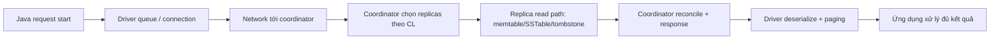
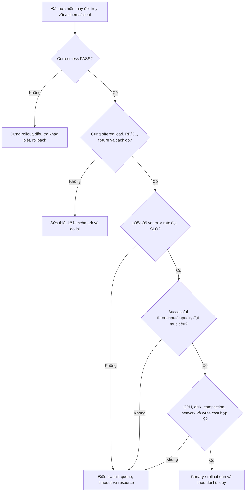

# Đo lại kết quả đúng, độ trễ và thông lượng sau thay đổi

## 1. Tối ưu truy vấn chỉ thành công khi đúng dữ liệu và đáp ứng tải

Trong Apache Cassandra, một truy vấn CQL được định tuyến theo **partition key** đến các natural replica theo replication strategy, được coordinator thực hiện với **consistency level (CL)** của request. Truy vấn có thể nhanh hoặc chậm do kích thước partition, số SSTable cần đọc, tombstone, paging, mạng, tải CPU/đĩa, compaction, repair và cấu hình Java Driver. Vì vậy, khi thay đổi câu CQL, schema, page size hoặc đường đọc, **không thể chỉ nhìn một con số latency giảm** rồi kết luận tối ưu đã thành công.

Một phép đo lại đáng tin cậy phải chứng minh **ba thuộc tính độc lập**:

1. **Kết quả đúng (correctness):** tập bản ghi, giá trị, thứ tự được cam kết, phạm vi lọc, TTL và tính nhất quán đáp ứng hợp đồng nghiệp vụ.
2. **Độ trễ (latency):** thời gian một thao tác mất từ phía client, phân phối p50/p95/p99, timeouts, retries và khác biệt giữa *trang đầu* với *đọc hết các trang*.
3. **Thông lượng (throughput):** số thao tác **thành công** mỗi giây dưới một mức tải xác định, chi phí tài nguyên và điểm hệ thống bắt đầu bão hòa.

Bài thuộc chương **Tối ưu truy vấn** trong mô-đun `DATABASE_ENGINE_WIDE_COLUMN_CASSANDRA`. Phạm vi gắn trực tiếp với kiến trúc phân tán/wide-column, thiết kế bảng theo truy vấn, khóa phân vùng, replication/CL, CQL, compaction, repair, xử lý lỗi và kết nối từ ứng dụng Java.

**Đầu ra cần có:** một báo cáo before/after chứa hợp đồng kết quả, dữ liệu đầu vào có thể tái lập, tải thử tương đương, histogram latency, achieved QPS, error rate, tài nguyên theo node và kết luận **giữ thay đổi hay rollback**.

## 2. Ba câu hỏi bắt buộc sau mỗi thay đổi

| Câu hỏi | Bằng chứng cần lấy | Dấu hiệu cảnh báo |
| --- | --- | --- |
| **Trả đúng cái gì?** | So sánh khóa chính, cột bắt buộc, giá trị, count, thứ tự được yêu cầu, đầy đủ các trang; kiểm tra các ca biên | Câu mới dùng `LIMIT`/lọc khác làm mất hàng; page đầu đúng nhưng những page sau thiếu; xóa nhầm cột API cần |
| **Nhanh ở đâu?** | Client end-to-end p50/p95/p99, first-page vs full iteration, trace mẫu, coordinator/replica metrics | Chỉ so một lần `cqlsh`, so mean mà không xét tail, tracing làm chậm workload |
| **Chịu tải bao nhiêu?** | Offered QPS, achieved successful QPS, concurrency, errors/timeouts, CPU, network, disk và điểm bão hòa | Chạy ít tải hơn sau thay đổi, chỉ đếm request gửi đi, bỏ các timeout khỏi latency |

### Ví dụ “tối ưu giả”

Ứng dụng trước đây đọc 500 sự kiện mới nhất của một thiết bị. Sau sửa, query trả 20 sự kiện với `LIMIT 20` và p99 giảm 80%. Nếu yêu cầu nghiệp vụ **vẫn cần đủ 500 hàng**, đây là **regression correctness**, không phải tối ưu thành công.

Tương tự, giảm CL từ `LOCAL_QUORUM` xuống `ONE` có thể giảm thời gian chờ, nhưng đã đổi **hợp đồng nhất quán** và khả năng đọc phiên bản cũ. Phải phê duyệt thay đổi đó như thay đổi semantics, không đưa vào phép đo “query tuning giữ nguyên kết quả”.

## 3. Xác định loại thay đổi và invariant cần bảo vệ

| Thay đổi dự định | Điều kiện đúng đắn cần xác minh | Tác động hiệu năng kỳ vọng |
| --- | --- | --- |
| Thay `SELECT *` bằng danh sách cột | Những cột bị bỏ **không nằm trong hợp đồng API**; các cột giữ lại giống trước | Giảm bytes payload và deserialize; chưa chắc giảm read I/O tương ứng |
| Điều chỉnh `LIMIT` | Hợp đồng số bản ghi/thứ tự không đổi, hoặc thay đổi được duyệt rõ | Giảm hàng truyền về; có thể che mất kết quả cần thiết |
| Điều chỉnh driver `page size` | Đọc **hết mọi page** vẫn ra cùng tập bản ghi trên snapshot dữ liệu ổn định | Trade-off round trip, memory, first-page latency và full-read latency |
| Thêm điều kiện `event_ts` / time bucket | Phạm vi thời gian mới đúng yêu cầu nghiệp vụ; không bỏ late-arriving data | Giảm số hàng/partition phải đọc |
| Chuyển sang bảng denormalized mới theo truy vấn | Backfill đầy đủ; dual-write/CDC, TTL, tombstone, timestamps và cutover nhất quán | Truy vấn bám partition key thay vì quét/chọn lọc không hiệu quả |
| Thay partition key/bucket | Cùng sự kiện có đúng một cách truy cập theo contract; không thiếu/nhân đôi khi gom nhiều bucket | Giảm hot/wide partition và fan-out nếu thiết kế hợp lý |
| Thêm index/SAI trên phiên bản hỗ trợ | Điều kiện lọc và dữ liệu trả về giống contract; kết quả đúng khi index còn build | Có thể giảm công việc đọc trong một số pattern, nhưng tăng chi phí ghi/disk |
| Tăng cache hoặc chỉnh compaction | Kết quả phải giống trước, không ảnh hưởng semantics | Có thể giảm latency nhưng tăng memory/I/O nền |
| Đổi RF, CL, DC routing | **Đây là thay đổi consistency/availability**, cần chấp nhận rủi ro riêng | Latency có thể đổi vì số replica, WAN và tình trạng đồng bộ |

**Giữ nguyên “giả định so sánh”** trong phép đo hiệu năng nếu không có lý do nghiệp vụ được duyệt: cùng keyspace/bảng dữ liệu tương đương, RF, CL, routing local DC, thời gian xét TTL, số node khỏe, kích thước result, workload và Java Driver settings. Nếu bắt buộc thay một giả định, ghi rõ đó là **biến can thiệp**.

## 4. Chuẩn bị dữ liệu CQL có thể tái lập

Ví dụ dùng cluster lab một DC tên `dc1` có ít nhất ba node để cấu hình RF = 3. Thay tên DC/RF theo môi trường thử nghiệm. Không tạo keyspace hay ghi dữ liệu lab vào production.

```sql
CREATE KEYSPACE tuning_lab_ks
WITH replication = {'class': 'NetworkTopologyStrategy', 'dc1': 3}
AND durable_writes = true;

CREATE TABLE tuning_lab_ks.events_by_device (
    device_id text,
    bucket_day date,
    event_ts timestamp,
    event_id uuid,
    event_type text,
    payload text,
    PRIMARY KEY ((device_id, bucket_day), event_ts, event_id)
) WITH CLUSTERING ORDER BY (event_ts DESC, event_id DESC);

INSERT INTO tuning_lab_ks.events_by_device
    (device_id, bucket_day, event_ts, event_id, event_type, payload)
VALUES
    ('sensor-7', '2026-11-21', '2026-11-21T08:00:00+0000',
     11111111-2222-4333-8444-555555555555, 'HEARTBEAT', 'v1');

INSERT INTO tuning_lab_ks.events_by_device
    (device_id, bucket_day, event_ts, event_id, event_type, payload)
VALUES
    ('sensor-7', '2026-11-21', '2026-11-21T08:05:00+0000',
     22222222-3333-4444-8555-666666666666, 'ALERT', 'v2');

INSERT INTO tuning_lab_ks.events_by_device
    (device_id, bucket_day, event_ts, event_id, event_type, payload)
VALUES
    ('sensor-7', '2026-11-21', '2026-11-21T08:10:00+0000',
     33333333-4444-4555-8666-777777777777, 'HEARTBEAT', 'v3');
```

**Schema và mục đích:** `(device_id, bucket_day)` là partition key, `(event_ts, event_id)` là clustering columns. Đọc một bucket trong khoảng thời gian cố định là query bám partition key; Cassandra không phải quét toàn bộ thiết bị hoặc bảng. Clustering order mặc định đã được khai báo giảm dần theo cả timestamp và UUID để phép so thứ tự có ý nghĩa rõ ràng trong lab.

### Một phép đổi projection có chủ đích

Trước thay đổi, giả sử code API dùng:

```sql
SELECT event_ts, event_id, event_type, payload
FROM tuning_lab_ks.events_by_device
WHERE device_id = 'sensor-7'
  AND bucket_day = '2026-11-21'
  AND event_ts >= '2026-11-21T08:00:00+0000'
  AND event_ts < '2026-11-21T09:00:00+0000'
LIMIT 100;
```

Sau thay đổi, khi endpoint **không cần payload**:

```sql
SELECT event_ts, event_id, event_type
FROM tuning_lab_ks.events_by_device
WHERE device_id = 'sensor-7'
  AND bucket_day = '2026-11-21'
  AND event_ts >= '2026-11-21T08:00:00+0000'
  AND event_ts < '2026-11-21T09:00:00+0000'
LIMIT 100;
```

**Không được đòi hai result set giống hệt nhau**, bởi query cũ có cột `payload` mà query mới không có. Hợp đồng kiểm thử ở đây là **cùng số hàng, cùng khóa (event_ts, event_id), cùng event_type và cùng thứ tự**, đồng thời **việc bỏ payload đã được API chấp nhận**. Nếu client còn cần `payload`, tối ưu này là breaking change.

Không dùng bộ ba hàng nhỏ để tuyên bố tối ưu đạt p99 production. Chúng là **fixture tính đúng đắn**; benchmark latency và throughput cần tập partition/số hàng/giá trị/TTL/tombstone đủ đại diện mà vẫn tuân thủ chính sách dữ liệu.

## 5. Ma trận correctness: không chỉ so row count

| Ca kiểm thử | Kiểm tra gì? | Vì sao cần? |
| --- | --- | --- |
| Partition có 1, nhiều, 0 hàng | Hàng trả đủ, query không trả dữ liệu từ partition khác | Phát hiện sai partition key/bucket hoặc mã hóa key |
| Hai hàng cùng `event_ts` | Khóa đầy đủ gồm `event_id`, thứ tự ổn định theo clustering comparator | Chỉ so timestamp có thể bỏ sót/đếm trùng hàng |
| Khoảng thời gian [start, end) | Bao gồm start, loại trừ end, không bỏ late-arriving events theo contract | Sai dấu `>=`/`<` làm đổi tập kết quả |
| Có hơn một trang | Đọc hết `ResultSet`, không chỉ page đầu | Page size không phải tổng `LIMIT`; bỏ trang làm thiếu dữ liệu |
| Kết quả đúng bằng/vượt `LIMIT` | Hợp đồng “top N” và clustering order | Giới hạn hàng chỉ đúng khi business chấp nhận N |
| Hàng có `null`/giá trị trống | Phân biệt null, absent và giá trị mặc định ở client | Projection/deserialization có thể đổi semantics |
| TTL sắp hết, hàng mới hết hạn | Thời điểm quan sát/clock nhất quán, TTL đã được tính vào contract | Dữ liệu có thể thay đổi dù query không đổi |
| Cập nhật/xóa/tombstone | Phiên bản mới và deleted rows không “sống lại”; backfill đúng | Bảng denormalized/migration dễ lỗi ở DELETE/TTL |
| Nhiều partition/bucket | Đầy đủ tập khóa, không nhân đôi event khi client fan-out | Cassandra không đảm bảo thứ tự toàn cục nếu tự ghép nhiều partition |
| Một replica chậm/down | CL, timeout, retry, dữ liệu có thể cũ theo lựa chọn CL | Test correctness không chỉ là dữ liệu ở trạng thái cluster khỏe |

### Dữ liệu đang thay đổi: thế nào là “cùng kết quả”?

Cassandra không cung cấp một **snapshot transaction xuyên các request CQL** chỉ vì chúng chạy gần nhau. Nếu hai query before/after được chạy cách nhau vài giây trong lúc hệ thống đang ghi, TTL hết hạn hoặc compaction/repair, chúng có thể trả khác nhau **mà không phải do query rewrite**.

Để kiểm chứng:

1. Dùng **fixture bất biến** trong lab, không đặt TTL hoặc bảo đảm TTL không hết trong thời gian thử.
2. Chọn cùng partition keys và cùng khoảng thời gian, cố định thời điểm/cutoff.
3. Cùng CL và local DC; không so `ONE` với `LOCAL_QUORUM` rồi kết luận query mới sai.
4. So tập khóa chính và các trường nghiệp vụ được giữ; với một partition, so **thứ tự clustering** nếu API cam kết.
5. Khi cần đối chiếu nhiều partition, chuẩn hóa kết quả **theo khóa chính** ở client trước khi hash/compare; không suy Cassandra có ORDER BY toàn bộ cluster.
6. Với migration/dual writes, phải có riêng kiểm thử **quá trình backfill, đồng bộ cập nhật, xóa, TTL và cutover**. Không dùng một query trả đúng một hàng làm chứng cứ toàn bộ lịch sử đã chuyển.

### Vì sao checksum cần thiết nhưng chưa đủ?

Digest/hash của một tập hàng **đã chuẩn hóa** giúp so sánh lượng dữ liệu lớn mà không in raw payload, nhưng chỉ có ý nghĩa khi:

- Hai bên có **cùng phạm vi và cùng projection đã thỏa thuận**.
- Cùng cách serialize kiểu dữ liệu (timestamp, decimal, null, text, UUID), thứ tự ổn định.
- Mọi trang đã được duyệt và đủ hàng, không dừng ở page đầu.
- Data fixture không bị ghi trong lúc so.

Hash khác → chắc chắn cần điều tra dữ liệu/phạm vi/serialization; hash bằng nhau → tăng độ tin cậy nhưng **không tự chứng minh** hiệu năng, freshness hoặc toàn bộ dữ liệu ở replica khác giống nhau. Đừng log payload/PII vào báo cáo benchmark.

## 6. Đo latency: từ client tới coordinator và replica



Có ít nhất **ba đồng hồ** hữu ích:

| Phép đo | Điểm đầu → cuối | Điểm mù |
| --- | --- | --- |
| **First-page latency** tại Java Driver | Trước `execute()` đến khi có `ResultSet` cho trang đầu | Không tính việc tải các trang sau và xử lý toàn bộ rows |
| **Full-consumption latency** | Trước `execute()` đến sau khi duyệt hết các trang và hàng | Bao gồm client deserialize/iteration; tùy cách ứng dụng xử lý dữ liệu |
| **Server request latency / CQL tracing** | Từ góc nhìn coordinator/replica cho từng request CQL | Không phản ánh toàn bộ kết nối, queue, client processing và request pages khác |

Một thao tác trả 10.000 hàng có thể có **first-page p99 tốt** nhưng total time rất lớn do 100 round trips. Ngược lại page size quá lớn có thể tăng thời gian trang đầu, heap/GC và bytes/network burst. Phải biết endpoint SLO đánh giá **trang đầu**, **toàn bộ kết quả**, hay **thời gian HTTP response**.

### Percentile và tail latency

Đặt \(L_1, L_2, ..., L_n\) là thời gian các thao tác **cùng loại** trong cửa sổ thử:

- **p50**: nửa thao tác hoàn tất không chậm hơn mức này; tốt cho xu hướng thông thường.
- **p95/p99**: mô tả phần đuôi mà người dùng thấy trong điều kiện tải, thường nhạy với GC, compaction, disk wait và retry.
- **Timeout/error rate**: cần ghi riêng. **Không được chỉ tính percentile trên các request thành công mà bỏ những timeout chậm nhất** rồi tuyên bố p99 đẹp hơn.

Percentile **không cộng tuyến tính**: p99 của HTTP + p99 của Cassandra không bằng p99 end-to-end. Tương tự, trung bình p99 của từng node không phải p99 của cả cluster. Hãy thu histogram/samples cùng loại rồi tính theo phương pháp thống nhất, gắn rõ node/DC và số request.

### Cảnh giác measurement bias

- **Warm cache:** lần chạy thứ hai có thể nhanh hơn do OS/page/cache dù không có thay đổi. Đổi thứ tự A/B hoặc warmup cả hai.
- **JIT, connection pool, prepared cache:** lần đầu gọi driver có startup/prepare overhead, không được ghép với steady-state nếu mục tiêu là query latency.
- **Compaction/repair đang chạy:** SSTables per read, disk I/O và GC thay đổi không liên quan query rewrite.
- **Tracing tự tạo overhead:** lấy trace mẫu nhỏ để giải thích, benchmark throughput/latency chính phải chạy **không bật trace**.
- **Coordinated omission:** load generator chờ request chậm rồi mới gửi request mới có thể bỏ sót thời gian queue mà người dùng thực phải chịu; báo offered rate và latency so với lịch đến dự kiến, dùng workload generator phù hợp.
- **Client bottleneck:** CPU/GC/network của chính máy chạy load test có thể chặn thông lượng trước Cassandra.

## 7. Thông lượng: phân biệt offered, achieved và successful

Thông lượng không đồng nghĩa với “đã cố gửi bao nhiêu request”.

Cho một cửa sổ \(\Delta t\):

\[
\text{Offered QPS} = \frac{\text{requests được lên lịch/gửi}}{\Delta t}
\]

\[
\text{Successful QPS} = \frac{\text{operations thành công hợp đồng}}{\Delta t}
\]

\[
\text{Error rate} = \frac{\text{failed + timed-out operations}}{\text{total operations được tính}} \times 100\%
\]

Giữ **nguyên định nghĩa operation** giữa before và after. Một request đọc 1 page khác với “một lần load hết 10 pages”. Nếu đổi page size, số CQL requests cấp server có thể đổi dù số **nghiệp vụ** không đổi; báo **operations/s**, **pages/s** và **bytes/s** tùy mục tiêu thay vì trộn lẫn.

**Offered load** là áp lực đầu vào; **achieved/completed throughput** là công việc được hoàn tất thực. Khi hệ thống bão hòa, QPS thực có thể đứng yên hoặc giảm trong khi latency, queue và timeout tăng.

```text
Offered QPS --> [Driver / Coordinator / Replicas] --> Successful QPS
                         |
                         +--> Timeouts / failures / retries
                         |
                         +--> Queue length, CPU, disk, network tăng
```

Một phép đo throughput nên có **nhiều mức tải** (chẳng hạn tăng theo bậc), không chỉ một điểm “chạy hết tốc lực”. Mỗi mức có giai đoạn warmup và đo ổn định; khi vượt ngưỡng p99/error/disk/CPU đã thỏa thuận, dừng thay vì tiếp tục gây quá tải.

### Concurrency và Little's Law

Trong hệ thống ổn định, quan hệ gần đúng:

\[
\text{In-flight trung bình} \approx
\text{Throughput hoàn tất (ops/s)} \times
\text{Response time trung bình (s)}
\]

Đây là cách kiểm tra **order of magnitude**, không thay cho histogram p99 và không đúng nếu benchmark đang tích lũy backlog chưa ổn định. Tăng số request đồng thời có thể tăng throughput lúc còn dư tài nguyên, nhưng sau điểm bão hòa sẽ chủ yếu tăng queue, retry và timeout.

## 8. Thiết kế benchmark before/after công bằng

### 8.1. Xây bảng “những gì phải giữ cố định”

| Hạng mục | Cần giữ/công bố |
| --- | --- |
| **Dataset** | Số partition, row/partition, bucket distribution, payload bytes, TTL/tombstone, tỉ lệ hot keys |
| **Query mix** | Tỷ lệ SELECT/INSERT/UPDATE/DELETE, query shape, limit/range, số page, scan pattern |
| **Topology** | Cassandra version, node count, RF theo DC, rack, local DC driver, CL |
| **Client** | Java Driver version, prepared statements, page size, concurrency, pooling, retry/timeouts |
| **Tải** | Offered QPS, mix theo tenant/partition, random seed, concurrency và thời lượng |
| **Máy đo** | CPU, network, vị trí region, số load generators; không để máy đo thành bottleneck |
| **Cluster nền** | Disk free, compaction backlog, repair/streaming, GC, cache warmth, node status |
| **Cách tính** | Phân biệt first-page/full operation, success/error, phần trăm, đơn vị và số samples |

Nếu thay đổi schema cần backfill, không benchmark trong lúc **chỉ mới chuyển 40% dữ liệu** rồi kết luận. Có thể cần đo riêng **giai đoạn migration** và **steady state sau cutover**, vì double-write/backfill làm tải khác với hoạt động bình thường.

### 8.2. Quy trình tối thiểu có tính lặp lại

1. **Baseline:** đo truy vấn hiện tại trên workload/fixture đã cố định, thu correctness và metrics.
2. **Warmup:** chuẩn bị connection pool, driver prepared cache, JIT, table/cache theo kế hoạch nhất quán.
3. **Chạy nhiều lần:** ít nhất vài lượt độc lập, dùng cửa sổ đủ dài để thu p99 đáng tin hơn một vài samples, đổi thứ tự nếu điều kiện cho phép.
4. **Áp một thay đổi:** giữ các biến khác cố định; chỉ khác projection, page size, schema hoặc tham số đã nêu.
5. **Correctness gate trước:** nếu sai dữ liệu/thiếu hàng, **dừng**; không cần xem latency như bằng chứng thành công.
6. **Latency/throughput:** so các mức offered QPS tương đương và vùng bão hòa, cùng SLO/error budget.
7. **Resource cost:** so read/write CPU, disk, bytes sent/received, pending tasks, tombstone/SSTables per read.
8. **Rollback decision:** chấp nhận, điều chỉnh hoặc quay lại dựa trên ngưỡng đã thống nhất.

**Không dập tắt dữ liệu lỗi bằng cách làm đẹp dashboard.** Một p99 tốt hơn nhưng tỷ lệ timeout tăng từ 0,1% lên 2% hoặc xuất hiện thiếu bản ghi là regression.

### 8.3. Tránh so sánh sai vì tải không bằng nhau

Nếu baseline chạy lúc 700 ops/s, after chỉ chạy 200 ops/s thì giảm latency **không đủ chứng minh** query tốt hơn. Cần so tại **cùng offered rate**, cùng distribution khóa và loại thao tác. Nếu after chịu được tải cao hơn, hãy tìm **ngưỡng thông lượng tối đa thỏa SLO**, không lấy p99 tại những mức tải khác nhau so trực tiếp.

## 9. Ví dụ bảng kết quả before/after có thể diễn giải

**Số liệu hoàn toàn giả định để luyện đọc, không phải benchmark Cassandra đã chạy.** Giả sử cùng RF3, `LOCAL_QUORUM`, cùng workload read-only và 60 giây cửa sổ đo ổn định ở mỗi mức:

| Phiên đo | Offered ops/s | Success ops/s | p50 (ms) | p95 (ms) | p99 (ms) | Error/timeout |
| --- | ---: | ---: | ---: | ---: | ---: | ---: |
| Before — 400 | 400 | 399 | 21 | 64 | 130 | 0,25% |
| After — 400 | 400 | 400 | 18 | 48 | 86 | 0% |
| Before — 800 | 800 | 680 | 87 | 360 | 620 | 15% |
| After — 800 | 800 | 794 | 31 | 116 | 198 | 0,75% |

Kết luận **có điều kiện**:

- Ở 400 offered ops/s, after giảm p99 từ 130 xuống 86 ms và vẫn phục vụ đủ operations; đây là tín hiệu cải thiện **nếu correctness đã PASS**.
- Ở 800 offered ops/s, after đạt nhiều successful ops/s và ít lỗi hơn; tuy nhiên **0,75% error** có thể vẫn vượt SLO. Không được tuyên bố “đã đáp ứng production” khi chưa có error budget.
- Không được dùng bảng này chứng minh giảm disk I/O: cần đo disk/CPU/SSTable và cấu hình cùng lúc.
- Nếu before trả cả `payload` và after bỏ nó, chỉ so sánh sau khi API chấp nhận **projection mới**; giảm payload **không tự động có nghĩa kết quả đúng**.

### Chọn ngưỡng nghiệm thu từ trước

Ví dụ một hợp đồng thử nghiệm có thể quy định **p99 full-operation không quá 200 ms, error rate không quá 0,1%, và successful throughput ít nhất 600 ops/s ở mức offered tương ứng**, đồng thời không có khác biệt dữ liệu. Đây chỉ là **ngưỡng ví dụ**, không phải giá trị mặc định cho mọi dịch vụ.

Khi áp tiêu chí, phiên “After — 800” **không đạt** nếu giới hạn error rate là 0,1%, dù p99 bằng 198 ms. Người đọc phải kết luận không nên rollout ở tải đó trước khi xử lý timeout hoặc thay đổi mục tiêu được duyệt.

## 10. Đo ở Cassandra: CQL, tracing và metric của đúng node

### 10.1. Xác minh dữ liệu bằng cqlsh

```sql
CONSISTENCY LOCAL_QUORUM
PAGING 2
ELAPSED ON

SELECT event_ts, event_id, event_type
FROM tuning_lab_ks.events_by_device
WHERE device_id = 'sensor-7'
  AND bucket_day = '2026-11-21'
LIMIT 100;
```

`PAGING 2` cố ý tạo phân trang với ba hàng fixture để người học thấy **trang đầu không phải toàn bộ result**. Trong cqlsh, phải tiếp tục lấy page còn lại theo prompt, rồi mới so kết quả. Những chỉ thị `CONSISTENCY`, `PAGING`, `ELAPSED` là lệnh của **cqlsh**, không cần dấu chấm phẩy.

Với một vài request chậm nhưng không đủ bằng chứng, bật tracing **chọn lọc**:

```sql
TRACING ON

SELECT event_ts, event_id, event_type
FROM tuning_lab_ks.events_by_device
WHERE device_id = 'sensor-7'
  AND bucket_day = '2026-11-21'
LIMIT 100;

TRACING OFF
```

Trace cho thông tin coordinator, replicas và các event của read path nhưng **bản thân tracing gây overhead**. Không dùng lần chạy có tracing bật làm số p99 đại diện cho workload bình thường, không bật trace cho toàn bộ benchmark và không sao chép raw trace có partition key nhạy cảm ra nơi không phù hợp.

### 10.2. Node/table metrics

```bash
nodetool status
nodetool tablestats tuning_lab_ks.events_by_device
nodetool tablehistograms tuning_lab_ks events_by_device
nodetool proxyhistograms
nodetool tpstats
nodetool compactionstats
```

Đọc đúng phạm vi:

- `tablestats` giúp xem SSTable count, disk usage, tombstone/cell và ước lượng đọc **của bảng trên node được hỏi**.
- `tablehistograms` cung cấp phân phối một số chỉ số đọc/ghi/table theo khả năng phiên bản; kiểm tra syntax bằng `nodetool help tablehistograms`.
- `proxyhistograms` quan sát độ trễ từ góc nhìn **coordinator/node**, không phải latency HTTP của ứng dụng Java.
- `tpstats` và `compactionstats` giúp nhận biết queue, thread pool, compaction/validation gây nhiễu.

Theo dõi thêm **JMX/Prometheus** theo version cho ClientRequest.Read/Write.Latency, Table.CoordinatorReadLatency/ReadLatency, SSTablesPerReadHistogram, TombstoneScannedHistogram, key/row cache, dropped messages, GC, disk await và network throughput.

Không so một counter tích lũy đọc từ node mới restart với node uptime lâu; lấy **delta/rate**, histogram đúng cửa sổ và công bố đơn vị. RF và CL quyết định số replica cần trả lời, nên chỉ số trên **một node** không tự đại diện toàn cluster.

## 11. Java Driver 4.x: đo trang đầu, đọc hết và fingerprint kết quả

Ví dụ dưới đây dùng **Java Driver 4.x** và dữ liệu fixture; giả sử `session` đã được tạo, các import phù hợp (`java.time.*`, `java.util.*`, `java.nio.charset.StandardCharsets`, `java.security.MessageDigest` và API Driver). Chạy đoạn này nhiều lần trong lab để **quan sát phương pháp**, không lấy một lần thực thi làm p99.

```java
PreparedStatement ps = session.prepare(
    "SELECT event_ts, event_id, event_type " +
    "FROM tuning_lab_ks.events_by_device " +
    "WHERE device_id = ? AND bucket_day = ? " +
    "AND event_ts >= ? AND event_ts < ? LIMIT 100"
);

BoundStatement query = ps.bind(
    "sensor-7",
    LocalDate.of(2026, 11, 21),
    Instant.parse("2026-11-21T08:00:00Z"),
    Instant.parse("2026-11-21T09:00:00Z")
).setConsistencyLevel(DefaultConsistencyLevel.LOCAL_QUORUM)
 .setPageSize(2); // Lab: chủ ý kiểm tra paging, không phải page size production.

long startNs = System.nanoTime();
ResultSet rs = session.execute(query); // Trang đầu được nhận.
long firstPageNs = System.nanoTime();

MessageDigest digest = MessageDigest.getInstance("SHA-256");
int rows = 0;
for (Row row : rs) { // Driver có thể tải thêm page trong lúc lặp.
    Instant timestamp = row.getInstant("event_ts");
    UUID id = row.getUuid("event_id");
    String type = row.getString("event_type");

    // Canonicalize theo trường hợp fixture không-null, 1 partition.
    String canonical = timestamp + "|" + id + "|" + type + "\n";
    digest.update(canonical.getBytes(StandardCharsets.UTF_8));
    rows++;
}
long finishedNs = System.nanoTime();

System.out.printf(
    "rows=%d firstPageMs=%.2f fullResultMs=%.2f digest=%s%n",
    rows,
    (firstPageNs - startNs) / 1_000_000.0,
    (finishedNs - startNs) / 1_000_000.0,
    HexFormat.of().formatHex(digest.digest())
);
```

**Lưu ý tương thích Java:** `HexFormat` có từ **Java 17**; nếu dự án đang chạy Java 11, chuyển digest sang hex bằng formatter phù hợp hoặc chỉ xuất digest dạng byte đã mã hóa khác. Các phiên bản Driver có thể yêu cầu cấu hình khác; xác minh API đang dùng.

Giải thích các số đo:

1. `firstPageMs` bao gồm `session.execute()` trả trang đầu; **không** đo riêng network RTT hay server execution.
2. `fullResultMs` bao gồm **tất cả page và thời gian client lặp/hash**. Với dataset hàng lớn, hash cũng là chi phí client — cần giữ cùng cách xử lý ở before/after.
3. `digest` trên **ba cột retained** có thể so before/after với cùng canonicalization; nhưng không chứng minh đúng `payload` vốn đã bị bỏ ra khỏi contract.
4. `rows` kiểm tra tổng số hàng đã duyệt, không chỉ các hàng của trang đầu.
5. Với dữ liệu có `null`, decimal/timezone/binary, phải bổ sung canonical serializer có **null marker và mã hóa ổn định**, không dùng phép ghép chuỗi đơn giản ở trên.
6. Nếu query fan-out nhiều partition, cần **sắp xếp toàn bộ records theo primary key trước khi hash**, không dựa vào thứ tự thực thi request qua nhiều node.

**Điểm cần tránh:** Đo p99 từ một `System.nanoTime()`. Để có p99 có ý nghĩa, phải chạy nhiều operations đủ đại diện, thu histogram/metrics cùng tải, tính riêng success/failure và cả thời gian timeout. Nếu phép đo Java được đưa vào HTTP handler, không làm hashing toàn bộ payload trên production chỉ để đo.

### Khi page size là chính thay đổi

Giả sử trước `pageSize = 500`, sau `pageSize = 100`. Giữ nguyên CQL, CL, dataset và cách iterate **tới hết**. So:

- Tổng rows và digest **phải giống** trên fixture bất biến.
- First-page latency có thể giảm nhờ page nhỏ, nhưng **full-result latency có thể tăng** do thêm round trips.
- Số request cấp server, bytes/page, CPU client và GC có thể khác nhau; vì vậy **throughput đơn vị thao tác nghiệp vụ** phải được ghi rõ.
- Nếu ứng dụng chỉ lấy trang đầu rồi bỏ phần còn lại, đã thay đổi hành vi; không xem “đọc 100 thay 500” là tương đương về correctness.

## 12. Khi query tuning liên quan schema, compaction hoặc replication

Không phải mọi thay đổi đều chỉ ở một câu SELECT. Với Cassandra, **schema đúng query pattern** quyết định lượng dữ liệu phải đọc; tối ưu sai thiết kế có thể chỉ che triệu chứng.

### 12.1. Thay bảng hoặc thêm time bucket

Ví dụ một thiết bị có partition quá rộng, cần chuyển từ `events_by_device` dùng partition key chỉ `device_id` sang `events_by_device_day` dùng `(device_id, bucket_day)`. Sau migration:

1. Kiểm tra **đủ sự kiện lịch sử**, kể cả timestamp sát biên ngày, múi giờ, dữ liệu đến muộn.
2. So theo **event_id và primary key logic**, loại trùng nếu việc đọc fan-out nhiều bucket.
3. Kiểm tra writes/updates/deletes/TTL sau cutover được áp tới đúng bảng.
4. Chỉ sau correctness PASS mới benchmark read latency/throughput.
5. Tính **tổng chi phí ghi và lưu trữ** khi thêm bảng denormalized; đọc nhanh hơn không miễn phí nếu ghi phải nhân nhiều bản.

### 12.2. SSTable, compaction và tombstone

Sau đổi compaction strategy, cleanup hoặc repair, số SSTable/tombstone trên các replica có thể thay đổi dần. Do đó:

- Lấy **baseline metrics và cùng điều kiện workload**.
- Tránh kết luận từ một phút sau major compaction: cache và scheduler có thể tạm thời khác bình thường.
- Xem `SSTablesPerReadHistogram`, `TombstoneScannedHistogram`, disk usage, compaction backlog và ReadLatency ở từng node.
- Không hạ `gc_grace_seconds` chỉ để làm số liệu đẹp; tính đúng đắn của dữ liệu xóa và repair coverage quan trọng hơn.

### 12.3. RF/CL và nhiều DC

Nếu query trước dùng `LOCAL_QUORUM` tại `dc1`, sau đổi sang `ONE`/`dc2`, latency có thể giảm nhưng đó là **đổi consistency/routing**, không phải tối ưu query giữ nguyên semantics. Khi mất DC hoặc một replica chậm, error/timeout có thể đổi đáng kể. Cần test ma trận availability riêng và đo data freshness, không nhập vào bảng performance A/B như thể mọi biến bằng nhau.

## 13. Cây quyết định sau khi đo lại



### Khi nào giữ? Khi nào rollback?

| Kết quả | Hành động |
| --- | --- |
| Mất/nhân đôi hàng, sai value, sai phạm vi hoặc đổi contract chưa duyệt | **Rollback/khóa rollout ngay**, xử lý correctness trước |
| Correctness PASS, p99 tốt hơn, error và QPS thành công không giảm | Có thể canary/rollout với monitoring, chưa bỏ kiểm tra resource |
| p50 giảm nhưng p99 và timeout tăng | Điều tra tail, retry, GC, network hoặc hot partitions; không chỉ báo p50 |
| Successful QPS giảm dù request gửi tăng | Kiểm tra saturation, queue và failed operations; điều chỉnh hoặc rollback |
| Đọc tốt hơn nhưng write amplification/disk/repair quá cao | Đánh giá **chi phí toàn vòng đời**, có thể phải đổi schema/strategy |
| Kết quả khác do writes/TTL/CL không cùng điều kiện | Sửa phương pháp đo, không kết luận query rewrite sai hoặc đúng |

**Điều kiện cuối cùng:** kế hoạch rollback phải được chuẩn bị trước. Nếu đã chuyển schema và bắt đầu ghi vào bảng mới, rollback **không chỉ là đổi một chuỗi SELECT cũ**: cần giữ đường ghi đồng bộ, dữ liệu backfill, TTL/delete, checkpoint và phương án khôi phục nhất quán.

## 14. Mẫu báo cáo tối ưu truy vấn để tái sử dụng

```text
Change ID:
Owner / thời gian UTC:
Keyspace / table / query shape:
Cassandra version / node count / DC / rack / RF / CL:
Java Driver version / local DC / pageSize / timeout / retry policy:

Giả thuyết: 
Thay đổi chính:
Correctness contract: projection, key set, order, time window, LIMIT, TTL:
Fixture / seed / số partition / rows/partition / tombstone ratio:
Before / After cùng dataset và cùng query mix?:
Kiểm thử tính đúng: PASS/FAIL + keys/rows/digest/cases:

Tải: warmup, thời gian đo, số lần lặp, offered ops/s, concurrency:
Latency: p50/p95/p99, first-page, full-operation, error/timeout:
Throughput: achieved successful ops/s, pages/s, bytes/s:
Tài nguyên: CPU/GC, disk free/IOPS/await, network, compaction/repair:
SLO / error budget / capacity target:

Kết luận: ACCEPT / CANARY / REWORK / ROLLBACK
Các biến nhiễu, rủi ro chưa giải quyết:
Đường rollback / dữ liệu cần giữ / người xác nhận:
```

Điền **đơn vị** vào mọi chỉ số; gắn số mẫu và cửa sổ quan sát. Không phát tán raw partition key, customer ID, event payload hay trace session nhạy cảm trong báo cáo.

## 15. Tình huống tự luận và bài tập

**Tình huống A — LIMIT che mất dữ liệu:** Endpoint yêu cầu 500 sự kiện gần nhất; người tối ưu đổi `LIMIT 500` thành `LIMIT 50` và p99 giảm còn một phần ba. Vì sao không được công bố đây là cải thiện? Hãy sửa thiết kế query/bucketing/paging để bảo vệ contract.

**Tình huống B — page size:** Đọc 12.000 rows. Trang đầu của `pageSize 100` nhanh hơn `pageSize 1000`, nhưng full-read chậm hơn do nhiều lần round trip. Endpoint stream dữ liệu về client theo từng page; cần đo những SLO và metric nào trước khi chọn?

**Tình huống C — offered ≠ achieved:** Baseline đạt 500 successful ops/s ở 550 offered, sau tuning load generator cố gửi 1.000 ops/s nhưng chỉ 450 success và nhiều timeout. Vì sao không thể tuyên bố throughput gấp đôi? Cần điều tra resource và queue thế nào?

**Tình huống D — compaction gây nhiễu:** Trước tuning đo khi đang chạy repair/compaction lớn, sau tuning đo khi cluster rảnh. Chỉ số p99 giảm 40%. Hãy thiết kế lại A/B để xác định phần cải thiện thực do query.

**Tình huống E — dữ liệu đổi trong lúc đo:** Hai câu SELECT cùng logic nhưng khác nhau một hàng vừa hết TTL. Nêu cách phân biệt query regression với thay đổi dữ liệu hợp lệ; làm thế nào dựng fixture ổn định?

**Câu hỏi ngắn:**

1. Vì sao p99 server trace và p99 end-to-end Java không nhất thiết bằng nhau?
2. Tại sao `LIMIT 100` và `pageSize 100` khác nhau về ý nghĩa?
3. Tại sao phải so **successful throughput** và error/timeout cùng với offered load?
4. Một digest của page đầu khớp có đủ chứng minh result set giống trước không?
5. Cùng CQL nhưng đổi CL từ `LOCAL_QUORUM` thành `ONE`: cần cập nhật hợp đồng correctness thế nào?
6. Tại sao giảm tombstone scan hoặc SSTables/read cần đo trên nhiều replica và nhiều khoảng thời gian?
7. Khi nào một thay đổi projection từ `SELECT *` sang ba cột là hợp lệ? Khi nào nó là breaking change?
8. Tại sao mỗi lần thay chỉ một biến và phải giữ cấu hình Driver/cluster đồng nhất?
9. Làm sao phát hiện coordinated omission trong benchmark chạy bằng client đồng bộ?
10. Viết một checklist canary có ngưỡng rollback cho correctness, p99, errors, successful QPS và disk/CPU.

**Tiêu chí hoàn thành bài:** người học xây dựng được kiểm thử kết quả đúng ở nhiều ca biên, đo first-page và full-result latency, trình bày đúng p50/p95/p99 và successful throughput dưới cùng offered load, nối số liệu Java Driver với coordinator/replica/host metrics, nhận diện thiên lệch benchmark và ra quyết định rollout/rollback có căn cứ.

## 16. Tài liệu tham khảo

- [Apache Cassandra Documentation](https://cassandra.apache.org/doc/stable/): CQL, kiến trúc partition/replication và hiệu năng truy vấn theo phiên bản.
- [Apache Cassandra — Data Modeling](https://cassandra.apache.org/doc/stable/cassandra/data_modeling/): thiết kế partition key, clustering order, bảng theo truy vấn.
- [Apache Cassandra — CQL SELECT](https://cassandra.apache.org/doc/stable/cassandra/developing/cql/dml.html): phạm vi WHERE, LIMIT, ORDER BY và semantics trả kết quả.
- [Apache Cassandra — Monitoring metrics](https://cassandra.apache.org/doc/stable/cassandra/managing/operating/metrics.html): phạm vi ClientRequest/Table/Cache và các histogram latency.
- [Apache Cassandra — nodetool](https://cassandra.apache.org/doc/stable/cassandra/managing/tools/nodetool/): `tablestats`, `tablehistograms`, `proxyhistograms`, `tpstats` và `compactionstats`.
- [Apache Cassandra Java Driver 4.x — Paging](https://apache.github.io/cassandra-java-driver/4.18.0/core/paging/): page size, truy vấn nhiều trang và tác động client.
- [Apache Cassandra Java Driver 4.x — Metrics](https://apache.github.io/cassandra-java-driver/4.18.0/core/metrics/): metrics request, pool và observability từ driver.

**Kết luận:** Một thay đổi query Cassandra chỉ đáng nhận là **tối ưu thành công** khi **giữ đúng hợp đồng dữ liệu**, giảm hoặc giữ latency trong SLO với cùng tải, nâng hoặc giữ successful throughput trong error budget và không tạo chi phí CPU/đĩa/mạng quá mức. Luôn kiểm tra đủ mọi page, partition key và CL, đo p95/p99 thay vì chỉ một lần thực thi, kiểm soát workload/caches/compaction và có rollback trước khi canary sang production.
