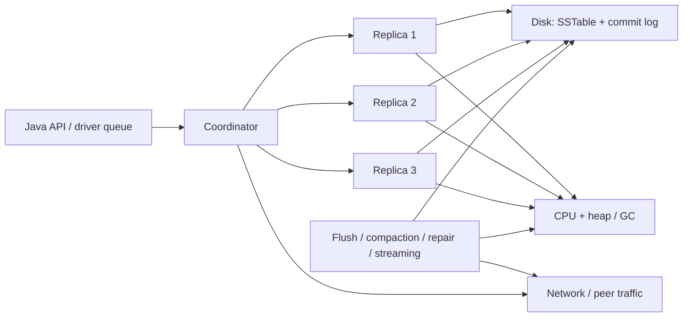
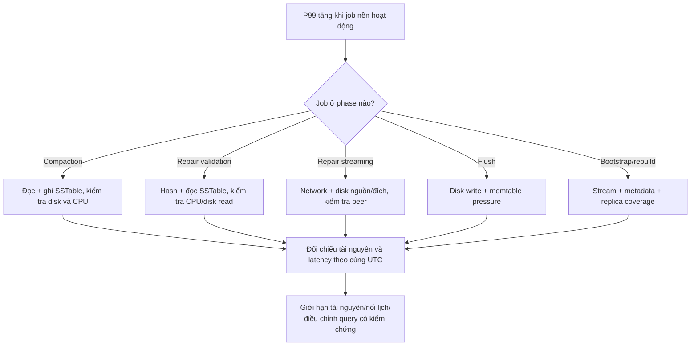
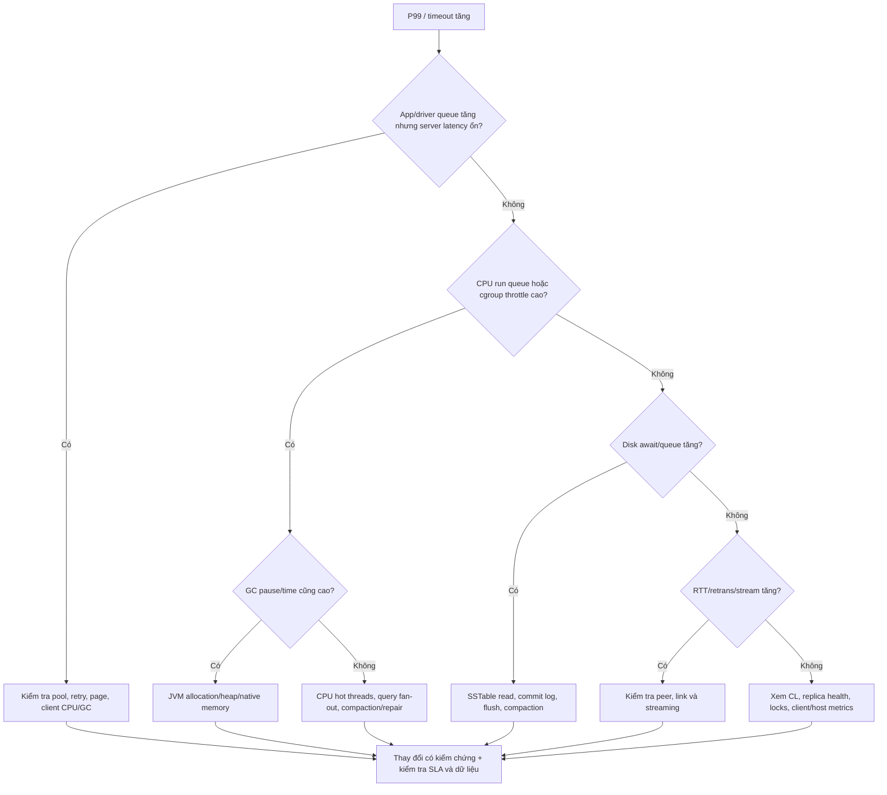

# Phân biệt nghẽn CPU, GC, đĩa, mạng và tranh chấp tài nguyên nền

Khi một cụm Apache Cassandra chậm, việc thấy **CPU 90%**, **GC liên tục**, **disk `%util` cao** hay **network throughput tăng** chưa đủ để kết luận đâu là nguyên nhân. Một truy vấn có thể chậm vì replica đang đọc SSTable từ ổ đĩa, coordinator đang chờ đủ replica cho `LOCAL_QUORUM`, JVM bị tạm dừng bởi GC, Java Driver hết kết nối khả dụng, hoặc vì **compaction/repair/streaming** tranh CPU, bộ nhớ, đĩa và mạng với truy vấn ứng dụng. Những tín hiệu này thường xuất hiện đồng thời và có quan hệ nhân quả phức tạp.

Bài thuộc chương **Tối ưu tài nguyên** của mô-đun **DATABASE_ENGINE_WIDE_COLUMN_CASSANDRA**. Trọng tâm là **chẩn đoán có bằng chứng** giữa nghẽn CPU, JVM/GC, storage, network và các tác vụ nền. Nội dung liên hệ tới kiến trúc phân tán, partition key, dữ liệu wide-column, consistency đọc/ghi, CQL, SSTable/compaction, repair, thay đổi topology và Java Driver. Mục tiêu không phải học thuộc một “tham số thần kỳ”, mà là biết **đo gì → phân biệt giả thuyết → thay một biến có kiểm soát → kiểm chứng cải thiện**.

## 1. Mục tiêu học tập

Sau bài này, bạn có thể:

1. Phân biệt **nghẽn** (một tài nguyên/queue giới hạn thông lượng) với **triệu chứng** (latency, timeout, GC, `iowait` hoặc queue tăng).
2. Đối chiếu p95/p99 ứng dụng, Java Driver, coordinator, replica và host theo **cùng khung thời gian**.
3. Nhận diện kiểu tín hiệu đặc trưng của CPU saturation, GC pauses/heap pressure, disk I/O saturation và network congestion.
4. Mô tả cách memtable flush, SSTable compaction, repair validation/streaming, bootstrap/rebuild và snapshot cạnh tranh tài nguyên với read/write path.
5. Sử dụng CQL, `nodetool`, JVM/OS metrics và Java Driver telemetry để tạo bằng chứng chẩn đoán, biết giới hạn từng công cụ.
6. Xây runbook phân loại nguyên nhân, chọn thay đổi an toàn và nghiệm thu theo SLA, thông lượng, lỗi và tính đúng đắn dữ liệu.
7. Tránh những cách chữa triệu chứng nguy hiểm: hạ consistency, giảm `gc_grace_seconds` bừa bãi, tắt repair, ép major compaction, tăng timeout/retry vô hạn hoặc tăng heap thiếu đo lường.

## 2. Vì sao chẩn đoán Cassandra phải theo nhiều tầng?

Một request từ ứng dụng Java không “đi vào một máy Cassandra rồi trở ra”. Driver chọn **coordinator**, coordinator xác định tập **replica** từ partition key/token/replication strategy, gửi yêu cầu và chờ đủ phản hồi theo **consistency level (CL)**. Tại replica, đọc có thể đụng memtable, SSTable, Bloom filter, index, cache và tombstone; ghi liên quan commit log, memtable và đường flush/compaction sau đó.



Nếu RF = 3 trong một DC, `LOCAL_QUORUM` thường cần **hai replica** trong DC đó trả lời. Vì vậy:

- **Một replica chậm** có thể làm tăng tail latency, nhất là khi coordinator phải chờ phản hồi cần thiết hoặc khi một replica khác đã down.
- **Coordinator chậm** có thể khiến ứng dụng thấy latency cao dù disk của replica bình thường.
- **Java Driver nghẽn connection pool/request throttling** có thể làm thời gian client tăng mà Cassandra chỉ mất ít thời gian xử lý trên server.
- **Một DC khác** có thể gặp mạng/streaming riêng mà không làm toàn bộ local-read latency tăng giống nhau.
- **Replication factor** làm tăng số bản sao dữ liệu chứ không có nghĩa mỗi SELECT chạy trên tất cả replica; các replica thực tế được chọn phụ thuộc CL và trạng thái cụm.

### Phân biệt năm khái niệm vận hành

| Khái niệm | Nghĩa | Ví dụ |
| --- | --- | --- |
| **Latency** | Thời gian từ một ranh giới đo đến ranh giới kết thúc. | App gọi `session.execute()` mất 800 ms. |
| **Throughput** | Số thao tác/byte xử lý trong một đơn vị thời gian. | 5.000 SELECT/giây hoặc 150 MiB/s disk writes. |
| **Utilization** | Tỷ lệ tài nguyên đang bận theo công cụ đo. | CPU bận 90%; disk `%util` gần 100%. |
| **Saturation/queue** | Công việc chờ vì khả năng phục vụ không đủ. | Pending tasks, run queue, disk requests queue, driver in-flight tăng. |
| **Error** | Công việc bị từ chối/thất bại hoặc client không nhận được kết quả đúng hạn. | `ReadTimeout`, `Unavailable`, dropped message, network reset. |

**Utilization cao không tự chứng minh saturation.** Một máy nhiều core có thể dùng CPU cao mà vẫn đáp ứng SLA, trong khi chỉ một core/event loop bị nghẽn có thể làm latency tăng dù trung bình CPU thấp. Với NVMe có nhiều hàng đợi, `%util=100%` không đơn giản bằng “hết sạch khả năng disk”. Cần xem **queue, latency, throughput, lỗi và workload** cùng lúc.

## 3. Quy trình bắt đầu: xác định phạm vi trước khi chạm tham số

Khi p99 tăng, ghi lại sáu yếu tố:

1. **Ai bị ảnh hưởng?** Chỉ một `query_name`, tenant, partition, node, rack, DC, hay mọi truy vấn?
2. **Khi nào?** Mốc UTC, thời lượng, tần suất, biến động theo giờ, liên hệ với compaction/repair/deploy/backup.
3. **Đường đi nào?** Read hay write, coordinator, các replica liên quan, RF, CL và local DC của Java Driver.
4. **Dữ liệu nào?** Kích thước partition, clustering range, row width, tỷ lệ TTL/DELETE/tombstone, SSTables/read.
5. **Hệ thống đang làm gì?** Memtable flush, compaction, repair, streaming, bootstrap, snapshot, JVM GC hoặc disk pressure.
6. **Thay đổi gì gần đây?** Ingest tăng, schema/TTL/compaction đổi, node mới, RF khác, Java retry policy/page size hoặc client concurrency tăng.

### Timeline là công cụ chính

```text
10:00  App read p99: 35 ms; Write p99: 20 ms; QPS 2k
10:05  Repair validation bắt đầu trên n03
10:07  Disk read await tăng, queue tăng; n03 read latency tăng
10:08  App read p99: 600 ms; driver retries tăng
10:12  Repair chuyển qua streaming; NIC throughput tăng
10:16  Repair hoàn tất; disk/queue giảm
10:18  App read p99 trở về 40 ms
```

Đây là **timeline giả định**, không phải số đo thực. Tương quan thời gian **gợi ý** repair cạnh tranh tài nguyên nhưng chưa chứng minh độc lập nguyên nhân; cần thêm metrics về disk/network/CPU của n03, mức tải truy vấn và trạng thái các node khác. Không kết luận “repair là lỗi” chỉ vì hai đường biểu đồ cùng tăng.

## 4. Bảng chẩn đoán nhanh CPU / GC / disk / network / nền

| Nhóm nghi ngờ | Tín hiệu điển hình | Cần kiểm chứng thêm | Phản ứng đầu tiên an toàn |
| --- | --- | --- | --- |
| **CPU saturation** | CPU user/system cao, run queue tăng, coordinator/replica latency tăng; có thể ít `iowait`. | CPU theo core/thread, hot partition, request rate, GC CPU, compaction CPU, cgroup quota. | Giảm burst/concurrency và phân loại process/thread; tối ưu query/schema hoặc mở rộng capacity đúng chỗ. |
| **GC/heap pressure** | GC pause/time tăng, heap occupancy sau GC cao, allocation rate lớn, JVM stall; latency có “đỉnh”. | GC log/JFR, heap/off-heap, allocation, pause duration, OOM/swap. | Thu chứng cứ JVM, tìm áp lực allocation/query lớn; không tăng heap mù quáng. |
| **Disk I/O** | Disk latency/queue tăng, read/write throughput hoặc IOPS gần trần; `iowait` có thể cao. | Device nào (data vs commit log), IO size/random vs sequential, pending flush/compaction, free disk. | Bảo toàn headroom, giới hạn việc nền nếu phù hợp; xử lý hot partition/đường đọc gây I/O. |
| **Network** | RTT/jitter/retrans tăng, throughput link cao, stream sessions kéo dài, timeout theo rack/DC. | NIC drops, TCP retrans, packet loss, connection resets, MTU/DNS/firewall, peer logs. | Khoanh vùng cặp node/DC; giữ CL và dữ liệu an toàn, giảm traffic cạnh tranh có kiểm soát. |
| **Background contention** | P99 tăng cùng thời điểm compaction, repair, streaming, bootstrap hoặc backup; tài nguyên dùng chung tăng. | Logs phase/tasks, bytes/s, queues, disk/network/CPU, overlap giữa jobs. | Giới hạn concurrency/lên lịch lại công việc nền theo runbook, không tắt bảo trì vô hạn. |
| **App/driver bottleneck** | HTTP latency cao nhưng Cassandra server latency bình thường; pool in-flight/queue tăng. | Driver metrics, event loop, CPU/GC Java service, retry/speculation, page fetch. | Giới hạn fan-out/retry, theo dõi request tracker, tối ưu pool và query đúng phạm vi. |

**Không được chọn hàng chỉ theo một biểu đồ.** CPU cao có thể do GC hoặc compaction; disk I/O cao có thể là nguyên nhân trực tiếp hoặc hậu quả của SELECT quét tombstone; network cao có thể là streaming hợp lệ chứ không phải sự cố link.

## 5. CPU saturation: phân biệt workload, GC và core bị nghẽn

CPU của node Cassandra phục vụ nhiều loại việc: parsing CQL, phối hợp coordinator, serialization/deserialization, hash/compaction, Merkle validation của repair, TLS/compression, xử lý mạng và JVM GC. Một node có CPU 95% **không tự** cho biết query nào cần sửa.

### Tín hiệu mạnh

- **Số runnable threads và run queue tăng** cùng throughput ngừng tăng, latency p95/p99 tăng khi tăng concurrency.
- **CPU per-core hoặc per-thread** có một nhóm thread nóng, trong khi metric CPU toàn node chưa chắc cao nếu máy nhiều core.
- **GC CPU time thấp** nhưng CPU user cao có thể gợi ý workload/compaction/query CPU; ngược lại, GC time cao khiến cần chẩn đoán JVM riêng.
- **Quota container/cgroup**: pod chỉ được cấp 2 CPU trên host 32 core có thể bị throttle liên tục dù dashboard host CPU còn dư.
- **CPU steal** trên VM hoặc contention với sidecar/process khác có thể làm Cassandra chậm dù CPU của process không đạt 100%.

### Lệnh quan sát thường dùng (Linux; môi trường đã được cấp quyền)

```bash
# Snapshot hệ thống, có thể thay bằng dashboard đã triển khai.
uptime
vmstat 1 5
top -H -p <CASSANDRA_PID>
pidstat -t -u -p <CASSANDRA_PID> 1 5
```

Trong `vmstat`, xem cột `r` (runnable), `us/sy`, `id`, `wa`; đừng coi `wa` là “CPU đang xử lý disk” mà hãy hiểu đó là thời gian CPU nhàn rỗi với I/O đang chờ trong cách đo của Linux. Các lệnh là ví dụ; `pidstat` thuộc gói sysstat, không phải máy nào cũng có.

### Chẩn đoán theo workload

| Dấu hiệu | Giả thuyết cần đối chứng |
| --- | --- |
| CPU tăng chủ yếu ở coordinator của một API | Query quá nhiều partition, lọc rộng, fan-out, serialization hoặc client retry tăng. |
| CPU tăng ở replica giữ một tenant/partition nóng | Hot partition, quá nhiều UPDATE/DELETE, scan clustering range/tombstone. |
| CPU tăng đúng lịch compaction | Data rewrite/metadata processing; xem đồng thời disk throughput và compaction tasks. |
| CPU tăng đúng lịch repair validation | Merkle tree/hash và đọc SSTable; xem logs repair/validation và disk read. |
| CPU cao + GC time cao | Allocation/heap pressure; không gọi đó chỉ là “CPU thiếu”. |
| CPU trung bình thấp nhưng vài query treo | Một thread/lock/queue, disk/network, driver hoặc hot core; cần thêm profile. |

**Hướng tối ưu:** ưu tiên schema/query giới hạn partition và clustering slice, giảm fan-out/retry không cần thiết, điều chỉnh capacity theo tải đo được, cô lập tranh chấp tài nguyên nền. Chỉ tinh chỉnh thread pools, compaction throughput hay JVM flags khi đã xác định đúng bottleneck và biết điều kiện rollback.

## 6. JVM và GC: tạm dừng khác với thiếu RAM

Cassandra chạy trên JVM; **heap, off-heap/direct memory, OS page cache và bộ nhớ của hệ điều hành** cùng chia RAM vật lý hoặc giới hạn cgroup. Một node có nhiều RAM không đồng nghĩa cần đẩy heap lên gần bằng tổng RAM: làm vậy có thể làm thiếu page cache, tăng disk read và thậm chí tạo GC pauses dài hơn.

### Các tín hiệu quan trọng

1. **GC pause duration** theo thời gian: đỉnh pause có trùng p99/timeout không?
2. **GC time ratio** và frequency: JVM dành bao nhiêu phần thời gian cho GC, có liên tục phải thu hồi bộ nhớ không?
3. **Heap used sau GC**: nếu baseline sau full/old collection liên tục tăng có thể do live set lớn/leak hoặc cấu hình heap không tương xứng.
4. **Allocation rate**: đọc partition lớn, tạo nhiều object, deserialization, logging/tracing quá mức có thể tăng allocation.
5. **Native/off-heap/mmap/page cache**: RSS, cgroup memory và OOM có thể tăng dù heap used chưa chạm Xmx.
6. **Swap/thrashing**: swap-in/out hay major page faults dưới tải có thể làm latency rất cao; cần theo chính sách memory/OS của phiên bản.

### Bảng nhận diện GC và CPU

| Tình trạng | Điều nên thấy | Hướng điều tra |
| --- | --- | --- |
| CPU cao, GC thấp, run queue cao | Nhiều công việc ứng dụng/compaction/repair chiếm core. | CPU flame graph/thread profiling có giới hạn, request mix và background jobs. |
| CPU cao, GC time cao, heap gần đầy | GC và allocation/memory pressure. | GC log, heap/GC occupancy, allocation, cấu hình JVM đúng Cassandra release. |
| Latency có spike gần bằng GC pause | Stop-the-world hoặc stall JVM là giả thuyết mạnh. | Đối chiếu **cùng UTC/monotonic window** giữa pause log và p99. |
| Heap ổn nhưng RSS/cgroup memory sát trần | Off-heap/native/page cache hoặc process khác. | RSS/cgroup/OOM, direct buffers, thread stacks, mmap, OS counters. |
| Heap lớn hơn làm disk read chậm | Có thể mất OS page cache. | So read latency/IOPS trước/sau, không chỉ GC pause. |

### Công cụ JVM tham khảo

```bash
# Chỉ dùng khi có quyền, công cụ JDK tương thích và runbook chấp thuận.
jcmd <CASSANDRA_PID> GC.heap_info
jstat -gcutil <CASSANDRA_PID> 1000 5

# Với Java 9+ và cấu hình JVM hỗ trợ, đọc log GC đã bật sẵn.
# Không tự động chạy heap dump lớn trên node production đang đầy disk.
```

**Giới hạn phiên bản:** Cassandra 3.x/4.x/5.x có yêu cầu Java/JVM/GC và flags khác nhau; JDK chạy `jcmd/jstat` phải tương thích. GC log có thể theo định dạng Java 8 hay unified logging Java 9+, tùy bản triển khai. Đừng copy tùy chọn `-Xlog:gc*` vào môi trường không hỗ trợ hoặc đổi GC algorithm khi chưa thử nghiệm dưới tải đại diện.

**Không dùng heap dump hoặc full GC cưỡng bức để đo thử trên production** nếu chưa đánh giá disk/headroom/pause. Để phân tích sâu, ưu tiên GC log/JFR hoặc profiler được phê duyệt với overhead có giới hạn.

## 7. Disk I/O: IOPS, throughput, latency, queue và dung lượng

Cassandra dùng disk cho **commit log, SSTable, compaction, streaming, snapshots** và các file tạm. Ghi logic nhỏ có thể dẫn đến nhiều lần đọc/ghi vật lý vì compaction; một read logic có thể chạm nhiều SSTable. Vì vậy phải theo dõi **thiết bị vật lý/volume thực sự** chứ không chỉ kích thước bảng.

### Ba câu hỏi cơ bản

- **IOPS**: bao nhiêu thao tác I/O/giây, kích thước từng request?
- **Throughput**: bao nhiêu MiB/giây, đọc hay ghi, tuần tự hay ngẫu nhiên?
- **Latency và queue depth**: mỗi I/O phải chờ bao lâu, requests có đang chất hàng?

Ổ NVMe có thể xử lý throughput/IOPS cao với nhiều hàng đợi; HDD có giới hạn random IOPS khác hẳn. **Một số `%util` hoặc `await` đơn lẻ không đủ kết luận disk bão hòa**: cần đối chiếu baseline, device type, queue depth và ứng dụng.

### Lệnh quan sát tham khảo

```bash
df -h
df -i
iostat -xz 1 5
pidstat -d -p <CASSANDRA_PID> 1 5
```

Trong `iostat -xz`, chú ý `r/s`, `w/s`, `rkB/s`, `wkB/s`, `r_await`, `w_await`, `aqu-sz`, `%util` (tên trường có thể thay theo sysstat). Cần map mount/filesystem → block device → SSD/cloud volume cụ thể. `df -h` thể hiện **dung lượng trống**, không thay I/O latency; một disk còn 50% dung lượng vẫn có thể nghẽn IOPS.

### Commit log khác SSTable data path

| Đường I/O | Dấu hiệu khi nghẽn | Cần phân biệt |
| --- | --- | --- |
| **Commit log append/sync** | Write latency tăng, fsync/disk write latency cao. | `commitlog_sync` policy, disk errors, commit log volume, write CL; không suy một ack nghĩa fsync cho từng mutation. |
| **Memtable flush** | Flush pending/blocked, memtable pressure, SSTable mới nhiều; đôi khi kéo theo write stalls. | Memtable/flush writer và disk throughput; không nhầm flush với compaction. |
| **Read SSTable** | Read p99 tăng, random read latency cao, nhiều SSTable/read, cache miss. | Partition/range, tombstone, compaction, disk cache và CL. |
| **Compaction rewrite** | Ghi + đọc nhiều, disk bandwidth cao, pending compactions. | Strategy STCS/LCS/TWCS, write amplification và competing user traffic. |
| **Repair/streaming** | Disk read/write tăng theo validation/transfer, network cũng tăng. | Phase Merkle validation vs streaming, token ranges và participant. |
| **Snapshot/backup** | Dung lượng/inodes hoặc read throughput tăng, có thể giữ SSTable cũ lâu. | Hard links/snapshot retention, backup uploader; không xóa file thủ công. |

### Dung lượng trống là một biến an toàn

Compaction thường phải giữ **SSTable đầu vào và đầu ra** trong giai đoạn xử lý; bootstrap/repair cũng có thể thêm file. Đừng vận hành sát 100% disk usage rồi chạy major compaction hoặc nhận node mới. Nếu disk đầy, Cassandra có thể lỗi ghi, không hoàn tất flush/streaming, làm giảm availability.

**Không xóa SSTable, commit log hoặc thư mục snapshot thủ công** để “giải phóng ngay” khi chưa có runbook và xác nhận đó là file có thể thu hồi an toàn. Snapshot và backups có thể là nguồn phục hồi quan trọng; compaction không thay thế repair/backup.

## 8. Network: local DC, liên DC, TCP và streaming

Network bottleneck có thể nằm ở **app → coordinator**, **coordinator → replica**, **replica ↔ replica** (repair/streaming), hoặc đường **liên DC**. Một biểu đồ “NIC throughput 80%” không phân biệt được traffic CQL người dùng và bulk streaming; cũng không chứng minh có packet loss.

### Dấu hiệu và phân biệt

| Tín hiệu | Diễn giải có thể | Kiểm chứng |
| --- | --- | --- |
| Latency tăng chỉ ở một rack/DC | Link/routing/peer tại khu vực đó, hoặc node disk/CPU riêng của rack/DC. | RTT theo cặp, server metrics hai đầu, rack/DC labels, packet drops. |
| Retransmits/TCP errors tăng | Packet loss, congestion, NIC/driver/firewall hoặc peer quá tải. | `ss -ti`, `sar -n TCP,ETCP`, interface counters, switch/cloud metrics. |
| NIC throughput đạt giới hạn link khi stream | Stream/repair/backup tranh đường với CQL. | `nodetool netstats`, logs stream, bytes/s từng peer, latency CQL. |
| Network thấp nhưng request timeout | Không nhất thiết là network: có thể CPU/GC/disk hoặc connection pool nghẽn. | Phối hợp host/server/driver signals; không nhìn bandwidth duy nhất. |
| RTT WAN cao, `EACH_QUORUM` write chậm | Write phải chờ quorum ở nhiều DC; WAN latency là phần của critical path. | So CL, RTT, remote replica health, throughput và application SLA. |
| Connection resets/handshake fail | TLS/mạng/identity/version, load balancer hoặc timeout. | Error logs hai đầu, cert, DNS, ephemeral ports, connection metrics. |

### Các công cụ mạng tham khảo

```bash
ip -s link
ss -s
ss -ti
sar -n DEV,TCP,ETCP 1 5

# Kiểm tra RTT đến peer theo chính sách mạng của môi trường.
ping -c 5 <PEER_HOST>
```

ICMP ping có thể bị chặn hoặc có ưu tiên khác lưu lượng TCP; **ping thành công không chứng minh native protocol/streaming link khỏe**. TCP retrans có thể là hậu quả peer xử lý chậm hay link loss; cần xem CPU/GC/disk cả hai node và logs cùng khung thời gian.

### Multi-DC đặc biệt nhạy với consistency

Ví dụ hai DC RF=3+3:

- `LOCAL_QUORUM` read/write ở DC cục bộ chờ quorum của DC cục bộ. WAN có thể ảnh hưởng replication/hints, nhưng **không bắt buộc nằm trên đường chờ quorum** cho một request local thành công.
- `EACH_QUORUM` write cần quorum **mỗi DC**, nên độ trễ/lỗi WAN có thể ảnh hưởng trực tiếp tính sẵn sàng ghi.
- Nếu client Java vô tình chọn coordinator sai DC hoặc không cấu hình local datacenter như mong muốn, latency và routing có thể thay đổi nhiều.

Không chữa WAN timeout bằng cách hạ CL khi nghiệp vụ yêu cầu remote acknowledgment hoặc mạnh tính nhất quán. Trước tiên phải xác nhận CL, routing, topology, tình trạng replica và trade-off RPO/RTO đã cam kết.

## 9. Tranh chấp tài nguyên nền: không phải công việc “vô hình”

Nhiều tác vụ nền là **thiết yếu cho tính đúng đắn hoặc tuổi thọ hệ thống**, nhưng dùng chung tài nguyên với truy vấn:

| Tác vụ | CPU | Disk | Network | Vì sao xảy ra | Rủi ro khi bỏ qua |
| --- | --- | --- | --- | --- | --- |
| **Memtable flush** | Serialize/compress | Ghi SSTable | Ít, cục bộ | Memtable đạt ngưỡng/flush được yêu cầu. | Write pressure, backlog, memory pressure. |
| **STCS/LCS/TWCS compaction** | Merge/compress | Đọc và ghi lại SSTable | Thường chủ yếu cục bộ | Giảm chồng lấn file, giải phóng dữ liệu đủ điều kiện. | SSTable count/latency/tombstone/disk tăng. |
| **Repair validation** | Hash/Merkle tree | Đọc SSTable | Trao đổi metadata/trees | Đối chiếu replica, tìm phần khác biệt. | Replica lệch, tăng rủi ro zombie nếu trễ quá grace. |
| **Repair sync / streaming** | Mã hóa, xử lý dữ liệu | Đọc nguồn, ghi đích | Bulk peer-to-peer | Đồng bộ token ranges/replica. | Repair không hoàn tất, thiếu dữ liệu trên replica. |
| **Bootstrap / replace / rebuild** | Xử lý metadata/stream | Đọc/ghi lớn | Có thể rất lớn | Chuyển ownership/điền replica. | Topology/replica coverage chưa ổn định. |
| **Snapshot / backup** | Phụ thuộc công cụ | Snapshot/đọc file/upload | Có thể tải lên object storage | Bảo vệ phục hồi. | Mất khả năng khôi phục hoặc tăng disk retention. |
| **Hint replay / read repair** | Xử lý message | Ghi trên replica | Peer traffic | Bù mutation/đồng bộ phần đọc. | Replica tiếp tục lệch; read latency có thể biến động. |

**Không “tắt repair cho cụm nhanh hơn” vô thời hạn**: `gc_grace_seconds` bảo vệ tombstone trong giới hạn; nếu repair trễ và replica vắng lâu, dữ liệu đã xóa có thể xuất hiện lại (*zombie*). Tương tự, tắt compaction quá lâu có thể làm SSTable/tombstone tích tụ và tăng read amplification.

### Phân biệt phase khi một job nền chạy



**Cùng là “repair đang chạy” nhưng phase validation có thể tạo CPU/disk read mạnh trong khi streaming tạo network/disk write mạnh.** Nếu không biết phase, lời khuyên “giảm network throughput của repair” có thể không giúp gì cho validation đang đọc SSTable.

## 10. Nodetool: quan sát theo node, bảng và tác vụ

Cú pháp/metric có thể khác theo Cassandra 3.x, 4.x, 5.x hoặc bản phân phối. Luôn kiểm tra `nodetool help <command>` và tài liệu **của phiên bản đang chạy** trước khi tự động hóa.

```bash
nodetool status
nodetool info
nodetool tpstats
nodetool compactionstats
nodetool netstats
nodetool tablestats resource_lab.events_by_tenant_day
nodetool tablehistograms resource_lab events_by_tenant_day
```

| Lệnh | Giúp quan sát | Không nên suy ra |
| --- | --- | --- |
| `status` | Up/Down/Normal, DC/rack, tải và thành viên ring. | Node UN không chứng minh replica đã repair hoặc query khỏe. |
| `info` | Thông tin node, heap và một số metadata/tài nguyên. | Chỉ một snapshot không đủ để chẩn đoán GC/disk saturation. |
| `tpstats` | Active/pending/completed và dropped tasks trong thread pools. | Pending tăng không tự nói CPU hay disk là nút thắt. |
| `compactionstats` | Compaction đang chạy/chờ, ước lượng tiến độ/bytes. | Không đại diện cho tất cả disk I/O hoặc mọi phase repair. |
| `netstats` | Streaming đang hoạt động và một số trạng thái network. | Không thay packet loss/retrans/RTT hoặc lịch sử stream đã hoàn tất. |
| `tablestats` | Read/write latency, SSTable count/space, tombstone/live scanned metrics tùy bản. | Trung bình bảng không chỉ rõ một hot partition hay query cụ thể. |
| `tablehistograms` | Ước lượng partition sizes/latencies/SSTable per read tùy release. | Không phải profiling đầy đủ của một request nhất định. |

### Đọc `tpstats` cho đúng

Một queue có **Pending** tăng nghĩa là công việc chưa được xử lý xong ở pool đó. Nhưng cần biết **pool đang xử lý việc gì** và vì sao tốc độ phục vụ chậm:

- Pending của request processing có thể tăng do CPU/GC, disk hoặc downstream replica chậm.
- Pending compaction/flush có thể tăng do I/O yếu hoặc tốc độ ghi đầu vào cao hơn khả năng xử lý.
- “Dropped messages” là tín hiệu quá tải/timeout trong một số loại thông điệp, cần đối chiếu thời điểm, loại message và phiên bản; không đồng nghĩa trực tiếp mất dữ liệu.
- Đếm `Completed` tăng không có nghĩa throughput đang đủ để giữ hàng đợi ổn định: **nếu arrival rate cao hơn service rate**, Pending vẫn tăng.

**Đừng sửa thread pool size chỉ vì thấy Pending**. Tăng concurrency khi disk/CPU đã bão hòa có thể làm queue lớn hơn, p99 tệ hơn và nhiều timeout hơn.

## 11. JMX/Prometheus: dashboard đo nguyên nhân, không chỉ symptom

Cassandra xuất nhiều metrics qua JMX, có thể được thu qua exporter/agent phù hợp. Tên MBean/Prometheus thay đổi theo phiên bản và cấu hình, vì thế bảng sau liệt kê **khái niệm và những tên thường gặp**, không phải hợp đồng tên metric cho mọi release.

| Nhóm | Metric/biểu đồ cần có | Câu hỏi |
| --- | --- | --- |
| **API/Driver** | Request rate, request latency p50/p95/p99, timeout/unavailable, retries, in-flight/queue, coordinator/driver node metrics. | Client chậm trước khi server bắt đầu xử lý hay trong replica path? |
| **CQL/table** | ReadLatency, WriteLatency, SSTablesPerReadHistogram, TombstoneScannedHistogram, LiveScannedHistogram. | Một query có đang xem nhiều SSTable/tombstone? |
| **Thread pools** | Active/Pending/Completed/Dropped theo pool và message type. | Work queue nào bắt đầu tăng trước p99? |
| **JVM/GC** | Heap usage, allocation, GC pause/time/count, native/RSS/cgroup memory, GC logs. | Pause/pressure có trùng spikes? |
| **CPU** | Process CPU %, run queue, per-core/thread CPU, cgroup throttling/steal. | Compute có phải giới hạn hiện tại? |
| **Disk** | Read/write IOPS, MiB/s, r/w await, queue depth, free disk/inodes, filesystem errors. | Volume nào nghẽn và loại I/O nào gây nghẽn? |
| **Network** | NIC throughput/drops/retrans, RTT giữa peers, streaming active/bytes, driver connection failures. | Traffic nào tranh link hoặc peer xử lý chậm? |
| **Background** | Pending compactions, bytes compacted, flush pending, repair status/errors, streaming status, snapshot size. | Tác vụ nào bắt đầu trước và dùng tài nguyên chung gì? |
| **Topology/replication** | Node UP/DOWN, DC/rack, RF, hints/repair gap, token ownership. | Replica cần phản hồi có khỏe và đồng bộ không? |

### Không lấy một histogram để “chứng minh” sự cố

Ví dụ bảng có `TombstoneScannedHistogram` cao và disk IOPS cao. Có ít nhất hai hướng:

1. **Query/schema gây scan lớn**, làm disk read tăng; compaction backlog chỉ là yếu tố cộng hưởng.
2. **Compaction chưa theo kịp ingest/TTL**, để nhiều SSTable/expired data; query vốn hẹp bắt đầu bị ảnh hưởng.

Muốn phân biệt cần quan sát **phân bố query/partition**, thời điểm TTL/DELETE, SSTable count, compaction phase và read latency. Histogram là aggregate; một tenant nóng có thể bị che trong trung bình của hàng triệu request khác.

### Cardinality và sampling

Đặt labels ít giá trị (DC, node, `query_name` ổn định, CL, outcome). Không đặt `partition_key`, `tenant_id`, `operation_id` hoặc tracing UUID vào labels Prometheus: số time series tăng không kiểm soát. Những ID này thuộc **structured log/span**, theo chính sách bảo mật. Cassandra query tracing có overhead; không bật 100% dưới production load.

## 12. Lab CQL: phân biệt query hẹp và query quét rộng

Lab dùng DC tên `dc1` có ít nhất ba node khi cấu hình RF = 3, hoặc điều chỉnh RF đúng theo lab nếu chỉ có một node. Không dùng production để tạo tải cố ý quá mức.

### Bước 1 — Bảng theo truy vấn và dữ liệu thử

```sql
CREATE KEYSPACE IF NOT EXISTS resource_lab
WITH replication = {
  'class': 'NetworkTopologyStrategy',
  'dc1': 3
}
AND durable_writes = true;

CREATE TABLE IF NOT EXISTS resource_lab.events_by_tenant_day (
  tenant_id text,
  event_day date,
  event_time timestamp,
  event_id uuid,
  event_type text,
  payload text,
  PRIMARY KEY ((tenant_id, event_day), event_time, event_id)
) WITH CLUSTERING ORDER BY (event_time DESC, event_id DESC);

CONSISTENCY LOCAL_QUORUM;

INSERT INTO resource_lab.events_by_tenant_day
  (tenant_id, event_day, event_time, event_id, event_type, payload)
VALUES ('tenant-a', '2026-11-21', '2026-11-21T08:05:00+0000',
        11111111-1111-4111-8111-111111111111, 'LOGIN', 'lab-only');

INSERT INTO resource_lab.events_by_tenant_day
  (tenant_id, event_day, event_time, event_id, event_type, payload)
VALUES ('tenant-a', '2026-11-21', '2026-11-21T08:40:00+0000',
        22222222-2222-4222-8222-222222222222, 'LOGOUT', 'lab-only');
```

Với dữ liệu chỉ hai hàng, **không có cơ sở để benchmark saturation**. Những câu lệnh này giúp kiểm tra đúng schema/truy vấn, sau đó lab có thể nạp dataset đại diện bằng công cụ kiểm thử được phép và đo riêng tác động CPU/GC/disk/network theo các kịch bản.

### Bước 2 — SELECT hẹp bằng partition và clustering slice

```sql
TRACING ON;

SELECT event_time, event_id, event_type
FROM resource_lab.events_by_tenant_day
WHERE tenant_id = 'tenant-a'
  AND event_day = '2026-11-21'
  AND event_time >= '2026-11-21T08:00:00+0000'
  AND event_time <  '2026-11-21T09:00:00+0000'
LIMIT 20;

TRACING OFF;
```

Đây là một partition và một clustering range rõ ràng, giúp giới hạn dữ liệu ứng viên. `LIMIT 20` chỉ giới hạn hàng sống trả về, **không chặn server quét trên 20 tombstone**. Tracing giúp đọc hoạt động coordinator/replica cho query được trace, nhưng tạo overhead và log bất đồng bộ; trong production chỉ sample có kiểm soát.

### Bước 3 — Phân tích anti-pattern, không chạy trên dữ liệu lớn

```sql
-- Minh họa anti-pattern: thiếu event_day trong composite partition key.
-- Không chạy trên dữ liệu production / bảng lớn.
SELECT event_time, event_id, event_type
FROM resource_lab.events_by_tenant_day
WHERE tenant_id = 'tenant-a'
ALLOW FILTERING;
```

Với partition key `(tenant_id, event_day)`, `tenant_id` đơn lẻ không định vị được một partition. Query có thể phải xem nhiều partition; chi phí disk/CPU/network có thể tăng dù chỉ vài row được trả. Hướng sửa là **truyền đúng event_day/bucket** hoặc tạo bảng truy vấn khác phục vụ access pattern cần thiết, không tăng CPU threads hoặc page size trước.

### Bước 4 — Thu baseline khi lab rảnh

```bash
nodetool status
nodetool tpstats
nodetool compactionstats
nodetool netstats
nodetool tablestats resource_lab.events_by_tenant_day
nodetool tablehistograms resource_lab events_by_tenant_day
```

Đồng thời ghi metrics OS/JVM và Java application đã có sẵn. Nên có số liệu p50/p95/p99 theo query, read/write IOPS, GC pause, run queue, network RTT/retrans, pending compactions và read/write throughput. **Không coi một snapshot của `nodetool` là phép đo hiệu năng đầy đủ**.

### Bước 5 — Thử nghiệm từng yếu tố trong lab

Thử nghiệm nên được điều phối có giới hạn, không dùng `stress/fio` trực tiếp lên disk production:

| Pha | Điều thay đổi có kiểm soát | Metric cần quan sát | Kết luận cần chứng minh |
| --- | --- | --- | --- |
| **A — Baseline** | Dataset ổn định, không repair/streaming lớn. | App p99, host CPU/GC, disk/network, nodetool. | Nền đủ ổn định để so sánh. |
| **B — Tăng read concurrency** | Tăng từng bậc với cùng query hẹp. | Run queue, CPU, disk read await/IOPS, p99 và throughput. | Giới hạn là CPU, I/O hay driver concurrency? |
| **C — Tăng row width / range** | Dùng dataset lab khác, cùng tenant/key phân bố. | Disk bytes/read, deserialize CPU, client bytes, GC. | Scan rộng/row lớn ảnh hưởng tài nguyên nào? |
| **D — TTL/DELETE tập trung** | Nạp dữ liệu thử có tombstone, không phá bảng A. | Tombstone scanned, SSTable per read, disk/GC, p99. | Tombstone có là nguồn tăng I/O/CPU? |
| **E — Compaction/repair theo lịch lab** | Kích hoạt thao tác có phê duyệt, một loại tại một thời điểm. | Background phase, disk/network, app p99. | Có thực sự tranh tài nguyên với query không? |
| **F — Recovery** | Ngừng workload thử, đợi các job kết thúc hợp lệ. | Queue về baseline, read/write SLA, dữ liệu đúng. | Hệ thống phục hồi ổn định, không còn công việc treo? |

Đo nhiều lần, giữ CL, RF, hardware, dataset, cache và driver config tương đương. Nếu query B chậm hơn A nhưng truy vấn B cũng đọc dữ liệu nhiều hơn, không được quy chênh lệch chỉ cho concurrency.

## 13. Java Driver 4.x: đo đúng latency và tránh khuếch đại tải

Trong Java, nên dùng **prepared statements**, query name ổn định, partition key đầy đủ và CL theo yêu cầu nghiệp vụ. Một request có timeout chưa chắc Cassandra chưa thực hiện mutation; retry mù có thể tăng tải khi cụm đang nghẽn.

Ví dụ đọc theo partition/range, log một phần telemetry có giới hạn (giả định `CqlSession session` đã cấu hình local DC và một logger `LOG`):

```java
import java.time.LocalDate;
import java.time.Instant;
import com.datastax.oss.driver.api.core.ConsistencyLevel;
import com.datastax.oss.driver.api.core.cql.PreparedStatement;
import com.datastax.oss.driver.api.core.cql.BoundStatement;
import com.datastax.oss.driver.api.core.cql.ResultSet;
import com.datastax.oss.driver.api.core.cql.ExecutionInfo;

PreparedStatement select = session.prepare(
    "SELECT event_time, event_id, event_type " +
    "FROM resource_lab.events_by_tenant_day " +
    "WHERE tenant_id = ? AND event_day = ? " +
    "AND event_time >= ? AND event_time < ? LIMIT 20");

BoundStatement statement = select.bind(
        "tenant-a", LocalDate.of(2026, 11, 21),
        Instant.parse("2026-11-21T08:00:00Z"),
        Instant.parse("2026-11-21T09:00:00Z"))
    .setConsistencyLevel(ConsistencyLevel.LOCAL_QUORUM)
    .setPageSize(20)
    .setIdempotent(true);

long t0 = System.nanoTime();
try {
    ResultSet result = session.execute(statement);
    ExecutionInfo info = result.getExecutionInfo();
    double elapsedMs = (System.nanoTime() - t0) / 1_000_000.0;
    String coordinator = info.getCoordinator() == null
        ? "unknown"
        : info.getCoordinator().getEndPoint().toString();
    LOG.info("query_name={} elapsed_ms={} coordinator={} warnings={}",
        "events_by_day.hour_window", elapsedMs,
        coordinator, info.getWarnings().size());
    // Xử lý result trong hạn mức row; đo riêng thời gian fetch tiếp nếu có.
} catch (RuntimeException e) {
    double elapsedMs = (System.nanoTime() - t0) / 1_000_000.0;
    LOG.warn("query_name={} elapsed_ms={} error_class={}",
        "events_by_day.hour_window", elapsedMs,
        e.getClass().getSimpleName());
    throw e;
}
```

### Giới hạn của phép đo Java

- `elapsedMs` trong ví dụ là thời gian của **lần execute ban đầu**, không nhất thiết bao gồm toàn bộ các page nếu ứng dụng duyệt kết quả sau đó.
- `ExecutionInfo.getCoordinator()` mô tả coordinator của response thành công, **không phải mọi replica** đã phản hồi. Khi timeout, có thể không nhận được coordinator/tracing ID.
- Driver có **connection pools, request throttling, retries và speculative execution**; server latency thấp vẫn có thể đi cùng client latency cao nếu nghẽn trước/sau server.
- `setPageSize(20)` không giới hạn số tombstone Cassandra quét. Giới hạn partition, clustering slice và API fan-out vẫn là điều kiện tiên quyết.
- `setIdempotent(true)` chỉ hợp lý ở SELECT không side effect này; không dùng cho counter/non-idempotent workflow.
- Không log raw `tenant_id`/payload/PII hay dùng `operation_id` làm Prometheus label. Dùng query_name/CL/DC ổn định để tổng hợp metrics và operation ID trong structured logs nếu cần truy vết.

### Retry storm và mối liên hệ với tài nguyên

Khi p99 tăng, nhiều client có thể cùng timeout rồi retry. Nếu retry không giới hạn, **throughput yêu cầu mới + retry** có thể vượt khả năng node. Khi đó dù tăng disk/CPU chút ít, hệ thống vẫn không phục hồi vì tải gửi đến cao hơn. Cần:

1. Giới hạn concurrency/in-flight ở service, có queue/bulkhead rõ ràng.
2. Retry có backoff/jitter, số lần thử và tổng deadline phù hợp idempotency.
3. Không chạy speculative execution cho mọi query, nhất là query vốn đã quá đắt.
4. Dùng request rate/attempt rate tách biệt để biết một business operation tạo bao nhiêu lần thử.
5. Chặn **thao tác nghẽn cả cụm** bằng giới hạn fan-out/ngày/shard, thay vì chỉ tăng request timeout.

## 14. Giới hạn tốc độ tác vụ nền: đổi gì và không đổi gì?

Khi đã có bằng chứng compaction/repair/streaming tranh tài nguyên, có thể điều chỉnh **mức song song, thông lượng, lịch chạy hoặc scale capacity** theo release và chính sách vận hành. Các tham số/cú pháp chính xác thay đổi giữa Cassandra versions, vì thế phải xem help/config thực tế.

| Tình huống | Hướng xử lý có kiểm soát | Rủi ro nếu cực đoan |
| --- | --- | --- |
| Compaction đè disk I/O trong giờ cao điểm | Benchmark compaction throughput/concurrency phù hợp disk, dời bulk loads, nâng disk capacity. | Giảm quá mạnh gây **backlog SSTable** và read amplification tăng; tăng quá mạnh làm p99 tệ. |
| Repair validation quá nặng | Chia nhỏ ranges/lịch, giới hạn concurrency, chọn thời gian đủ headroom, giám sát tiến độ. | Delay repair vượt grace, nguy cơ replica/tombstone không hội tụ. |
| Repair/streaming bão hòa WAN | Cân nhắc throughput limit/cửa sổ chạy, ổn định link/peers, phân nhóm DC. | Throttle quá thấp khiến repair/rebuild kéo dài nguy hiểm và tăng RTO. |
| Bootstrap/replace đang stream | Không đồng thời mở thêm topology change, giám sát nguồn/đích và RF/CL. | Chạy song song hoặc force có thể thiếu replica/metadata chưa ổn định. |
| Flush pending tăng | Đánh giá write ingest, disk throughput, memtable/heap/commitlog và compaction backlog. | Tăng buffer/heap tùy tiện có thể đẩy áp lực sang GC hoặc disk, gây blocked writes. |
| Backup/snapshot chiếm băng thông | Lên lịch, giới hạn uploader theo mức bảo vệ backup/RPO. | Bỏ backup quá lâu gây mất nguồn phục hồi; snapshots giữ disk nếu thiếu retention. |

**Ví dụ lệnh chỉ-đọc tham khảo** khi CLI hỗ trợ:

```bash
nodetool help getcompactionthroughput
nodetool getcompactionthroughput
nodetool compactionstats
nodetool netstats
```

Các lệnh **đặt** thông lượng, đổi compaction workers hoặc can thiệp repair chỉ thực hiện sau khi runbook phiên bản và change approval được thông qua. Tăng/giảm một tham số trong vài phút chưa chứng minh tối ưu lâu dài: hãy đo **steady state**, backlog, SLA và disk/network headroom trong nhiều chu kỳ ingest/compaction.

### Điều không nên dùng như “nút sửa nhanh”

- **Major compaction toàn bảng** để xử lý p99: có thể ghi lại SSTable rất lớn, dùng nhiều disk trống và làm mất đặc tính cửa sổ TWCS.
- **Giảm `gc_grace_seconds` xuống 0** để “dọn tombstone cho nhanh”: tăng nguy cơ zombie nếu replica thiếu xóa trước khi repair.
- **Tắt repair/streaming** không kiểm soát khi node mới đang join hoặc replica đã trễ lâu: làm xấu tính hội tụ và availability sau sự cố.
- **Tăng thread pool vô hạn** khi disk đã nghẽn: chỉ tạo thêm công việc chờ và context switching.
- **Tăng Java/Cassandra heap vô hạn**: có thể giảm OS page cache, tăng GC pause hoặc OOM cgroup.
- **Hạ `LOCAL_QUORUM` xuống `ONE`** chỉ để giảm latency mà không cập nhật yêu cầu nhất quán.
- **Tăng timeout và retry count** không đi kèm giảm tải: có thể làm khuếch đại sự cố.

## 15. Bốn kịch bản chẩn đoán có đối chứng

### Kịch bản A — CPU cao, GC bình thường

Một node xử lý token ranges của tenant nóng có CPU user cao, run queue tăng, GC pause thấp, disk read latency gần baseline. Từ log/query metrics thấy API bất ngờ quét nhiều partition do `ALLOW FILTERING` hoặc tăng fan-out.

**Giả thuyết:** CPU bị chiếm bởi request processing/serialization và nhiều coordinator work. **Thử kiểm chứng:** giới hạn partition key/clustering range và concurrency, so CPU per-core, app p99, throughput, số CQL calls và server read metrics trong cùng tải. Nếu giảm CPU và p99 khi cùng kết quả nghiệp vụ, bằng chứng mạnh hơn việc chỉ scale instance.

### Kịch bản B — GC pauses trùng p99 spike

Heap occupancy sau GC tăng, allocation rate cao, JFR/GC log có pause đáng kể đúng lúc app gặp timeout. `iostat` không cho thấy disk latency tăng rõ rệt.

**Giả thuyết:** allocation/memory pressure từ query lớn, row width hoặc logging/tracing quá mức. **Thử kiểm chứng:** giảm lượng row/payload/page, giảm object allocation không cần thiết; đối chiếu GC time, p99, heap sau GC và CPU. Chỉ khi vẫn cần mới cân nhắc JVM/heap theo bản Cassandra và dành đủ RAM cho cache.

### Kịch bản C — Disk bão hòa khi compaction

Read p99 tăng cùng compaction; `compactionstats` thấy nhiều task, `iostat` cho thấy r/w await và queue tăng, CPU chưa chạm trần, network ổn.

**Giả thuyết:** compaction cạnh tranh disk với read. **Thử kiểm chứng:** trên lab hoặc change đã được phê duyệt, thay lịch/giới hạn throughput compaction ở mức hợp lý; theo dõi **cả pending compaction sau đó** và read p99. Nếu giảm tốc compaction làm pending file tăng mãi, đó không phải giải pháp bền vững: cần disk capacity, strategy phù hợp hoặc giảm write amplification của workload.

### Kịch bản D — Network/repair và replica timeout

Write/read timeout tăng chủ yếu khi một repair streaming giữa hai rack; `netstats` có stream lớn, TCP retrans tăng, NIC throughput/drops cao; disk read của node nguồn có thể cũng tăng.

**Giả thuyết:** link hoặc peer trong luồng stream đang tranh network và disk. **Thử kiểm chứng:** so hai phía và thiết bị mạng, sửa packet loss/MTU/đường link nếu có lỗi; giới hạn/lên lịch stream có kiểm soát, quan sát Cassandra CL, timeout rate và repair completion. **Không** tuyên bố toàn cụm bị network congestion nếu chỉ một node timeout do GC.

## 16. Runbook điều tra sự cố tài nguyên trong 15 bước

Quy trình sau có thể dùng khi một dashboard báo read/write p99 tăng. Các bước là khung điều tra, không phải script tự chạy:

1. **Xác định sự cố:** service, SLA, loại query, p50/p95/p99, throughput, timeout, thời điểm bắt đầu.
2. **Giữ bất biến nghiệp vụ:** xác nhận CL/RF, TTL/repair; không giảm consistency hoặc xóa data để “tăng tốc”.
3. **Kiểm tra phạm vi:** một tenant/partition, một coordinator/replica, một rack/DC hay toàn cluster?
4. **Thu trạng thái node:** `nodetool status`, thay đổi topology, node đang DOWN/JOINING/LEAVING.
5. **Thu logs và driver metadata:** `query_name`, application operation ID, Java Driver coordinator (nếu biết), retries/speculation, paging và timeout class.
6. **Đối chiếu CPU:** process/per-core CPU, run queue, throttling, host steal, thread profile nếu được phép.
7. **Đối chiếu JVM:** GC pause/time, heap sau GC, RSS/native memory, swap/OOM; log GC theo UTC.
8. **Đối chiếu disk:** r/w IOPS, throughput, latency, queue, free space/inodes, phân biệt data/commit log volume.
9. **Đối chiếu mạng:** NIC throughput, drops/retrans, RTT theo rack/DC, streaming peers và client connections.
10. **Đối chiếu tác vụ nền:** `compactionstats`, `netstats`, `tpstats`, lịch repair/bootstrap/backup/flush và phase.
11. **Đối chiếu read path:** partition key, clustering range, `ALLOW FILTERING`, SSTables/read, tombstone scans, row width.
12. **Xếp hạng giả thuyết:** mỗi giả thuyết phải có **ít nhất hai tín hiệu** phù hợp và một phép đo có thể phản chứng.
13. **Thay một biến có kiểm soát:** giới hạn fan-out, load shedding, sửa query, đổi lịch tác vụ nền hoặc mở rộng capacity; biết trước rollback.
14. **Theo dõi phục hồi:** p99, throughput, lỗi, queue, GC, disk/network, pending compaction/repair và data correctness trên cùng workload.
15. **Ghi biên bản:** nguyên nhân có bằng chứng, điều chưa chắc chắn, dữ liệu trước/sau, tác động tới correctness/availability và cách ngăn tái phát.

### Sơ đồ chọn nhánh nhanh



Sơ đồ là **triage ban đầu**, không tuyên bố chỉ có một nguyên nhân: CPU, disk và network có thể cùng nghẽn. Nếu nhánh đầu là “client queue” nhưng server cũng chậm, cần điều tra cả hai và xác định **điểm bắt đầu theo thời gian**.

## 17. Nghiệm thu thay đổi tuning: không đánh đổi rủi ro dài hạn

Một change được xem là thành công khi đáp ứng **đồng thời** những cổng sau:

| Cổng | Bằng chứng cần có |
| --- | --- |
| **SLA ứng dụng** | Read/write p95/p99, timeout và error rate cải thiện ở cùng workload/CL. |
| **Thông lượng** | Throughput đáp ứng mục tiêu mà không tăng vô hạn retries/in-flight queues. |
| **Tài nguyên** | CPU/GC pause, disk latency/queue, network retrans và free disk nằm trong ngưỡng an toàn. |
| **Background health** | Pending flush/compaction/repair/streaming không tăng kéo dài; lịch bảo trì còn đáp ứng grace/DR. |
| **Correctness** | Không đổi CL/RF, không làm mất tombstone/replica coverage; kiểm tra truy vấn nghiệp vụ và dữ liệu sau sự cố. |
| **Ổn định dài hạn** | Kết quả tốt qua nhiều chu kỳ ingest/compaction/repair, không chỉ vài phút warm cache. |
| **Rollback** | Tham số/lịch/định dạng cấu hình cũ có thể khôi phục; biết những hiệu ứng không thể đảo ngược. |

### Mẫu biên bản trước/sau

```text
CHANGE_ID: cassandra-resource-lab-001
QUERY: events_by_day.hour_window
CL / RF / DC: LOCAL_QUORUM / RF3 / dc1
HYPOTHESIS: compaction tranh disk read với SELECT
BASELINE: p99, QPS, disk read/write await, queue, CPU, GC [số đo thật]
CHANGE: [một thay đổi được duyệt, cùng cấu hình khác]
AFTER: p99, QPS, await/queue, pending compaction [số đo thật]
SAFETY: RF/CL không đổi; repair schedule còn an toàn; disk headroom PASS?
RESULT: PASS / FAIL / INCONCLUSIVE
ROLLBACK_OWNER: nhóm/ca trực
```

Không tự điền các ô **[số đo thật]** bằng số tưởng tượng. Nếu chưa có kết quả đủ dài để chứng minh backlog không tích tụ, ghi **INCONCLUSIVE** thay vì tuyên bố tối ưu thành công.

## 18. Những kết luận sai thường gặp

| Ngộ nhận | Cách hiểu đúng |
| --- | --- |
| “CPU 90% nghĩa là CPU chắc chắn là nguyên nhân.” | Cần run queue/per-core/throttle, GC, process profile và quan hệ thời gian với p99. |
| “GC xảy ra cùng lúc timeout nên phải tăng heap.” | Cần đo pause, allocation, native memory, OS cache và ảnh hưởng của tăng heap. |
| “Disk `%util=100` nghĩa là mọi SSD đều hết công suất.” | Với NVMe/multi-queue, xem IOPS/throughput/await/queue, SLA và baseline thực tế. |
| “Có `iowait` thì CPU đã dùng 100% cho disk.” | Iowait không phải CPU đang xử lý disk; cần xem hoạt động I/O và queue. |
| “Network throughput cao nghĩa là mất gói.” | Cần retrans/drops/RTT và xác định traffic streaming hay CQL. |
| “Repair làm chậm thì tắt repair vĩnh viễn.” | Repair cần cho hội tụ replica và an toàn tombstone; điều chỉnh lịch/thông lượng có giới hạn. |
| “Compaction chậm thì cứ bật major compaction.” | Major compaction có thể tạo I/O lớn/disk pressure, không là cách sửa mặc định. |
| “Tăng concurrent threads giúp hết queue.” | Khi bottleneck là disk/CPU, thêm concurrency thường làm tail latency và queue xấu hơn. |
| “Heap càng lớn càng tốt trên máy nhiều RAM.” | Heap lớn có thể giảm OS page cache và kéo dài GC pauses; phải đo. |
| “Đổi `LOCAL_QUORUM` sang `ONE` chỉ là tối ưu hiệu năng.” | Đó là thay cam kết consistency và rủi ro đọc/ghi. |
| “Giảm `gc_grace_seconds` giúp xóa tombstone nhanh mà an toàn.” | Có nguy cơ zombie nếu replica chưa bắt kịp xóa trước khi tombstone bị loại. |
| “Response có LIMIT 10 nên server chỉ đọc 10 hàng.” | Server có thể xét nhiều tombstone/SSTable để tìm mười hàng còn sống. |
| “Node UN nghĩa là node khỏe và đã đồng bộ.” | UN là trạng thái membership; không xác nhận p99, repair hoặc dữ liệu hội tụ. |
| “P99 sau thay đổi giảm trong 3 phút là fix thành công.” | Cần steady state, backup/repair/compaction cycles, cùng workload và rollback plan. |

## 19. Bài tập thực hành

### Bài A — Phân biệt CPU và GC

Một node Cassandra có CPU 92%, p99 read tăng từ 40 ms lên 900 ms. `vmstat` cho thấy run queue cao, nhưng GC log chỉ có các pause rất nhỏ; disk await và network RTT gần baseline.

1. Những giả thuyết nào còn phù hợp và giả thuyết nào yếu đi?
2. Bạn sẽ dùng dữ liệu per-core/thread, `tpstats` và query tracing thế nào?
3. Nếu thấy nhiều requests `ALLOW FILTERING`, bạn sửa schema/query thế nào trước khi tăng CPU?
4. Chọn metric để xác nhận sau sửa không làm mất kết quả nghiệp vụ.

### Bài B — GC hay disk?

Ứng dụng đọc một partition với hàng rất lớn. Sau khi tăng Java page size, p99 tăng, GC pause tăng, disk I/O chưa tăng rõ.

1. Vì sao page size lớn có thể tăng allocation/response handling?
2. Bạn cần so heap after-GC, allocation rate, native memory và app/server p99 như thế nào?
3. Nếu giảm page size làm GC ổn nhưng phải fetch thêm page, bạn đo tổng end-to-end latency ra sao?
4. Tại sao không nên kết luận chỉ tăng Xmx sẽ giải quyết vĩnh viễn?

### Bài C — Disk nghẽn trong compaction

Một bảng dùng LCS có write-heavy workload; pending compactions tăng, disk write throughput cao, `iostat` báo await và queue tăng, read p99 xấu. Nhóm đề xuất **giảm compaction throughput về gần 0**.

1. Tại sao đề xuất có thể giảm I/O trong ngắn hạn nhưng làm read path xấu dài hạn?
2. Nêu kế hoạch benchmark capacity, compaction strategy, row width/update rate và disk headroom.
3. Chỉ ra tiêu chí rollback và điều kiện giữ lịch repair an toàn.

### Bài D — Streaming liên DC

Một repair giữa dc1 và dc2 đang streaming. Network RTT/retrans tăng và p99 write `EACH_QUORUM` tăng, trong khi `LOCAL_QUORUM` local read vẫn ổn.

1. Cơ chế nào khiến `EACH_QUORUM` write nhạy với WAN?
2. Bạn đo những chỉ số nào ở hai đầu stream và các NIC/link?
3. Giảm streaming throughput có thể giúp gì, và rủi ro nếu repair không hoàn thành trước hạn an toàn tombstone?
4. Vì sao không hạ `EACH_QUORUM` mặc định nếu nghiệp vụ yêu cầu remote acknowledgment?

### Bài E — Hot partition gây hiểu nhầm “thiếu tài nguyên”

Một tenant tạo 10 triệu events/ngày vào một partition; hầu hết API chỉ cần 30 event gần nhất, nhưng partition có nhiều tombstone. p99 cao ở chỉ một nhóm token ranges.

1. Vì sao tăng CPU toàn cụm có thể không sửa được hot partition?
2. Hãy đề xuất partition theo giờ/shard, giới hạn clustering range và `LIMIT` phù hợp.
3. Đo partition size, SSTables per read, tombstone scanned và app fan-out như thế nào?
4. Giải thích trade-off nếu chia shard khiến API phải merge nhiều partitions.

### Bài F — Dashboard giám sát và cảnh báo

Thiết kế dashboard cho Cassandra RF=3 ở một DC, có API Java:

- Hàng 1: p50/p95/p99 read/write, throughput, error/timeout và retries theo `query_name`.
- Hàng 2: CPU/per-core/run queue, JVM GC pause/time/heap/RSS.
- Hàng 3: disk read/write await, queue, throughput, IOPS, free space.
- Hàng 4: NIC drops/retrans/RTT, streaming sessions, compaction/repair/flush backlog.
- Hàng 5: node/rack/DC health, partition size và SSTable/tombstone read metrics.

Định nghĩa tối thiểu ba cảnh báo kết hợp **triệu chứng + bằng chứng saturation**, không chỉ một ngưỡng CPU hoặc disk `%util`.

### Bài G — Postmortem có nguyên nhân kiểm chứng

Cho tình huống: p99 tăng đúng lúc repair; `netstats` thấy stream và disk queue tăng, CPU cũng cao. Sau khi repair xong, p99 giảm. Bạn có đủ chứng cứ để kết luận **network là bottleneck duy nhất** không? Hãy viết postmortem phân biệt correlation với causation, nêu phép đo cần bổ sung và giải pháp giữ repair thành công định kỳ mà không làm SLA vượt giới hạn.

### Tiêu chí hoàn thành

Học viên đạt yêu cầu khi có thể:

1. **Khoanh đúng phạm vi** query/node/replica/rack/DC và khung thời gian.
2. **Phân loại nguồn nghẽn** bằng metrics kết hợp CPU/GC/disk/network và tác vụ nền.
3. **Đề xuất thay đổi có điều kiện** thay vì tối ưu theo một biểu đồ, giữ replication/consistency/tombstone correctness.
4. **Đo sau thay đổi** theo p99, throughput, backlog và data correctness, kèm rollback và giới hạn rủi ro.

## 20. Câu hỏi tự kiểm tra

1. Vì sao CPU 90% không đủ chứng minh CPU là bottleneck?
2. `iowait` là gì và vì sao nó không phải phần CPU đang trực tiếp xử lý disk?
3. Trường hợp nào CPU cao do GC nhưng nguyên nhân sâu hơn là truy vấn đọc quá nhiều dữ liệu?
4. Tại sao tăng heap quá mức có thể làm disk read chậm hơn?
5. `iostat -xz` có những chỉ số gì giúp phân biệt disk saturation với throughput cao nhưng vẫn khỏe?
6. Vì sao một node chỉ có p99 cao ở vài token ranges cần điều tra partition key/hot partition?
7. Compaction và repair validation khác nhau về mục đích nhưng cùng có thể cạnh tranh tài nguyên gì?
8. Repair streaming và validation khác nhau như thế nào về CPU/disk/network?
9. Vì sao tắt compaction/repair dài hạn có thể gây sự cố mới dù p99 tạm giảm?
10. Tại sao tăng timeout/retry dưới saturation có thể tạo vòng xoáy quá tải?
11. Khi nào `LOCAL_QUORUM` và `EACH_QUORUM` có hành vi khác nhau dưới WAN latency?
12. Vì sao `nodetool status` thấy `UN` không đủ nói node khỏe hay dữ liệu hội tụ?
13. Khi thay compaction throughput, những số liệu nào phải theo dõi **sau nhiều chu kỳ** thay vì chỉ lúc vừa đổi?
14. Vì sao `LIMIT 20` và page size 20 không chặn số tombstone server phải duyệt?
15. Một biên bản tuning đúng cần những điều kiện nào để kết luận PASS?

## 21. Nguồn tham khảo

- [Apache Cassandra — Monitoring](https://cassandra.apache.org/doc/latest/cassandra/managing/operating/metrics.html): các nhóm số liệu node/table/thread pool, JMX và vận hành theo phiên bản.
- [Apache Cassandra — Nodetool](https://cassandra.apache.org/doc/latest/cassandra/managing/tools/nodetool/): `tpstats`, `compactionstats`, `netstats`, `tablestats` và trạng thái cụm.
- [Apache Cassandra — Storage Engine](https://cassandra.apache.org/doc/latest/cassandra/architecture/storage_engine.html): memtable/commit log/SSTable và đường đọc/ghi.
- [Apache Cassandra — Compaction](https://cassandra.apache.org/doc/latest/cassandra/managing/operating/compaction/overview.html): STCS/LCS/TWCS, tác động I/O và backlog.
- [Apache Cassandra — Repair](https://cassandra.apache.org/doc/latest/cassandra/managing/operating/repair.html): validation/streaming, đồng bộ replica và yêu cầu an toàn tombstone.
- [Apache Cassandra — Tombstones](https://cassandra.apache.org/doc/latest/cassandra/managing/operating/compaction/tombstones.html): read amplification, `gc_grace_seconds` và zombie risk.
- [Apache Cassandra Java Driver 4.x](https://apache.github.io/cassandra-java-driver/): `ExecutionInfo`, query tracing, metrics, retry, pools và paging.
- [Linux man-pages / sysstat documentation](https://sysstat.github.io/): `iostat`, `pidstat`, `sar` và ý nghĩa các counters theo phiên bản hệ điều hành.

**Ghi nhớ:** CPU, GC, disk, network và compaction/repair/streaming thường gây **triệu chứng chồng lấn**. Muốn tối ưu Cassandra an toàn, phải bắt đầu từ **query/partition/CL và phạm vi ảnh hưởng**, đối chiếu **metrics OS/JVM/driver/server theo cùng timeline**, phân biệt **nguồn nghẽn với hệ quả**, rồi thay đổi có giới hạn và đo lại cả **p99, throughput, backlog lẫn tính đúng đắn dữ liệu**. Mục tiêu không phải làm một biểu đồ đẹp hơn, mà là giữ cụm khỏe trong cả thời gian có tải người dùng **và** thời gian thực hiện công việc bảo trì cần thiết.
