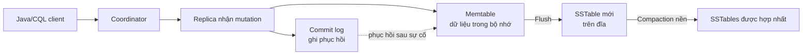
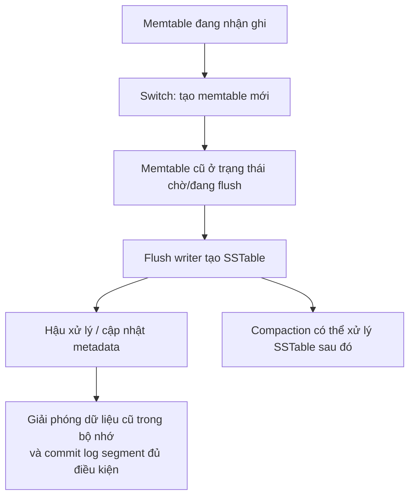
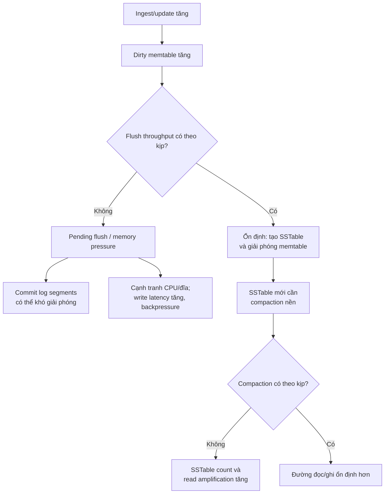
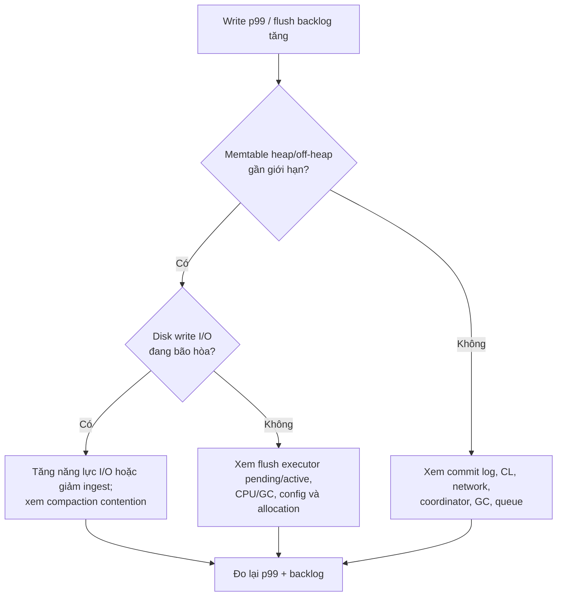

# Memtable, giới hạn bộ nhớ và áp lực flush

**Chương:** Tối ưu tài nguyên  
**Module:** `DATABASE_ENGINE_WIDE_COLUMN_CASSANDRA` — Apache Cassandra

Apache Cassandra sử dụng kiến trúc ghi theo kiểu **LSM-tree**: mutation từ ứng dụng Java/CQL được ghi vào **commit log** để hỗ trợ phục hồi khi tiến trình hỏng, đồng thời cập nhật **memtable** trong bộ nhớ; sau đó memtable được **flush** thành SSTable bất biến trên đĩa. Cơ chế này phù hợp với tải ghi lớn, nhưng chỉ hoạt động ổn định khi tốc độ ghi, ngân sách bộ nhớ, thông lượng flush, compaction và năng lực đĩa được cân bằng.

Một cluster có thể vẫn phản hồi được nhiều câu `INSERT` trong khi flush bắt đầu chậm hơn tốc độ hình thành dữ liệu bẩn. Nếu điều này kéo dài, memtable chiếm gần hết ngân sách, các flush tasks chờ tài nguyên, commit log khó được giải phóng và p95/p99 của ứng dụng tăng. Ngược lại, **ép flush liên tục** cũng không phải giải pháp: nó tạo thêm SSTable nhỏ và đẩy chi phí sang read path/compaction.

Bài này tập trung cách đánh giá **memtable, giới hạn heap/off-heap và áp lực flush** bằng CQL, `nodetool`, JMX/metrics và ví dụ Java Driver. Kiến thức liên quan trực tiếp đến mô hình wide-column, partition key, replication/consistency level, SSTable/compaction, repair và xử lý lỗi của Apache Cassandra.

> **An toàn và phiên bản:** Các thí nghiệm chỉ thực hiện trên cluster lab. Cassandra 4.1 và 5.x, các bản phân phối/đóng gói, JDK và container có thể khác tên cấu hình, giá trị mặc định và metrics. **Không sao chép ngân sách bộ nhớ, tăng flush writers hoặc chạy `nodetool flush` liên tục trên production** trước khi xác nhận phiên bản và đo tải thực tế. Đây là bài kiến thức và kịch bản vận hành, không phải kết quả benchmark đã được chạy.

## 1. Kết quả học tập

Sau bài này, bạn có thể:

1. Phân biệt **memtable**, **commit log**, **SSTable**, **flush** và **compaction**.
2. Giải thích vì sao ACK ở consistency level phù hợp không đòi hỏi mutation đã trở thành SSTable, nhưng độ bền dữ liệu còn phụ thuộc commit log và cấu hình đồng bộ ghi.
3. Nhận diện các tác nhân kích hoạt flush: áp lực ngân sách memtable, dung lượng commit log, chu kỳ flush, yêu cầu quản trị và một số tác vụ vòng đời node.
4. Phân biệt ngân sách memtable trên **JVM heap**, **off-heap**, bộ nhớ JVM khác và **page cache của hệ điều hành**.
5. Đọc `nodetool tablestats`, `tpstats`, `compactionstats`, `info` và các metrics liên quan để phân biệt **ghi nhiều hợp lý** với **flush backlog bất thường**.
6. Dự đoán tác động của memtable quá nhỏ, flush quá nhiều, commit log không được giải phóng và SSD gần bão hòa.
7. Thiết lập lab có phép đo trước/sau `nodetool flush` mà không nhầm flush với repair hay replication.
8. Đánh giá trade-off khi thay đổi bộ nhớ, số flush writers, cách phân vùng dữ liệu và tốc độ ingest.
9. Tạo một quy trình tuning có baseline, giả thuyết, ngưỡng dừng và khả năng quay lại cấu hình cũ.
10. Liên hệ số liệu server với latency/timeout từ Java Driver, nhưng không dùng vài câu INSERT để kết luận hiệu năng production.

## 2. Vị trí memtable trong đường ghi Cassandra

### 2.1. Luồng ghi cơ bản



Đây là mô hình khái niệm của **một replica**. Coordinator sẽ gửi mutation tới các replica được chọn theo replication strategy; consistency level quyết định số phản hồi cần có trước khi request được xem là thành công. Trình tự commit log/memtable cụ thể và điểm hoàn tất ACK phụ thuộc triển khai, `durable_writes` và chính sách commit log sync của phiên bản đang chạy.

**Ba sự kiện không được đánh đồng:**

- **Write ACK:** replica/coordinator đáp ứng điều kiện ghi ở CL; không có nghĩa tất cả replica đã nhận mutation, hay dữ liệu đã được flush thành SSTable.
- **Flush:** chuyển dữ liệu từ memtable sang SSTable; không tự gửi SSTable đó tới các replica khác.
- **Compaction:** xử lý/hợp nhất SSTable **trên từng replica**, có thể dọn phiên bản cũ và tombstone khi an toàn; không thay anti-entropy repair.

### 2.2. Khi một partition được cập nhật nhiều lần

```sql
UPDATE lab_memtable.profile_by_user
SET score = 10 WHERE user_id = 'user-01';

UPDATE lab_memtable.profile_by_user
SET score = 20 WHERE user_id = 'user-01';
```

Trong trường hợp không có ghi cạnh tranh hoặc timestamp bất thường, `SELECT` sau đó có thể thấy `score = 20` ngay cả khi memtable chưa flush. Cassandra hòa giải các mutation theo quy tắc timestamp/cell, không đợi compaction mới có trạng thái logic mới nhất.

Sau nhiều flush, các phiên bản của cùng khóa có thể nằm trong nhiều SSTable. Compaction giảm read amplification/space overhead theo điều kiện, nhưng việc **nhiều SSTable có cùng partition** là một trạng thái bình thường của LSM-tree.

### 2.3. Commit log không phải memtable

| Cấu trúc | Ở đâu? | Mục đích | Khi nào được thu hồi? |
| --- | --- | --- | --- |
| **Commit log** | File ghi nối tiếp trên đĩa | Khả năng replay mutation chưa flush khi node hỏng | Segment chỉ đủ điều kiện tái sử dụng/xóa khi **tất cả memtable** mà segment có mutation liên quan đã flush theo cơ chế phiên bản |
| **Memtable** | Bộ nhớ được cấp cho cấu trúc ghi | Hợp nhất mutation trong RAM, phục vụ read trước khi flush | Khi chuyển dữ liệu sang SSTable và các tham chiếu bộ nhớ được giải phóng |
| **SSTable** | File bất biến trên đĩa | Lưu trữ và phục vụ read bền vững sau flush | Được thay thế/dọn theo compaction và trạng thái tham chiếu |
| **Page cache** | RAM do hệ điều hành quản lý | Cache dữ liệu file/đĩa, giúp đọc nhanh hơn | OS tự quản lý theo áp lực bộ nhớ |
| **Repair/streaming** | Trao đổi dữ liệu qua mạng và đĩa | Đồng bộ/thay đổi ownership replica | Không phải một cơ chế giải phóng memtable |

Nếu nhiều memtable bẩn chưa flush, commit log segments có thể bị giữ lại lâu hơn dự kiến. Tăng không gian commit log có thể chỉ **lùi thời điểm xuất hiện áp lực**, không giải quyết lý do flush không theo kịp.

## 3. Flush làm gì và không làm gì?

### 3.1. Từ memtable thành SSTable

Khi flush bắt đầu, Cassandra đóng/switch memtable đang ghi để có thể nhận mutation mới, rồi viết nội dung memtable cũ thành SSTable. Tác vụ này cần CPU, bộ nhớ đệm, các lượt ghi đĩa và metadata. Một số bước hậu xử lý được thực hiện trước khi tài nguyên của memtable/commit log tương ứng có thể được giải phóng.



**Chú ý:** Memtable switch, flush completion và compaction là các mốc khác nhau. Có thể thấy memtable switch count tăng nhưng chưa suy ra tất cả dirty bytes đã xuống đĩa.

### 3.2. Các nguyên nhân flush phổ biến

| Nguyên nhân | Điều kiện khái niệm | Lưu ý |
| --- | --- | --- |
| **Áp lực heap/off-heap memtable** | Bộ nhớ memtable tiến gần hoặc vượt các ngưỡng quản lý của node | Bộ nhớ được quản lý ở cấp **node**, nhiều bảng cùng cạnh tranh ngân sách |
| **Áp lực commit log space** | Log segments chiếm nhiều dung lượng, cần flush memtable để giải phóng các segments | Có thể xảy ra dù memtable của một bảng không quá lớn |
| **Chu kỳ bảng** | Table có cấu hình `memtable_flush_period_in_ms` khác 0 | Flush định kỳ không phải cam kết “SSTable đúng một phút một lần” trong mọi điều kiện |
| **Quản trị viên yêu cầu** | `nodetool flush` | Gây I/O và có thể tạo SSTable nhỏ; chỉ dùng khi có mục đích |
| **Shutdown/snapshot/vòng đời khác** | Một số hoạt động cần đồng bộ hoặc ổn định trạng thái lưu trữ | Kiểm tra theo lệnh và phiên bản; không suy mọi snapshot luôn flush |

Không có “một memtable duy nhất cho cả cluster”. Mỗi node quản lý memtable cho các bảng/dữ liệu mà node lưu; các replica khác có memtable, commit log và lịch flush **riêng**.

### 3.3. Flush không phải lệnh bảo đảm đồng bộ replica

Giả sử RF=3, write ở `LOCAL_QUORUM` được hai replica ACK, replica thứ ba đang offline. Gọi `nodetool flush` trên một node chỉ tác động bộ nhớ/tệp của node đó. Nó **không** làm replica thứ ba nhận mutation còn thiếu.

Nếu mục tiêu là hội tụ replica, cần đánh giá hinted handoff, read repair, anti-entropy repair hoặc recovery theo runbook. Nếu mục tiêu là đảm bảo độ bền qua crash, cần hiểu commit log durability/ACK policy, không tự thay flush thành một “transaction commit” của Cassandra.

## 4. Phân bổ bộ nhớ: heap, off-heap và page cache

### 4.1. Phải lập ngân sách ở **cấp node**, không chỉ nhìn `-Xmx`

Cassandra là một JVM process nhưng không phải toàn bộ resident memory đều nằm trong Java heap. Một cách nhìn đúng:

```text
RAM / container memory limit
├── Java heap (-Xmx)
│   ├── Heap objects, query state, metadata/caches
│   └── Memtable allocations nằm trên heap (nếu cấu hình dùng heap)
├── Native / off-heap memory
│   ├── Memtable off-heap allocations (nếu được dùng)
│   ├── Direct buffers, compression, networking, native/JVM overhead
│   └── Thread stacks và runtime allocations
└── OS / filesystem page cache, kernel và các tiến trình khác
```

Sơ đồ chỉ là **bản đồ ngân sách**; một số bộ nhớ nằm trong cùng process RSS, một số ở page cache chung của host. Trên container, kernel/cgroup accounting có thể tính cả file cache. Không cộng `-Xmx`, off-heap limit và page cache với giả định chúng luôn là các khoản “đã dùng hết”; đây là các khả năng/giới hạn khác nhau cần đo.

**Hệ quả:**

- Tăng heap không nhất thiết làm Cassandra ghi nhanh hơn; có thể tăng GC pause và chiếm RAM đáng lẽ dành cho page cache.
- Chuyển/giữ memtable ngoài heap có thể giảm áp lực GC ở một số workload, nhưng **không xóa tổng nhu cầu RAM**. Native memory vẫn cần đủ chỗ.
- Container memory limit nhỏ hơn tổng nhu cầu process + page cache quan trọng có thể gây memory pressure/OOM kill dù heap chưa đầy.
- Nếu đĩa yếu, tăng memtable chỉ kéo dài thời gian đến lúc flush nghẽn; throughput ghi ra SSD vẫn là giới hạn vật lý.

### 4.2. Các tham số cần nhận diện

Các cấu hình thường được gặp trong Cassandra 4.x bao gồm những tên sau, nhưng **giá trị mặc định, đơn vị và tính khả dụng phải kiểm tra theo phiên bản hiện tại**:

| Nhóm | Tên cấu hình thường gặp | Ý nghĩa khái niệm |
| --- | --- | --- |
| Ngân sách heap memtable | `memtable_heap_space` | Giới hạn không gian heap dành cho memtables trên node |
| Ngân sách off-heap memtable | `memtable_offheap_space` | Giới hạn vùng off-heap cho memtables trên node |
| Cách cấp phát | `memtable_allocation_type` | Chọn hình thức cấp phát (các giá trị hỗ trợ tùy phiên bản) |
| Số worker flush | `memtable_flush_writers` | Mức song song của flush; tăng có thể tăng cạnh tranh I/O |
| Không gian commit log | `commitlog_total_space_in_mb` hoặc option tương ứng ở bản đang chạy | Ảnh hưởng pressure giữ segments và kích hoạt flush |
| Flush định kỳ theo bảng | `memtable_flush_period_in_ms` | Table option CQL; `0` thường nghĩa không áp thời hạn flush định kỳ |
| Sync commit log | `commitlog_sync` và các option đi kèm | Điều khiển chính sách đồng bộ log; **không** phải knob làm memtable lớn hơn |

Tên cấu hình trong bảng là **điểm cần đối chiếu**, không phải mẫu `cassandra.yaml` có thể copy không chỉnh sửa. Ví dụ `memtable_offheap_space` có thể vắng hoặc thay semantics ở bản phân phối cụ thể. Kiểm tra config document cùng cách runtime lắng nghe/restart trước khi áp dụng.

Không nên đặt thông số theo quy tắc “mỗi node dùng 50% RAM cho memtable” vì còn heap GC, page cache, compaction buffers, network và JVM native overhead.

### 4.3. Minh họa lập ngân sách, không phải cấu hình tối ưu

Giả sử node có **16 GiB RAM khả dụng** và `-Xmx = 6 GiB`. Còn khoảng 10 GiB **về mặt trừ số học** cho các nhu cầu khác, nhưng không thể suy cả 10 GiB đều được dành cho off-heap memtable.

| Khoản cần xét | Câu hỏi |
| --- | --- |
| Heap 6 GiB | Workload có GC pause và heap occupancy ổn định không? |
| Memtable heap | Bao nhiêu trong heap đang dành cho dirty tables? |
| Memtable off-heap | Allocation thực tế và RSS/cgroup tăng thế nào? |
| Native/JVM/thread stacks | Có headroom cho direct buffers và các cấu trúc ngoài heap không? |
| Page cache | Read-heavy workload có cần nhiều RAM cache file không? |
| Kernel/cgroup limit | Có nguy cơ host memory pressure hoặc container OOM kill không? |

**Không gán 10 GiB cho memtable** chỉ vì tổng 16 − heap 6 = 10. Chọn theo baseline và tải, sau đó thử từng thay đổi nhỏ trong môi trường tương đương production.

## 5. Áp lực flush xuất hiện như thế nào?

### 5.1. Tốc độ tạo dirty data và tốc độ làm sạch bằng flush

Gọi:

- `W_m`: số byte bộ nhớ memtable mới phát sinh mỗi giây trong một khoảng quan sát.
- `F_m`: số byte **tương đương dữ liệu memtable đã được giải phóng** mỗi giây sau flush, trên cùng cách đo/đơn vị.
- `Q_m`: khối lượng dữ liệu memtable đang chờ được xử lý.

Một mô hình xấp xỉ:

\[
\frac{\Delta Q_m}{\Delta t} \approx W_m - F_m
\]

Nếu `W_m > F_m` kéo dài, `Q_m` có xu hướng tăng. Tuy nhiên không được dùng bytes mạng/CQL làm `W_m` rồi dùng bytes SSTable **đã nén** làm `F_m` mà tưởng chúng tương đương: mutation, allocation và dữ liệu SSTable có kích thước/overhead khác nhau.

**Ví dụ thuần minh họa:** Nếu dirty allocation tăng **120 MiB/s** còn hệ thống chỉ giải phóng tương đương **90 MiB/s** trong cùng cách đo, chênh lệch khoảng **30 MiB/s**, tương ứng ~**1,8 GiB/phút**. Đây chỉ là mô hình để hiểu tại sao backlog tăng nhanh; Cassandra có cơ chế tự kích hoạt flush, nên các đường throughput thực tế không nhất thiết tuyến tính như ví dụ.

### 5.2. Khi áp lực không được giải quyết



Mức “flush bottleneck” có thể xuất hiện ở nhiều điểm: số flush writers quá ít, SSD đĩa chậm, filesystem/IOPS đầy, CPU/GC, compaction tranh đĩa hoặc bảng sinh quá nhiều memtable nhỏ. Vì vậy tăng số workers chỉ có ích nếu tài nguyên đích còn dư.

### 5.3. Hai kiểu vấn đề thường gặp

**Áp lực dung lượng memtable:** bộ nhớ gần giới hạn, flush thường xuyên, pause/queue tăng. Cần xem tổng heap/off-heap memory và dirty tables. 

**Áp lực tốc độ flush:** flush queue chờ lâu, SSTable output chậm, I/O wait cao, commit log không giải phóng nhanh. Cần xem throughput flush thực tế và disk/compaction contention. 

Hai vấn đề liên quan nhưng không giống nhau. Tăng ngân sách bộ nhớ có thể giảm số flush ngắn hạn nhưng **không tăng tốc độ SSD**; tăng flush writers có thể tạo thêm concurrency nhưng **làm xấu I/O queue** nếu đĩa đã bão hòa.

## 6. Metrics nào có ý nghĩa?

### 6.1. Các lệnh quan sát tại node

Trên node Cassandra của lab:

```bash
nodetool status
nodetool info
nodetool tpstats
nodetool compactionstats
nodetool tablestats lab_memtable.events_by_device_day
nodetool gcstats
```

Tùy Cassandra/JDK, tên lệnh, cột, thread pool và cách xuất metrics có thể khác; xem `nodetool help <command>` của phiên bản thực tế. `nodetool` thường quan sát **node đang gọi**, không tạo một bức tranh đồng nhất tự động cho mọi replica.

### 6.2. Những chỉ số nên đặt cạnh nhau

| Chỉ số | Điều nó gợi ý | Ngộ nhận cần tránh |
| --- | --- | --- |
| **Memtable live data size** | Lượng dữ liệu live đang ở memtable của bảng/replica | Không phải toàn bộ RSS hay bytes trên đĩa |
| **Memtable on-heap/off-heap size** | Phần bộ nhớ memtable theo loại allocation nếu metric có | Không phải tất cả heap/native allocations |
| **Memtable switch count** | Có bao nhiêu lần memtable được chuyển trạng thái | Tăng không chứng minh flush tasks hoàn tất và disk theo kịp |
| **Pending flushes** | Việc flush đang chờ hoặc chưa hoàn tất theo metric phiên bản | Một snapshot bằng 0 không chứng minh không có bottleneck giờ cao điểm |
| **Flush writer pending/active tasks** | Executor xử lý flush có đang nghẽn? | Tên executor có thể khác; xem `tpstats` thực tế |
| **Commit log bytes/usage** | Log segments có bị giữ lâu/tiệm cận giới hạn? | Không nên suy 1 byte commit log = 1 byte memtable |
| **SSTable count** | Số file tạo ra sau flush và compaction | Nhiều SSTable có thể do workload/strategy, không chỉ flush |
| **Pending compactions** | Compaction có theo kịp SSTable mới? | 0 tại một thời điểm không có nghĩa không có áp lực tích lũy |
| **Disk write throughput, IOPS, await/I/O wait** | Đĩa có phải giới hạn flush/compaction không? | CPU còn thấp không nghĩa disk chưa bão hòa |
| **GC pause, heap occupancy, process RSS, cgroup memory** | JVM/OS có bị pressure không? | Chỉ nhìn `-Xmx` sẽ bỏ qua off-heap và page cache |
| **Client write p95/p99, timeouts, dropped messages** | Ảnh hưởng tới SLA của ứng dụng | Độ trễ cao có thể do CL/replica/network, không nhất thiết memtable |

Để phân tích, lấy **cùng time window** và nếu có thể cùng node/bảng/DC. Không so memtable max của một node với p99 ứng dụng đo ở node khác rồi kết luận quan hệ nhân quả.

### 6.3. JMX và exporters

Các bảng Cassandra thường cung cấp metric với tên khái niệm như:

```text
Table / MemtableLiveDataSize
Table / MemtableOnHeapSize
Table / MemtableOffHeapSize
Table / MemtableSwitchCount
Table / PendingFlushes
ThreadPools / ActiveTasks
ThreadPools / PendingTasks
ClientRequest / WriteLatency
```

**Các nhãn trên chỉ là gợi ý để tìm metrics**. Tên JMX ObjectName, MBean scope, đơn vị, tính khả dụng và tên sau khi xuất sang Prometheus có thể khác theo Cassandra/exporter. Khi xây dashboard:

1. Xác minh tên MBean/metric trên **phiên bản đang chạy**.
2. Phân biệt gauge hiện thời, counter tăng dần và histogram/latency.
3. Với counter switch/flush, tính **rate theo thời gian** chứ không so giá trị tích lũy.
4. Gắn nhãn node, DC, keyspace, table; tránh dán raw partition key vào nhãn Prometheus.
5. Theo dõi **max/tail trên từng node**, không chỉ trung bình cluster.
6. Đặt annotation khi có đổi schema, restart, flush thủ công, rebuild/repair hay thay workload.

### 6.4. `tpstats` và thread pool

`nodetool tpstats` hiển thị active/pending/completed/blocked tasks theo executor. Tên liên quan memtable flush có thể là `MemtableFlushWriter` và các executor hậu xử lý, tùy phiên bản.

Nếu pending tasks tăng đồng thời disk write queue cao, tăng flush writers có thể không giúp; cần kiểm tra throughput/latency của đĩa. Nếu executor pending cao nhưng disk chưa dùng hết, mới đáng nghiên cứu concurrency/CPU/lock và những giới hạn khác.

**Đừng dùng một ngưỡng cứng chung “pending > 10 là lỗi”.** Với ingest theo đợt, pending ngắn có thể bình thường; **tăng liên tục, không giảm** đi kèm p99 xấu mới là bằng chứng đáng lo.

## 7. Chuẩn bị CQL lab về memtable và flush

### 7.1. Điều kiện đầu vào

- Cassandra 4.1/5.x tương thích, ít nhất một node để học lệnh; muốn kiểm tra replica divergence cần cluster nhiều node.
- Có `cqlsh`, `nodetool` và quyền đọc metric trên node.
- Thí nghiệm không chạy trên dữ liệu thật, không cố ý gây đầy disk/OOM.
- Ghi version, JDK, heap size, disk capacity, chiến lược compaction và tải nền trước bài test.
- Nếu datacenter không phải `datacenter1`, thay đúng tên trong DDL.

Trên terminal:

```bash
nodetool status
nodetool info
cqlsh
```

Trong `cqlsh`:

```sql
SELECT data_center, release_version FROM system.local;
```

Tạo keyspace/table:

```sql
CREATE KEYSPACE IF NOT EXISTS lab_memtable
WITH replication = {
  'class': 'NetworkTopologyStrategy',
  'datacenter1': 1
}
AND durable_writes = true;

CREATE TABLE IF NOT EXISTS lab_memtable.events_by_device_day (
    device_id text,
    bucket_day date,
    event_ts timestamp,
    event_id uuid,
    value double,
    payload text,
    PRIMARY KEY ((device_id, bucket_day), event_ts, event_id)
) WITH CLUSTERING ORDER BY (event_ts DESC, event_id ASC)
  AND memtable_flush_period_in_ms = 0;

CREATE TABLE IF NOT EXISTS lab_memtable.profile_by_user (
    user_id text PRIMARY KEY,
    score int
);
```

Ý nghĩa:

- `(device_id, bucket_day)` kiểm soát kích thước partition: một thiết bị/ngày có một partition logic. Nếu volume/ngày quá lớn vẫn phải bucket nhỏ hơn hoặc shard.
- `event_ts`, `event_id` hỗ trợ truy vấn trong một ngày có thứ tự; `event_id` là UUID, không đòi timeuuid.
- `memtable_flush_period_in_ms = 0` biểu diễn không yêu cầu flush định kỳ cho bảng trong những phiên bản hỗ trợ; memtable **vẫn** được flush vì pressure/commit log/admin.
- RF=1 phù hợp cú pháp lab nhưng **không chịu được mất replica**. Production cần thiết kế RF/CL riêng.

### 7.2. Ghi dữ liệu với khóa xác định

```sql
CONSISTENCY ONE

INSERT INTO lab_memtable.events_by_device_day
    (device_id, bucket_day, event_ts, event_id, value, payload)
VALUES ('device-01', '2026-11-21', '2026-11-21T10:00:00Z',
        10000000-0000-4000-8000-000000000001, 21.5, 'm-001');

INSERT INTO lab_memtable.events_by_device_day
    (device_id, bucket_day, event_ts, event_id, value, payload)
VALUES ('device-01', '2026-11-21', '2026-11-21T10:01:00Z',
        10000000-0000-4000-8000-000000000002, 22.0, 'm-002');

INSERT INTO lab_memtable.events_by_device_day
    (device_id, bucket_day, event_ts, event_id, value, payload)
VALUES ('device-02', '2026-11-21', '2026-11-21T10:00:00Z',
        10000000-0000-4000-8000-000000000003, 19.1, 'm-003');

SELECT event_ts, event_id, value
FROM lab_memtable.events_by_device_day
WHERE device_id = 'device-01'
  AND bucket_day = '2026-11-21';
```

Nếu các INSERT được ACK và không có ghi cạnh tranh, kết quả logic cho `device-01` gồm hai hàng. **Không** suy rằng cả hai đã nằm trên SSTable: trước flush, chúng có thể vẫn được phục vụ từ memtable.

### 7.3. Cập nhật cùng khóa

```sql
INSERT INTO lab_memtable.profile_by_user (user_id, score)
VALUES ('user-01', 10);

UPDATE lab_memtable.profile_by_user
SET score = 20
WHERE user_id = 'user-01';

SELECT user_id, score
FROM lab_memtable.profile_by_user
WHERE user_id = 'user-01';
```

Kỳ vọng `score = 20` trong điều kiện ghi tuần tự bình thường. UPDATE không ghi đè SSTable bất biến ngay tại chỗ; các phiên bản có thể được reconcile trên read path và hợp nhất về mặt lưu trữ sau compaction.

## 8. Thực nghiệm có kiểm soát: trước và sau flush

### 8.1. Bước A — Lưu baseline

Sau khi ghi vài hàng, trên **cùng node lab**:

```bash
nodetool tablestats lab_memtable.events_by_device_day
nodetool tablestats lab_memtable.profile_by_user
nodetool tpstats
nodetool compactionstats
nodetool info
```

Ghi:

```text
TIME_UTC:
NODE:
TABLE:
MEMTABLE_LIVE_DATA_SIZE:
MEMTABLE_ON_HEAP / OFF_HEAP (nếu có):
MEMTABLE_SWITCH_COUNT:
PENDING_FLUSHES:
SSTABLE_COUNT:
PENDING_COMPACTIONS:
DISK_WRITE / IOWAIT:
READ_P99 / WRITE_P99:
```

Với ba INSERT, nhiều giá trị có thể nhỏ, không đủ đo chênh lệch hiệu năng đáng kể. Tác dụng của lab là hiểu quan hệ giữa hành động và metric, **không** tạo bằng chứng rằng một cấu hình nhanh hơn.

### 8.2. Bước B — Yêu cầu flush **một bảng** trên node lab

```bash
# Chỉ trên node lab, đúng keyspace/table được giao để học:
nodetool flush lab_memtable events_by_device_day

# Sau khi lệnh kết thúc:
nodetool tablestats lab_memtable.events_by_device_day
nodetool tpstats
nodetool compactionstats
```

Quan sát có thể xảy ra:

- Memtable live size giảm sau khi dirty data của bảng được flush (nếu không có ghi mới trong lúc quan sát).
- SSTable count tăng hoặc thay đổi, tùy tệp đã có và compaction nền.
- Memtable switch count có thể tăng.
- Commit log segments **có thể** đủ điều kiện thu hồi, nhưng phụ thuộc các memtable khác cũng liên quan tới segment.
- `compactionstats` có thể thấy công việc nền sau flush.

Không tuyên bố “flush luôn tạo đúng một SSTable”. Cách flush, số memtable, số disk directory, bảng phụ và cơ chế phiên bản ảnh hưởng kết quả. Một kết quả `SSTable count` không đổi cũng không chứng minh lệnh thất bại: compaction/metadata và trạng thái dữ liệu có thể thay đổi đồng thời.

### 8.3. Bước C — Ghi tiếp để phân biệt data path với disk state

```sql
INSERT INTO lab_memtable.events_by_device_day
    (device_id, bucket_day, event_ts, event_id, value, payload)
VALUES ('device-01', '2026-11-21', '2026-11-21T10:02:00Z',
        10000000-0000-4000-8000-000000000004, 22.7, 'm-004');

SELECT event_ts, value
FROM lab_memtable.events_by_device_day
WHERE device_id = 'device-01'
  AND bucket_day = '2026-11-21';
```

Kỳ vọng ba hàng logic của `device-01`, dù hai hàng trước có thể nằm trong SSTable và một hàng mới nằm ở memtable. Đây là lý do **read path kết hợp memtable với SSTables**.

### 8.4. Bước D — Thử chu kỳ flush định kỳ trên lab, rồi trả lại

```sql
-- Chỉ lab: có thể tạo nhiều SSTable nhỏ nếu workload ít.
ALTER TABLE lab_memtable.events_by_device_day
WITH memtable_flush_period_in_ms = 60000;

SELECT keyspace_name, table_name, memtable_flush_period_in_ms
FROM system_schema.tables
WHERE keyspace_name = 'lab_memtable'
  AND table_name = 'events_by_device_day';
```

Sau khi quan sát một thời gian hợp lý, khôi phục:

```sql
ALTER TABLE lab_memtable.events_by_device_day
WITH memtable_flush_period_in_ms = 0;
```

**Đừng hiểu `60000` là phương án tối ưu cho data 1 phút**: flush period không phải retention period hay TWCS window. Nếu nhiều bảng đều flush mỗi phút với lượng dữ liệu nhỏ, số SSTable/compaction overhead có thể tăng. Không lấy thí nghiệm này làm lý do cấu hình periodic flush trên production.

## 9. Từ flush sang SSTable và compaction: tác động dây chuyền

### 9.1. Flush nhiều chưa chắc là tốt

Giả sử một workload nhận 1.000 writes/s nhưng mỗi bảng chỉ có ít dirty bytes trước một đợt flush bắt buộc. Rất nhiều SSTable nhỏ có thể xuất hiện; read path cần thêm metadata/tệp để hòa giải, còn compaction phải hợp nhất chúng. Với workload giống nhau, tỷ lệ SSTable nhỏ/rate flush thay đổi có thể làm write amplification tăng.

Các tình huống làm flush dày:

- Ngân sách memtable quá nhỏ so với tốc độ ingest/burst.
- Quá nhiều bảng có `memtable_flush_period_in_ms` thấp.
- Commit log space pressure từ nhiều bảng khác nhau.
- Các lệnh `nodetool flush` được gọi quá thường xuyên bởi runbook không phù hợp.
- Đường ingest phân tán vào rất nhiều bảng với memtable nhỏ; mô hình cần đo chứ không suy đoán.
- Restart/maintenance/hoạt động hệ thống làm switch memtable theo quy trình.

**Hệ quả:** Giảm flush count bằng cách tăng memtable có thể tốt cho một số workload, nhưng nếu đĩa không theo kịp, chỉ trì hoãn thời điểm nghẽn và tăng RAM usage. Phải đo đồng thời compaction/backlog/p99.

### 9.2. Chiến lược compaction có liên quan nhưng không thay thế flush tuning

| Chiến lược | Workload thường cân nhắc | Quan hệ tới flush |
| --- | --- | --- |
| **STCS** | Ingest lớn, read ít, ưu tiên write throughput | Nhóm SSTable gần kích thước; quá nhiều SSTable nhỏ vẫn tạo áp lực |
| **LCS** | Lookup/read-heavy, độ trễ đọc quan trọng | Giảm read amplification nhưng có thể tăng write amplification và I/O cạnh tranh flush |
| **TWCS** | Time-series append-only, TTL tương đối đồng nhất | SSTable được tổ chức theo time window; flush quá nhỏ và late writes có thể giảm hiệu quả |
| **UCS (Cassandra 5+ khi hỗ trợ)** | Workload hỗn hợp, cần lựa chọn trade-off | Benchmark theo phiên bản và metrics; không tự làm memtable có thêm RAM |

Không đổi compaction strategy chỉ vì `MemtableSwitchCount` tăng. Cần xem backlog, kích thước SSTable, read latency, tombstones, tần suất cập nhật và yêu cầu TTL.

### 9.3. Flush pressure và repair/streaming

Khi repair hoặc bootstrap đang stream nhiều dữ liệu, SSD vừa phục vụ flush và compaction vừa đọc/ghi các SSTable nhận/truyền. Nếu write latency tăng đúng trong maintenance window, phải ghi sự kiện đó vào biểu đồ; tăng memtable hoặc flush writers không nhất thiết giải quyết cạnh tranh I/O.

## 10. Thu hẹp nguyên nhân: bộ nhớ hay đĩa?

### 10.1. Cây quyết định



Đây là hướng chẩn đoán, không phải bộ luật tuyệt đối. Nhiều bottleneck có thể đồng thời xảy ra: SSD gần đầy, heap pressure, GC pause, commit log fsync và network replication lag.

### 10.2. Ma trận triệu chứng

| Triệu chứng | Khả năng cần xét | Kiểm tra ưu tiên |
| --- | --- | --- |
| Memtable size tăng, pending flushes tăng | Flush chưa theo kịp workload | Disk I/O, executor, compaction, commit log space |
| Switch count tăng, SSTable count bùng nổ | Flush liên tục/memtable nhỏ/chu kỳ quá ngắn | Periodic flush, mức ghi mỗi bảng, commit log pressure |
| Heap GC pause tăng, RSS bình thường | Memtable trên heap/caches/object allocation | GC logs, heap occupancy, memtable allocation |
| RSS/cgroup tăng, heap ổn định | Off-heap/native/direct buffer/page cache pressure | Native memory, cgroup limit, OS memory |
| Disk write throughput tối đa, flush pending | SSD bottleneck hoặc compaction tranh I/O | Disk queue, I/O wait, compactionstats, streaming |
| Commit log space tăng nhưng memtable một bảng nhỏ | Nhiều bảng khác giữ segments hoặc flush chưa xong | Global memtable/commitlog metrics, per-table flush states |
| Write latency cao, flush queue bình thường | CL/replica/network/GC/commitlog sync hoặc app | `nodetool status`, tracing, client errors, disk fsync |
| Read p99 tăng sau nhiều flush nhỏ | SSTable count/read amplification/compaction | Tablehistograms, SSTables/read, compaction |
| Chỉ một node có flush backlog | Disk/RAM/throttling/node-specific workload | So per-node CPU/RSS/I/O/compaction và token distribution |
| Mọi node cùng chậm trong giờ ingest | Tải chung vượt capacity hoặc thay workload | Ingest bytes/s, schema access, capacity planning |

Nếu nguyên nhân là **hot partition** do partition key không phù hợp, tăng bộ nhớ memtable cũng không phân tán được workload qua các token. Cần thiết kế lại key/bucket/shard theo truy vấn và phân bố lưu lượng.

## 11. Tuning theo thứ tự ít rủi ro đến nhiều rủi ro

### 11.1. Bắt đầu từ workload và cấu trúc dữ liệu

Đặt câu hỏi:

- Có bảng nào nhận hàng triệu mutation/s vào một partition hay không?
- Dữ liệu có TTL/DELETE/UPDATE dày khiến compaction bận không?
- Có batch rất lớn hoặc payload nặng mà ứng dụng gửi liên tục không?
- Các câu truy vấn có dùng partition key/clustering range hợp lý không?
- Số bảng ingest nhiều có sinh quá nhiều memtable nhỏ không?
- Client có retry không giới hạn sau timeout khiến write load nhân đôi không?

Điều chỉnh batch size, burst rate hoặc partition model nhiều khi có tác dụng lớn hơn thay memtable allocation. **Không dùng `BEGIN BATCH` để tăng throughput ghi hàng loạt** trên nhiều partition; logged batch có semantics/overhead riêng và không thay công cụ ingest có rate limit.

### 11.2. Giảm cạnh tranh disk trước

Nếu disk ghi đã bão hòa:

- Xem compaction đang chiếm I/O nhiều hay không.
- Xem snapshot/backup/streaming/repair có cạnh tranh không.
- Đánh giá SSD throughput/IOPS và latency thực tế, không chỉ băng thông lý thuyết.
- Đặt lịch maintenance và giới hạn đồng thời có kiểm soát.
- Nếu cần, mở rộng capacity/hardware/cluster khi workload vượt giới hạn một node.

**Tăng `memtable_flush_writers` trên disk bão hòa có thể làm xấu p99** vì nhiều writer cùng xếp hàng I/O. Chỉ thử tăng concurrency khi có bằng chứng workers là bottleneck và disk còn dư.

### 11.3. Điều chỉnh ngân sách memtable khi có headroom

Nếu ngân sách memtable quá nhỏ và flush quá thường xuyên nhưng disk/JVM còn đủ năng lực, có thể thử tăng ngân sách **từ từ** theo phiên bản. Trước mỗi thay đổi:

1. Xác nhận cấu hình hiện tại trên **tất cả node** và cách nó được áp dụng.
2. Tính RAM tổng (heap, off-heap, native, page cache, cgroup) và safety headroom.
3. Đo GC pause và RSS/OS cache trước.
4. Thử ở staging hoặc canary node nếu deployment/runbook hỗ trợ.
5. So sánh rate flush, SSTable size/count, pending tasks, p99 và I/O sau thời gian ổn định.
6. Có kế hoạch khôi phục config/restart rolling theo điều kiện của phiên bản.

Không tự giả định mọi option đều dynamic; nhiều tham số cấp JVM/node cần restart để có hiệu lực, và rolling restart cũng làm thay đổi tải replica tạm thời.

### 11.4. Đánh giá flush writer count

Nếu pending flush tasks tăng nhưng disk vẫn còn nhiều throughput, CPU/GC ổn định và cấu hình số writers đang thấp so với phần cứng, có thể benchmark số writers cao hơn. Nhưng:

- Mỗi writer có thể tiêu tốn CPU/buffer/I/O.
- Nhiều writers tăng contention với compaction, commit log và client read.
- Các node dùng ổ HDD, network storage hoặc SSD khác nhau có điểm tối ưu khác nhau.
- Tăng writers không thay đổi thiết kế partition hoặc tần suất xóa/tombstone.
- Phải đo throughput **hữu hiệu** và tail latency, không chỉ số tasks hoàn tất.

### 11.5. Đánh giá commit log một cách độc lập

Commit log liên quan độ bền ghi và khả năng replay. Nếu log space pressure kích hoạt flush dày, kiểm tra:

- Kích thước segments và tổng không gian commit log theo cấu hình phiên bản.
- Các memtable nào còn dirty và giữ tham chiếu tới segments.
- Đĩa commit log có đủ throughput/latency fsync không.
- Policy sync commit log và `durable_writes` đang dùng.
- Log errors, disk free và timeouts.

**Không tắt durable writes, vô hiệu commit log hoặc đổi sync policy tùy tiện** chỉ để benchmark memtable: đó là thay đổi **rủi ro mất dữ liệu**, không phải tuning vô hại. Thay đổi commit log total space có thể giúp chịu burst tốt hơn trong một số trường hợp nhưng không chữa flush throughput không đủ.

### 11.6. Khi nào nên mở rộng cluster?

Nếu đã tối ưu query/write pattern, không có maintenance contention, nhưng tổng ingest và read/write I/O liên tục vượt năng lực phần cứng, lựa chọn có thể là:

- Thêm node để phân bố token/partition và replica load.
- Dùng ổ đĩa có latency/IOPS phù hợp, đảm bảo network đủ cho replication.
- Tách workload hoặc bảng theo truy vấn/retention thay vì gom mọi mutation vào một partition.
- Thay đổi RF/CL chỉ khi đã hiểu chi phí và yêu cầu nhất quán; không tự giảm RF để “nhẹ tài nguyên”.

Mở rộng topology cũng tạo streaming/repair và áp lực đĩa tạm thời, nên cần capacity headroom trước khi bootstrap.

## 12. Bài toán tính năng lực flush

### 12.1. Kịch bản A — burst ngắn

Giả sử:

- Ingest dirty allocation ~**80 MiB/s** trong 20 giây, sau đó về 15 MiB/s.
- Flush có thể giải phóng tương đương trung bình **40 MiB/s** trong thời gian burst.
- Memtable budget hiện còn 1 GiB headroom trước khi burst.

Trong 20 giây, chênh lệch xấp xỉ:

\[
(80-40)\,\mathrm{MiB/s}\times20\,\mathrm{s}=800\,\mathrm{MiB}
\]

Burst này **có thể** được hấp thụ nếu các giả định đo chính xác, không có giới hạn khác và flush tiếp tục làm việc, nhưng vẫn phải xem commit log, compaction, cgroup và GC. Đây là bài toán lý tưởng hóa, không phải cam kết Cassandra luôn nhận burst mà không tăng p99.

### 12.2. Kịch bản B — mất cân bằng kéo dài

Giả sử ingest tạo dirty allocation **80 MiB/s** liên tục trong một giờ, trong khi tốc độ giải phóng qua flush **40 MiB/s**. Chênh lệch:

\[
(80-40)\,\mathrm{MiB/s}\times3600\,\mathrm{s}
=144000\,\mathrm{MiB}\approx 140{,}6\,\mathrm{GiB}
\]

Không thể dùng vài GiB memtable để hấp thụ sự mất cân bằng hàng giờ. Giải pháp dài hạn phải tác động tốc độ ingest, flush/disk capacity, số node hoặc cấu trúc workload. **Tăng ngân sách memtable đơn thuần không phải giải pháp**.

### 12.3. Kịch bản C — số flush tăng nhưng throughput vẫn bình thường

Nếu write rate tăng trong thời gian ngắn, memtable switch count tăng là một hậu quả có thể chấp nhận được. Khi `pending flush` giảm về baseline, p99 ổn định và disk I/O vẫn có headroom, chưa có bằng chứng đủ mạnh để thay cấu hình.

Một tối ưu tốt không phải “làm switch count về 0”, mà là **giữ sự ổn định của write/read SLA, bộ nhớ, disk và compaction dưới workload mục tiêu**.

## 13. Java Driver: kiểm thử ingest có giới hạn và liên hệ latency

Với Java Driver 4.x, ví dụ sau dùng prepared statement, khóa cố định theo từng event, gửi **tuần tự** và giới hạn số lệnh. Nó không đủ để đo throughput cực đại; mục đích là tạo một workload dễ dừng và ghi được số liệu client để đối chiếu flush metrics.

```java
import com.datastax.oss.driver.api.core.CqlSession;
import com.datastax.oss.driver.api.core.DefaultConsistencyLevel;
import com.datastax.oss.driver.api.core.cql.PreparedStatement;
import com.datastax.oss.driver.api.core.cql.BoundStatement;
import com.datastax.oss.driver.api.core.data.CqlDate;

import java.nio.charset.StandardCharsets;
import java.time.Instant;
import java.time.LocalDate;
import java.util.UUID;

public final class BoundedMemtableIngest {
    public static void run(CqlSession session) throws InterruptedException {
        PreparedStatement insert = session.prepare(
            "INSERT INTO lab_memtable.events_by_device_day " +
            "(device_id, bucket_day, event_ts, event_id, value, payload) " +
            "VALUES (?, ?, ?, ?, ?, ?)"
        );

        CqlDate day = CqlDate.fromDaysSinceEpoch(
            (int) LocalDate.of(2026, 11, 21).toEpochDay()
        );
        Instant base = Instant.parse("2026-11-21T12:00:00Z");

        int acknowledged = 0;
        int failed = 0;
        long started = System.nanoTime();

        // 300 thao tác tuần tự, có nhịp nghỉ: không phải stress test.
        for (int i = 0; i < 300; i++) {
            UUID id = UUID.nameUUIDFromBytes(
                ("memtable-lab-device01-" + i).getBytes(
                    StandardCharsets.UTF_8)
            );

            BoundStatement write = insert.bind(
                "device-01",
                day,
                base.plusMillis(i * 1000L),
                id,
                20.0 + (i % 20) * 0.1,
                "sample-" + i
            ).setConsistencyLevel(DefaultConsistencyLevel.ONE);

            try {
                session.execute(write);
                acknowledged++;
            } catch (RuntimeException ex) {
                failed++;
                System.err.println("i=" + i + " write error: " + ex);
                // Không coi timeout là đã rollback; tránh retry mù.
            }

            Thread.sleep(10);
        }

        double elapsedSeconds =
            (System.nanoTime() - started) / 1_000_000_000.0;
        System.out.println(
            "ack=" + acknowledged + ", failed=" + failed +
            ", elapsedSeconds=" + elapsedSeconds
        );
    }
}
```

**Giải thích:**

- Mẫu RF=1 của lab dùng `ONE`. Trong production, CL phải khớp RF/DC và mục tiêu nhất quán; không dùng `ONE` như lựa chọn chung để làm ghi “nhanh”.
- `UUID.nameUUIDFromBytes` tạo UUID ổn định cho mỗi index; khi chạy lại cùng dữ liệu thì primary key không tự tạo một hàng trùng mới. Tuy nhiên, timestamp mutation và ghi đồng thời vẫn cần được xem xét khi retry.
- `Thread.sleep(10)` tạo nhịp nghỉ thô; tốc độ thực còn phụ thuộc thời gian `session.execute`. Không coi đây là rate limiter có độ chính xác cao.
- Vòng lặp làm việc **đồng bộ, tuần tự** nhằm tránh flood. Một stress test thật dùng concurrency/rate limit kiểm soát, latency histogram, nhiều partition và cỡ payload tương tự production.
- `acknowledged` chỉ là số response success tại CL chọn, **không phải số SSTable được tạo** hay số mutation đã được repair ở mọi replica.
- Chạy lại `nodetool tablestats`, `tpstats` và disk metrics trong khoảng ingest, nhưng 300 hàng rất có thể không đủ để tạo backlog thấy rõ.

### 13.1. Lưu kết quả theo thời gian

```text
RUN_ID:
CASSANDRA_VERSION:
NODE / DATACENTER:
JAVA_DRIVER_VERSION:
REQUEST_RATE_TARGET:
WRITES_ACK / WRITES_ERROR:
CLIENT_WRITE_P50 / P95 / P99:
MEMTABLE_HEAP / OFF_HEAP:
MEMTABLE_SWITCH_RATE:
PENDING_FLUSHES:
FLUSH_EXECUTOR_PENDING / ACTIVE:
COMMITLOG_USAGE:
SSTABLE_COUNT:
PENDING_COMPACTIONS:
DISK_WRITE_MBPS / IOPS / AWAIT:
CPU / GC_PAUSE / RSS / CGROUP_MEMORY:
NOTES:
```

Với benchmark thực, lấy latency percentiles từ metrics/benchmark trên **nhiều requests**, không tính p99 từ một vài lần gọi và không so các node có cấu hình khác nhau mà không ghi nhận.

## 14. Tình huống xử lý sự cố

### A. Viết nhanh lúc đầu, sau vài phút write p99 tăng dần

**Khả năng:** memtable hấp thụ burst ban đầu nhưng flush hoặc compaction không theo kịp; pending flush, commit log usage và disk I/O tăng.

**Hướng xử lý:** xác minh time correlation và I/O capacity. Nếu disk đang bão hòa, tăng memtable chỉ kéo dài giai đoạn đầu, không sửa throughput dài hạn. Hạn chế ingest, giảm maintenance contention hoặc mở rộng capacity theo runbook.

### B. Memtable vẫn nhỏ nhưng commit log gần đầy

**Khả năng:** nhiều memtables/bảng khác có dirty mutations tham chiếu segments; pressure commit log thúc đẩy flush. Không thể chỉ nhìn memtable của một bảng để kết luận.

**Hướng xử lý:** xem node-wide memtable/commitlog metrics, trạng thái flush các bảng, log errors, disk space và commitlog sync. Đừng xóa commit log segments thủ công vì có thể làm mất khả năng replay.

### C. Tăng flush writers nhưng latency đĩa xấu hơn

**Khả năng:** trước đó SSD đã gần bão hòa, thêm concurrent writers tăng queue depth và contention với compaction.

**Hướng xử lý:** quay về cấu hình đã benchmark ổn, đo IOPS/await và pending tasks. Chỉ tăng writers nếu có headroom và giảm backlog mà không vi phạm SLO.

### D. Sau khi đổi heap/memtable, container bị OOM kill

**Khả năng:** tổng RSS/native/offheap/page cache và giới hạn cgroup không đủ, dù `-Xmx` vẫn như cũ.

**Hướng xử lý:** kiểm tra cgroup memory, process RSS, native memory và tình trạng OS. Khôi phục ngân sách an toàn; không tự tăng heap/offheap đồng thời mà không đánh giá tổng RAM.

### E. `nodetool flush` chạy xong, đọc vẫn chậm

**Khả năng:** vấn đề nằm ở partition rộng, nhiều SSTable, tombstone, compaction backlog hoặc network/CL; flush không giải quyết tất cả.

**Hướng xử lý:** xem `tablehistograms`, SSTables/read, read p99, tracing và partition design. Không tiếp tục ép flush để “dọn dữ liệu”.

### F. Sau khi bật flush period 1 phút, SSTables tăng nhanh

**Khả năng:** memtable nhỏ bị flush định kỳ, tạo SSTables ít dữ liệu.

**Hướng xử lý:** khôi phục period mặc định/phù hợp và đo lại. Xem retention/query workload trước khi chọn một chu kỳ flush, không nhầm chu kỳ này với TTL.

### G. Chỉ node C bị nghẽn flush trong cluster RF=3

**Khả năng:** disk C chậm, C vừa repair/stream, partition/token workload lệch, GC/cgroup C bị pressure hoặc phần cứng khác peers.

**Hướng xử lý:** so per-node metrics, trạng thái `nodetool status`, queue, CL, disk/network và compaction. Một giá trị trung bình toàn cluster dễ che node yếu; tăng heap cho tất cả node không giải quyết node C có ổ đĩa lỗi.

### H. Tắt durable writes giúp benchmark nhanh hơn

**Nhận xét:** phép thử đã thay đổi **độ bền dữ liệu**; kết quả không thể dùng làm bằng chứng cấu hình an toàn cho hệ thống nghiệp vụ cần durability.

**Hướng xử lý:** khôi phục durable-write policy được yêu cầu và benchmark lại. Tối ưu tài nguyên phải được đánh giá cùng khả năng phục hồi crash/replica failure.

## 15. Ma trận quyết định tuning

| Bằng chứng quan sát | Thử hướng nào trước | Tránh hành động nào |
| --- | --- | --- |
| Pending flush tăng, disk bão hòa | Giảm ingest burst, giảm contention, tăng I/O capacity | Tăng writers vô hạn |
| Flush nhiều SSTable rất nhỏ, disk còn khỏe | Xem flush period, ngân sách memtable và nhiều bảng ít ghi | Ép flush theo lịch dày hơn |
| Heap GC cao và memtable heap lớn | Đánh giá allocation/heap budget, JDK GC, offheap theo phiên bản | Tăng heap mà không đo GC/page cache |
| RSS/cgroup gần giới hạn, GC bình thường | Kiểm kê offheap/native/direct/page cache | Chỉ xem `-Xmx` |
| Commit log pressure cao, nhiều dirty tables | Kiểm tra flush toàn node và commitlog config | Xóa commit log thủ công |
| Write p99 cao nhưng flush bình thường | Kiểm tra CL/replica/network/commitlog sync | Mặc định tăng memtable |
| Read p99 tăng sau ingest, SSTables/read cao | Xem compaction backlog/strategy, query, partition | Dùng `nodetool flush` để “cải thiện read” |
| Burst ngắn ổn định, backlog nhanh giảm | Theo dõi, không đổi config vội | Tuning theo một spike ngắn |
| Backlog kéo dài hàng giờ | Capacity planning, phân bố tải, I/O và scale-out | Chỉ tăng bộ nhớ để chịu vô hạn |

## 16. Quy trình thay đổi an toàn trên hệ thật

Một thay đổi `memtable_heap_space`, `memtable_offheap_space` hoặc `memtable_flush_writers` phải được đối xử như **tuning có rủi ro vận hành**, vì có thể cần restart/rolling restart, tác động bộ nhớ/GC và read/write SLA.

**Runbook gợi ý:**

1. **Xác định mục tiêu:** giảm pending flush kéo dài, giảm số SSTable nhỏ hay cải thiện write p99? Đừng tối ưu “memtable càng lớn càng tốt”.
2. **Đo baseline:** ít nhất một khoảng giờ cao điểm và một khoảng bình thường; cùng metrics node/table/client.
3. **Ghi cấu hình hiện tại:** phiên bản Cassandra, JDK, heap size, cgroup, filesystem, memtable options, commitlog, compaction và RF/CL.
4. **Viết giả thuyết:** ví dụ “memtable budget thấp khiến flush quá nhỏ trong khi SSD còn 40% headroom”.
5. **Chọn một thay đổi:** ngân sách, writer count hoặc periodic flush; không sửa ba biến cùng lúc.
6. **Thử lab/canary:** giữ cùng phân bố partition, payload, read/write rate, TTL và compaction.
7. **Đặt stop conditions:** read/write p99, dropped/timeout rate, disk queue, GC pause, RSS/cgroup, pending flush/compaction và disk free.
8. **Rollout có kiểm soát:** bảo đảm cluster đủ replica/CL khi restart từng node, theo dõi repair/hints nếu downtime.
9. **Đánh giá sau ổn định:** so hiệu năng và disk headroom đủ dài để bao gồm vòng flush + compaction, không chỉ 1 phút đầu.
10. **Rollback hoặc chốt:** nếu điều kiện xấu hơn, khôi phục config theo runbook, lưu timeline và nguyên nhân.

Đặc biệt, nếu cần restart một replica trong cluster RF=3, hãy xác nhận CL đang phục vụ và trạng thái các replicas còn lại trước. Đừng thay nhiều node đồng thời nếu có thể làm client `LOCAL_QUORUM`/`ALL` không khả dụng.

## 17. Câu hỏi tự kiểm tra

1. Tại sao Cassandra vẫn có thể trả `SELECT` đúng ngay sau INSERT dù dữ liệu chưa flush thành SSTable?
2. Commit log khác memtable thế nào? Khi nào commit log segment có thể đủ điều kiện thu hồi?
3. Vì sao `nodetool flush` không đồng nghĩa bù mutation thiếu cho một replica khác?
4. `memtable_flush_period_in_ms = 0` có nghĩa Cassandra không bao giờ flush bảng đó không?
5. Vì sao tăng memtable từ 1 GiB lên 4 GiB không tự giải quyết disk throughput kém?
6. Hãy phân biệt Java heap, off-heap allocation, process RSS và OS page cache.
7. Khi một container bị OOM kill dù Java heap chưa đầy, bạn phải đo những gì?
8. Vì sao số lần memtable switch tăng không đủ chứng minh flush backlog?
9. Khi pending flushes và disk I/O wait cùng tăng, tăng flush writers có thể gây tác hại gì?
10. Tại sao nhiều lệnh `nodetool flush` trên dữ liệu nhỏ có thể làm read path tốn hơn?
11. Khi commit log space gần giới hạn nhưng memtable một bảng rất nhỏ, tại sao cần kiểm tra các bảng khác?
12. `memtable_flush_period_in_ms` khác TTL và TWCS compaction window ra sao?
13. Nếu write latency tăng nhưng memtable/flush metrics ổn, đâu là ba nhóm nguyên nhân khác cần xét?
14. Cách nào giúp phân biệt large/hot partition với vấn đề bộ nhớ memtable?
15. Nêu cách đối chiếu `tablestats`, `tpstats`, `compactionstats`, GC và disk I/O để tìm nút nghẽn.
16. Trong ví dụ 80 MiB/s ingest và 40 MiB/s flush, backlog tương đương tăng bao nhiêu MiB sau 20 giây?
17. Nếu mất cân bằng 40 MiB/s kéo dài một giờ, chỉ tăng memtable vài GiB có đủ không?
18. Những điều kiện nào khiến chuyển memtable sang off-heap không thể xem là “RAM miễn phí”?
19. Vì sao `acknowledged` trong Java code không bằng số rows trên SSTable?
20. Khi benchmark, tại sao cần giữ cố định RF/CL, payload, schema, compaction và phân bố partition?
21. Một node đang stream/repair có thể gây áp lực gì cho flush và read/write p99?
22. Khi nào scale-out hoặc nâng SSD là giải pháp đúng hơn thay đổi các knobs memtable?

### Checklist theo dõi vận hành

- [ ] Biết phiên bản Cassandra/JDK và cấu hình memtable/commitlog hiện tại trên từng node.
- [ ] Có baseline memtable live/heap/offheap, switch rate và pending flushes.
- [ ] Có active/pending flush executor tasks, commit log usage và disk I/O wait.
- [ ] Có SSTable count, pending compactions và SSTables per read.
- [ ] Có process RSS, cgroup memory, heap occupancy, GC pauses và OS page cache/headroom.
- [ ] Có client write/read p95/p99, timeout rate, CL và trạng thái replicas.
- [ ] Đã tách áp lực **dung lượng memtable** khỏi áp lực **tốc độ flush/đĩa**.
- [ ] Không thay commitlog durability để che bottleneck.
- [ ] Không ép flush thường xuyên trên production.
- [ ] Nếu muốn đổi flush writers, đã chứng minh đĩa còn headroom.
- [ ] Nếu muốn tăng memtable, đã đánh giá cả heap, offheap và cgroup limit.
- [ ] Tuning đã thử với workload đại diện, có stop/rollback.
- [ ] Khi rolling restart, replica health và mức nhất quán ứng dụng vẫn đạt yêu cầu.
- [ ] Đã đo sau nhiều chu kỳ flush/compaction, không kết luận từ một snapshot.

**Ghi nhớ:** **Memtable hấp thụ ghi trong bộ nhớ, flush chuyển memtable thành SSTable, commit log hỗ trợ phục hồi và compaction tổ chức dữ liệu trên đĩa.** Đánh giá hệ thống đúng đòi hỏi xem **heap + off-heap + page cache + commit log + disk I/O + workload** như một ngân sách chung. Nếu dirty data tăng nhanh hơn năng lực flush lâu dài, thêm RAM chỉ mua thêm thời gian; giải pháp bền vững cần tăng khả năng xử lý hoặc giảm/thiết kế lại tải. Tuning tốt nhất là tuning **giữ được p99 và độ bền dữ liệu**, không chỉ giảm số lần flush.

