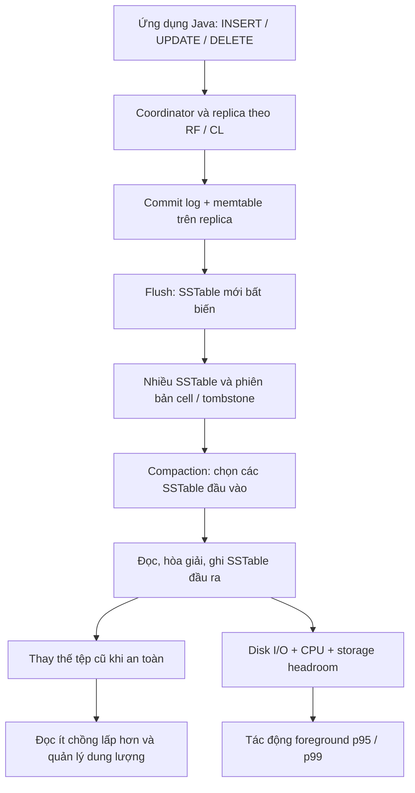
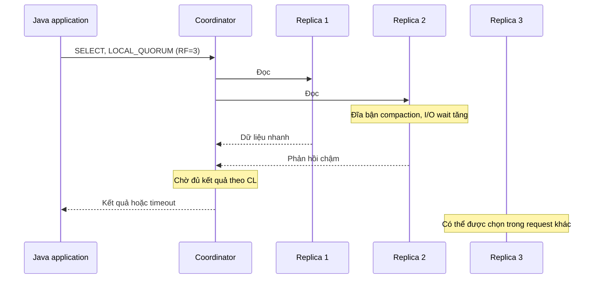
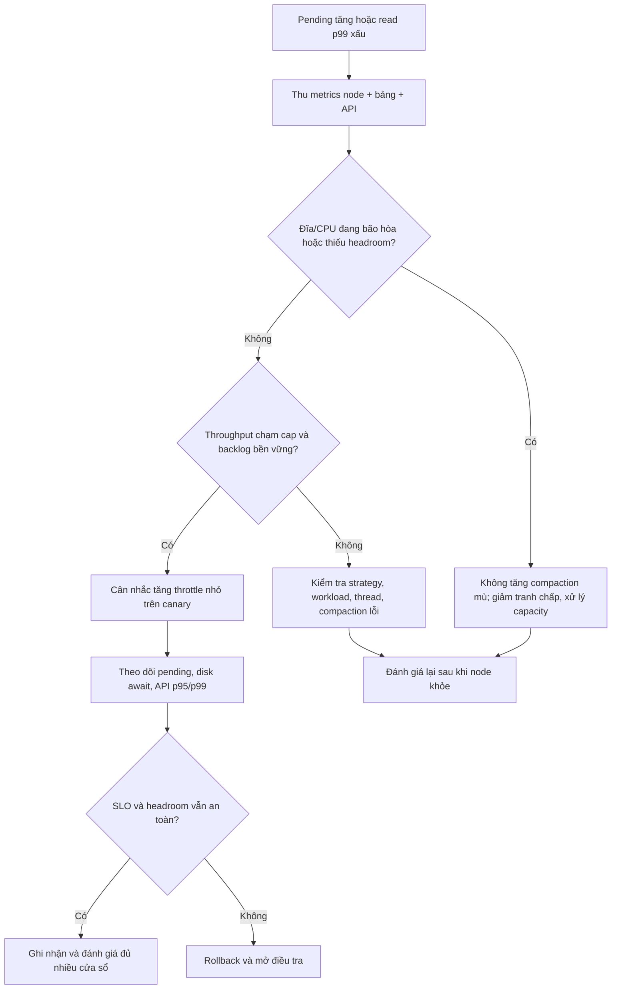

# Compaction throughput, pending task và write amplification trong Apache Cassandra

## 1. Mục tiêu: cân bằng công việc nền với tải đọc/ghi thật

Apache Cassandra là cơ sở dữ liệu **wide-column phân tán**. Mỗi mutation CQL đến một **partition key**, được ghi vào commit log và memtable tại các replica phù hợp với **replication factor (RF)** và **consistency level (CL)**. Khi memtable flush, dữ liệu được ghi ra SSTable bất biến. **Compaction** hợp nhất và tổ chức lại SSTable theo chiến lược của bảng, đồng thời xử lý phiên bản cell và tombstone khi đáp ứng điều kiện an toàn.

Compaction là công việc nền cần thiết, nhưng nó cạnh tranh **disk I/O, CPU, bộ nhớ và đôi khi băng thông** với yêu cầu từ ứng dụng Java. Hai thái cực đều có hại:

- **Compaction quá chậm:** SSTable tích tụ, read amplification tăng, một số truy vấn phải hòa giải nhiều phiên bản dữ liệu, disk pressure tăng và khả năng thu hồi dung lượng bị trì hoãn.
- **Compaction quá mạnh:** đọc/ghi SSTable ồ ạt, làm chậm flush, read và write trên cùng ổ đĩa; p95/p99 của API có thể tăng dù backlog giảm nhanh.

Ba khái niệm cần quan sát cùng nhau:

1. **Compaction throughput:** tốc độ công việc/dữ liệu compaction được xử lý và giới hạn điều tiết tương ứng.
2. **Pending task:** số tác vụ compaction còn chờ được thống kê, **không trực tiếp là dung lượng byte còn lại**.
3. **Write amplification:** lượng dữ liệu phải ghi vật lý nhiều hơn lượng dữ liệu logic mới được ứng dụng ghi vào hệ thống.

Bài học tập trung vào **tuning tài nguyên**, không coi việc tăng tốc độ compaction là phương án thay thế cho thiết kế bảng theo truy vấn, replication, repair hoặc xử lý node lỗi.

## 2. Từ mutation đến compaction: dữ liệu được ghi lại ở đâu?



Sơ đồ cho biết **vị trí phát sinh I/O**, không mô tả thứ tự giao thức cố định cho mọi bản Cassandra. SSTable được chọn, tần suất chạy, cấu trúc đầu ra và khả năng bỏ tombstone phụ thuộc **compaction strategy**, phiên bản và trạng thái dữ liệu.

### Vì sao một hàng có thể được ghi nhiều lần?

Giả sử cùng khóa `order_id` có ba phiên bản trạng thái:

```text
T1: status = CREATED  -> memtable -> SSTable A
T2: status = PAID     -> memtable -> SSTable B
T3: status = SHIPPED  -> memtable -> SSTable C

Compaction chọn A, B, C:
  đọc các cell và timestamp liên quan
  hòa giải theo quy tắc Cassandra
  ghi dữ liệu còn hiệu lực vào SSTable D
  gỡ A, B, C khi đủ điều kiện an toàn
```

Dữ liệu đã được ghi một lần vào SSTable khi flush **lại được ghi vào SSTable mới** trong compaction. Một SSTable đầu ra có thể tiếp tục làm đầu vào của một đợt compaction khác. Đó là nguồn quan trọng của *write amplification*.

**Không nhầm compaction với repair:** compaction tổ chức dữ liệu **trên một replica**; anti-entropy repair đối chiếu và đồng bộ **giữa replica**. Compaction không tự sửa một mutation bị mất trên replica khác.

## 3. Ba lớp chi phí cần tách riêng

| Lớp | Công việc | Số liệu liên quan |
| --- | --- | --- |
| **Foreground writes** | Request CQL, commit log, memtable, ACK theo CL | QPS, write latency, timeout, pending flush |
| **Flush** | Chuyển memtable thành SSTable bất biến | Flush rate, SSTable mới, disk write, memtable |
| **Compaction** | Đọc SSTable đầu vào, viết SSTable đầu ra, thay tệp | Throughput, pending compactions, completed tasks, I/O, write amplification |

Có thêm streaming khi bootstrap/repair, snapshot, compaction do một số thao tác quản trị và hoạt động hệ điều hành. Khi đo tốc độ ghi đĩa **tổng**, đừng gán mọi byte viết cho compaction.

Trong Cassandra, một request `INSERT` được xác nhận sau khi đủ replica đáp ứng CL; ứng dụng **không phải chờ một compaction tương lai** để request đó được coi là thành công. Tuy nhiên, compaction tranh chấp tài nguyên có thể làm write/flush chậm và dẫn tới timeout về sau.

### Liên hệ với tính bất biến SSTable

Để cập nhật một cell, Cassandra thường ghi mutation mới, **không sửa tại chỗ** cell cũ trong SSTable. Đọc cần hòa giải nhiều nguồn: memtable, SSTable, timestamp, TTL và tombstone. Vì thế:

- Flush liên tục tạo SSTable mới.
- Compaction giúp giới hạn số SSTable/chồng lấp trong phạm vi chiến lược.
- Ghi nhiều phiên bản cùng partition làm tăng việc hòa giải.
- TTL và delete làm phát sinh tombstone, không biến mất ngay sau khi hết hạn.

Tối ưu chỉ bằng cách tăng RAM hoặc tăng compaction throughput nhưng không xem **partition size, query shape và chiến lược compaction** có thể giải quyết nhầm nút thắt.

## 4. Compaction throughput: giới hạn điều tiết không phải tốc độ đĩa

**Compaction throughput** có hai cách dùng dễ gây nhầm:

1. **Throughput limit (throttle):** ngân sách tốc độ mà cấu hình Cassandra cho phép công việc compaction tiêu thụ theo cơ chế của phiên bản.
2. **Observed throughput:** tốc độ byte compaction thực tế được xử lý trong một khoảng đo.

Giới hạn 64 MB/s **không có nghĩa compaction luôn chạy 64 MB/s**. Nó có thể chạy thấp hơn nếu thiếu tác vụ, thiếu nguồn I/O, chỉ có ít thread hoạt động hoặc bị tranh chấp CPU/disk. Ngược lại, mức độ đọc và ghi thực tế trên thiết bị không thể suy ra đơn giản từ một con số throttle, vì metrics có thể định nghĩa **bytes processed** khác với **bytes written to disk**.

Một số phiên bản Cassandra cung cấp các lệnh:

```bash
nodetool getcompactionthroughput
nodetool help setcompactionthroughput
```

Tên khóa cấu hình trong `cassandra.yaml`, đơn vị MB/s hay MiB/s, cách làm tròn và hành vi thay đổi lúc chạy **khác nhau theo phiên bản**. Trước khi áp dụng, phải đọc `nodetool help` trên đúng cluster và đối chiếu thông số phiên bản đó.

### Ví dụ điều chỉnh có kiểm soát

Chỉ trên **cluster lab hoặc theo runbook đã phê duyệt**, sau khi xác minh đơn vị:

```bash
# Kiểm tra trạng thái hiện tại.
nodetool getcompactionthroughput

# Xác minh cú pháp/đơn vị, không chạy thử tùy tiện trên production.
nodetool help setcompactionthroughput

# Ví dụ giá trị 32 theo đơn vị mà phiên bản công bố:
nodetool setcompactionthroughput 32

# Xác minh giá trị sau thay đổi.
nodetool getcompactionthroughput
```

Thông số `32` ở đây là **ví dụ thao tác**, không phải mức tốt cho mọi đĩa. Cần lưu giá trị cũ để rollback. Thay đổi qua `nodetool` có thể là **runtime setting**; không giả định nó được lưu vĩnh viễn sau restart hoặc được đồng bộ sang mọi node.

### Vì sao không “mở hết tốc độ”?

Giả sử một node có disk write throughput bền vững khoảng 250 MiB/s trong điều kiện kiểm thử:

```text
Foreground write + flush:    85 MiB/s
Compaction write:           110 MiB/s
Streaming/khác:             30 MiB/s
------------------------------------
Tổng write giả định:        225 MiB/s
```

Còn khoảng 25 MiB/s theo **số throughput trung bình**, nhưng chưa tính giới hạn IOPS, read I/O, latency dưới queue, đặc tính SSD, fsync, compaction bursts và mức sử dụng CPU. Node có thể vi phạm p99 **trước** khi đạt tối đa băng thông ghi danh nghĩa.

Do đó **disk busy, disk read/write latency và API p99** thường quyết định khả năng tăng compaction tốt hơn một con số MB/s đơn độc.

## 5. Pending task: đếm công việc chờ, không đếm byte nợ

`nodetool compactionstats` hiển thị thông tin về các tác vụ compaction đang hoạt động và một số chỉ số pending theo phiên bản.

```bash
nodetool compactionstats
```

Một đầu ra minh họa rút gọn:

```text
pending tasks: 124
            id   compaction type   keyspace   table      completed   total
            ...  COMPACTION        sales      events    ...         ...
Active compaction remaining time: ...
```

Đây là **mẫu tưởng tượng để giải thích trường**, không phải output chính xác từ một phiên bản Cassandra. Tên cột và cách ước lượng pending thay đổi theo phiên bản.

### Ba sai lầm khi đọc pending tasks

**Sai lầm 1 — “124 pending” nghĩa là còn 124 GiB.** Không đúng. Mỗi task có thể xử lý dung lượng rất khác nhau; nhiều task nhỏ có thể nhẹ hơn một compaction lớn.

**Sai lầm 2 — “Pending = 0” nghĩa là đĩa đang rảnh.** Không đúng. Có thể vẫn có **active compactions**, flush, repair streaming, commit log, read/write foreground hoặc I/O từ hệ điều hành.

**Sai lầm 3 — “Pending tăng” luôn do throughput thấp.** Chưa chắc. Nguyên nhân có thể là ingest burst, flush tạo SSTable nhanh, thay compaction strategy, tablet/table skew, tombstone, compaction bị lỗi hoặc node quá tải.

### Đọc tốc độ tăng backlog

```text
09:00: pending =  40
09:10: pending =  90
09:20: pending = 145
09:30: pending = 190

Tăng +50, +55, +45 tasks mỗi 10 phút.
=> Có xu hướng backlog tích tụ.
```

Giá trị pending chỉ là **ước lượng số công việc cần làm**. Nó có thể nhảy lên/xuống do scheduler tái đánh giá tập SSTable hoặc do một tác vụ lớn chia/ghép khác nhau. Phải ghép với **bytes pending (nếu phiên bản có), active throughput, completed tasks, SSTable count và disk headroom** để biết tác động.

Một quan hệ đơn giản mang tính tư duy:

```text
Tốc độ tăng backlog ≈ tốc độ sinh công việc - tốc độ xử lý công việc
```

Nhưng “task/giây” không thay thế “byte/giây”, vì kích thước mỗi tác vụ không cố định.

## 6. Write amplification: định nghĩa rõ tử số và mẫu số

**Write amplification (WA)** diễn tả có bao nhiêu byte vật lý phải ghi so với một đơn vị byte dữ liệu logic mới. Trong hệ thống LSM/SSTable, một dữ liệu có thể được ghi trong flush, rồi **ghi lại nhiều lần** khi compaction.

Tùy nguồn metric, WA có thể được định nghĩa khác nhau:

- **WA tính từ logic:** `(SSTable flush writes + compaction SSTable writes) / logical ingest bytes`.
- **WA so với dữ liệu SSTable flush:** `(flush writes + compaction writes) / flush writes`.
- **Compaction-only amplification:** `compaction writes / flush writes`.
- **Disk-level write amplification:** có thể còn tính commit log, snapshots/tệp tạm và overhead filesystem/SSD; không đồng nhất với ba tỷ số trên.

Vì dữ liệu có thể được nén, chứa tombstone/TTL, có nhiều replica và cập nhật chồng lấp, **không so sánh tỷ lệ WA giữa hai cluster nếu chưa thống nhất cùng định nghĩa và khoảng đo**.

### Ví dụ tính WA với tốc độ ổn định

Một node có các số giả định trong một khoảng đo đủ dài:

| Hạng mục | Tốc độ trung bình |
| --- | ---: |
| Dữ liệu logic đến replica, trước nén | 20 MiB/s |
| SSTable mới do flush, sau nén | 16 MiB/s |
| SSTable đầu ra do compaction ghi | 48 MiB/s |
| Tổng SSTable bytes được ghi | 64 MiB/s |

Khi đó:

```text
WA so với logic = (16 + 48) / 20 = 3,2 lần
WA so với flush = (16 + 48) / 16 = 4,0 lần
Compaction-only / flush = 48 / 16 = 3,0 lần
```

Một báo cáo ghi “WA = 3” có thể nói **3,0 lần compaction writes so với flush**, chứ **không** tương đương “3 lần toàn bộ I/O vật lý”. Ví dụ cũng **chưa tính commit log và compaction reads**, nên không đủ để suy ra dung lượng I/O cả thiết bị.

> Lưu ý: dữ liệu cấp ứng dụng đi vào cluster có thể được **RF bản sao nhân lên** trên các node. Đo WA trên một replica phải dùng byte logic tương ứng mà replica nhận, không lấy tổng logical writes ở client rồi trộn với tổng physical writes toàn cluster một cách tùy tiện.

## 7. Read amplification, space amplification và sự đánh đổi

Compaction tuning ảnh hưởng ít nhất ba dạng khuếch đại:

| Khái niệm | Mô tả | Ví dụ |
| --- | --- | --- |
| **Write amplification** | Ghi lại dữ liệu thành SSTable nhiều lần | Compaction output chiếm nhiều byte write I/O |
| **Read amplification** | Một đọc logic phải kiểm tra nhiều SSTable/cell | Một partition có phiên bản ở nhiều file |
| **Space amplification** | Dung lượng thực lưu tạm/thừa nhiều hơn dữ liệu sống | SSTable cũ và mới cùng tồn tại trong compaction |

Đẩy một đại lượng xuống thấp có thể làm đại lượng khác tăng. Ví dụ:

- **LCS** thường hướng đến read amplification thấp cho nhiều workload nhưng có thể tăng write amplification do file di chuyển qua nhiều level.
- **STCS** thường có write amplification khác LCS, song có thể giữ nhiều SSTable chồng lấp hơn.
- **TWCS** có lợi cho dữ liệu theo time window/TTL khi dữ liệu tuân theo thời gian ghi/hết hạn; trộn dữ liệu cũ vào window mới có thể gây hệ quả không mong đợi.
- **UCS** (khi phiên bản hỗ trợ) cung cấp khả năng điều chỉnh mục tiêu/đánh đổi khác; phải xác minh phiên bản và thông số cụ thể.

Không có một tỷ lệ WA “chuẩn” áp dụng cho mọi bảng. Yêu cầu `SELECT`, kiểu cập nhật, số partition, TTL, compaction strategy và phần cứng quyết định cấu hình phù hợp.

## 8. Strategy định hình backlog và WA nhiều hơn một throttle

| Strategy | Cơ chế khái quát | Khi nên cân nhắc | Rủi ro tuning |
| --- | --- | --- | --- |
| **SizeTieredCompactionStrategy (STCS)** | Gộp các SSTable có kích cỡ tương tự thành SSTable lớn hơn | Workload ghi nhiều, đọc chịu được độ chồng lấp tùy trường hợp | Pending/SSTable count có thể tăng; compaction lớn đòi headroom |
| **LeveledCompactionStrategy (LCS)** | Tổ chức dữ liệu vào các level, hạn chế chồng lấp trong level phù hợp | Truy vấn nhạy read amplification, cập nhật thường xuyên | Có thể phải ghi lại nhiều lần, làm tăng compaction I/O |
| **TimeWindowCompactionStrategy (TWCS)** | Gom dữ liệu theo cửa sổ thời gian | Time-series/TTL tương đối đồng đều, ít ghi muộn vào window cũ | Late writes, TTL hỗn hợp và thao tác thay đổi dữ liệu cũ |
| **UnifiedCompactionStrategy (UCS)** | Chiến lược có tham số điều chỉnh đánh đổi theo phiên bản hỗ trợ | Khi nền tảng/phiên bản có hỗ trợ và đã benchmark | Tùy chỉnh nhầm có thể đổi cả WA, RA và space amplification |

**TWCS không phải giải pháp mặc định cho mọi bảng có timestamp.** Nó phù hợp nhất khi luồng ghi và TTL thuận lợi để SSTable trong time window có thể hết hạn và được loại bỏ an toàn. Nếu cập nhật cũ liên tục hoặc có TTL rất khác nhau, đừng áp dụng vì thấy dữ liệu “có thời gian”.

### Ví dụ CQL: chọn strategy cho bảng sự kiện

```sql
CREATE KEYSPACE IF NOT EXISTS tuning_lab
WITH replication = {
    'class': 'NetworkTopologyStrategy',
    'dc1': 3
}
AND durable_writes = true;

CREATE TABLE IF NOT EXISTS tuning_lab.events_by_tenant_day (
    tenant_id text,
    bucket_day date,
    created_at timestamp,
    event_id uuid,
    payload text,
    PRIMARY KEY ((tenant_id, bucket_day), created_at, event_id)
) WITH CLUSTERING ORDER BY (
    created_at DESC,
    event_id ASC
)
AND compaction = {
    'class': 'SizeTieredCompactionStrategy'
};
```

Lệnh CQL tạo bảng **không khởi động bài benchmark tự động**; nó chỉ đặt strategy. Khi muốn thử TWCS trên một bảng chuyên time-series trong **lab**, có thể đánh giá:

```sql
ALTER TABLE tuning_lab.events_by_tenant_day
WITH compaction = {
    'class': 'TimeWindowCompactionStrategy',
    'compaction_window_unit': 'DAYS',
    'compaction_window_size': '1'
};
```

**Không thực hiện `ALTER TABLE` này trên production chỉ để làm giảm pending tasks.** Đổi strategy trên dữ liệu hiện hữu không lập tức biến mọi SSTable cũ thành cấu trúc mới, có thể tạo giai đoạn I/O cao và làm thay đổi cách xử lý tombstone/TTL; cần runbook chuyển đổi và đo trước/sau.

## 9. Concurrency và throughput là hai núm điều khiển khác nhau

Ngoài giới hạn throughput, Cassandra có cách cấu hình **số compaction thực thi đồng thời** (ví dụ `concurrent_compactors` trong những phiên bản). Hai núm tác động khác nhau:

| Nút điều khiển | Chủ yếu ảnh hưởng | Giới hạn |
| --- | --- | --- |
| Throughput throttle | Ngân sách tốc độ xử lý compaction | Tăng số không bảo đảm disk có thể chịu |
| Concurrent compactors | Số tác vụ compaction cùng chạy | Quá nhiều có thể tranh chấp disk/CPU và tăng context switching |
| Compaction strategy | Cách chọn SSTable và thời điểm/scope gộp | Ảnh hưởng bản chất read/write/space amplification |
| Flush và workload ghi | Tần suất SSTable mới xuất hiện | Tăng throttle không thể sửa mọi vấn đề schema/partition |

Ví dụ: có bốn compaction cùng chạy trên ổ đĩa đã bão hòa thì tăng thêm thread không nhất thiết làm việc hoàn thành nhanh hơn; có thể chỉ làm queue depth và p99 của truy vấn tăng.

Một số thay đổi cấu hình chỉ áp dụng sau restart hoặc theo cơ chế quản trị phiên bản. **Không thay đổi đồng thời concurrency, throughput và strategy** rồi kết luận núm nào có hiệu quả.

### Throttle thấp quá cũng nguy hiểm

Một cluster có tải ghi ổn định nhưng luôn giữ compaction throttle rất thấp có thể tích tụ dữ liệu chưa gộp. Khi SSTable count cao, đọc phải làm nhiều việc; khi disk free giảm, node thiếu không gian để thực hiện compaction về sau.

Mục tiêu là **tốc độ phục vụ compaction bền vững đủ để theo kịp tốc độ phát sinh công việc**, trong khi latency foreground còn trong SLO — không phải “luôn đặt thấp để bảo vệ ứng dụng” hay “luôn đặt cao để hết pending”.

## 10. Liên hệ p95/p99 và consistency level của Cassandra

Khi một node đang compaction mạnh, các request vẫn phải đi qua đường đọc/ghi của replica đó.



Sơ đồ đơn giản hóa: số replica liên hệ, digest/data, speculative read và coordinator behavior phụ thuộc phiên bản, CL và điều kiện runtime.

Với RF3 và `LOCAL_QUORUM`, coordinator cần đủ hai phản hồi địa phương. Nếu hai replica cùng bị disk I/O cạnh tranh bởi compaction, Java có thể thấy p99 đọc tăng dù nhiều node vẫn `UN` trong `nodetool status`.

Ở đường ghi, compaction không nằm trên đường xác nhận trực tiếp như một bước bắt buộc, nhưng disk busy và flush/commit log bị ảnh hưởng có thể làm ACK chậm. **Không hạ `LOCAL_QUORUM` xuống `ONE` chỉ để che timeout** nếu ứng dụng cần bảo đảm quorum.

### Chỉ số node không phải chỉ số API

`Local read latency` từ `nodetool tablestats` đo trên node theo cách instrument của Cassandra. API Java p99 còn gồm mạng client, coordinator, nhiều replica, paging, retry và logic dịch vụ. Muốn quy kết compaction là nguyên nhân phải **tương quan theo thời gian giữa compaction I/O, replica latency và API p99**.

## 11. Sức khỏe hệ thống: quan sát đúng bằng nhiều công cụ

Một bộ lệnh thường hữu ích:

```bash
nodetool status
nodetool compactionstats
nodetool getcompactionthroughput
nodetool tablestats tuning_lab.events_by_tenant_day
nodetool tablehistograms tuning_lab events_by_tenant_day
nodetool tpstats
nodetool netstats
```

Khi chưa tạo bảng lab, thay đường dẫn bằng bảng thật đang điều tra. Công cụ `nodetool` thường hiển thị số liệu **node mà nó kết nối**, vì vậy cần thu thập từ những node liên quan, không lấy một replica làm đại diện cả DC.

| Nguồn | Nhìn vào đâu? | Câu hỏi |
| --- | --- | --- |
| `compactionstats` | Pending, active, loại task, tiến độ/ETA theo output phiên bản | Có backlog, compaction lớn hoặc kẹt không? |
| `getcompactionthroughput` | Throttle hiện tại | Giới hạn thấp, cao hay không khớp runbook? |
| `tablestats` | SSTable count, space, pending flushes, read/write latency | Bảng nào sinh nhiều tệp và có dấu hiệu I/O? |
| `tablehistograms` | SSTables/read, p95/p99, partition size, cell count | Có read amplification hay large partition? |
| `tpstats` | Pending/active tasks, dropped message theo verb/type | Hàng đợi foreground hay timeout có tăng không? |
| `netstats` | Streaming và một số hoạt động mạng/hints | Có bootstrap/repair cùng lúc với compaction? |
| JVM/JMX exporter | Compaction completed/rate, thread pool, GC, SSTables | Xu hướng và mức công việc đang chạy |
| OS metrics | Disk read/write MB/s, IOPS, await/p99, %util, disk free, CPU | Thiết bị thực sự có headroom hay không? |
| Java Driver/API | QPS, attempts/retries, read/write p95/p99, timeout | Người dùng có chịu ảnh hưởng không? |

Tên metric JMX, đơn vị throughput và trường trong output **phụ thuộc phiên bản Cassandra/exporter**. Khi dựng dashboard phải ghi version, host, DC, keyspace, table và đơn vị. Không lấy một counter tổng sau nhiều ngày làm tốc độ tức thời.

### Đo delta thay vì nhìn counter tích lũy

Ví dụ counter completed tasks tăng từ 11.500 lên 11.560 trong 5 phút:

```text
delta completed = 60 tasks
duration = 300 giây
completed rate = 60 / 300 = 0,2 task/giây
```

Điều này **chưa chứng minh công suất xử lý đã đủ**, vì mỗi compaction có kích thước khác nhau. Cần xem byte đọc/ghi, nguồn tạo SSTable và pending trend. Nếu node restart, counter có thể reset; monitoring cần xử lý reset thay vì tính rate âm.

## 12. Chẩn đoán compaction backlog theo triệu chứng

| Quan sát | Giả thuyết đầu tiên | Cần xác minh |
| --- | --- | --- |
| Pending tăng liên tục, disk I/O còn dư | Throttle thấp hoặc concurrency chưa khai thác được thiết bị | Current throughput limit, active tasks, disk latency |
| Pending tăng, disk util cao, p99 xấu | I/O đã bão hòa, workload tạo việc nhanh hơn xử lý | OS I/O, flush rate, compaction size, query/write workload |
| Pending ổn định nhưng SSTable count cao | Strategy tạo nhiều SSTable hoặc backlog theo byte khác task | SSTables/read, strategy, pending ranges, flush history |
| Pending thấp, read p99 vẫn cao | Hot/large partition, tombstone, mạng/quorum, cache hoặc I/O khác | `tablehistograms`, tracing, API metrics, GC |
| Compaction throughput đạt cap, disk còn nhàn | Throttle có thể là giới hạn thực sự | Tăng từng bước có giám sát, không vượt SLO |
| Throttle cao nhưng observed throughput thấp | Không đủ task, I/O/CPU bottleneck, pause hoặc compaction lỗi | Logs, active tasks, thread state, disk |
| Disk free giảm, pending/compaction IO tăng | Đầu ra và đầu vào cùng tồn tại, dữ liệu lớn, TTL/delete chưa thu hồi | Disk headroom, snapshots, retention, GC grace |
| Backlog tăng sau bootstrap/repair | Streaming và compaction tranh chấp tài nguyên | `netstats`, network/disk, repair schedule |

**Đừng chạy major compaction hàng loạt** khi pending cao mà chưa hiểu strategy và disk headroom. Major compaction có thể tạo một I/O spike rất lớn; với một số time-window workload, nó còn phá sự tách biệt dữ liệu theo thời gian.

## 13. Playbook tuning an toàn theo từng bước

### Bước 1 — Xác định mục tiêu và giới hạn

Ghi rõ:

- SLA: p95/p99 của API đọc/ghi, timeout và unavailable tối đa chấp nhận.
- Dữ liệu: kích thước bảng, ingest rate, RF, cập nhật/tombstone/TTL, compaction strategy.
- Hạ tầng: số ổ, loại SSD, disk free, IOPS và băng thông bền vững.
- Cửa sổ bảo trì: repair/backup/bootstrap có đang chạy không?
- Kế hoạch rollback: giá trị throughput/concurrency trước thay đổi.

**Không chỉnh trên node đang gần đầy đĩa** chỉ để giảm backlog; compaction có thể cần nhiều không gian đầu ra trước khi giải phóng đầu vào. Ưu tiên kế hoạch capacity và xử lý nguyên nhân.

### Bước 2 — Thu baseline nhiều cửa sổ

Ví dụ đo mọi 5 phút trong ít nhất một giai đoạn đủ đại diện với workload:

```text
09:00 | pending=60 | compaction active=2 | disk busy=48% | read p99=35ms
09:05 | pending=85 | compaction active=2 | disk busy=55% | read p99=38ms
09:10 | pending=110| compaction active=2 | disk busy=59% | read p99=42ms
```

Các con số chỉ **giả định**. Cần bổ sung bytes processed, throughput quan sát, flush rate, disk latency, write p99 và QPS. Từ chuỗi trên chỉ được đặt giả thuyết “pending tăng dù disk busy chưa tối đa”, chưa kết luận throttle là nguyên nhân.

### Bước 3 — Phân loại vấn đề trước khi tăng throughput



### Bước 4 — Chỉ đổi một núm và dùng canary

Khi throttle thực sự là giới hạn, thay đổi nhỏ trên một node/tập node được lựa chọn và giám sát:

1. Lưu cấu hình cũ và version của Cassandra.
2. Chọn mức mới phù hợp headroom **cả read và write**.
3. Chờ quan sát qua nhiều vòng đo, không chỉ 20 giây.
4. So pending trend, active throughput, disk await, disk free, read/write p99 và retries.
5. Nếu API xấu hoặc headroom mất, **đưa về mức cũ** và xác minh phục hồi.

Sau canary mới cân nhắc nhân rộng có kiểm soát. **Đừng đồng thời tăng `concurrent_compactors`, thay STCS → LCS và tăng throttle**; không còn biết điều gì gây thay đổi.

### Bước 5 — Xác minh công việc nợ có thực sự giảm

Một ca tuning thành công không chỉ là “pending 100 xuống 20”. Cần xem:

- Có giảm **bền vững** qua workload peak và steady state không?
- SSTable count và SSTables/read có hợp lý theo strategy không?
- Độ trễ local/API p99 có trong SLO không?
- Disk free và I/O latency có dư địa cho sự cố node/repair không?
- Có phát sinh timeout, dropped messages hoặc compaction error không?

Nếu chỉ đổi thông số làm pending giảm nhưng p99 gấp ba và đĩa đạt 99% util, đó **không phải cải tiến toàn hệ thống**.

## 14. Thực hành CQL: tạo dữ liệu và theo dõi compaction

Sử dụng keyspace `tuning_lab` ở mục 8 trên **cluster test** có DC `dc1` và RF khả dụng. Không làm fault injection hoặc tạo tải lớn trên production.

### Ghi một số sự kiện

```sql
INSERT INTO tuning_lab.events_by_tenant_day (
    tenant_id, bucket_day, created_at, event_id, payload
) VALUES (
    'tenant-a', '2026-11-20', '2026-11-20 09:00:00+0000',
    11111111-1111-4111-8111-111111111111, 'created'
);

UPDATE tuning_lab.events_by_tenant_day
SET payload = 'confirmed'
WHERE tenant_id = 'tenant-a'
  AND bucket_day = '2026-11-20'
  AND created_at = '2026-11-20 09:00:00+0000'
  AND event_id = 11111111-1111-4111-8111-111111111111;

SELECT created_at, event_id, payload
FROM tuning_lab.events_by_tenant_day
WHERE tenant_id = 'tenant-a' AND bucket_day = '2026-11-20'
LIMIT 20;
```

Hai mutation không đủ tạo ra một workload compaction đáng kể; mục đích là xác minh schema và đường truy vấn. Sau đó có thể tạo dữ liệu test với **nhiều partition keys** và tốc độ có giới hạn, quan sát qua thời gian.

### Quan sát sau một đợt ingest

```bash
nodetool tablestats tuning_lab.events_by_tenant_day
nodetool tablehistograms tuning_lab events_by_tenant_day
nodetool compactionstats
nodetool getcompactionthroughput
nodetool tpstats
```

Chụp dữ liệu **trước – trong – sau** một đợt test. Nên ghi QPS, bytes ghi, compaction strategy, disk I/O, pending và API/driver p99 cùng timestamp. Tốc độ ghi thấp hoặc memtable chưa flush có thể khiến compactionstats gần như không đổi; điều đó bình thường.

### Nếu muốn kiểm tra TTL/TWCS

Trên bảng **lab phù hợp**, có thể tạo mutation có TTL:

```sql
INSERT INTO tuning_lab.events_by_tenant_day (
    tenant_id, bucket_day, created_at, event_id, payload
) VALUES (
    'tenant-b', '2026-11-20', '2026-11-20 12:00:00+0000',
    22222222-2222-4222-8222-222222222222, 'temporary'
) USING TTL 604800;
```

TTL `604800` giây tương đương 7 ngày. **Dữ liệu hết TTL không tự biến mất khỏi mọi SSTable ngay lập tức.** Tombstone/compaction và điều kiện an toàn quyết định khi nào dung lượng được thu hồi; repair giữa replica cũng phải được tính vào chính sách giữ tombstone.

## 15. Java Driver 4.x: đo ghi nghiệp vụ để không tối ưu sai mục tiêu

Một lớp Java có thể ghi CQL bằng prepared statement và đo latency của request. Ví dụ bên dưới dùng timestamp/tên sự kiện do caller cung cấp ổn định, không tạo ID mới mỗi retry:

```java
import java.time.Instant;
import java.time.LocalDate;
import java.util.UUID;
import java.util.concurrent.TimeUnit;

import com.datastax.oss.driver.api.core.CqlSession;
import com.datastax.oss.driver.api.core.DefaultConsistencyLevel;
import com.datastax.oss.driver.api.core.cql.BoundStatement;
import com.datastax.oss.driver.api.core.cql.PreparedStatement;

public final class EventWriter {
    private final CqlSession session;
    private final PreparedStatement insert;

    public EventWriter(CqlSession session) {
        this.session = session;
        this.insert = session.prepare(
            "INSERT INTO tuning_lab.events_by_tenant_day " +
            "(tenant_id, bucket_day, created_at, event_id, payload) " +
            "VALUES (?, ?, ?, ?, ?) USING TIMESTAMP ?"
        );
    }

    public long writeLatencyMillis(
            String tenantId, LocalDate bucketDay,
            Instant createdAt, UUID eventId, String payload,
            long timestampMicros) {
        BoundStatement stmt = insert.bind(
                tenantId, bucketDay, createdAt, eventId, payload,
                timestampMicros
            )
            .setConsistencyLevel(DefaultConsistencyLevel.LOCAL_QUORUM)
            .setIdempotent(true);

        long start = System.nanoTime();
        session.execute(stmt);
        return TimeUnit.NANOSECONDS.toMillis(System.nanoTime() - start);
    }
}
```

**Điều kiện cho `setIdempotent(true)`:** cùng logical operation phải dùng **đúng lại** `eventId`, dữ liệu và `timestampMicros`, không có counter/LWT/side effect khác và được thiết kế chống ghi cạnh tranh. Nếu không đảm bảo điều kiện này, **không đánh dấu idempotent**. Write timeout có thể là kết quả chưa xác định; retry không được thực hiện mù.

Ứng dụng production nên dùng lại `CqlSession` và chuẩn hóa metrics theo query template, DC, CL, status/error, không gắn hàng triệu `tenantId` vào nhãn metrics. Bên cạnh write latency, đo **API p95/p99, attempts/retries, timeout, throughput, backlog ứng dụng và connection pool**.

**Không diễn giải thời gian một lần `session.execute` là thời gian compaction.** Ghi thành công có thể xảy ra trước khi dữ liệu được flush/compaction. Phải so latency client với số liệu node/disk trong cùng khoảng thời gian.

## 16. Các tình huống vận hành để tự kiểm tra

### Tình huống A — Pending tăng nhưng disk chưa bão hòa

Pending compactions tăng từ 20 lên 300 suốt giờ ingest; disk latency ổn định, throughput compaction chạm giới hạn hiện tại và CPU còn dư. Có nên tăng throughput?

**Gợi ý:** Có thể **thử tăng nhỏ có kiểm soát** và đo lại, vì throttle có thể đang là giới hạn. Nhưng phải đánh giá compaction strategy, kích thước task, workload peak và p99; không khẳng định chắc chắn từ pending count.

### Tình huống B — Pending giảm, API p99 tăng gấp đôi

Sau khi tăng throughput, pending từ 200 còn 50, nhưng read p99 từ 45 ms lên 130 ms; disk await tăng mạnh. Có phải tuning đã thành công?

**Gợi ý:** Chưa. Nó cải thiện một chỉ số nền nhưng gây hại foreground SLA. Cần rollback/điều tiết lại, đo tổng I/O và cân bằng tốc độ xử lý backlog với p99.

### Tình huống C — LCS có write amplification lớn

Bảng thường xuyên cập nhật cùng partition, ưu tiên đọc nhanh và dùng LCS. Đo compaction SSTable writes lớn hơn nhiều flush writes. Có phải lỗi của LCS?

**Gợi ý:** Không thể kết luận chỉ từ tỷ số; LCS thường đánh đổi WA để cải thiện một số dạng read amplification. Phải đo cùng read p99, SSTables/read, space headroom, workload và định nghĩa WA trước khi quyết định strategy khác.

### Tình huống D — TWCS nhưng dữ liệu ghi muộn

Ứng dụng liên tục cập nhật dữ liệu sự kiện từ 90 ngày trước trong một bảng TWCS có TTL. Pending và kích thước SSTable tăng không như mong đợi. Điều gì cần kiểm tra?

**Gợi ý:** Ghi muộn, timestamp/time-window semantics, TTL hỗn hợp và cách compaction xếp dữ liệu vào cửa sổ. TWCS không lý tưởng nếu liên tục sửa dữ liệu ở các cửa sổ cũ; xem lại workload và strategy.

### Tình huống E — Đĩa sắp đầy, muốn ép major compaction

Node còn 6% disk free, pending tăng và dữ liệu nhiều tombstone. Quản trị viên đề nghị major compaction để “dọn sạch đĩa”. An toàn không?

**Gợi ý:** Không mặc định. Major compaction cần không gian cho SSTable đầu ra và tốn I/O; tombstone không luôn được phép xóa. Phải xử lý headroom/capacity, snapshot, retention và lịch repair trước.

### Tình huống F — Tính write amplification sai mẫu số

Ứng dụng ghi 20 MiB/s logic ở client; một cluster RF3 có tổng disk SSTable writes 180 MiB/s. Có thể gọi WA toàn hệ thống 9 lần rồi so trực tiếp với WA của node RF1 không?

**Gợi ý:** Không. 180/20 = 9 là một tỷ lệ tổng hợp bị ảnh hưởng cả **replication factor**. Muốn so amplification do flush/compaction phải chuẩn hóa theo node/replica, dữ liệu thực tế mỗi replica nhận và nêu rõ có tính compression, commit log hay không.

## 17. Checklist trước và sau khi tuning

- [ ] Xác định **workload ingest**, tần suất update/delete/TTL và partition/query shape.
- [ ] Biết compaction strategy theo bảng; không áp dụng STCS/LCS/TWCS/UCS bằng một công thức chung.
- [ ] Đọc `nodetool compactionstats` để phân biệt **pending, active và tiến độ**.
- [ ] Không suy từ pending task count trực tiếp ra **byte backlog** hoặc dung lượng cần cấp.
- [ ] Kiểm tra `getcompactionthroughput` và đơn vị/cú pháp phiên bản trước khi chỉnh.
- [ ] Tách throughput throttle khỏi throughput thực, và throughput khỏi concurrency.
- [ ] Định nghĩa rõ write amplification có tính flush, compaction, compression, RF và commit log không.
- [ ] Cùng theo dõi **SSTables/read, disk await, disk free, read/write p95/p99, timeout**.
- [ ] Đánh giá compaction cùng repair, bootstrap, streaming, snapshot và foreground traffic.
- [ ] Không tăng throughput/concurrency mù khi đĩa hoặc CPU đã bão hòa.
- [ ] Không ép major compaction hoặc giảm `gc_grace_seconds` chỉ để xóa tombstone.
- [ ] Thay một biến trên canary, giữ số liệu baseline và chuẩn bị rollback.
- [ ] Kiểm chứng qua nhiều cửa sổ workload, không chỉ một ảnh chụp compactionstats.
- [ ] Với Java, giữ CL theo yêu cầu và retry có idempotency, tránh khuếch đại tải khi node chậm.
- [ ] Chỉ công nhận cải tiến khi **backlog bền vững và SLO ứng dụng** đều đạt.

**Ghi nhớ:** `compaction throughput` là công cụ điều tiết năng lực compaction; `pending tasks` là chỉ báo công việc chờ **theo cách ước lượng của scheduler**, không phải trực tiếp số byte còn nợ; `write amplification` là chi phí dữ liệu bị ghi lại và phải được tính bằng định nghĩa rõ ràng. Tuning Cassandra hiệu quả là giữ **SSTable/compaction backlog trong tầm kiểm soát nhưng không hy sinh read/write p99, disk headroom và tính đúng đắn của dữ liệu**.
