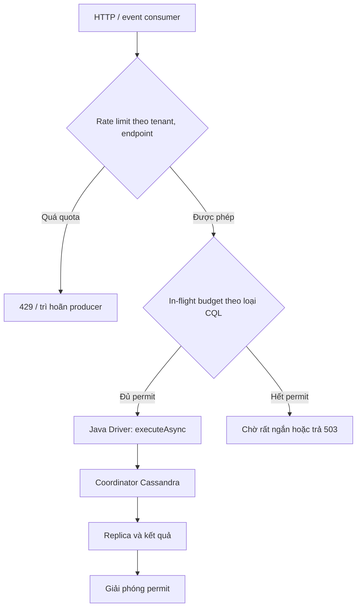

# Giới hạn request đồng thời và điều tiết ở ứng dụng khi dùng Apache Cassandra

## 1. Vấn đề: ứng dụng có thể làm Cassandra quá tải dù truy vấn đúng

Trong **DATABASE_ENGINE_WIDE_COLUMN_CASSANDRA**, Apache Cassandra lưu dữ liệu theo mô hình **wide-column**, phân phối partition trên nhiều node và nhân bản theo cấu hình keyspace. Thiết kế bảng theo truy vấn, chọn partition key hợp lý, cấu hình replication, consistency, compaction và repair là những phần quan trọng của vận hành. Tuy nhiên, ngay cả khi mỗi câu CQL đều có partition key và trả kết quả nhanh trong điều kiện bình thường, **hàng nghìn truy vấn phát sinh đồng thời** vẫn có thể làm tăng hàng đợi, thời gian phản hồi, áp lực bộ nhớ và timeout trong toàn cụm.

Ví dụ: dịch vụ bán hàng nhận một đợt truy cập lớn sau khi mở bán. Mỗi HTTP request gọi một truy vấn đọc sản phẩm, một truy vấn kiểm tra tồn kho và đôi khi một lệnh cập nhật đơn hàng. Nếu 200 request cùng đến và mỗi request tạo 3 truy vấn CQL song song, ứng dụng có thể phát ra tới **600 thao tác CQL đang chờ phản hồi**. Việc thêm nhiều thread, tăng kết nối hoặc tăng timeout có thể khiến vấn đề kéo dài hơn: nhiều thao tác hơn bị giữ trong hàng đợi và người dùng nhận lỗi muộn hơn.

Giải pháp là đặt một **ngân sách tải** ở phía ứng dụng, quyết định thao tác nào được gửi ngay, thao tác nào chờ một khoảng ngắn và thao tác nào phải bị từ chối có kiểm soát. Đây là **admission control / backpressure**: bảo vệ cả Cassandra, tài nguyên của ứng dụng và thời gian phản hồi mà API đã cam kết.

Sau bài này, bạn cần phân biệt rate limit và concurrency limit, xác định đơn vị giới hạn đúng, triển khai chặn tải bằng Java Driver, thiết kế chính sách lỗi/retry và kiểm thử khi có spike hoặc replica gặp sự cố.

## 2. Phân biệt tốc độ yêu cầu, số request đang xử lý và hàng đợi

| Đại lượng | Câu hỏi trả lời | Ví dụ | Công cụ phù hợp |
| --- | --- | --- | --- |
| **Request rate** (`λ`) | Mỗi giây hệ thống nhận bao nhiêu request? | 800 HTTP request/s | Rate limiter, token bucket, quota theo tenant |
| **CQL operation rate** | Mỗi giây thực sự phát bao nhiêu thao tác CQL? | 2.400 CQL op/s vì mỗi HTTP request fan-out thành 3 thao tác | Đếm ở repository/driver, giới hạn theo loại truy vấn |
| **In-flight concurrency** (`L`) | Tại thời điểm này có bao nhiêu thao tác đã gửi nhưng chưa hoàn thành? | 96 thao tác CQL | Semaphore/bulkhead, giới hạn tác vụ đang bay |
| **Latency** (`W`) | Mỗi thao tác mất bao lâu để hoàn thành? | Trung bình 80 ms; p99 450 ms | Timeout budget, theo dõi p50/p95/p99 |
| **Pending queue** | Bao nhiêu thao tác đang chờ được nhận xử lý? | 200 thao tác đợi permit | Hàng đợi có giới hạn độ dài và thời gian chờ |
| **Rejected requests** | Bao nhiêu yêu cầu không được nhận vì vượt ngân sách? | 15 request/s bị từ chối | HTTP 429/503, retry có giới hạn và jitter |

Hai cơ chế chính bổ sung cho nhau:

- **Rate limiting:** khống chế lượng yêu cầu **trong một khoảng thời gian**. Token bucket cho phép một mức burst ngắn rồi nạp token theo tốc độ quy định. Phù hợp cho quota tenant, endpoint hoặc giới hạn lưu lượng vào hệ thống.
- **Concurrency limiting:** khống chế lượng thao tác **đang chiếm tài nguyên đồng thời**. Semaphore là một cách dễ áp dụng; khi mọi permit đã được dùng, ứng dụng ngừng phát thao tác CQL mới. Phù hợp để ngăn hàng loạt request chậm làm tích tụ tải.

Hệ thống chỉ giới hạn `requests/second` vẫn có thể quá tải khi Cassandra phản hồi chậm. Ví dụ cùng 500 op/s nhưng mỗi thao tác từ 20 ms tăng lên 400 ms thì số thao tác đang chờ tăng rất mạnh. Ngược lại, chỉ giới hạn concurrency vẫn không đảm bảo quota công bằng: một tenant có thể liên tục chiếm hết permit.

### Dùng định luật Little để có điểm xuất phát

Trong trạng thái ổn định, với cùng đơn vị đo:

\[
L \approx \lambda \times W
\]

Trong đó `L` là **số thao tác trung bình đang xử lý**, `λ` là throughput thao tác/giây và `W` là **thời gian hoàn thành trung bình tính bằng giây**. Chẳng hạn nếu đo được 600 CQL op/s và latency trung bình 0,08 s, số thao tác đang xử lý trung bình xấp xỉ `600 × 0,08 = 48`.

Con số **48 không phải cấu hình tối ưu tự động**. Nó không bao hàm burst, p99, độ lệch dữ liệu theo partition, lưu lượng của ứng dụng khác, giới hạn từng node hay thay đổi khi mất replica. Dùng công thức để ước lượng quy mô, rồi đo tải thực tế và đặt giới hạn có biên an toàn. Đừng thay latency trung bình bằng p99 trong công thức mà vẫn diễn giải kết quả là giá trị trung bình.

## 3. Giới hạn ở đúng chỗ trong luồng xử lý



Một chiến lược có thể kết hợp nhiều tầng:

1. **Cổng vào/API gateway:** đặt tốc độ tối đa và burst theo endpoint/tenant; phát hiện client gửi liên tục hoặc retry dồn dập.
2. **Tầng nghiệp vụ:** áp dụng ngân sách riêng cho đọc nhanh, ghi quan trọng, LWT, tác vụ quét/phân trang và tác vụ nền như đồng bộ hoặc backfill; không để batch job chiếm hết tài nguyên của giao dịch trực tuyến.
3. **Trước lời gọi driver:** giới hạn **số thao tác CQL in-flight**, không chỉ số HTTP request. Một HTTP request có 10 câu CQL song song phải dùng tài nguyên tương ứng 10 thao tác.
4. **Tại driver và cluster:** theo dõi số request đang bay, queue/throttling của driver (nếu phiên bản/cấu hình sử dụng) và tín hiệu quá tải của Cassandra; giới hạn ứng dụng phải ăn khớp với khả năng thực tế ở tầng dưới.

**Đơn vị ngân sách phải nhất quán.** Đếm “một request” ở HTTP gateway và “một operation” ở driver là hai loại số liệu khác nhau. Với truy vấn phân trang, một lần `executeAsync` có thể chỉ lấy **trang đầu**; mỗi lần tải thêm trang có thể tạo thêm request tới Cassandra. Nếu cần giới hạn toàn bộ công việc, giữ ngân sách đến khi hoàn tất việc tiêu thụ các trang, đồng thời tính cả những lần fetch kế tiếp. Với các luồng batch/fan-out, hạn chế độ song song ngay tại nơi sinh công việc.

### Chọn phạm vi giới hạn

| Phạm vi | Vì sao cần | Điểm cần chú ý |
| --- | --- | --- |
| Toàn bộ instance ứng dụng | Ngăn một pod tự tạo quá nhiều CQL in-flight | Tăng số pod sẽ tăng tổng concurrency nếu không điều chỉnh |
| Theo endpoint / kiểu tác vụ | Tránh truy vấn chậm, backfill, LWT làm nghẹt các truy vấn đọc nhỏ | Gắn với nhu cầu nghiệp vụ và chi phí thực đo |
| Theo tenant / khách hàng | Đảm bảo công bằng, ngăn một tenant gây ảnh hưởng dây chuyền | Rate limit và in-flight quota có thể cùng cần thiết |
| Theo partition/hot key | Ngăn nhiều lệnh tranh chấp một partition, nhất là ghi và LWT | Không lập vô hạn semaphore theo mọi khóa; cần giới hạn số khóa và cơ chế dọn dẹp |
| Toàn hệ thống nhiều instance | Giữ tổng ngân sách ổn định khi autoscale | Cần phân bổ hạn mức theo instance hoặc bộ điều tiết phân tán; phải tính cả trường hợp bộ điều tiết lỗi |

Ví dụ có 6 pod, mỗi pod được phép 64 CQL operation in-flight thì hệ thống có thể có tới **384 thao tác đồng thời từ dịch vụ đó**, chưa kể các ứng dụng khác. Nếu autoscale lên 12 pod và không đổi giới hạn, trần tăng thành **768**, dù Cassandra không nhất thiết đã mở rộng theo. Hãy theo dõi và tính lại ngân sách khi thay đổi số replica ứng dụng, topology Cassandra hoặc traffic.

## 4. Thực hành với Java Driver 4.x: giới hạn in-flight bằng `Semaphore`

Ví dụ một repository đọc sản phẩm theo **partition key `sku`**, mỗi lần trả một hàng. Đoạn code sử dụng `CqlSession` của Java Driver 4.x (`com.datastax.oss.driver.api`) đã được cấu hình contact point, local datacenter và authentication ở nơi khởi tạo ứng dụng. `CqlSession` được **tái sử dụng** và prepared statement chỉ được chuẩn bị một lần.

Giả sử có bảng phục vụ truy vấn:

```sql
CREATE TABLE catalog.product_by_sku (
    sku text PRIMARY KEY,
    title text,
    price decimal
);
```

Lớp Java chặn yêu cầu mới khi đã có 128 thao tác đọc đang bay:

```java
import java.time.Duration;
import java.util.concurrent.CompletableFuture;
import java.util.concurrent.CompletionStage;
import java.util.concurrent.RejectedExecutionException;
import java.util.concurrent.Semaphore;

import com.datastax.oss.driver.api.core.CqlSession;
import com.datastax.oss.driver.api.core.DefaultConsistencyLevel;
import com.datastax.oss.driver.api.core.cql.AsyncResultSet;
import com.datastax.oss.driver.api.core.cql.BoundStatement;
import com.datastax.oss.driver.api.core.cql.PreparedStatement;

public final class BoundedProductRepository {
    private final CqlSession session;
    private final PreparedStatement bySku;
    private final Semaphore readPermits = new Semaphore(128);

    public BoundedProductRepository(CqlSession session) {
        this.session = session;
        this.bySku = session.prepare(
            "SELECT sku, title, price " +
            "FROM catalog.product_by_sku WHERE sku = ?");
    }

    public CompletionStage<AsyncResultSet> findBySku(String sku) {
        // Không giữ thread HTTP để chờ permit vô hạn.
        if (!readPermits.tryAcquire()) {
            return CompletableFuture.failedFuture(
                new RejectedExecutionException("Cassandra read budget exceeded"));
        }

        try {
            BoundStatement query = bySku.bind(sku)
                .setConsistencyLevel(DefaultConsistencyLevel.LOCAL_ONE)
                .setTimeout(Duration.ofMillis(500));

            return session.executeAsync(query)
                .whenComplete((result, error) -> readPermits.release());
        } catch (RuntimeException error) {
            // Giải phóng cả khi lỗi xảy ra trước lúc nhận CompletionStage.
            readPermits.release();
            return CompletableFuture.failedFuture(error);
        }
    }
}
```

**Cách hoạt động:** `tryAcquire()` chỉ cho phép gửi CQL khi còn permit. Khi `CompletionStage` hoàn thành thành công **hoặc** thất bại, `whenComplete` giải phóng permit. Nhánh lỗi đồng bộ cũng giải phóng permit, tránh rò tài nguyên. `LOCAL_ONE` ở đây chỉ là **chính sách consistency cho ví dụ đọc danh mục cho phép dữ liệu cũ**; nếu endpoint yêu cầu đọc thấy ghi đã xác nhận, hãy chọn CL phù hợp với hợp đồng nghiệp vụ, không hạ CL để cải thiện thông số tải.

Ví dụ dùng truy vấn đúng một `sku`, nên kết quả thực tế chỉ có một hàng và không cần tải nhiều trang. Nếu thay truy vấn bằng đọc danh sách nhiều trang, **không giải phóng permit sau trang đầu mà vẫn tiếp tục fetch các trang khác với tốc độ không giới hạn**. Có thể giữ permit theo toàn bộ thao tác phân trang, hoặc áp giới hạn riêng lên mỗi lần fetch, miễn sao số request đang thực thi vẫn được khống chế. Trong thực tế nên chuyển `RejectedExecutionException` tại ranh giới HTTP thành phản hồi phù hợp, thay vì để lỗi nổi lên thành 500 khó hiểu.

### Tại sao không tăng thread pool để xử lý spike?

Các phương thức bất đồng bộ của Java Driver giúp nhiều thao tác I/O dùng ít thread ứng dụng. Nhưng **bất đồng bộ không đồng nghĩa vô hạn khả năng xử lý**. Nếu tạo 50.000 `CompletionStage` cùng lúc, ứng dụng vẫn phải giữ trạng thái chờ, dữ liệu phản hồi, timeout/retry và các tài nguyên liên quan. `Semaphore` bảo vệ độ lớn của tải trước khi đẩy request xuống driver. Không gọi `.join()` hoặc `.get()` bên trong event loop chỉ để biến tác vụ bất đồng bộ thành chặn luồng.

### Trạng thái bị từ chối phải được xử lý ở ranh giới API

Ví dụ quy ước nghiệp vụ:

| Tác nhân vượt giới hạn | Phản hồi / hành động | Điều cần bảo đảm |
| --- | --- | --- |
| Một tenant vượt quota | `HTTP 429 Too Many Requests`, có thể kèm `Retry-After` | Client biết cần giảm nhịp hoặc đợi |
| Instance hết ngân sách Cassandra | `HTTP 503 Service Unavailable` hoặc phản hồi overload được API định nghĩa | Không giữ request treo đến khi timeout hàng loạt |
| Message consumer bị đầy | Tạm dừng/giảm số message lấy mới và kiểm soát prefetch | Không ACK khi chưa xử lý; không tạo backlog bộ nhớ vô hạn |
| Batch job bị điều tiết | Tạm dừng, checkpoint rồi tiếp tục theo hạn mức nền | Không tranh tài nguyên với luồng phục vụ người dùng |

Khi có retry, dùng **exponential backoff có jitter và giới hạn lần thử/thời gian tối đa**; ưu tiên idempotency key hoặc mô hình xử lý có thể lặp. Cassandra có thể đã nhận ghi trước khi client nhìn thấy timeout; gửi lại một lệnh tăng giá trị hoặc tác vụ có tác dụng phụ mà không kiểm tra là nguy hiểm. Riêng lệnh `IF`/LWT có thể phát sinh tranh chấp; cần xử lý kết quả điều kiện và timeout theo logic nghiệp vụ, tránh retry bão hòa.

## 5. Rate limiter và hàng đợi ngắn: điều tiết burst mà không tích tụ nợ

Giả sử có endpoint đọc danh mục với quota 200 request/s cho mỗi tenant và cho phép burst 100 request. **Token bucket** nạp trung bình 200 token mỗi giây, sức chứa tối đa 100 token; mỗi request trừ một token. Sau khi hết token, request tiếp theo bị giới hạn cho đến khi có token mới. Nếu một HTTP request thực hiện nhiều truy vấn, có thể tính `cost` theo số CQL operation dự kiến, hoặc áp lớp semaphore độc lập ở repository.

Ví dụ chính sách dạng pseudo-code:

```text
onRequest(tenant, request):
    cost = estimateCost(request)       // ít nhất phải phản ánh fan-out
    if !tenantBucket[tenant].take(cost):
        return 429                    // có Retry-After phù hợp

    if !operationBudget.tryAcquire():
        return 503                    // từ chối sớm, tránh làm nghẽn driver

    try:
        return executeCqlAsync(request)
    finally_when_async_completes:
        operationBudget.release()
```

Pseudo-code thể hiện thứ tự kiểm soát; một implementation thực phải xử lý thread safety, tính token theo thời gian đơn điệu, giới hạn số lượng bucket tenant, hoàn permit trong mọi nhánh và phân biệt timeout/cancel.

Nếu cần chờ vì spike rất ngắn, có thể dùng hàng đợi nhỏ và deadline rõ ràng, chẳng hạn **tối đa 32 request chờ trong 20 ms** cho một instance sau khi kiểm thử. Hết thời gian chờ thì từ chối; không đặt queue không giới hạn. Một queue dài làm tăng latency mà chưa chắc tăng throughput, đồng thời khiến dữ liệu phục vụ HTTP trở nên lỗi thời ngay khi vừa được xử lý.

**Đừng gom backlog trên nhiều tầng một cách vô thức.** API server có hàng đợi, thư viện retry có hàng đợi, driver có throttler, hệ thống messaging có prefetch và Cassandra có hàng đợi nội bộ. Tổng lượng request đang chờ có thể lớn hơn nhiều so với một chỉ số duy nhất trong dashboard. Ưu tiên một điểm admission control rõ ràng ở ứng dụng và đo các queue còn lại.

## 6. Tránh hot partition và tác vụ đắt tiền chiếm toàn bộ ngân sách

Với mô hình wide-column, các row có cùng partition key tập trung vào cùng tập replica. **Giới hạn tổng concurrency không tự giải quyết hot partition**. Ví dụ 1.000 người cùng đọc một sản phẩm nổi bật, hay 500 worker cùng cập nhật một bộ đếm/đơn hàng, có thể tạo hotspot dù lượng truy vấn toàn cụm còn thấp.

Những biện pháp bổ sung:

- **Thiết kế khóa phân vùng theo truy vấn và phân bố tải.** Tránh partition quá lớn và truy vấn quét diện rộng. Chỉ shard/bucket khi nghiệp vụ và đường đọc đã được thiết kế phù hợp; không thay đổi partition key chỉ để “chia đều” một cách tùy tiện.
- **Coalesce/caching cho đọc trùng:** nhiều request đồng thời của cùng `sku` có thể chia sẻ một kết quả cache hoặc một lời gọi đang bay, có TTL và quy tắc invalidation tương ứng. Tránh stampede khi cache hết hạn.
- **Giới hạn theo loại thao tác:** reserve ngân sách cho đọc online; giới hạn riêng cho write, LWT, truy vấn nặng, xuất dữ liệu và migration. LWT có thêm vòng Paxos nên không nên trộn với đọc đơn giản trong một hàng đợi ưu tiên ngang nhau.
- **Kiểm soát batch và phân trang:** CQL `BATCH` không phải công cụ tăng throughput cho các partition không liên quan. Chia tác vụ import theo kích thước, giới hạn mức song song, đặt fetch size hợp lý và đánh giá tác động của tombstone/TTL.
- **Hạn chế tranh chấp ghi:** với cập nhật điều kiện trên một partition, dùng version hoặc LWT khi cần; đặt ngân sách riêng và xử lý CAS không thành công đúng cách. Nếu cần invariant xuyên nhiều partition, xem lại mô hình dữ liệu và ranh giới giao dịch.

Trong cluster nhiều DC, `LOCAL_ONE`, `LOCAL_QUORUM`, `QUORUM` hoặc LWT có chi phí mạng/replica khác nhau. **Giữ consistency phù hợp yêu cầu đọc/ghi**, sau đó điều chỉnh tốc độ và số in-flight theo độ trễ thực nghiệm của từng loại truy vấn; không dùng việc hạ CL như biện pháp chống overload mặc định.

## 7. Xác lập cấu hình ban đầu và các chỉ số cần quan sát

Một quy trình triển khai thực tế:

1. **Phân nhóm thao tác CQL:** đọc theo partition key; ghi idempotent; ghi có điều kiện LWT; quét/phân trang; backfill; phân biệt traffic online với nền.
2. **Đo baseline dưới tải phù hợp:** operation/s, in-flight, latency trung bình và p95/p99, timeout, unavailable, độ lớn partition, mức tiêu thụ CPU/GC/network của ứng dụng và Cassandra.
3. **Tìm điểm bắt đầu tăng độ trễ:** tăng throughput từ từ; khi p99 và tỷ lệ lỗi tăng nhanh nhưng throughput không tăng tương ứng, đó có thể là tín hiệu đã vượt ngưỡng ổn định. Kiểm tra nguyên nhân trước khi kết luận.
4. **Đặt limit theo instance và loại thao tác:** chọn ngân sách thấp hơn vùng bão hòa được đo, chừa năng lực cho node/retry/maintenance và tính cả số pod hoạt động.
5. **Kiểm soát burst, deadline và lỗi:** rate limit trước, concurrency limit tiếp, queue ngắn nếu thực sự có ích, rejection rõ ràng, retry có giới hạn.
6. **Theo dõi production và điều chỉnh:** khi schema, RF/CL, số node, số pod hoặc khối lượng truy vấn thay đổi, kiểm thử lại giới hạn.

Ví dụ một lần thử tải trên môi trường gần sản xuất cho kết quả: 4 instance ứng dụng, tổng mức ổn định 1.200 CQL op/s, latency trung bình 70 ms và p99 trong SLO. Theo Little, số in-flight trung bình lúc đó khoảng `1.200 × 0,07 = 84`, trung bình 21 mỗi instance nếu chia đều. Có thể **thử nghiệm** mức trần 32–48 in-flight/instance và kiểm tra lại p99, số request bị từ chối và khả năng phục hồi. Đây là ví dụ về **cách tìm giá trị**, không phải khuyến nghị mặc định `32`, `48` hay `128` cho mọi cluster.

| Chỉ số theo dõi | Khi thay đổi bất thường, cần kiểm tra |
| --- | --- |
| `in_flight` theo instance/loại query | Limit đã chạm trần hay có request bị kẹt/chưa giải phóng permit? |
| Accepted/rejected rate, `429`, `503` | Khách hàng nào tạo burst? Budget đang thấp hay Cassandra thật sự bão hòa? |
| Queue depth và queue wait | Admission control đang giữ quá nhiều request chờ? |
| CQL op/s, throughput hoàn thành | Thêm tải có còn tạo thêm kết quả thành công? |
| Latency p50/p95/p99, request timeout | Có tail latency tăng do replica chậm, network, compaction, GC? |
| Driver in-flight, pool/throttler metrics | Có hàng đợi hoặc nghẽn từ driver trước khi request tới Cassandra? |
| Cassandra CPU, GC, disk I/O, pending tasks, dropped/timeout metrics | Sự cố tài nguyên, compaction, repair, node hoặc hot partition? |
| Read/write consistency, lỗi LWT và retry count | Tăng độ trễ do CL, tranh chấp CAS hoặc vòng retry khuếch đại tải? |

Tránh dùng `partition_key` thô làm label metric cho mọi key: cardinality sẽ rất lớn. Theo dõi hot key bằng sampling hoặc trace/diagnostic có kiểm soát; dashboard tổng hợp theo tenant, endpoint, loại statement và DC thường hữu ích hơn.

### Điều chỉnh động khi điều kiện thay đổi

Có thể áp dụng thuật toán **additive increase / multiplicative decrease (AIMD)** theo từng nhóm truy vấn: chỉ tăng concurrency từ từ khi latency và lỗi ở mức cho phép, giảm nhanh hơn khi p99 hoặc overload vượt ngưỡng. Tuy nhiên, cần đặt giá trị min/max, cooldown và cửa sổ quan sát; nếu mọi pod đồng loạt tăng/giảm theo tín hiệu nhiễu, hệ thống có thể dao động mạnh. Bắt đầu bằng limit tĩnh đã kiểm thử và chỉ thêm bộ điều khiển động khi có dữ liệu chứng minh cần thiết.

## 8. Kịch bản kiểm thử quan trọng

| Thử nghiệm | Cách thực hiện trong môi trường thử | Kết quả cần xác nhận |
| --- | --- | --- |
| Burst ngắn 5–10 lần baseline | Phát traffic tăng đột ngột vào một endpoint | In-flight không vượt trần; reject có kiểm soát; p99 của phần được nhận vẫn nằm trong mức định nghĩa |
| Giảm tốc độ Cassandra | Tạo độ trễ bằng fault injection hoặc giới hạn tài nguyên test | Rate ổn định nhưng in-flight tăng đến trần; queue không tăng vô hạn |
| Mất một replica trong DC | Mô phỏng node chậm/không khả dụng, đo với CL thật | Hệ thống xử lý timeout và failover đúng; retry không gây retry storm |
| Một hot partition | Nhiều client cùng đọc/ghi một partition | Phát hiện key nóng và bảo vệ endpoint khác; xử lý LWT contention nếu có |
| Một tenant độc chiếm | Tenant A gửi lưu lượng rất cao, tenant B gửi bình thường | Quota và công bằng ngăn B bị ảnh hưởng quá mức |
| Scale pod từ 4 lên 10 | Giữ tải không đổi, tăng instance ứng dụng | Tổng ngân sách CQL được kiểm soát, không nhân trần tải lên cluster ngoài dự kiến |
| Backfill chạy cùng traffic online | Chạy import/repair/compaction theo lịch vận hành rồi phát tải đọc | Công việc nền được điều tiết; SLO luồng online được ưu tiên |
| Timeout ghi chưa rõ kết quả | Chặn phản hồi sau khi một phần replica có thể đã ghi | API không báo chắc chắn thất bại/không tự retry unsafe; có idempotency/đối soát |

Điều chỉnh giới hạn là bài toán **đầu cuối**: thời gian vào hàng đợi + xử lý tại ứng dụng + request tới driver + coordinator/replica + kết quả trả về phải nằm trong deadline của API. Đặt timeout driver 3 giây trong khi HTTP timeout 1 giây thường khiến nhiều truy vấn tiếp tục tiêu tài nguyên sau khi người dùng đã bỏ cuộc. Cần truyền deadline/cancellation phù hợp và theo dõi work còn chạy sau khi client đóng kết nối; khả năng cancel không đồng nghĩa Cassandra đã hủy một ghi đã gửi.

## 9. Các sai lầm hay gặp và hướng sửa

| Sai lầm | Hệ quả | Cách sửa |
| --- | --- | --- |
| Đặt `Semaphore` quanh HTTP request nhưng mỗi request fan-out 20 truy vấn | Vượt ngân sách Cassandra dù số HTTP request thấp | Đếm và giới hạn tại tầng CQL, đồng thời giới hạn fan-out |
| Dùng queue không giới hạn để “không mất request” | Heap tăng, tail latency xấu, retry dồn | Bounded queue + deadline + chính sách reject rõ ràng |
| Chặn `.get()` trên luồng xử lý I/O | Tốn thread, dễ nghẽn và gây deadlock trong một số mô hình xử lý | Dùng `CompletionStage`, trả permit bằng completion callback |
| Tăng connection pool và timeout khi Cassandra chậm | Có thể làm nhiều request tích tụ hơn | Đo bottleneck, giảm admission và xử lý nguyên nhân tại node/truy vấn |
| Áp một limit chung cho LWT, đọc sản phẩm và batch export | Tác vụ nền chiếm ngân sách online | Bulkhead/quota theo loại thao tác và mức ưu tiên |
| Retry mọi lỗi ngay lập tức | Retry storm, ghi trùng/không rõ kết quả | Idempotency, exponential backoff + jitter, retry budget |
| Hạ consistency từ `LOCAL_QUORUM` xuống `LOCAL_ONE` để giảm timeout | Vi phạm hợp đồng độ mới dữ liệu | Giữ CL theo nghiệp vụ, điều tiết tải và nêu rõ chế độ suy giảm nếu có |
| Chỉ tính mỗi pod nhưng quên autoscale | Tổng limit tăng theo số pod | Thiết kế ngân sách toàn dịch vụ, cập nhật phân bổ khi scale |
| Giới hạn tổng request nhưng bỏ qua hot partition | Một tập replica vẫn quá tải | Cache/coalesce, điều tiết theo khóa và xem lại mô hình partition |

## 10. Bài tập tình huống và checklist trước khi triển khai

**Tình huống:** hệ thống đặt vé có 8 instance Java, mỗi instance cho tối đa 100 CQL operation in-flight. Một lượt đặt vé phát 1 `SELECT` và 2 thao tác ghi. Khi mở bán, 4.000 người dùng gửi request gần như đồng thời; p99 Cassandra tăng, xuất hiện timeout, và hệ thống retry ngay 2 lần cho mọi lỗi.

Hãy trả lời:

1. Tổng số CQL operation in-flight tối đa do 8 instance tạo ra là bao nhiêu? Nếu mỗi lượt thực hiện 3 thao tác **song song**, tối đa bao nhiêu lượt đồng thời có thể chiếm hết 800 permit (giả sử các thao tác có thời gian tương đương)? Nếu thực hiện **tuần tự**, vì sao cách tính phải khác?
2. Vì sao retry ngay có thể khiến Cassandra phục hồi chậm hơn? Bạn sẽ đặt retry budget, idempotency key và trạng thái “chưa rõ kết quả” ở đâu?
3. Khi tăng lên 16 instance, cần thay đổi hạn mức mỗi instance thế nào nếu muốn giữ trần toàn dịch vụ quanh 800 thao tác, chưa kể sự phân bố tải không đều?
4. Nếu một `seat_id` trở thành hot partition và hai người đồng thời giữ cùng chỗ, tại sao concurrency limit không giải quyết xung đột trạng thái? Khi nào cân nhắc LWT với `IF`?

**Gợi ý tự kiểm tra:** 8 × 100 = **800** CQL in-flight. Nếu mỗi request thật sự chiếm đồng thời 3 permit trong khoảng thời gian tương đương, khoảng **266 request** có thể làm gần đầy trần (266 × 3 = 798); đây không phải mức throughput/s. Khi tăng lên 16 instance, chia ngân sách 800 cho 16 cho mức khởi đầu khoảng **50 permit/instance**, rồi kiểm tra thực tế. Với thao tác tuần tự, mỗi lượt có thể chỉ dùng một permit tại một thời điểm, nhưng giữ request lâu hơn và vẫn phát tổng cộng ba truy vấn trong vòng đời. Nếu nghiệp vụ giữ chỗ đòi hỏi chỉ một người thành công, cần logic tranh chấp và dữ liệu phù hợp ngoài bộ giới hạn tải.

Trước khi đưa vào production, cần chắc rằng:

- Đã đo **CQL operation** thực sự cho mỗi API, kể cả fan-out, paging, LWT và retry.
- Đã có rate limit theo nguồn tải và in-flight limit tại đường đi gọi driver; hàng đợi có trần và thời gian chờ.
- Đã chọn partition key, replication và consistency theo **hợp đồng nghiệp vụ**; giới hạn tải không được dùng để che lỗi thiết kế bảng.
- Đã định nghĩa đường xử lý 429/503, timeout, ambiguous write, idempotency và retry có jitter.
- Đã kiểm tra burst, hot partition, node lỗi, compaction/repair, autoscaling và ảnh hưởng của tác vụ nền.
- Đã có metric để thấy accepted/rejected rate, queue, in-flight, p99 và lỗi từ ứng dụng đến Cassandra.

**Kết luận:** Điều tiết request ở ứng dụng giúp Cassandra xử lý trong vùng tải ổn định, nhờ giới hạn tốc độ yêu cầu, số truy vấn đồng thời, fan-out và độ dài hàng đợi. Hiệu quả chỉ bền vững khi đi cùng thiết kế bảng theo partition key, consistency đúng nhu cầu, retry an toàn, vận hành replication/compaction/repair và kiểm thử bằng tải thực tế.
