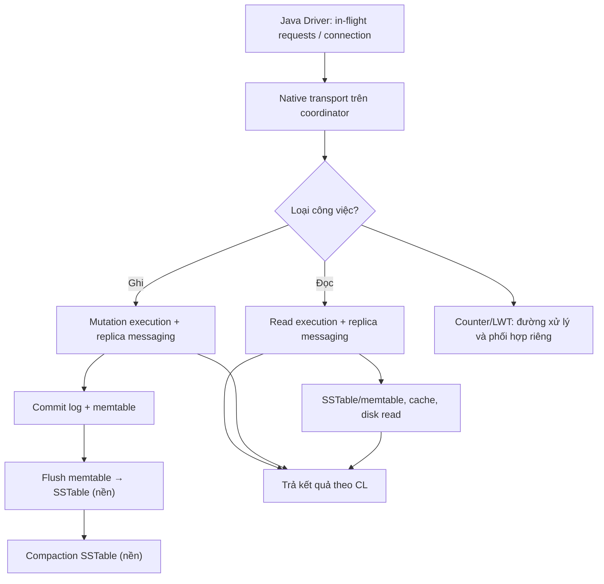
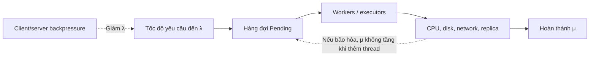
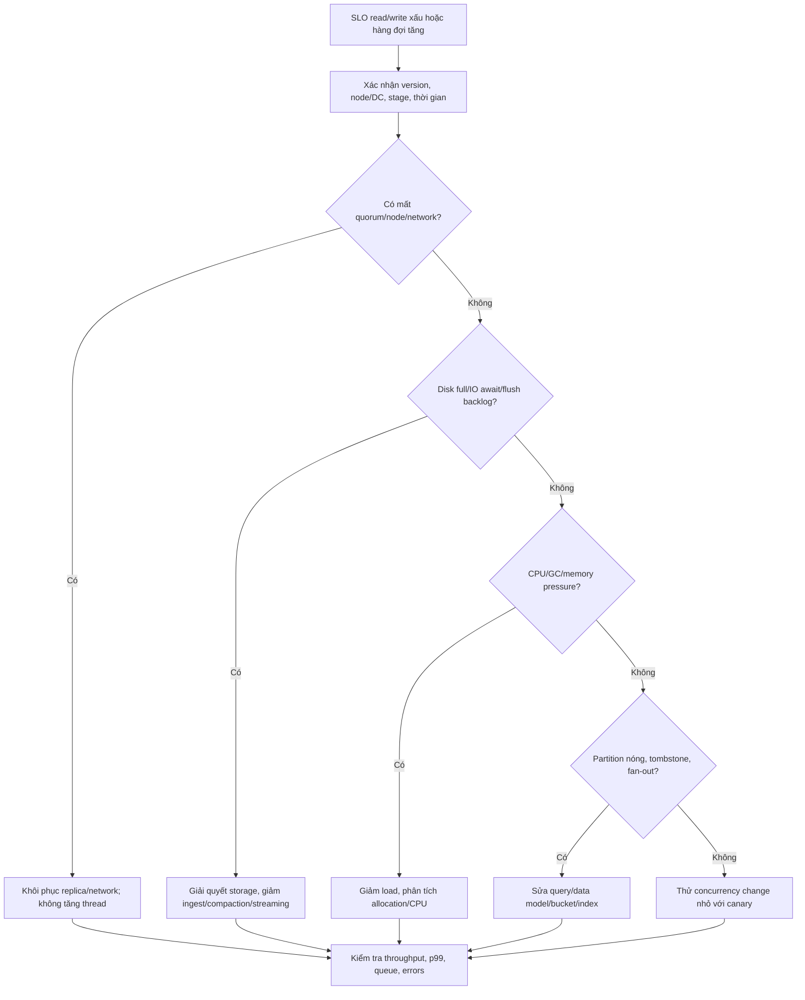

# Các hàng đợi, thread pool và tham số thay đổi theo phiên bản

> **Chương:** Tối ưu tài nguyên  
> **Học phần:** `DATABASE_ENGINE_WIDE_COLUMN_CASSANDRA` — Apache Cassandra

Cassandra là cơ sở dữ liệu phân tán theo mô hình **wide-column**: một truy vấn đi qua driver, coordinator, replica, commit log/memtable/SSTable, rồi trở lại ứng dụng. Trong quá trình đó, công việc được xử lý bởi nhiều cơ chế thực thi bất đồng bộ, **executor/thread pool**, hàng đợi, cơ chế giới hạn số việc đồng thời và lưu lượng I/O nền. Khi một hàng đợi tăng, cách xử lý sai phổ biến nhất là **“cứ tăng số thread”**. Nếu nút thắt thực sự là disk, mạng, GC, compaction hay partition nóng, nhiều thread hơn còn làm tình hình tệ hơn.

Một yếu tố khó hơn là **phiên bản**. Các tên stage, metric, key `cassandra.yaml`, giá trị mặc định và khả năng điều chỉnh lúc đang chạy có thể thay đổi giữa Apache Cassandra 3.x, 4.x, 5.x và các bản phân phối. Vì vậy, điều quan trọng không chỉ là nhớ tham số `concurrent_reads`, mà là biết **xác định công việc đang chờ ở đâu, kiểm tra đúng bản Cassandra, sửa một biến có đo lường và bảo toàn khả năng phục vụ**.

Bài học này tập trung vào quan sát và tối ưu tài nguyên an toàn, đồng thời liên hệ với thiết kế bảng theo truy vấn, partition key, replication, consistency level, compaction, repair và kết nối từ Java Driver.

**Mục tiêu**

- Hiểu sự khác nhau giữa **thread pool**, **executor**, **queue**, **backpressure** và các nguồn lực CPU/heap/disk/network.
- Đọc `nodetool tpstats` và kết hợp `compactionstats`, `tablestats`, JMX/metrics, log và chỉ số phía Java.
- Giải thích vì sao `Pending`/`Active`/`Dropped` không tự chứng minh nguyên nhân hoặc mất dữ liệu.
- Phân loại các tham số ảnh hưởng tới **đọc/ghi, counter, memtable flush, compaction, streaming và native transport**.
- Lập ma trận **tham số – phiên bản – nguồn xác minh – tác động – cách rollback**, không copy nguyên cấu hình từ tài liệu khác phiên bản.
- Thực hiện một vòng tuning nhỏ với baseline, giới hạn an toàn, canary, theo dõi p95/p99 và điều kiện dừng.

## 1. Một request dùng những nguồn lực nào?

Xét ứng dụng Java ghi sự kiện vào bảng:

```sql
-- Giả định keyspace telemetry đã tồn tại và replication phù hợp.
CREATE TABLE telemetry.events_by_device_day (
    device_id text,
    event_day date,
    event_id uuid,
    payload text,
    PRIMARY KEY ((device_id, event_day), event_id)
);
```

Partition key `(device_id, event_day)` được ánh xạ thành token, từ đó Cassandra xác định replica theo `NetworkTopologyStrategy`. Nếu Java Driver gửi write ở `LOCAL_QUORUM` với RF=3 tại data center địa phương, coordinator thường cần hai replica ở DC đó xác nhận để trả thành công; **replica còn lại vẫn có thể đang xử lý** mutation.

Một đường ghi/đọc được đơn giản hóa:



Đây là **sơ đồ tư duy**, không phải cam kết rằng mọi phiên bản đều có đúng một thread pool riêng tương ứng với mỗi ô. Cassandra sử dụng các stage/executor và kiến trúc messaging thay đổi theo phiên bản; nhiều công việc cũng chạy bất đồng bộ với I/O.

**Điều quan trọng:** một request có thể “chờ” ở nhiều tầng:

- Chờ **slot in-flight** trong Java Driver hoặc service.
- Chờ **connection/request processing** ở coordinator hoặc mạng.
- Chờ **task trong executor** trên coordinator/replica.
- Chờ **commit-log sync**, disk read, flush hoặc compaction để giải phóng áp lực.
- Chờ replica khác phản hồi theo **consistency level**, network RTT, failure detector hoặc timeout.
- Chờ GC, CPU scheduler và OS I/O queue.

Nếu đo sai tầng, việc tăng `concurrent_reads` hoặc số kết nối Java có thể chỉ đẩy nhiều request hơn tới cùng nút nghẽn.

## 2. Thread pool, queue, backpressure và dropped messages

### 2.1. Những khái niệm cơ bản

| Khái niệm | Ý nghĩa | Điều cần nhớ |
| --- | --- | --- |
| **Worker / thread** | Đơn vị thực thi task | Số thread cao không có nghĩa năng suất cao nếu task chờ I/O. |
| **Executor/stage** | Cơ chế tiếp nhận và điều phối một loại công việc | Tên executor/stage và cấu trúc nội bộ **không phải API ổn định** giữa các phiên bản. |
| **Active** | Task đang được thực thi ở stage | Active chạm giới hạn trong thời gian dài có thể cho thấy bão hòa, nhưng cần so với throughput thực. |
| **Pending / queue** | Task chờ được xử lý ở stage | Hàng đợi dài liên tục + latency tăng là dấu hiệu quan trọng; hàng đợi nhỏ thoáng qua có thể bình thường. |
| **Completed** | Tổng task stage đã xử lý | Thường là counter tích lũy; tính tốc độ theo cửa sổ thay vì so trực tiếp số tích lũy. |
| **Blocked / All time blocked** | Công việc bị chặn theo cơ chế của executor tương ứng | Không tự đồng nhất với blocked I/O của kernel hoặc lỗi CQL. |
| **Dropped messages** | Một số message/task không được xử lý trong giới hạn hiệu lực/timeout | Tín hiệu quá tải hoặc sự cố; **không tự chứng minh mất mutation vĩnh viễn**. |
| **Backpressure** | Giảm/giới hạn tốc độ nhận công việc khi phía sau không theo kịp | Tốt hơn tích tụ hàng đợi vô hạn dẫn tới memory/timeout. |



Một số tên stage thường thấy trong các bản Cassandra gồm `ReadStage`, `MutationStage`, `CounterMutationStage` và những executor phục vụ request/response, flush, compaction. **Đừng suy rằng tên stage, số luồng, metric hay ý nghĩa `Pending` giống hệt nhau trên tất cả các bản.** Quan sát `nodetool tpstats` của node thực tế và tài liệu metric đúng phiên bản.

### 2.2. Tại sao số task Pending không phải chẩn đoán hoàn chỉnh?

Giả sử một node nhận trung bình **500 task/s** nhưng chỉ hoàn thành **400 task/s** trong giai đoạn tải cao. Nếu tình trạng giữ nguyên, queue tăng khoảng **100 task/s**. Sau 5 phút, queue có thể tích thêm khoảng **30.000 task** (bỏ qua các cơ chế giới hạn hoặc timeout).

Thêm worker chỉ cải thiện nếu việc chờ xảy ra do **thiếu song song có ích**. Nếu disk đã đạt IOPS tối đa, thêm thread tạo thêm I/O outstanding, chuyển ngữ cảnh, bộ nhớ và retry mà **không tăng năng suất hoàn thành μ**.

Một mô hình đơn giản:

\[
\frac{dQ}{dt} \approx \lambda - \mu
\]

Trong đó `Q` là số việc chờ, `λ` là tốc độ vào và `μ` là tốc độ xử lý được. Muốn backlog giảm bền vững cần `μ > λ` trong giai đoạn phục hồi, hoặc giảm `λ` bằng giới hạn tải. Đây là phép tư duy về năng lực, **không thay thế** việc đo executor thực tế.

**Định luật Little** với hệ thống ổn định:

\[
L = \lambda W
\]

Trong đó `L` là số công việc trung bình đang ở trong hệ thống, `λ` là throughput và `W` là thời gian trung bình trong hệ thống. Khi `W` tăng trong khi throughput không tăng, số công việc chờ/in-flight có thể phình lên. Ứng dụng gửi thêm request để “bù chậm” thường làm áp lực nặng hơn.

### 2.3. Dropped có nghĩa bị mất dữ liệu?

**Không thể kết luận như vậy từ một metric đơn lẻ.** Dropped messages thường gắn với thông điệp hết thời gian chờ hoặc không còn hữu ích để xử lý ở stage. Có thể có client timeout, request đã hoàn thành ở replica khác, hinted handoff hoặc repair sau đó; cũng có trường hợp không đạt consistency level.

Cách điều tra đúng là đối chiếu **loại message**, log, request outcome phía Java, metrics `Timeouts`/`Failures`/`Unavailables`, replica health và dữ liệu thực tế. Nếu write timeout, **kết quả có thể chưa xác định**: không retry một cách mù quáng với counter hoặc phép toán có side effect.

## 3. Đọc `nodetool tpstats` đúng cách

`nodetool tpstats` là một công cụ hữu ích để nhìn trạng thái các executor/thread pool và dropped messages trên node đang kết nối.

```bash
# Lệnh quan sát; cần quyền quản trị/JMX phù hợp.
nodetool version
nodetool tpstats
nodetool status
nodetool describecluster
```

Kết quả có thể có các cột tương tự:

```text
Pool Name             Active  Pending  Completed  Blocked  All time blocked
ReadStage                  8      100     120000        0                 0
MutationStage              2        0     130000        0                 0

Message type        Dropped
READ                    50
MUTATION                 0
```

**Đây là dữ liệu mô phỏng** để giải thích cách đọc, không phải ngưỡng mặc định hay định dạng bắt buộc của mọi Cassandra release. Nếu bản thực tế có thêm/bớt stage hoặc metric, dựa theo tài liệu/nodetool của chính binary đó.

### 3.1. Quy trình đọc bảng

1. **Xác nhận phiên bản:** ghi `nodetool version` trước. Nếu cụm đang rolling upgrade, metric có thể khác giữa các node; không so sánh hai tên stage như cùng một thứ.
2. **Chụp nhiều mẫu:** khoảng 15–60 giây hoặc theo dashboard có resolution phù hợp; một ảnh chụp `Pending=100` không biết là spike 100 ms hay backlog 1 giờ.
3. **Quan sát tốc độ `Completed`:** lấy chênh lệch giữa hai mẫu và xử lý trường hợp node restart làm counter reset.
4. **Phân loại stage:** Read/Mutation/Counter, thread pool liên quan đến flush/compaction, internal messaging; tra nghĩa trong bản đang chạy.
5. **Đối chiếu với CL và replica:** `ReadStage` pending tại một replica có thể gây read timeout ở coordinator khác. Hãy xem **nhiều node**, không chỉ nơi client kết nối.
6. **So với OS/driver:** CPU, GC, disk await, network loss, Java in-flight, retry rate và p99.

### 3.2. Ví dụ đối chiếu theo triệu chứng

| Quan sát | Giả thuyết ban đầu | Xác minh thêm |
| --- | --- | --- |
| `ReadStage Pending` tăng, disk read await cao | Replica đọc SSTable chậm, cache miss, nhiều tombstone/SSTable | `tablestats`, `proxyhistograms`, disk I/O, truy vấn theo partition key |
| `MutationStage Pending` tăng, commit log wait cao | Ghi bị nghẽn ở commit log/storage | `CommitLog` metrics, flush, disk free/await, write p99 |
| Counter-related stage pending tăng | Counter update nặng, nhiều write lên cùng partition hoặc coordination | Query volume, RF/CL, key distribution, outcome/retry |
| Flush pool/`PendingFlushes` tăng | Memtable flush không theo kịp, disk bận/đầy | `tablestats`, commit log size, compaction và disk |
| Compaction pending tăng | SSTables sinh nhanh hơn tốc độ hợp nhất | `compactionstats`, strategy, disk headroom, ingest rate |
| Drop messages tăng cùng client timeouts | Task/message quá hạn hoặc node/replica bão hòa | Stage liên quan, JMX request metrics, mạng/GC |
| Pending bình thường nhưng p99 cao | Nút nghẽn không nằm trong queue đang xem | Network/CL, disk service time, GC, ứng dụng, lock/coordination |

**Không đánh tráo:** `tpstats` báo executor pending khác với queue của OS block device (`iostat`), queue Java Driver, backlog compaction và kích cỡ pending streaming. Cần dùng chỉ số của đúng tầng.

## 4. Bốn kiểu giới hạn tài nguyên dễ nhầm

### 4.1. CPU-bound

Dấu hiệu:

- CPU user/system cao kéo dài, GC không giải thích toàn bộ.
- Nhiều stage active nhưng throughput gần như không tăng khi tăng concurrency.
- Context switches/runnable queue tăng, p99 xấu đi.

Hướng xử lý: giảm thao tác không cần thiết, cải thiện query/partition model, đo CPU profiling ở môi trường phù hợp, xem thread count vừa sức. **Tăng số worker trên CPU đã bão hòa** có thể chỉ tăng chuyển ngữ cảnh.

### 4.2. Disk I/O-bound

Dấu hiệu:

- `iostat` cho disk await/queue tăng, disk throughput gần giới hạn.
- SSTable reads, commit-log sync, memtable flush hoặc compaction đồng thời cao.
- `PendingCompactions`, `PendingFlushes` hay `TotalCommitLogSize` tăng.

Hướng xử lý: giảm ingest/repair/streaming, tách hoặc mở rộng disk phù hợp, đánh giá compaction strategy và partition/tombstone. Không dùng `concurrent_reads` để biến ổ disk chậm thành nhanh.

### 4.3. Memory/GC-bound

Dấu hiệu:

- Heap/off-heap pressure, GC pause kéo dài, allocation rate cao.
- Page cache bị đẩy ra ngoài do heap quá lớn, khiến read I/O tăng.
- Quá nhiều in-flight request/buffer làm tiến trình có nguy cơ OOM.

Hướng xử lý: hạn chế độ đồng thời và payload, quan sát memtable/cache, heap/off-heap và OS page cache; chỉ điều chỉnh JVM sau khi hiểu phiên bản Cassandra/JDK. **Không cấp hết RAM cho JVM heap** rồi cho rằng server sẽ tốt hơn.

### 4.4. Network/replica/consistency-bound

Dấu hiệu:

- Internode RTT/loss cao, source DC chậm, node Down.
- `LOCAL_QUORUM` không đạt ở một vài token range; remote DC/`EACH_QUORUM` kéo dài write latency.
- Streaming/rebuild/hints đẩy NIC đến trần dù CPU/disk còn dư.

Hướng xử lý: kiểm tra RF/CL, topology/snitch, link, rate limiting streaming, repair scheduling. Thread pool cục bộ không sửa node remote mất kết nối hoặc quorum không đủ.

## 5. Các tham số thường gặp: có ý nghĩa gì và phải kiểm tra phiên bản ra sao?

### 5.1. Bảng định hướng theo nhóm

| Nhóm | Ví dụ tên tham số/cơ chế | Nó điều khiển gì? | Không được suy diễn |
| --- | --- | --- | --- |
| Read concurrency | `concurrent_reads` | Mức độ song song phục vụ đọc theo cơ chế của bản phát hành | Không phải số query toàn cụm/giây được bảo đảm. |
| Write concurrency | `concurrent_writes` | Công việc ghi đồng thời theo đường xử lý tương ứng | Tăng không sửa commit log/disk đầy. |
| Counter concurrency | `concurrent_counter_writes` | Điều phối công việc counter | Counter vẫn có ngữ nghĩa retry khác update idempotent. |
| Flush | `memtable_flush_writers` và nhóm cấu hình memtable | Số worker flush hoặc chính sách tài nguyên memtable tùy bản | Thêm flush writers có thể bão hòa data disk và compaction. |
| Compaction | `concurrent_compactors` | Số compaction tasks có thể chạy đồng thời | Nhiều compaction song song có thể tăng I/O và nhu cầu disk tạm. |
| Compaction bandwidth | `compaction_throughput` hoặc tên cũ có hậu tố đơn vị | Giới hạn throughput compaction nền | Không đồng nghĩa giới hạn tất cả disk I/O. |
| Streaming | `stream_throughput_outbound`, `inter_dc_stream_throughput_outbound` hoặc tên theo bản | Giới hạn tốc độ streaming outbound | Không phải throttle toàn bộ write replication hay native CQL. |
| Native transport | Các giới hạn requests/connections/frame/in-flight | Số kết nối, kích thước frame và request buffering ở giao tiếp CQL | Chỉnh server limit không thay thế backpressure phía Java. |
| Internode messaging | Queue/capacity/timeout/throttle của messaging theo phiên bản | Buffer/flow control và thời gian xử lý message | Tên metric/option có thể đổi; không copy từ bản khác. |
| Request timeouts | `read_request_timeout`, `write_request_timeout` và các tên tương ứng | Ngưỡng timeout của request server theo loại | Tăng timeout che triệu chứng, không tăng năng lực xử lý. |

**Lưu ý:** bảng này nêu các *nhóm knob thường thấy*, không phải bảng cấu hình hợp lệ cho mọi binary. Chẳng hạn tên throughput có thay đổi giữa nhánh tài liệu; một số trường có mặc định tự chọn dựa trên CPU, disk hoặc JVM. Cần kiểm tra `cassandra.yaml` và tài liệu **đúng phiên bản**, không chỉ sao chép ví dụ từ blog cũ.

### 5.2. Ma trận kiểm tra phiên bản

| Dòng Apache Cassandra | Cách áp dụng thông tin tuning | Điều cần đề phòng |
| --- | --- | --- |
| **3.x** | Đọc tài liệu cấu hình và metrics khớp nhánh 3.x; xác minh pool/stage và default bằng `nodetool` của chính node | Không dùng nguyên snippet 4.x/5.x hoặc giả định cùng cú pháp YAML. |
| **4.0 / 4.1** | Kiểm tra lại nhóm internode messaging, native transport, thread pool, request/concurrency và cách xuất metric; đối chiếu với JDK/GC được hỗ trợ | Kiến trúc và option có thay đổi giữa các major versions, bao gồm cách xử lý I/O và buffer. |
| **5.0.x** | Dùng tài liệu nhánh 5.0 và đúng patch release; đối chiếu compaction/streaming knobs với hệ thực tế | Không mặc định tên cũ có hậu tố `_mb_per_sec`/`_megabits_per_sec` vẫn có ngữ nghĩa/cú pháp giống tên mới. |
| **Bản sau 5.0 / vendor** | Xác minh **binary, release notes và tài liệu nhà cung cấp** | Không suy rằng tùy chọn bản Apache được managed service mở quyền thay đổi. |

**Phương pháp xác minh tốt hơn học thuộc số mặc định:**

1. Ghi **phiên bản trên từng node** bằng `nodetool version`.
2. Đọc tài liệu chính thức **của nhánh đó** và cấu hình thực được hệ quản lý cấu hình phân phối. Trong bài này không mở các file module khác; khi vận hành production, operator phải kiểm tra config thật.
3. Với tham số có khả năng truy vấn/điều chỉnh runtime, kiểm tra `nodetool help <command>` trên đúng node.
4. Tra JMX metric thực tế/explorer, không giả định metric exporter đổi tên giống bản trước.
5. Ghi default, giá trị đang chạy, đơn vị (`MiB/s` khác `Mb/s`), kiểu áp dụng (runtime/rolling restart), rủi ro và rollback.
6. Không thay nhiều giá trị đồng thời nếu không có khả năng cô lập ảnh hưởng.

### 5.3. Ví dụ YAML — danh mục để **đối chiếu**, không copy vào production

```yaml
# VÍ DỤ TƯ DUY: chỉ dùng trên bản Cassandra nhận những key này.
# Giá trị bên dưới không phải khuyến nghị mặc định hay cấu hình hoàn chỉnh.
concurrent_reads: 32
concurrent_writes: 32
concurrent_counter_writes: 32
memtable_flush_writers: 2
concurrent_compactors: 2

# Kiểm tra tên/đơn vị tham số compaction và streaming theo release.
# Ví dụ một số nhánh có compaction_throughput, nhánh cũ có
# compaction_throughput_mb_per_sec; KHÔNG dùng cả hai như synonym.
```

Tại sao không đưa giá trị “chuẩn” cho mọi cụm? Một node 4 vCPU dùng network SSD với tải ghi nặng khác xa node 32 vCPU dùng NVMe trong workload nhiều truy vấn đọc; còn có heap, page cache, RF, compaction strategy và partition size. `32` ở đây chỉ là **giá trị minh họa**, không phải mục tiêu tuning.

**Nên tách hai việc:** trước hết chọn **có cần thay tham số không**, sau đó mới chọn **giá trị** dựa trên CPU, số disk, IOPS, queue latency, request throughput và experiment.

### 5.4. Cấu hình runtime khác với cấu hình bền vững

Một số lệnh `nodetool` có thể đọc hoặc đổi các giới hạn runtime:

```bash
# Chỉ đọc trên phiên bản hỗ trợ:
nodetool getcompactionthroughput
nodetool getstreamthroughput
nodetool getinterdcstreamthroughput

# Xem cú pháp trước; KHÔNG thay đổi trong lab/production chỉ để thử:
nodetool help setcompactionthroughput
nodetool help setstreamthroughput
nodetool help setinterdcstreamthroughput
```

Không được suy rằng `nodetool set...` sẽ **tồn tại sau restart**: tùy loại tham số/version, giá trị runtime có thể không được ghi trở lại `cassandra.yaml`. Cần đồng bộ ý định cấu hình vào config management, chú ý đơn vị tham số, rollout từng node và ghi rõ rollback.

## 6. Chẩn đoán theo **cây quyết định**, không dựa một số Pending



### Bước 1 — xác nhận triệu chứng có ảnh hưởng ứng dụng

Thu p50/p95/p99 theo read/write, timeout, unavailable, failure, request volume, mức nhất quán, local data center, queue/in-flight từ Java. Một stage có `Pending=1000` nhưng client SLO không vi phạm và queue tự rút khi burst qua chưa chắc cần xử lý như P1; ngược lại request timeout liên tiếp dù Pending nhỏ vẫn phải điều tra.

### Bước 2 — nối stage với tài nguyên nền

```bash
nodetool tpstats
nodetool compactionstats
nodetool tablestats telemetry.events_by_device_day
nodetool proxyhistograms
nodetool netstats
```

OS (ví dụ Linux, thay path theo triển khai):

```bash
df -h /var/lib/cassandra/data /var/lib/cassandra/commitlog
df -i /var/lib/cassandra/data /var/lib/cassandra/commitlog
iostat -xz 1 5
```

Các lệnh này là **quan sát**, không thay đổi SSTable. Trong môi trường production dùng JMX/Prometheus và network provider telemetry theo thời gian dài để phát hiện lúc hàng đợi tăng. Tracing CQL có thể giúp điều tra một query mẫu, nhưng không bật tracing 100% traffic.

### Bước 3 — xác định phạm vi

- **Một node:** disk cụ thể, heap, network NIC, hardware, hot token/partition.
- **Nhiều node cùng DC:** nguồn ingest, traffic chuyển tuyến, compaction/rebuild, network DC.
- **Toàn cụm:** schema/query mới, tăng dữ liệu, thay đổi CL/RF, deploy app, repair đồng thời, backup/export.
- **Một table:** primary key, partition size, tombstones, SSTable count, compaction strategy, query fan-out.

Với RF=3, phải xem **tập replica của những partition bị ảnh hưởng**. Queue cao ở một replica có thể làm read `LOCAL_QUORUM` chậm nếu coordinator cần đợi phản hồi từ node ấy; tăng client concurrency còn làm nhiều request chạm cùng replica.

### Bước 4 — phân loại khả năng kiểm soát

| Nút nghẽn | Thử đầu tiên | Chỉ xét tăng concurrency khi |
| --- | --- | --- |
| Disk chậm/đầy | Mở rộng/khôi phục storage, giảm load, sắp lịch compaction | Disk còn headroom nhưng pipeline chưa tận dụng song song đủ. |
| Network/replica down | Khôi phục node/link, đánh giá CL và hints/repair | Đã loại trừ vấn đề replica và network. |
| CPU/GC bão hòa | Giảm mutation/query cost, hạn chế in-flight, profiling | CPU còn dư và task thực sự chờ execution slot. |
| Hot partition | Bucket/shard, sửa model/query | Đã giảm skew; tăng thread không phân phối lại một key nóng. |
| Flush backlog | Kiểm tra data disk, commit log, memtable size, compaction | Flush writer thực sự là giới hạn với disk còn dư. |
| Compaction backlog | Kiểm tra strategy, throughput, disk, mutation rate | Có đủ disk I/O/headroom và việc chạy song song hiệu quả. |
| Client burst | Backpressure, batch/parallelism, rate limiting, token bucket | Server có năng lực dư và request được phân phối hợp lý. |

## 7. Runbook cho các kiểu hàng đợi thường gặp

### RB-01 — `ReadStage` pending tăng và p99 đọc vượt SLO

**Xác nhận:** đo read p99 phía Java, `ClientRequest` read timeouts, stage pending theo node, `tablestats`, `SSTablesPerReadHistogram`, `TombstoneScannedHistogram`, disk await.

**Nguyên nhân thường gặp:** query quét rộng/`ALLOW FILTERING`, partition quá lớn hoặc nóng, nhiều tombstone, cache miss, quá nhiều SSTable do compaction chậm, disk chậm hoặc network/replica down.

**Giảm ảnh hưởng:** hạn chế request quét/batch, dùng đúng partition key và clustering range, tạm hoãn streaming/repair tranh chấp I/O khi an toàn, bổ sung capacity nếu cần. Có thể canary `concurrent_reads` sau khi chứng minh disk/CPU còn dư, không bắt đầu bằng nó.

**Không làm:** tăng timeout rồi xem như hết sự cố; tăng tất cả pool; bật `ALLOW FILTERING` trên hot path để “tránh lỗi Invalid query”.

**Đóng sự cố:** read p95/p99, timeout và queue trở về SLO, các partition quan trọng đọc đúng theo CL, không còn bottleneck disk/compaction nghiêm trọng.

### RB-02 — Write/Mutation pending tăng

**Xác nhận:** `MutationStage` hoặc stage ghi tương ứng ở phiên bản đó, write latency, `CommitLog` wait, disk await, `PendingFlushes`, `TotalCommitLogSize`, node health.

**Nguyên nhân:** commit log disk chậm, memtable flush nghẽn, data disk đầy, quá tải mutation, RF/CL/network lỗi, write hot partition.

**Giảm ảnh hưởng:** giảm producer rate/in-flight, giải quyết disk và flush, giới hạn bulk streaming/compaction cạnh tranh I/O khi có kế hoạch. Nếu liên quan consistency level, kiểm tra replica khỏe thay vì tăng `concurrent_writes` vô tội vạ.

**Không làm:** xóa commit log hoặc SSTable thủ công; restart nhiều replica cùng lúc; thử `concurrent_writes` cực cao trong lúc disk bão hòa.

**Đóng sự cố:** write error/p99 trong SLO, commit log và flush tiến triển, hàng đợi không còn tăng kéo dài, disk headroom đủ.

### RB-03 — Counter hoặc LWT có queue/latency xấu

Counter có ngữ nghĩa tăng/giảm đặc biệt; **gửi lại cùng lệnh counter sau timeout có thể áp dụng hai lần**. LWT/CAS có đường coordination và chi phí riêng, không chỉ phụ thuộc số worker.

- Đo tỷ lệ counter/LWT, phân phối partition key, số xung đột điều kiện, write/read CL và retry phía ứng dụng.
- Giới hạn độ song song và hotspot trước, xem có thể dùng event/ID bất biến và tổng hợp ngoài đường nóng không.
- Không gắn `setIdempotent(true)` cho counter hoặc thao tác không idempotent chỉ để bật retry.
- Sau timeout, outcome có thể chưa xác định; dùng cơ chế đối soát nghiệp vụ.

### RB-04 — Memtable flush backlog/commit log tăng

- Xác nhận `PendingFlushes`, memtable usage, commit log size/wait, disk free/await, compaction backlog.
- Nếu data disk gần đầy, ưu tiên **cấp chỗ trống an toàn**. Flush cần ghi SSTable; ép flush khi không có chỗ trống có thể làm tình hình tệ hơn.
- Khi disk vẫn có dư địa, đánh giá số flush writers, memtable sizing và tốc độ tạo SSTable. Nhiều flush writers cùng lúc có thể làm compaction backlog tăng.
- Không xóa file commit log để “giải phóng nhanh” khi chưa xác minh durability của dữ liệu.

### RB-05 — Compaction pending tăng kéo dài

- Đo pending tasks, SSTable count, disk throughput, CPU, free space, repair/streaming đang chạy.
- Xem strategy `STCS`/`LCS`/`TWCS` hoặc `UCS` (UCS được giới thiệu trong Apache Cassandra 5.0), dựa trên workload read/write/TTL.
- `concurrent_compactors` cao hơn có thể giúp nếu còn nhiều disk IOPS và tác vụ độc lập; với một volume đã đầy tải, nó tăng cạnh tranh và space amplification tạm thời.
- Không chạy major compaction toàn bảng làm phép thử trong khi đĩa gần đầy hoặc p99 đang vượt SLO.

### RB-06 — Streaming/repair tạo hàng đợi liên DC và ảnh hưởng client

- Tách streaming bytes/rate khỏi request traffic; kiểm tra `nodetool netstats`, trạng thái repair, hints và link WAN theo chiều.
- Tùy phiên bản, có thể giới hạn streaming outbound và inter-DC streaming qua tham số/lệnh `nodetool` tương ứng. **Không hiểu chúng là throttle toàn bộ write replication.**
- Tạm giảm tốc tác vụ nền có thể hoãn, giữ đủ lịch repair trước `gc_grace_seconds`, tránh chạy đồng loạt các segment trên cùng replica.
- Khi WAN phục hồi, hints replay có thể tạo traffic đột biến; không xóa hints để giảm queue.
- Đóng sự cố khi streaming/repair đúng phạm vi hoàn tất hoặc có kế hoạch an toàn, client SLO và capacity đạt.

## 8. Java Driver 4.x: backpressure trước khi quá nhiều request tới node

**Tuning server cần đi cùng kiểm soát phía client.** Nếu ứng dụng Java có 20 instance, mỗi instance phát cùng lúc 10.000 request bất đồng bộ vào vài replica, tổng in-flight có thể rất lớn dù mỗi request đơn giản.

Ví dụ Java Driver 4.x giới hạn **số request đang xử lý trong một instance** bằng semaphore. Ví dụ này chỉ **đọc** theo partition key phù hợp, đặt `LOCAL_QUORUM` và chỉ giữ 1 page do query có `LIMIT`. Code sử dụng Java 11+, đã giả định `CqlSession` được cấu hình local data center/credentials/TLS ở nơi tạo.

```java
import java.time.LocalDate;
import java.util.UUID;
import java.util.concurrent.CompletableFuture;
import java.util.concurrent.CompletionStage;
import java.util.concurrent.RejectedExecutionException;
import java.util.concurrent.Semaphore;

import com.datastax.oss.driver.api.core.CqlSession;
import com.datastax.oss.driver.api.core.DefaultConsistencyLevel;
import com.datastax.oss.driver.api.core.cql.AsyncResultSet;
import com.datastax.oss.driver.api.core.cql.BoundStatement;
import com.datastax.oss.driver.api.core.cql.PreparedStatement;

public final class BoundedEventReader {
    private final CqlSession session;
    private final PreparedStatement select;
    private final Semaphore permits;

    public BoundedEventReader(CqlSession session, int maxInFlight) {
        if (maxInFlight <= 0) {
            throw new IllegalArgumentException("maxInFlight must be positive");
        }
        this.session = session;
        this.permits = new Semaphore(maxInFlight);
        this.select = session.prepare(
            "SELECT event_id, payload " +
            "FROM telemetry.events_by_device_day " +
            "WHERE device_id = ? AND event_day = ? LIMIT 50");
    }

    public CompletionStage<AsyncResultSet> read(
            String deviceId, LocalDate day) {
        if (!permits.tryAcquire()) {
            return CompletableFuture.failedFuture(
                new RejectedExecutionException("Client backpressure"));
        }

        BoundStatement statement = select.bind(deviceId, day)
            .setConsistencyLevel(DefaultConsistencyLevel.LOCAL_QUORUM)
            .setPageSize(50)
            .setIdempotent(true);

        try {
            return session.executeAsync(statement)
                .whenComplete((result, failure) -> permits.release());
        } catch (RuntimeException failure) {
            permits.release();
            throw failure;
        }
    }
}
```

**Ý nghĩa và giới hạn:**

- Semaphore **giới hạn in-flight của một instance**, không phải toàn cluster. Phải đo tổng số instance/replica và capacity thực tế. Mức `maxInFlight` cần benchmark, không có mặc định chung.
- `tryAcquire()` có thể từ chối sớm để **bảo vệ hệ thống**; API cần trả lỗi có kiểm soát (ví dụ giới hạn tốc độ) hoặc đưa request vào queue có giới hạn và deadline, không chặn vô thời hạn thread HTTP.
- `whenComplete` trả permit khi stage hoàn thành, kể cả có lỗi. Callback cần ngắn, không chạy công việc nặng trên event loop.
- Query `LIMIT 50` được giới hạn số hàng trả về; **đường đọc vẫn phải theo partition key**. Page size không sửa quét rộng.
- Với `SELECT`, `setIdempotent(true)` hợp lý. **Không sao chép cờ này sang counter hoặc mutation có side effect**. Write timeout có thể mang outcome chưa xác định.
- Nếu consumer fetch thêm các page sau, cần tính riêng in-flight/paging pressure. Trong ví dụ query có `LIMIT 50` nên không thiết kế để stream vô hạn.
- Ngoài semaphore ở ứng dụng, driver có connection pool/request throttling và timeout/config tương ứng theo phiên bản; cần xem tài liệu driver 4.x đúng nhánh và đo trạng thái thay vì chỉ tăng mọi giới hạn.

### Backpressure tránh “retry storm”

Một retry tự động làm tăng `λ` vào đúng thời điểm Cassandra đã không theo kịp. Nếu timeout tăng, các tầng gọi lẫn nhau retry, tải có thể **khuếch đại**: 1000 request/s từ client thành 2000–3000 attempts/s trên coordinator.

Vì vậy:

1. Chỉ retry khi **ngữ nghĩa thao tác cho phép**, theo policy có giới hạn và jitter/backoff.
2. Giữ event ID/partition key và payload ổn định cho mutation idempotent; xem TTL/timestamp nếu có.
3. Có deadline/circuit breaker ở API và queue in-flight hữu hạn.
4. Đo **attempt rate và original request rate** riêng; không tính attempts như số nghiệp vụ độc lập.
5. Khi node/replica down, backpressure phải phản ánh số replica thực sự còn khỏe theo RF/CL; không tăng worker để bù một replica không thể liên lạc.

## 9. Thiết kế thí nghiệm tuning có thể kiểm chứng

### 9.1. Baseline trước khi thay đổi

Chụp ít nhất:

| Tầng | Chỉ số cần lưu | Câu hỏi |
| --- | --- | --- |
| Ứng dụng | Read/write p50/p95/p99, timeout/unavailable, QPS, retry attempts, in-flight | Người dùng có bị ảnh hưởng không? |
| Cassandra stage | Active/Pending/Completed/Dropped theo node/stage | Hàng đợi nằm ở đâu? Tốc độ xử lý thay đổi không? |
| Storage | Disk free, disk await, read/write IOPS/throughput, commit log/flush | Có dư địa thực để chạy song song thêm? |
| JVM/OS | Heap/off-heap, GC pause, CPU utilization, runnable queue, FD | Thêm thread có nguy cơ tăng GC/context switch không? |
| Workload | Keyspace/table, partition size/skew, SSTables/tombstones, RF/CL/DC | Nguyên nhân có nằm ở data model/replica không? |
| Nền | Compaction/repair/streaming/hints, backup/export | Cùng thời điểm có jobs ăn tài nguyên không? |

Không chỉ so một phút tải thấp trước/sau. Cần cả **tải steady-state và peak**, dữ liệu đại diện, warmup, khác biệt cache, replica down và work nền như compaction.

### 9.2. Chỉ thay **một** giả thuyết

Ví dụ muốn kiểm tra tăng `concurrent_reads` vì ReadStage pending tăng và **disk/CPU còn dư**:

1. Chụp baseline trên một nhóm node tương tự, xác nhận workload, version và những stage liên quan.
2. Định nghĩa **giả thuyết**: tăng song song đọc một mức nhỏ sẽ tăng `Completed/s`, giảm `Pending` mà không tăng disk await/p99.
3. Xác định cách áp dụng: thay `cassandra.yaml` và rolling restart hoặc cấu hình runtime **nếu bản đó hỗ trợ**; không suy từ tên option rằng có thể đổi nóng.
4. Áp dụng có kiểm soát, **không restart đồng thời nhiều replica của cùng token range**.
5. Đo throughput, p99, error rate, CPU, GC, disk queue, ReadStage pending, tác động đến write.
6. Nếu latency/error tăng hoặc disk đạt trần nhưng throughput không cải thiện, **rollback** theo quy trình.
7. Nếu tốt, mở rộng từng nhóm với bằng chứng và cập nhật runbook, config management.

**Mẫu nhật ký thử nghiệm:**

```text
Hypothesis: Read worker parallelism is insufficient (disk/CPU have headroom)
Cassandra version: <exact version and distribution>
Scope: <cluster/DC/node subset>
Knob: <exact supported cassandra.yaml key / nodetool command>
Old value: <current verified value>
New value: <small, justified change>
Apply method: <runtime / rolling restart>
Before: <read p99, pending, completed/s, CPU, disk await>
After:  <same measures, same representative workload>
Stop conditions: <SLO, timeouts, disk free, GC, backlog>
Rollback: <how to revert and validate>
Owner / review: <person and change ticket>
```

Những placeholder trong block chỉ dùng làm **mẫu sổ tay**, không phải các lệnh thực thi trên production.

### 9.3. Khi nào cần scale out thay vì tăng thread?

Khi đã gần giới hạn CPU/disk/network, việc tăng concurrency chỉ dồn nhiều request hơn lên cùng nguồn lực. Hãy xem:

- **Thêm node** để tăng capacity và phân phối token/ranges, sau khi dự toán streaming, disk, RF và impact tới topology.
- **Thiết kế lại partition key/bucket/shard** nếu một số partition quá nóng; thêm node không tự chia một partition nóng thành nhiều partition.
- **Giảm write amplification** bằng workload model, compaction strategy và chính sách TTL/tombstone phù hợp.
- **Giới hạn producer/consumer** để ưu tiên request quan trọng, thay vì tăng worker không kiểm soát.
- **Tách loại workload** hoặc thay đổi thời điểm repair/analytics/backup theo budget.

Scale out không phải thao tác không rủi ro: bootstrap/repair/cleanup tạo tải nền. Sau thay đổi topology, kiểm tra node `UN`, ownership, streaming, query read-before/write-after và CL.

## 10. Các nhầm lẫn cần tránh

**“`ReadStage Pending` tăng chắc chắn vì `concurrent_reads` quá thấp.”**  
Không. Disk await, GC, tombstone, partition nóng, compaction hay replica khác chậm đều có thể là nguyên nhân. Phải chứng minh còn headroom và throughput cải thiện khi tăng song song.

**“`Completed` lớn tức hệ thống đang khỏe.”**  
`Completed` thường là tổng tích lũy từ lúc start, cần xem **tốc độ tăng** và tỉ lệ so với arrival rate, latency và failures.

**“Dropped messages nghĩa Cassandra đã mất vĩnh viễn dữ liệu.”**  
Không thể kết luận như vậy từ metric đơn lẻ. Phải xem loại message, outcome request, CL, hints/repair và trạng thái replica.

**“Thread pool và connection pool Java là một.”**  
Không. Client request throttling/connection in-flight nằm ở phía Java/driver; executor/stage là tài nguyên server. Cả hai cùng ảnh hưởng lượng công việc đồng thời.

**“Có thể copy `cassandra.yaml` của Cassandra 3.x sang 5.x.”**  
Không. Tên option, đơn vị, mặc định và mô hình xử lý có thể đã đổi. Dùng tài liệu nhánh tương ứng, release notes và kiểm tra binary thật.

**“Tăng `concurrent_compactors` luôn làm compaction nhanh hơn.”**  
Không, đặc biệt trên disk bão hòa hoặc thiếu chỗ cho SSTable output. Có thể làm read/write p99 tệ hơn.

**“Tăng request timeout giải quyết được backlog.”**  
Không. Timeout dài hơn có thể khiến in-flight tồn lâu hơn và che việc server không theo kịp. Cần giảm queue hoặc tăng năng lực thực.

**“Giới hạn inter-DC stream throughput cũng giới hạn tất cả CQL writes.”**  
Không. Nó nhắm tới streaming, không phải tổng network replication/request traffic.

**“Cassandra 5.x cùng mọi patch release nên config y hệt.”**  
Không nên giả định. Dùng đúng patch-level documentation và binary, đặc biệt với các cấu hình được đổi tên hoặc khả năng runtime adjustment.

## 11. Bài tập tình huống và tự đánh giá

**Câu 1.** Trong 5 phút, node nhận 500 tasks/s và xử lý 400 tasks/s. Nếu không có cơ chế drop/backpressure, backlog tăng bao nhiêu task? Điều đó có chứng minh thiếu thread không?

**Câu 2.** `ReadStage` có Pending cao, disk await tăng và `SSTablesPerReadHistogram` xấu. Có nên tăng `concurrent_reads` lên gấp bốn? Hãy nêu ít nhất ba phép kiểm tra khác.

**Câu 3.** Một blog cho cấu hình `compaction_throughput_mb_per_sec: 64` cho Cassandra cũ, còn tài liệu một nhánh mới ghi `compaction_throughput` theo đơn vị khác. Có nên thay thẳng key và số `64` không?

**Câu 4.** Java service có 30 instances, mỗi instance cho phép 1000 in-flight requests. Tại sao nhìn một instance “chỉ 1000” không đủ để đánh giá tải tới cluster?

**Câu 5.** Write timeout tăng, `MutationStage` pending không cao nhưng `CommitLog.WaitingOnCommit` tăng. Bạn ưu tiên đo và xử lý ở đâu trước khi thay `concurrent_writes`?

**Câu 6.** Bảng counter rất nóng; một nhóm bật `setIdempotent(true)` cho câu `UPDATE counters SET value = value + 1` để driver retry dễ hơn. Nguy cơ là gì?

**Câu 7.** Repair/streaming đang ăn hết WAN, `LOCAL_QUORUM` ở DC cục bộ vẫn thành công nhưng dữ liệu remote chậm bắt kịp. Tham số nhóm nào kiểm soát streaming, và tại sao không thể coi đó là throttle mọi write replication?

**Câu 8.** Một thí nghiệm tăng `concurrent_compactors` làm pending compaction giảm nhưng read p99 tăng 2 lần, disk await tăng. Kết luận của bạn và bước tiếp theo?

<details>
<summary>Gợi ý đáp án</summary>

1. `(500 - 400) × 300 = 30.000 tasks`. Không: nguyên nhân có thể là năng lực disk/CPU/network, hot partition, GC hoặc execution slot; phải đo headroom.
2. Kiểm tra partition/query (quét rộng, tombstone), disk IOPS/await, compaction backlog, GC/CPU và replica/CL. Tăng thread có thể làm cạnh tranh disk nặng hơn.
3. Không. Cần xác nhận version/đúng key, đơn vị MiB/s hay Mb/s, mặc định và cách áp dụng; thử thay đổi nhỏ có benchmark và rollback.
4. Toàn ứng dụng có thể tạo tới khoảng `30 × 1000 = 30.000` in-flight, nhiều request tập trung ở một nhóm token/replica; phải đo ở cluster/server và xác định RF/CL.
5. Ưu tiên commit log disk latency/sync, data disk flush backlog, disk full và streaming/compaction cạnh tranh; tăng thread không giải quyết fsync nghẽn.
6. Counter mutation không idempotent; timeout có thể xảy ra sau khi một increment đã áp dụng, retry có thể cộng hai lần.
7. Nhóm `stream_throughput_outbound`/`inter_dc_stream_throughput_outbound` đúng bản. Chúng hạn chế bulk streaming, không phải mọi mutation gửi giữa replica theo giao thức write.
8. Rollback/giảm concurrency hoặc giới hạn compaction theo runbook: queue giảm không đủ nếu SLO tệ hơn và disk bị bão hòa. Cần ưu tiên outcome ứng dụng.

</details>

## 12. Checklist khi chuẩn bị một thay đổi tài nguyên

| Hạng mục | Xác nhận trước rollout |
| --- | --- |
| **Phiên bản** | Mọi node được chọn có đúng Cassandra/JDK/release; xác nhận mixed-version upgrade nếu đang diễn ra. |
| **Tài liệu** | Key, loại, đơn vị, default, phạm vi, runtime vs restart, deprecated/removed đúng bản. |
| **Baseline** | QPS, p95/p99, errors, tpstats pending/completed/dropped, disk/CPU/GC, backlog nền. |
| **Giả thuyết** | Vì sao nút nghẽn là thread/executor mà không phải disk/network/model? |
| **Phạm vi** | Node/DC/table nào thử, tránh quá nhiều replica của cùng partition bị restart đồng thời. |
| **Giới hạn an toàn** | CPU, disk free, I/O await, latency budget, timeout rate, repair schedule. |
| **Thử tải** | Steady + peak + hot partition + compaction/repair chạy nền, theo CL thực. |
| **So sánh** | Chỉ đổi một biến, đo throughput thành công và p99, so trên cùng workload. |
| **Rollback** | Lưu old value, cách revert, config management và tiêu chí dừng. |
| **Hậu kiểm** | Node khỏe, schema/ownership ổn, read/write probes và error budget đạt. |

### Nguồn đọc thêm

- [Apache Cassandra — cassandra.yaml (tham số phải đối chiếu đúng nhánh)](https://cassandra.apache.org/doc/stable/cassandra/managing/configuration/cass_yaml_file.html)
- [Apache Cassandra — Metrics, ThreadPools, ClientRequest, CommitLog, Compaction](https://cassandra.apache.org/doc/stable/cassandra/managing/operating/metrics.html)
- [Apache Cassandra — nodetool tpstats](https://cassandra.apache.org/doc/stable/cassandra/managing/tools/nodetool/tpstats.html)
- [Apache Cassandra — nodetool compactionstats](https://cassandra.apache.org/doc/stable/cassandra/managing/tools/nodetool/compactionstats.html)
- [Apache Cassandra — Compaction strategies and trade-offs](https://cassandra.apache.org/doc/stable/cassandra/managing/operating/compaction/overview.html)
- [Apache Cassandra — Streaming](https://cassandra.apache.org/doc/stable/cassandra/architecture/streaming.html)
- [Apache Cassandra — Repair](https://cassandra.apache.org/doc/stable/cassandra/managing/operating/repair.html)
- [DataStax Java Driver 4.x — Asynchronous API](https://docs.datastax.com/en/developer/java-driver/4.17/manual/core/async/index.html)

