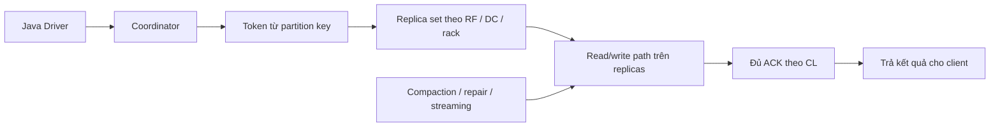
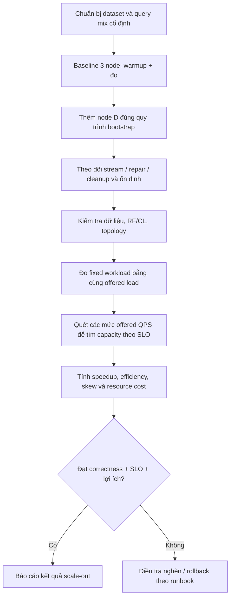
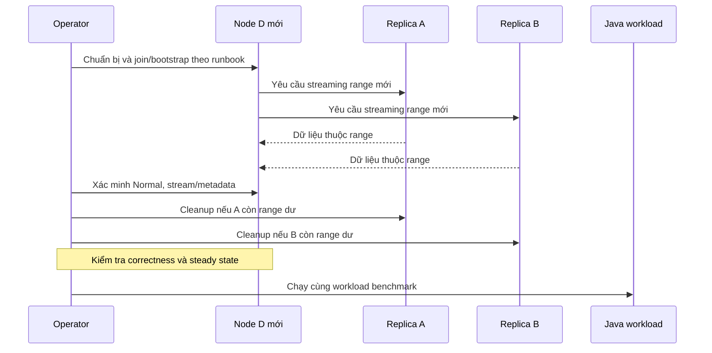

# Đo mức mở rộng khi thêm nút trên cùng loại tải

## 1. Vấn đề: thêm một node có thật sự tăng năng lực Cassandra?

Apache Cassandra là cơ sở dữ liệu **wide-column phân tán**: partition key được băm thành token, replication strategy chọn các **natural replicas**, còn coordinator tổ chức đọc/ghi theo **consistency level (CL)**. Thêm một node có thể tạo thêm CPU, bộ nhớ, disk và network, nhưng **không mặc nhiên** làm mọi truy vấn nhanh hơn hay tăng throughput tỷ lệ thuận với số node.

Chẳng hạn, một cluster 3 node có thể xử lý 6.000 operations/s ở p99 và error rate đạt SLO. Sau khi thêm node thứ tư, muốn kết luận “scale-out tốt” cần biết:

- Tại **cùng 4.000 operations/s đầu vào**, p95/p99, timeout và mức sử dụng CPU/disk/network đã thay đổi thế nào?
- Khi **tăng dần tải**, cluster 4 node đạt bao nhiêu operations/s **thành công** mà vẫn giữ p99/error rate trong SLO?
- Node mới đã hoàn tất **bootstrap/streaming**, dữ liệu đã phân bố lại và các node cũ đã được **cleanup** đúng lúc chưa?
- Partition key có phân tán tải hay phần lớn request vẫn dồn vào một **hot partition**?
- RF, CL, query mix, dữ liệu, page size, phiên bản Cassandra/Java Driver, vị trí client và tải nền đã được giữ tương đương chưa?

Bài thuộc chương **Tối ưu tài nguyên** của mô-đun `DATABASE_ENGINE_WIDE_COLUMN_CASSANDRA`, nối kết kiến trúc phân tán, thiết kế bảng theo truy vấn, partition key, CQL, replication/consistency, compaction, repair, xử lý lỗi và Java Driver.

**Kết quả học tập:** người học thiết kế và giải thích được benchmark scale-out **cùng loại tải** khi tăng số node; phân biệt năng lực trạng thái ổn định với chi phí chuyển topology; tính speedup/efficiency, kiểm chứng dữ liệu và SLO; xác định bottleneck còn lại trước khi quyết định tiếp tục mở rộng.

## 2. “Cùng loại tải” phải được định nghĩa chặt chẽ

Ở đây, **cùng loại tải** không chỉ nghĩa là cùng một câu `SELECT`. Cần cố định hoặc khai báo rõ những yếu tố quyết định mức tài nguyên tiêu thụ trên **mỗi thao tác nghiệp vụ**:

| Thuộc tính | Ví dụ mô tả định lượng | Nếu thay đổi sẽ gây nhầm lẫn gì? |
| --- | --- | --- |
| Query mix | 80% đọc 20% ghi; số `SELECT`/`UPDATE` mỗi nghiệp vụ | Thay đổi read/write I/O, coordinator và commitlog load |
| Query shape | Cùng bảng, khóa phân vùng, range, projection, `LIMIT`, batch size | Bỏ bớt hàng hoặc cột làm benchmark nhanh hơn nhưng không còn cùng công việc |
| Phân bố partition key | 70% keys phân bố đều, 30% hot keys theo cùng seed/Zipf parameter | Thay hot-key ratio làm đổi khả năng phân bổ tải dù số node không đổi |
| Data footprint | Số partition, rows/partition, SSTable count, tombstone/TTL, payload size | Dữ liệu nhỏ nằm cache khác dữ liệu lớn phải đọc disk |
| CL và RF | `NetworkTopologyStrategy {'dc1': 3}`, đọc/ghi `LOCAL_QUORUM` | Hạ CL hoặc RF để lấy throughput cao hơn là thay semantics |
| Truy vấn phân trang | `pageSize`, đọc một page hay đọc hết toàn bộ | Số request server và bytes/operation bị đổi |
| Driver | Local DC, token-aware routing, retry, speculative execution, connection pools | Coordinator phân bố khác; retry có thể tăng request thật |
| Điều kiện cluster | Node, rack/DC, storage class, CPU, RAM, network, Cassandra/JDK version | So khác phần cứng/phần mềm không chứng minh hiệu quả thêm node |
| Tải nền | Repair, bootstrap, compaction, backup, snapshot, GC | Thay đổi tiến trình nền dễ lấn át tác động scale-out |
| Tải được đề nghị | Offered operations/s, concurrency, arrival pattern, duration | So ở hai mức tải khác nhau có thể khiến p99 biến động rất lớn |

**Nguyên tắc:** Phép thử giữ **loại thao tác, phân bố keys, payload, semantics và cấu hình client** giống nhau trước/sau. Có thể thay **số lượng tải** trong phép thử tìm capacity, nhưng phải ghi rõ từng mức offered rate thay vì so lẫn các mức.

### Hai khái niệm cần tách riêng

- **Workload cố định (fixed-workload/strong-scaling-style):** cùng tổng dữ liệu và cùng offered traffic; tăng từ 3 lên 4 node rồi so latency, error và mức dùng tài nguyên. Mục tiêu là độ trễ/headroom cải thiện, không nhất thiết throughput hoàn tất tăng vì số request đầu vào đã cố định.
- **Capacity under SLO (capacity scaling):** giữ cùng query/data distribution, tăng dần offered traffic cho từng kích thước cluster để tìm mức **successful operations/s cao nhất** vẫn đạt p99, error và ngân sách tài nguyên. Đây là phép đo tốt hơn khi hỏi “thêm 1 node giúp chịu được bao nhiêu tải nữa?”.

Một thiết kế **weak-scaling-style** có thể tăng đồng thời số node, lượng dữ liệu và tổng workload để giữ gần bằng dữ liệu/tải **trên mỗi node**. Đó là bài toán khác, phải công bố riêng; không trộn với kết luận về dữ liệu cố định.

## 3. Tại sao Cassandra không tăng tốc tuyến tính khi có thêm node?

Ở mức khái niệm, một request đi qua:



Thêm node có thể làm giảm số token range, lượng dữ liệu **hữu hiệu** và lưu lượng bình quân trên mỗi node, nhưng không xóa các giới hạn sau:

1. **Hot partition:** các thao tác trên một partition vẫn tập trung vào **một tập RF replicas**, không được chia đều thành từng row trên mọi node mới.
2. **RF và CL:** với RF = 3 và `LOCAL_QUORUM`, đọc/ghi vẫn cần đủ phản hồi theo ngưỡng địa phương; node mới làm thay đổi **node nào** giữ replica, không làm một partition có khả năng dùng vô hạn nodes.
3. **Coordinator/client bottleneck:** driver, load balancer, DNS, network hoặc máy tạo tải có thể nghẽn trước cluster.
4. **Shared overhead:** gossip, streaming, compaction, repair, schema metadata, caches và network coordination có chi phí không biến mất khi tăng số node.
5. **Skew dữ liệu/tải:** node mới nhận ít/không đồng đều các partition nóng; tỷ lệ “Owns (effective)” không tương ứng trực tiếp IOPS, bytes hay CPU.
6. **Giới hạn thiết bị:** disk write amplification, GC/heap, NIC, CPU, request queues và tài nguyên từng DC có thể không cân xứng.

Do đó ta cần chứng minh **tải thực tế đã được phân bổ** và **các điểm nghẽn đã thay đổi**, thay vì chỉ nhìn cluster có thêm một hàng `UN` trong `nodetool status`.

### RF = 3 trước/sau khi thêm node

Giả sử cluster ban đầu có **3 node ở một DC và RF = 3**. Mọi partition có natural replicas trên **cả 3 node** (nếu cả ba được chọn hợp lệ). Khi thêm node thứ tư và phân bổ range ổn định, mỗi partition vẫn có **3 replicas**, nhưng những tập 3 node có thể khác nhau theo token range.

| Thuộc tính | 3 node, RF3 | 4 node, RF3 |
| --- | --- | --- |
| Natural replicas mỗi partition | 3 | 3 |
| `LOCAL_QUORUM` ACK cần thiết | 2 | 2 |
| Node tham gia lưu một partition | Thường cả ba | Một tập ba trong bốn, tùy token/rack |
| Tổng bản sao logic cho toàn dataset | Xấp xỉ RF × dữ liệu, cộng overhead | Xấp xỉ RF × dữ liệu, cộng overhead |
| Dữ liệu trung bình trên mỗi node | Cao hơn nếu phân bố cân bằng | Có thể thấp hơn **sau chuyển range và cleanup** |
| Mỗi hot partition tự chia ra 4 node | Không | **Không** |

Trong mô hình cân bằng lý tưởng, dung lượng bản sao bình quân mỗi node giảm tỷ lệ \(3/4\) khi từ 3 lên 4 node **cùng RF3 và cùng dataset**. Đây là kỳ vọng **trung bình**, không phải một dự báo disk usage cho từng node: SSTable, compaction, snapshot, token allocation và dữ liệu range thực khiến độ lệch đáng kể.

## 4. Trước khi đo: xác minh bất biến dữ liệu và consistency

Scale-out là thay đổi topology, nên phép đo performance phải kèm kiểm tra **correctness và availability**. Các câu hỏi cần chốt:

- Mọi bảng/keyspace trong workload có replication strategy/RF như cũ không?
- Node mới có đúng DC/rack, snitch, JDK/Cassandra version và cấu hình storage/network không?
- Bootstrap đã stream đủ token ranges chưa? Có repair cần làm trước khi coi trạng thái mới ổn định không?
- Dữ liệu từ trước khi thêm node có đọc được ở cùng `LOCAL_QUORUM` không?
- Số bản ghi/partition/TTL và thời gian đo có thay đổi khiến result set khác đi không?
- Driver đã discovery topology mới và route đúng local DC, không ghim tất cả request vào vài contact points cố định?

Để kiểm tra keyspace:

```sql
SELECT keyspace_name, replication, durable_writes
FROM system_schema.keyspaces
WHERE keyspace_name = 'scale_lab_ks';
```

Để đọc trạng thái:

```bash
nodetool status scale_lab_ks
nodetool ring scale_lab_ks
nodetool describecluster
nodetool netstats
```

`nodetool status` hiển thị node Up/Normal, effective ownership và load, **không chứng minh mỗi replica đã đồng bộ**. `UN` mới chỉ là điều kiện vận hành cần thiết. Phải nối với logs bootstrap, streaming, repair và đọc thử những partition đã tồn tại trước khi mở rộng.

**Nếu dữ liệu thay đổi liên tục trong thử nghiệm**, dùng tập dữ liệu test bất biến cho kiểm tra đúng đắn hoặc chuẩn hóa theo cutoff/khóa chính. Cassandra không tạo snapshot nhất quán giữa hai lần `SELECT` chỉ vì chúng có cùng query text.

## 5. Thiết kế thí nghiệm: một DC, đồng nhất phần cứng

### Định nghĩa minh họa

- Cassandra lab ở `dc1`, ban đầu ba node `A/B/C`, sau đó thêm `D`; có thể thử thêm `E` nếu lab đủ năng lực.
- Node cùng loại CPU, RAM, storage, NIC, rack/network policy; cùng Cassandra version và cấu hình JVM/GC khi khả thi.
- Keyspace RF3 với `NetworkTopologyStrategy`; đọc/ghi ở `LOCAL_QUORUM`.
- Bộ dữ liệu tổng hợp có đủ partition/rows để phản ánh read path thật, không chỉ vài hàng trong cache.
- Cùng query mix/partition-key distribution, seed tạo tải, payload size, page size và retry policy.
- Driver/app load generator ở máy **khác** Cassandra; có đủ năng lực để không làm giới hạn đo.
- Chỉ đổi **số node** giữa hai trạng thái ổn định, không đồng thời chỉnh compaction throughput, JVM heap, page size, RF hoặc CL.

### Quy trình trực quan



**Không chạy benchmark trạng thái ổn định ngay khi D vừa chuyển sang `UN`.** Phải kiểm tra streaming đã hoàn tất, không còn bootstrap lỗi, cleanup (nếu cần) và compaction/anti-compaction backlog về mức bình thường. Cũng không nên chờ “mọi pending compaction = 0” bằng mọi giá trên cluster có ghi liên tục; thay vào đó đặt **điều kiện steady-state cụ thể**, ví dụ backlog và disk/CPU nằm trong dải ổn định, không có hoạt động topology change bất thường.

## 6. Một phép thử tốt cần hai nhánh đo

### 6.1. Nhánh A — tải cố định

Giữ offered rate ở mức ví dụ **3.000 operations/s** cho cả ba và bốn node. Đo:

| Đại lượng | Ý nghĩa trong fixed workload |
| --- | --- |
| Successful operations/s | Có đạt gần 3.000 không, hay timeout khiến thấp hơn? |
| p50, p95, p99 full-operation | Thay đổi độ trễ và tail khi tải tổng không đổi |
| Read/write errors, timeouts, retries | Độ tin cậy có bị tác động bởi topology/driver không? |
| CPU user/system và GC trên từng node | Headroom có tăng và mức lệch giữa nodes có giảm không? |
| Disk read/write IOPS, latency, SSTables per read | Chuyển range có giảm tranh I/O thật không? |
| Network inbound/outbound (client và inter-node) | Chi phí phối hợp replica và phân bố nguồn/đích |
| Disk used/free theo node | Ownership hiệu hữu hiệu/dung lượng có cân bằng không? |

Không kỳ vọng thành công 3.000 requests/s biến thành 4.000 khi **chỉ có 3.000 requests/s được đề nghị**. Nếu cả hai cluster đều đạt 3.000, lợi ích ở nhánh này là **latency/headroom/resilience**, không phải QPS cao hơn.

### 6.2. Nhánh B — xác định capacity dưới SLO

Giữ cùng **loại workload**, lần lượt thử các mức offered rate như 2.000 → 3.000 → 4.000 → ... operations/s, dừng khi vi phạm ngưỡng an toàn. Với mỗi kích thước cluster, ghi mức **successful throughput cao nhất** thỏa:

- Correctness PASS theo hợp đồng truy vấn/ghi;
- p99 **full-operation** dưới ngưỡng SLO đã định (ví dụ 100 ms, chỉ là minh họa);
- error/timeout rate dưới giới hạn (ví dụ 0,1%, chỉ là minh họa);
- không tồn tại bất ổn GC/disk full/queue không giảm hoặc request backlog không ổn định.

**Offered** là tải *được lập lịch hoặc gửi đến*, **achieved** là thao tác thực hoàn tất và **successful** là thao tác hợp đồng trả đúng, không timeout. Đếm retry ở tầng CQL riêng với thao tác nghiệp vụ để tránh nhận diện sai mức tải.

Với workflow paging, xác định đơn vị là **đọc đủ kết quả nghiệp vụ** hay **một page**. Nếu một operation gồm 5 pages, 1.000 operations/s có thể sinh ra ~5.000 page requests/s trước khi tính retry; không được so với 1.000 single-page requests/s rồi gọi là cùng workload.

## 7. Công thức speedup và hiệu quả mở rộng

Định nghĩa:

- \(N_0\): số node nền, \(N_1\): số node sau mở rộng;
- \(T_{N_0}\), \(T_{N_1}\): **successful throughput lớn nhất dưới cùng SLO**, cùng workload;
- \(S = T_{N_1} / T_{N_0}\): throughput speedup;
- \(I = N_1 / N_0\): hệ số node lý tưởng;
- \(E = S / I\): **scale-out efficiency** so với mở rộng tuyến tính theo node.

\[
S = \frac{T_{N_1}}{T_{N_0}},\qquad
E = \frac{T_{N_1}/T_{N_0}}{N_1/N_0}
\]

**Ví dụ giả định**: 3 node đạt \(T_3 = 6.000\) successful ops/s ở SLO; 4 node đạt \(T_4 = 7.500\).

\[
S = 7.500/6.000 = 1,25
\]

\[
I = 4/3 \approx 1,333;\qquad E=1,25/(4/3)=0,9375=93,75\%
\]

Đọc kết quả: thêm 33,3% số node giúp tăng **25% throughput trong SLO**, với hiệu suất mở rộng so với tuyến tính khoảng **93,75%**. Không nên gọi “93,75% CPU efficiency”: đây là chỉ số **thông lượng so với số node**, không phải CPU utilization.

Lợi ích **biên** của node thứ tư so với một phần ba capacity nền:

\[
\text{Marginal gain fraction} =
\frac{T_4-T_3}{T_3/3}
= \frac{1.500}{2.000}=0,75
\]

Nghĩa là node thêm đem lại mức tăng bằng **75%** throughput bình quân một node trong cấu hình 3 node. Chỉ số này khác E vì đo phần tăng **biên**, trong khi E so throughput toàn cluster. Trên hệ thống có RF/CL và hot keys, không thể diễn giải \(T_3/3\) như năng lực độc lập thực tế của mỗi máy.

### Đo cost efficiency và headroom

| Chỉ số | Cách báo cáo | Cảnh báo |
| --- | --- | --- |
| Throughput/node | \(T_N/N\) successful ops/s/node | Không so nếu node khác cấu hình/công suất |
| Capacity gain / thêm node | \((T_4-T_3)/(4-3)\) | Không bảo đảm tăng đều khi có node thứ năm |
| Unit cost | Tổng chi phí node + storage + network / successful ops/s ở SLO | Tùy giá hạ tầng, replicated bytes và hoạt động nền |
| CPU headroom | 100% trừ percent utilization trên **từng** node | Cluster average che giấu node nóng |
| Disk headroom | Free bytes, IOPS/latency margin trên node bận nhất | Disk usage sau bootstrap chưa cleanup không phản ánh steady-state |
| SLO headroom | Khoảng cách từ p99/error đo được tới ngưỡng | Không thay cho load sweep ở nhiều mức offered rate |

Nếu thêm node nhưng một hot partition vẫn bão hòa ba replica, \(S\) có thể gần 1; thậm chí \(E < 1\) do chi phí coordination, token skew, measurement noise hoặc bootstrap chưa ổn định. Đây là thông tin **có ích để sửa thiết kế workload**, không phải phép đo “thất bại” cần che đi.

## 8. Tạo fixture CQL để kiểm thử tính đúng đắn

Đoạn sau **chỉ dành cho cluster lab**, giả sử `dc1` có đủ số node và dữ liệu được tạo bằng chương trình/synthetic generator. Không ghi test data vào production.

```sql
CREATE KEYSPACE scale_lab_ks
WITH replication = {'class': 'NetworkTopologyStrategy', 'dc1': '3'}
AND durable_writes = true;

CREATE TABLE scale_lab_ks.events_by_device (
    device_id text,
    bucket_day date,
    event_ts timestamp,
    event_id uuid,
    event_type text,
    payload text,
    PRIMARY KEY ((device_id, bucket_day), event_ts, event_id)
) WITH CLUSTERING ORDER BY (event_ts DESC, event_id DESC);

INSERT INTO scale_lab_ks.events_by_device
    (device_id, bucket_day, event_ts, event_id, event_type, payload)
VALUES ('synthetic-device-001', '2026-11-21', '2026-11-21T08:00:00+0000',
        11111111-2222-4333-8444-555555555555, 'HEARTBEAT', 'sample-1');

INSERT INTO scale_lab_ks.events_by_device
    (device_id, bucket_day, event_ts, event_id, event_type, payload)
VALUES ('synthetic-device-001', '2026-11-21', '2026-11-21T08:01:00+0000',
        22222222-3333-4444-8555-666666666666, 'ALERT', 'sample-2');
```

**Partition key:** `(device_id, bucket_day)`. Nếu đưa toàn bộ sự kiện của một thiết bị vào **một partition duy nhất rất nóng**, thêm node có thể không chia công việc theo row; giữ bucket ngày và **phân bố device_id** thực tế là biến cực kỳ quan trọng. Nếu một thiết bị có hàng triệu events/ngày, cần cân nhắc bucket nhỏ hơn theo bài toán, nhưng **không được đổi schema giữa hai phép đo scale-out** rồi gán toàn bộ lợi ích cho thêm node.

Trên cqlsh của lab:

```sql
CONSISTENCY LOCAL_QUORUM
PAGING 100

SELECT event_ts, event_id, event_type, payload
FROM scale_lab_ks.events_by_device
WHERE device_id = 'synthetic-device-001'
  AND bucket_day = '2026-11-21'
LIMIT 100;
```

**Correctness gate trước/sau thêm node:**

1. Cùng query shape, CL và đầy đủ các trang dữ liệu cho một tập partition đã biết.
2. So **khóa chính và giá trị nghiệp vụ**, không chỉ row count; kiểm tra cả partition rỗng, có tombstone và nhiều clustering rows.
3. Nếu có writes trong benchmark, kiểm tra đủ write ACK theo CL và đọc lại sau khi bảo đảm điều kiện thời gian/đồng bộ phù hợp.
4. Không suy một lần `SELECT` ở `LOCAL_QUORUM` là bằng chứng **mọi replica** đã repair.

### Sinh dữ liệu đại diện cho benchmark

Hai hàng fixture trên chỉ đủ minh họa correctness. Trước khi benchmark thật cần công bố:

- Tổng số partition, số row/partition (median và tail), kích thước payload và SSTable count.
- Số ngày/bucket, dữ liệu “nóng/lạnh”, tỷ lệ TTL/tombstone và phân bố tần suất đọc.
- Tỷ lệ read/write, kết quả trả về trung bình, page size, keys được truy cập mỗi giây.
- Cách tạo bằng **seed cố định** và kiểm soát thời điểm TTL để hai pha so sánh có dataset tương đương.

Không tự nhân dữ liệu production sang lab nếu chưa đáp ứng bảo mật/ẩn danh; dùng dữ liệu tổng hợp để tránh lộ partition keys hay payload thật.

## 9. Trước khi thêm node: chụp baseline đúng phạm vi

### CQL/cluster topology

```bash
nodetool status scale_lab_ks
nodetool ring scale_lab_ks
nodetool describecluster
nodetool info
nodetool netstats
```

Lấy dữ liệu trên **từng node**, lưu timestamp UTC và nhãn DC/rack. Khi đo **tài nguyên** phải phân biệt:

- **Load (disk size) và Owns (effective)** không phải QPS/node. RF3 có thể khiến nhiều node cùng báo effective ownership cao; hot-key distribution vẫn quyết định CPU/disk traffic.
- **Node Up/Normal** không cho biết số request đã nhận, tỷ lệ timeout hay tiến độ repair.
- **Số token/vnode** và bộ phân bổ token của cluster quyết định mức chia range. Thêm node không chắc chia đều 25% lượng truy vấn cho mỗi node khi distribution skewed.

### Metrics node và bảng

```bash
nodetool tablestats scale_lab_ks.events_by_device
nodetool tablehistograms scale_lab_ks events_by_device
nodetool proxyhistograms
nodetool tpstats
nodetool compactionstats
```

Kết hợp JMX/Prometheus và metric host, ít nhất:

| Lớp | Metrics cần thu | Ý nghĩa scale-out |
| --- | --- | --- |
| **Driver/client** | Offered/completed/failed ops/s; retries; p50/p95/p99; in-flight, pool utilization | Tránh load generator hoặc routing làm nghẽn trước server |
| **Coordinator** | Per-node requests/s, pending threads, timeouts, client request latency | Có thật sự phân tán coordinator workload sang node mới? |
| **Replica/table** | Table read/write latency, SSTables/read, tombstones scanned, read/write count | Có giảm read amplification và phân bố replica load không? |
| **CPU/GC** | CPU user/system, load average, allocation/GC pause/heap | Node nóng nhất có còn đụng CPU/GC không? |
| **Disk** | Disk used/free, IOPS, read/write throughput, await/p95 disk latency, compaction backlog | Có giảm disk saturation thay vì chỉ di chuyển byte? |
| **Network** | NIC bytes/s, retransmit, inter-node/client traffic, streaming | Mức traffic/byte mỗi operation và WAN/tor bottleneck |
| **Topology jobs** | Bootstrap/stream/repair status, pending compactions, cleanup | Chưa steady state thì không so năng lực lâu dài |

**Tránh cộng sai:** một mutation có thể được gửi đến RF replicas nên tổng **network bytes trên node** khác bytes payload client; tương tự một request tới coordinator có thể tạo nhiều replica read/write messages. Không gọi tổng request counter của mọi node là “số thao tác nghiệp vụ”.

## 10. Thêm node: tách pha chuyển topology khỏi pha benchmark

Theo runbook của phiên bản Cassandra đang vận hành, một node mới thường:

1. Cấu hình đúng cluster name, DC/rack/snitch, seeds/contact, CPU/RAM/storage, network, Java/Cassandra version và bộ cấp token.
2. **Bootstrap** và nhận những token range mới bằng streaming từ các replica hiện tại.
3. Chuyển trạng thái `Joining → Normal` sau khi hoàn tất các bước thành viên và dữ liệu theo cơ chế phiên bản.
4. Khi đã xác nhận mapping replica, đồng bộ dữ liệu và backup/repair coverage cần thiết, thực hiện **cleanup trên các node cũ đang giữ range không còn thuộc trách nhiệm**.
5. Chờ compaction, streaming, GC và disk/network ổn định trước khi đo steady-state.



### Không làm trong bài benchmark

- **Không** sửa `num_tokens`/`initial_token` trên node đang chạy để “phân lại tải” thay cho quy trình topology change.
- **Không** ép `auto_bootstrap: false` khi thêm node thật chỉ để bỏ qua streaming.
- **Không** bật `cleanup` trước khi dữ liệu/ownership ổn định.
- **Không** chạy thêm nhiều bootstrap/decommission cùng lúc nếu chưa tính khả năng đáp ứng RF/CL và bandwidth.
- **Không** thay RF, CL hay phân bổ DC trong cùng thí nghiệm rồi gán toàn bộ số cải thiện cho node thêm.
- **Không** coi disk free cao sau khi cleanup là bằng chứng p99 đã giảm; phải đo trực tiếp.

### Thời điểm xác nhận “đủ ổn định để đo”

| Điều kiện | Bằng chứng |
| --- | --- |
| Node cũ/mới phù hợp `UN` và đúng DC/rack | `nodetool status`/`describecluster` từ nhiều node |
| Bootstrap streaming hoàn tất, không có range fail | `netstats`, bootstrap logs, kế hoạch streaming |
| Không có topology operation khác chen vào | Runbook/scheduler logs và trạng thái cluster |
| Cleanup đã được thực hiện đúng phạm vi, hoặc có lý do trì hoãn được ghi rõ | Log cleanup và disk/SSTable metrics từng node |
| Repair/anti-entropy cần thiết đã được xem xét | Repair schedule, range coverage, node outage history |
| Disk/CPU/compaction/GC không còn drift lớn | Dashboard ít nhất trong nhiều interval quan sát phù hợp workload |
| Java Driver nhận topology mới và endpoint phân bổ hợp lý | Per-node coordinator requests/s, driver node discovery và connection metrics |

## 11. Một phép thử scale-out bằng Java Driver 4.x

Mẫu sau **minh họa cách đo một operation**, không phải load generator production. Giả sử đã cấu hình `CqlSession session` với `local-datacenter = dc1`, đã import Java Driver và `java.time.LocalDate`.

```java
PreparedStatement ps = session.prepare(
    "SELECT event_ts, event_id, event_type " +
    "FROM scale_lab_ks.events_by_device " +
    "WHERE device_id = ? AND bucket_day = ? LIMIT 100"
);

BoundStatement request = ps.bind(
    "synthetic-device-001", LocalDate.of(2026, 11, 21)
).setConsistencyLevel(DefaultConsistencyLevel.LOCAL_QUORUM)
 .setPageSize(100);

long begin = System.nanoTime();
ResultSet result = session.execute(request);
long firstPageTime = System.nanoTime();
int rows = 0;
for (Row row : result) {
    row.getUuid("event_id");
    rows++;
}
long finished = System.nanoTime();
System.out.printf(
    "rows=%d firstPageMs=%.2f fullResultMs=%.2f%n",
    rows,
    (firstPageTime - begin) / 1_000_000.0,
    (finished - begin) / 1_000_000.0
);
```

**Giải thích:** đo từ phía Java bao gồm queue/connection/network/coordinator/replica và phần xử lý result; server trace chỉ bao phủ một phần. Nếu tập kết quả nhiều page, một lần đọc “đủ hàng” có thể phát thêm request. Giữ page size và logic iterate giống nhau ở baseline/after.

Để đo throughput toàn cluster, không dùng loop đồng bộ một thread như trên làm chuẩn: nó thường bị giới hạn bởi **số request in-flight và độ trễ một luồng**, chứ không tận dụng hết cluster. Dùng client có load generator đủ năng lực (Java Driver async, công cụ benchmark chuyên dụng hoặc một harness được kiểm chứng), đặt:

1. **Open-loop offered schedule** ở từng mức QPS hoặc xác định rõ loại closed-loop workload. Nếu dùng closed-loop, công bố concurrency và cảnh báo coordinated omission.
2. Cùng tập prepared statements, RF/CL, page size, payload, partition-key generator/seed và retry policy.
3. Đo request thành công theo **operation ID**, tránh đếm cả retry thành operation mới.
4. Thu latency histogram và error/timeout **kể cả request thất bại**; không chỉ thống kê success latencies.
5. Lặp đủ thời gian và lượt thử để p99 có ý nghĩa thống kê; lưu peak/steady-state và điều kiện warmup.

### Hành vi routing khi thêm node

Java Driver 4.x thường token-aware và nhận topology qua metadata/events, nhưng điều này phụ thuộc policy/config và thời điểm metadata refresh. **Contact points chỉ là điểm discovery**, không phải danh sách duy nhất node mà driver được phép dùng. Sau bootstrap phải quan sát per-node requests/s để thấy driver đã cân bằng coordinator traffic; đừng gán sự không tăng QPS cho Cassandra nếu mọi request đang bị route vào một coordinator vì cấu hình proxy/custom policy.

## 12. Bảng kết quả mẫu (số liệu giả định)

Số liệu dưới đây **chỉ là giả lập để học cách phân tích**, không phải benchmark thực tế. RF3, cùng local DC/CL, query mix, dataset và thiết bị; SLO mẫu là **p99 ≤ 100 ms, error rate ≤ 0,1%**.

| Cluster | Offered ops/s | Successful ops/s | p50 (ms) | p95 (ms) | p99 (ms) | Error rate | CPU max/node | Đạt SLO? |
| --- | ---: | ---: | ---: | ---: | ---: | ---: | ---: | --- |
| 3 node | 3.000 | 2.999 | 14 | 34 | 70 | 0,03% | 70% | Có |
| 4 node | 3.000 | 3.000 | 11 | 26 | 49 | 0,00% | 54% | Có |
| 3 node | 6.000 | 5.995 | 26 | 61 | 96 | 0,08% | 88% | Có |
| 4 node | 6.000 | 5.998 | 19 | 47 | 73 | 0,03% | 73% | Có |
| 3 node | 7.500 | 7.010 | 65 | 210 | 410 | 6,53% | 99% | Không |
| 4 node | 7.500 | 7.498 | 24 | 59 | 93 | 0,03% | 89% | Có |
| 4 node | 8.500 | 7.900 | 78 | 250 | 530 | 7,06% | 100% | Không |

**Diễn giải đúng:**

- Ở tải cố định 3.000 ops/s, hai cluster có gần cùng successful throughput **vì chỉ được đề nghị 3.000**. Lợi ích 4 node là p99 giảm (70 → 49 ms) và **headroom CPU tăng**, chứ không phải throughput tự tăng lên 4.000.
- Ở 6.000 ops/s, cả hai gần SLO nhưng node thứ tư có CPU/p99 tốt hơn; hiệu quả mở rộng cần được chứng minh bằng nhiều lần đo và sự ổn định nguồn tải.
- Tại 7.500 ops/s, 3 node vi phạm SLO/error budget rõ ràng, 4 node còn đạt. Tuy nhiên bảng **chưa chứng minh** \(T_3=6.000, T_4=7.500\) là các **maximum thực sự**: đó chỉ là các mức đạt SLO cao nhất **trong những điểm đã đo**. Cần quét thêm quanh ngưỡng mới ước lượng capacity.
- Khi tăng 4 node lên 8.500 offered ops/s, successful ops/s vẫn tăng nhưng p99 và lỗi vượt ngưỡng. **Không** gọi 7.900 là năng lực “dùng được” nếu SLO không đạt.
- Phải kết hợp CPU **max/node**, disk await và histogram; chỉ dùng CPU average có thể che node nóng gần 100%.

## 13. Những phân tích mà dashboard average dễ che giấu

### 13.1. Cluster average thấp nhưng một node bão hòa

Ví dụ sau mở rộng: A = 95% CPU, B = 42%, C = 44%, D = 40%. CPU trung bình chỉ 55,25%, nhưng A vẫn có thể là bottleneck của một tập hot keys hoặc coordinator. Kiểm tra:

- Tỷ lệ request theo **coordinator** trên A.
- Những **partition keys** nóng và replica set của chúng (không cần log khóa nhạy cảm; dùng thống kê/anonymized labels).
- Disk I/O, SSTables/read, memtable/commitlog pressure ở A.
- Rack/endpoint assignment và driver token-aware routing.

Một node mới có thể đang rảnh vì token allocation hoặc data skew, không phải vì Cassandra “không hỗ trợ scale-out”.

### 13.2. Disk usage giảm nhưng throughput không tăng

Nếu dữ liệu được phân bổ lại tốt mà bottleneck nằm ở application serialization, network proxy, một hot partition hoặc GC JVM, giảm disk used/node không cải thiện p99 đáng kể. Cần **resource utilization và latency** cùng với ownership.

### 13.3. Write workload không giống read workload

Với RF3, mỗi write tạo mutation trên nhiều replicas, ghi memtable/commitlog và gây compaction về sau. Thêm node có thể giúp chia tải replica nhưng tổng replicated bytes logic vẫn theo RF. Đọc ở `LOCAL_QUORUM` có read reconciliation/replica latency khác với ghi.

Do đó cần benchmark **read-only**, **write-only** và **read/write mix thực** nếu cả ba quan trọng. Đừng dùng chỉ số write-throughput để dự đoán p99 read khi workload có nhiều tombstone/SSTables.

### 13.4. Storage, repair và chi phí vận hành scale theo node

Thêm node cũng làm tăng tổng JVM heap/GC events, disk, repair participants, đồng bộ metadata, network ports và chi phí hạ tầng. Trong thời gian mở rộng, bootstrap/streaming có thể làm **p99 tệ hơn tạm thời**; khi ổn định, phải tính lịch repair/backup/compaction đủ capacity chứ không chỉ benchmark CQL.

### 13.5. Cassandra không chữa query pattern sai

Nếu query cần `ALLOW FILTERING` trên tập dữ liệu lớn, hoặc một partition giữ toàn bộ lịch sử không bucket, tăng node có thể không giải quyết read amplification. Trước khi mua thêm node, xác định **schema bám truy vấn và phân bố partition keys**. Một hot partition có thể làm khả năng scale gần như bằng 0 dù có thêm CPU rảnh toàn cluster.

## 14. Phân tích lỗi khi không thấy cải thiện

| Triệu chứng | Giả thuyết | Bằng chứng nên lấy |
| --- | --- | --- |
| Node D đã `UN` nhưng dùng ít CPU | Driver routing chưa thấy node mới, token hot-skew, D giữ ít range nóng | Driver per-node requests, status/ring, key distribution |
| Disk dùng trên A/B/C chưa giảm | Cleanup chưa chạy, snapshots giữ SSTable, compaction chưa hoàn tất | Disk/SSTable/cleanup logs, snapshot refs, `compactionstats` |
| p99 tăng ngay sau bootstrap | Streaming/repair/compaction tranh I/O/network | `netstats`, `compactionstats`, disk await và thời gian event |
| Throughput tăng nhưng timeout tăng mạnh | Vượt capacity; retries/queues bùng lên | Offered vs success, timeout histogram, thread pools |
| Tăng node không cải thiện hot-key p99 | Một partition vẫn ở RF replicas, khó phân tán hơn | Hot key frequency, replica mapping, schema bucket |
| 4 node chậm hơn 3 node ở cùng tải | Measurement noise, caches khác, RF/CL đổi, client thành bottleneck, token skew | A/B protocol, warmup, CPU client, workload/dataset diffs |
| CPU thấp nhưng write p99 cao | Disk fsync/commitlog, NIC/WAN, pending compactions, replica chậm | Disk latency, per-node write metrics, network/errors |
| 4 node tốt ở 3.000 QPS, không đạt 7.500 QPS | Điểm bão hòa vẫn tồn tại; capacity chưa đủ cho nhu cầu | Quét tải ở nhiều mức, p99/error và hotspot |
| Read result count khác sau mở rộng | TTL/writes thay đổi, dữ liệu bootstrap chưa đủ, CL khác | Fixture bất biến, key/row comparison, stream/repair status |
| Load generator 100% CPU, server dư tài nguyên | Máy benchmark là bottleneck | Tách client hosts, client CPU/network, latency/offered schedule |

**Không khắc phục bằng cách chỉ tăng timeout** để làm rate thành công trông đẹp hơn: việc này có thể giấu queue dài và gây hệ quả latency SLO. Cũng không giảm CL từ `LOCAL_QUORUM` xuống `ONE` trong một phép thử chỉ nhằm chứng minh năng lực node thêm.

## 15. Runbook thực tế để đo lại theo từng mốc

### P0 — Chốt mục tiêu và bảng điều kiện

Ghi trước thay đổi: cần giảm p99 ở fixed 3.000 ops/s hay tăng capacity khi đạt p99 ≤ 100 ms, errors ≤ 0,1%? Có tối thiểu bao nhiêu headroom disk/CPU? Chốt query mix, dữ liệu và phân bố key, seed và phiên bản.

### P1 — Xác lập baseline 3 node

Chuẩn bị fixture/data, xác minh CL/RF, warmup và đo ở nhiều điểm offered QPS, lặp nhiều lần. Thu histogram latency, throughput success/errors, CPU/disk/network **từng node** cùng server logs. Ghi các biến nền như compaction/repair đang chạy.

### P2 — Thêm đúng một node và tách thời gian chuyển đổi

Theo quy trình tương ứng phiên bản, bootstrap D, giám sát streaming, disk, p99 khi topology đang đổi. **Giai đoạn này có SLO riêng**, không nhập vào steady-state before/after. Không phá hủy dữ liệu local, không bỏ qua streaming và không chỉnh nhiều node cùng lúc.

### P3 — Kiểm chứng post-bootstrap

Xác nhận `UN`, token/DC/rack, natural replicas, logs thành công, dữ liệu fixture không thiếu; cleanup đúng phạm vi, repair cần thiết và ổn định backlog. Driver đã nhận topology mới, request không tập trung bất thường vào một coordinator.

### P4 — Lặp lại fixed-load test

Chạy **đúng offered QPS baseline** với cùng query mix/seed/CL/page size. So p99, success rate, CPU max/node, disk await, coordinator load và streaming/compaction. Nếu correctness FAIL, **dừng** trước khi công bố cải thiện.

### P5 — Quét lại capacity theo SLO

Tăng từng mức offered rate theo kịch bản được duyệt, thu **successful ops/s**, p99 và error. Khi vượt ngưỡng, dừng để bảo vệ node. Lặp lại ở vùng sát SLO để ước lượng capacity tốt hơn và khoảng biến thiên.

### P6 — Tính efficiency và quyết định

Tính \(S\), \(E\), marginal gain, resource max/p99, cost per unit và headroom. Nếu node thêm cho lợi ích thấp, điều tra hot partition, dữ liệu lệch, driver, disk và query design trước khi đề xuất thêm node khác.

### P7 — Kết thúc và theo dõi

Giữ hay hoàn nguyên thay đổi theo runbook với bằng chứng data/RF/CL và khả năng phục vụ. Với node đã nhận dữ liệu, **rollback không chỉ là tắt node**: rút node cần quy trình decommission/membership phù hợp và phải đảm bảo replica giữ dữ liệu. Theo dõi thêm sau benchmark để xem repair/compaction và workload production có tạo regression.

## 16. Mẫu báo cáo trước/sau mở rộng

```text
CHANGE_ID:
OWNER / UTC time window:
Cassandra / JDK / Java Driver version:
DC / rack / snitch / RF / CL:
Before nodes: 3          After nodes: 4
Node hardware / disk / NIC identical?:
Token allocation / num_tokens:
Bootstrap + streaming + cleanup + repair evidence:

Dataset: partitions, rows/partition, payload, TTL/tombstone:
Workload: read/write mix, query shape, key distribution + seed:
Client: local DC, page size, retries, concurrency, offered schedule:
Correctness before/after: key+rows+values, PASS/FAIL:

Fixed load (offered ops/s):
  Before: success ops/s, p50/p95/p99, timeout/error, CPU max/node:
  After:  success ops/s, p50/p95/p99, timeout/error, CPU max/node:

SLO: p99 <= ..., error rate <= ..., resource headroom >= ...
Capacity sweep (offered -> successful ops/s -> p99/errors):
  3 nodes:
  4 nodes:
  Highest measured SLO-passing throughput (not necessarily true max):
Speedup S:
Ideal node factor I:
Scale-out efficiency E:
Marginal gain / added node:

Disk free/await, compaction, network, coordinator skew:
Load-generator CPU / bottlenecks:
Confounders / measurement uncertainty / repeats:
DECISION: ACCEPT / EXTEND TEST / REWORK / ROLLBACK
Next steps / topology recovery plan:
```

## 17. Bài tập tự kiểm tra

1. Vì sao thêm node thứ tư vào cluster RF3, ba node không làm một hot partition tự trải trên bốn replica?
2. Khi giữ offered rate 3.000 ops/s, cả hai cluster đạt gần 3.000 successful ops/s, có thể kết luận node thêm không có ích không? Cần so những metric nào?
3. Tại sao không so throughput ở mức offered 6.000 ops/s của cluster cũ với p99 tại 3.000 ops/s của cluster mới?
4. Nếu 3 node chịu 6.000 successful ops/s, 4 node chịu 7.500 ở cùng SLO, tính \(S\), \(E\) và marginal gain theo công thức bài học.
5. Một node mới đã `UN` nhưng chưa cleanup; kết luận nào về disk used/node có thể bị sai?
6. Nếu read p99 giảm, nhưng write timeouts và pending compactions tăng mạnh, có nên thông qua scale-out ngay không?
7. Vì sao một workload có 90% request tới cùng device_id không phải mẫu tốt để chứng minh scale-out cho tải phân bố đều?
8. Làm thế nào biết client load generator hay proxy trở thành bottleneck trước Cassandra?
9. Một lệnh `SELECT` trả đúng từ `LOCAL_QUORUM` có chứng minh mọi replica đã đầy đủ dữ liệu sau bootstrap không? Vì sao?
10. Vì sao phải tính throughput theo **successful business operations** thay vì cộng mọi CQL request (bao gồm paging/retry)?
11. Đề xuất thí nghiệm để tách tác động của **bootstrap/streaming** với năng lực **steady-state** khi thêm node.
12. Nếu schema hiện có một partition cực rộng, bạn sẽ xem xét thay partition key/bucketing hay tăng node trước? Làm sao tránh thay đồng thời hai biến trong cùng phép đo?

**Tiêu chí hoàn thành:** Người học xác lập được workload có thể tái lập, bảo vệ correctness/RF/CL, tổ chức test 3→4 node sau khi bootstrap đã ổn định, đo **fixed workload** và **capacity under SLO**, giải thích successful throughput/p99/error và tính speedup/efficiency đúng ý nghĩa; từ đó quyết định scale-out dựa trên số liệu và giới hạn của partition placement.

## 18. Tài liệu tham khảo

- [Apache Cassandra — Production recommendations](https://cassandra.apache.org/doc/stable/cassandra/getting-started/production.html): chọn phần cứng, layout, production capacity và vận hành.
- [Apache Cassandra — Architecture](https://cassandra.apache.org/doc/stable/cassandra/architecture/overview.html): partitioner, replica placement, đường đọc/ghi và CL.
- [Apache Cassandra — Topology changes](https://cassandra.apache.org/doc/stable/cassandra/managing/operating/topo_changes.html): bootstrap, decommission, cleanup và lưu ý chuyển token/range theo version.
- [Apache Cassandra — Repair](https://cassandra.apache.org/doc/stable/cassandra/managing/operating/repair.html): đối soát range và tính đúng đắn sau thay đổi topology.
- [Apache Cassandra — Monitoring metrics](https://cassandra.apache.org/doc/stable/cassandra/managing/operating/metrics.html): client requests, bảng, compaction và histogram.
- [Apache Cassandra — nodetool](https://cassandra.apache.org/doc/stable/cassandra/managing/tools/nodetool/): `status`, `ring`, `netstats`, `tablestats`, `tablehistograms` và `compactionstats`.
- [Apache Cassandra Java Driver 4.x — Load balancing](https://apache.github.io/cassandra-java-driver/4.18.0/core/load_balancing/): local DC, token-aware routing, connection distribution.
- [Apache Cassandra Java Driver 4.x — Metrics](https://apache.github.io/cassandra-java-driver/4.18.0/core/metrics/): đo request latency, errors, connections và retry.

**Kết luận:** **Thêm node chỉ chứng minh scale-out khi cùng loại tải, cùng hợp đồng dữ liệu và cùng SLO**, so ở trạng thái ổn định sau bootstrap/cleanup, và ghi nhận **successful throughput, p99/error, sử dụng tài nguyên theo từng node**. Hãy đo cả tải cố định lẫn trần tải được phép theo SLO, tính hiệu quả mở rộng và kiểm tra hot partition/driver skew trước khi quyết định mua thêm năng lực hoặc sửa mô hình bảng.
