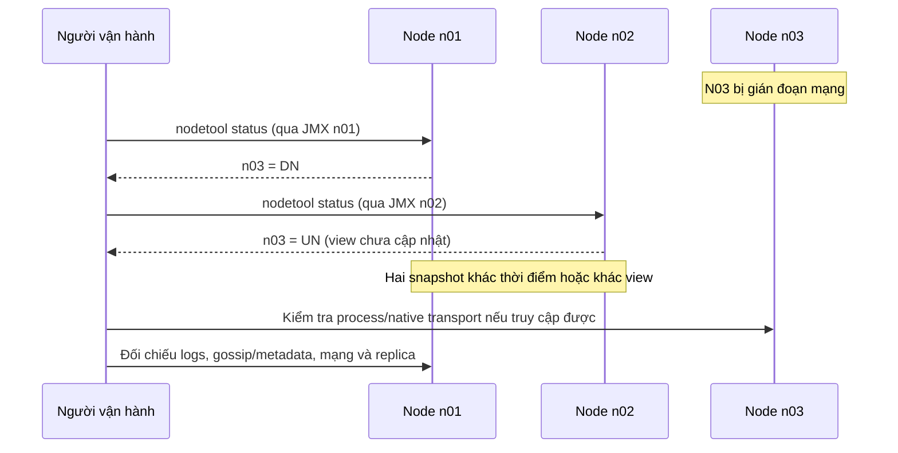
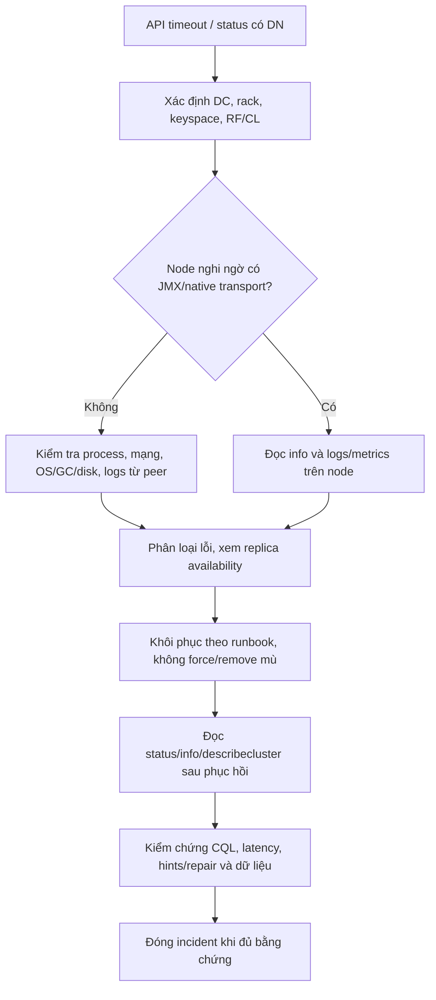

# nodetool status/info/describecluster và đọc trạng thái cụm

Khi một API Java gặp `UnavailableException` hoặc `ReadTimeoutException`, câu hỏi đầu tiên của người vận hành Apache Cassandra thường là: **“Những node nào đang tham gia cụm, coordinator và replica có khỏe không, topology có đúng như thiết kế không?”** Ba lệnh `nodetool status`, `nodetool info` và `nodetool describecluster` cung cấp những lát cắt bổ sung cho nhau. Tuy nhiên, thấy toàn bộ node ở trạng thái **`UN` (Up/Normal)** không đồng nghĩa mọi replica đã có cùng dữ liệu, repair hoàn tất, ứng dụng có thể ghi ở mọi consistency level hay CPU/đĩa/mạng đều khỏe.

Bài thuộc chương **Công cụ vận hành** trong mô-đun **DATABASE_ENGINE_WIDE_COLUMN_CASSANDRA**. Ta học cách đọc đúng trạng thái phân tán và mô hình wide-column, xác định sự liên quan giữa token, partition key, placement, replication factor (RF), consistency level (CL), rồi kết hợp quan sát từ `nodetool` với CQL, compaction, repair, JVM/OS metrics và Java Driver để điều tra sự cố mà không làm thay đổi dữ liệu.

**Thông điệp chính:** ba lệnh này là **snapshot quan sát**, không phải một phép kiểm tra duy nhất chứng nhận “cluster healthy”. Cần biết chúng chạy ở node nào, lúc nào, phiên bản nào, và thông tin nào còn thiếu.

## 1. Mục tiêu học tập

Sau bài này, bạn có thể:

1. Giải thích khác biệt về phạm vi giữa `status` (vòng token và các thành viên), `info` (node được hỏi) và `describecluster` (metadata/sơ đồ cụm).
2. Đọc các mã `UN`, `DN`, `UJ`, `UL`, `UM` và ý nghĩa tách biệt của **liveness** và **membership state**.
3. Giải thích các cột `Address`, `Load`, `Tokens`, `Owns (effective)`, `Host ID`, `Rack`; biết khi nào cần truyền keyspace để diễn giải ownership.
4. Sử dụng `info` để kiểm tra trạng thái gossip/native transport, heap, uptime, exception counters và các chỉ số node với đúng giới hạn.
5. Sử dụng `describecluster` để đối chiếu cluster name, snitch, partitioner và schema versions; nhận ra dấu hiệu cần điều tra metadata/schema disagreement.
6. Phân tích RF/CL và miền lỗi để biết **một node Down** ảnh hưởng tới yêu cầu đọc/ghi nào.
7. Xây quy trình chẩn đoán khi node Down/Joining/Leaving hoặc Java Driver báo timeout, và xác nhận kết quả bằng nhiều tín hiệu độc lập.
8. Thực hành `nodetool`, CQL và Java Driver 4.x trong lab không sử dụng các thao tác destructive đối với topology.

## 2. Ba lệnh trả lời ba câu hỏi khác nhau

| Lệnh | Câu hỏi chính | Góc nhìn mặc định | Điều **không** chứng minh |
| --- | --- | --- | --- |
| `nodetool status` | Những node nào được thấy trong ring, Up/Down và trạng thái Joining/Normal/Leaving/Moving? | Node mà `nodetool` kết nối qua JMX, nhìn trạng thái membership/gossip và ring. | Mọi replica đồng bộ dữ liệu, query p99 đạt SLA, repair/streaming xong, đủ quorum cho mọi keyspace. |
| `nodetool info` | Node đang được hỏi có identity, heap, tải và dịch vụ nội bộ như thế nào? | **Một** Cassandra process/node; nhiều số liệu mang tính thời điểm hoặc tính từ lần khởi động. | Sức khỏe của node khác, latency của từng truy vấn hay dung lượng toàn cluster. |
| `nodetool describecluster` | Cụm nhận diện tên/partitioner/snitch và schema versions ra sao? | Metadata cluster được node được hỏi biết ở thời điểm chạy. | Dữ liệu SSTable của mọi replica giống nhau, schema chắc chắn đồng thuận ở tất cả node đã mất kết nối, topology chuyển đổi đã nghiệm thu hoàn chỉnh. |

Ba lệnh tương đối **đọc-only**: chúng dùng để quan sát chứ không tự làm decommission, remove, repair, flush hay compaction. Chúng vẫn cần quyền truy cập quản trị phù hợp và có thể tạo tải JMX nhỏ; không gọi liên tục với tần suất vô hạn trong một hệ thống đang quá tải.

### Quy tắc đọc một snapshot

```text
  Một dòng "UN" trong status
       │
       ├── Liveness: node được nhìn là Up
       ├── Membership: node đang Normal
       │
       ├── CHƯA suy ra: replica dữ liệu đã giống nhau
       ├── CHƯA suy ra: mọi keyspace đạt RF như thiết kế
       ├── CHƯA suy ra: repair/hints đã hoàn tất
       ├── CHƯA suy ra: read/write p99 hoặc disk/GC bình thường
       └── CHƯA suy ra: ứng dụng ở DC khác thấy mutation mới ngay
```

Điều này quan trọng với Cassandra vì **ghi** có thể thành công khi đủ phản hồi theo CL nhưng một replica tạm bỏ lỡ mutation, và **đọc** có thể trả dữ liệu từ một tập replica mà không động tới replica còn thiếu.

## 3. Chuẩn bị: phiên bản, quyền, JMX và điểm quan sát

`nodetool` là công cụ quản trị kết nối tới Cassandra qua **JMX**. Nó không tương đương `cqlsh` (sử dụng native protocol/CQL) và không phải Java Driver API gọi câu SELECT. Hãy biết rõ node nào đang là **đích JMX** khi chạy lệnh.

### Lệnh cơ bản

```bash
# Trên một node được cấp quyền vận hành:
nodetool status
nodetool info
nodetool describecluster

# Kiểm tra help/cú pháp đúng bản Cassandra đang chạy:
nodetool help status
nodetool help info
nodetool help describecluster
```

Trong môi trường có nhiều node, có thể cần chỉ định host JMX qua tùy chọn hỗ trợ như `-h`, credential/TLS và port theo chính sách. **Không** mở JMX không xác thực ra Internet hoặc đặt mật khẩu vào câu lệnh được ghi vào lịch sử shell. Cấu hình từ xa cần tuân thủ RBAC, TLS/firewall, audit và hướng dẫn của bản triển khai.

### Bốn thông tin phải ghi vào biên bản

1. **Đang kết nối tới node nào?** Tên máy/IP của node JMX được hỏi; khi lỗi node Down, thường chạy `status` trên một **node còn sống**, không kỳ vọng JMX của node Down luôn truy cập được.
2. **Lúc nào?** Timestamp UTC, phiên bản Cassandra và công cụ; các snapshot cách nhau vài giây có thể phản ánh trạng thái gossip khác nhau.
3. **Keyspace nào?** Khi phân tích ownership và RF, dùng `nodetool status <keyspace>` nếu phiên bản hỗ trợ, thay vì suy từ vòng token toàn cluster.
4. **Định nghĩa “healthy” là gì?** Phải gắn với SLA, DC/rack, RF/CL, repair và kết quả CQL; `UN` là một tín hiệu, không phải tiêu chuẩn nghiệm thu duy nhất.

### Nếu lệnh `nodetool` thất bại

Lỗi không kết nối được JMX **chưa chứng minh** Cassandra native protocol đã Down. Cần phân biệt JMX port/auth/TLS, firewall, JVM đang stall, host/network lỗi, process Cassandra không chạy hoặc công cụ không tương thích phiên bản. Đối chiếu service/process, driver/native transport, node logs và lệnh từ một node khác trước khi tuyên bố cluster Down.

## 4. `nodetool status`: đọc bảng ring theo từng cột

Ví dụ **đầu ra giả định** dưới đây mô phỏng cụm có hai DC, mỗi DC ba node; keyspace lab dùng `NetworkTopologyStrategy` RF = 3 ở mỗi DC. Các địa chỉ, host ID, dung lượng và số token **không phải** số đo từ môi trường thật.

```text
$ nodetool status ops_status_lab

Datacenter: dc1
===============
Status=Up/Down
|/ State=Normal/Leaving/Joining/Moving
--  Address      Load       Tokens  Owns (effective)  Host ID                               Rack
UN  10.0.1.11    281.4 GiB  16      100.0%            11111111-1111-4111-8111-111111111111  rack1
UN  10.0.1.12    279.0 GiB  16      100.0%            22222222-2222-4222-8222-222222222222  rack2
UN  10.0.1.13    291.3 GiB  16      100.0%            33333333-3333-4333-8333-333333333333  rack3

Datacenter: dc2
===============
Status=Up/Down
|/ State=Normal/Leaving/Joining/Moving
--  Address      Load       Tokens  Owns (effective)  Host ID                               Rack
UN  10.0.2.21    266.1 GiB  16      100.0%            44444444-4444-4444-8444-444444444444  rack1
UN  10.0.2.22    270.0 GiB  16      100.0%            55555555-5555-4555-8555-555555555555  rack2
UN  10.0.2.23    268.5 GiB  16      100.0%            66666666-6666-4666-8666-666666666666  rack3
```

Với RF=3 **và đúng ba node trong mỗi DC**, mỗi node có thể lưu bản sao cho toàn bộ dữ liệu thuộc keyspace đó trong DC tương ứng, nên `Owns (effective)` bằng 100% trong ví dụ là **có chủ ý**. **Không cộng sáu số 100% rồi cho rằng có 600% token ring**; đây là tỷ lệ hiệu dụng xét replication, không phải tỷ lệ token không có bản sao. Khi thêm node, đổi RF hoặc chọn keyspace khác, tỷ lệ có thể đổi.

### Giải nghĩa các cột

| Cột | Ý nghĩa | Lưu ý để không hiểu nhầm |
| --- | --- | --- |
| **Datacenter** | Tên DC được snitch/topology gán. | Ứng dụng Java chọn `localDatacenter` phải phù hợp; nhầm DC gây routing/latency và CL khác kỳ vọng. |
| **Hai ký tự `UN`/`DN`...** | Ký tự đầu: Up/Down; ký tự hai: Normal/Joining/Leaving/Moving. | Tình trạng nhìn từ node đang được hỏi có tính phân tán và có thể trễ; không phải health check hoàn chỉnh. |
| **Address** | Endpoint/địa chỉ node được công cụ hiển thị. | IPv4/IPv6, broadcast endpoint, NAT hoặc cách in tên host có thể khác giữa bản triển khai. |
| **Load** | Ước lượng dung lượng dữ liệu Cassandra trên node theo phép đo của công cụ. | Không phải RAM, dung lượng filesystem còn trống, disk IOPS hay tổng dung lượng logical data của cluster. |
| **Tokens** | Số token node giữ, thường phản ánh số vnode/token assignments. | Không phải số partition, số replica, số CPU hoặc mức tải cần cân bằng. |
| **Owns (effective)** | Phần dữ liệu/token range được node sở hữu theo replication của keyspace chọn. | Cần keyspace/RF để hiểu; có thể là `?` hoặc khó diễn giải nếu không chọn keyspace phù hợp. |
| **Host ID** | UUID định danh node trong cluster metadata. | Quan trọng khi replace/rebuild; địa chỉ IP giống nhau chưa chắc là cùng node identity hợp lệ. |
| **Rack** | Miền lỗi/rack do snitch báo. | Không tự chứng minh node ở các AZ/vùng điện độc lập; cần đối chiếu hạ tầng thực tế. |

### Tại sao mỗi node có nhiều token?

Khi dùng vnodes, một node có thể sở hữu nhiều đoạn token ring. Điều này giúp phân bổ ownership và cho phép stream theo nhiều ranges, nhưng khi thêm/rút **một** node có thể phải chuyển dữ liệu của **nhiều token ranges**. `Tokens = 16` trong bảng không có nghĩa chỉ có 16 partition trên node hoặc 16 câu SELECT chạy đồng thời.

### Phân biệt Load và disk headroom

Hai node cùng `Load = 280 GiB` có thể có free disk khác nhau do dung lượng volume, snapshot/backup, file tạm, các mount khác hoặc metadata. Muốn quyết định node có đủ chỗ bootstrap/repair/compaction không, cần `df`, metrics disk/cgroup và kích thước SSTable/snapshot, **không** dùng `Load` đơn độc.

## 5. Mã trạng thái: Up/Down khác Normal/Joining/Leaving/Moving

`nodetool status` hiển thị hai chiều:

- **Ký tự thứ nhất — liveness:** `U` = Up, `D` = Down **theo góc nhìn membership/gossip**.
- **Ký tự thứ hai — membership phase:** `N` = Normal, `J` = Joining, `L` = Leaving, `M` = Moving.

| Mã | Diễn giải | Cần kiểm tra tiếp |
| --- | --- | --- |
| **`UN`** | Node được xem là Up và Normal. | RF/CL, read/write latency, repair/hints, disk/GC, dữ liệu đại diện. |
| **`DN`** | Node bị xem là Down nhưng metadata vẫn coi ở trạng thái Normal. | Process/network/JMX, replica ranges, quorum còn lại, outage timeline. |
| **`UJ`** | Node đang Up và Joining/bootstrap. | Streaming, token ranges/pending replicas, nguồn dữ liệu, disk headroom, kết quả cuối. |
| **`DJ`** | Node đang được xem Down trong khi Join chưa hoàn tất. | Phân loại lỗi bootstrap, không tự xóa data directory hay force remove. |
| **`UL`** | Node đang Up và Leaving/decommission. | Dữ liệu chuyển đi, node đích, quorum sau khi rời, trạng thái metadata. |
| **`DL`** | Node bị xem Down giữa quá trình Leaving. | Runbook recovery theo version, phạm vi streaming đã/chưa hoàn tất. |
| **`UM`** | Node đang Up và Moving, nếu phiên bản/kiểu token hỗ trợ. | Token range cũ/mới, streaming, rủi ro overlap chuyển động. |
| **`DM`** | Node Down trong quá trình Moving nếu trạng thái này được thể hiện. | Cần xử lý sự cố topology đang dang dở, không đoán bằng một lệnh force. |

Các mã cụ thể có thể không xuất hiện trên mọi version/topology workflow. Cassandra 5.x có cơ chế **Cluster Metadata (TCM)** khác một số bản cũ; khi CLI và metadata thể hiện trạng thái khác nhau, tra log/công cụ **đúng phiên bản** thay vì giả định cùng một luồng xử lý ở 3.x, 4.x và 5.x.

### `UN` là điều kiện cần trong nhiều runbook, không phải điều kiện đủ

Một node vừa bootstrap thành `UN` có thể:

- Đã hoàn tất một bước membership nhưng vẫn cần hậu kiểm streaming/repair/cleanup theo quy trình;
- Có dữ liệu SSTable chưa compact hoặc disk pressure sau streaming;
- Nhận ghi/đọc ở CL nào đó nhưng còn lệch dữ liệu lịch sử vì repair chưa bao phủ;
- Đang chịu GC pause/CPU saturation mà gossip vẫn coi là Up;
- Đang có client kết nối tới DC không mong muốn hoặc token routing metadata chưa được cập nhật ở vài client.

Muốn tuyên bố “đã hoàn tất thay đổi topology”, cần xác nhận **metadata + streaming + replica coverage + data correctness + p95/p99**, không chỉ `UN`.

## 6. Tỷ lệ Owns (effective) cần gắn với keyspace và RF

Không nên đọc `Owns (effective)` như mức CPU/disk load hay tỷ lệ cân bằng đơn giản. Cassandra dùng partitioner để ánh xạ partition key → token; chiến lược replication quyết định node nào lưu **bản sao của token range**. Tỷ lệ sở hữu hiệu dụng vì vậy phụ thuộc cả token layout và replication, đặc biệt khi dùng `NetworkTopologyStrategy` nhiều DC.

### So sánh hai cách quan sát

```bash
nodetool status
nodetool status ops_status_lab
```

Lệnh đầu có thể in ownership chưa tính hiệu dụng cụ thể (chẳng hạn `?` ở cột tương ứng, tùy version/cấu hình). Lệnh thứ hai yêu cầu tính theo **replication của keyspace** `ops_status_lab`. Khi so hai lần, hãy lưu rõ **có/không truyền keyspace**, vì tỷ lệ không nhất thiết cùng ý nghĩa.

### Ví dụ khái niệm

| Topology được giả định | Cách hiểu an toàn |
| --- | --- |
| `dc1` ba node, RF = 3 | Mỗi partition có ba bản sao cục bộ; mỗi node có thể có ownership hiệu dụng rất lớn, thậm chí 100% cho keyspace DC đó. |
| `dc1` sáu node, RF = 3 | Mỗi partition chỉ có ba replica trong sáu node, ownership hiệu dụng phân tán theo token/rack placement; không suy mỗi node sở hữu đúng 50% nếu token/placement lệch. |
| Hai DC `dc1:3, dc2:3` | Số liệu ownership còn liên quan replication theo từng DC; không cộng các phần trăm trên các DC để tính “ring còn bao nhiêu % rảnh”. |
| Node vừa bootstrap/decommission | Token ranges, pending ownership và dữ liệu đang stream có thể khiến snapshot tỷ lệ chưa tương ứng trạng thái đích ổn định. |

**Không dùng Owns để chọn “xóa bớt node đang ít tải”.** Phải xét node/rack availability, RF, CL, dung lượng, disk I/O, pending ranges và lịch repair; một node có Load thấp vẫn có thể là replica cần thiết của hot partition.

## 7. `nodetool info`: thông tin của **một node**, không phải cả cụm

Trên node cần khảo sát:

```bash
nodetool info
```

Một số trường thường thấy tùy phiên bản/phân phối:

```text
ID                     : 11111111-1111-4111-8111-111111111111
Gossip active          : true
Native Transport active: true
Load                   : 281.4 GiB
Generation No          : ...
Uptime (seconds)       : ...
Heap Memory (MB)       : ... / ...
Off Heap Memory (MB)   : ...
Data Center            : dc1
Rack                   : rack1
Exceptions             : ...
Key Cache              : ...
Row Cache              : ...
Counter Cache          : ...
```

Đây là **mẫu trường minh họa**, không phải output đầy đủ bắt buộc. Một số bản có phần cache metrics, tỷ lệ repaired, token hoặc fields khác; một số trường có thể vắng mặt/đổi cách hiển thị.

| Trường | Điều cung cấp | Cần đối chiếu với |
| --- | --- | --- |
| **ID** | Host ID của node, để so với `Host ID` trong `status`. | Topology/replace/rebuild history, không chỉ IP. |
| **Gossip active** | Trạng thái subsystem gossip tại node. | View từ các peers; gossip active không nghĩa mọi peer có thể liên lạc. |
| **Native Transport active** | CQL native transport tại node có đang active không. | Client `9042` connectivity, auth/TLS, driver pool và query success; không chỉ nhìn cờ true. |
| **Load** | Tổng dữ liệu cục bộ theo báo cáo Cassandra. | `df` và metrics disk/volume, không dùng như free disk. |
| **Generation No** | Dấu hiệu thế hệ gossip/startup theo cơ chế phiên bản. | Uptime/log restart, không dùng như “số lần repair”. |
| **Uptime** | Node process đã chạy bao lâu. | Incident timeline; vừa restart không đồng nghĩa đã bootstrap hoặc repair xong. |
| **Heap Memory** | Heap JVM đang dùng và dung lượng heap được báo cáo. | GC log, allocation, native/RSS/cgroup/page cache; heap không phải toàn RAM. |
| **Off Heap Memory** | Một phần bộ nhớ ngoài heap do Cassandra theo dõi. | RSS/cgroup/direct buffers; có thể **không** gồm mọi native memory. |
| **Data Center / Rack** | Labels mà snitch/node báo. | `status`, hạ tầng AZ/rack, RF NTS và Java local DC. |
| **Exceptions** | Counter exceptions node theo phạm vi mà phiên bản cung cấp. | Rate theo thời gian, `system.log`, thời điểm restart; không suy mọi exception đều là request failure. |
| **Cache metrics** | Một phần hiệu quả key/row/counter cache khi bật. | Hit rate, miss và workload; tăng cache không tự sửa query partition sai. |

### Giải thích ba tình huống dễ nhầm

**Tình huống 1 — Gossip active=true nhưng driver không kết nối được:** kiểm tra native transport, TLS/auth, firewall, listen/broadcast address, connection pool hoặc CPU/GC. Gossip dùng cơ chế/giao thức khác native protocol, nên hai trạng thái không tương đương.

**Tình huống 2 — Native Transport active=true nhưng `ReadTimeout`:** node có thể nhận kết nối CQL nhưng replica đích chậm/Down, disk saturated, `LOCAL_QUORUM` không đủ phản hồi hoặc query quét tombstone. Đây là vấn đề khả dụng/latency đường đọc chứ không đơn giản là “port 9042 mở”.

**Tình huống 3 — Heap còn nhiều nhưng node disk chậm:** heap chỉ là một phần RAM. OS page cache, off-heap, compaction, IOPS và SSTable reads cần được quan sát riêng. Không tăng Xmx chỉ vì một trường `Heap Memory` trong snapshot.

## 8. `nodetool describecluster`: nhận diện cụm và schema versions

```bash
nodetool describecluster
```

Một đầu ra **minh họa** có thể bao gồm:

```text
Cluster Information:
  Name: Cassandra Lab
  Snitch: org.apache.cassandra.locator.GossipingPropertyFileSnitch
  DynamicEndPointSnitch: enabled
  Partitioner: org.apache.cassandra.dht.Murmur3Partitioner
  Schema versions:
    77777777-7777-4777-8777-777777777777: [10.0.1.11, 10.0.1.12, 10.0.1.13,
                                            10.0.2.21, 10.0.2.22, 10.0.2.23]
```

Các tên trường, group và cách in cụ thể **khác theo Cassandra release**. Ví dụ không hàm ý GUID schema là một ID có ý nghĩa nghiệp vụ. Trên một số phiên bản/trạng thái, schema version có thể được thể hiện với thông tin đặc biệt hoặc chưa ổn định; không tự gán “schema disagreement” chỉ vì một dòng không khớp chính xác ví dụ.

### Cần đọc gì ở từng trường?

| Trường | Ý nghĩa vận hành | Không nên kết luận |
| --- | --- | --- |
| **Name** | Tên cụm, giúp phát hiện đang kết nối nhầm cluster dev/staging/prod. | Tên giống nhau không chứng minh mọi node thuộc cùng membership khỏe mạnh. |
| **Partitioner** | Cách chuyển partition key thành token, ví dụ `Murmur3Partitioner`. | Không quyết định RF và không thay thế snitch/rack placement. |
| **Snitch** | Cách Cassandra nhận diện DC/rack/topology phục vụ replica placement. | Class snitch đúng không đảm bảo file/cấu hình từng node khai báo DC/rack đúng. |
| **DynamicEndpointSnitch** | Tính năng hỗ trợ chọn replica tốt cho đọc trong một số cấu hình. | Không làm consistency mạnh hơn, không thay dữ liệu hoặc repair. |
| **Schema versions** | Các phiên bản schema được quan sát qua cluster metadata ở thời điểm chụp. | Một phiên bản chung không bảo đảm data values trên SSTable đồng nhất hay mỗi node Down đã nhận cập nhật schema mới. |

### Schema agreement là gì và có giới hạn nào?

Khi tạo/đổi bảng/keyspace, schema metadata cần được các thành viên liên quan nhận biết nhất quán. Nếu `describecluster` hiển thị **nhiều schema versions** trên các node được quan sát sau thời gian hội tụ bình thường:

1. Ghi lại **node nào thuộc version nào**, DC/rack và thời điểm.
2. Đối chiếu `status` và network/gossip: có node Down/Joining, đường liên DC mất kết nối hoặc thay đổi topology không?
3. Đối chiếu CQL `DESCRIBE KEYSPACE`/DDL mong đợi và ứng dụng: có sự cố `UNPREPARED`, schema mismatch hoặc migration đang chạy?
4. Kiểm tra log và trạng thái cluster metadata với công cụ **đúng phiên bản**; Cassandra 5.x sử dụng cơ chế metadata/schema hiện đại khác một số bản cũ.
5. Không phát thêm `ALTER TABLE`/schema migration chồng lấn hoặc chỉnh system tables thủ công để “đồng bộ nhanh” khi chưa xác định nguyên nhân.

**Schema agreement khác replica consistency.** Hai node có thể cùng định nghĩa bảng nhưng chứa dữ liệu cũ/mới khác nhau vì bỏ lỡ mutation; việc đó thuộc phạm vi replication/hints/repair. Ngược lại, schema disagreement có thể tồn tại khi phần lớn truy vấn đọc dữ liệu cũ vẫn chạy.

## 9. Đọc một cụm như một hệ thống phân tán: nhiều góc nhìn

Cassandra sử dụng cơ chế membership/gossip (và metadata/topology workflows tùy phiên bản). Vì cập nhật và lỗi mạng không đồng thời được mọi node nhìn thấy, hai lệnh `status` từ hai node khác nhau có thể **tạm báo khác nhau**.



Đây là kịch bản khái niệm, không phải một chuỗi RPC cố định. **Nếu hai view mâu thuẫn**, đừng chọn view “đẹp hơn” để đóng ticket. Ghi thời gian/cặp node, kiểm tra tính ổn định theo nhiều lần quan sát có giới hạn, driver và network/JVM logs.

### Tam giác bằng chứng

| Nguồn | Có thể trả lời | Phải kết hợp với |
| --- | --- | --- |
| **`status` từ 1–2 node khỏe** | Membership/liveness/topology view. | Peer logs, health của node đang nghi ngờ, CQL CL/replica. |
| **`info` trên node nghi ngờ** | Local gossip/native transport/JVM/uptime và identity. | OS/JVM metrics, client connectivity và kết quả CQL. |
| **`describecluster`** | Cluster identity, snitch/partitioner/schema versions. | Schema metadata/DDL, topology workflow, log migration. |
| **Java Driver metadata/metrics** | Endpoint driver biết, node state, DC, request coordinator, latency/retry. | Không thay thế server ring/repair status; driver cũng có view cập nhật theo thời gian. |
| **CQL + quan sát bảng** | Truy vấn với partition key/CL có trả đúng dữ liệu đại diện không? | Không đủ kiểm chứng mọi replica/token ranges chỉ bằng một SELECT. |
| **Server log/OS/JMX metrics** | CPU, GC, disk, network, streaming, compaction/repair, exceptions. | Cần khung giờ và correlation; không một biểu đồ chứng minh nguyên nhân. |

## 10. Từ trạng thái node đến khả năng chịu lỗi: RF và CL

Giả sử keyspace có `NetworkTopologyStrategy` với RF = 3 trong `dc1`, ba node thuộc ba rack khác nhau; một partition được sao chép lên ba replica A/B/C:

```text
DC dc1, RF = 3, một partition P
Replica A: UN
Replica B: UN
Replica C: DN

LOCAL_ONE    : yêu cầu 1 replica ở dc1, có thể tiếp tục nếu A hoặc B phản hồi.
LOCAL_QUORUM : floor(3/2) + 1 = 2; có thể tiếp tục nếu A và B phản hồi.
ALL          : cần cả 3 replica, không thể hoàn tất khi C thật sự không khả dụng.
```

Đây là **điều kiện đếm replica cho một partition**, không phải cam kết rằng request sẽ thành công: A/B có thể chậm vì disk/GC/network, schema hoặc coordinator có lỗi, nên vẫn có thể xảy ra `ReadTimeout`/`WriteTimeout`. Nếu node còn sống nhưng không giữ partition P, nó **không** thay thế tự động một replica của P.

### Phân biệt CL và DC

Với hai DC `dc1:3, dc2:3`:

| Consistency | Những phản hồi cần thiết | Khi một node dc2 Down |
| --- | --- | --- |
| `LOCAL_ONE` tại dc1 | 1 replica cục bộ của partition. | Có thể không ảnh hưởng trực tiếp thời điểm ack tại dc1, nhưng ảnh hưởng dữ liệu/DR ở dc2. |
| `LOCAL_QUORUM` tại dc1 | 2 replica trong dc1. | Vẫn có thể ack cục bộ; **không** chứng minh dc2 đã bắt kịp. |
| `LOCAL_QUORUM` tại dc2 | 2 replica trong dc2. | Có thể còn đủ với 2/3 UP, nhưng không còn dư nhiều khả năng chịu lỗi. |
| `QUORUM` tổng RF=6 | 4 replica trên tổng sáu. | Phải xét những replica thực sự phản hồi, không suy `QUORUM` nghĩa là 2+2 ở mỗi DC. |
| `EACH_QUORUM` (write) | Quorum trong **mỗi DC** (2 tại dc1 và 2 tại dc2). | Chịu ảnh hưởng trực tiếp nếu dc2 không đủ quorum; WAN có thể trên đường chờ. |

**Đọc `status` phải gắn với một keyspace và loại request.** “Cluster còn 5/6 node Up” là con số quá thô nếu không biết RF/CL và key nào nằm trên những replica nào.

### Rack/AZ là miền lỗi cần kiểm tra

Ba node `UN` đặt cùng rack có thể cùng mất điện/hạ tầng. `Rack` trong `status` là label từ snitch; phải đối chiếu với vị trí vật lý/AZ thực. Muốn đánh giá chịu mất một rack, xác định có những partition nào có replica cùng rack và RF/CL sẽ còn đáp ứng nếu rack đó mất; không chỉ nhìn số lượng node.

## 11. Lab CQL: quan sát topology và dữ liệu theo partition

**Điều kiện:** lab có hai DC thật sự tên `dc1` và `dc2`, mỗi DC ít nhất ba node, quyền dùng `cqlsh` và `nodetool`. Nếu chỉ có một DC/nút, chỉnh ví dụ RF trong **lab** cho phù hợp; không đổi RF của production để chạy bài. Các bước đầu là **đọc-only**; CREATE/INSERT chỉ làm trên keyspace được cấp riêng cho thực hành.

### Bước 1 — Chụp baseline toàn cụm

```bash
nodetool status
nodetool info
nodetool describecluster

# Kiểm tra theo keyspace sau khi tạo ở bước tiếp theo.
# nodetool status ops_status_lab
```

Ghi lại thời gian UTC, node JMX, Cassandra version, số node theo DC/rack, Host IDs, trạng thái hiện tại, Load và số Tokens. Không điền `SUCCESS` chỉ vì tất cả node `UN`; xem lệnh `info` trên ít nhất các node đại diện và `describecluster` để so cluster name/schema.

### Bước 2 — Tạo keyspace và bảng theo truy vấn

```sql
CREATE KEYSPACE IF NOT EXISTS ops_status_lab
WITH replication = {
  'class': 'NetworkTopologyStrategy',
  'dc1': 3,
  'dc2': 3
}
AND durable_writes = true;

CREATE TABLE IF NOT EXISTS ops_status_lab.events_by_tenant_day (
  tenant_id text,
  event_day date,
  event_time timestamp,
  event_id uuid,
  event_type text,
  PRIMARY KEY ((tenant_id, event_day), event_time, event_id)
) WITH CLUSTERING ORDER BY (event_time DESC, event_id DESC);

CONSISTENCY LOCAL_QUORUM;

INSERT INTO ops_status_lab.events_by_tenant_day
  (tenant_id, event_day, event_time, event_id, event_type)
VALUES ('tenant-lab', '2026-11-21', '2026-11-21T08:00:00+0000',
        11111111-1111-4111-8111-111111111111, 'BASELINE');
```

**Giải thích:** `(tenant_id, event_day)` là partition key; `event_time, event_id` là clustering columns. CQL `LOCAL_QUORUM` ghi từ coordinator trong một DC không đợi quorum ở DC khác, nên đọc ngay ở DC còn lại có thể **tạm thấy dữ liệu cũ/thiếu** nếu replication chưa hội tụ. Việc có đủ node `UN` chỉ là điều kiện topology ban đầu, không thay sự kiểm tra kết quả.

### Bước 3 — Đọc lại trạng thái theo keyspace

```bash
nodetool status ops_status_lab
nodetool describecluster
```

Đối chiếu `Owns (effective)` theo NTS/RF3+3, phân bố rack và kết quả schema versions sau DDL. Nếu `describecluster` có nhiều schema versions ngay sau CREATE, cần cho cluster thời gian hội tụ và kiểm tra có node lỗi hay không; **không** phát lệnh thay schema lặp lại vô hạn chỉ để hết cảnh báo.

### Bước 4 — SELECT đúng một partition

```sql
CONSISTENCY LOCAL_QUORUM;

SELECT event_time, event_id, event_type
FROM ops_status_lab.events_by_tenant_day
WHERE tenant_id = 'tenant-lab'
  AND event_day = '2026-11-21'
LIMIT 20;
```

Với RF3+3 và đủ node khỏe, câu SELECT phải định vị một partition logic. Nếu muốn kiểm tra từ **cả hai DC**, mở hai phiên `cqlsh` kết nối tới coordinator **đã xác nhận thuộc từng DC** và chạy cùng query. Một SELECT ở dc1 trả kết quả đúng không chứng minh mọi replica ở dc2 đã nhận mutation tại cùng thời điểm.

### Bước 5 — Tìm metadata qua CQL (tham khảo)

```sql
-- Node coordinator/local mà cqlsh đang kết nối (tùy phiên bản):
SELECT cluster_name, host_id, data_center, rack
FROM system.local;

-- Kiểm tra DDL/replication theo hỗ trợ của cqlsh:
DESCRIBE KEYSPACE ops_status_lab;
```

Ở một số release có `system.peers` hoặc `system.peers_v2` để quan sát thông tin node đồng cấp; schema các bảng hệ thống có thể khác theo phiên bản và cơ chế metadata. **Không sửa system tables thủ công.** Kết quả CQL metadata chỉ là bổ sung; không thay `nodetool status/info/describecluster` và cluster logs khi đang có sự cố membership.

### Bước 6 — Thử tình huống bất thường **trên giấy**

Không dừng node hoặc thực hiện decommission/removenode trong bài lab bắt buộc này. Hãy đổi **bản sao output giả lập** thành:

```text
dc1: n01=UN, n02=UN, n03=DN
dc2: n04=UN, n05=UN, n06=UN
RF: dc1=3, dc2=3
CL ghi ứng dụng tại dc1: LOCAL_QUORUM
```

Đánh giá liệu hai replica dc1 còn sống có thể đạt quorum, còn dư khả năng chịu thêm một lỗi không, `info` trên n03 có truy cập được không, và phải dùng những metrics/log nào trước khi tuyên bố node thực sự hỏng.

## 12. Quy trình sự cố: một node từ `UN` sang `DN`

### Các bước điều tra không phá dữ liệu

1. **Ghi time window và góc nhìn:** chạy `nodetool status` từ một node còn sống, lưu node nguồn và timestamp UTC; đối chiếu một peer khỏe khác nếu cần.
2. **Xác định mức độ ảnh hưởng:** node DN ở DC/rack nào, có giữ replica của các partition ứng dụng đang lỗi không, RF và CL cho những keyspace nào?
3. **Kiểm tra node nghi ngờ:** host/process/JVM nếu được phép, native port, JMX, disk free/IOPS, GC pause, CPU/heap, network peer connectivity; đừng gọi JMX unreachable là bằng chứng duy nhất.
4. **Đối chiếu log:** Cassandra `system.log`/GC logs, kernel/OS logs, network events, error class Java Driver và latency theo coordinator/replica.
5. **Kiểm tra các nguồn biến động khác:** repair/streaming/compaction/flush, bootstrap/decommission, deploy schema, disk-full, WAN/rack failure.
6. **Giữ nguyên correctness:** không hạ consistency hoặc giảm RF vô điều kiện; không `removenode` một node có thể quay lại trước khi biết trạng thái và runbook đúng.
7. **Phục hồi theo loại lỗi:** restart service, sửa mạng/đĩa hoặc replace/rebuild chỉ theo quy trình vận hành của version; theo dõi mutation chưa tới và dữ liệu tombstone.
8. **Nghiệm thu:** node trở lại `UN` là một bước, nhưng còn cần kiểm tra CL, ứng dụng, repair/hints và dữ liệu đại diện trên các ranges.



### Vì sao không chỉ đếm node còn Up?

Một cluster có mười node nhưng partition nóng chỉ nằm trên ba replica A/B/C. Nếu B/C đều DN, số node Up toàn cluster vẫn là tám; `LOCAL_QUORUM` của partition đó **không thể** đạt quorum RF3. Trái lại, một node DN không thuộc tập replica của partition đang đọc có thể không ảnh hưởng trực tiếp yêu cầu đó. Cần ánh xạ **partition/token → replica set**, không chỉ đếm tổng số node.

## 13. Kịch bản Joining/Leaving: cần phối hợp với streaming

Thay đổi topology làm chuyển ownership dữ liệu. `status` có thể báo `UJ` hoặc `UL`, nhưng nó **không** ghi toàn bộ tiến độ từng SSTable/range. Bổ sung:

```bash
nodetool netstats
nodetool compactionstats
nodetool tpstats
nodetool status
nodetool describecluster
```

| Tín hiệu | Khi thấy `UJ` | Khi thấy `UL` |
| --- | --- | --- |
| **Membership** | Node mới đang join; không tính là replica ổn định chỉ từ trạng thái Up. | Node cũ đang rời; đánh giá RF/CL và nguồn dữ liệu trước khi nó biến mất. |
| **Streaming** | Kiểm tra node nguồn/đích, bytes/ranges, lỗi peer và disk headroom. | Xác nhận dữ liệu/ownership được chuyển cho replica còn lại đúng runbook. |
| **Tài nguyên** | Disk đích và source read I/O có thể tăng, network/GC/p99 bị ảnh hưởng. | Data stream, compaction và network có thể tranh với traffic. |
| **Điều kiện kết thúc** | Membership Normal + stream thành công + replica coverage + data checks. | Node rời ring hoàn chỉnh + data/replica coverage + hậu kiểm. |
| **Thao tác nguy hiểm** | Khởi động thêm bootstrap/replace khi phase hiện tại chưa rõ. | Tắt cưỡng bức node đang decommission hoặc phát `removenode` thiếu đánh giá. |

`nodetool netstats` cho biết các stream **đang hoạt động**; không thấy stream trong snapshot cuối chưa tự chứng minh tất cả stream đã hoàn thành. Dùng logs và kết quả cuối của lệnh topology. Khi có session lỗi/unknown, không khởi động topology change thứ hai chỉ vì một node chuyển thành `UN`.

### Khi nào cần repair hoặc cleanup?

Sau bootstrap/decommission/replace, có thể cần **repair** để đảm bảo replica hội tụ hoặc **cleanup** để thu hồi dữ liệu không còn thuộc ownership, tùy quy trình và phiên bản. Đây không phải những lệnh thay thế nhau:

- **Repair** đối chiếu dữ liệu giữa replica và đồng bộ phần chênh lệch.
- **Cleanup** thu hồi dữ liệu cục bộ không còn thuộc phạm vi node sau topology change hợp lệ.
- **Compaction** tối ưu SSTable tại node cục bộ, không làm replica khác tự nhận mutation đã bỏ lỡ.

Các lệnh đó **có tác động tài nguyên/dữ liệu**; bài này chỉ giới thiệu ý nghĩa và cách quan sát, không yêu cầu chạy như một bước “thử xem có hết lỗi không”.

## 14. Liên kết với Java Driver 4.x: client cũng có một góc nhìn

Java Driver giữ metadata về nodes, endpoints, DC/rack và trạng thái mà driver biết. Một driver đang dùng connection pools/token-aware routing có thể có **view cập nhật muộn** so với `nodetool` tại thời điểm topology thay đổi. Ngược lại, `nodetool status` thấy node `UN` không bảo đảm client có TLS/auth đúng hoặc connection pool không bão hòa.

### Ví dụ quan sát metadata phía Java (đọc-only)

```java
import com.datastax.oss.driver.api.core.CqlSession;
import com.datastax.oss.driver.api.core.metadata.Node;

// Giả định CqlSession session đã được tạo và cấu hình contact points
// cùng localDatacenter đúng môi trường ở tầng khởi tạo ứng dụng.

for (Node node : session.getMetadata().getNodes().values()) {
    System.out.printf(
        "hostId=%s endpoint=%s dc=%s rack=%s state=%s%n",
        node.getHostId(),
        node.getEndPoint(),
        node.getDatacenter(),
        node.getRack(),
        node.getState());
}
```

Đoạn code cho biết **driver biết gì**, không chứng nhận cluster metadata tuyệt đối. `node.getState()` là trạng thái theo driver, không tương đương từng mã `UN/DN/UJ/UL/UM` của `nodetool`; driver không đảm bảo hiển thị đầy đủ phase membership.

### Ghi log request đi qua coordinator nào

```java
import java.time.LocalDate;
import com.datastax.oss.driver.api.core.ConsistencyLevel;
import com.datastax.oss.driver.api.core.cql.PreparedStatement;
import com.datastax.oss.driver.api.core.cql.BoundStatement;
import com.datastax.oss.driver.api.core.cql.ResultSet;
import com.datastax.oss.driver.api.core.cql.ExecutionInfo;

PreparedStatement select = session.prepare(
    "SELECT event_time, event_id, event_type " +
    "FROM ops_status_lab.events_by_tenant_day " +
    "WHERE tenant_id = ? AND event_day = ? LIMIT 20");

BoundStatement statement = select.bind(
    "tenant-lab", LocalDate.of(2026, 11, 21))
    .setConsistencyLevel(ConsistencyLevel.LOCAL_QUORUM)
    .setPageSize(20)
    .setIdempotent(true);

long start = System.nanoTime();
try {
    ResultSet rs = session.execute(statement);
    ExecutionInfo info = rs.getExecutionInfo();
    double elapsedMs = (System.nanoTime() - start) / 1_000_000.0;
    String coordinator = info.getCoordinator() == null
        ? "unknown" : info.getCoordinator().getEndPoint().toString();

    System.out.printf(
        "query=events_by_day.select elapsedMs=%.2f coordinator=%s " +
        "warnings=%d%n", elapsedMs, coordinator, info.getWarnings().size());
    // Duyệt kết quả theo giới hạn; nếu fetch thêm pages, đo các page riêng.
} catch (RuntimeException error) {
    System.err.println("query=events_by_day.select error="
        + error.getClass().getSimpleName());
    throw error;
}
```

**Lưu ý:**

- `ExecutionInfo.getCoordinator()` là node gửi phản hồi cho lần thực thi đã thành công; **không** phải tập replica được chọn hoặc bằng chứng repair.
- Khi driver timeout trước khi nhận response, có thể không có coordinator/tracing ID từ `ExecutionInfo`; trạng thái ghi có thể **chưa biết**. Không retry ghi tạo ID mới hoặc side effect không idempotent theo phản xạ.
- `setPageSize(20)` không đảm bảo server chỉ quét 20 hàng/tombstone. Partition key/range phù hợp là điều kiện trước.
- `LOCAL_QUORUM` không nên hạ xuống `ONE` chỉ để che sự cố node/replica. Hãy căn cứ SLA và consistency contract.
- Log `query_name`, CL, local DC, elapsed, coordinator khi biết; **không** đưa raw partition keys, bind values hoặc PII vào log/Prometheus labels.

### Khi driver và nodetool không cùng nhận định

Nếu driver vẫn coi node `DOWN` sau khi `nodetool` thấy `UN`, kiểm tra contact points, local DC, native protocol connectivity, auth/TLS, address/broadcast settings, metadata refresh, driver reconnection và logs. Không tự ép driver đánh dấu Up bằng cách sửa ring hoặc metadata server.

## 15. Bảng chẩn đoán kết hợp các công cụ vận hành

| Triệu chứng | Bắt đầu từ lệnh nào? | Cần bổ sung gì? | Kết luận tránh nhảy tới |
| --- | --- | --- | --- |
| Một node hiển thị `DN` | `status` từ node khỏe; `info` nếu node nghi ngờ còn truy cập. | Logs process/JVM/network, RF/CL, replica endpoints. | “Toàn cluster không dùng được”. |
| Java không kết nối native port | `info` để xem Native Transport; `status` để xem membership. | Firewall/TLS/auth, driver local DC và pool. | “Node DN” chỉ vì JMX hoặc TCP từ một client lỗi. |
| Heap tăng sau deploy | `info`. | GC log/JFR, RSS/off-heap/cgroup, allocation và p99. | “Cứ tăng Xmx là hết”. |
| Query chậm dù toàn `UN` | `status` + `tablestats`/`tablehistograms`. | Read latency, tombstone scans, SSTables/read, disk/GC và Java driver. | “UN = query sẽ nhanh”. |
| Node `UJ` nhiều giờ | `status` + `netstats`. | Bootstrap logs, stream bytes, disk headroom, peer health. | “Force Normal/remove rồi thử lại”. |
| Node `UL` và thêm một node Down | `status` + `describecluster`. | RF, CL, pending ranges, streaming và khả năng quorum. | “Rút tiếp node khác vì tổng số node vẫn nhiều”. |
| Sau `ALTER TABLE` có schema mismatch | `describecluster`. | CQL DDL, peers/metadata, schema agreement, logs migration. | “Repair dữ liệu sẽ sửa schema ngay”. |
| Ownership/Load lệch giữa nodes | `status <keyspace>` + `info`. | Data volume/df, token ranges, RF/rack, SSTable counts và workload. | “Owns nhỏ thì node phải được xóa”. |
| Một DC đọc dữ liệu cũ | `status` theo DC + `describecluster`. | CL, WAN/hints/repair, time of write, replica data. | “Status UN đã bảo đảm mọi DC hội tụ”. |

### Các lệnh quan sát bổ sung (không phải cùng mục đích)

```bash
nodetool tpstats
nodetool tablestats ops_status_lab.events_by_tenant_day
nodetool tablehistograms ops_status_lab events_by_tenant_day
nodetool compactionstats
nodetool netstats
```

`tpstats` dùng để xem hàng đợi/active/dropped tasks; `tablestats/tablehistograms` xem chỉ số bảng/read amplification; `compactionstats` xem compaction, `netstats` xem streaming đang chạy. Kết hợp với OS/JVM CPU/GC/disk/network; không dùng `status/info/describecluster` thay mọi monitoring.

## 16. Dashboard và cảnh báo cho ba nhóm trạng thái

Một dashboard hữu ích nên giữ riêng:

| Nhóm dashboard | Chỉ số/đầu ra | Alert có ý nghĩa |
| --- | --- | --- |
| **Membership & placement** | Node `UN/DN/UJ/UL/UM` theo DC/rack, số Host IDs, thay đổi ring, RF/keyspace. | Node Down kéo dài hoặc không đủ replica/quorum cho workload quan trọng; transition treo. |
| **Node & transport** | `info` gossip/native transport, uptime/restart, heap/GC, exceptions, connection health. | Native transport down, restarts bất thường, GC pauses và request errors tăng. |
| **Cluster metadata** | Cluster name, partitioner/snitch, schema versions, trạng thái migration/topology. | Schema disagreement kéo dài sau cửa sổ hội tụ hoặc node có DC/rack labels sai. |
| **Dữ liệu & độ trễ** | App read/write p95/p99, timeout, CL, SSTables/read, tombstone scanned, repair/hints. | SLA vi phạm đi kèm read amplification, replica trouble hoặc repair quá hạn. |
| **Bảo trì/tài nguyên** | Streaming/compaction/repair progress, disk capacity, CPU/GC, network RTT/retrans. | Pending work và tài nguyên vượt giới hạn, khả năng không hoàn tất bootstrap/repair. |

**Cảnh báo nên ghép trạng thái + tác động**. Ví dụ “n03 DN hơn ngưỡng đã thống nhất **và** dc1 RF3 chỉ còn đúng quorum” mạnh hơn alert đơn lẻ “một node không UN” đối với SLA. Nhưng một node DN vẫn cần cảnh báo riêng để phản ứng sớm vì redundancy đã giảm, kể cả khi ứng dụng chưa timeout.

### Lưu ý cardinality và an toàn

Metrics có nhãn `dc`, `rack`, `node`, `query_name` ổn định; không gắn trực tiếp `tenant_id`, raw partition key, request UUID hay thông tin nhạy cảm thành labels không giới hạn. Logs về Host ID, endpoints và cluster topology là thông tin vận hành cần kiểm soát quyền; không đưa toàn bộ `nodetool status` vào kênh công khai.

## 17. Nghiệm thu một đợt kiểm tra sức khỏe cụm

Không dùng nhãn duy nhất “GREEN nếu tất cả UN”. Đặt năm cổng nghiệm thu:

1. **Membership:** không có `DN`/Joining/Leaving/Moving ngoài kế hoạch; không có node mất liên lạc hoặc view mâu thuẫn chưa giải thích.
2. **Placement và RF/CL:** keyspace quan trọng dùng replication đúng DC/rack; các partition dự kiến còn số replica/miền lỗi phù hợp CL và khả năng chịu mất nút.
3. **Schema/topology metadata:** cluster name/snitch/partitioner đúng, schema versions/metadata không có drift kéo dài chưa xử lý, topology transitions hoàn tất.
4. **Dữ liệu và bảo trì:** repair/hints/streaming/cleanup theo phạm vi đã hoàn tất hoặc được đánh dấu chưa hoàn tất rõ ràng; đọc/ghi mẫu đúng partition không cho lỗi bất thường.
5. **Tài nguyên và SLA:** Java Driver/app p95/p99, timeout, node disk/CPU/GC/network, compaction backlog và dung lượng an toàn.

Nếu cổng 1–3 đạt nhưng repair chưa hoàn tất, ghi `TOPOLOGY_STABLE / DATA_REPAIR_PENDING` theo schema báo cáo nội bộ thay vì `FULLY_HEALTHY`. Nếu một node DN nhưng CL ứng dụng vẫn phục vụ được, trạng thái cũng không phải “mọi thứ hoàn hảo”: redundancy đã giảm.

### Mẫu biên bản (đầu ra tự thiết kế, không phải nodetool)

```text
CHECK_ID: cassandra-ops-status-2026-11-21
OBSERVER_NODE: n01 (dc1)
CHECK_TIME_UTC: [thời điểm thực]
CASSANDRA_VERSION: [phiên bản]
KEYSPACE_RF: ops_status_lab / dc1:3, dc2:3
STATUS_VIEW: 6 UN / 0 DN / 0 transitions  [số liệu lab minh họa]
HOST_ID_RACK_AUDIT: PASS / INCOMPLETE
DESCRIBECLUSTER_SCHEMA: AGREED / DISAGREED / UNKNOWN
INFO_CHECKS: native transport / heap / uptime / exceptions
REPAIR_STREAMING: SUCCESS / PENDING / UNKNOWN
DRIVER_CQL_CHECK: LOCAL_QUORUM query succeeds in dc1/dc2?
APP_P99_AND_ERRORS: [số đo thật]
FINAL: HEALTHY / DEGRADED / INCOMPLETE
EVIDENCE: [logs, metrics, change/repair run ID]
```

Không biến giá trị minh họa `6 UN / 0 DN` thành kết quả quan sát thật. Báo cáo phải ghi **góc nhìn**, khung thời gian và mức độ chắc chắn; sau thay đổi topology hoặc restart, cần thực hiện lại kiểm tra thay vì tái sử dụng snapshot cũ.

## 18. Những hiểu lầm thường gặp

| Nhận định sai | Cách hiểu và xử lý |
| --- | --- |
| “`UN` là node khỏe 100%.” | Chỉ membership/liveness; cần CPU/GC/disk, client CL, repair và kết quả CQL. |
| “`DN` nghĩa toàn cluster Down.” | Cần map RF/CL và replica của từng partition, xem bao nhiêu miền lỗi còn khả dụng. |
| “`nodetool info` cho sức khỏe mọi node.” | Nó mô tả node được hỏi, không phải cluster-wide rollup. |
| “Gossip active=true nghĩa CQL port chắc chắn hoạt động.” | Gossip và native transport là hai đường dịch vụ khác nhau. |
| “JMX lỗi nghĩa CQL cũng lỗi.” | JMX và native transport khác cổng, TLS/auth và xử lý; cần kiểm chứng riêng. |
| “Load lớn nhất là node có nhiều client traffic nhất.” | Load chủ yếu là dung lượng dữ liệu, không phải QPS/CPU/latency. |
| “Owns=100% nghĩa node độc quyền toàn ring.” | Với RF cao có thể mỗi replica sở hữu nhiều dữ liệu trùng nhau; phải xét keyspace/DC. |
| “Tokens=256 nghĩa có 256 partition.” | Số token/vnodes không phải số partition hoặc hàng. |
| “Host ID giống IP, node thay IP là node mới.” | Host ID là định danh metadata; thay node/replace cần runbook riêng. |
| “Describecluster có một schema version nghĩa mọi replica data giống nhau.” | Schema metadata agreement khác đồng bộ giá trị/tombstone trên SSTable. |
| “Schema disagreement xử lý bằng `nodetool repair`.” | Repair dữ liệu không phải công cụ sửa schema metadata một cách tổng quát. |
| “Join xong thành UN thì streaming/repair chắc chắn đều xong.” | Cần xem log, pending ranges, streaming và hậu kiểm dữ liệu. |
| “Có 5/6 node Up nên mọi `LOCAL_QUORUM` đều thành công.” | Quorum theo partition/DC/replica set, chưa kể node chậm hoặc network. |
| “Tăng RF bằng `ALTER KEYSPACE` sẽ lập tức có đủ dữ liệu trên node mới.” | Cần quy trình populate/repair/streaming theo phiên bản và kiểm chứng. |
| “Đổi consistency xuống ONE là cách sửa node Down.” | Thay cam kết nhất quán và rủi ro dữ liệu; cần đánh giá SLA. |
| “Không có netstats đang stream tức là mọi streaming đã thành công.” | Snapshot hiện tại không chứa lịch sử stream lỗi/đã hoàn thành. |

## 19. Bài tập tổng hợp

### Bài A — Đọc output trạng thái

Một cụm `dc1` có RF=3 và ba node n01/n02/n03 thuộc ba rack. Output `status` cho thấy `n01=UN`, `n02=UN`, `n03=DN`.

1. Giải nghĩa **từng ký tự** của `DN`.
2. Ghi ở `LOCAL_QUORUM` có thể thành công không? Điều kiện nào ở n01/n02 vẫn phải đúng?
3. Ghi ở `ALL` có thể thành công không khi n03 thật sự unavailable?
4. Nếu n03 còn process sống nhưng JMX bị chặn, bạn kiểm tra dữ kiện nào để phân biệt lỗi JMX với lỗi native protocol?
5. Viết tối thiểu ba điều **không thể** kết luận chỉ từ output `status`.

### Bài B — Đọc `Load` và `Owns`

Cụm NTS có ba node trong dc1, RF=3. `nodetool status keyspace_x` in `Owns (effective)=100%` cho mỗi node.

1. Tại sao ba tỷ lệ này không có nghĩa cluster có “300% dữ liệu độc lập”?
2. Vì sao `Load` khác nhau dù `Owns` tương đương?
3. Nếu muốn cân bằng ổ đĩa, còn phải đo những chỉ số nào trước khi rút/thêm node?
4. Số `Tokens` có thể giúp bạn suy gì về vnodes nhưng **không thể** suy gì về số partition?

### Bài C — `info` và hai trạng thái dịch vụ

Node n02 có `Gossip active=true`, `Native Transport active=false`, heap vừa tăng mạnh sau deploy. Java Driver không kết nối được n02.

1. `status` từ n01 có nhất thiết hiển thị n02 là DN không? Vì sao?
2. Kiểm tra GC logs, server logs, native port/firewall/TLS và driver errors theo thứ tự nào?
3. Có nên tăng Xmx ngay không? Cần thêm dữ liệu heap after-GC, RSS, OS page cache nào?
4. Làm sao xác nhận service đã hồi phục mà không chỉ dựa vào `Native Transport active=true`?

### Bài D — Schema version không đồng thuận

Sau schema migration, `describecluster` hiển thị hai schema versions; `status` báo một node `UJ` ở dc2.

1. Những lý do hợp lý nào khiến versions khác nhau tạm thời?
2. Vì sao không phát `ALTER TABLE` lặp lại hoặc chỉnh `system.local` thủ công?
3. Liệt kê bằng chứng để phân biệt metadata chưa hội tụ, node lỗi và migration schema thật sự sai.
4. Khi nào mới có thể tiếp tục triển khai ứng dụng có prepared statements sử dụng schema mới?

### Bài E — Bootstrap dở dang

Node n07 `UJ`, `netstats` có stream lớn, disk trống 8%, một node nguồn DN. Scheduler muốn khởi động decommission một node khác vì quá hạn kế hoạch.

1. Gate nào đang fail? Vì sao giữ lại source và headroom quan trọng?
2. Bạn cần kiểm tra streaming phase, logs, RF/CL và disk của node nguồn/đích ra sao?
3. Vì sao không dùng `removenode` hay force bootstrap theo phản xạ?
4. Điều kiện gì phải đạt trước khi phát hành topology change mới?

### Bài F — Nhiều DC và quorum

Keyspace `orders` có `dc1:3, dc2:3`. Một node ở dc2 DN, mọi node dc1 UN. Ứng dụng tại dc1 ghi `LOCAL_QUORUM` và API tại dc2 đọc `LOCAL_QUORUM`.

1. Yêu cầu bao nhiêu replica mỗi DC cho hai request đó?
2. Có thể kết luận DC2 đã đọc được ghi vừa xác nhận ở dc1 không? Vì sao?
3. So sánh với write `EACH_QUORUM` về điều kiện ack và WAN dependency.
4. Những metric/hints/repair nào cần theo dõi để biết DC2 hội tụ?

### Bài G — Biên bản health check

Thiết kế một trang báo cáo có `status`, `info`, `describecluster`, RF/CL, Java read/write p99, disk/GC, repair/streaming và kết quả CQL thử. Định nghĩa ba trạng thái **`HEALTHY`, `DEGRADED`, `INCOMPLETE`**, nêu ví dụ tương ứng và cách lưu thời gian/node JMX để lần sau có thể đối chiếu.

### Tiêu chí hoàn thành

Học viên phải chứng minh được:

1. **Đọc đúng ba phạm vi** ring/member/node/metadata và không nhầm `UN` với application/data health.
2. **Hiểu các cột** trạng thái và ownership theo RF/keyspace/DC, không dùng Load/Owns sai mục đích.
3. **Liên kết RF/CL với replica set** để ước lượng tác động của một node Down hoặc topology transition.
4. **Có quy trình bằng chứng** từ `nodetool` → logs/metrics → CQL/Java, dùng runbook an toàn khi incident.

## 20. Câu hỏi tự kiểm tra

1. `nodetool status` khác `nodetool info` và `nodetool describecluster` về phạm vi quan sát thế nào?
2. Ký tự `U/D` và `N/J/L/M` biểu diễn hai chiều trạng thái nào?
3. Một node `UN` có thể vẫn trả timeout hoặc thiếu dữ liệu một phần không? Vì sao?
4. `Load` có bằng dung lượng trống filesystem hoặc QPS của node không?
5. Vì sao `Owns (effective)` cần được hiểu theo keyspace replication?
6. `Tokens` biểu diễn điều gì trong môi trường virtual nodes?
7. Host ID khác IP/hostname và có vai trò gì khi replace node?
8. Gossip active và Native Transport active có cùng ý nghĩa không?
9. Heap Memory trong `info` có đại diện cho mọi RAM/RSS của Cassandra không?
10. `describecluster` cho một schema version có đủ chứng minh các replica giữ cùng nội dung dữ liệu không?
11. Khi `status` từ hai node khác nhau mâu thuẫn, những nguồn thông tin nào giúp tìm nguyên nhân?
12. Vì sao tổng node UP toàn cụm không thay thế phép tính quorum của partition trong DC cụ thể?
13. Khi node `UJ`, lệnh nào giúp xem streaming và tại sao một snapshot stream trống chưa đủ nghiệm thu?
14. Tại sao `nodetool` không kết nối JMX được chưa đủ để kết luận port CQL `9042` bị lỗi?
15. Một runbook health check đầy đủ cần thêm metrics, repair status và kiểm chứng Java/CQL ra sao?

## 21. Tài liệu tham khảo và tra cứu theo phiên bản

- [Apache Cassandra — nodetool](https://cassandra.apache.org/doc/latest/cassandra/managing/tools/nodetool/): tra `status`, `info`, `describecluster` và lệnh quan sát khác theo version.
- [Apache Cassandra — Operating Cassandra](https://cassandra.apache.org/doc/latest/cassandra/managing/operating/): membership, quản trị node, topology change và giám sát.
- [Apache Cassandra — Architecture](https://cassandra.apache.org/doc/latest/cassandra/architecture/): token/partition key, replication strategy, DC/rack và consistency.
- [Apache Cassandra — CQL DDL](https://cassandra.apache.org/doc/latest/cassandra/developing/cql/ddl.html): keyspace `NetworkTopologyStrategy`, RF và thiết kế bảng.
- [Apache Cassandra — Metrics](https://cassandra.apache.org/doc/latest/cassandra/managing/operating/metrics.html): JMX/table/host metrics để đánh giá health ngoài `UN/DN`.
- [Apache Cassandra — Repair](https://cassandra.apache.org/doc/latest/cassandra/managing/operating/repair.html): đồng bộ replica và sự khác nhau giữa repair với membership.
- [Apache Cassandra Java Driver 4.x](https://apache.github.io/cassandra-java-driver/): node metadata, local datacenter, coordinator, metrics và request tracing.

**Ghi nhớ:** `nodetool status` cho biết **ring thấy thành viên nào và họ đang ở phase gì**; `nodetool info` cho biết **một node báo cáo trạng thái nội bộ ra sao**; `nodetool describecluster` cho biết **metadata/nhận diện/schema version của cụm**. Chỉ khi ghép chúng với **RF, CL, replica placement, dữ liệu CQL, Java Driver, repair/streaming và OS/JVM metrics**, người vận hành mới có đủ cơ sở phân biệt một cụm **đang nhìn thấy mọi node** với một cụm **thực sự phục vụ đúng, nhất quán và ổn định**.
