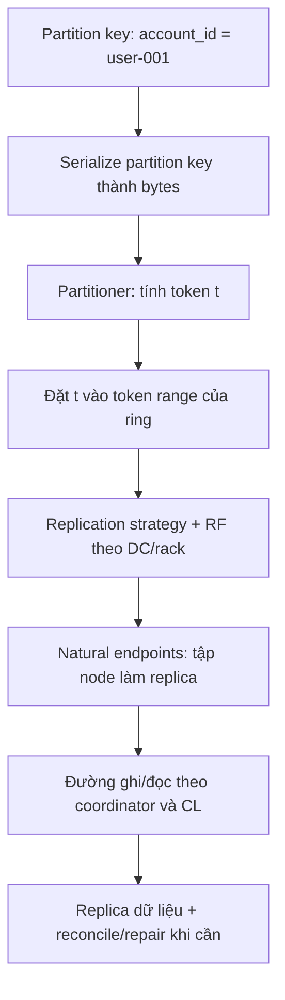

# nodetool ring/getendpoints và đối chiếu vị trí bản sao

> **Chương:** Công cụ vận hành  
> **Mô-đun:** `DATABASE_ENGINE_WIDE_COLUMN_CASSANDRA` — Apache Cassandra, cơ sở dữ liệu wide-column phân tán.  
> **Trọng tâm:** Dùng `nodetool ring`, `nodetool getendpoints` và các nguồn đối chiếu liên quan để xác định **token range**, **replica placement theo keyspace**, **tình trạng node**, cũng như những giới hạn khi suy luận dữ liệu thực tế có nằm và đã đồng bộ trên replica hay chưa.

Apache Cassandra chọn các replica của một partition thông qua **partition key → token → token ring → replication strategy**. Khi cần điều tra một truy vấn chậm, một bản ghi không xuất hiện ở một DC, một node đang bootstrap hoặc nghi ngờ cấu hình RF/rack không đúng, đội vận hành thường hỏi:

- Partition của `account_id='user-001'` được đặt tại các node nào?
- Node nào là replica *theo topology*, node nào đang Up?
- Vì sao một keyspace có RF=3 mà output `ring` hiển thị hàng trăm dòng token?
- Vì sao `getendpoints` liệt kê một node Down dù một truy vấn `LOCAL_QUORUM` vẫn thành công?
- Vì sao sau `bootstrap`, `decommission` hoặc `replace`, hai node có thể tạm báo những quan sát khác nhau?
- Làm sao so kết quả `nodetool` với CQL, tracing, metadata của Java Driver và repair history mà không nhầm **vị trí bản sao** với **bản sao đã nhận đủ dữ liệu**?

Hai lệnh trọng tâm giải quyết các câu hỏi khác nhau:

- **`nodetool ring`:** quan sát ring gồm các token/vnodes, DC/rack, trạng thái node và thông tin ownership; giúp hiểu *toàn cảnh vị trí theo token*.
- **`nodetool getendpoints`:** với một `keyspace`, `table` và **partition key cụ thể**, hỏi metadata của node đang chạy lệnh về **các natural endpoints** được phân công làm replica; giúp hiểu *vị trí của đúng một partition*.

**Quy tắc quan trọng nhất:** `getendpoints` trả lời **“theo replica placement, key này thuộc node nào?”**, không tự trả lời **“mọi node đó có dữ liệu mới nhất, đang phục vụ được, hay đã repair thành công?”**

## 1. Mục tiêu học tập

Sau bài này, bạn có thể:

1. Giải thích token range `(left, right]`, primary token owner và tập natural replicas khác nhau như thế nào.
2. Đọc đúng `nodetool ring <keyspace>` khi node dùng **vnodes** và `NetworkTopologyStrategy`.
3. Gọi `nodetool getendpoints <keyspace> <table> <key>` với partition key đơn giản, hiểu phạm vi và giới hạn đầu ra.
4. Đối chiếu `ring`, `status`, `describering`, schema CQL, `token()` và DC/rack để kiểm tra placement.
5. Phân biệt **natural replica**, **pending replica**, **replica Up/Down**, **nơi đang có SSTable** và **node được coordinator hỏi trong một request**.
6. Hiểu vai trò RF, `LOCAL_QUORUM`, `QUORUM`, `ALL` và thay topology khi một node Down hoặc chưa đồng bộ.
7. Sử dụng Java Driver 4.x để kiểm tra token/routing key và metadata replica, đồng thời nhận ra metadata đó có thể tạm stale.
8. Thực hiện runbook kiểm tra an toàn trước/sau bootstrap, decommission, replace, repair; không chỉnh tay ring vì một output bất thường.

## 2. Chuỗi ánh xạ từ khóa phân vùng đến replica

### 2.1. Partition key được chuyển thành token

Giả sử bảng có một cột partition key là `account_id text`:

```sql
CREATE TABLE lab_placement.accounts_by_id (
    account_id text PRIMARY KEY,
    email text,
    account_state text,
    updated_at timestamp
);
```

Khi ghi:

```sql
INSERT INTO lab_placement.accounts_by_id (
    account_id, email, account_state, updated_at
) VALUES (
    'user-001', 'demo@example.invalid', 'ACTIVE',
    '2026-11-21 08:00:00+0000'
);
```

Cassandra sử dụng **biểu diễn byte của partition key** và partitioner (thường là `Murmur3Partitioner`) để tính token. Token này dùng để xác định khoảng trên ring và những node được chọn làm replica theo keyspace.



Một khóa có token `t` **không đồng nghĩa** dữ liệu chỉ nằm ở node có boundary token đầu tiên lớn hơn hoặc bằng `t`. Boundary đó giúp xác định **primary ownership**; replication strategy còn chọn **những replica bổ sung**.

### 2.2. Clustering key không dùng để đổi vị trí replica

Ví dụ bảng wide-column:

```sql
CREATE TABLE lab_placement.events_by_account_day (
    account_id text,
    event_day date,
    event_time timestamp,
    event_id timeuuid,
    event_type text,
    PRIMARY KEY ((account_id, event_day), event_time, event_id)
) WITH CLUSTERING ORDER BY (event_time DESC, event_id DESC);
```

Trong bảng này:

- `(account_id, event_day)` là **composite partition key**; cả hai giá trị tham gia tạo bytes và token.
- `event_time` và `event_id` là **clustering columns**; chỉ quyết định vị trí hàng trong partition đã xác định.
- Hai events cùng `account_id` và `event_day` chia sẻ token và cùng **tập natural replicas**.
- Cùng `account_id` nhưng `event_day` khác có thể tạo token khác, dẫn đến replica placement khác.

Đừng đưa clustering key vào phép tính replica placement; nhưng cũng đừng quên một cột của composite partition key.

### 2.3. Token range có quy tắc biên

Một cách ký hiệu thường dùng là:

\[
R_i = (t_{i-1}, t_i]
\]

nghĩa là **không gồm** boundary trái, **gồm** boundary phải. Giả sử token `27` thuộc khoảng `(20,40]`; token `20` lại thuộc range kết thúc ở `20`, không thuộc `(20,40]`.

Token ring là **vòng**: range cuối nối lại range đầu. Với Murmur3, miền token thực là số nguyên có dấu 64-bit, không phải chỉ `0..99` như ví dụ giáo khoa ở phần sau.

### 2.4. RF, DC và rack ảnh hưởng vị trí replica

Với `NetworkTopologyStrategy`:

```sql
CREATE KEYSPACE IF NOT EXISTS lab_placement
WITH replication = {
    'class': 'NetworkTopologyStrategy',
    'dc1': 3
};
```

Keyspace này yêu cầu **RF=3 trong dc1**. Điều đó có nghĩa một partition cần có ba full replicas phù hợp trong DC đó, miễn topology và số node cho phép.

Nếu có thêm DC:

```sql
-- Chỉ là ví dụ cấu hình cho một cụm THỰC có đủ node ở cả hai DC.
CREATE KEYSPACE IF NOT EXISTS lab_placement_two_dc
WITH replication = {
    'class': 'NetworkTopologyStrategy',
    'dc1': 3,
    'dc2': 2
};
```

Một partition có mục tiêu **ba replicas ở dc1 và hai replicas ở dc2**. Các node thuộc DC khác nhau **không thay thế tùy ý** cho quorum trong DC local khi dùng `LOCAL_QUORUM`.

Chiến lược chọn replica phụ thuộc metadata token/rack/DC; tránh dự đoán từ vị trí IP hoặc thứ tự node viết trong file cấu hình. Với số rack không đủ để phân bố toàn bộ replica sang các rack riêng, placement có thể buộc phải chia sẻ rack. Phải đo những failure domains thật có sẵn.

## 3. `nodetool ring` cho biết điều gì?

### 3.1. Cú pháp và cách đọc cơ bản

```bash
# Hiển thị ring, có thể gồm rất nhiều dòng nếu dùng vnodes.
nodetool ring

# Kèm keyspace để tính ownership theo replication strategy tương ứng.
nodetool ring lab_placement
```

Một số cột thường thấy, tùy phiên bản:

| Cột thường gặp | Ý nghĩa | Điều không nên suy ra |
|---|---|---|
| `Address` | Địa chỉ endpoint của node | Không phải tên keyspace hoặc định danh ổn định nhất |
| `DC` | Datacenter theo snitch/topology | Không chứng minh đường WAN đang khỏe |
| `Rack` | Rack/failure domain được khai báo | Không chứng minh rack vật lý đúng nếu snitch cấu hình sai |
| `Status` | Up/Down theo membership hiện tại | Không chứng minh row dữ liệu đồng bộ |
| `State` | Normal/Joining/Leaving/... tùy phiên bản | Không chứng minh streaming đã hoàn tất |
| `Load` | Ước lượng lượng dữ liệu trên node | Không phải dung lượng filesystem hay quota |
| `Owns` | Phần sở hữu token/effective ownership theo ngữ cảnh | Không phải tỷ lệ chính xác của byte hoặc traffic |
| `Token` | Boundary token của vnode/ring | Không phải partition key của một hàng |

**Lưu ý output:** token của cùng một node có thể xuất hiện ở nhiều dòng vì **vnodes**. Node mang 128 hoặc 256 tokens không trở thành 128 hoặc 256 máy chủ khác nhau.

### 3.2. `ring` khác `status`

```bash
nodetool status
nodetool status lab_placement
```

`nodetool status` thường tổng hợp mỗi node trên một dòng: địa chỉ, DC/rack, trạng thái như `UN` (Up/Normal), `DN` (Down/Normal), load, owns và số tokens. `ring` đi sâu vào ring/token boundaries.

| Câu hỏi | Công cụ nên xem |
|---|---|
| Node nào Up/Down, đang Joining/Leaving? | `nodetool status` |
| Boundary tokens/vnodes nằm ở đâu? | `nodetool ring` |
| Effective ownership theo keyspace là bao nhiêu? | `nodetool ring <keyspace>` hoặc `status <keyspace>`, hiểu giới hạn |
| Một partition key cụ thể thuộc replica nào? | `nodetool getendpoints` |
| Các range và endpoints mô tả theo keyspace? | `nodetool describering <keyspace>` |
| Replica đã có dữ liệu đồng bộ? | Repair/streaming logs, coverage và kiểm chứng dữ liệu, **không chỉ ring** |

Không đọc cột `Owns` thành số byte đã ghi thực tế. Một partition rất lớn có thể khiến lượng dữ liệu lệch mạnh dù tỷ lệ token ownership gần cân bằng.

### 3.3. Khi có nhiều vnode

Nếu cụm có `num_tokens` lớn, `ring` có thể rất dài. Các token thường xen kẽ từ nhiều node:

```text
Ví dụ minh họa:
Address        DC    Rack  Status State   Token
10.0.1.11      dc1   r1    Up     Normal  -743000...
10.0.1.12      dc1   r2    Up     Normal  -720000...
10.0.1.11      dc1   r1    Up     Normal  -680000...
10.0.1.13      dc1   r3    Up     Normal  -650000...
...
```

**Đây không phải output thực.** Một node xuất hiện nhiều lần vì sở hữu nhiều token boundaries. Khi tính RF=3, replication strategy chọn **những node phù hợp khác nhau**, chứ không tính ba dòng token liên tiếp bất kể có trùng node.

## 4. `nodetool getendpoints` cho biết điều gì?

### 4.1. Cú pháp cơ bản

```bash
nodetool getendpoints <keyspace> <table> <key>
```

Ví dụ với partition key `account_id text` đơn giản:

```bash
nodetool getendpoints lab_placement accounts_by_id user-001
```

Kết quả thường là một danh sách địa chỉ node, ví dụ minh họa:

```text
10.0.1.13
10.0.1.14
10.0.1.15
```

Đây là **natural endpoints theo ring/replication metadata được node chạy lệnh nhìn thấy**. Số lượng và địa chỉ thật phụ thuộc dữ liệu key, partitioner, keyspace RF, topology và trạng thái ring.

### 4.2. Bốn giới hạn quan trọng

**Thứ nhất — Đây là lookup metadata, không đọc row.** `getendpoints` không thực hiện `SELECT` để xác nhận giá trị `email`, cũng không đo timestamp từng replica.

**Thứ hai — Node Down có thể vẫn được liệt kê.** Membership/replica responsibility và tình trạng Up/Down là hai lớp khác nhau. Replica Down có thể vẫn là natural endpoint cho key.

**Thứ ba — Không chứng minh endpoint được coordinator thực sự hỏi.** Một truy vấn có CL cụ thể, request scheduling, speculative executions hoặc pending ranges có thể đi theo đường khác. Để điều tra một request, dùng tracing có giới hạn và logs/metrics.

**Thứ tư — Đầu vào `key` phải biểu diễn đúng partition key.** `nodetool getendpoints` được thiết kế cho key truyền theo CLI; cách parse/serialize các kiểu CQL và **composite partition key** có thể phụ thuộc bản Cassandra. Đừng giả định có thể gõ một UUID/composite key bằng chuỗi tùy ý và chắc chắn được cùng bytes mà CQL dùng.

Vì thế ví dụ đầu tiên dùng **một partition key kiểu `text`**, không có dấu cách hoặc ký tự đặc biệt. Với key phức tạp, kiểm tra `nodetool help getendpoints` của phiên bản và đối chiếu bằng `token()`, serialized routing key/driver metadata hoặc công cụ thích hợp.

### 4.3. Nếu key không có row vẫn có vị trí dự kiến

Token và natural replica placement phụ thuộc **giá trị partition key**, không phụ thuộc việc row đã được insert. Với cùng schema/keyspace/topology, `getendpoints` có thể cho biết **những node sẽ chịu trách nhiệm** ngay cả khi không có dữ liệu cho key đó.

Đây cũng là lý do output không thể chứng minh row đang tồn tại.

### 4.4. Dùng đúng keyspace và table

`getendpoints` nhận cả keyspace, table và key. Hai keyspace có replication strategy hoặc RF khác nhau có thể chọn tập replica khác nhau cho **cùng một partition key**. Cùng keyspace nhưng hai bảng dùng hai kiểu partition key khác nhau cũng có thể tạo token khác nhau cho chuỗi biểu diễn trông giống nhau.

Trước khi chạy, kiểm tra:

```sql
DESCRIBE KEYSPACE lab_placement;
DESCRIBE TABLE lab_placement.accounts_by_id;
```

Lệnh `DESCRIBE` là tính năng của `cqlsh`, không phải CQL statement chung mà mọi driver đều hiểu. Nếu môi trường không có `cqlsh`, đọc schema từ metadata CQL/system schema hoặc công cụ phù hợp.

## 5. Mô hình ring bằng tay: từ token đến natural replicas

Để hiểu `ring` và `getendpoints`, sử dụng một ring **giả định** có một token boundary cho mỗi node, trong một DC và RF=3.

| Boundary token | Node | Rack |
|---:|---|---|
| 0 | A | r1 |
| 20 | B | r2 |
| 40 | C | r3 |
| 60 | D | r1 |
| 80 | E | r2 |
| 99 | F | r3 |

**Giả định giáo khoa:** token nằm trên vòng `0..99`, placement theo chiều tăng của token; dữ liệu được chia đều và rack được phân bổ thuận lợi. Đây **không phải** miền token thật của Murmur3 hay kết quả chính xác cho mọi bản Cassandra.

### 5.1. Khóa có token 27

Token `27` thuộc range `(20,40]`, do boundary `40` của C kết thúc. Trong mô hình đơn giản, C là điểm bắt đầu chọn natural replicas. Với RF=3, tiếp theo ta chọn các node hợp lệ theo chiến lược:

```text
Ring tăng token:
... → 20(B,r2) → 40(C,r3) → 60(D,r1) → 80(E,r2) → 99(F,r3) → 0(A,r1) → ...

Key k có token = 27
              │
              ▼
       range (20,40] → C
                       D
                       E  (ví dụ RF=3 với ba rack phù hợp)
```

Tập replica **minh họa** là `{C,D,E}`, nhưng khi dùng **vnodes** hoặc replication strategy thực tế, đừng chọn tay bằng cách “ba dòng đầu tiên sau token”. Một node có thể có nhiều tokens; rack/DC selection có thể bỏ qua token boundary của cùng node hoặc cùng rack để chọn replica phù hợp.

### 5.2. Trường hợp một node có nhiều token

Giả sử `ring` hiển thị hai boundary liên tiếp thuộc cùng node C:

```text
Token 40  → Node C
Token 45  → Node C
Token 60  → Node D
Token 80  → Node E
```

RF=3 **không có nghĩa** C được tính hai replicas chỉ vì có hai boundaries. Cassandra cần tập replica theo strategy, dựa trên những nodes phù hợp; một node không thay thế cho hai bản sao độc lập.

### 5.3. Kiểm chứng bằng công cụ thay vì đoán

Trong cluster thật:

1. Xác định **schema** và `NetworkTopologyStrategy`/RF của keyspace.
2. Quan sát `ring` và `status` để hiểu token ownership/DC/rack.
3. Dùng `getendpoints` cho **key cụ thể**.
4. Đối chiếu các endpoint với DC/rack mong muốn.
5. Nếu không khớp giả định, **kiểm tra assumptions** (composite key, vnodes, topology, version, rack placement) trước khi kết luận ring sai.

`getendpoints` là một quan sát về replica placement, không phải một lời hứa nó sẽ luôn giống kết quả tính bằng tay của mô hình đơn giản.

## 6. Lab đầy đủ: kiểm tra một partition key kiểu text

### 6.1. Điều kiện phòng thực hành

Chuẩn bị một **cluster lab** có:

- Cassandra 4.x/5.x hoặc bản tương thích, biết rõ version.
- Datacenter `dc1` có tối thiểu ba full-capable nodes, topology/snitch đúng.
- Quyền chạy `cqlsh` và `nodetool`.
- Kết nối internode/JMX phù hợp với policy bảo mật.
- Không có bootstrap/decommission/replace đang chạy khi bắt đầu baseline.

Các IP như `10.0.1.13` trong ví dụ là địa chỉ **minh họa**, không phải địa chỉ phải có trong môi trường của bạn.

### 6.2. Tạo keyspace và bảng

```sql
CREATE KEYSPACE IF NOT EXISTS lab_placement
WITH replication = {
    'class': 'NetworkTopologyStrategy',
    'dc1': 3
};

CREATE TABLE IF NOT EXISTS lab_placement.accounts_by_id (
    account_id text PRIMARY KEY,
    email text,
    account_state text,
    updated_at timestamp
);
```

Bảng này phù hợp truy vấn `WHERE account_id = ?`, có một partition key kiểu `text` nên dễ so `getendpoints` với token.

### 6.3. Ghi và đọc row

Trong `cqlsh`:

```sql
CONSISTENCY LOCAL_QUORUM;

INSERT INTO lab_placement.accounts_by_id (
    account_id, email, account_state, updated_at
) VALUES (
    'user-001', 'demo@example.invalid', 'ACTIVE',
    '2026-11-21 08:00:00+0000'
);

SELECT account_id, email, account_state, updated_at
FROM lab_placement.accounts_by_id
WHERE account_id = 'user-001';
```

**`CONSISTENCY` là lệnh của `cqlsh`**, không phải một CQL keyword có thể đưa nguyên vào prepared statement của Java. `LOCAL_QUORUM` cần quorum trong DC local của coordinator; với RF=3 full replicas ở `dc1`, quorum là 2.

### 6.4. Đọc token của một partition hiện có

```sql
SELECT account_id, token(account_id) AS partition_token
FROM lab_placement.accounts_by_id
WHERE account_id = 'user-001';
```

`token(account_id)` cho biết token ứng với partition key theo partitioner hiện tại. Kết quả là giá trị thực của cluster, **không phải** token `27` trong ví dụ giáo khoa.

Chú ý: `SELECT` trên bảng chỉ trả row nếu row tồn tại và thỏa đọc; không phải công cụ tính token cho mọi key bất kể có row. Nếu key chưa tồn tại, cách tính token ở tầng driver/partitioner có thể phù hợp hơn.

### 6.5. Quan sát ring và endpoints

Trên node quản trị lab (hoặc truyền host/JMX parameters được quyền):

```bash
nodetool status lab_placement
nodetool ring lab_placement
nodetool describering lab_placement
nodetool getendpoints lab_placement accounts_by_id user-001
```

Ghi lại:

| Nguồn | Quan sát cần lưu |
|---|---|
| `DESCRIBE KEYSPACE` | `NetworkTopologyStrategy` và `dc1:3` |
| `SELECT token(account_id)` | Token thật của `user-001` |
| `ring` | Boundary tokens, addresses, DC/rack, trạng thái |
| `status` | Node Up/Down/Joining/Leaving, rack/DC |
| `describering` | Các range và endpoints theo keyspace |
| `getendpoints` | Danh sách natural replica addresses của `user-001` |
| `SELECT` | Kết quả logic của query tại CL đã chọn |

### 6.6. Đối chiếu ba lớp

Với RF=3 trong `dc1` và topology đủ khả năng:

1. **Placement:** `getendpoints` dự kiến chỉ ra ba natural replicas ở `dc1`.
2. **Availability:** từng endpoint có thể `UN` hoặc `DN` theo `status`; node Down không bị loại tự động khỏi natural endpoint list.
3. **Data correctness:** đọc một lần ở `LOCAL_QUORUM` chưa chứng minh cả ba replica đã nhận mutation. Hints/repair và trạng thái đồng bộ cần đánh giá riêng.

Nếu một endpoint không xuất hiện trong `status` cùng thời điểm, hoặc thuộc DC không như keyspace yêu cầu, cần điều tra **metadata khác thời điểm, sai endpoint/port, DC/rack schema hoặc topology đang chuyển** trước khi phát biểu rằng dữ liệu đã bị đặt sai.

## 7. `nodetool describering` bổ sung cho `ring` và `getendpoints`

```bash
nodetool describering lab_placement
```

Lệnh này mô tả các token ranges và endpoints tương ứng cho keyspace theo metadata node nhìn thấy. Nó hữu ích khi cần **kiểm tra cả một nhóm ranges**, không chỉ một key, đặc biệt trong audit ownership hoặc đối chiếu sau thay topology.

Tuy vậy:

- Output có thể rất lớn nếu dùng nhiều vnodes.
- Nó phản ánh ring metadata tại thời điểm gọi, không xác nhận mỗi replica đã có đủ SSTable bytes.
- Nếu keyspace và replication strategy khác nhau, tập endpoints cũng khác.
- Trong bootstrap/decommission, cần hiểu **pending ranges** và trạng thái chuyển tiếp; một ảnh chụp không phải bằng chứng của toàn bộ diễn biến.
- Không dùng các token ranges sao chép từ output để tự tay sửa file hệ thống hay ownership trong production.

### 7.1. Bảng so sánh ba lệnh

| Lệnh | Hạt quan sát | Đầu ra chính | Giới hạn |
|---|---|---|---|
| `nodetool ring` | Toàn ring/vnodes | Boundary tokens, node, DC/rack, trạng thái, ownership | Dài; không chỉ ra duy nhất key đang hỏi nếu chưa ghép token |
| `nodetool describering <ks>` | Các ranges theo keyspace | Token ranges và endpoints | Không chứng minh dữ liệu thực đã stream/repair |
| `nodetool getendpoints <ks> <table> <key>` | Một partition key | Natural replica addresses cho key | Key serialization và metadata; không xác nhận health/data |
| `nodetool status <ks>` | Theo node | Up/Down/Normal và ownership | Không xác nhận replica của một key cụ thể |

**Không có lệnh nào một mình chứng minh đồng thời “placement đúng, node Up, dữ liệu mới nhất và app luôn đọc được”.** Cần phối hợp nhiều nguồn.

## 8. Natural replica khác “node đã chứa dữ liệu đúng”

Hãy phân biệt ít nhất **bốn câu hỏi**:

| Câu hỏi | Công cụ/nguồn phù hợp |
|---|---|
| **Theo topology, ai nên giữ partition?** | `getendpoints`, ring metadata, driver token map |
| **Ai đang hoạt động và có thể nhận request?** | `status`, health checks, logs, JMX/driver |
| **Ai đã nhận mutation mới nhất?** | CL ACK/hints/repair evidence, replica diagnostics |
| **Application đang nhận kết quả logic nào?** | CQL read theo CL, driver metrics, tracing có kiểm soát |

### 8.1. Tình huống RF=3, một replica Down

Giả sử `getendpoints` cho `user-001` là A, B và C, đều thuộc `dc1`. C đang Down:

```text
Natural endpoints: A, B, C
Status:            A=UN, B=UN, C=DN
Write CL:          LOCAL_QUORUM → cần 2 ACK ở dc1
Observed ACK:      A và B
C:                 Có thể bỏ lỡ mutation
```

Client ghi thành công vì A và B đáp ứng quorum. Nhưng `getendpoints` **vẫn có thể liệt kê C** vì C là natural replica theo ring. Khi C quay lại, hinted handoff hoặc anti-entropy repair có thể cần thiết để đồng bộ.

**Điều không được suy ra:** “Có ba endpoints ⇒ cả ba chắc chắn đã lưu bản ghi”.

### 8.2. LOCAL_QUORUM, QUORUM và ALL

Với RF=3 trong một DC:

\[
Q=\left\lfloor\frac{3}{2}\right\rfloor+1=2.
\]

`LOCAL_QUORUM` yêu cầu quorum ở local DC. Trong cụm nhiều DC, `QUORUM` tính quorum trên toàn bộ full replicas theo semantics phù hợp; `ALL` yêu cầu tất cả replica cần thiết. Tăng CL có thể làm điều kiện ACK chặt hơn, nhưng không tự thay đổi **danh sách natural replicas** của partition.

Một node Down có thể khiến `ALL` unavailable dù `LOCAL_QUORUM` vẫn hoạt động. Đánh giá tính nhất quán theo **RF/CL và các DC thực tế**, không theo số dòng của `ring`.

### 8.3. Read repair không thay anti-entropy repair

Nếu ứng dụng đọc một key thành công ở `LOCAL_QUORUM`, kết quả đó không chứng minh mọi replica/tất cả ranges đã đồng nhất. Read repair có thể khắc phục một số sai khác tùy phiên bản/cấu hình, nhưng **anti-entropy repair** mới là quá trình đối chiếu có kế hoạch trên ranges được chọn.

`getendpoints` không kích hoạt repair, không chạy Merkle tree và không truyền SSTable.

### 8.4. Tombstone và nguy cơ dữ liệu zombie

Nếu C Down khi A/B nhận `DELETE`, C có thể còn dữ liệu cũ. Tombstone trên A/B phải còn đủ lâu cho việc đồng bộ trước khi được phép purge theo `gc_grace_seconds` và quy tắc compaction.

Nếu C Down quá lâu, tombstone ở nguồn khỏe có thể đã bị purge; C quay lại có nguy cơ làm **dữ liệu đã xóa xuất hiện lại**. Việc `getendpoints` liệt kê C trong thời gian Down không có nghĩa C đã nhận tombstone.

Khi node Down vượt grace hoặc có rủi ro cao, **không để node cũ tự nhập cụm mà không có runbook đánh giá/replace/rebuild từ nguồn tin cậy**.

## 9. Multi-datacenter: đối chiếu replica theo từng DC

Giả sử có keyspace:

```sql
CREATE KEYSPACE IF NOT EXISTS lab_geo
WITH replication = {
    'class': 'NetworkTopologyStrategy',
    'dc1': 3,
    'dc2': 2
};
```

Nếu topology có đủ full replicas phù hợp:

- Mỗi partition cần ba natural replicas ở `dc1`.
- Mỗi partition cần hai natural replicas ở `dc2`.
- Một lookup `getendpoints` có thể liệt kê endpoints ở **cả hai DC**.
- `nodetool status` giúp xác nhận địa chỉ từng endpoint thực sự ở DC/rack nào.

### 9.1. Không tính quorum bằng tổng tất cả node

Với `LOCAL_QUORUM` từ coordinator ở `dc1`, cần quorum ở **dc1** (2/3). Không tính `(3+2)/2` rồi áp cho local quorum. Với coordinator ở `dc2`, local quorum của hai full replicas là 2/2.

| Coordinator DC | RF local | LOCAL_QUORUM cần |
|---|---:|---:|
| `dc1` | 3 | 2 |
| `dc2` | 2 | 2 |

Các con số trên giả định full replicas và topology đã sẵn sàng. Đây là lý do một ứng dụng failover từ dc1 sang dc2 có thể thấy độ khả dụng khác nếu RF local khác.

### 9.2. Hai DC có thể nhìn metadata khác nhau tạm thời

Nếu ring vừa thay đổi, gossip/schema agreement hoặc streaming chưa ổn định, node được hỏi ở dc1 và dc2 có thể tạm nhìn trạng thái chưa hội tụ. Hãy:

1. Ghi timestamp và node **nơi chạy `nodetool`** cho mỗi output.
2. Kiểm tra `status`/`ring` trên node ở **mỗi DC**.
3. Đối chiếu schema/replication options và trạng thái topology.
4. Kiểm tra gossip, kết nối internode và logs.
5. Lặp quan sát sau khi topology ổn định; nếu mismatch kéo dài, điều tra sâu thay vì tự sửa token.

Trong trường hợp dữ liệu không giống nhau giữa DC, **local repair riêng từng DC chưa chứng minh có đối soát liên DC**. Repair policy phải bao phủ peers/token ranges phù hợp.

### 9.3. `getendpoints` không chứng minh độ mới của dữ liệu remote

Một write ở `dc1` tại `LOCAL_QUORUM` có thể ACK trước khi DC2 có quorum cập nhật. `getendpoints` vẫn trả danh sách natural replicas ở DC2, nhưng ứng dụng đọc ở DC2 ngay sau đó có thể thấy dữ liệu cũ.

Cần có thiết kế CL/replication/failover phù hợp yêu cầu read-your-write và RPO; không dùng endpoint list làm “chứng chỉ đồng bộ”.

## 10. Khi topology thay đổi: bootstrap, decommission, replace

### 10.1. Bootstrap một node mới

Trong lúc node mới Joining:

- Ring có thể hiện trạng thái `UJ` hoặc Joining tùy bản Cassandra.
- Replica placement có thể có **pending ownership/ranges**.
- Dữ liệu phải stream từ replica khỏe sang node mới.
- Natural endpoints/cách client route có thể biến đổi theo quá trình chuyển trạng thái.
- Hai lần `getendpoints` ở hai thời điểm có thể cho danh sách khác nhau.

**Sau khi node `UN`** và streaming hoàn tất theo log, vẫn cần kiểm tra data/repair theo runbook; một node Up không chứng minh mọi range đã nhất quán.

### 10.2. Decommission một node còn sống

Khi node rời cluster có kiểm soát:

- Nó vẫn có thể phục vụ/stream trong một giai đoạn.
- Các node khác nhận trách nhiệm mới theo RF.
- `ring` và `getendpoints` có thể thay đổi khi việc rời ring hoàn tất.
- Data đã không còn thuộc trách nhiệm node cũ có thể cần cleanup sau khi topology ổn định.

Không xóa node còn hoạt động khỏi hệ thống chỉ vì một lần `getendpoints` không còn trả IP của nó; cần hoàn tất đúng quy trình `decommission` và đối chiếu membership.

### 10.3. Replace node hỏng

Node thay thế có thể cần nhận ranges của node cũ từ những replica khỏe. IP/host ID và các thuộc tính membership khác có thể thay đổi theo phương pháp replace, nên:

- Không lấy **IP cũ** làm định danh duy nhất của replica để đối chiếu dài hạn.
- So cả **host ID, DC/rack, token responsibility và node state**.
- Xác nhận dữ liệu đã stream, ring ổn định và repair/hậu kiểm theo policy.
- Không để disk image của node cũ Down quá lâu tự gia nhập nếu có rủi ro zombie.

### 10.4. Thay RF của keyspace

Ví dụ tăng `dc1` từ RF=2 lên RF=3 thay đổi **tập replica mong muốn** cho từng token range. `getendpoints` sau thay đổi có thể liệt kê thêm một natural replica, **nhưng sự có mặt trong danh sách không chứng minh dữ liệu cũ đã được streaming/repair vào node mới**.

Chạy quy trình hoàn thiện replication/repair theo đúng phiên bản, phạm vi và DC. Không xem `ALTER KEYSPACE` xong là đã đạt full data redundancy.

### 10.5. Vì sao không tự chạy cleanup ngay?

`nodetool cleanup` loại dữ liệu không còn thuộc responsibility của node theo ring mới. Chạy khi topology chưa ổn định, khi dữ liệu chưa được chuyển đầy đủ hoặc khi chưa có đủ disk headroom có thể gây vấn đề nghiêm trọng.

`getendpoints` và `ring` là công cụ **kiểm tra trước**; chúng không thay thế kiểm tra completion của streaming/repair, snapshot và quy trình cleanup.

## 11. Đối chiếu từ hai hoặc nhiều node

Nếu nghi metadata không hội tụ, một cách đánh giá là gọi **cùng một lệnh trên các node khác nhau**, có ghi thời điểm:

```bash
# Chạy lệnh tương ứng trên node quản trị A:
nodetool getendpoints lab_placement accounts_by_id user-001
nodetool status lab_placement

# Sau đó chạy đúng các lệnh đó trên node quản trị B.
nodetool getendpoints lab_placement accounts_by_id user-001
nodetool status lab_placement
```

Bảng đối chiếu:

| Thuộc tính | Node A nhìn thấy | Node B nhìn thấy | Ghi chú |
|---|---|---|---|
| Thời điểm | T1 | T2 | Chênh bao nhiêu giây? |
| Keyspace RF | `dc1:3` | `dc1:3` | Schema có hội tụ không? |
| Token/key input | `user-001` | `user-001` | Có cùng bytes không? |
| Natural endpoints | A,B,C | A,B,C | Tập hợp, không cần phụ thuộc thứ tự in |
| Endpoint health | A/B Up, C Down | A/B Up, C Down | Membership nhất quán? |
| Topology events | Không có | Không có | Có bootstrap/replace đang diễn ra? |

**Ví dụ minh họa**, không phải output thực. So **tập hợp endpoints**, không mặc định thứ tự in của hai CLI phải giống hệt để được coi là đúng.

### 11.1. Nếu hai node không đồng ý

Đừng vội “sửa” Cassandra bằng cách chỉnh file token:

1. Bảo đảm cả hai lệnh dùng **đúng keyspace, table, partition key bytes và phiên bản**.
2. So hostname/IP/host ID, DC/rack, schema agreement và gossip.
3. Kiểm tra node có đang Joining/Leaving/Moving/Replacing hay không.
4. Kiểm tra network partition và lịch sử restart.
5. Chỉ sau khi metadata đã hội tụ mới đối chiếu data consistency và repair.
6. Nếu mismatch dai dẳng, dùng runbook quản trị/đội hỗ trợ phù hợp phiên bản.

Việc “vẫn khác khi cluster ổn định” là một triệu chứng cần điều tra, không phải chứng cứ chắc chắn dữ liệu vật lý đã bị hỏng.

## 12. Đối chiếu với tracing của một truy vấn

Trong `cqlsh`, có thể bật tracing **tạm thời** cho một truy vấn hẹp:

```sql
TRACING ON;

CONSISTENCY LOCAL_QUORUM;

SELECT account_id, account_state, updated_at
FROM lab_placement.accounts_by_id
WHERE account_id = 'user-001';

TRACING OFF;
```

Tracing có thể hiển thị coordinator, các message/request và node tham gia trong một đường thực thi, tùy phiên bản và hành vi request. Cần nhớ:

- `getendpoints` liệt kê **natural replicas**.
- Tracing cho thấy **một hoặc vài bước trong request đang được thực thi**.
- Request có thể không cần chờ tất cả replicas để thỏa CL.
- Read repair/speculative retry, pending ranges, node không sẵn sàng và tracing sampling có thể làm đường quan sát khác với danh sách natural replicas.
- Tracing không phải bằng chứng mọi replica đã nhận mọi mutation.
- Bật tracing rộng có overhead; không áp dụng cho toàn bộ traffic production để so địa chỉ.

Một phân tích đúng sẽ hỏi: “Coordinator chọn những replica nào trong lần đọc này và vì sao?”, **không** đòi trace luôn phải liệt kê đúng ba dòng giống `getendpoints`.

## 13. Java Driver 4.x: đối chiếu token map ở client

Ứng dụng Java cần biết partition key để định tuyến request phù hợp. Java Driver 4.x có metadata **TokenMap** và routing key từ prepared statement; điều này tạo một góc quan sát khác với `nodetool`.

Ví dụ dưới đây sử dụng bảng `lab_placement.accounts_by_id` với partition key kiểu `text`:

```java
import com.datastax.oss.driver.api.core.CqlIdentifier;
import com.datastax.oss.driver.api.core.CqlSession;
import com.datastax.oss.driver.api.core.DefaultConsistencyLevel;
import com.datastax.oss.driver.api.core.cql.BoundStatement;
import com.datastax.oss.driver.api.core.cql.PreparedStatement;
import com.datastax.oss.driver.api.core.metadata.Node;
import com.datastax.oss.driver.api.core.metadata.token.Token;
import com.datastax.oss.driver.api.core.metadata.token.TokenMap;

import java.net.InetSocketAddress;
import java.nio.ByteBuffer;
import java.util.Optional;
import java.util.Set;

public final class InspectReplicaPlacement {
    public static void main(String[] args) {
        try (CqlSession session = CqlSession.builder()
                .addContactPoint(new InetSocketAddress("127.0.0.1", 9042))
                .withLocalDatacenter("dc1")
                .build()) {

            PreparedStatement ps = session.prepare(
                "SELECT account_id, account_state " +
                "FROM lab_placement.accounts_by_id " +
                "WHERE account_id = ?"
            );

            BoundStatement query = ps.bind("user-001")
                .setConsistencyLevel(
                    DefaultConsistencyLevel.LOCAL_QUORUM
                );

            ByteBuffer routingKey = query.getRoutingKey();
            Optional<TokenMap> tokenMapOptional =
                session.getMetadata().getTokenMap();

            if (routingKey == null || !tokenMapOptional.isPresent()) {
                System.out.println(
                    "Routing key hoặc token map không khả dụng");
                return;
            }

            TokenMap tokenMap = tokenMapOptional.get();
            Token token = tokenMap.getToken(routingKey);

            CqlIdentifier keyspace = CqlIdentifier.fromCql("lab_placement");
            Set<Node> replicas = tokenMap.getReplicas(keyspace, token);

            System.out.println("Token: " + token);
            for (Node node : replicas) {
                System.out.println(
                    "Replica: " + node.getHostId() +
                    " endpoint=" + node.getEndPoint() +
                    " dc=" + node.getDatacenter() +
                    " rack=" + node.getRack()
                );
            }

            // CQL read: đây là một request riêng; kết quả thành công
            // không chứng minh mọi replica đã được repair.
            session.execute(query);
        }
    }
}
```

**Điều kiện của ví dụ:** dùng Java Driver 4.x có API metadata token tương ứng, chuẩn bị keyspace/table trong lab, có quyền truy cập và DC `dc1` đúng. `getRoutingKey()` có thể trả `null` nếu driver không thể suy ra routing key; `getTokenMap()` có thể vắng mặt khi metadata disabled hoặc chưa khả dụng. Tùy driver version, thông tin endpoint có thể có cách biểu diễn khác.

### 13.1. Token map là metadata ở phía client

Khi ứng dụng mới khởi động, sau topology change hoặc trong network partition, driver có thể **chưa kịp refresh** replica metadata. Vì vậy:

- So kết quả Java với `getendpoints` tại cùng thời điểm đủ gần.
- Kiểm tra driver topology refresh/events, contact points và local DC.
- Không coi hai giá trị khác nhau trong lúc bootstrap là bằng chứng sửa replication strategy sai.
- Không tự ép danh sách replica tĩnh trong application config để “sửa” token map stale.
- Xem token-aware routing như một **tối ưu định tuyến**, không phải chứng chỉ mọi replica có dữ liệu đồng bộ.

### 13.2. Không cố dùng các key khác kiểu qua CLI

CQL có thể dùng `uuid`, `int`, `blob` và composite partition keys. Java Driver có khả năng serialize đúng kiểu từ prepared statement để lấy routing key; `nodetool getendpoints` nhận tham số CLI là chuỗi với semantics riêng.

Nếu output hai công cụ khác nhau cho một UUID/composite key:

1. Xác nhận **bytes serialized thật** của partition key.
2. So partitioner/token được tính, không chỉ chuỗi hiển thị.
3. Kiểm tra có đủ **mọi cột partition key theo đúng thứ tự** không.
4. Xác định giới hạn hỗ trợ của `getendpoints` ở version đang chạy.
5. Không kết luận partition bị đặt sai khi mới chỉ thấy hai cách biểu diễn key khác nhau.

## 14. Bộ quy trình điều tra “bản sao của key đang ở đâu?”

### Bước 1 — Xác định key và schema

Ghi rõ:

- Cluster/environment, Cassandra version.
- Keyspace/table và **đúng các cột partition key**.
- Kiểu từng cột: `text`, `uuid`, `date`, v.v.
- Giá trị key **đã được mã hóa và bảo vệ dữ liệu nhạy cảm** khi ghi log.
- RF theo DC và partitioner/snitch.

Trong trường hợp user ID hoặc thông tin cá nhân, không copy key thô vào ticket/public logs nếu policy không cho phép.

### Bước 2 — Xác minh placement dự kiến

```bash
nodetool ring lab_placement
nodetool getendpoints lab_placement accounts_by_id user-001
```

Với key phức tạp, ưu tiên cách lấy token qua CQL/driver metadata đúng kiểu. Ghi timestamp/node đã chạy lệnh.

### Bước 3 — Xác minh membership và failure domain

```bash
nodetool status lab_placement
nodetool describecluster
```

Đối chiếu từng endpoint với:

- DC/rack thực tế.
- Up/Down/Normal hay đang Joining/Leaving.
- Host ID và trạng thái bootstrap/replacement.
- Có node mới, node cũ hoặc RF change trong thời gian gần đây không.

### Bước 4 — Xác minh read/write semantics

Kiểm tra ứng dụng ghi/đọc tại CL nào, coordinator ở DC nào, có timeout/retry/hints không. Với truy vấn mẫu:

```sql
CONSISTENCY LOCAL_QUORUM;

SELECT account_id, account_state, updated_at
FROM lab_placement.accounts_by_id
WHERE account_id = 'user-001';
```

Một kết quả đúng tại một CL là bằng chứng **đường đọc đó**, không phải hoàn tất repair toàn cluster.

### Bước 5 — Xác minh dữ liệu và đồng bộ

Nếu nghi lệch replica:

- Kiểm tra log, hints/repair history và thời điểm mutation.
- Xác định phạm vi token ranges, replica/DC cần repair.
- Với một node Down lâu, so tuổi downtime với `gc_grace_seconds`.
- Dùng repair theo runbook, theo dõi validation/Merkle tree/streaming/finalization thành công.
- Nếu dữ liệu đã mất ở mọi replica, cần backup/audit thay vì tin rằng repair sẽ tự tạo lại.

### Bước 6 — Chốt kết luận có điều kiện

Báo cáo theo cấu trúc:

```text
Keyspace/table: lab_placement.accounts_by_id
Key: user-001 (text)
Observed token: <từ CQL/driver>
RF strategy: NTS dc1=3
Natural endpoints: <3 endpoint do getendpoints trả về>
Membership: <UN/DN/UJ/UL của từng endpoint>
Observed read/CL: <kết quả CQL, coordinator DC>
Repair/streaming evidence: <job/ranges/session status>
Conclusion:
  - Replica placement: <đúng/chưa hội tụ/cần điều tra>
  - Availability: <đủ/thiếu quorum theo CL>
  - Data correctness: <đã xác minh/chưa đủ bằng chứng>
```

Đừng xóa trường “Data correctness” chỉ vì endpoint list đã khớp.

## 15. Các tình huống lỗi thường gặp

### 15.1. `getendpoints` chỉ ra ba IP nhưng `status` có một node Down

Đây **không nhất thiết là mâu thuẫn**. Natural endpoints mô tả trách nhiệm lưu dữ liệu; trạng thái Up/Down mô tả khả năng phục vụ hiện tại.

Kiểm tra CL. Với RF=3, `LOCAL_QUORUM` có thể còn đủ hai replica; `ALL` có thể không đủ. Cần phục hồi node, kiểm tra hints và repair theo lịch.

### 15.2. `ring` có hàng trăm dòng trong cluster chỉ có năm node

Có thể vì mỗi node giữ nhiều **vnodes**. Kiểm tra số tokens trong `nodetool status` và phân biệt token boundaries với số node vật lý. Không dùng số dòng ring để tính RF.

### 15.3. Một keyspace chọn endpoints khác keyspace khác

Hoàn toàn có thể đúng nếu RF/NTS của hai keyspaces khác nhau. Đọc `DESCRIBE KEYSPACE` của từng keyspace rồi đối chiếu.

### 15.4. Một table dùng composite partition key nhưng `getendpoints` không khớp CQL

Khả năng cao do **serialize key khác nhau** giữa CLI string và composite bytes CQL. Kiểm tra phiên bản/cách nhập, `token(partition_key_columns)` khi có row, prepared statement routing key trong driver.

Không tự thay keyspace replication vì output CLI chưa khớp.

### 15.5. Node vừa bootstrap, `getendpoints` đã liệt kê nó nhưng SELECT còn chậm

Replica placement đang đổi; node mới có thể chưa stream đủ hoặc hệ thống đang tranh disk/network. Kiểm tra trạng thái Joining/Normal, stream logs, `nodetool netstats`, compaction và client p99. Không lấy endpoint list làm bằng chứng bootstrap hoàn tất.

### 15.6. Một node cũ vẫn có SSTable của key dù `getendpoints` không liệt kê nữa

**Có dữ liệu vật lý** không đồng nghĩa **còn là natural replica**. Sau topology change, node cũ có thể còn SSTable chứa ranges không còn sở hữu cho tới khi cleanup/compaction; snapshot cũng có thể giữ file.

Chỉ cleanup khi ring ổn định và quy trình replication đã hoàn tất; không xóa file thủ công để “làm khớp” getendpoints.

### 15.7. Java Driver chọn node khác danh sách đã dự đoán

Có thể metadata client chưa refresh, coordinator không cần là replica trong mọi tình huống, local DC/routing policy có điều kiện riêng, hoặc phiên request có retry/failover. Kiểm tra TokenMap thật, routing key, policy, tracing và topology events.

### 15.8. DC khác có endpoints nhưng không đọc thấy write mới

Việc `getendpoints` liệt kê replica ở dc2 không có nghĩa dc2 đã nhận một write ACK bằng `LOCAL_QUORUM` ở dc1. Kiểm tra lag, CL, node availability, hints/repair và policy failover.

### 15.9. `nodetool` từ hai node trả danh sách không giống nhau

Có thể topology đang chuyển, gossip chưa hội tụ, node/driver dùng schema metadata khác thời điểm, hoặc một bên có lỗi mạng. Thu outputs kèm timestamp, node, version và status; không tự ép token range hoặc dùng `removenode` chỉ dựa vào khác biệt này.

### 15.10. RF=3 nhưng chỉ có hai node khỏe ở DC

Natural endpoints vẫn phụ thuộc ring/placement, còn khả năng đáp ứng CL phụ thuộc node khỏe thực tế. Không tăng RF bằng schema rồi tin rằng đã thêm vật lý một bản sao mới; cần capacity/topology/repair phù hợp.

## 16. Checklist vận hành và kiểm toán replica placement

**Trước khi kiểm tra**

- [ ] Xác định keyspace/table và schema chính xác, gồm **mọi cột partition key**.
- [ ] Ghi partitioner, RF theo DC, rack/snitch, vnodes và phiên bản Cassandra.
- [ ] Chọn một key kiểu text đơn giản để xác minh trước khi thử UUID/composite.
- [ ] Ghi thời điểm, node chạy `nodetool` và trạng thái topology hiện hành.
- [ ] Không dùng key nhạy cảm trực tiếp trong ticket/log không được bảo vệ.

**Kiểm tra metadata**

- [ ] `nodetool ring <keyspace>` và `status <keyspace>` đã được đọc đúng.
- [ ] Phân biệt mỗi **token boundary** với mỗi **node vật lý**.
- [ ] `nodetool getendpoints <ks> <table> <key>` có danh sách endpoints phù hợp RF/DC dự kiến.
- [ ] `describering` được dùng khi cần kiểm tra coverage của nhiều ranges.
- [ ] Nếu có nghi ngờ, so outputs từ hai node với cùng key/phiên bản/thời điểm gần nhau.

**Kiểm tra availability và dữ liệu**

- [ ] Endpoint natural replica nào đang `UN/DN/UJ/UL`?
- [ ] CL của CQL/Java ở DC nào và cần bao nhiêu ACK?
- [ ] Tracing mẫu có được hiểu là **một request**, không phải bằng chứng full repair?
- [ ] Repair/streaming/history đã hoàn tất nếu cluster vừa thay RF/topology?
- [ ] Node Down lâu có rủi ro tombstone/grace và zombie data không?
- [ ] Disk/SSTable trên node cũ không được xóa chỉ vì ownership thay đổi.

**Đóng kiểm tra**

- [ ] Kết luận riêng cho **placement**, **node availability** và **data correctness**.
- [ ] Ghi lại bất đồng metadata, phạm vi chưa kiểm tra và bước khắc phục.
- [ ] Không đánh dấu hoàn tất nếu ring vẫn thay đổi hoặc các replica chưa đủ coverage.
- [ ] Có bằng chứng CQL/Java ở CL mong muốn và giám sát sau thay đổi.

## 17. Bài tập tư duy

### Bài 1 — Đọc ring

Một ring mô phỏng có boundary tokens `0:A, 20:B, 40:C, 60:D, 80:E, 99:F`. Key có token `27`. Nó thuộc khoảng nào? Trong mô hình RF=3 cùng một DC với rack phân bố thuận lợi, những node đầu tiên cần xét làm replicas là ai?

### Bài 2 — RF và vnode

`nodetool ring` hiện 600 token rows nhưng `status` chỉ có 6 physical nodes. Có đúng là RF của mọi partition phải bằng 100 không? Vì sao?

### Bài 3 — Node Down

`getendpoints` trả A, B, C. `status` báo A/B Up, C Down. Client ghi `LOCAL_QUORUM` thành công với RF=3 trong dc1. Có thể khẳng định C đã có mutation mới nhất không? C cần cơ chế gì khi quay lại?

### Bài 4 — Hai DC

Keyspace `NetworkTopologyStrategy` có `dc1:3, dc2:2`. `getendpoints` theo key trả năm node. Client ghi `LOCAL_QUORUM` ở dc1 cần bao nhiêu ACK local? Nếu đọc ở dc2 ngay sau đó, có cam kết nhìn thấy ghi không?

### Bài 5 — Composite partition key

Bảng có `PRIMARY KEY ((tenant_id, event_day), event_time)`. Hai hàng cùng tenant khác `event_day` có chắc luôn ở cùng replica set không? Có nên gọi `getendpoints` với chuỗi tenant đơn lẻ rồi coi đó là vị trí của một hàng cụ thể?

### Bài 6 — Đang bootstrap

Một node mới ở trạng thái Joining, `getendpoints` từ hai node quản trị có output khác nhau. Bạn có nên dừng bootstrap, sửa thủ công token và kết luận dữ liệu hỏng? Quy trình xác minh đúng là gì?

### Bài 7 — Data presence và natural owner

Node A không còn xuất hiện trong `getendpoints` cho key, nhưng vẫn có SSTable chứa dữ liệu liên quan sau decommission/scale-out. Điều này có thể hợp lệ không? Khi nào cleanup được xem xét?

### Bài 8 — Java Driver metadata

Java Driver hiển thị tập replica khác `getendpoints` trong vài phút sau replace. Hãy nêu ba điểm cần kiểm tra trước khi quyết định một công cụ sai.

### Bài 9 — Repair và tombstone

Replica C Down lâu, bỏ lỡ `DELETE`. `getendpoints` vẫn liệt kê C. Tại sao điều đó không bảo vệ khỏi zombie data? Cần xem những mốc/thông tin gì?

### Bài 10 — Báo cáo điều tra

Một quản trị viên gửi screenshot `ring` và tuyên bố “cả ba replica đều đúng”. Hãy bổ sung ít nhất năm bằng chứng hoặc phép kiểm tra trước khi chấp nhận kết luận.

### Gợi ý đáp án

1. Token `27` ở `(20,40]`, primary boundary là C; trong mô hình thuận lợi, xét C/D/E. Placement thật phải theo strategy/vnodes/rack.
2. Không. 600 rows có thể là tổng vnode token boundaries; RF là cấu hình của **keyspace**, không phải số dòng ring.
3. Không. C có thể bỏ lỡ ghi; cần hints còn hiệu lực hoặc anti-entropy repair để hội tụ, tùy trạng thái.
4. dc1 RF=3 cần 2 ACK local; dc2 có thể chưa nhận mutation ngay, dù nó vẫn có natural endpoints.
5. Không chắc; `event_day` là thành phần partition key nên token có thể khác. Chuỗi tenant đơn lẻ không đại diện đầy đủ composite key.
6. Không. Kiểm tra thời điểm, ring state, gossip/schema agreement, streaming logs và chờ topology ổn định theo runbook.
7. Có. Dữ liệu vật lý cũ có thể còn trước cleanup hoặc snapshot; chỉ cleanup sau topology/streaming ổn định và đủ khả năng replica.
8. Routing key bytes, driver metadata refresh, DC/rack, pending ranges, timestamp và node hỏi `nodetool`.
9. Endpoint chỉ là responsibility; không xác nhận đã có tombstone. Xem downtime, `gc_grace_seconds`, compaction/purge, repair coverage, backup và nguồn dữ liệu tin cậy.
10. Schema/RF/DC/rack, token của key, `getendpoints`, `status`, CL/coordinator, request tracing, repair/stream completion, thời điểm và topology state.

## 18. Tài liệu tham khảo để kiểm tra trên đúng phiên bản

Khi học và làm lab, ưu tiên tài liệu chính thức **trùng bản Cassandra đang chạy**:

- Apache Cassandra — **nodetool ring** (các token/vnodes, effective ownership).
- Apache Cassandra — **nodetool getendpoints** (keyspace/table/key và replica endpoints).
- Apache Cassandra — **nodetool status**, **describering**, **describecluster**.
- Apache Cassandra — **NetworkTopologyStrategy** và replication theo datacenter/rack.
- Apache Cassandra — **CQL token()** và mô hình partition/clustering key.
- Apache Cassandra Java Driver 4.x — **prepared statement routing key**, `TokenMap` và `getReplicas`.
- Apache Cassandra — **Repair**, **streaming**, **bootstrap/decommission/replace**, tombstone/`gc_grace_seconds`.

Đọc `nodetool help ring`, `nodetool help getendpoints` và tài liệu driver/version thực tế. Tùy bản Cassandra hoặc bản phân phối, định dạng output, CLI parsing, metadata và thuật toán replica placement có thể khác ví dụ minh họa.

## 19. Những điểm cần nhớ

- **`ring` là cái nhìn toàn cảnh token/vnode và placement; `getendpoints` là câu trả lời cho một partition key cụ thể.**
- **Replica được phân công không đồng nghĩa replica đang Up, đã có row hoặc đã đồng bộ dữ liệu mới nhất.** Luôn đối chiếu `status`, CL và repair/streaming evidence.
- **Partition key quyết định token.** Clustering columns không làm thay đổi replica placement, nhưng các thành phần của composite partition key thì có.
- **RF là thuộc tính của keyspace theo DC.** Nhiều vnode boundaries hay nhiều dòng `ring` không làm tăng RF hoặc số máy vật lý.
- **Natural endpoints có thể gồm node Down**; `LOCAL_QUORUM` có thể thành công khi một replica Down mà node đó vẫn còn trong danh sách placement.
- **Trong topology change, metadata có thể chuyển tiếp**. Ghi thời điểm, so nhiều node, đợi ring ổn định và kiểm tra streaming/repair trước khi kết luận.
- **`getendpoints` không phải tool xác minh dữ liệu trên đĩa hay sửa lỗi.** Không có lý do dùng nó để quyết định xóa SSTable, chạy cleanup sớm hoặc giảm tombstone grace.
- **Java Driver TokenMap là góc nhìn metadata khác**; cần đúng routing key bytes và hiểu metadata refresh, nhất là với composite keys.
- Điều tra tốt kết thúc bằng ba nhận định riêng: **placement đúng hay chưa, availability theo CL ra sao, và data correctness đã có đủ bằng chứng hay chưa**.
