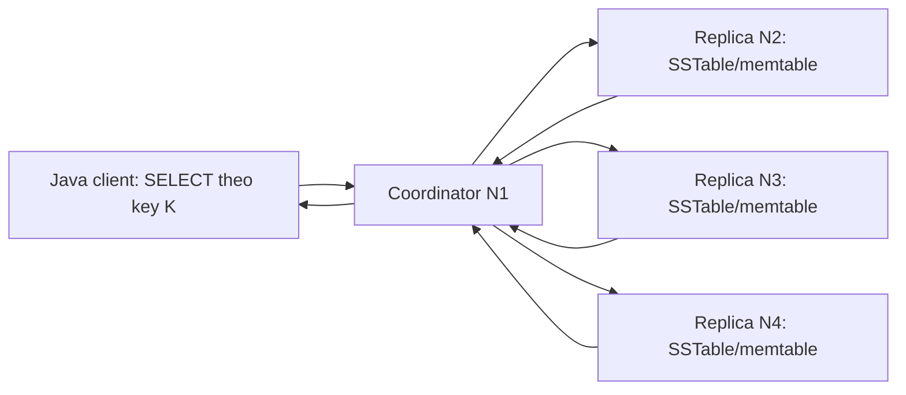
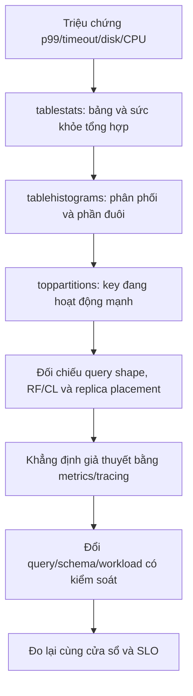
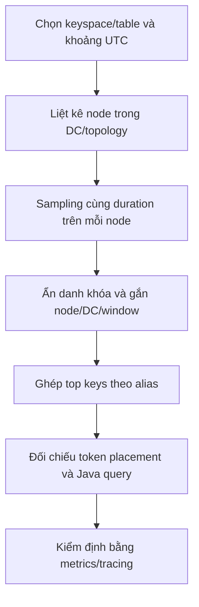

# nodetool tablestats, tablehistograms, toppartitions và chẩn đoán dữ liệu nóng trong Apache Cassandra

## 1. Tình huống: bảng có dữ liệu không lớn nhưng một số request vẫn rất chậm

Một ứng dụng Java ghi nhận `LOCAL_QUORUM` read p99 tăng từ 45 ms lên 260 ms. `nodetool status` cho thấy các node đều `UN`. Tổng dung lượng bảng chỉ khoảng 90 GiB/node và trung bình CPU cụm chưa quá cao. Tuy nhiên, một nhóm request đọc cùng khóa phân vùng chiếm phần lớn tải trên ba replica và thỉnh thoảng gặp tombstone scan.

Để chẩn đoán, người vận hành cần trả lời **ba câu hỏi khác nhau**:

1. **Bảng đang ở trạng thái nào?** Dung lượng, số SSTable, latency, tombstone và kích thước partition có bất thường không?
2. **Phân phối dữ liệu/độ trễ ra sao?** Chỉ số trung bình có che các partition cực lớn hoặc đuôi độ trễ dài không?
3. **Partition nào đang nhận nhiều truy cập nhất ngay lúc đo?** Có một số khóa bị đọc/ghi dồn dập dù kích thước không quá lớn không?

Ba công cụ `nodetool tablestats`, `nodetool tablehistograms` và `nodetool toppartitions` lần lượt hỗ trợ các câu hỏi này. Chúng **bổ sung**, không thay thế lẫn nhau: `tablestats` không liệt kê top partition theo traffic, `tablehistograms` không xác định danh tính từng key nóng, còn `toppartitions` không phải báo cáo đầy đủ về kích thước partition hay lịch sử traffic.

Bài thuộc chương **Công cụ vận hành** của mô-đun `DATABASE_ENGINE_WIDE_COLUMN_CASSANDRA`. Nội dung đặt trong bối cảnh Cassandra phân tán/wide-column, partition key, thiết kế bảng theo truy vấn, CL đọc/ghi, CQL, replication, compaction, repair, vận hành lỗi và Java Driver.

### Kết quả học tập

Sau bài này, bạn có thể:

- Dùng đúng cú pháp cơ bản và đọc được phạm vi số liệu của cả ba lệnh.
- Phân biệt **hot partition**, **large partition**, **hot coordinator** và **data skew**.
- Phân tích bảng có SSTables-per-read, tombstone scan, kích thước partition hoặc p99 bất thường.
- Lập thí nghiệm `toppartitions` lấy mẫu trên nhiều node, tránh coi kết quả sampler là số đếm toàn cụm chính xác.
- Liên hệ hành vi truy vấn CQL/Java với placement theo token/RF, phát hiện hotspot và chọn cách xử lý theo nguyên nhân.
- Báo cáo baseline → xử lý → after bằng bằng chứng có mốc thời gian, không tạo rủi ro khi chạy công cụ trên production.

## 2. Kiến thức nền: partition khác node, table và coordinator

Trong Cassandra, **partition key** được băm thành token để xác định các replica theo replication strategy và topology. Các hàng trong một partition có thể được sắp theo **clustering columns**, còn dữ liệu vật lý có thể nằm trên nhiều **SSTable**. Node nhận request CQL từ ứng dụng là **coordinator**; nó không nhất thiết đồng thời là replica chứa partition.



Với `NetworkTopologyStrategy` và RF = 3 tại DC cục bộ, một partition có ba replica mục tiêu trong DC đó. Request ở `LOCAL_QUORUM` cần đủ phản hồi theo CL, nhưng **vị trí coordinator** và **nơi thực hiện local reads** không phải luôn cùng node. Điều đó giải thích vì sao kết quả `tablestats` trên một node không đại diện cho mọi request do node ấy điều phối.

### 2.1. Ba khái niệm “nóng” khác nhau

| Hiện tượng | Dấu hiệu | Có chắc partition lớn không? |
| --- | --- | --- |
| **Hot partition** | Một key/range nhận quá nhiều request hoặc byte/s trong cửa sổ ngắn | **Không**: một row nhỏ có thể bị đọc 50.000 lần/s |
| **Large/wide partition** | Một partition giữ quá nhiều hàng/cell/byte, scan rộng tốn bộ nhớ/I/O | **Không cần** traffic cao; chỉ thỉnh thoảng đọc vẫn có thể rất đắt |
| **Hot coordinator** | Một node nhận nhiều request attempt hoặc điều phối request nặng | **Không** nhất thiết là replica của mọi hot partition |
| **Data skew** | Dữ liệu/traffic phân bố không đều theo node/token/tenant | Có thể do key design, RF, token ownership, tải hoặc node khỏe yếu |

**Hot là đặc trưng của workload trong một khoảng thời gian; large là đặc trưng kích thước dữ liệu.** Một partition có thể vừa hot vừa large, nhưng cần bằng chứng cho từng chiều.

## 3. Ma trận ba công cụ: dùng cái nào trước?

| Công cụ | Đầu ra chính | Phạm vi | Câu hỏi phù hợp | Điều không chứng minh |
| --- | --- | --- | --- | --- |
| `tablestats` | Số liệu aggregate per table: SSTables, bytes, read/write, partition/tombstone estimates | **Node đang được truy vấn** và bảng/keyspace được chọn | Bảng nào có dữ liệu/độ trễ/tombstone đáng quan tâm? | Partition key nào gây tải |
| `tablehistograms` | Các percentile/histogram được Cassandra xuất cho một bảng | **Node đang được truy vấn** và bảng | Đuôi phân phối partition size/cell count/SSTables-per-read/latency có xấu không? | Danh tính key lớn/hot; các percentile là số chính xác tuyệt đối |
| `toppartitions` | Danh sách **sampled heavy-hitter partition keys** theo sampler trong một duration | **Node đang được truy vấn** và khoảng thời gian lấy mẫu | Key nào có hoạt động read/write cao ngay lúc này? | Toàn bộ key nóng trên cụm; số count chính xác không sai số |

Đặt ba công cụ trong một chuỗi:



Nếu mục tiêu là tìm **key vừa hot** mà biết rõ table, bạn có thể bắt đầu từ `toppartitions`. Nếu chỉ biết p99 toàn cụm tăng, nên bắt đầu từ các metrics/`tablestats` và định vị bảng/node trước.

## 4. Điều kiện an toàn và ý nghĩa của “node-local”

`nodetool` tương tác với **một Cassandra node** qua giao diện quản trị/JMX. Thường lệnh không có tham số `-h` sẽ kết nối node cục bộ; có thể chọn node khác bằng `-h` và cổng JMX theo cấu hình. Phải xác minh máy đích, quyền truy cập và Cassandra version.

### Checklist tối thiểu

1. Xác định **cluster, DC, node, keyspace, table**, version và thời điểm chạy; không mặc định node nơi đặt terminal là node đang gây lỗi.
2. Kiểm tra health trước: `nodetool status`, read/write error rate, disk free, compaction/repair đang chạy.
3. Lấy dữ liệu **cùng cửa sổ** với workload và cùng tên bảng; không so `tablestats` lúc 09:00 với `toppartitions` lúc 15:00 khi pattern traffic khác.
4. Hạn chế tác động: `toppartitions` chạy sampler có overhead; thử duration ngắn và số top phù hợp trước khi khảo sát lâu.
5. Quản lý bảo mật: `toppartitions` có thể in **partition keys** chứa thông tin định danh, nên không copy raw output vào kênh công khai.
6. Chụp dữ liệu từ **tất cả replica/node có liên quan** hoặc ghi rõ rằng kết quả chỉ thuộc một node.

Các lệnh quan sát ở đây **không chủ ý sửa dữ liệu**, nhưng điều đó không có nghĩa chúng hoàn toàn không tốn CPU/heap hoặc không làm lộ key trong log.

### Version-aware CLI

Ở Cassandra 3.11, 4.1 và 5.0, những option chi tiết có thể khác. Luôn chạy:

```bash
nodetool help tablestats
nodetool help tablehistograms
nodetool help toppartitions
```

Ví dụ trong bài dùng cú pháp tương thích phổ biến và ghi chú option nào phụ thuộc phiên bản. **Không** sửa trực tiếp tham số JMX/ngưỡng/tính năng sampler chỉ để lấy output cho một bài lab production.

## 5. tablestats: ảnh chụp sức khỏe một bảng trên một node

Cú pháp cơ bản:

```bash
# Ví dụ keyspace sensor_lab, bảng readings_by_device_day:
nodetool tablestats sensor_lab.readings_by_device_day

# Hiển thị byte dễ đọc nếu phiên bản hỗ trợ:
nodetool tablestats -H sensor_lab.readings_by_device_day

# Một số phiên bản có JSON/YAML output cho automation:
nodetool tablestats -F json sensor_lab.readings_by_device_day
```

`-F json` là tùy chọn công cụ, **không** bảo đảm schema output JSON giống hệt giữa mọi version. Collector phải kiểm thử trường thực có và ghi version khi lưu. Không đưa JSON chưa được kiểm soát bảo mật chứa host/table names ra ngoài.

### 5.1. Nhóm chỉ số nên đọc

| Trường/nhóm thường gặp | Ý nghĩa thực dụng | Cảnh báo diễn giải sai |
| --- | --- | --- |
| **SSTable count** | Số SSTable hiện có cho bảng trên node | Nhiều SSTable không tự chứng minh một query đọc nhiều file |
| **Space used (live)** | Dung lượng live SSTable theo cách thống kê của node | Không phải kích thước logic ứng dụng hay tổng cluster sau RF |
| **Space used (total)** | Tổng dung lượng SSTable theo định nghĩa metric, có thể khác live | Không thay thế disk free filesystem; snapshot/tệp tạm cần xem riêng |
| **Space used by snapshots** | Dung lượng snapshot được báo cho bảng nếu có | Không nên cộng mù vào live/total vì các metric có quy tắc riêng |
| **Number of partitions (estimate)** | Ước lượng partition trên node/bảng | Không phải `COUNT(*)` chính xác; không cho biết phân phối traffic |
| **Compacted partition maximum/mean bytes** | Kích thước partition được ước lượng từ SSTable/data stats | Không khẳng định tuyệt đối key lớn nhất trên cluster hoặc kích thước logic sau hòa giải |
| **Local read/write count/latency** | Hoạt động đọc/ghi tại node ở phạm vi metric bảng | Không phải full end-to-end latency của Java client |
| **Average/maximum tombstones per slice (last five minutes)** | Tín hiệu tombstone trong các slice đọc theo cửa sổ tương ứng | Không suy ra mọi query đều quét mức max; phụ thuộc số mẫu |
| **Bloom filter false ratio** | Dấu hiệu hiệu quả lọc SSTable, cần xem cả denominator | Không phải đo trực tiếp query latency |
| **Pending flushes** | Dữ liệu/buffer đang cần flush theo metric | Một số snapshot pending = 0 không chứng minh không có I/O bottleneck |
| **Percent repaired** | Mức độ repaired SSTable/data theo metric của phiên bản | Không thay cho chứng cứ full repair bao phủ đủ token range |

Tên trường, đơn vị và việc tồn tại của từng chỉ số khác theo release. Không so trực tiếp `Local read latency` của node với HTTP p99 nếu chưa xác định metric đo phần nào của request.

### 5.2. Ví dụ output rút gọn, **hoàn toàn giả định**

```text
Keyspace: sensor_lab
  Table: readings_by_device_day
  SSTable count:                         184
  Space used (live):                     32.8 GiB
  Number of partitions (estimate):       780000
  Compacted partition maximum bytes:     98000000
  Local read count:                      4100000
  Local read latency:                    4.1 ms
  Average tombstones per slice (last five minutes): 18.2
  Maximum tombstones per slice (last five minutes):  8400
```

**Diễn giải ban đầu:**

- SSTable count 184 và dung lượng 32,8 GiB mô tả **một bảng trên một node**, cần đối chiếu chiến lược compaction, thời điểm flush và lịch sử của node.
- Estimated partition count 780.000 không làm mọi partition có kích thước bằng nhau. Max partition estimate khoảng 98 MB là tín hiệu nên điều tra partition rộng, nhưng **không phải danh sách key gây ra con số đó**.
- Average tombstone thấp hơn nhiều so với maximum cho thấy có thể tồn tại **đuôi truy vấn quét tombstone cao**; cần xem query/range/log và biểu đồ theo thời gian.
- `Local read latency 4,1 ms` có thể đi kèm client p99 180 ms do coordinator, queue, network, paging hoặc vài truy vấn đắt. Trung bình không phủ định p99.

**Không nên làm:** thấy `SSTable count` cao rồi chạy major compaction ngay. Compaction lớn có thể tốn disk headroom và I/O, với TWCS còn có nguy cơ làm xấu việc tổ chức cửa sổ dữ liệu.

## 6. tablehistograms: phần đuôi phân phối cho biết điều gì?

Cú pháp phổ biến:

```bash
nodetool tablehistograms sensor_lab readings_by_device_day

# Một số phiên bản chấp nhận dạng keyspace.table:
nodetool tablehistograms sensor_lab.readings_by_device_day
```

Lệnh đưa ra bảng percentile cho những đại lượng như **SSTables per read**, **write/read latency**, **partition size**, **cell count** tùy version. Ở các bản truyền thống, percentile thường gồm các mốc 50%, 75%, 95%, 98%, 99%, min/max; hãy **đọc header và đơn vị thực**, không giả định mọi cột đều mili giây hoặc byte.

### 6.1. Mỗi cột trả lời một câu hỏi

| Cột thường gặp | Câu hỏi cần trả lời | Suy luận không hợp lệ |
| --- | --- | --- |
| **SSTables** / SSTables per read | Một lần đọc partition phải chạm bao nhiêu SSTable? | SSTable count của bảng bằng SSTables per read |
| **Write latency** | Độ trễ ghi theo histogram đo tại lớp mà công cụ công bố | Đây là client HTTP p99 |
| **Read latency** | Độ trễ đọc theo phân vị phù hợp metric | Một partition nóng chắc chắn gây mọi latency |
| **Partition size** | Phân phối kích thước partition **ước lượng**, thường tính bằng byte | Các top 10 partition trong output này chính là top 10 key theo traffic |
| **Cell count** | Phân phối số cell/partition | Số row trả về từ mọi query |

Một percentile partition size cao nghĩa là **đuôi của phân phối kích thước** lớn; nó không đưa ra ngay **partition key** cụ thể. Muốn xác định key lớn cần thêm công cụ chuyên biệt, thao tác phân tích SSTable/metadata có kiểm soát, hoặc instrumentation từ workload. `toppartitions` chỉ giúp tìm **key được truy cập nhiều trong cửa sổ lấy mẫu**, không thay thế hoàn toàn việc tìm **largest partitions**.

### 6.2. Ví dụ đọc bảng histogram, số liệu giả định

| Percentile | SSTables per read | Read latency | Partition size |
| --- | ---: | ---: | ---: |
| 50% | 2 | 3 ms | 32 KiB |
| 95% | 6 | 18 ms | 4 MiB |
| 99% | 13 | 110 ms | 52 MiB |
| Max | 29 | 270 ms | 180 MiB |

**Lưu ý:** bảng chỉ minh họa giá trị đã chuyển đơn vị nhất quán; output thật có thể dùng đơn vị khác và nguồn thống kê khác. Không dùng ví dụ này để khẳng định tương quan giữa **cùng một request** có SSTables=13 và latency=110 ms: các percentile từ từng histogram **không nhất thiết gắn với cùng mẫu**.

Một số giả thuyết phù hợp:

- Có **đuôi partition lớn**: p99 size 52 MiB, max 180 MiB, cần xem key design, retention, clustering fan-out và kích thước bucket.
- **Đọc chạm nhiều SSTable** ở đuôi: kiểm tra compaction strategy, flush rate, SSTable overlap và phân phối truy cập.
- p99 read latency lớn hơn median nhiều: kiểm tra hot partition, tombstone scan, GC/disk và coordinator/client latency.

**Không khẳng định nguyên nhân chỉ từ histogram.** Phải đặt metric của cùng node, table và cửa sổ cùng với query shape, latency application và thời gian compaction.

### 6.3. Histogram có thể không có đủ mẫu

Nếu bảng gần như không được đọc, read latency histogram có thể thiếu số liệu, giá trị đặc biệt hoặc mốc percentiles không ổn định. Nếu mẫu nhỏ, hãy báo **sample count và cửa sổ thu thập** khi có thể, không ép tính p99. Tránh so p99 từ hai thời điểm mà workload, số sample hoặc cách reset histogram khác nhau.

## 7. toppartitions: tìm các partition hoạt động nhiều trong cửa sổ ngắn

Đây là lệnh trả lời trực tiếp câu hỏi **“key nào đang bị truy cập nhiều?”**, bằng cơ chế **sampling/stream summary**, không phải phép đếm truy cập chính xác của toàn bảng.

Theo cú pháp Apache Cassandra phổ biến:

```bash
# Lấy mẫu trên MỘT node, một bảng, 10.000 mili giây (= 10 giây).
nodetool toppartitions sensor_lab readings_by_device_day 10000

# Hiển thị tối đa 20 kết quả và tăng dung lượng sampler lên 1024,
# chỉ dùng option khi nodetool help của phiên bản xác nhận hỗ trợ.
nodetool toppartitions -k 20 -s 1024 \
  sensor_lab readings_by_device_day 10000

# Ví dụ chọn samplers READS,WRITES nếu bản đang chạy hỗ trợ tên này.
nodetool toppartitions -a READS,WRITES -k 10 \
  sensor_lab readings_by_device_day 10000
```

**Đơn vị của tham số cuối là mili giây**, không phải số giây. `10000` nghĩa là 10 giây. Hãy xác minh cú pháp `-a` và sampler names bằng `nodetool help toppartitions` đúng release. Cassandra 5.0 còn có các option công việc sampling theo lịch; bài này chỉ sử dụng dạng chạy một lần để hạn chế phạm vi.

### 7.1. Ý nghĩa các tham số

| Tham số | Vai trò | Giới hạn |
| --- | --- | --- |
| `<keyspace> <table>` | Bảng lấy mẫu | Không tự mở rộng sang mọi bảng |
| `<duration>` | Thời gian lấy mẫu, **milliseconds** | Một khoảng 10 giây chưa đại diện traffic cả ngày |
| `-k <topCount>` | Số key ở phần kết quả top | `-k` lớn không tự làm thống kê chính xác hơn |
| `-s <capacity>` | Dung lượng sampler/summary, liên quan độ chính xác khi cardinality cao | Capacity cao tốn thêm tài nguyên, cần cân nhắc |
| `-a <samplers>` | Chọn loại hoạt động được sample, có thể gồm READS/WRITES | Không tự quy đổi số mẫu thành business RPS |

**Cực kỳ quan trọng:** các số như sampled count, cardinality và error trên output chỉ nên diễn giải theo **semantics của phiên bản**. Sampling và thuật toán heavy-hitter có sai số/giới hạn; một key không có trong top **không có nghĩa nó không được truy cập**. Không cộng số sample từ nhiều replica và gọi đó là logical operation count.

### 7.2. Output minh họa, không phải output chuẩn cố định

```text
Sampling window: 10 seconds; table: sensor_lab.readings_by_device_day
sampler=READS
  key=(device-042,2026-11-21)     estimate=3200
  key=(device-917,2026-11-21)     estimate=910
  key=(device-002,2026-11-21)     estimate=85
sampler=WRITES
  key=(device-042,2026-11-21)     estimate=1800
  key=(device-120,2026-11-21)     estimate=430
```

Các dòng được **viết lại để dễ hiểu**, không cam kết layout, key serialization hay trường `estimate` đúng với mọi release. Trong thực tế, output có thể gồm error/cardinality và key dạng chuỗi hoặc bytes. **Không dùng key thật của khách hàng** trong ví dụ/ticket công khai.

### 7.3. Những câu hỏi cần hỏi sau khi có top keys

1. Key xuất hiện liên tục trong **nhiều cửa sổ** hay chỉ bùng lên vì một job ngắn?
2. Hot ở **READS**, **WRITES** hay cả hai? Pattern tương ứng loại truy vấn nào?
3. Cùng key có xuất hiện trên **những node giữ replica của token** không? Có node bị loại khỏi kết quả vì không thu đủ node không?
4. Key có **partition size lớn** hay chỉ rất nhiều request nhỏ?
5. Java service/endpoint nào tạo traffic; có retry storm, scan thiếu clustering range hoặc batch?
6. CL, RF và topology có làm request lan sang nhiều node hay vùng khác không?

Không quy kết một tenant/key là “có lỗi” chỉ vì nó top traffic. Có những partition nóng hợp lệ theo nghiệp vụ, nhưng vẫn cần thiết kế/sizing chịu được tải.

## 8. Tại sao toppartitions không tương đương hot-key analytics toàn cụm?

Khi node N2 là một replica của partition K, nó có thể thực hiện nhiều local read cho K dù coordinator thực sự là N1. Ngược lại, một query range/multi-partition trên coordinator có thể liên quan nhiều key/replica; cơ chế sample không nhất thiết có quan hệ một-một với request người dùng.

Hãy coi `toppartitions` là **cảm biến từng node**:

- **Giới hạn không gian:** chỉ những hoạt động node đó quan sát và table được chọn.
- **Giới hạn thời gian:** chỉ khoảng sample (ví dụ 10 giây); activity theo giờ/ngày có thể khác.
- **Giới hạn thuật toán:** ưu tiên heavy hitters theo sampler, capacity, count và approximation.
- **Giới hạn semantics:** READS/WRITES là các loại hoạt động do Cassandra đếm/sampling, không nhất thiết bằng HTTP RPS hoặc row count.

### Quy trình lấy mẫu nhiều node



Đồng bộ gần đúng cửa sổ giữa node giúp so sánh, nhưng **không thể mặc định mọi lệnh bắt đầu và kết thúc cùng mili giây**. Ghi timestamp của mỗi node để tránh nhầm sự kiện burst thoáng qua. Số lượt sample từ nhiều replica **có thể trùng nhau về cùng logical write**, không dùng phép cộng đơn giản làm traffic business.

## 9. Ghép ba công cụ thành một điều tra có nhân quả

Giả sử lúc 10:00 UTC, API đọc sự kiện theo thiết bị tại DC1 có p99 cao. Thu:

| Chứng cứ | Quan sát giả định | Ý nghĩa ban đầu |
| --- | --- | --- |
| `tablestats` N2 | SSTable count 180, max tombstones/slice 8.400 | Có thể có scan nhiều file/tombstone |
| `tablehistograms` N2 | SSTables per read p99=12, partition size p99=48 MiB | Đuôi dữ liệu/đường đọc đắt |
| `toppartitions` N2 | Key alias A liên tục top READS trong ba lượt sample | Một key được truy cập nhiều ở N2 |
| `toppartitions` N3 | Cùng alias A xuất hiện top READS | Phù hợp key có replica ở N2/N3 |
| Java metrics | Query fingerprint Q, p99 260 ms, retry 5% | Có tác động thực đến nghiệp vụ |
| `compactionstats` N2 | Pending compactions tăng | Tác nhân có thể làm read I/O xấu |

**Giả thuyết:** key A vừa hot vừa có chi phí đọc cao do tombstone/SSTable overlap. Nhưng chưa thể kết luận “compaction là nguyên nhân duy nhất”, vì:

- Top key theo traffic **không chứng minh** chính key đó sinh ra max tombstone.
- p99 từ histogram bảng **không gắn mặc nhiên** với một key/statement cụ thể.
- Compaction backlog và p99 tăng cùng lúc có thể chỉ là **tương quan**.

Để kiểm chứng, liên kết **query fingerprint + partition alias + timestamp** phía Java với sampling; bật tracing **cho một số request có kiểm soát**; xem table-level tombstone histograms, node disk I/O và replay workload trên staging. Chỉ chuyển giả thuyết sang kết luận khi có bằng chứng phân biệt được nguyên nhân cạnh tranh.

## 10. Tìm data skew: số byte và số request trên mỗi node

Một bảng có tổng dung lượng 900 GiB tại RF=3 **không thể chia đơn giản** thành “mỗi node 300 GiB” nếu chưa biết số node, token distribution, replication, nén, snapshot và key distribution. Trong cụm sử dụng vnode, token ownership có thể tương đối đều nhưng **request skew** vẫn lớn vì một token/partition được truy cập thường xuyên hơn những token khác.

### 10.1. Phân loại bằng ma trận

| Data size/node | Traffic/node | Diễn giải ban đầu | Hướng điều tra |
| --- | --- | --- | --- |
| Gần đều | Gần đều | Bình thường theo mô hình tải, vẫn phải xem p99 | Query cost, GC, disk, SLO |
| Gần đều | Lệch mạnh | **Hot-key/traffic skew**, driver routing hoặc request pattern | `toppartitions`, token/replica placement, retry |
| Lệch mạnh | Gần đều | Data skew, compaction/repair/snapshot, disk/capacity | `tablestats` per-node, tablehistograms |
| Lệch mạnh | Lệch mạnh | Có thể partition vừa rộng vừa hot hoặc topology lệch | Cả ba công cụ + Java metrics |

### 10.2. Hot coordinator khác hot replica

Nếu N1 làm coordinator cho rất nhiều query nhưng key thực sự nằm trên N2/N3/N4, `toppartitions` trên N1 có thể không phản ánh toàn bộ local replica traffic. Ngược lại, N2 có thể nóng vì nó là replica của nhiều hot partitions dù số CQL connections trực tiếp không cao. Phải xem **coordinator ClientRequest metrics**, `proxyhistograms`, `tpstats` và placement song song với `toppartitions`.

```bash
nodetool proxyhistograms
nodetool tpstats
nodetool status sensor_lab
```

`status` cho biết membership và load, **không chứng minh** node có read p99 tốt; `proxyhistograms` báo đường coordinator nhưng không trực tiếp xác định partition key.

## 11. CQL lab: thiết kế bucket theo device/day

Ví dụ lab để người học hiểu vì sao partition key quyết định việc một key trở thành hot. **Không chạy trên production**; điều chỉnh DC và RF theo cluster thử nghiệm:

```sql
CREATE KEYSPACE IF NOT EXISTS sensor_lab
WITH replication = {
    'class': 'NetworkTopologyStrategy',
    'dc1': 3
};

CREATE TABLE IF NOT EXISTS sensor_lab.readings_by_device_day (
    device_id text,
    event_day date,
    event_time timestamp,
    event_id uuid,
    temperature double,
    payload text,
    PRIMARY KEY ((device_id, event_day), event_time, event_id)
) WITH CLUSTERING ORDER BY (event_time DESC, event_id ASC);
```

Với partition key ghép `(device_id, event_day)`, mỗi thiết bị có một partition mỗi ngày. Truy vấn đúng khóa:

```sql
INSERT INTO sensor_lab.readings_by_device_day
    (device_id, event_day, event_time, event_id, temperature, payload)
VALUES (
    'device-042', '2026-11-21', '2026-11-21T08:30:00Z',
    11111111-1111-1111-1111-111111111111, 28.5, 'lab-only'
);

SELECT event_time, event_id, temperature
FROM sensor_lab.readings_by_device_day
WHERE device_id = 'device-042'
  AND event_day = '2026-11-21'
  AND event_time >= '2026-11-21T08:00:00Z'
  AND event_time < '2026-11-21T09:00:00Z'
LIMIT 100;
```

**Giải thích:**

- `device_id` và `event_day` cùng xác định partition; truy vấn bắt buộc biết cả hai để truy cập một partition cụ thể.
- `event_time` là clustering column, dải hẹp giúp hạn chế số mục cần đọc **bên trong partition**.
- `LIMIT 100` không bảo đảm chỉ quét 100 cell/tombstone.
- Nếu một thiết bị phát hàng triệu events/ngày, partition theo ngày vẫn có thể rất lớn và hot; cân nhắc giờ hoặc shard **sau khi đo**.

### 11.1. Thiết kế thí nghiệm hot key vs nhiều key

Tạo hai workload **trên staging**:

1. **Workload đều:** nhiều `device_id` và `event_day` khác nhau, cùng RPS tổng và payload/query shape.
2. **Workload lệch:** phần lớn request dồn vào một hoặc vài partition key, giữ RPS tổng và CL gần tương đương.

So `toppartitions` trên các replica, Java p95/p99 và node CPU/queue. Nếu workload lệch gây p99 lớn, đó là bằng chứng về **tác động của traffic distribution**, nhưng vẫn cần xem compaction/GC/disk trước khi quyết định shard.

### 11.2. Khi nào partition bucket nhỏ hơn hữu ích?

Bucket ngày có thể làm lịch sử partition nhỏ hơn so với bảng chỉ partition theo `device_id`. Nhưng **bucket không giảm QPS nếu mọi query vẫn cùng một bucket hiện tại**. Chia nhỏ hơn (theo giờ, hoặc hash shard) có thể phân tán tải nếu ứng dụng biết cách định tuyến/đọc nhiều shard, song đánh đổi:

- Số partition và lượt query tăng.
- Query cần fan-out và merge kết quả, tăng request/CL/cost.
- Việc chọn shard phải hợp lý và không làm mất thứ tự/time range.
- Không được đặt shard ngẫu nhiên khiến đọc một thiết bị phải quét toàn cluster.

Phải chọn theo workload thực và đo trước/sau. **Không chuyển schema chỉ vì một lần toppartitions xuất hiện key đứng đầu**.

## 12. Java Driver 4.x: thu số liệu đúng nguồn từ ứng dụng

`toppartitions` không tự biết request nào thuộc endpoint Java nào. Để nối dữ liệu, mỗi kiểu query nên có **query fingerprint**, CL, page size, local DC, thời gian và partition alias được ẩn danh.

Ví dụ Java 17+, DataStax/Apache Cassandra Java Driver 4.x với `CqlSession` được cấu hình từ ứng dụng:

```java
import com.datastax.oss.driver.api.core.DefaultConsistencyLevel;
import com.datastax.oss.driver.api.core.cql.BoundStatement;
import com.datastax.oss.driver.api.core.cql.PreparedStatement;
import com.datastax.oss.driver.api.core.cql.Row;
import java.time.Instant;
import java.time.LocalDate;
import java.util.UUID;

// session là CqlSession lâu dài, có local DC và bảo mật phù hợp.
PreparedStatement ps = session.prepare("""
    SELECT event_time, event_id, temperature
    FROM sensor_lab.readings_by_device_day
    WHERE device_id = ? AND event_day = ?
      AND event_time >= ? AND event_time < ?
    LIMIT 100
    """);

BoundStatement request = ps.boundStatementBuilder()
    .setString(0, "device-042")
    .setLocalDate(1, LocalDate.of(2026, 11, 21))
    .setInstant(2, Instant.parse("2026-11-21T08:00:00Z"))
    .setInstant(3, Instant.parse("2026-11-21T09:00:00Z"))
    .setConsistencyLevel(DefaultConsistencyLevel.LOCAL_QUORUM)
    .setPageSize(100)
    .build();

long startedNs = System.nanoTime();
try {
    int rows = 0;
    for (Row row : session.execute(request)) {
        rows++;
    }
    long latencyNs = System.nanoTime() - startedNs;
    // Ghi histogram: query_shape, CL, localDC, elapsed, rowCount.
    // Gắn partition_alias HMAC thay raw device_id nếu có policy phù hợp.
} catch (RuntimeException error) {
    long latencyNs = System.nanoTime() - startedNs;
    // Ghi lỗi timeout/unavailable/read failure riêng và query fingerprint.
    throw error;
}
```

**Giới hạn cần nhớ:**

- Vòng `for` tiêu thụ các page kết quả nếu driver cần paging; đo từ trước `execute` đến sau vòng lặp là **end-to-end query consumption**, khác latency chỉ fetch trang đầu.
- Một `LOCAL_QUORUM` read thành công **không** bảo đảm tất cả replica đều khỏe hoặc dữ liệu đã repaired đầy đủ.
- `System.nanoTime()` đo duration trong cùng JVM; dùng UTC timestamp riêng để ghép log trên các node, kèm clock skew nếu so thứ tự.
- Retry/speculative execution có thể tạo nhiều server attempts cho một logical query, khiến counts ở Java và `toppartitions` không một-một.
- Một ID thiết bị thật có thể là dữ liệu nhạy cảm; dùng HMAC alias ổn định để correlation, không đưa khóa HMAC vào metrics/log.

### 12.1. Thêm metric driver

Khi bản driver cho phép, thu per-node open connections/in-flight, request latency, retries, speculative executions và request throttling. Đối chiếu node được driver định tuyến với output `toppartitions` và replica endpoints theo token. Metric names/config có thể khác giữa các phiên bản Driver 4.x; dùng tài liệu driver và exporter thực đang chạy.

## 13. Tombstone và compaction: bảng nóng không luôn do lượng request

Một partition có thể phát sinh chi phí lớn do dữ liệu cũ đã xóa/hết TTL và số SSTable phải tra cứu, ngay cả khi số request/s không quá cao.

### 13.1. Tombstone scan

`DELETE` và TTL có thể để lại tombstone cho đến khi đủ điều kiện thu hồi vật lý qua compaction. Một `SELECT ... LIMIT 20` vẫn có thể phải quét nhiều tombstone để tìm 20 hàng sống. Vì thế:

- `tablestats`: xem average/maximum tombstones per slice nếu version hỗ trợ.
- JMX metrics: xem `TombstoneScannedHistogram`, warning/failure counters nếu exporter có.
- Tracing/log: tìm request có scanning nhiều tombstone, gắn CQL/range cụ thể.
- `toppartitions`: xem key có hoạt động nhiều trong lúc đọc chậm, **không** coi top traffic là tombstone key nếu chưa có bằng chứng.

Tăng `tombstone_failure_threshold` để “hết lỗi” có thể chỉ khiến node quét lâu hơn. Nên tối ưu range, lifecycle TTL/delete và compaction/repair theo kế hoạch.

### 13.2. SSTable count và SSTables-per-read

Số SSTable của bảng có thể cao nhưng nếu Bloom filter, index và clustering range giúp tránh nhiều file thì một request chỉ đọc ít SSTable. Ngược lại, một vùng khóa có phiên bản rải trên nhiều SSTable có thể tốn I/O. `tablehistograms` về SSTables per read cung cấp một **phân phối hữu ích hơn** so với chỉ nhìn SSTable count.

Các chiến lược STCS, LCS, TWCS hoặc UCS có trade-off khác nhau giữa write amplification, read amplification và khả năng thu hồi TTL. Không chọn chiến lược compaction mới chỉ vì thấy `tablestats` có nhiều SSTable, và không chạy major compaction tùy tiện trên production.

### 13.3. Repair và bản sao

Một replica offline có thể bỏ lỡ ghi hoặc tombstone. Repair cần được vận hành để hội tụ replica, đặc biệt trước khi dữ liệu được phép purge. Nhưng `repair` **không phải** lệnh sửa partition hot; nó có thể tăng I/O và khiến p99 tạm thời xấu. Ghi repair/compaction activity khi lấy mẫu, tránh quy mọi spike cho query.

## 14. Runbook 10 bước khi có nghi ngờ hot partition

| Bước | Hành động | Bằng chứng cần lưu |
| --- | --- | --- |
| 1 | Xác nhận endpoint/query và SLO bị ảnh hưởng | Query fingerprint, client p95/p99, timeout, UTC window |
| 2 | Xác nhận topology/RF/CL và node health | `nodetool status`, DC/rack, trạng thái replica |
| 3 | Tìm bảng/nguyên nhân aggregate | `tablestats` từng node, read/write rate, SSTable/tombstone/disk |
| 4 | Kiểm tra phần đuôi | `tablehistograms` trên cùng bảng/node | Percentiles, đơn vị, số mẫu nếu có |
| 5 | Lấy mẫu partition theo workload thực | `toppartitions` 10–30 s/ngắn và có kiểm soát trên node liên quan | Top keys ẩn danh, samplers, duration, capacity |
| 6 | Đối chiếu replica placement và routing | `getendpoints`/token metadata nếu phù hợp | Node/replica set, coordinator, query shape |
| 7 | Xem resource và hoạt động nền | CPU/heap, GC, disk I/O, `tpstats`, compaction, repair | Time series cùng khoảng |
| 8 | Kiểm định giả thuyết | Tracing sample có giới hạn, CQL range/TTL/delete, app metrics | FACT/HYPOTHESIS và nguyên nhân cạnh tranh |
| 9 | Giảm tải và sửa gốc | Concurrency limit, cache đúng ngữ nghĩa, bucket/shard/query redesign | Change plan, rollback, read consistency |
| 10 | Đo lại và đóng sự cố | Cùng RPS, CL, schema/dataset tương đương, p99, error, hot key | Before/after; số case còn chưa xác định |

**Không** cần cố chạy hết 10 bước nếu lỗi đã do một node down rõ ràng hoặc thiếu quorum. Runbook này dùng cho triage **hot data**, không thay thế hướng dẫn DR hoặc restore.

### 14.1. Thao tác giảm tác động tức thời

Khi xác minh một key đang bị read flood:

1. **Giới hạn concurrency** theo endpoint/tenant hoặc tạm giảm offered RPS của query đắt.
2. Cân nhắc cache cho dữ liệu đọc lặp **nếu** nghiệp vụ chấp nhận TTL/invalidation và stale read tương ứng.
3. Giảm fan-out thừa; dùng prepared statement có partition key và clustering range chính xác.
4. Giữ retry/backoff có giới hạn; retry storm có thể nhân workload vào cùng replica nóng.
5. Nếu đang có compaction/repair, tránh thêm tác vụ I/O nặng cho tới khi hiểu headroom.

Không tự **thêm replica** bằng sửa RF rồi kết luận hotspot được giải quyết: tăng RF cần repair/backfill lịch sử; một hot partition có thể vẫn bị tất cả replica mới/đang có truy cập và chi phí consistency tăng.

## 15. Cách phân biệt một key nóng thật với sai lệch sampling

Giả sử `toppartitions` hiển thị key A có 5.000 mẫu READS trong 10 giây. Những điều **chưa biết**:

- Có bao nhiêu **logical Java operations**? Một operation có thể retry hoặc query nhiều page.
- Count là **ước lượng** với error nào và capacity sampler bao nhiêu?
- Node được sample là coordinator hay replica? Có bao nhiêu replica khác xử lý cùng key?
- Trong cùng cửa sổ, app retry/timeout có bất thường không?
- Hoạt động có kéo dài nhiều phút hay chỉ 10 giây vừa đo?

**Kế hoạch kiểm định:**

1. Chạy nhiều cửa sổ ngắn ở cùng node, ghi start/end UTC, loại sampler và capacity.
2. Lặp tại các replica liên quan để thấy mức độ nhất quán của tập hot keys.
3. Ghép `query fingerprint + partition alias` từ Java trong cùng cửa sổ.
4. Kiểm tra successful requests vs retries/speculations/pages.
5. Đo latency và resource trước/sau khi hạn chế traffic key A hoặc chuyển query sang phương án tốt hơn.

Nếu chỉ một lần sample cho thấy key A top nhưng workload ổn và không có p99/timeout, hãy ghi nhận **bằng chứng về traffic concentration**, chưa gọi nó là “nguyên nhân sự cố”.

## 16. Báo cáo trước/sau: dữ liệu nóng có thực sự giảm?

Trước khi sửa, chốt:

| Mục tiêu | Metric chính | Phải giữ nguyên hoặc ghi khác biệt |
| --- | --- | --- |
| Giảm hot-key concentration | Top key tỷ trọng/sample rank từ cùng phương pháp | Sampler duration/capacity, node set, offered RPS |
| Giảm read cost | SSTables per read, tombstones scanned, partition size distribution | Query shape, CL, cache/compaction state |
| Cải thiện SLO | Client p50/p95/p99, timeout, rejected, successful RPS | Concurrency, payload, page size, DC |
| Bảo vệ node | CPU, GC, disk util/latency, compaction backlog, disk free | Hardware, repair jobs, traffic composition |
| Không làm sai dữ liệu | Kết quả CQL đúng, read consistency, idempotency | Schema/migration, TTL, replica health |

### Ví dụ số giả định có trade-off

| Chỉ số | Baseline | Sau thêm bucket/shard phù hợp |
| --- | ---: | ---: |
| Client read p99 | 215 ms | 71 ms |
| Read timeout rate | 2,5% | 0,3% |
| Successful RPS | 8.000/s | 8.200/s |
| SSTables per read p99 | 15 | 6 |
| Max partition size estimate | 160 MiB | 38 MiB |
| Số request fan-out trung bình/endpoint | 1 | 2 |

Số liệu **chỉ để diễn giải**, không phải benchmark Cassandra. Kết quả tốt hơn ở p99 đi kèm **fan-out tăng gấp đôi**, có thể làm network/CPU tăng; phải kiểm tra request workload khác và khả năng chịu lỗi. Nếu hot key chuyển sang key khác hoặc client giảm số request thành công, chưa thể kết luận sửa thành công.

### 16.1. Không so số không cùng đơn vị

`tablestats` có field theo byte, count, millisecond hoặc khoảng thời gian khác; `tablehistograms` có thể trình bày latency theo **microseconds**, size theo byte; `toppartitions` dùng duration **milliseconds**. Chuẩn hóa đơn vị trước khi đưa vào bảng, ghi nguồn và phiên bản.

**Không lấy trung bình p99 nhiều node** để ra p99 cụm. Với histogram có thể hợp nhất, sử dụng phương pháp aggregation phù hợp; nếu không, trình bày p99 **theo node** và lượng traffic tương ứng.

## 17. Lỗi diễn giải thường gặp

| Phát biểu sai | Vì sao sai? | Cách sửa |
| --- | --- | --- |
| “`tablestats` cho biết top 10 hot keys” | Nó chủ yếu báo **aggregate table/node** | Dùng `toppartitions` và app instrumentation |
| “Partition lớn nhất luôn là partition nóng nhất” | Kích thước và traffic độc lập | So histogram size với sampled READS/WRITES |
| “`toppartitions` là exact toàn cluster” | Node-local, sampled, theo cửa sổ | Thu nhiều node/window, ghi giới hạn |
| “Không thấy key trong top nghĩa là không có truy cập” | Sampler chỉ giữ top/sai số/capacity | Lặp sample, tăng capacity hợp lý, ghép app logs |
| “Tăng `-k` làm count chính xác hơn” | `-k` là số top được hiển thị | `-s` ảnh hưởng capacity, vẫn là sampling |
| “Tham số duration là số giây” | CLI dùng **mili giây** | `10000` cho 10 s |
| “SSTable count cao nghĩa mỗi read chạm bấy nhiêu file” | Các phép lọc bỏ qua SSTable không liên quan | Xem SSTables per read |
| “p99 histogram + max size xảy ra trên cùng một query” | Percentile các histogram không được join theo request | Cần tracing/instrumentation |
| “Nhiều tombstone chỉ cần tăng failure threshold” | Thêm tài nguyên quét, không sửa data model | Giảm phạm vi scan, sửa retention/compaction |
| “`nodetool status UN` chứng minh node nhanh” | Membership không đo latency/queue | `proxyhistograms`, `tpstats` và SLO |
| “Thêm bucket luôn giảm hotspot” | Current bucket có thể vẫn nhận toàn bộ writes | Đo partition key/traffic, chọn shard theo workload |
| “Tăng RF/chạy repair là cách dọn hotspot” | Có thể tăng I/O, không sửa skew query | Chẩn đoán rồi chọn data model/concurrency |

## 18. Bảo mật và lưu giữ bằng chứng

Output `toppartitions` có thể chứa khóa phân vùng như email, ID khách hàng, số tài khoản hoặc device identifier. Khi đưa vào ticket/dashboard:

- Dùng **HMAC alias ổn định**, với khóa HMAC được quản lý ngoài log, thay vì lưu giá trị nhạy cảm. Hash đơn thuần của miền giá trị nhỏ có thể bị đoán.
- Ghi `cluster/DC/node, UTC start/end, duration, sampler, capacity, topCount, table, Cassandra version`.
- Giữ raw output chỉ trong kho được cấp quyền và có retention theo chính sách.
- Không đưa partition key vào nhãn metric Prometheus cho **mọi** request vì cardinality lớn và rủi ro lộ PII.
- Trong báo cáo dùng key aliases và số liệu đã chuẩn hóa; tách FACT (tool output) khỏi HYPOTHESIS (nghi ngờ hot key gây p99).

Một output có timestamp, method và giới hạn rõ ràng hữu ích hơn ảnh chụp không biết node nào và lúc nào.

## 19. Thực hành theo cấp độ

### Bài tập A — phân biệt hot và large

Giả sử key A có **partition size estimate 2 KiB** nhưng READS sampler xấp xỉ 9.000 trong 10 s; key B có size 80 MiB nhưng không xuất hiện trong top read/write.

1. Key nào hot theo cửa sổ quan sát?
2. Key nào large theo định nghĩa dữ liệu?
3. Nếu read p99 cao, cần đo thêm chỉ số gì để biết A hay B gây ra?
4. Vì sao không thể kết luận từ ba số trên rằng B không có tác động tới p99?

### Bài tập B — đọc histograms đúng đơn vị

Ở một node, `tablehistograms` báo p99 SSTables per read 14, p99 partition size 70 MiB và p99 read latency 120 ms.

1. Ba p99 có bắt buộc thuộc cùng request không?
2. Cần dùng `tablestats`, JMX và tracing ra sao để kiểm định mối liên hệ?
3. Nếu có 0,1% request timeout, chỉ thống kê latency của request thành công có thể dẫn tới kết luận sai gì?

### Bài tập C — quy hoạch lấy mẫu nhiều node

Cụm có 6 node, hai DC, keyspace NTS RF 3 mỗi DC. Client Java ở DC1 gửi phần lớn read ở `LOCAL_QUORUM`.

1. Có nên chỉ lấy mẫu `toppartitions` trên coordinator N1?
2. Làm thế nào chọn node, khoảng thời gian và sampler để so kết quả?
3. Tại sao không cộng count từ cả sáu node rồi gọi tổng đó là số logical reads?
4. Truy vấn có paging/retry ảnh hưởng gì tới kết quả?

### Bài tập D — so trước/sau thay partition key

Trước migration, một bảng partition theo `device_id`, sau migration thành `(device_id, event_day)`. p99 giảm từ 190 xuống 80 ms nhưng số request/session tăng 60%.

1. Cần giữ workload nào như nhau để so sánh công bằng?
2. Fan-out read có tăng không và ảnh hưởng CL/replica/network thế nào?
3. Đo data correctness và retention/TTL ra sao trước cutover?
4. Khi nào không nên tuyên bố migration thành công dù p99 giảm?

### Câu hỏi tự kiểm tra

1. `tablestats` và `tablehistograms` khác nhau ở kiểu tổng hợp số liệu nào?
2. `toppartitions` dùng duration theo đơn vị gì?
3. `-k` và `-s` trong `toppartitions` khác nhau thế nào?
4. Vì sao kết quả `toppartitions` không phải danh sách largest partitions?
5. Một key nhỏ có thể trở thành hot partition không?
6. Vì sao cùng partition có thể xuất hiện trên nhiều node?
7. Những yếu tố nào khiến coordinator nóng dù số connection bình thường?
8. `SSTable count` khác `SSTables per read` ở phạm vi đo nào?
9. `LIMIT 20` có giới hạn tombstone phải scan không?
10. Khi nào cần hạn chế retry/concurrency thay vì tăng connection pool?
11. Tại sao không dùng một histogram p99 để xác định chính xác key gây lỗi?
12. Vì sao phải ghi CL, query shape và local DC khi đối chiếu Java client với node metrics?

## 20. Mẫu báo cáo vận hành có thể sao chép

```text
INCIDENT / CHANGE: <id>
UTC WINDOW: <start> ... <end>
CASSANDRA VERSION / CLUSTER / DC / NODE SET:
KEYSPACE.TABLE:
QUERY SHAPE / CL / PAGE SIZE / APPLICATION BUILD:

SYMPTOMS:
  Client offered RPS / successful RPS / p50,p95,p99 / timeout:
  Coordinator latency/attempts and replica/node health:

TABLESTATS (PER NODE):
  SSTable count, live bytes, total bytes, partition estimate:
  Local read/write, tombstones per slice, snapshot/flush context:

TABLEHISTOGRAMS (PER NODE):
  SSTables per read p50/p95/p99:
  Partition size p50/p95/p99:
  Cell count/read latency percentiles and UNITS:

TOPPARTITIONS (PER NODE/WINDOW):
  Samplers, -k, -s, duration milliseconds, UTC start/end:
  Top partition aliases and approximate counts/error:

CROSS-CHECK:
  Partition token/replica placement:
  Java query fingerprint / partition alias / retry:
  Compaction/repair/GC/disk I/O/tombstone context:

HYPOTHESES:
  H1: <evidence for/against>
  H2: <evidence for/against>
  UNKNOWN: <missing node, time window, sampler, count>

ACTION:
  <backpressure, cache, query range, bucketing/sharding...>
  Safety/consistency, rollback:

AFTER:
  Same workload and CL? node set/duration comparable?
  p95/p99, errors, successful RPS, estimated partition size:
  Data correctness and other workload impact:
  STATUS: VERIFIED / INCOMPLETE / ROLLED_BACK
```

**Không** điền dữ liệu giả vào ô đo thực tế rồi trình bày như kết quả production. Nếu thiếu số lượng mẫu/độ chính xác hay không đo được một node, ghi rõ `INCOMPLETE`.

## 21. Tài liệu Apache Cassandra để đối chiếu phiên bản

- [Apache Cassandra — nodetool tablestats](https://cassandra.apache.org/doc/latest/cassandra/managing/tools/nodetool/tablestats.html): cú pháp, `-F`, `-H` và các trường sort/stats.
- [Apache Cassandra — nodetool tablehistograms](https://cassandra.apache.org/doc/latest/cassandra/managing/tools/nodetool/tablehistograms.html): cú pháp xuất các statistic histograms cho bảng.
- [Apache Cassandra — nodetool toppartitions](https://cassandra.apache.org/doc/latest/cassandra/managing/tools/nodetool/toppartitions.html): duration theo mili giây, `-a` sampler, `-k` topCount, `-s` capacity.
- [Apache Cassandra — Monitoring Metrics](https://cassandra.apache.org/doc/latest/cassandra/managing/operating/metrics.html): histograms/metrics ở table/coordinator, tombstone, SSTable và latency.
- [Apache Cassandra — Use Nodetool](https://cassandra.apache.org/doc/stable/cassandra/troubleshooting/use_nodetool.html): cách dùng `nodetool` để thu hẹp sự cố theo node.

Tài liệu trên có thể được cập nhật và tên option/field khác theo release; dùng **`nodetool help <command>` và Cassandra/driver version thực tế** khi áp dụng trong cluster.

## 22. Kết luận

**`tablestats` trả lời “bảng này trên node đang ở tình trạng nào”; `tablehistograms` trả lời “phần đuôi phân phối có đáng lo không”; `toppartitions` trả lời “partition key nào được sample là hoạt động nhiều trong cửa sổ này”.** Không công cụ nào một mình chứng minh được một key là nguyên nhân mọi lỗi đọc/ghi toàn cụm.

Chẩn đoán dữ liệu nóng đúng cách là ghép **trạng thái bảng + percentiles + sampled top keys** với **query shape, partition/clustering key, RF/CL, replica placement, Java driver metrics, I/O và công việc nền**. Dữ liệu nóng có thể nhỏ mà bị đọc quá nhiều; dữ liệu rất lớn có thể hiếm khi được truy cập; coordinator nóng có thể khác replica nóng. Thu thập theo **node và cửa sổ UTC**, có giới hạn sampling, ẩn danh khóa và đo **before/after** bằng SLO/nghiệp vụ thực. **Chỉ sửa thiết kế partition, concurrency, cache hay compaction khi có bằng chứng và phương án rollback an toàn.**
