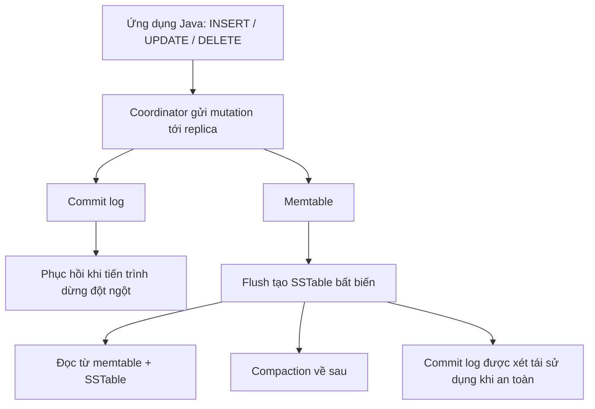
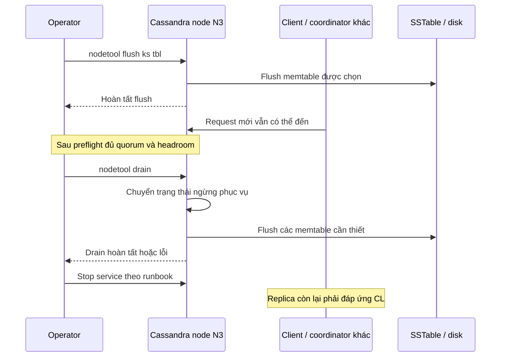
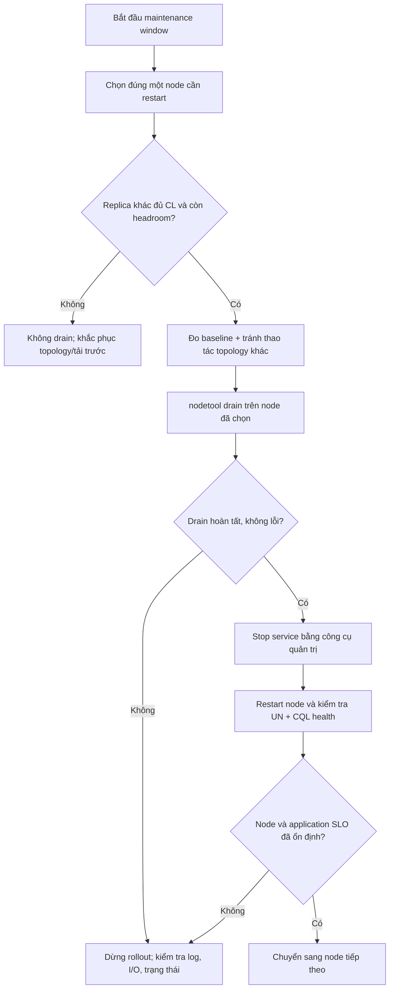

# `nodetool flush`, `drain` và các điều kiện trước khi dừng một node Cassandra

## 1. Bài toán: dừng node an toàn mà không làm mất khả dụng

Apache Cassandra là cơ sở dữ liệu **wide-column phân tán**. Dữ liệu nằm trong các partition được xác định bằng **partition key**; mỗi partition được sao chép trên nhiều **replica** theo replication factor (RF). Một truy vấn CQL do ứng dụng Java gửi đi cần đủ phản hồi theo **consistency level (CL)**, chẳng hạn `LOCAL_QUORUM` hoặc `QUORUM`.

Trong lúc bảo trì, quản trị viên có thể cần dừng một node để nâng cấp, khởi động lại hệ điều hành, thay cấu hình hoặc kiểm tra phần cứng. Hai lệnh dễ bị nhầm là:

- `nodetool flush`: yêu cầu node **flush memtable ra SSTable**.
- `nodetool drain`: đưa node vào quá trình **ngừng phục vụ có kiểm soát** và flush dữ liệu trước khi dừng tiến trình theo quy trình.

**Không lệnh nào tự đảm bảo cluster còn đủ replica để đáp ứng CL khi node ngừng hoạt động.** Trước khi dừng phải kiểm tra topology, RF, CL, sức khỏe các replica còn lại, dung lượng/tải và khả năng client định tuyến đến node khác.

Trong bài, “node” là một tiến trình Cassandra trên một máy/VM. Các thao tác `nodetool` thường tác động tới **node mà công cụ đang kết nối**, không tác động đồng loạt lên toàn bộ cluster.

### Sau bài học, cần trả lời được

1. Flush thay đổi gì trong memtable, SSTable và commit log?
2. Drain khác flush ra sao, và có tự tắt tiến trình không?
3. Tại sao `UN` trên `nodetool status` chưa đủ để kết luận có thể dừng một node?
4. Một đợt **rolling restart** cần được lên lịch và xác minh thế nào?
5. Khi drain lỗi hoặc node offline lâu, cần làm gì thay vì xóa data directory hay chạy lệnh nguy hiểm?

## 2. Đường ghi và điểm flush xuất hiện

Trên mỗi replica nhận mutation, Cassandra thường dùng hai thành phần quan trọng:

- **Commit log:** ghi nhận mutation để hỗ trợ phục hồi khi tiến trình dừng đột ngột.
- **Memtable:** cấu trúc dữ liệu trong bộ nhớ chứa những cập nhật chưa được chuyển hết ra SSTable.

Khi memtable flush, Cassandra ghi một **SSTable bất biến** trên đĩa. Sau đó, commit log segment chỉ được tái sử dụng hoặc giải phóng khi các điều kiện an toàn cho những mutation liên quan đã được đáp ứng.



Sơ đồ là khái niệm: chi tiết ACK, commit log sync, thứ tự nội bộ và việc release segment phụ thuộc cấu hình/phiên bản. **Không suy ra rằng ứng dụng chỉ nhận ACK sau khi SSTable đã được flush.** Ở đường ghi thông thường, SSTable flush không phải bước bắt buộc đồng bộ của mọi request.

### Flush và durability không đồng nghĩa replication

Giả sử partition `order_id = O1` có RF = 3:

```text
Replica R1: commit log + memtable
Replica R2: commit log + memtable
Replica R3: đang Down, chưa nhận mutation
```

Nếu chạy `nodetool flush` trên R1:

- Dữ liệu ở memtable của **R1** được chuyển ra SSTable tương ứng.
- R2 không tự flush chỉ vì R1 đã flush.
- R3 không tự nhận mutation bị bỏ lỡ.
- Flush không chứng minh dữ liệu đã hội tụ giữa các replica.

**Anti-entropy repair**, hints và replication là những cơ chế khác, có mục tiêu riêng. Không dùng `flush` như một bản sao lưu hoặc như lệnh sửa inconsistency.

## 3. `nodetool flush`: làm gì và không làm gì?

Ở các bản Cassandra thường gặp, cú pháp có dạng:

```bash
# Xem cú pháp trên đúng phiên bản.
nodetool help flush

# Flush các memtable trong phạm vi keyspace/table chỉ định.
nodetool flush maintenance_lab events_by_device

# Flush theo phạm vi mặc định của phiên bản nếu bỏ đối số.
nodetool flush
```

Lệnh có thể chỉ định một keyspace và các table thuộc keyspace đó; cách hiển thị help và những tùy chọn nâng cao thay đổi theo phiên bản. **Không coi `nodetool flush` là lệnh “flush tất cả node”.**

### Phạm vi tác động

| Điều | `flush` có thực hiện? | Ghi chú |
| --- | --- | --- |
| Yêu cầu đẩy memtable sang SSTable | **Có** | Trên node và phạm vi bảng được chỉ định |
| Dừng nhận tất cả CQL mới | **Không** | Ghi mới vẫn có thể đến trong/sau flush |
| Chuyển node sang trạng thái drained | **Không** | Đây không phải quy trình shutdown |
| Đảm bảo toàn bộ replica đã đồng bộ | **Không** | Chỉ tác động dữ liệu cục bộ |
| Tạo backup an toàn ở nơi khác | **Không** | Snapshot/backup và restore là quy trình riêng |
| Giảm ngay số lượng SSTable | **Không** | Flush còn có thể **tăng** số SSTable |
| Đảm bảo mọi commit log segment biến mất | **Không** | Segment còn phụ thuộc các memtable và điều kiện recycle |

### Vì sao flush xong vẫn có dữ liệu trong memtable?

Một ứng dụng có thể tiếp tục ghi ngay sau khi flush bắt đầu hoặc khi nó kết thúc. Vì thế:

```text
10:00:00  nodetool flush maintenance_lab events_by_device
10:00:01  Các memtable cần flush được xử lý
10:00:02  Ứng dụng ghi thêm mutation M2
10:00:03  nodetool flush trả về thành công

M2 có thể đang nằm trong memtable mới.
```

**Flush không phải hàng rào “không còn writes mới”.** Nếu mục tiêu là dừng node để bảo trì, chỉ chạy flush rồi lập tức tắt máy chưa tương đương một quy trình ngừng dịch vụ có kiểm soát.

### Flush có chi phí

Flush tạo SSTable và tiêu thụ disk throughput/CPU. Khi node đã gần đầy đĩa hoặc I/O bị bão hòa, ép flush thêm có thể làm latency và pending compaction xấu đi. Không dùng flush liên tục như cách giảm memtable size “cho đẹp số”.

Trong trường hợp cần quan sát:

```bash
nodetool tablestats maintenance_lab.events_by_device
nodetool compactionstats
nodetool tpstats
```

`Memtable data size`, `Pending flushes`, `SSTable count` và disk free cần được xem **theo xu hướng**, không suy luận từ một snapshot.

## 4. `nodetool drain`: chuẩn bị dừng node theo trình tự

Lệnh:

```bash
nodetool help drain
nodetool drain
```

Ở các phiên bản Cassandra phổ biến, `drain` đưa node vào trạng thái không tiếp tục phục vụ write mới theo chu trình bình thường và **flush những memtable cần thiết** để chuẩn bị shutdown; các thành phần xử lý/giao tiếp liên quan được đưa về trạng thái dừng theo cơ chế của phiên bản.

Điều cần hiểu chính xác:

- Drain **rộng hơn flush**: nó nhằm chuẩn bị node dừng, không chỉ viết memtable ra SSTable.
- Drain có thể khiến node **ngừng tiếp nhận hoặc phục vụ request mới** trong quá trình chuyển trạng thái. Không chạy drain trên node production chỉ để đo đạc.
- Khi đã drained, **không nên mong gọi CQL trở lại trên cùng tiến trình chỉ bằng một lệnh “undrain”**; kế hoạch thường là dừng và khởi động lại dịch vụ.
- `nodetool drain` **không đồng nghĩa đã tắt nguồn máy hoặc luôn tự kết thúc JVM**. Hãy xác minh trạng thái rồi dùng service manager/orchestrator để dừng tiến trình theo runbook.
- Cú pháp, nội dung flush, logs, trạng thái giao tiếp và thời gian hoàn tất có thể khác giữa bản Cassandra và nền tảng triển khai.

### Khi nào chọn drain?

| Mục tiêu | Lựa chọn thường phù hợp | Không nên nhầm |
| --- | --- | --- |
| Muốn buộc flush memtable của một bảng phục vụ chẩn đoán | `nodetool flush keyspace table` | Không ngừng CQL |
| Chuẩn bị dừng/restart node có kế hoạch | `nodetool drain` rồi stop theo runbook | Không làm node rời token ring vĩnh viễn |
| Loại bỏ node khỏe khỏi cluster lâu dài | Quy trình **decommission** phù hợp phiên bản | Không dùng `drain` thay decommission |
| Xử lý node đã chết và cần bỏ metadata ownership | Quy trình **removenode** trong điều kiện phù hợp | Không dùng để “undo” drain |
| Đối chiếu dữ liệu replica bỏ lỡ | **Repair** | Không phải `flush` hoặc `drain` |
| Sao lưu dữ liệu trước thao tác rủi ro | Snapshot/backup theo chính sách | Không coi SSTable flush là backup |

**Drain không di chuyển ownership và không thay đổi RF.** Một node đã được drain/dừng vẫn là thành viên topology cho đến khi có thao tác membership khác được thực hiện theo quy trình.

## 5. So sánh từng giai đoạn của flush, drain và shutdown



Đây là luồng minh họa về **trật tự vận hành**. Trong thực tế không bắt buộc chạy `flush` riêng trước `drain`: **drain đã chứa bước flush cần thiết**, nên chạy cả hai có thể dư thừa và tăng I/O. Sơ đồ đặt flush trước drain để làm rõ hai lệnh không tương đương.

### Tại sao phải tính thời gian drain?

Nếu node chứa nhiều memtable cần flush, I/O đang bị chiếm bởi compaction hoặc đĩa gần đầy, drain có thể tốn thời gian hoặc thất bại. Không đặt timeout của hệ điều phối quá ngắn rồi dùng `SIGKILL` làm phương án mặc định.

Trong Kubernetes, VM manager hoặc service manager, phải kiểm tra **graceful shutdown deadline**, thứ tự termination và readiness/traffic routing theo công cụ vận hành thực tế. Một process bị hệ điều phối buộc kill trước khi drain hoàn tất không được ghi nhận là “drain thành công”.

## 6. Điều kiện quan trọng nhất: còn đủ replica cho consistency level?

Giả sử keyspace `maintenance_lab` dùng `NetworkTopologyStrategy` với `RF(dc1)=3`. Mỗi partition có ba replica trong `dc1`, và client dùng `LOCAL_QUORUM`:

```text
LOCAL_QUORUM = floor(3 / 2) + 1 = 2

R1: Up
R2: Up
R3: Up

Dừng R3 theo lịch => còn R1 và R2.
Về mặt số lượng: vẫn đủ 2 phản hồi local quorum,
NẾU cả R1 và R2 thực sự khỏe và đang lưu dữ liệu phù hợp.
```

Nếu R2 đang Down từ trước:

```text
Trước bảo trì: R1 Up, R2 Down, R3 Up => có thể đủ 2.
Sau khi dừng R3: R1 Up, R2 Down, R3 Down => chỉ còn 1.
LOCAL_QUORUM yêu cầu 2 => unavailable.
```

**Không dừng R3 chỉ vì `nodetool status` hiển thị R3 là `UN`.** Phải xác minh các replica còn lại của những token range mà R3 đang phục vụ.

### Ma trận RF/CL trước khi dừng một replica

| RF trong DC | CL của ứng dụng | Số cần | Nếu còn RF − 1 replica khỏe | Kết luận về số lượng |
| ---: | --- | ---: | ---: | --- |
| 3 | `LOCAL_ONE` | 1 | 2 | Có thể tiếp tục |
| 3 | `LOCAL_QUORUM` | 2 | 2 | Có thể tiếp tục, nhưng không có dư địa cho lỗi replica thứ hai |
| 3 | `ALL` | 3 | 2 | Không đạt |
| 2 | `LOCAL_QUORUM` | 2 | 1 | Không đạt |
| 1 | `ONE` | 1 | 0 | Không đạt |

Đây là ví dụ giả định ba (hoặc RF) replica nằm ở node khác nhau, trạng thái và dữ liệu hợp lệ. **Không áp dụng phép đếm RF − 1 máy móc** nếu cluster có vấn đề placement, thay đổi topology dở dang hoặc DC/rack thực tế không khớp thông tin Cassandra.

### Với cluster nhiều datacenter

`NetworkTopologyStrategy` định nghĩa RF riêng theo từng DC; `LOCAL_QUORUM` của ứng dụng ở DC đó chỉ yêu cầu quorum replica **địa phương**. `QUORUM` tính theo tổng RF toàn keyspace và `EACH_QUORUM` (ghi thông thường) đòi quorum từng DC.

Ví dụ RF3 + RF3, global `QUORUM` cần 4 trong tổng 6 replica. Dừng một replica có thể còn 5, nhưng nếu một DC đang mất từ trước hoặc mạng WAN đã chia cắt thì **không thể suy từ con số 5 trong điều kiện lý tưởng** rằng truy vấn vẫn thành công. Phải kiểm tra CL **theo từng luồng ứng dụng** và trạng thái thực của các DC.

**LWT/CAS** còn có serial consistency và đường Paxos riêng; không chỉ kiểm tra CL thường rồi mặc định mọi thao tác có điều kiện vẫn an toàn trong cửa sổ bảo trì.

## 7. Preflight trước khi drain: từ topology đến ứng dụng

### 7.1. Sức khỏe ring và thao tác topology

```bash
nodetool status
nodetool describecluster
nodetool netstats
```

Xác minh:

- Các node còn lại cần thiết đang **Up/Normal**, không có node quan trọng đang Joining/Leaving/Moving hoặc lỗi.
- Node định dừng nằm đúng DC/rack dự kiến; không dừng nhầm host ID.
- Không có bootstrap, decommission, rebuild, repair hay streaming lớn đang tranh chấp tài nguyên.
- Đường mạng giữa các replica còn lại không có lỗi hoặc latency bất thường.
- Khả năng đạt quorum cho **mọi keyspace/CL quan trọng**, không chỉ một bảng thử nghiệm.

`UN` là trạng thái membership, **không chứng minh node đang trả lời CQL đúng deadline**. Kiểm tra thêm metrics timeout, dropped messages và thread pool.

### 7.2. Sức khỏe tài nguyên và độ trễ

```bash
nodetool tpstats
nodetool compactionstats
nodetool netstats
```

Theo dõi cả chỉ số hệ điều hành:

| Nhóm | Cần xác minh | Vì sao quan trọng? |
| --- | --- | --- |
| Disk space | Free space tại node định dừng và node còn lại | Drain/flush cần ghi SSTable; node còn lại phải chịu tải |
| Disk I/O | Utilization, read/write latency, pending queue | Flush đồng thời hoặc dồn tải có thể làm p99 tăng |
| CPU/GC | Pause, heap pressure, threads | Node còn lại cần headroom khi mất một replica |
| Network | Packet loss, RTT, throughput giữa node/DC | Quorum request phụ thuộc truyền thông còn hoạt động |
| Client SLO | Read/write p95/p99, timeout, unavailable, retry rate | Tiêu chí quyết định có nên bảo trì |
| Backup/repair | Lịch và trạng thái gần nhất | Node offline lâu có thể bỏ lỡ mutation/tombstone |

Nếu free space đã rất thấp, **đừng bắt đầu drain chỉ để “đẩy dữ liệu xuống đĩa”**. Flush có thể cần thêm dung lượng SSTable, và một lần restart khi storage đã có lỗi làm tăng rủi ro phục hồi.

### 7.3. Ứng dụng có chịu được thiếu một coordinator không?

Java Driver thường khám phá topology sau khi kết nối bằng các **contact points**. Nhưng không nên giả định mọi ứng dụng đã có cấu hình đúng:

- Các client có **nhiều contact point dự phòng**, không gắn mọi traffic vào IP duy nhất của node sắp dừng.
- `local datacenter` đã cấu hình đúng.
- Connection pool, request deadlines và retry policy không tạo **retry storm** khi một node bị drain.
- Load-balancing policy không ép mọi request tới node bảo trì.
- Có dashboard đối chiếu **logical QPS** với **attempt QPS**, số retry và lỗi theo DC.

**Drain sạch về mặt lưu trữ vẫn có thể gây unavailable hoặc p99 tăng** nếu các replica còn lại quá tải hoặc client không tìm được coordinator khác.

## 8. Phân biệt rolling restart với dừng nhiều node đồng thời

**Rolling restart** nghĩa là dừng/khởi động lại từng node hoặc theo các nhóm nhỏ đã chứng minh an toàn. Không phải “chạy cùng câu lệnh drain trên mọi node rồi restart tất cả”.



Ví dụ RF3, `LOCAL_QUORUM`, ba replica tại ba rack độc lập. Dừng một node còn hai replica đủ quorum theo số lượng, **nhưng nếu dừng ngay node thứ hai trước khi node thứ nhất hồi phục** sẽ chỉ còn một replica cho nhiều partition. Vì vậy phải chờ node trước về trạng thái phục vụ bình thường và SLO ổn định.

### Với một rack hoặc availability zone

Một rack có thể chứa nhiều node, và một lỗi nguồn/switch có thể ảnh hưởng nhiều replica. Khi lên lịch phải xét **miền lỗi vật lý**:

- Không đồng thời restart các node thuộc những rack khác nhau nếu điều đó làm thiếu quorum.
- Không giả định hai VM khác nhau luôn độc lập nếu cùng hypervisor, nguồn điện hoặc storage appliance.
- Khi một DC đang có sự cố, thường không nên thêm kế hoạch maintenance làm giảm số replica sống trong DC còn lại.

## 9. Quy trình thao tác một node: preflight → drain → stop → restart

Giả sử chọn node `N3` thuộc `dc1`. Đây là **runbook minh họa**, không thay thế quy trình cho từng phiên bản Cassandra và nền tảng điều phối.

### Bước 1 — Chốt phạm vi và điều kiện dừng

Ghi nhận host ID, IP, DC, rack, phiên bản Cassandra, keyspace/CL ảnh hưởng, người phụ trách và cửa sổ bảo trì. Xác định ngưỡng dừng rollout, ví dụ:

- p99 đọc/ghi của API vượt SLO trong nhiều cửa sổ đo liên tiếp;
- timeout/unavailable tăng so với baseline;
- disk free của một node cần thiết xuống dưới headroom cho phép;
- node khác vừa mất kết nối hoặc repair/streaming gặp lỗi.

Ngưỡng cụ thể phải dựa trên SLO và capacity của hệ thống, không dùng cùng một số cho mọi cluster.

### Bước 2 — Quan sát trước khi drain

```bash
nodetool status
nodetool tpstats
nodetool compactionstats
nodetool netstats
```

Đọc thêm logs, metrics disk/GC/network và số liệu client. **Không chạy một lệnh quản trị có khả năng ngừng phục vụ** nếu đang không chắc mình kết nối tới node nào.

### Bước 3 — Thực thi drain trên đúng node

```bash
nodetool drain
```

Theo dõi thời gian chạy, exit code, logs và các lỗi liên quan memtable flush/commit log/storage. Không coi drain thành công khi command còn treo hoặc trả lỗi.

**Không cần chạy `nodetool flush` riêng theo thói quen trước `drain`.** Với quy trình thông thường, drain đã xử lý flush cần thiết. Chỉ chạy flush trước nếu runbook phiên bản có lý do cụ thể và đã đánh giá chi phí I/O.

### Bước 4 — Dừng tiến trình bằng công cụ triển khai

Chỉ sau khi drain hoàn tất theo runbook mới dùng service manager hoặc orchestrator để stop service. Ví dụ `systemctl`/container lifecycle khác nhau theo hạ tầng; **không sao chép lệnh stop khi chưa biết tên service, quyền, và thời hạn graceful termination**.

Không dùng `kill -9`/buộc xóa container là lựa chọn mặc định. Khi process bị dừng đột ngột, Cassandra có thể phải **replay commit log khi khởi động lại**; hành vi phục hồi và rủi ro phụ thuộc tình trạng lưu trữ thực tế.

### Bước 5 — Khởi động lại và xác minh

Sau khi service đã khởi động:

```bash
nodetool status
nodetool info
nodetool netstats
nodetool tpstats
```

Đừng chỉ thấy tiến trình đang chạy rồi chuyển sang node tiếp theo. Xác minh:

1. Node về **Up/Normal** trong nhiều góc nhìn membership.
2. Logs không có lỗi startup, recovery, commit log, SSTable hoặc kết nối.
3. Java Driver có thể gửi CQL qua cluster theo CL nghiệp vụ.
4. p95/p99, timeout, unavailable, retry và disk/CPU ổn định.
5. Những replica cần thiết đã khỏe; nếu node vắng mặt lâu, đánh giá hints/repair theo thời gian downtime và chính sách tombstone.

Chỉ sau các bước này mới bàn giao lượt restart tiếp theo.

## 10. Flush/drain không thay thế backup, repair hay decommission

| Công cụ/hành động | Mục đích chính | Không hứa điều gì? |
| --- | --- | --- |
| `nodetool flush` | Đưa memtable của node/table xuống SSTable | Không dừng request, không sửa replica khác |
| `nodetool drain` | Chuẩn bị node dừng sạch theo chu trình phiên bản | Không di chuyển ownership, không làm quorum tự tăng |
| Graceful service stop | Kết thúc tiến trình theo service manager | Không chứng minh node khác chịu được tải |
| `nodetool snapshot`/backup | Tạo dữ liệu phục hồi theo cơ chế hỗ trợ | Không tự duy trì replica hội tụ |
| `nodetool repair` | Đối chiếu dữ liệu trên những replica/range đã chọn | Không thay thế backup hoặc tự đồng bộ toàn cluster từ một node |
| `nodetool decommission` | Đưa node đang hoạt động rời vòng và xử lý chuyển ownership | Không phải bước bắt buộc của rolling restart |
| `nodetool removenode` | Xử lý metadata cho node chết trong tình huống phù hợp | Không phải “undo” chung cho một lần drain lỗi |

### Khi bảo trì kéo dài nhiều ngày

Nếu một node vắng mặt lâu hơn thời gian dự kiến, cần quan tâm:

- Hints có thể không còn đủ để chuyển tất cả mutation bị bỏ lỡ.
- Tombstone và `gc_grace_seconds` đặt ràng buộc an toàn khi có DELETE/TTL.
- Anti-entropy repair cần bao phủ đúng token ranges và replica liên quan.
- Sau khi node trở lại, compaction/streaming có thể tăng tải và p99.

Không chỉ restart node rồi kết luận “mọi dữ liệu đã đồng bộ”. Nếu downtime vượt cửa sổ repair/tombstone an toàn, cần quy trình khôi phục chuyên biệt; **không tự động chạy repair hoặc cleanup bừa bãi khi topology chưa khỏe**.

## 11. CQL lab: kiểm tra khả dụng trước và sau bảo trì

Ví dụ dưới đây chỉ dành cho **cluster lab cô lập** có datacenter `dc1`, ít nhất ba node để đáp ứng RF3, và đã kiểm tra cách đặt tên DC thực tế.

### Tạo keyspace và bảng phục vụ truy vấn theo partition key

```sql
CREATE KEYSPACE IF NOT EXISTS maintenance_lab
WITH replication = {
    'class': 'NetworkTopologyStrategy',
    'dc1': 3
}
AND durable_writes = true;

CREATE TABLE IF NOT EXISTS maintenance_lab.events_by_device (
    device_id text,
    bucket_day date,
    event_time timestamp,
    event_id uuid,
    payload text,
    PRIMARY KEY ((device_id, bucket_day), event_time, event_id)
) WITH CLUSTERING ORDER BY (
    event_time DESC,
    event_id ASC
);
```

Partition key `(device_id, bucket_day)` giới hạn phạm vi đọc theo thiết bị/ngày. Đây là bảng phục vụ kiểm thử API; nó không được dùng để phát biểu về mọi partition trong cluster.

### Ghi và đọc mẫu

Trong `cqlsh` kết nối tới coordinator thuộc `dc1`:

```text
CONSISTENCY LOCAL_QUORUM;
```

Sau đó:

```sql
INSERT INTO maintenance_lab.events_by_device (
    device_id, bucket_day, event_time, event_id, payload
) VALUES (
    'device-42', '2026-11-20',
    '2026-11-20 10:00:00+0000',
    11111111-1111-4111-8111-111111111111, 'online'
);

SELECT event_time, event_id, payload
FROM maintenance_lab.events_by_device
WHERE device_id = 'device-42'
  AND bucket_day = '2026-11-20'
LIMIT 20;
```

Trong **lab**, sau khi xác định có đủ replica sống, có thể dừng một node bằng runbook và kiểm tra cùng truy vấn từ một coordinator khỏe khác. Với RF3 và `LOCAL_QUORUM`, hai replica còn lại có thể đủ để đáp ứng request nếu chúng có dữ liệu và năng lực phục vụ.

**Một câu `SELECT` thành công không chứng minh tất cả keyspace đều sẵn sàng.** Nếu cần đánh giá production, phải quan sát nhiều query templates, partition keys, CL, DC và workload thật.

### Đo flush và phân biệt với trạng thái shutdown

Trên một node lab có quyền:

```bash
nodetool tablestats maintenance_lab.events_by_device
nodetool flush maintenance_lab events_by_device
nodetool tablestats maintenance_lab.events_by_device
```

Có thể quan sát memtable/SSTable statistics thay đổi, nhưng với ít mutation và compaction chạy cùng lúc **không đảm bảo mọi trường số liệu thay đổi rõ rệt**. Sau flush, node vẫn có thể tiếp nhận request CQL; điều đó là bình thường.

**Không chạy `nodetool drain` trong bước kiểm tra flush nếu mục tiêu vẫn muốn node lab phục vụ tiếp**: drain là thao tác chuẩn bị ngừng phục vụ, thường đòi restart để đưa node về trạng thái bình thường.

## 12. Java Driver 4.x: kiểm tra khả dụng theo CL nghiệp vụ

Ví dụ ứng dụng Java Driver 4.x kết nối qua **hai contact point khác nhau** cùng DC, chuẩn bị một câu `SELECT` theo partition key và đo latency. Trong thực tế, driver tiếp tục khám phá metadata/topology; contact points là địa chỉ bootstrap, **không phải chính sách cân bằng tải tĩnh**.

```java
import java.net.InetSocketAddress;
import java.time.LocalDate;
import java.util.UUID;
import java.util.concurrent.TimeUnit;

import com.datastax.oss.driver.api.core.CqlSession;
import com.datastax.oss.driver.api.core.DefaultConsistencyLevel;
import com.datastax.oss.driver.api.core.cql.BoundStatement;
import com.datastax.oss.driver.api.core.cql.PreparedStatement;
import com.datastax.oss.driver.api.core.cql.ResultSet;
import com.datastax.oss.driver.api.core.cql.Row;

public final class MaintenanceProbe implements AutoCloseable {
    private final CqlSession session;
    private final PreparedStatement select;

    public MaintenanceProbe() {
        session = CqlSession.builder()
            .addContactPoint(new InetSocketAddress("10.0.0.11", 9042))
            .addContactPoint(new InetSocketAddress("10.0.0.12", 9042))
            .withLocalDatacenter("dc1")
            .build();

        select = session.prepare(
            "SELECT event_time, event_id, payload " +
            "FROM maintenance_lab.events_by_device " +
            "WHERE device_id = ? AND bucket_day = ? LIMIT 20"
        );
    }

    public long probeMillis(String deviceId, LocalDate day) {
        BoundStatement statement = select.bind(deviceId, day)
            .setConsistencyLevel(DefaultConsistencyLevel.LOCAL_QUORUM)
            .setIdempotent(true)
            .setPageSize(20);

        long started = System.nanoTime();
        ResultSet result = session.execute(statement);
        for (Row ignored : result) {
            // Tiêu thụ hết dữ liệu được trả trong phạm vi LIMIT.
        }
        return TimeUnit.NANOSECONDS.toMillis(
            System.nanoTime() - started
        );
    }

    @Override
    public void close() {
        session.close();
    }
}
```

Địa chỉ IP, DC và RF là **giá trị minh họa**. Production cần cấu hình TLS/auth, contact point dự phòng, connection pooling, timeout, retry và lifecycle của session. Không tạo `CqlSession` mới **mỗi request**; ví dụ đóng session khi lifecycle ứng dụng kết thúc.

### Diễn giải kết quả Java probe

- Probe thành công khi một node đang down chỉ chứng minh **một đường truy vấn/CL tại thời điểm đó** đáp ứng.
- p99 tăng có thể đến từ coordinator mới, replica còn lại bị quá tải, network, GC, paging hoặc retry.
- `UnavailableException` có thể do không đủ replica sống theo CL; `ReadTimeoutException` có thể xảy ra dù đủ node `UN` nhưng chậm.
- Một read probe không đánh giá write durability, LWT, batch, TTL hoặc những bảng khác.
- Không tự hạ `LOCAL_QUORUM` xuống `ONE` để làm số liệu bảo trì “xanh”.

Trong giám sát sản xuất, nên có probe **đọc và ghi với khóa thử nghiệm riêng theo chính sách**, giám sát rate và tránh tạo khối lượng dữ liệu/TTL lớn chỉ để health check. Ghi thử phải có cơ chế cleanup phù hợp và không làm nhiễu workload thật.

## 13. Khi drain/flush lỗi: lựa chọn an toàn là dừng rollout

| Triệu chứng | Khả năng cần kiểm tra | Hành động đầu tiên |
| --- | --- | --- |
| `nodetool flush` báo lỗi I/O | Disk đầy/hỏng, permissions, file system | Xem log, free space và lỗi storage; không lặp liên tục |
| `nodetool drain` kéo dài | Flush backlog, disk chậm, pending operations | Theo dõi log/metrics, không kill vội |
| Drain trả lỗi nhưng service vẫn chạy | Một phần thao tác hoàn tất, một phần lỗi | Đánh giá trạng thái thực của node, tạm dừng kế hoạch |
| Node Down sau stop, client báo unavailable | Không đủ replica theo CL hoặc driver chỉ có một endpoint | Kiểm tra RF/CL, topology, app connection và node còn lại |
| Node lên `UN` nhưng CQL timeout | I/O/GC/network hoặc startup/repair còn nặng | Kiểm tra disk, logs, `tpstats` và client latency |
| Commit log recovery lâu | Node đã bị dừng đột ngột hoặc còn dữ liệu cần replay | Để cơ chế phục hồi xử lý theo runbook, không xóa commit log |
| Thời gian offline vượt dự tính | Hints/tombstone/repair scope cần đánh giá | Dùng runbook phục hồi dài ngày, không mặc định rollout node khác |

**Không xóa SSTable, commit log hoặc data directory để “cho drain chạy nhanh”.** Đây là các thành phần dữ liệu, không phải cache vô hại.

### Tránh thao tác membership sai mục đích

- `decommission` dùng cho node đang sống được đưa **ra khỏi cluster**, không phải restart bình thường.
- `removenode` xử lý các tình huống node chết theo quy trình; không phải nút rollback của drain lỗi.
- `cleanup` loại dữ liệu không còn thuộc ownership sau thay đổi topology; không được chạy để thay flush hay giải phóng đĩa lúc node thiếu headroom.
- `repair` đối chiếu replica, có thể tốn I/O lớn; không tự chạy ngay trong lúc node đang lỗi/bootstrapping chưa ổn định.

Nếu quy trình graceful stop bất khả thi vì sự cố khẩn cấp, cần runbook **emergency shutdown** riêng, ghi rõ rủi ro, phạm vi dữ liệu có thể cần phục hồi và những bước kiểm tra trước khi trả traffic.

## 14. Những sai lầm vận hành thường gặp

| Hiểu nhầm | Cách hiểu đúng |
| --- | --- |
| “Flush xong thì có thể tắt máy bất kỳ lúc nào” | Flush không ngăn writes mới; shutdown có kế hoạch nên dùng drain/graceful stop phù hợp |
| “Drain là lệnh flush nhanh hơn” | Drain là quá trình chuyển node sang trạng thái chuẩn bị ngừng phục vụ |
| “Drain thành công nghĩa mọi replica đã có dữ liệu” | Drain chỉ xử lý node đích; không thay replication/repair |
| “Drain làm node rời cluster vĩnh viễn” | Membership/ownership vẫn cần quy trình decommission riêng nếu muốn loại bỏ |
| “Trạng thái UN là đủ để drain node kế tiếp” | Phải kiểm tra CL, capacity, CQL p99 và recovery trước |
| “RF3 luôn cho phép restart hai node cùng lúc” | Với local quorum cần hai replica; dừng hai có thể chỉ còn một |
| “RF3 + CL ALL vẫn an toàn khi dừng một node” | `ALL` cần mọi replica xác nhận |
| “Cứ tăng retry khi dừng node” | Retry storm có thể làm node còn lại quá tải và che lỗi quorum |
| “Kill -9 không sao vì Cassandra có commit log” | Commit log giúp phục hồi nhưng không biến forced kill thành lựa chọn mặc định an toàn |
| “Flush là backup” | Cần snapshot/backup/restore được kiểm chứng riêng |
| “Drain luôn tự tắt process” | Phải xác minh phiên bản và stop service theo runbook |

## 15. Bốn tình huống tự kiểm tra

### Tình huống A — Một replica đã down trước bảo trì

Keyspace RF3 ở `dc1`, ứng dụng dùng `LOCAL_QUORUM`. R2 đã Down, R1 và R3 Up. Quản trị viên muốn drain R3 vì nó cần restart. Có nên thực hiện ngay?

**Đáp án:** Không. Sau khi R3 dừng, chỉ R1 còn sống cho những partition được cả ba replica giữ; `LOCAL_QUORUM` cần hai phản hồi. Phục hồi R2 hoặc thay đổi kế hoạch bảo trì trước.

### Tình huống B — Flush rồi nhận write mới

Đã chạy `nodetool flush maintenance_lab events_by_device` lúc 10:00. Tới 10:01 ứng dụng tiếp tục ghi. Có thể tuyên bố “memtable chắc chắn trống cho tới khi shutdown” không?

**Đáp án:** Không. Flush không ngăn writes mới. Nếu mục tiêu là stop có kế hoạch, thực hiện quy trình drain và kiểm tra điều kiện quorum trước; không dùng flush làm rào chặn ghi.

### Tình huống C — Drain thành công nhưng p99 tăng

R3 drain thành công, R1/R2 còn Up và đủ số lượng cho `LOCAL_QUORUM`. API read p99 tăng từ 70 ms lên 450 ms, timeout tăng. Có thể tiếp tục restart R2 không?

**Đáp án:** Không. Dù quorum vẫn đủ về số lượng, node còn lại có thể thiếu CPU/disk/network headroom. Dừng rollout, đánh giá nguồn tải, driver retry và trạng thái R3 khi phục hồi.

### Tình huống D — Muốn loại node vĩnh viễn

Nhóm vận hành muốn giảm cụm từ bốn xuống ba node và định chạy `nodetool drain` trên node thứ tư rồi xóa VM. Có đúng không?

**Đáp án:** Không. Drain không chuyển ownership/range hay loại node khỏi ring. Phải có quy trình **decommission** và kiểm tra replication/streaming/disk headroom của cluster theo phiên bản.

### Tình huống E — Dừng đột ngột vì hết thời hạn container

Orchestrator gửi tín hiệu stop, nhưng trước khi flush/drain hoàn tất đã kill container. Node restart và phát hiện commit log cần replay. Có nên xóa commit log để startup nhanh?

**Đáp án:** Không. Commit log là cơ chế phục hồi mutation chưa nằm trong SSTable; xóa thủ công có thể mất dữ liệu. Kiểm tra log, disk và thời hạn graceful termination; để Cassandra thực hiện recovery theo runbook.

## 16. Checklist trước, trong và sau khi dừng node

**Trước drain**

- [ ] Xác định đúng node/host ID, DC/rack, keyspace, RF, CL và loại workload (read/write/LWT).
- [ ] Kiểm tra quorum của **mọi token range và luồng ứng dụng quan trọng** sau khi node dự kiến dừng.
- [ ] Đảm bảo không có replica khác đang Down, Joining/Leaving hoặc bị quá tải trong phạm vi cần thiết.
- [ ] Kiểm tra disk free, disk I/O latency, CPU/GC, compaction, streaming, repair và backup.
- [ ] Chụp baseline read/write p95/p99, timeout, unavailable, retries và dropped messages.
- [ ] Xác nhận Java Driver/client có đường kết nối và routing tới coordinator khác.
- [ ] Có cửa sổ bảo trì, quyền thao tác, ngưỡng dừng rollout và phương án phục hồi.

**Khi drain/stop**

- [ ] Kiểm tra `nodetool help drain`/`help flush` ở đúng phiên bản.
- [ ] Chạy `nodetool drain` **trên đúng node** cần dừng, không chạy hàng loạt.
- [ ] Theo dõi exit code, logs, flush và storage errors; không coi command treo là thành công.
- [ ] Không cần ép `flush` trước drain theo thói quen nếu không có lý do riêng.
- [ ] Chỉ dừng service theo runbook sau khi trạng thái drain đã được xác minh.
- [ ] Không dùng forced kill hoặc xóa data files để làm nhanh khi chưa ở tình huống khẩn cấp.

**Sau restart**

- [ ] Xác minh node Up/Normal và CQL health theo CL thực tế.
- [ ] So request/replica latency, API p99, error/timeout và retry với baseline.
- [ ] Xem logs về commit log replay, SSTable, network, GC và trạng thái streaming.
- [ ] Nếu downtime dài, đánh giá hints, repair, tombstone và phục hồi dữ liệu trước khi trả đủ traffic.
- [ ] Không tiếp tục node kế tiếp nếu có lỗi hoặc hết headroom.
- [ ] Ghi lại tác động thực tế, thời gian drain/restart và điều chỉnh runbook.

**Ghi nhớ:** `nodetool flush` giúp chuyển memtable thành SSTable **trên node và phạm vi được chỉ định** nhưng không ngừng ghi mới. `nodetool drain` chuẩn bị **ngừng node có kiểm soát**, bao gồm flush cần thiết, nhưng **không bảo đảm quorum, không sửa replica khác, không phải decommission và không thay thế backup**. Một lần dừng node Cassandra chỉ an toàn khi **đúng topology, còn đủ replica theo CL, tài nguyên node còn lại có headroom, client đã sẵn sàng và kết quả sau restart được kiểm chứng**.
