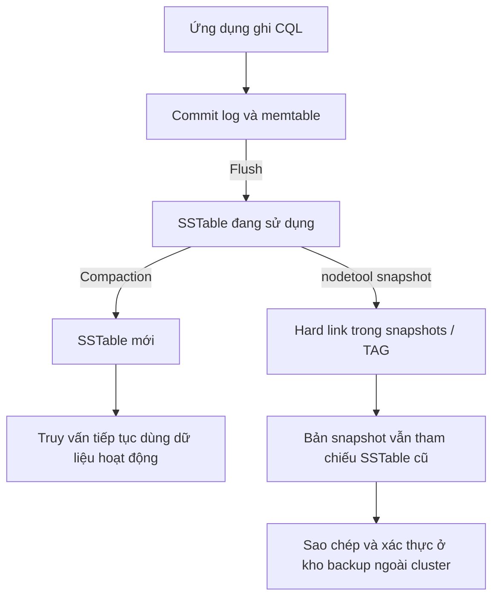

# nodetool snapshot, listsnapshots, clearsnapshot và kiểm kê bản sao trong Apache Cassandra

## 1. Mục tiêu vận hành

Apache Cassandra là cơ sở dữ liệu phân tán theo mô hình **wide-column**. Bảng thường được thiết kế từ truy vấn, dữ liệu phân bố theo **partition key**, còn **replication factor (RF)** xác định các replica lưu dữ liệu của mỗi partition. Trong vận hành thực tế, ngoài đọc/ghi bằng CQL và chọn consistency level, người quản trị cần biết **đang có những bản chụp dữ liệu nào, nằm ở node nào, chiếm bao nhiêu dung lượng và có thể khôi phục được hay không**.

Ba lệnh `nodetool` trọng tâm của bài này:

- `nodetool snapshot`: tạo snapshot cục bộ từ SSTable cho keyspace hoặc bảng được chỉ định.
- `nodetool listsnapshots`: liệt kê snapshot mà **node đang được hỏi** biết đến.
- `nodetool clearsnapshot`: xóa snapshot cục bộ đã chọn sau khi hoàn tất quy trình kiểm tra và giữ lại dữ liệu cần thiết.

**Thông điệp chính:** một snapshot trên một node là **bản chụp cục bộ**, không tự động trở thành bản sao lưu bền vững cho cả cluster. Để có một bộ backup đủ điều kiện phục hồi, cần **kiểm kê và thu thập snapshot trên mọi node cần thiết, sao chép sang nơi lưu trữ độc lập, kiểm tra tính toàn vẹn và diễn tập khôi phục**.

Sau bài học, bạn có thể xây dựng runbook snapshot an toàn, phân biệt snapshot với replication/repair/compaction, đọc bảng kiểm kê và quyết định thời điểm được phép dọn snapshot.

## 2. Phân biệt replica, snapshot và backup

| Khái niệm | Mục đích | Nằm ở đâu? | Điều gì không được bảo đảm? |
| --- | --- | --- | --- |
| **Replica theo RF** | Phục vụ truy vấn, khả năng chịu lỗi và nhất quán theo CL | Nhiều node trong một hay nhiều DC | Không bảo vệ khỏi lệnh xóa hợp lệ, lỗi logic được nhân bản hoặc thao tác nhầm |
| **Snapshot cục bộ** | Giữ lại phiên bản SSTable tại thời điểm chụp để có nguồn khôi phục | Trong thư mục dữ liệu của một node | Không phải bản chụp nguyên tử toàn cluster; còn chung miền hỏng với ổ đĩa/node |
| **Bộ backup ngoài cluster** | Khôi phục sau hỏng node, mất DC, xóa nhầm hoặc thảm họa | Object storage / kho backup độc lập | Không tự hữu dụng nếu thiếu schema, manifest, phiên bản và kiểm thử restore |
| **Incremental backup** | Ghi nhận các SSTable mới theo cơ chế backup gia tăng khi bật cấu hình | Thư mục backup cục bộ, cần xuất ra ngoài | Không tự cung cấp lịch sử thời gian chính xác nếu thiếu quy trình commitlog/PITR |
| **Repair** | Đồng bộ trạng thái dữ liệu giữa replica khi có sai lệch | Quá trình chống entropy giữa các node | Không tạo bản lưu lịch sử để hoàn tác dữ liệu bị xóa |
| **Compaction** | Gộp/viết lại SSTable, giảm số tệp và xử lý tombstone theo điều kiện | Trên từng node | Không thay thế backup và có thể khiến dung lượng snapshot được giữ lâu hơn |

Ví dụ keyspace `commerce` có `RF(dc1)=3`. Ba node có thể giữ ba **replica đang hoạt động** của cùng partition. Khi chụp snapshot trên cả ba node, ta có ba tập **snapshot cục bộ** khác nhau. Mỗi snapshot có thể chỉ chứa phần dữ liệu mà node đó đang sở hữu; không được suy luận rằng snapshot trên node A chứa toàn bộ keyspace.

Một bản ghi bị xóa bằng CQL có thể được nhân bản sang tất cả replica theo quá trình thông thường. **RF=3 không có nghĩa là có ba bản backup lịch sử.** Snapshot/backup phải được thiết kế thành chính sách riêng.

## 3. Snapshot hoạt động bên dưới như thế nào?

Trong Cassandra, dữ liệu được ghi qua commit log và memtable; khi flush, nội dung memtable trở thành các **SSTable** bất biến trên đĩa. Snapshot dùng **hard link** tới các tệp SSTable hiện có trong hệ thống tệp, thay vì lập tức sao chép đầy đủ từng byte dữ liệu.



Các hệ quả cần hiểu:

1. **Tạo snapshot thường nhanh** nhờ hard link. Theo hành vi thông thường, `nodetool snapshot` flush dữ liệu trước khi tạo snapshot; một số phiên bản có tùy chọn bỏ qua flush, nhưng chỉ dùng khi hiểu rõ dữ liệu nào chưa xuất hiện trong SSTable.
2. **Snapshot không đóng băng toàn bộ cluster.** Các node vẫn tiếp tục phục vụ ghi, và snapshot chạy theo thứ tự ở các node khác nhau có thể phản ánh các thời điểm khác nhau.
3. **Không thể coi dung lượng lúc vừa snapshot là 0.** Ban đầu hard link chia sẻ block với tệp đang hoạt động, nhưng sau compaction, các SSTable cũ vẫn bị snapshot giữ lại; dung lượng có thể tăng và khó thu hồi cho đến khi xóa liên kết cuối cùng.
4. **Xóa tệp hoạt động không xóa nội dung snapshot đang được giữ bằng hard link.** Ngược lại, `clearsnapshot` xóa các link/tệp thuộc snapshot, không tự xóa SSTable còn đang được live data dùng.
5. **Đọc được snapshot không đồng nghĩa restore thành công.** Muốn khôi phục vẫn cần schema, phiên bản tương thích, đúng phạm vi node/table, các tệp liên quan, quy trình load SSTable và các kiểm tra hậu khôi phục.

Trên nhiều bản Cassandra, snapshot nằm dưới đường dẫn có dạng:

```text
<data_file_directory>/
  commerce/
    orders_by_id-<table_id>/
      <sstable-components>...
      snapshots/
        orders-20261121T0400Z/
          manifest.json
          schema.cql
          <sstable-components>...
```

Đây là **minh họa cấu trúc**, không phải đường dẫn cố định. Cassandra có thể cấu hình nhiều `data_file_directories`; thư mục bảng chứa ID; một số tệp/metadata khác nhau theo phiên bản. Hãy tìm cấu hình đường dẫn của node và kiểm tra thực tế, không hard-code mọi cluster vào `/var/lib/cassandra/data`.

## 4. Chuẩn bị trước khi chạy lệnh

Trước khi snapshot cho backup định kỳ hoặc trước một thay đổi lớn, xác định rõ:

- **Phạm vi:** keyspace nào, bảng nào, toàn bộ các DC hay chỉ một DC; bao gồm hoặc loại trừ system keyspace theo mục tiêu restore.
- **Mục tiêu khôi phục:** RPO/RTO, backup phục vụ kiểm toán hay phục hồi dữ liệu, cần lịch sử đến mức nào và cần xét đến các thay đổi đang ghi cùng lúc hay không.
- **Topology:** danh sách node ở từng DC, trạng thái Up/Down, node bootstrap/decommission/move và có replica mới đang streaming hay không.
- **Dung lượng:** chỗ trống cho flush, compaction, snapshot và upload; mức tăng của snapshot theo thời gian chứ không chỉ chi phí khi vừa tạo.
- **Kho lưu trữ:** điểm đích tách khỏi node/cluster, mã hóa, quyền truy cập, retention, kiểm tra checksum và quản lý khóa.
- **Nhãn snapshot:** một tag duy nhất, có ý nghĩa nghiệp vụ, timestamp UTC và cùng giá trị trên các node tham gia.
- **Phiên bản:** kiểm tra cú pháp bằng `nodetool help snapshot`, `nodetool help listsnapshots` và `nodetool help clearsnapshot` ở đúng node/phiên bản đang chạy; các tùy chọn có thể thay đổi giữa bản Cassandra và bản phân phối.

Các lệnh dưới đây là **minh họa chạy tại node Cassandra** với quyền truy cập JMX hợp lệ. Nếu triển khai trong container/Kubernetes hoặc sử dụng cổng JMX riêng, thao tác thông qua cơ chế quản trị được nền tảng cho phép.

```bash
# Kiểm tra tình trạng node và cluster trước khi tạo snapshot.
nodetool status
nodetool version

# Kiểm tra cú pháp được phiên bản hiện tại hỗ trợ.
nodetool help snapshot
nodetool help listsnapshots
nodetool help clearsnapshot
```

`nodetool status` cung cấp góc nhìn topology từ node được hỏi, nhưng không thay thế kiểm tra đồng thuận trạng thái từ các hệ thống giám sát khác. Nếu đang có node lỗi hoặc topology thay đổi, lập kế hoạch lại trước khi tuyên bố snapshot đầy đủ.

## 5. Tạo snapshot bằng `nodetool snapshot`

### 5.1. Snapshot một keyspace

Ví dụ có keyspace `commerce` chứa bảng tra cứu đơn hàng theo `order_id`. Đặt tag dùng UTC để dễ đối chiếu giữa node, DC và kho backup:

```bash
# Thực hiện tại node n1 (ví dụ, không thay thế lệnh của các node khác).
nodetool snapshot -t orders-20261121T0400Z commerce

# Đọc lại danh sách snapshot trên CHÍNH node n1.
nodetool listsnapshots
```

Cần chạy lệnh snapshot với **cùng tag** trên từng node thuộc tập cần backup. Nếu định bảo vệ toàn cluster, công cụ điều phối cần biết chính xác node đã thành công, node lỗi và node chưa thực thi. Không được đánh dấu bộ backup là hoàn tất chỉ vì một node trả về thành công.

### 5.2. Snapshot một bảng

Khi chỉ cần sao lưu bảng có phạm vi xác định, có thể chọn bảng bằng cờ hỗ trợ bởi phiên bản triển khai. Trong nhiều bản Cassandra, tùy chọn là `-cf` hoặc `--table`:

```bash
# Ví dụ cú pháp phổ biến; xác nhận bằng "nodetool help snapshot".
nodetool snapshot -t orders-table-20261121T0400Z -cf orders_by_id commerce
```

Snapshot một bảng thích hợp trước migration riêng bảng đó, nhưng **không đủ** để khôi phục nghiệp vụ nếu dữ liệu còn phụ thuộc bảng materialized view, bảng denormalized, index hoặc nguồn dữ liệu khác. Cassandra thiết kế bảng theo truy vấn; backup phải xét **toàn bộ tập bảng cần khôi phục cùng nhau**.

### 5.3. Snapshot tất cả dữ liệu trong phạm vi được hỗ trợ

Có thể dùng `nodetool snapshot` mà không chỉ định keyspace để snapshot phạm vi mặc định theo phiên bản/lệnh. Tuy nhiên, với hệ thống sản xuất nên **chỉ định phạm vi có chủ đích** và đọc `--help`, vì dữ liệu hệ thống, yêu cầu khôi phục metadata và kích thước backup có thể khác dự đoán.

**Không nhầm snapshot với export:** lệnh này không gửi dữ liệu đến S3, NFS hay kho khác. Sau khi snapshot thành công, vẫn cần thu thập tệp và metadata từ từng node, kiểm tra rồi lưu trữ ở nơi độc lập.

## 6. Kiểm kê với `nodetool listsnapshots`

`nodetool listsnapshots` cho biết snapshot mà **một node** đang giữ tại thời điểm kiểm tra. Khi điều hành một cụm nhiều DC, chạy lệnh trên mỗi node hoặc qua hệ thống quản trị tập trung đã có quyền truy cập JMX.

```bash
# Chạy riêng ở mỗi node trong danh sách cluster.
nodetool listsnapshots
```

Kết quả thường liệt kê các chiều như **snapshot name/tag**, **keyspace**, **table/column family** và **thông tin kích thước**. Tên cột/định dạng và cách tính kích thước phụ thuộc phiên bản. Nên dùng lệnh để nhận diện snapshot, sau đó đối chiếu filesystem và manifest nếu cần lượng byte có thể khôi phục hoặc dọn dẹp.

Không nên lấy tổng `Size on disk` của nhiều node rồi coi ngay là số byte có thể thu hồi: hard link chia sẻ block, dữ liệu replication bị nhân lên, snapshot có thể giữ SSTable cũ và file system cũng có metadata/overhead. Khi cần dự báo dung lượng, theo dõi **disk usage thực tế, tăng trưởng theo thời gian và không gian trống**, không chỉ một ảnh chụp thống kê.

### 6.1. Kiểm kê đủ theo node, DC, keyspace và bảng

Một bản kiểm kê tối thiểu nên ghi:

| Trường | Ý nghĩa |
| --- | --- |
| `backup_id` / `snapshot_tag` | Nhãn duy nhất để gom toàn bộ snapshot cùng đợt |
| `cluster`, `dc`, `node_id` / địa chỉ quản trị | Xác định nguồn dữ liệu; tránh trộn staging với production |
| `cassandra_version`, `schema_version` | Hỗ trợ khôi phục với định dạng và DDL phù hợp |
| `keyspace`, `table`, `table_id` | Đúng tài nguyên và tệp đã snapshot |
| `started_at_utc`, `finished_at_utc` | Ghi khoảng thời gian thực tế, không giả định một thời điểm cluster-wide |
| `command_status`, `error` | Phân biệt thành công, thất bại, thiếu kết quả |
| `snapshot_path`, `file_count`, `bytes` | Kiểm tra những tệp thực sự có trên node |
| `manifest` / checksum | Đối chiếu tính đầy đủ sau khi sao chép |
| `remote_uri`, `upload_verified_at` | Vị trí backup ngoài cluster và tình trạng xác thực |
| `retention_until`, `owner`, `restore_test` | Chính sách giữ, người chịu trách nhiệm, kết quả kiểm tra khôi phục |

Ví dụ một **bảng ghi kiểm kê minh họa**, không phải kết quả từ cluster thật:

| backup_id | DC | Node | Keyspace | Kết quả snapshot | Sao chép ngoài cluster |
| --- | --- | --- | --- | --- | --- |
| `orders-20261121T0400Z` | `dc1` | `node-a` | `commerce` | Thành công | Đã xác thực |
| `orders-20261121T0400Z` | `dc1` | `node-b` | `commerce` | Thành công | Đã xác thực |
| `orders-20261121T0400Z` | `dc1` | `node-c` | `commerce` | Thất bại | Chưa có |

Trong ví dụ này, trạng thái bộ backup phải là **CHƯA HOÀN TẤT** dù hai node đã upload. Không nên nói “đã backup ba replica” khi một replica không có bản chụp; tùy mục tiêu phục hồi và phân bổ token, thiếu một node có thể khiến mất phạm vi dữ liệu.

### 6.2. Kiểm kê từ filesystem khi cần đối chiếu

Với dữ liệu theo layout cài đặt thông thường, có thể **đọc** các thư mục snapshot để xác minh tag và tệp:

```bash
# Ví dụ trên node Linux dùng data directory mặc định.
# Thay đường dẫn theo data_file_directories được cấu hình thực tế.
find /var/lib/cassandra/data -type d -path '*/snapshots/orders-20261121T0400Z' -print
```

Lệnh `find` ở đây chỉ đọc metadata, không sửa dữ liệu. Với nhiều đường dẫn data hoặc mount khác nhau, phải kiểm tra tất cả. Việc một thư mục tồn tại **không đủ** để chứng minh snapshot có thể khôi phục: cần kiểm manifest, checksum, phạm vi bảng, dữ liệu từ toàn bộ các node cần thiết và tình trạng upload.

### 6.3. Checklist hoàn tất một đợt kiểm kê

Chỉ coi bộ backup **hoàn tất về mặt vận hành** khi:

1. Danh sách node/DC theo phạm vi backup được chốt tại thời điểm chụp.
2. Mỗi node cần thiết đã chạy lệnh và được đánh dấu thành công; các node thiếu hoặc lỗi được ghi rõ.
3. Tag, keyspace, table và schema được đối chiếu nhất quán, kể cả bảng phát sinh mới.
4. Snapshot đã được xuất khỏi **tất cả node trong phạm vi**, lưu tại nơi độc lập với cluster.
5. File count, manifest và/hoặc checksum đã được kiểm tra tại nơi lưu đích.
6. Có retention, người phụ trách và ghi nhận thử restore theo lịch.

Một danh sách `listsnapshots` đầy đủ **chỉ xác nhận inventory cục bộ**, không hoàn tất sáu điều kiện trên.

## 7. Dọn snapshot bằng `nodetool clearsnapshot`

Snapshot giữ hard link tới SSTable cũ; sau compaction hoặc nhiều đợt chụp, các file này có thể góp phần làm đầy ổ đĩa. Tuy vậy, xóa nhầm snapshot có thể phá vỡ khả năng khôi phục. Cần gắn mỗi thao tác dọn với **tag, keyspace, phạm vi node và bằng chứng backup đã xác thực**.

Quy trình an toàn:

1. Kiểm kê `nodetool listsnapshots` trên từng node; đối chiếu tag chính xác.
2. Đối chiếu `backup_id` với bản ghi tập trung: upload ngoài cluster đã xong, manifest/checksum hợp lệ, retention cục bộ cho phép xóa và không có restore đang diễn ra.
3. Xác nhận **đúng node, đúng tag, đúng keyspace**; ưu tiên dọn từng tag cụ thể thay vì dùng tùy chọn xóa tất cả.
4. Chạy `clearsnapshot` trên những node được phê duyệt.
5. Chạy lại `listsnapshots` trên từng node, kiểm kê thư mục và quan sát disk usage. Ghi lại node chưa dọn, lỗi quyền hoặc snapshot còn sót.

```bash
# Trên node được kiểm kê và phê duyệt dọn tag này:
nodetool listsnapshots

# Xóa snapshot có tag cụ thể trong keyspace commerce trên node hiện tại.
nodetool clearsnapshot -t orders-20261121T0400Z commerce

# Xác nhận tag không còn xuất hiện trên node này.
nodetool listsnapshots
```

**Điểm quan trọng:** `clearsnapshot` chỉ tác động trên **node được kết nối**, không xóa đồng loạt trên mọi replica/DC. Nó không xóa bản đã được copy tới object storage, nhưng cũng không xác nhận bản copy đó đúng hay đủ. Sau khi dọn, khoảng trống được thu hồi phụ thuộc SSTable nào còn được tham chiếu bởi live data hoặc snapshot khác.

Một số phiên bản cho phép xóa rộng bằng tham số như `--all` hoặc dọn không chỉ định tag. **Không dùng các dạng xóa rộng trong runbook tự động** nếu chưa kiểm chứng phạm vi cụ thể của phiên bản và phê duyệt chính sách. Với snapshot tự động do thao tác `DROP`/`TRUNCATE` hoặc cấu hình hệ thống tạo ra, tag có thể khác snapshot thủ công; kiểm kê trước khi áp dụng retention.

### Khi nào chưa được xóa?

Không gọi `clearsnapshot` nếu:

- Một hoặc nhiều node chưa upload snapshot, upload dở dang hoặc checksum chưa đạt.
- Tập snapshot thuộc một đợt chuẩn bị rollback/migration chưa kết thúc.
- Bản backup ngoài cluster chưa có manifest/schema cần thiết hoặc chưa vượt kiểm thử restore theo chính sách.
- Không xác định được chủ sở hữu, retention hoặc liệu đây là bản snapshot duy nhất còn giữ dữ liệu trước sự cố.
- Có thao tác khôi phục đang đọc các tệp đó, hoặc vừa xảy ra lỗi cluster và chưa chốt kế hoạch phục hồi.

Nếu đang thiếu dung lượng nghiêm trọng, **không dọn ngẫu nhiên**. Đánh giá trước các nguồn chiếm dung lượng: snapshot cũ, live SSTable, compaction, commitlog, backup gia tăng, hệ thống tệp và khả năng phục hồi. Bước xử lý phải theo thứ tự rủi ro và chính sách dữ liệu.

## 8. Runbook mẫu: snapshot trước thay đổi schema lớn

Giả sử chuẩn bị thay đổi quy trình ghi ở keyspace `commerce`. Cluster có hai DC; thay đổi có thể ảnh hưởng dữ liệu nhiều bảng. Runbook vận hành nên có ba pha.

### Pha A — Trước cửa sổ thay đổi

- Chốt danh sách node, DC, keyspace/table, tag ví dụ `commerce-prechange-20261121T0400Z` và người chịu trách nhiệm.
- Kiểm tra trạng thái cluster, dung lượng đĩa, thời gian hoàn thành upload dự kiến và kết quả backup gần nhất.
- Xác định lưu lượng ghi nào còn hoạt động; nếu cần khôi phục một trạng thái nhất quán theo giao dịch trên nhiều bảng, lên kế hoạch **điều phối hoặc tạm dừng ghi ở tầng ứng dụng**. Chỉ chạy snapshot nhiều node không bảo đảm global point-in-time.
- Thống nhất điểm lưu ngoài cluster, khóa mã hóa, retention và tiêu chí cho phép rollback/dọn.

### Pha B — Thực thi và xác thực

Trên **mỗi node thuộc phạm vi**, điều phối cùng một lệnh:

```bash
nodetool snapshot -t commerce-prechange-20261121T0400Z commerce
nodetool listsnapshots
```

Sau đó:

1. Ghi kết quả per-node vào bảng kiểm kê; node thất bại giữ trạng thái `FAILED` và không bị bỏ qua.
2. Thu các thành phần SSTable, manifest và thông tin schema liên quan theo layout thực tế.
3. Sao chép dữ liệu sang kho backup riêng. Nếu dùng công cụ copy, cần giữ tên tệp và nội dung nguyên vẹn; tránh sửa file snapshot ngay trên node Cassandra.
4. Đối chiếu checksum/file count giữa nguồn và đích, giới hạn quyền ghi/xóa tại kho backup.
5. Ghi lại trạng thái `VERIFIED` sau khi kiểm tra; chỉ khi đủ mọi node thì mới coi là bộ backup sẵn sàng phục vụ bước thay đổi.

### Pha C — Sau thay đổi

- Kiểm tra truy vấn nghiệp vụ theo partition key, read/write consistency, dữ liệu tổng hợp ở các bảng theo truy vấn và số lỗi ứng dụng.
- Nếu có sự cố, chọn đường khôi phục đã được kiểm thử. Không tự sao chép SSTable vào data directory của node đang hoạt động rồi kỳ vọng Cassandra tự nhận tất cả.
- Sau khi hết cửa sổ rollback và retention cục bộ, đối chiếu bộ backup ngoài cluster, rồi dùng `clearsnapshot -t <tag> <keyspace>` trên **từng node** đủ điều kiện.
- Cập nhật inventory `LOCAL_CLEARED` / `REMOTE_RETAINED` và lưu biên bản.

Runbook này có thể áp dụng tương tự trước major upgrade, thay đổi replication hoặc hoạt động import lớn, nhưng điều kiện schema/restore sẽ khác nhau. Khi thay đổi RF hoặc topology, phải đặc biệt chú ý node nào giữ range dữ liệu trước và sau chuyển đổi.

## 9. Snapshot, tính nhất quán và khả năng khôi phục

### Snapshot có phải một transaction toàn cluster?

**Không.** Mỗi node chụp các SSTable cục bộ. Các node có thể nhận write ở những thời điểm khác nhau, và một đợt snapshot trải qua nhiều phút có thể trộn những thời điểm khác nhau. Ngay cả khi ghi với `LOCAL_QUORUM` hoặc `QUORUM`, bộ snapshot thu tuần tự từ nhiều node không tự có ranh giới transaction toàn cluster hay xuyên nhiều partition.

Vì vậy cần phân biệt:

- **Backup để khôi phục hạ tầng:** mục tiêu có thể là thu đầy đủ dữ liệu để rebuild, sau đó chấp nhận mức khôi phục/đối soát đã xác định.
- **Backup để khôi phục nghiệp vụ tại một điểm thời gian:** phải đánh giá cơ chế ngừng/điều phối ghi, ghi sự kiện, commitlog hoặc quy trình PITR khả dụng với phiên bản và nền tảng triển khai.
- **Backup để rollback thay đổi schema:** phải lưu schema phù hợp trước thay đổi, liệt kê toàn bộ bảng liên quan và kiểm tra dữ liệu ghi sau thời điểm backup sẽ được xử lý thế nào.

**Snapshot + commitlog** có thể là một phần chiến lược khôi phục theo thời điểm, nhưng chỉ khi có quy trình lưu, vận chuyển, replay và kiểm thử cụ thể. Snapshot đơn lẻ không phải tính năng PITR hoàn chỉnh.

### Restore được thực hiện thế nào?

Khôi phục SSTable không nằm trong ba lệnh của bài. Ở mức định hướng, quy trình restore cần:

1. Lập lại keyspace/schema phù hợp, kiểm phiên bản Cassandra, table ID và định dạng SSTable.
2. Chọn cách restore theo phạm vi: node recovery, khôi phục vào cluster mới, import qua công cụ như `sstableloader` hoặc quy trình do bản phân phối hỗ trợ.
3. Đưa dữ liệu đến đúng vị trí và xác thực cấu trúc, tránh ghi đè live data không có kế hoạch.
4. Xử lý nhân bản, consistency, repair và những thao tác cần thiết sau restore theo thiết kế cluster.
5. So sánh các truy vấn nghiệp vụ, checksum/đếm dữ liệu ở mức có ý nghĩa và kiểm chứng RPO/RTO.

Hướng dẫn khôi phục chi tiết phụ thuộc phiên bản Cassandra, loại SSTable, bảo mật, topology và yêu cầu dữ liệu. **Phải thử restore trên môi trường tách biệt trước khi dựa vào backup để khôi phục production.**

## 10. Giám sát dung lượng và xử lý sự cố

| Hiện tượng | Nguyên nhân có thể | Bước điều tra đúng |
| --- | --- | --- |
| `snapshot` thành công nhưng không thấy trên node khác | Snapshot là thao tác cục bộ; node kia chưa chạy | Đối chiếu bảng inventory theo node/DC và log điều phối |
| `listsnapshots` rỗng nhưng object storage có backup | Lệnh chỉ liệt kê snapshot cục bộ | Kiểm kê local và remote bằng hai nguồn riêng |
| Snapshot tạo nhanh nhưng disk usage tăng về sau | Hard link giữ SSTable cũ sau compaction | Xem danh sách snapshot, live SSTable, hoạt động compaction và retention |
| `clearsnapshot` không thu hồi dung lượng như kỳ vọng | Tệp còn được live data/snapshot khác tham chiếu; có nguồn dung lượng khác | Kiểm trạng thái snapshot còn lại, compaction, disk usage |
| Không truy cập được `nodetool` | JMX, xác thực, quyền, cấu hình mạng hoặc node bất thường | Xác nhận kết nối quản trị, phiên bản và log; không sửa file dữ liệu thủ công |
| Snapshot chỉ có vài bảng | Lệnh dùng phạm vi keyspace/table hẹp, node chưa đủ dữ liệu hoặc lỗi | So sánh scope ban đầu, schema và per-node manifest |
| Tag giống nhau nhưng tệp khác nhau giữa các node | Token ownership và thời điểm snapshot khác nhau | Đối chiếu phạm vi range, metadata; khác tệp không đồng nghĩa sai |
| Backup remote thiếu một node | Upload lỗi hoặc điều phối bỏ sót | Đánh dấu bộ backup chưa hoàn tất, thực hiện bù/thu lại theo chính sách |
| Backup cũ không restore được sau upgrade | Không tương thích schema/SSTable hoặc thiếu thành phần restore | Duy trì manifest phiên bản và diễn tập restore cho đường nâng cấp |

Snapshot cũng liên quan đến **compaction và repair**. Repair giúp replica hội tụ nhưng không phải backup; compaction có thể thay thế SSTable hoạt động, trong khi snapshot tiếp tục giữ liên kết tới tệp cũ. Khi dự tính disk space, hãy xét lịch repair, mức ghi, compaction strategy (ví dụ STCS/LCS/TWCS tùy workload), TTL/tombstone và tần suất snapshot cùng lúc.

### Những chỉ số nên đưa vào dashboard

| Chỉ số | Giá trị vận hành |
| --- | --- |
| Số snapshot theo node/DC/keyspace | Thấy snapshot còn sót hoặc bị bỏ qua |
| Thời gian tạo snapshot và tỷ lệ lệnh thất bại | Phát hiện node/chức năng quản trị gặp lỗi |
| Tổng disk used/free, tốc độ tăng SSTable và snapshot | Ước tính nguy cơ đầy ổ đĩa |
| Số node đã upload/đã xác thực trên tổng số node yêu cầu | Đánh giá tính đầy đủ của bộ backup |
| Thời gian từ snapshot đến remote verification | Ước tính độ trễ có bản sao bảo vệ ngoài cluster |
| Tuổi snapshot và hạn retention | Hỗ trợ dọn dẹp có chủ đích |
| Restore-test gần nhất, kết quả RPO/RTO | Chứng minh backup có thể sử dụng |

Không thu thập thông tin nhạy cảm vào tên tag hoặc đường dẫn công khai. Thống nhất một quy ước tag không chứa dữ liệu khách hàng, token hoặc mật khẩu.

## 11. Bài tập thực hành có kiểm soát

**Bối cảnh:** một cluster Cassandra có `dc1` với ba node `n1,n2,n3` và `dc2` với ba node `n4,n5,n6`. Keyspace `commerce` có `RF=3` tại mỗi DC. Nhóm vận hành muốn có snapshot trước migration, lưu backup trên object storage và dọn snapshot local sau khi xác thực.

**Yêu cầu:**

1. Chọn tag có timestamp UTC và viết lệnh tạo snapshot cho keyspace `commerce`.
2. Liệt kê những node cần chạy lệnh, và giải thích vì sao `nodetool snapshot` trên `n1` chưa bảo vệ toàn cluster.
3. Viết lệnh kiểm tra snapshot cục bộ; lập bảng inventory gồm node/DC, tag, keyspace, status, remote URI và checksum status.
4. Giả sử `n5` tạo snapshot thành công nhưng upload thất bại. Bạn có được xóa snapshot trên `n5` hay đánh dấu backup đã hoàn tất không? Cần làm gì tiếp?
5. Sau khi cả sáu node upload và kiểm tra thành công, viết lệnh xóa snapshot **chỉ theo tag được duyệt** trên từng node.
6. Khi `clearsnapshot` không thu hồi nhiều dung lượng, nêu hai lý do liên quan hard link và compaction.

**Gợi ý đáp án:**

```bash
# Chạy riêng trên n1 ... n6 trong phạm vi được phê duyệt:
nodetool snapshot -t commerce-pre-migration-20261121T0400Z commerce
nodetool listsnapshots

# Chỉ thực hiện ở từng node sau khi remote backup được xác thực:
nodetool clearsnapshot -t commerce-pre-migration-20261121T0400Z commerce
nodetool listsnapshots
```

`n5` upload lỗi nghĩa là bộ backup **chưa hoàn tất**; cần retry upload hoặc thực hiện lại theo quy trình, ghi checksum và kiểm kê trạng thái. Không xóa bản local duy nhất trước khi có bản remote đủ điều kiện. Nếu `clearsnapshot` thu hồi ít dung lượng, SSTable có thể vẫn được live data hoặc snapshot khác tham chiếu; ngược lại, compaction và những SSTable khác có thể đang chiếm phần lớn dung lượng.

## 12. Checklist bàn giao ca vận hành

- [ ] Đã xác định mục tiêu restore, keyspace/table, danh sách node và phạm vi DC.
- [ ] Đã kiểm topology, quyền `nodetool`, phiên bản, dung lượng trống và chính sách retention.
- [ ] Đã dùng tag duy nhất thống nhất trên mọi node trong đợt snapshot.
- [ ] Đã chạy `nodetool listsnapshots` và lưu kết quả theo từng node.
- [ ] Đã kiểm kê các bản sao local: đường dẫn, keyspace, table, kích thước, số file và trạng thái thành công/thất bại.
- [ ] Đã sao chép tới kho ngoài cluster và xác minh manifest/checksum của từng nguồn.
- [ ] Đã ghi nhận thời điểm, phiên bản/schema và lịch sử thử khôi phục.
- [ ] Đã có phê duyệt retention/rollback trước khi chạy `nodetool clearsnapshot`.
- [ ] Đã kiểm lại danh sách snapshot và disk usage sau khi dọn.
- [ ] Đã cập nhật người chịu trách nhiệm, lỗi còn tồn tại và kế hoạch xử lý trong inventory.

**Ghi nhớ:** `snapshot` tạo một điểm giữ SSTable **cục bộ**, `listsnapshots` giúp quan sát những gì còn trên **node hiện tại**, và `clearsnapshot` dọn các snapshot cục bộ theo phạm vi chỉ định. Đối với Cassandra phân tán, chất lượng backup nằm ở **bộ kiểm kê per-node/per-DC, nơi lưu trữ độc lập, tính nhất quán với nghiệp vụ và một quy trình restore đã kiểm thử**.
