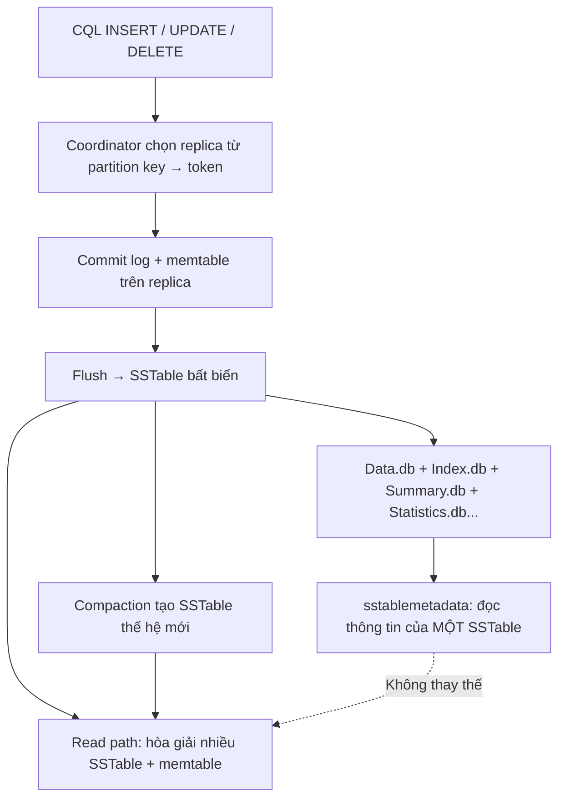
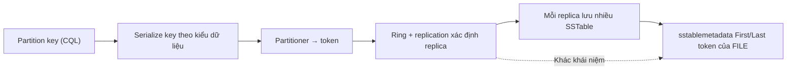
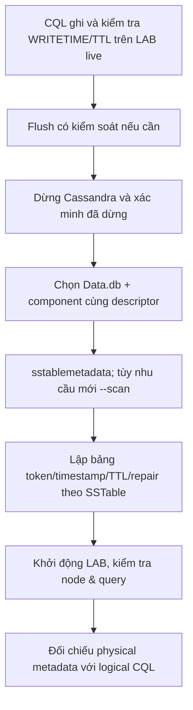

# sstablemetadata và đọc thông tin định dạng, token, timestamp

> **Chương:** Công cụ vận hành  
> **Học phần:** `DATABASE_ENGINE_WIDE_COLUMN_CASSANDRA` — Apache Cassandra

Khi một bảng Cassandra đọc chậm, tích tụ tombstone hoặc có nhiều SSTable cũ sau repair và compaction, người vận hành thường cần biết **một tệp SSTable cụ thể chứa thông tin gì** mà không đọc từng hàng dữ liệu. Công cụ `sstablemetadata` phục vụ đúng mục đích đó: nó in các thống kê, thông tin định dạng, token, timestamp, TTL, compression và trạng thái repair đã ghi trong metadata của SSTable.

Điểm cốt lõi là **phạm vi bằng chứng**. Một SSTable là một tệp dữ liệu **bất biến** tạo ra từ flush hoặc compaction, trong khi một bảng logic có thể trải qua nhiều SSTable trên nhiều replica và cả memtable. `sstablemetadata` đọc **metadata ở cấp SSTable**, không phải truy vấn CQL, không đối soát các replica và không kết luận trạng thái cuối cùng của một row sau reconciliation.

> **Cảnh báo vận hành bắt buộc:** Tài liệu chính thức Apache Cassandra yêu cầu **dừng Cassandra trước khi chạy công cụ SSTable offline**, trong đó có `sstablemetadata`. Script **không tự kiểm tra Cassandra đã dừng**; chạy vào tệp mà tiến trình đang flush/compaction có thể cho kết quả bất ngờ. Trên production cần lên lịch bảo trì cho node được kiểm tra hoặc tạo **bản sao SSTable nhất quán để phân tích trên máy cách ly**, cùng phiên bản công cụ phù hợp. Không thử trực tiếp trên dữ liệu live chỉ vì lệnh “chỉ đọc”.

Bài này hướng dẫn đọc từng nhóm trường, phân biệt đơn vị thời gian, đánh giá token range và các bẫy thường gặp khi kết luận về TTL, tombstone, compaction hoặc dữ liệu bị thiếu.

## 1. Đặt sstablemetadata vào kiến trúc Cassandra

Một mutation trong Apache Cassandra được nhân bản theo token của **partition key** và replication strategy. Trên mỗi replica, mutation được ghi vào commit log và memtable; memtable sau đó được flush ra **SSTable** trên disk. SSTable không bị cập nhật trực tiếp: bản cập nhật/xóa tiếp theo có thể ở SSTable khác; khi đọc, Cassandra phối hợp dữ liệu từ memtable và nhiều SSTable rồi áp dụng quy tắc timestamp/tombstone.



`sstablemetadata` hỗ trợ trả lời:

- SSTable được mô tả bằng **partitioner**, định dạng file và thông tin schema nào?
- Token nhỏ nhất/lớn nhất của **những partition đã lưu trong SSTable** là bao nhiêu?
- Timestamp ghi nhỏ nhất/lớn nhất và khoảng thời gian mà dữ liệu trong SSTable đại diện là gì?
- SSTable có dấu hiệu TTL/tombstone, tỷ lệ nén, cấp độ compaction, marker repaired/pending repair nào?
- Có sự khác biệt đáng chú ý giữa các SSTable của **cùng một bảng trên cùng node** không?

Công cụ **không tự trả lời**:

- “Bảng có chính xác bao nhiêu **row đang sống**?”
- “Partition X đang có giá trị CQL cuối cùng là gì?”
- “Dữ liệu trên cả ba replica của RF=3 đã nhất quán chưa?”
- “Tôi có thể xóa tệp này vì estimated droppable tombstones lớn không?”
- “SSTable này vẫn thuộc quyền sở hữu token range hiện hành của node hay không?”

Những câu hỏi đó cần kết hợp CQL, `nodetool`, metrics, repair, compaction và topology thực tế.

## 2. SSTable gồm những thành phần nào?

Một SSTable thường có nhiều file cùng tiền tố, mỗi file phục vụ một phần read/write path. Ví dụ theo dạng SSTable truyền thống:

```text
/var/lib/cassandra/data/telemetry/events_by_device_day-<table-id>/
    mc-17-big-Data.db
    mc-17-big-Index.db
    mc-17-big-Summary.db
    mc-17-big-Statistics.db
    mc-17-big-Filter.db
    mc-17-big-CompressionInfo.db   (nếu nén)
    mc-17-big-TOC.txt
    ... các thành phần khác tùy phiên bản/định dạng
```

Các tên trên là **ví dụ cấu trúc**, không phải cam kết tệp nào cũng tồn tại. Phiên bản mới, format, compression và tính năng bật trên bảng có thể dùng những component khác nhau.

| Component | Vai trò khái quát | Liên hệ với `sstablemetadata` |
| --- | --- | --- |
| `Data.db` | Dữ liệu được lưu theo thứ tự partition/clustering trên disk | **Đối số thường truyền cho lệnh** để nhận diện SSTable cần kiểm tra. |
| `Index.db` | Thông tin index partition trong SSTable | Hỗ trợ cơ chế tìm vị trí partition khi đọc; không phải secondary index CQL. |
| `Summary.db` | Thông tin tóm tắt/index sampling và phạm vi khóa | Một trong những nguồn metadata mà công cụ sử dụng. |
| `Statistics.db` | Metadata/statistics: timestamp, TTL, repair, phân phối size... | Nguồn quan trọng nhất của thống kê công cụ in ra. |
| `Filter.db` | Bloom filter để giảm số SSTable cần tra trong read path | Trường `Bloom Filter FP chance` cho biết xác suất false positive cấu hình/dự kiến. |
| `CompressionInfo.db` | Thông tin cần để tìm các chunk dữ liệu được nén | Có khi SSTable bật compression; tỷ lệ nén còn thể hiện trong metadata. |
| `TOC.txt` | Danh sách các thành phần của SSTable | Giúp xác nhận nhóm file cùng một descriptor. |

Tên SSTable như `mc-17-big-Data.db` có thể được đọc thành:

- `mc`: mã **phiên bản định dạng SSTable** trong descriptor.
- `17`: **generation**/mã định danh của SSTable trong phạm vi thư mục tương ứng, **không phải** Cassandra 17.0 hay token.
- `big`: định danh **format SSTable** theo cơ chế đặt tên của phiên bản.
- `Data.db`: component dữ liệu của SSTable đó.

**Không suy ngược phiên bản server từ một tiền tố filename duy nhất.** Một node được nâng cấp có thể còn nhiều SSTable có format cũ; một số thay đổi định dạng diễn ra khi flush/compaction/upgrade, không phải ngay sau khi nâng binary. Phải kiểm tra **Cassandra version + SSTable version + file format compatibility** trước khi dùng tool đọc file của bản khác.

## 3. Runbook dùng công cụ một cách an toàn

### 3.1. Preflight

Trước khi mở SSTable:

1. Xác định **node, keyspace, table, data directory và Cassandra version**; ghi case/incident ID, mục tiêu điều tra.
2. Với node production, xác minh replica khác đủ khỏe để phục vụ mức CL hiện hành trước khi đưa node vào bảo trì. Nếu không thể dừng node an toàn, dùng phương án **copy/snapshot nhất quán rồi phân tích offline trên máy tách biệt** theo runbook backup của tổ chức.
3. Không chạy trên tệp đang có nguy cơ bị flush/compaction thay thế. Tuân thủ cảnh báo chính thức **Cassandra phải được dừng** khi chạy các công cụ SSTable offline.
4. Kiểm tra quyền truy cập và nhãn bảo mật: key trong metadata có thể chứa thông tin định danh; không đẩy file hoặc output lên ticket công khai.
5. Ghi lại **đường dẫn chính xác** tới nhóm tệp của SSTable và chỉ sử dụng binary Cassandra hỗ trợ version định dạng đó.

`sstablemetadata` là công cụ offline **đọc metadata**; đừng nhầm với `sstablerepairedset`, `sstablelevelreset`, `sstablescrub` hoặc `sstableupgrade` — những công cụ sau có mục đích khác và có thể sửa metadata hoặc SSTable.

### 3.2. Tìm tệp `Data.db` cần kiểm tra

Trong môi trường **Cassandra đã dừng**, tài liệu chính thức cho phép dùng `sstableutil` để tìm danh sách tệp của một bảng:

```bash
# Minh họa trên node LAB ĐÃ DỪNG Cassandra.
# 'telemetry' và 'events_by_device_day' là tên giả định.
sstableutil telemetry events_by_device_day | grep 'Data.db'
```

Ví dụ output:

```text
/var/lib/cassandra/data/telemetry/events_by_device_day-aabbccdd11223344/mc-17-big-Data.db
/var/lib/cassandra/data/telemetry/events_by_device_day-aabbccdd11223344/mc-18-big-Data.db
```

Thư mục bảng thường chứa tên bảng cùng table ID. Đừng chép một đường dẫn đang thấy trên node khác mà không xác minh **host ID, table ID, keyspace, phiên bản và tính nhất quán của bản sao**. Khi có nhiều data directories, một bảng có thể trải trên nhiều volume.

### 3.3. Đọc metadata một hoặc nhiều SSTable

```bash
# Offline. Dùng đúng tệp Data.db của SSTable cần xem:
sstablemetadata \
  /var/lib/cassandra/data/telemetry/events_by_device_day-aabbccdd11223344/mc-17-big-Data.db

# Có thể truyền nhiều tên Data.db vào cùng lệnh:
sstablemetadata \
  /var/lib/cassandra/data/telemetry/events_by_device_day-aabbccdd11223344/mc-17-big-Data.db \
  /var/lib/cassandra/data/telemetry/events_by_device_day-aabbccdd11223344/mc-18-big-Data.db

# Xem option đúng phiên bản binary trong môi trường offline:
sstablemetadata --help
```

Cú pháp tổng quát do Apache Cassandra công bố:

```text
sstablemetadata <options> <sstable filename(s)>
```

Trên một số cài đặt, lệnh nằm trong công cụ đi kèm gói Cassandra hoặc dưới `tools/bin` / `resources/cassandra/tools/bin`. Đừng tự giả định mọi node đều có file executable trong `PATH`; cần dùng tool **cùng bản phân phối** và đủ JDK/permissions.

### 3.4. Các tùy chọn hữu ích

| Tùy chọn (theo tài liệu 5.0) | Mục đích | Lưu ý |
| --- | --- | --- |
| `--help` | Hiện trợ giúp | Option và alias cụ thể có thể khác giữa các phiên bản. |
| `--gc_grace_seconds <seconds>` | Cung cấp grace dùng cho phép ước lượng tombstone có thể loại | **Không thay đổi** `gc_grace_seconds` của bảng/CQL; không xóa dữ liệu. |
| `--scan` | Quét **toàn SSTable** để tính thêm số partition, row, cell, tombstone, nhóm partition lớn/rộng | Có thể **tốn nhiều I/O và thời gian**; chỉ dùng khi đã lập budget. |
| `--timestamp_unit <unit>` | Khai báo đơn vị timestamp của cell cho công cụ khi cần | Không nhầm timestamp cell với local deletion time; xác minh các giá trị hợp lệ qua `--help`. |
| `--colors` / `--unicode` | Thay đổi cách hiển thị màu và biểu đồ | Không làm metadata chính xác hơn hoặc sửa SSTable. |

Bản 4.0/4.1 có thể ghi ít tùy chọn hơn trong tài liệu chính thức; **không mặc định `--scan` hoặc `--timestamp_unit` tồn tại** trên mọi binary 3.x/4.x chỉ vì chúng xuất hiện trong tài liệu 5.0. Việc đọc tệp SSTable cũ bằng công cụ từ bản mới hơn cũng phải tuân thủ giới hạn tương thích.

## 4. Một output minh họa và cách đọc

Dưới đây là **output mô phỏng, rút gọn** theo các tên trường của tài liệu Apache Cassandra. Các giá trị không tương ứng với một hệ thống đang chạy và việc format ngày có thể khác theo bản, locale hoặc tùy chọn:

```text
SSTable: .../events_by_device_day-<table-id>/mc-17-big
Partitioner: org.apache.cassandra.dht.Murmur3Partitioner
Bloom Filter FP chance: 0.010000
Minimum timestamp: 1760000000000000
Maximum timestamp: 1760086400000000
Duration: Days: 1 Hours: 0 Minutes: 0 Seconds: 0
SSTable min local deletion time: 1760172800
SSTable max local deletion time: 1760259200
Compressor: org.apache.cassandra.io.compress.LZ4Compressor
Compression ratio: 0.55
TTL min: 86400
TTL max: 86400
First token: -8200000000000000000 (key=...)
Last token: 7900000000000000000 (key=...)
Estimated droppable tombstones: 0.31
SSTable Level: 0
Repaired at: 0
Pending repair: --
Total Column Cells: 72918
Total Rows: 24306
```

**Quan trọng:** đừng đọc các số trên như bản ghi CQL thật. Đây là **metadata đã tổng hợp** từ một SSTable. Tên trường có thể đổi hoặc được bổ sung ở phiên bản mới (ví dụ originating host id, covered clusterings, replay positions, histograms, encoding stats).

Bảng dưới tách ý nghĩa các trường thành những nhóm thường dùng khi điều tra.

## 5. Đọc metadata về định dạng và khả năng tương thích

| Trường / dấu hiệu | Cách hiểu | Không kết luận |
| --- | --- | --- |
| `SSTable` | Đường dẫn/prefix của nhóm component đã được đọc | Không xác nhận tệp vẫn thuộc tập **live SSTables** hiện tại trong node online. |
| Descriptor `mc-17-big` | SSTable version/generation/format theo quy tắc tên tệp | Không dùng `17` làm server version hoặc token. |
| `Partitioner` | Thuật toán ánh xạ partition key thành token, ví dụ `Murmur3Partitioner` | Không chứng minh token đang do node nào sở hữu. |
| `KeyType` / `ClusteringTypes` / `StaticColumns` / `RegularColumns` | Thông tin mã hóa/cấu trúc cột trong metadata | Không phải bằng chứng schema hiện tại của cluster đã agreement. |
| `Bloom Filter FP chance` | Xác suất false positive dự kiến/cấu hình của Bloom filter | Không phải tỷ lệ false positive đo thực trên toàn bộ workload. |
| `Compressor` | Thuật toán nén dùng trong SSTable, như `LZ4Compressor` | Không mặc định mọi SSTable khác cùng bảng dùng cùng codec sau một lần `ALTER TABLE`. |
| `Compression ratio` | Tỷ lệ **dung lượng nén / dung lượng không nén** theo cách Cassandra báo cáo | Không suy ra tất cả disk space được thu hồi theo đúng tỷ lệ đó (còn index, filter, snapshot...). |
| `SSTable Level` | Cấp compaction được lưu trong metadata, thường hữu ích với LCS | Level 0 **không** đồng nghĩa tệp chưa được compact bao giờ hoặc compaction strategy luôn là LCS. |

### 5.1. Nhận diện file cũ sau nâng cấp

Một node Cassandra có thể đang chạy binary mới nhưng vẫn giữ SSTable format cũ. Điều đó có thể bình thường vì:

1. Memtable mới flush theo version được hỗ trợ của bản chạy.
2. SSTable cũ được đọc khi version tương thích, và có thể đổi định dạng khi compact hoặc chạy quy trình upgrade offline/online thích hợp.
3. Nhiều component trong cùng node có thể khác thế hệ/format.

Nếu công cụ báo **unsupported SSTable version**, trước tiên kiểm tra binary và khả năng tương thích; **không** sửa descriptor filename, rename `Data.db` hoặc chép metadata của file khác. Tương tự, đổi compression trong schema không tự nén lại SSTable bất biến ngay tức thì; metadata của file cũ có thể phản ánh codec cũ.

### 5.2. Tỷ lệ nén 0,55 có nghĩa gì?

Nếu `Compression ratio = 0.55`, theo cách đo phổ biến của Cassandra, dữ liệu sau nén trong phần tính toán tương ứng khoảng **55%** kích thước chưa nén; mức giảm tương đối khoảng **45%** cho phần đó. Nó không phải “SSTable chiếm 55% tổng dung lượng cluster” và cũng không đo số byte truyền liên data center.

Khi muốn tuning, so sánh theo **table và thời điểm**, CPU khi flush/compaction, tốc độ giải nén read path, disk I/O và `nodetool tablestats`. Compression có chi phí CPU; tối ưu dung lượng có thể làm p99 truy vấn thay đổi.

## 6. Đọc `First token` và `Last token` đúng phạm vi

Đây là hai trường dễ bị suy diễn sai nhất khi vừa thêm node, rebuild hoặc decommission.

- `First token` là token nhỏ nhất liên quan đến khóa partition được ghi trong SSTable theo thứ tự phân vùng được lưu.
- `Last token` là token lớn nhất liên quan đến khóa partition được ghi trong SSTable.
- `key=...` thường là **bytes khóa đã mã hóa**, được in dạng hex hoặc biểu diễn nhị phân tương ứng; không nhất thiết là chuỗi UTF-8 có thể đọc trực tiếp.
- Với `Murmur3Partitioner`, token có thể là số âm. “Âm” không phải dấu hiệu dữ liệu lỗi hay thời gian ở quá khứ.
- Hai token này mô tả **các partition có mặt trong một SSTable**, không nhất thiết là token range mà **node đang sở hữu theo ring**.



### Ví dụ: vì sao token range rộng không có nghĩa SSTable chứa mọi partition?

Giả sử một SSTable báo:

```text
First token: -9000000000000000000 (key=...)
Last token:   9000000000000000000 (key=...)
```

Bạn chỉ biết SSTable có ít nhất một partition gần mỗi đầu đó. Nó có thể chứa 30 partition rải thưa hoặc hàng triệu partition. Đừng lấy `last - first` để tính số partition, độ lớn dữ liệu, số replica hoặc độ chính xác của phân phối token trong ring.

Sau topology change, node có thể còn các SSTable chứa dữ liệu thuộc range đã nhường cho node khác **cho tới khi cleanup an toàn hoàn tất**. Ngược lại, một SSTable được stream từ replica khác vẫn có key cùng token nhưng khác generation/metadata. Để xác nhận ownership phải đối chiếu:

```bash
# Lệnh online CHỈ ĐỌC: thực hiện khi node Cassandra đang hoạt động
# trong giai đoạn quan sát riêng, KHÔNG trong phiên chạy SSTable tools offline.
nodetool status telemetry
nodetool ring telemetry
nodetool describering telemetry
```

Với **partition key đơn** và đúng CQL type, `nodetool getendpoints` giúp tìm replica kỳ vọng của một partition cụ thể; với **partition key phức hợp**, phải mã hóa đúng kiểu theo hỗ trợ của công cụ/driver, không nối bừa nhiều thành phần bằng ký tự phân cách.

**Kết luận đúng:** `sstablemetadata` cho biết **phạm vi token mà SSTable chứa dữ liệu thực tế**, còn `nodetool ring/getendpoints` phản ánh **bản đồ sở hữu replica hiện hành**. Hai câu trả lời bổ sung nhau, không thay thế nhau.

## 7. Đọc timestamp: microsecond, second và timestamp CQL

### 7.1. `Minimum timestamp` và `Maximum timestamp`

Timestamp của cell trong Cassandra là mốc logic/ghi dùng để hòa giải phiên bản, thường biểu diễn theo **microseconds từ Unix epoch**. Nếu dùng `USING TIMESTAMP`, ứng dụng có thể cung cấp timestamp; nếu không, Cassandra/driver sẽ tham gia chọn timestamp theo ngữ nghĩa ghi của phiên bản.

Ví dụ:

```text
Minimum timestamp: 1760000000000000
Maximum timestamp: 1760086400000000
```

Hai giá trị cách nhau **86.400.000.000 microsecond = 86.400 giây = 1 ngày**. Chúng **không tự chứng minh** SSTable được flush trong khoảng đúng một ngày, vì timestamp có thể đến từ ứng dụng, backfill, repair hoặc dữ liệu đã ghi từ lâu. Thời gian tạo file trên OS cũng **không phải** timestamp ghi của dữ liệu.

Cassandra có thể hiển thị timestamp vừa dạng ngày giờ vừa dạng giá trị epoch trong ngoặc. Khi so sánh nhiều node, ưu tiên **giá trị số** và chuyển về cùng múi giờ UTC; không suy mốc qua định dạng `07/08/2023` vì phụ thuộc cách biểu diễn ngày/tháng.

### 7.2. `SSTable min/max local deletion time`

`Local deletion time` thường được ghi theo **giây Unix epoch**, phục vụ TTL/tombstone và quyết định khả năng thu hồi. Nó **không** phải bản sao của `Minimum timestamp` theo microsecond.

| Trường | Đơn vị thường gặp | Ý nghĩa |
| --- | --- | --- |
| `Minimum timestamp`, `Maximum timestamp` | **Microsecond** từ Unix epoch | Mốc ghi của dữ liệu/cell trong SSTable. |
| `SSTable min local deletion time`, `max local deletion time` | **Second** từ Unix epoch | Các mốc local deletion time liên quan tombstone/TTL trong metadata. |
| `TTL min`, `TTL max` | **Second thời lượng** | TTL áp dụng cho cell tương ứng, **không** phải Unix epoch. |
| `Repaired at` | **Millisecond** từ Unix epoch (hoặc `0`) | Thời điểm SSTable được đánh dấu repaired trong metadata. |
| `Replay positions covered` | Commit log **segment ID/offset** | Vị trí replay/commit log liên quan SSTable, **không** phải timestamp trên đồng hồ. |

Nếu `local deletion time` hiện **2147483647** (giá trị sentinel trong nhiều bản), **không** diễn giải ngay thành “dữ liệu sẽ xóa năm 2038”. Nó thường biểu thị giá trị chưa có deletion time hữu dụng ở trường tương ứng (hoặc trạng thái không có xóa), tùy format/phiên bản. Cần đọc cùng TTL, tombstone histograms và dữ liệu liên quan.

Một lỗi vận hành phổ biến là so số `1760000000000000` (microseconds) với `1760172800` (seconds) rồi kết luận metadata hỏng. Khác biệt **một triệu lần** là do đơn vị.

### 7.3. So sánh với CQL `WRITETIME` và `TTL`

CQL có thể quan sát một **cell sống đang được truy vấn** theo primary key, thay vì toàn SSTable. Ví dụ schema:

```sql
-- Minh họa trên môi trường lab, keyspace telemetry đã tồn tại.
CREATE TABLE IF NOT EXISTS telemetry.events_by_device_day (
    device_id text,
    event_day date,
    event_id uuid,
    payload text,
    PRIMARY KEY ((device_id, event_day), event_id)
);

INSERT INTO telemetry.events_by_device_day
    (device_id, event_day, event_id, payload)
VALUES (
    'sensor-07', '2026-11-21',
    11111111-1111-4111-8111-111111111111,
    'reading:23.5'
) USING TTL 86400;

SELECT payload,
       WRITETIME(payload) AS write_ts_us,
       TTL(payload) AS remaining_ttl_s
FROM telemetry.events_by_device_day
WHERE device_id = 'sensor-07'
  AND event_day = '2026-11-21'
  AND event_id = 11111111-1111-4111-8111-111111111111;
```

Ở đây:

- `WRITETIME(payload)` hiển thị timestamp ghi **của cell payload đang sống**, đơn vị microseconds.
- `TTL(payload)` trả thời gian TTL **còn lại** (seconds), không nhất thiết bằng TTL ban đầu; có thể là `null` nếu cell không có TTL.
- Một SSTable có `Minimum timestamp` hoặc `TTL min` không có nghĩa hai giá trị đó thuộc đúng cell đang được đọc: hàng có thể có phiên bản mới ở memtable hoặc SSTable khác.
- `WRITETIME`/`TTL` có giới hạn theo loại cột và phiên bản; không áp dụng mù quáng cho mọi biểu thức, counter hoặc bảng có schema khác.

`SELECT` trên CQL và `sstablemetadata` là hai góc nhìn khác nhau: **logical current read** và **physical file metadata**.

## 8. TTL, tombstone và `Estimated droppable tombstones`

Trong Cassandra:

- `DELETE` và gán cột `null` tạo dấu xóa (tombstone).
- TTL khi hết hạn cũng làm dữ liệu được xem như tombstone.
- Tombstone giúp replica vắng mặt không đưa dữ liệu đã xóa trở lại khi đồng bộ.
- `gc_grace_seconds` tạo khoảng bảo vệ trước khi tombstone có thể được thu hồi khi **compaction đáp ứng điều kiện an toàn**.

Output có thể chứa:

```text
TTL min: 86400
TTL max: 86400
Estimated droppable tombstones: 0.31
Estimated tombstone drop times:
  <epoch-second>: <estimated-count>
```

Giá trị `0.31` là **ước lượng tỷ lệ tombstone có thể được drop theo thuật toán và grace dùng để tính**, **không** đồng nghĩa có thể xóa an toàn 31% byte của file hoặc thu hồi đúng 31% disk space ngay sau một lệnh compaction.

Một tombstone có thể đã đủ tuổi nhưng vẫn cần được giữ nếu việc loại nó có nguy cơ làm giá trị cũ trong SSTable khác xuất hiện trở lại. Để thu hồi còn cần xét **SSTable overlap**, compaction strategy và tình trạng đồng bộ replica. Đặc biệt nếu repair bị bỏ quá lâu hoặc replica offline vượt grace, xóa tombstone quá sớm có nguy cơ **zombie data**.

### Ý nghĩa của `--gc_grace_seconds`

```bash
# OFFLINE và chỉ để so sánh ƯỚC LƯỢNG;
# ví dụ 864000 giây = 10 ngày, không thay schema.
sstablemetadata --gc_grace_seconds 864000 \
  /var/lib/cassandra/data/telemetry/events_by_device_day-aabbccdd11223344/mc-17-big-Data.db
```

Tham số này ảnh hưởng phép **ước lượng droppable tombstones** khi in ra; nó **không** chạy `ALTER TABLE`, không sửa `gc_grace_seconds` của bảng và không xóa tombstone. Phải đối chiếu giá trị trong schema:

```sql
SELECT keyspace_name, table_name, gc_grace_seconds, compaction
FROM system_schema.tables
WHERE keyspace_name = 'telemetry'
  AND table_name = 'events_by_device_day';
```

Nếu output cho biết nhiều tombstone và truy vấn chậm, hành động hợp lý là điều tra **TTL, DELETE, partition size, tombstone scans, compaction/repair**, không tự chạy major compaction hoặc đặt `gc_grace_seconds=0` để “dọn sạch”.

## 9. Các thống kê khác: Level, repaired, replay, histogram

### 9.1. `SSTable Level` và compaction

`SSTable Level` là thông tin cấp compaction trong metadata. Với **LeveledCompactionStrategy (LCS)**, SSTable được sắp theo level và compaction quản lý overlap theo cấp. Tuy nhiên, không được dùng level như phép đo duy nhất về **độ tuổi, thứ tự tạo, số lần compact hay hiệu suất truy vấn**.

Trong bảng dùng STCS/TWCS/UCS hoặc những chiến lược khác, ý nghĩa vận hành của level có thể không giống LCS; hãy xem cấu hình `compaction` của bảng và metrics:

```bash
# Online, chỉ đọc, ở bước quan sát riêng (không chạy cùng offline tools):
nodetool tablestats telemetry.events_by_device_day
nodetool compactionstats
```

### 9.2. `Repaired at`, `Pending repair` và repair coverage

| Trường | Diễn giải thực dụng | Giới hạn |
| --- | --- | --- |
| `Repaired at: 0` | SSTable có marker **unrepaired** ở metadata | Không chứng minh mọi row trong file khác thiếu repair hoặc dữ liệu đang không nhất quán. |
| `Repaired at: <epoch-ms>` | SSTable được đánh dấu repaired với mốc epoch milliseconds | Không phải bằng chứng chắc chắn rằng mọi range/replica đã repair đầy đủ gần đây. |
| `Pending repair: <ID>` | Tệp gắn với một phiên/session incremental repair pending khi format hỗ trợ | Không tự kết luận session đã hoàn thành hay đang lỗi; cần log và `repair_admin`/tool scheduler. |
| `Pending repair: --` | Không có marker pending repair trong output tương ứng | Không chứng minh không có repair diễn ra ở cluster. |

Incremental repair có thể tác động tới việc chia nhóm SSTable repaired/unrepaired và anti-compaction. Một file `Repaired at: 0` **không phải lệnh yêu cầu** can thiệp tay. Không dùng `sstablerepairedset` chỉ để làm đẹp output; thay marker repair sai có thể phá giả định của repair/compaction và làm sai coverage thực tế.

### 9.3. `Replay positions covered`

Metadata có thể chứa vùng **commit log position** liên quan đến dữ liệu SSTable, ví dụ:

```text
Replay positions covered:
  CommitLogPosition(segmentId=..., position=...) -> CommitLogPosition(...)
```

Đây là **segment/offset**, không phải timestamp event, không phải độ trễ replication và không phải cam kết backup đã nhất quán. Dùng để hỗ trợ phân tích đường commit log/flush/recovery trong ngữ cảnh công cụ và phiên bản phù hợp; đừng tự quyết định xóa commit log bằng cách nhìn vài vị trí này.

### 9.4. `Total Rows`, `Total Column Cells` và histograms

Các thống kê `Total Rows`, `Total Column Cells`, phân phối kích thước row/partition và cell count được **tổng hợp cho SSTable**. Chúng **không** phải một phép `SELECT COUNT(*)` của bảng logic:

- Một logical row có thể xuất hiện ở **nhiều SSTable** với các phiên bản và tombstone khác nhau.
- SSTable đang phân tích có thể chứa dữ liệu đã bị ghi đè hoặc hết hạn.
- Memtable, replica khác, snapshot và SSTable khác có thể không nằm trong phạm vi lệnh.
- Các histogram/ước lượng không nhất thiết cho giá trị chính xác từng partition khi không quét toàn bộ file.

Đừng cộng `Total Rows` của mọi SSTable trên ba replica rồi báo là “số đơn hàng toàn hệ thống”; như vậy vừa nhân lên theo RF, vừa đếm lại các phiên bản cũ.

## 10. `--scan`: quét toàn bộ SSTable để biết thêm gì?

Từ các định dạng SSTable được hỗ trợ, tùy chọn `--scan` có thể đọc **toàn bộ file** và in thống kê thực tế sâu hơn so với metadata tóm tắt:

```bash
# OFFLINE: chỉ khi Cassandra đã dừng hoặc đang phân tích
# một tập SSTable nhất quán trên máy cách ly.
sstablemetadata --scan \
  /var/lib/cassandra/data/telemetry/events_by_device_day-aabbccdd11223344/mc-17-big-Data.db
```

Ví dụ dạng output bổ sung (minh họa):

```text
Size: <bytes-read>
Partitions: <number>
Rows: <number>
Tombstones: <number>
Cells: <number>
Widest Partitions:
  <partition-key>: <row-count>
Largest Partitions:
  <partition-key>: <bytes>
```

Phân biệt:

| Chế độ | Nguồn công việc | Khi dùng |
| --- | --- | --- |
| Mặc định | Đọc metadata lưu trong `Statistics.db`/`Summary.db` và các component liên quan | Bước đầu tìm format, min/max token/timestamp, TTL và repair flags. |
| `--scan` | Duyệt **toàn bộ SSTable Data.db** để đo thêm partition/row/cell/tombstone | Điều tra partition lớn, phân bố dữ liệu hoặc kiểm tra nghi vấn cụ thể sau khi dự toán disk I/O. |

Một scan có thể mất nhiều thời gian và tạo disk pressure trên SSTable rất lớn. **Không nên đưa `--scan` vào cron trên mọi SSTable production**. Cũng không dùng kết quả scan của một file để khẳng định partition logic còn bao nhiêu row sống sau reconciliation trên các SSTable khác.

**Cẩn trọng quyền riêng tư:** output `Largest Partitions`/`Widest Partitions` hoặc token key hex có thể để lộ khóa người dùng. Trước khi gửi vào issue/ticket, che khóa và đường dẫn nhạy cảm.

## 11. Kịch bản điều tra thực tế

### 11.1. SSTable có timestamp cũ sau khi ứng dụng vẫn ghi bình thường

**Triệu chứng:** bảng ghi hàng ngày, nhưng `Minimum timestamp` của SSTable cũ hơn tháng hiện tại.

**Không vội kết luận:** dữ liệu stale hoặc node không nhận write. Dữ liệu mới có thể ở SSTable khác/memtable; compaction có thể gom dữ liệu từ nhiều giai đoạn; timestamp ứng dụng có thể cố ý là mốc quá khứ khi backfill.

**Hướng điều tra:**

1. So sánh `Minimum/Maximum timestamp` trên **nhiều SSTable** và kiểm tra đơn vị microseconds.
2. Xác nhận `WRITETIME` của một cell đại diện bằng CQL theo primary key.
3. Xem compaction strategy, SSTables live, memtable/flush, dữ liệu cũ được giữ theo retention.
4. Chỉ khi client read không đúng hoặc repair trễ mới mở hướng điều tra replication/consistency level.

### 11.2. Token ở SSTable có vẻ không còn thuộc node sau bootstrap

**Triệu chứng:** token trong SSTable nằm ngoài range mà `nodetool ring telemetry` mô tả cho node sau thay đổi topology.

**Khả năng bình thường:** node vừa nhường range, chưa chạy `cleanup` hoặc có snapshot/copy cũ. Metadata file **không chứa bản đồ ring hiện hành**.

**Hướng điều tra:** xác nhận node mới đã stream dữ liệu và query readback đúng; đối chiếu endpoints và trạng thái cleanup. **Không xóa SSTable bằng tay** dựa trên `First/Last token`; cleanup là thao tác riêng chỉ được lên lịch khi dữ liệu ở owner mới đã an toàn.

### 11.3. Estimated droppable tombstones cao nhưng dung lượng không giảm

**Triệu chứng:** `Estimated droppable tombstones: 0.9`, nhưng disk vẫn gần đầy.

**Không vội kết luận:** compaction bị lỗi. Tỷ lệ là **ước lượng metadata**, không phải phần trăm dung lượng thu hồi. Tombstone có thể che dữ liệu trong SSTable khác, có SSTable còn chứa dữ liệu sống và chưa có compaction đủ điều kiện.

**Hướng điều tra:** so timestamp và local deletion time, `gc_grace_seconds` đúng schema, repair coverage, overlap SSTables, compaction strategy/backlog và phân phối TTL. Khi disk thiếu headroom, ép major compaction hàng loạt **có thể làm đầy disk nhanh hơn**.

### 11.4. Một SSTable báo `Repaired at: 0` sau khi lịch repair chạy

**Triệu chứng:** lịch repair hiển thị job completed nhưng metadata của một file vẫn là unrepaired.

**Các khả năng:** incremental repair chỉ xử lý tập/range cần thiết; file mới được flush/compact sau job; một phần phạm vi bị bỏ qua; hoặc job success không đồng nghĩa với full coverage. Kiểm tra marker `Pending repair` và lịch sử repair; **không dùng repairedAt của một file làm kết luận toàn cụm**.

### 11.5. Sau upgrade, công cụ không đọc được tệp

**Triệu chứng:** lỗi format/version hoặc thiếu component, trong khi node có thể vẫn đọc dữ liệu.

**Hướng điều tra:** xác nhận SSTable descriptor, version của tool và server, tính toàn vẹn file copy. Một tệp `Data.db` mà thiếu `Statistics.db`/`Summary.db` từ cùng descriptor có thể gây lỗi. Không rename thành prefix mới hoặc cố mở bằng tool rất cũ; chọn binary hỗ trợ format và kiểm tra checksum/backup theo runbook.

## 12. So sánh với những công cụ Cassandra khác

| Công cụ | Khi nào phù hợp | Khác với `sstablemetadata` |
| --- | --- | --- |
| `nodetool tablestats` | Quan sát **bảng trên node đang chạy**: disk used, SSTable count, read/write latency, tombstone histograms | Tổng hợp ở mức bảng/node, không đọc toàn bộ metadata từng SSTable. |
| `nodetool compactionstats` | Quan sát compaction tasks đang chạy và backlog | Không in token/timestamp min/max của từng SSTable. |
| `nodetool status`, `ring`, `getendpoints` | Xem node health, token ownership và replica kỳ vọng | Ring metadata hiện hành khác với token min/max của tệp. |
| `sstableutil` | Liệt kê thành phần SSTable và phục vụ xác định đường dẫn offline | Không thay việc đọc min/max metadata. |
| `sstabledump` | Điều tra chi tiết nội dung SSTable được chọn khi được phép và trong môi trường offline | Có thể xuất bản ghi, dữ liệu nhạy cảm; phạm vi khác `sstablemetadata`. |
| `sstablepartitions` | Phân tích partition lớn/size theo khả năng phiên bản | Không phải nguồn mặc định cho mọi metadata định dạng/timestamp. |
| `sstableexpiredblockers` | Tìm SSTable có thể chặn việc loại bỏ dữ liệu đã hết hạn trong bối cảnh TTL/compaction | Trả lời câu hỏi khác với estimated droppable tombstones; cũng là tool offline. |
| `nodetool repair` | Đối soát replica theo token range và stream khác biệt | Có thể thay đổi dữ liệu; không chỉ xem thông tin của một SSTable. |
| CQL `WRITETIME`/`TTL` | Kiểm tra timestamp và TTL của một **cell logic đang sống** theo primary key | Không xem toàn bộ SSTable, không hiển thị marker repaired/format. |

**Ranh giới live/offline:** `nodetool` và CQL dùng cho cụm đang chạy; nhóm SSTable tools theo tài liệu Apache yêu cầu dừng Cassandra. Nếu cần cả hai góc nhìn, hãy **chụp bằng chứng online trước**, sau đó đưa node lab/bản sao vào trạng thái offline để phân tích, thay vì chạy trộn vào cùng một dữ liệu đang biến đổi.

## 13. Java Driver: đối chiếu metadata với kết quả logic

Một chương trình Java **không cần đọc trực tiếp tệp SSTable** để biết timestamp của một cell hiện hành. Driver CQL đọc kết quả đã được Cassandra hòa giải giữa memtable/SSTable/replica theo consistency level.

Ví dụ Java Driver 4.x, bảng `telemetry.events_by_device_day` đã tạo ở trên:

```java
import java.time.LocalDate;
import java.util.UUID;

import com.datastax.oss.driver.api.core.CqlSession;
import com.datastax.oss.driver.api.core.DefaultConsistencyLevel;
import com.datastax.oss.driver.api.core.cql.PreparedStatement;
import com.datastax.oss.driver.api.core.cql.Row;

public final class CellTimestampProbe {
    private final CqlSession session;
    private final PreparedStatement statement;

    public CellTimestampProbe(CqlSession session) {
        this.session = session;
        this.statement = session.prepare(
            "SELECT payload, WRITETIME(payload) AS write_ts_us, " +
            "TTL(payload) AS ttl_left_s " +
            "FROM telemetry.events_by_device_day " +
            "WHERE device_id = ? AND event_day = ? AND event_id = ?");
    }

    public void inspect(String deviceId, LocalDate day, UUID eventId) {
        Row row = session.execute(
            statement.bind(deviceId, day, eventId)
                .setConsistencyLevel(DefaultConsistencyLevel.LOCAL_QUORUM)
                .setIdempotent(true)
        ).one();

        if (row == null) {
            System.out.println("Không tìm thấy row còn sống theo truy vấn.");
            return;
        }

        Long writeTimeUs = row.isNull("write_ts_us")
            ? null : row.getLong("write_ts_us");
        Integer ttlLeftSeconds = row.isNull("ttl_left_s")
            ? null : row.getInt("ttl_left_s");

        System.out.println("writetime_microseconds=" + writeTimeUs);
        System.out.println("ttl_remaining_seconds=" + ttlLeftSeconds);
    }
}
```

Giới hạn cần nêu rõ:

- `WRITETIME` của cell hiện hành **không** cho biết cell đang ở SSTable filename nào; đọc qua nhiều tệp và replica có thể đã hòa giải version.
- `LOCAL_QUORUM` phản ánh mức nhất quán mà ứng dụng chọn, không chứng minh tất cả replica đã repair. Khi một replica có dữ liệu cũ, kết quả đọc có thể vẫn đúng mà data offline còn lệch.
- Java Driver không phải công cụ phân tích metadata offline. **Không copy file SSTable từ máy đang phục vụ request để tự parse trong ứng dụng**.
- Dùng `SELECT` theo đầy đủ partition key thay vì `ALLOW FILTERING` hoặc quét rộng, tránh tạo tải trong lúc đang chẩn đoán.
- Cần phân quyền, không log `payload` hay partition key nhạy cảm trong hệ thống giám sát.

## 14. Quy trình kiểm tra từng bước trong lab

Đây là bài lab **có điều kiện**: chỉ dùng cluster riêng, đủ quyền và **không làm gián đoạn production**.

### Pha A — quan sát bằng CQL khi Cassandra đang chạy

1. Tạo một keyspace/table phù hợp topology lab, ghi vài giá trị với và không với TTL.
2. Chạy `SELECT WRITETIME(payload), TTL(payload) ... WHERE` đầy đủ partition key; ghi các mốc microseconds và seconds.
3. Ghi trạng thái cluster/tables và số SSTable bằng `nodetool status`, `tablestats`.
4. Đảm bảo dữ liệu lab không phải dữ liệu nhạy cảm.

### Pha B — tạo điểm kiểm tra và đưa lab về offline

1. Nếu muốn có SSTable để phân tích, chờ flush tự nhiên hoặc thực hiện **flush có kiểm soát trên lab**, bảo đảm disk còn dư và không tranh chấp.
2. **Dừng Cassandra theo trình tự lab**, xác nhận service/process đã dừng hẳn. Không mở SSTable tools trước bước này.
3. Ghi lại version binary, đường dẫn data directory và file set. Nếu phân tích bản sao trên máy khác, copy đầy đủ component cần thiết cùng descriptor với độ nhất quán đã xác minh.

### Pha C — phân tích metadata

1. `sstableutil <keyspace> <table>` để tìm `Data.db`.
2. `sstablemetadata <Data.db>` để đọc format, token, timestamp, TTL, compression, repaired flag.
3. Chỉ khi thực sự cần, chạy `sstablemetadata --scan <Data.db>` trên một file có quy mô phù hợp.
4. Lập bảng so sánh các SSTable cùng table; xác định kết luận **có thể chứng minh** và câu hỏi **chưa thể kết luận**.
5. Không sửa SSTable bằng các tool khác chỉ để khớp mong muốn.

### Pha D — phục hồi và đối chiếu

1. Khởi động lại Cassandra lab theo runbook, xác nhận `UN` và schema agreement.
2. Đọc lại các key đã chuẩn bị; đối chiếu `WRITETIME` và TTL còn lại (TTL sẽ tiếp tục giảm theo thời gian).
3. So với `sstablemetadata`: một SSTable có nhiều timestamp, trong khi CQL trả **một cell hiện hành**.
4. Nếu phát sinh lỗi, dừng thí nghiệm, giữ log/bản sao và điều tra binary/version; không thử thủ thuật xóa tệp.



## 15. Checklist chẩn đoán và nguyên tắc không được bỏ qua

| Câu hỏi kiểm tra | Điều cần có trước khi kết luận |
| --- | --- |
| Dữ liệu có an toàn để mở offline? | Cassandra đã dừng hoặc file set nhất quán trên hệ phân tích riêng; tool đúng version. |
| Đây có đúng SSTable không? | Keyspace, table ID, descriptor, `Data.db` và các component cùng nhóm. |
| Số trong timestamp dùng đơn vị gì? | Microseconds (cell), seconds (local deletion), milliseconds (repairedAt); timezone/format rõ ràng. |
| Token thuộc về ai? | Token min/max trong file **và** ring/endpoints của keyspace hiện hành, không chỉ một phía. |
| Có thể xóa tombstone chưa? | Schema grace, TTL, overlap SSTables, repair coverage và compaction safety. |
| Bảng có bao nhiêu row sống? | Cần truy vấn/đối soát logic theo phạm vi, không cộng Total Rows trong files/replicas. |
| File format có tương thích? | Server/tool version, descriptor, hướng dẫn upgrade của nhánh Cassandra. |
| Repair đã đầy đủ? | Range/table/DC coverage từ công cụ repair và logs, không chỉ `Repaired at` một file. |
| Có thể ép compaction? | Kiểm tra load, disk headroom, pending tasks và rủi ro data loss; không dựa vào một estimated ratio. |
| Có được chia sẻ output? | Che đường dẫn, key hex hoặc row/partition keys nhạy cảm. |

## 16. Bài tập vận dụng

**Câu 1.** Một file `mc-17-big-Data.db` được đọc bằng `sstablemetadata`. Số `17` có phải Cassandra server version hay token không? Muốn khẳng định khả năng tương thích cần kiểm tra gì?

**Câu 2.** `Minimum timestamp = 1760000000000000`, `SSTable min local deletion time = 1760172800`. Vì sao không thể lấy hai số trừ trực tiếp để tính TTL?

**Câu 3.** Một SSTable có `First token = -9000000000000000000` và `Last token = 9000000000000000000`. Có thể kết luận nó chứa phần lớn row của cả cluster không?

**Câu 4.** `Estimated droppable tombstones = 0.92` và data disk chỉ còn ít chỗ. Có nên chạy major compaction ngay để “thu hồi 92% đĩa” không?

**Câu 5.** Một file báo `Repaired at: 0` nhưng scheduler cho biết vòng incremental repair gần nhất đã hoàn tất. Có thể kết luận repair hệ thống đang hỏng không? Cần đối chiếu gì?

**Câu 6.** Vì sao `WRITETIME(payload)` từ CQL không nhất thiết bằng `Maximum timestamp` của SSTable có chứa phiên bản cũ của row?

**Câu 7.** Operator định chạy `sstablemetadata --scan` ngay trên đường dẫn dữ liệu node đang live để kiểm tra một partition lớn. Rủi ro nào tồn tại và cách làm an toàn hơn là gì?

**Câu 8.** Sau khi thêm node, `First/Last token` trong file cũ có dữ liệu ngoài ownership của node. Có thể xóa file đó bằng `rm` không? Cần xác minh gì?

**Câu 9.** Một file có `Compression ratio = 0.55`. Nó có nghĩa compression giúp giảm 55% hay file compressed chiếm khoảng 55% kích cỡ uncompressed? Vì sao còn cần xem disk thực tế?

<details>
<summary>Gợi ý đáp án</summary>

1. Không. `17` là generation của SSTable trong quy ước descriptor. Cần xem Cassandra version, SSTable version/format, tính tương thích binary/tool và component đi cùng.
2. Hai số khác **đơn vị**: microseconds và seconds; TTL là **thời lượng giây**, còn local deletion time là mốc Unix seconds. Phải đổi về cùng đơn vị và hiểu ngữ nghĩa từng trường.
3. Không. Min/max token chỉ là biên của các partition thực có trong **file đó**, không cho biết có bao nhiêu partition hoặc bytes, và không thay ring metadata.
4. Không. Đây là **ước lượng tỷ lệ tombstone**, không phải phần trăm byte; compaction cần disk headroom, phải xét overlap, grace và repair safety.
5. Chưa thể kết luận. SSTable có thể mới flush sau repair, nằm ngoài range đã sửa hoặc chưa được mark repaired. Xem history/coverage, pending repair, log và loại full/incremental.
6. CQL trả timestamp của **phiên bản cell được hòa giải hiện tại**; SSTable có thể chứa cell cũ, tombstone hay dữ liệu của các row khác. Maximum timestamp là tối đa của **mọi entry trong file**.
7. Tài liệu yêu cầu Cassandra **dừng trước khi chạy offline tools**; file đang compaction/flush có thể thay đổi, `--scan` còn gây I/O lớn. Dùng lab stopped hoặc file set nhất quán trên máy cách ly.
8. Không. Cần xem ring/endpoints, hoàn tất bootstrap/streaming, readback và chỉ chạy cleanup theo runbook khi ownership an toàn.
9. Ratio 0.55 nghĩa phần được đo khi nén chiếm khoảng 55% uncompressed, tương đương giảm khoảng 45% trong phạm vi đó. Disk còn index/filter, snapshots, tệp khác và overhead.

</details>

## Ghi nhớ

- **`sstablemetadata` là công cụ phân tích SSTable offline**, đọc thống kê từ những component liên quan; **dừng Cassandra trước khi dùng**, không chạy trên tệp live đang thay đổi.
- Đọc đúng **format/version/generation**, **First/Last token**, **timestamp microseconds**, **local deletion time seconds**, **repairedAt milliseconds**, TTL và compression.
- Token min/max trong file **không phải** token ownership của node; metadata của một SSTable **không phải** dữ liệu logic hiện hành của toàn bảng.
- `Estimated droppable tombstones` và `Total Rows` là những số phải diễn giải theo ngữ cảnh; không dùng để xóa file hoặc tính chính xác tổng row sống.
- `--scan` cung cấp thống kê partition/cell chi tiết hơn nhưng **phải đọc toàn bộ SSTable**; lập budget I/O và xử lý dữ liệu nhạy cảm.
- Đối chiếu với CQL `WRITETIME`/`TTL`, `nodetool tablestats`/`ring`/`compactionstats`, repair history, schema và metrics trước khi đưa ra quyết định vận hành.

### Tài liệu tham khảo chính thức

- [Apache Cassandra — sstablemetadata (cú pháp, ví dụ, trường output và cảnh báo offline)](https://cassandra.apache.org/doc/stable/cassandra/managing/tools/sstable/sstablemetadata.html)
- [Apache Cassandra — SSTable tools và yêu cầu dừng Cassandra](https://cassandra.apache.org/doc/stable/cassandra/managing/tools/sstable/index.html)
- [Apache Cassandra 4.1 — sstablemetadata (đối chiếu theo phiên bản)](https://cassandra.apache.org/doc/4.1/cassandra/tools/sstable/sstablemetadata.html)
- [Apache Cassandra — Compression (định nghĩa compression ratio)](https://cassandra.apache.org/doc/stable/cassandra/managing/operating/compression.html)
- [Apache Cassandra — sstableutil](https://cassandra.apache.org/doc/stable/cassandra/managing/tools/sstable/sstableutil.html)
- [Apache Cassandra — Tombstones và compaction](https://cassandra.apache.org/doc/stable/cassandra/managing/operating/compaction/tombstones.html)
- [Apache Cassandra — Repair](https://cassandra.apache.org/doc/stable/cassandra/managing/operating/repair.html)
- [Apache Cassandra — nodetool tablestats](https://cassandra.apache.org/doc/stable/cassandra/managing/tools/nodetool/tablestats.html)

