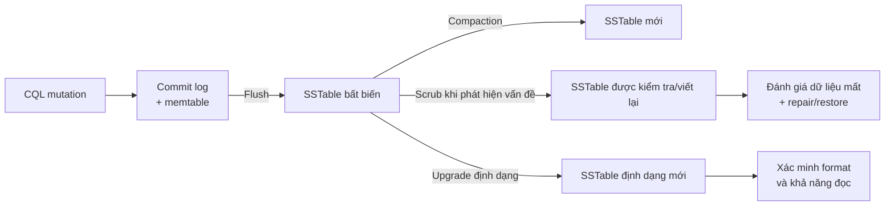
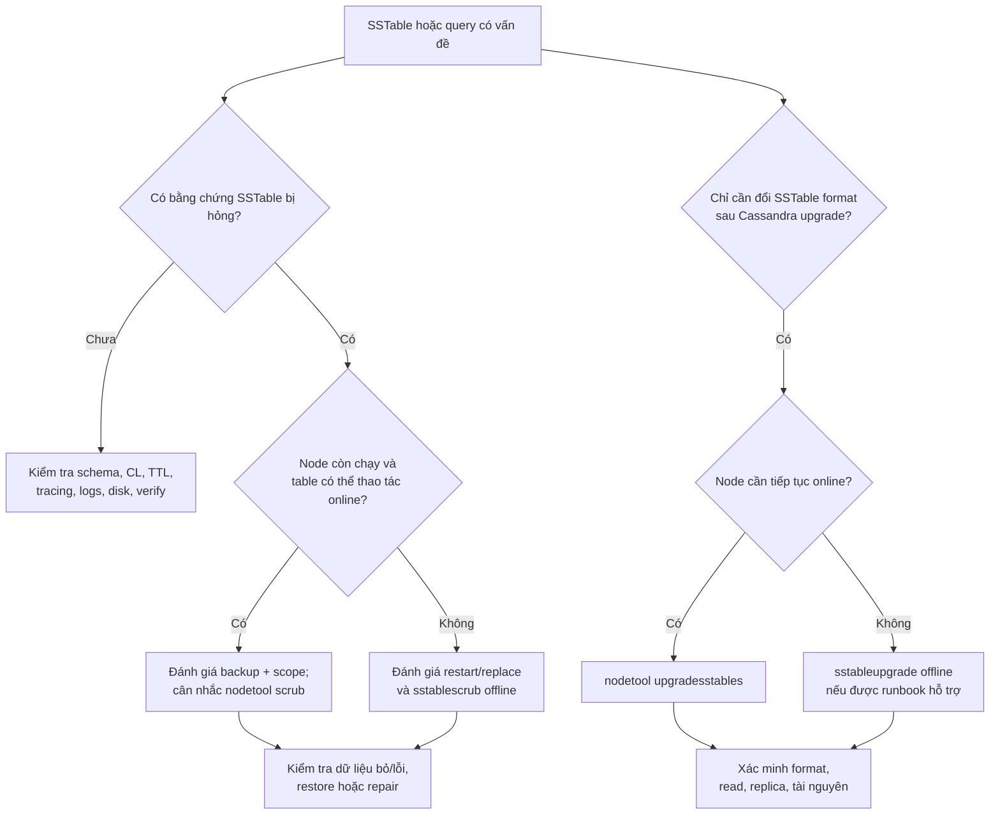
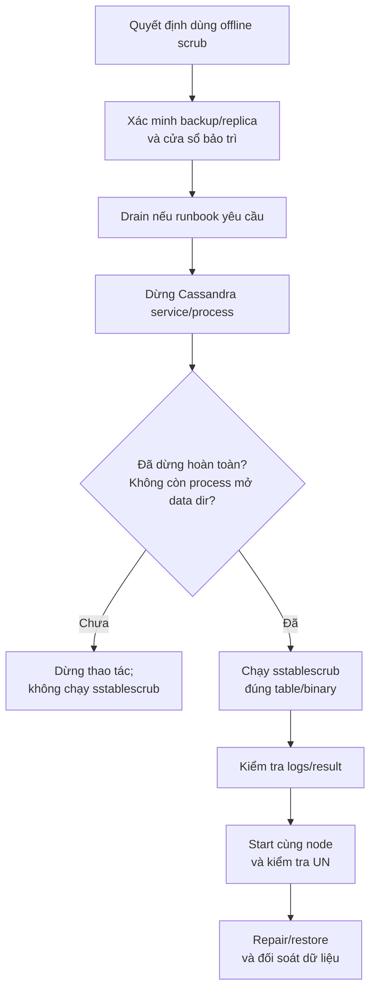

# Công cụ scrub/upgrade SSTable và phạm vi online/offline phải kiểm tra

**Chương:** Công cụ vận hành  
**Module:** `DATABASE_ENGINE_WIDE_COLUMN_CASSANDRA` — Apache Cassandra

Apache Cassandra lưu dữ liệu dài hạn trong **SSTable bất biến** trên từng replica. Sau một lỗi ổ đĩa, sự cố định dạng tệp hoặc một đợt nâng cấp phiên bản Cassandra, người vận hành có thể gặp các lệnh có tên gần giống nhau: `nodetool scrub`, `sstablescrub`, `nodetool upgradesstables` và `sstableupgrade`. Tuy nhiên, chúng không tương đương. Hai lệnh `nodetool` làm việc qua node Cassandra đang chạy; hai tiện ích `sstable*` làm việc trực tiếp với tệp và **cần dừng tiến trình Cassandra trên node chứa dữ liệu** trước khi dùng.

Quan trọng hơn, **scrub có khả năng loại bỏ dữ liệu bị xem là hỏng**. Nó không phải một lệnh “sửa mọi thứ mà không mất hàng nào”. Ngược lại, **upgrade SSTable** nhằm chuyển định dạng tệp sang định dạng được phiên bản Cassandra hiện tại sử dụng; không phải phép kiểm tra/sửa dữ liệu hỏng. Chọn sai công cụ, sai mục tiêu hoặc sai thời điểm có thể gây mất dữ liệu, làm tiến trình khởi động không được hoặc khiến rollback sau nâng cấp không khả thi.

Bài này nằm trong module `DATABASE_ENGINE_WIDE_COLUMN_CASSANDRA` về kiến trúc phân tán và wide-column, partition key, thiết kế bảng theo truy vấn, consistency level, CQL, replication, compaction, repair, xử lý lỗi và kết nối Java. Mục tiêu là xây dựng **runbook phân biệt online/offline và phạm vi áp dụng**, thay vì học thuộc bốn câu lệnh rồi chạy tùy tiện.

> **Giới hạn và an toàn:** Các ví dụ hướng tới Apache Cassandra 4.1/5.x trên Linux. Cú pháp, flag, cơ chế snapshot và hỗ trợ định dạng có thể khác theo bản phân phối. Đối chiếu `nodetool help ...`, `sstablescrub --help`, `sstableupgrade --help` và tài liệu đúng phiên bản đang chạy. Chỉ thử sửa SSTable trong **cluster disposable**. Không cố ý phá file thật, không xóa SSTable bằng tay và không chạy tiện ích offline khi Cassandra còn mở data directory.

## 1. Kết quả học tập

Sau bài này, bạn có thể:

1. Phân biệt **lỗi dữ liệu vật lý**, **lỗi truy vấn/schema**, **thiếu replica** và **SSTable format cũ sau nâng cấp**.
2. Chọn giữa `nodetool scrub` (online), `sstablescrub` (offline), `nodetool upgradesstables` (online) và `sstableupgrade` (offline).
3. Biết vì sao `nodetool verify`/`sstableverify` có chức năng xác minh, **không phải** tự phục hồi những hàng bị mất.
4. Xác định phạm vi **keyspace/table/node/SSTable/snapshot** cần tác động; hiểu rằng một lệnh trên một node không sửa toàn bộ replica của cluster.
5. Chuẩn bị health check, snapshot/backup độc lập, disk headroom, rollback và điều kiện dừng.
6. Thực hiện runbook scrub online có giám sát, hiểu `--no-snapshot`, `--skip-corrupted` và `--no-validate` là những lựa chọn rủi ro.
7. Hiểu quy trình offline: drain (nếu thích hợp) → dừng Cassandra → xác minh đã dừng → dùng tool cùng phiên bản → khởi động lại → repair/validation.
8. Nêu được vì sao format upgrade làm tăng đọc/ghi đĩa và có thể ảnh hưởng khả năng rollback sang phiên bản cũ.
9. Đối chiếu dữ liệu CQL và Java Driver với logs, `nodetool` và kết quả repair sau bảo trì.
10. Lập biên bản bảo trì có bằng chứng trước/sau và phạm vi chưa được kiểm chứng.

## 2. LSM-tree và lý do phải có công cụ SSTable

### 2.1. Từ mutation đến file

Trên mỗi replica:



Một partition được ánh xạ sang token thông qua partition key; tùy RF và topology, nhiều node có bản sao của partition đó. **SSTable là tệp trên một replica**, không phải toàn bộ dữ liệu logic của keyspace. Cùng một partition có thể xuất hiện trong nhiều SSTable do các lần flush/update và quá trình compaction.

SSTable gồm nhiều component liên quan dữ liệu và metadata (ví dụ Data, Index, Statistics, Summary, CompressionInfo tùy định dạng). Tên tệp/định dạng thay đổi giữa các dòng Cassandra. Không tự sửa component file bằng editor hoặc chỉ thay tên prefix để “nâng cấp” định dạng.

### 2.2. Khi nào xảy ra lỗi vật lý?

Một số nguồn lỗi có thể gây nghi ngờ SSTable:

- Exception `CorruptSSTableException` hoặc lỗi checksum/validation trong log.
- Node không khởi động được vì không mở hoặc không đọc được một SSTable.
- `nodetool verify` báo bất thường với SSTable/range được kiểm tra.
- Filesystem, controller, disk hoặc kernel báo I/O error.
- Snapshot/backup chưa đầy đủ, copy file thiếu component, mất điện hoặc có lỗi phần cứng.
- Trạng thái sau upgrade không tương thích định dạng theo tài liệu phiên bản.

Tuy nhiên, **truy vấn trả sai giá trị không đủ để kết luận SSTable hỏng**. Có thể ứng dụng dùng sai partition key, timestamp, TTL, consistency level, schema hoặc replica chưa repair. Scrub không sửa được lỗi nghiệp vụ.

## 3. Ma trận quyết định online/offline

| Công cụ | Node Cassandra trên **chính data directory** | Mục đích | Rủi ro chính |
| --- | --- | --- | --- |
| `nodetool scrub` | **Đang chạy (online)**, dùng JMX | Scrub, kiểm tra/viết lại SSTable cho table chọn | Có thể bỏ phần dữ liệu bị coi là hỏng; I/O lớn; cần repair/restore |
| `sstablescrub` | **Phải dừng (offline)** | Sửa SSTable có lỗi bằng utility trực tiếp trên filesystem | Có thể bỏ hàng hỏng; cần dừng node; có thể lỗi startup/thiếu dữ liệu |
| `nodetool upgradesstables` | **Đang chạy (online)**, dùng JMX | Viết lại SSTable định dạng cũ sang format hiện tại | Disk/CPU/compaction contention, cần backup và kế hoạch upgrade |
| `sstableupgrade` | **Phải dừng (offline)** | Viết lại định dạng SSTable tại filesystem (cũng có chế độ snapshot theo phiên bản) | Không được chạy song song daemon; ảnh hưởng khả năng rollback/khôi phục |
| `nodetool verify` | Đang chạy (online) | Kiểm tra tính hợp lệ/checksum dữ liệu theo cơ chế phiên bản | Gây I/O nhưng **không** khôi phục bản ghi mất |
| `sstableverify` | Phải dừng (offline) | Xác minh SSTable bằng utility trực tiếp | I/O lớn; **không** phải scrub |
| `nodetool repair` | Đang chạy (online) | Đối chiếu replica và truyền dữ liệu khác nhau | Đòi nguồn replica còn dữ liệu đúng, tốn mạng/đĩa |
| `nodetool compact` | Đang chạy (online) | Yêu cầu compaction | **Không** phải scrub hay repair; có thể dùng thêm nhiều disk |

**Online** ở đây là **node đích vẫn đang chạy Cassandra và có thể phục vụ CQL**; không đồng nghĩa không có downtime, không tăng p99 hoặc an toàn khi dùng trên production. **Offline** nghĩa là **tiến trình Cassandra không được mở data directory ấy** trong thời gian utility làm việc; drain xong nhưng daemon vẫn chạy **chưa phải offline**.

**Không đảo ngược định nghĩa:** `nodetool` kết nối từ máy quản trị tới JMX của node đích; chạy nó trên máy khác không biến thao tác thành “offline”. Ngược lại, `sstablescrub` chạy bên ngoài tiến trình server, nên việc mở terminal khác để gõ lệnh không giúp tránh điều kiện phải dừng Cassandra.

## 4. Quy trình chọn công cụ theo triệu chứng



Một số tình huống có thể cần **thay thế/rebuild node** thay vì scrub, nhất là khi data directory bị hỏng nặng nhưng RF vẫn có replica tốt để stream lại. Không chọn một thao tác nguy hiểm chỉ vì tên lệnh xuất hiện trong log.

### 4.1. Bốn câu hỏi trước khi chọn scrub

1. Bằng chứng nào xác nhận tệp bị hỏng: exception, checksum, lỗi đọc hay I/O hardware?
2. Lỗi ở **node nào, keyspace/table nào, SSTable nào, token range nào**?
3. Replica khác có dữ liệu lành/được repair đúng lịch không? RF=1 có backup không?
4. Bạn chấp nhận **mất một số hàng hỏng** hay cần khôi phục nguyên vẹn từ snapshot/backup?

Scrub **không sửa đĩa vật lý lỗi**. Nếu ổ đĩa tiếp tục trả I/O error, ưu tiên xử lý hạ tầng và bảo vệ dữ liệu trước khi cho phép tiến trình viết lại hàng loạt.

### 4.2. Ba câu hỏi trước khi chọn upgrade

1. Cassandra đã nâng cấp binary/schema tương thích theo quy trình được hỗ trợ chưa?
2. SSTables hiện tại có định dạng cũ cần được rewrite không, hay đã đúng format?
3. Nếu cần rollback binary, phiên bản cũ có đọc được SSTable sau rewrite không?

**Upgrade SSTable không có mục tiêu bỏ dữ liệu hỏng**, cũng không phải một bước khôi phục dữ liệu thiếu. Đừng dùng upgradesstables thay vì verify/scrub/repair khi logs báo corruption.

## 5. Preflight bắt buộc: phạm vi và an toàn

### 5.1. Xác minh cluster và node trước khi viết lại dữ liệu

Trên **node/cluster thử nghiệm**:

```bash
nodetool status
nodetool version
nodetool describecluster
nodetool info
nodetool tpstats
nodetool compactionstats
nodetool netstats
```

Ghi lại Cassandra version, JDK, replication factor, datacenter/rack, tình trạng replica `UN/DN`, pending compactions, repair/streaming đang chạy và disk free. Nếu một replica khác cũng đang lỗi, việc scrub khiến thêm dữ liệu biến mất trên node còn sống có thể đẩy cluster vào tình huống không có nguồn khôi phục.

Với một table nghi vấn, ghi:

```bash
nodetool tablestats lab_ops.inventory_by_sku
nodetool tablehistograms lab_ops inventory_by_sku
nodetool help scrub
nodetool help upgradesstables
```

Nếu table chưa tồn tại, hai lệnh `tablestats`/`tablehistograms` chỉ là ví dụ cần thay tên thực tế. Không phải mọi `nodetool` subcommand đều sẵn có trên mọi phiên bản.

### 5.2. Snapshot và backup không hoán đổi

**Snapshot** Cassandra thường tham chiếu các file SSTable bằng hard link/cơ chế filesystem phù hợp; đó là ảnh chụp file dữ liệu trên một node tại một thời điểm. Một bản snapshot nằm **trên cùng ổ đĩa đang có nguy cơ lỗi** không đủ làm bản backup độc lập.

Trước thao tác có thể loại bỏ dữ liệu:

1. Có backup được lưu ra vị trí riêng và quy trình restore đã từng được kiểm chứng.
2. Lưu schema/table metadata và thông tin cluster/replication.
3. Xác nhận snapshot trên **đúng node và table** trước khi chạy scrub; không chỉ dùng snapshot ở node khác.
4. Có dung lượng cho **snapshot giữ tệp cũ + SSTable mới được rewrite + compaction/snapshot khác**.
5. Xác định ai sẽ phê duyệt xóa snapshot sau khi đã kiểm tra phục hồi.

Ví dụ chụp snapshot có tên rõ ràng trên node lab:

```bash
# Kiểm tra cú pháp trên phiên bản hiện tại.
nodetool help snapshot

# Ví dụ theo cú pháp thường có:
nodetool snapshot -t pre_sstable_maintenance_011 -cf inventory_by_sku lab_ops

nodetool listsnapshots
```

Câu `nodetool scrub` có thể tự tạo pre-scrub snapshot theo mặc định (nếu snapshot không bị vô hiệu hóa). Tuy vậy, **không dựa hoàn toàn vào auto-snapshot** cho rủi ro mất dữ liệu: nó có thể không tạo được khi disk đầy, bị tắt theo cấu hình hoặc không thay thế backup độc lập.

### 5.3. Dự phòng tài nguyên

| Nguồn lực | Rủi ro khi scrub/upgrade | Cần đo |
| --- | --- | --- |
| Disk free trên node đích | SSTable cũ và mới có thể cùng tồn tại; snapshot giữ block cũ | Free bytes, snapshot bytes, filesystem errors |
| Disk throughput/IOPS | Rewrite đọc và ghi nhiều tệp, cạnh tranh compaction | Read/write latency, queue depth, I/O wait |
| CPU/GC/heap | Validation, compression, index rebuild, buffers | CPU, GC pauses, RSS/cgroup |
| Replica availability | Node offline làm giảm số replica có thể ACK | RF/CL, node status, client timeout |
| Network | Repair/streaming sau scrub có thể truyền dữ liệu | WAN/DC traffic, `netstats` |
| Thời gian bảo trì | Rewrite không kết thúc đúng lúc nếu data lớn/đĩa yếu | Dung lượng SSTable, throughput đo thực |
| Backup/rollback | Dữ liệu bị bỏ hoặc format mới không tương thích cũ | Snapshot/backup restore tested, version compatibility |

**Không có hệ số “đúng gấp đôi dung lượng” áp dụng cho mọi bảng.** Kế hoạch space phải tính lượng tệp được viết lại, snapshot/hard links, compaction và số node tác động. Nếu disk đích không đủ headroom, dừng trước khi bắt đầu, không chờ quá trình hết đĩa rồi tìm cách xóa SSTable bằng tay.

### 5.4. Biên bản trước khi chạy

```text
CHANGE_ID:
INCIDENT_ID:
NODE / HOST_ID / DC / RACK:
CASSANDRA_VERSION / JDK:
KEYSPACE / TABLE / SSTABLE_PATH_IF_KNOWN:
ERROR_OR_REASON:
RF / CURRENT_CLIENT_CL:
REPLICA_HEALTH:
BACKUP_LOCATION / RESTORE_TEST:
SNAPSHOT_NAME / VERIFY_RESULT:
DISK_FREE / CPU / COMPACTION / P99:
TOOL / ONLINE_OR_OFFLINE:
COMMAND_AND_FLAGS:
STOP_CONDITION:
RECOVERY_OWNER:
```

Mục tiêu là lưu **đúng cái đã xác minh**, không điền ví dụ giả định thành số đo thật.

## 6. `nodetool scrub`: chạy khi node còn online

### 6.1. Tác dụng và rủi ro

`nodetool scrub` yêu cầu node Cassandra đang hoạt động **viết lại SSTables** cho các table được chỉ định, cố giữ lại phần dữ liệu hợp lệ và bỏ/điều chỉnh các phần được xác định là hỏng theo logic tool. Công việc này liên quan đường compaction và có thể tranh tài nguyên với client read/write.

**Không** nói “scrub hoàn toàn không mất dữ liệu”. Nếu bỏ một partition/row hỏng, dữ liệu logic của replica đó đã bị ảnh hưởng. Trong RF nhiều bản sao, sau đó có thể repair từ replica lành; trong RF=1 và không có backup, dữ liệu bị bỏ có thể **không phục hồi được**.

### 6.2. Cú pháp an toàn để tìm hiểu trước

```bash
nodetool help scrub

# Ví dụ chỉ dành cho node lab có bảng tương ứng:
nodetool scrub lab_ops inventory_by_sku
```

Phạm vi là **table `inventory_by_sku` của keyspace `lab_ops` trên node đích**. Nó không scrub cùng table trên tất cả node của cluster và không bảo đảm mọi partition/tombstone khác trong DC đã hội tụ.

Không chạy `nodetool scrub` trên mọi keyspace khi bạn chỉ gặp lỗi một SSTable thuộc một table. Nếu cần nhiều table, lập danh sách và thứ tự được phê duyệt.

### 6.3. Các flag cần hiểu trước khi dùng

| Flag (kiểm tra `help` theo phiên bản) | Ý nghĩa | Quy tắc an toàn |
| --- | --- | --- |
| `--no-snapshot` / `-ns` | Không tạo snapshot pre-scrub | **Tránh**, trừ khi đã có backup/snapshot độc lập được kiểm chứng và runbook cho phép |
| `--skip-corrupted` / `-s` | Cho phép bỏ các partition hỏng kể cả trong bảng counter theo semantics phiên bản | Có thể mất dữ liệu và làm counter sai; tuyệt đối không bật để thử vận may |
| `--no-validate` / `-n` | Bỏ một số bước kiểm tra kiểu/cột | Không dùng nếu chưa xác định chính xác nguyên nhân và tác động |
| `--reinsert-overflowed-ttl` / `-r` | Đường xử lý đặc biệt cho lỗi TTL overflow lịch sử | **Không** phải “sửa TTL nói chung”; chỉ theo thủ tục lỗi/phiên bản xác nhận |
| `--jobs` / `-j` | Giới hạn SSTable xử lý đồng thời | Tăng jobs có thể làm disk I/O và p99 xấu đi |

Các flag này **không phải lựa chọn tối ưu hiệu năng mặc định**. Một số biến thể giúp scrub tiếp tục bằng cách bỏ phần không xử lý được; hành vi này có hệ quả về toàn vẹn dữ liệu và cần approval cụ thể.

### 6.4. Counter cần đặc biệt thận trọng

Một bảng counter có semantics khác hàng thông thường. Khi bỏ một partition hoặc fragment hỏng, **giá trị counter tổng hợp có thể bị thiếu**. Đối với các phiên bản có `--skip-corrupted`, tùy chọn này có thể cho phép bỏ phần dữ liệu hỏng trong bảng counter mà mặc định bị ngăn.

Do đó, với bảng counter:

1. Không chạy `--skip-corrupted` chỉ để scrub không báo lỗi.
2. Xác định dữ liệu ảnh hưởng và cách tái dựng giá trị từ nguồn nghiệp vụ nếu cần.
3. Có backup/approval và thiết kế đối soát sau sửa.
4. Hiểu rằng repair không thể tự biết số counter nghiệp vụ chính xác nếu mọi replica đều thiếu thông tin.

### 6.5. Theo dõi sau khi chạy

```bash
nodetool compactionstats
nodetool tablestats lab_ops.inventory_by_sku
nodetool tpstats
nodetool listsnapshots
nodetool status
```

Ghi logs liên quan tệp nào được scrub, số hàng/partition bị bỏ (nếu tool báo), snapshot được tạo, thời gian và lỗi. Một lệnh trả exit code 0 chỉ chứng minh tiến trình thao tác hoàn tất theo tiêu chí của nó; **không chứng minh tất cả mutation đã được khôi phục**.

Nếu có dữ liệu bị loại, cần quy trình **restore từ backup hoặc repair từ replica lành** phù hợp tình trạng RF. Đừng tự chạy repair mù trước khi ghi lại phạm vi đã mất; sau repair vẫn phải kiểm tra kết quả dữ liệu logic và trạng thái các replica.

## 7. `sstablescrub`: tiện ích offline

### 7.1. Điều kiện bắt buộc

`sstablescrub` làm việc trực tiếp trên SSTables và có khả năng viết lại tệp. **Phải dừng Cassandra trên node đó**. Tài liệu Apache Cassandra nhấn mạnh các tiện ích `sstable*` offline **không tự kiểm tra** daemon đã dừng hay chưa. Vì vậy việc chạy được command **không đồng nghĩa an toàn**.



**Drain không bằng stop.** `nodetool drain` giúp node xử lý phần dữ liệu đang mở theo cơ chế shutdown, nhưng có thể daemon vẫn đang sống. Phải xác nhận process đã dừng **sau** lệnh dừng service.

### 7.2. Ví dụ runbook trên VM Linux lab

Các lệnh dưới đây **không phải một script copy-paste tự động**. Chỉ chạy trên VM lab được phép ngừng dịch vụ và khi đã xác nhận backup:

```bash
# Khi Cassandra vẫn chạy, nếu runbook của phiên bản yêu cầu:
nodetool drain

# Dừng service trên node mục tiêu:
sudo systemctl stop cassandra

# Xác minh thực sự đã dừng; tên process có thể khác bản đóng gói:
pgrep -af 'org.apache.cassandra.service.CassandraDaemon'

# Chỉ sau khi KHÔNG còn daemon dùng data directory:
sstablescrub --help
sstablescrub lab_ops inventory_by_sku
```

`pgrep` có thể trả exit code khác 0 khi không tìm thấy tiến trình; đó là kết quả phù hợp nếu đã xác nhận bằng service manager/log/file handle theo runbook. Nếu còn process, **không chạy sstablescrub**.

Sau khi utility hoàn tất và logs/file đã được kiểm tra:

```bash
sudo systemctl start cassandra

# Chờ node khởi động và ổn định; chạy từ node/host phù hợp:
nodetool status
nodetool compactionstats
nodetool tablestats lab_ops.inventory_by_sku
```

Không dùng `kill -9`, xóa data directory hoặc chạy lại scrub nhiều lần khi chưa hiểu lỗi. Nếu node vẫn không thể start sau scrub, giữ logs, snapshot và chuyển sang runbook phục hồi/rebuild/replace phù hợp.

### 7.3. Docker/Kubernetes có bẫy riêng

Nếu chạy `docker stop cassandra3`, bạn **không thể** mặc định `docker exec cassandra3 sstablescrub ...` vào container đã dừng. Trong Kubernetes, operator có thể tự restart pod, và ephemeral container/Job cần mount volume cùng cấu hình/UID nhưng **không được** để hai process Cassandra/utility ghi vào cùng data directory đồng thời.

Vì vậy runbook offline trên container cần do platform owner xác nhận:

- Một controller/maintenance mode thực sự ngăn Cassandra auto-restart.
- Utility có **đúng phiên bản binary/JDK** tương thích với SSTable và schema.
- Volume được mount an toàn với quyền sở hữu đúng.
- Không có daemon/sidecar khác đang ghi vào cùng data dir.
- Có kiểm soát cleanup/restore và thời điểm trả pod vào service.

Không tự dùng `--privileged` hoặc thay quyền filesystem production để “vượt” permission denied.

### 7.4. Khi nào offline scrub vẫn không đủ?

Nếu tệp quá hỏng, sstable không đọc được metadata, nguồn đĩa vẫn báo I/O error hoặc nhiều replica cùng hỏng, công cụ có thể không khôi phục được. Khi đó:

- Cân nhắc restore backup nếu cần giữ dữ liệu chính xác.
- Nếu RF đủ, đánh giá thay/rebuild node từ replica lành.
- Không tự xóa file lỗi để node start nếu chưa có runbook được phê duyệt.
- Không biến `--skip-corrupted` thành cách lặp vô hạn để “đến khi hết lỗi”.

**Offline scrub có thể bỏ dữ liệu**, không phải “sửa mạnh hơn nên chắc chắn không mất dữ liệu”.

## 8. `nodetool upgradesstables`: nâng định dạng khi online

### 8.1. Dùng khi nào?

Sau một **nâng cấp Cassandra binary được hỗ trợ**, node có thể vẫn giữ SSTables ở format của phiên bản trước. Khi thích hợp, `nodetool upgradesstables` viết lại những SSTable chưa thuộc định dạng hiện tại của node, để chuyển chúng sang format mới. Hoạt động này cần I/O/CPU/space; theo tài liệu có thể được triển khai như một loại compaction.

**Không dùng upgradesstables để sửa dữ liệu corruption**. Nếu format đã ở phiên bản hiện tại, lệnh có thể không viết lại gì; đó không phải lỗi. Một số tool hoặc version cung cấp `--include-all-sstables` để rewrite cả tệp đã ở format hiện tại, làm chi phí lớn hơn.

### 8.2. Cú pháp

```bash
nodetool help upgradesstables

# Ví dụ online cho bảng được chọn:
nodetool upgradesstables lab_ops inventory_by_sku

# Theo dõi thời điểm hoạt động:
nodetool compactionstats
nodetool tablestats lab_ops.inventory_by_sku
```

Các tùy chọn được tài liệu Cassandra 5.0 mô tả có thể bao gồm:

| Tùy chọn | Ý nghĩa | Lưu ý |
| --- | --- | --- |
| `--include-all-sstables` / `-a` | Viết lại cả các SSTable đã có format hiện tại | I/O lớn, không bật trừ khi có lý do rõ |
| `--jobs` / `-j` | Độ đồng thời cho các SSTable được upgrade | Cần xét disk/CPU/compaction contention |
| `--max-timestamp` / `-t` (nếu có) | Giới hạn chọn SSTable theo mốc thời gian tạo tệp được hỗ trợ | Có thể không tồn tại hoặc khác semantics ở phiên bản khác |

Lệnh được thực hiện **trên node được nhắm đến**; khi một cluster có 10 nodes, nó không tự rewrite SSTables ở 9 nodes còn lại. Lập lịch rolling hoặc theo nhóm đủ an toàn và ghi trạng thái riêng từng node.

### 8.3. Khi nào nên chạy trong quy trình upgrade?

Thứ tự khái niệm:

1. Có backup/restore plan, tương thích binary/schema/driver được xác minh.
2. Nâng cấp Cassandra **theo runbook được hỗ trợ**, quan sát health và phiên bản từng node.
3. Khi cluster đủ ổn định và rollback window đã được đánh giá, quyết định có cần nâng SSTable format hay không.
4. Chạy upgradesstables có giới hạn theo table/node, giám sát disk/CPU, p99, compaction.
5. Kiểm chứng dữ liệu, khả năng đọc, trạng thái format và các tác vụ repair liên quan.

**Rollback trap:** nếu SSTables được viết sang format mới mà binary cũ không đọc được, việc “cài lại bản Cassandra cũ” có thể **không khôi phục được node**. Dù một số cặp phiên bản cho phép compatibility đặc biệt, không được suy rằng rollback binary luôn an toàn sau `upgradesstables`.

### 8.4. Không cần chạy nếu không có lý do

Một số hướng dẫn upgrade không yêu cầu viết lại toàn bộ SSTable tức thì. Có tình huống tệp cũ được đọc tương thích trong giai đoạn chuyển tiếp và compaction nền dần tạo format mới. Phải đọc hướng dẫn đúng phiên bản; không chạy rewrite trên toàn bộ cluster chỉ vì vừa deploy binary mới và muốn thấy SSTable count thay đổi.

## 9. `sstableupgrade`: nâng định dạng offline

`sstableupgrade` là utility thao tác SSTables trực tiếp trên disk. Theo tài liệu Apache Cassandra, **Cassandra phải được dừng trước khi sử dụng**, vì việc daemon và tool cùng truy cập/ghi dữ liệu có thể gây kết quả không lường trước.

### 9.1. Quy trình lab trên một node được phép dừng

```bash
# Xem --help từ đúng binary/installation:
sstableupgrade --help

# Nếu cần và runbook quy định, drain trước khi shutdown:
nodetool drain
sudo systemctl stop cassandra

# Xác minh không còn Cassandra process đọc/ghi data dir:
pgrep -af 'org.apache.cassandra.service.CassandraDaemon'

# Chỉ khi đã OFFLINE:
sstableupgrade lab_ops inventory_by_sku

# Sau khi utility hoàn tất và kiểm tra kết quả:
sudo systemctl start cassandra
nodetool status
```

Đây là **hướng dẫn điều kiện**, không phải lời khuyên dừng một replica của production mà không kiểm tra RF/CL. Trong cluster RF=3, khi một node offline, `LOCAL_QUORUM` có thể còn khả dụng nếu hai replica khác khỏe; `ALL` có thể không khả dụng. Với RF=1, dừng replica duy nhất gây outage cho ranges do node ấy lưu.

### 9.2. Snapshot cũng có thể bị ảnh hưởng

Tùy phiên bản, `sstableupgrade` có tùy chọn tác động **một snapshot**. Tài liệu Cassandra 5.0 nêu việc upgrade snapshot có thể thay file của snapshot và **phá liên kết hard link với SSTable sống**. Vì vậy:

- Xác minh đang nhắm đúng live table hay snapshot.
- Không coi snapshot sau rewrite là bản backup bất biến tuyệt đối.
- Giữ một bản backup **ngoài cùng filesystem** nếu cần rollback/restore.
- Không dùng snapshot upgrade để sửa lỗi đọc dữ liệu nếu nguyên nhân là corruption.

### 9.3. Online và offline upgrade nên chọn cái nào?

Thông thường khi cluster đang vận hành và phiên bản hỗ trợ, `nodetool upgradesstables` tiện hơn vì node vẫn online. `sstableupgrade` thích hợp khi **runbook yêu cầu xử lý offline**, ví dụ node đã dừng để bảo trì hoặc cần thao tác tệp/snapshot chuyên biệt. Một tiện ích offline không tự nhanh hơn, an toàn hơn hoặc phù hợp hơn mọi tình huống.

## 10. Các lệnh nhìn giống nhưng giải quyết mục tiêu khác

| Lệnh | Công dụng | Không nên dùng để |
| --- | --- | --- |
| `nodetool flush` | Đẩy memtable ra SSTable | Sửa SSTable hỏng, khôi phục replica thiếu |
| `nodetool compact` | Yêu cầu compaction | Đảm bảo toàn vẹn dữ liệu hoặc upgrade format theo runbook |
| `nodetool scrub` | Thử sửa/tái tạo SSTable lỗi online | “Dọn mọi tombstone” định kỳ |
| `nodetool verify` | Kiểm tra tính hợp lệ dữ liệu/SSTable | Tự sửa mọi checksum lỗi |
| `nodetool upgradesstables` | Rewrite format SSTable online | Hòa giải dữ liệu thiếu giữa replica |
| `sstablescrub` | Xử lý SSTable lỗi offline | Chạy khi daemon còn sống |
| `sstableupgrade` | Rewrite format offline | Chạy đồng thời với compaction của daemon |
| `nodetool repair` | Đối chiếu replica, đồng bộ dữ liệu khác | Thay backup khi mọi replica đều mất dữ liệu |
| `nodetool rebuild` | Stream dữ liệu cho node theo phạm vi/nguồn được chọn | Chỉ đổi format tệp của một table |

### 10.1. Scrub không thay repair

Khi scrub loại phần hỏng, replica A có thể thiếu mutation mà replica B/C còn. Anti-entropy repair có thể đồng bộ từ các replica khác nhưng chỉ khi dữ liệu đó thực sự còn và thời gian/tombstone vẫn an toàn. Nếu RF=1, repair không tạo ra dữ liệu từ không khí.

### 10.2. Upgrade không thay compaction strategy

Chuyển SSTable format không tự quyết định STCS, LCS, TWCS hay UCS. Workload update-heavy, TTL hoặc partition rộng vẫn cần thiết kế bảng và compaction riêng. Đừng kỳ vọng upgradesstables là giải pháp chung cho read p99 xấu.

### 10.3. “Online” không có nghĩa thao tác phân tán tự động

`nodetool` tác động node đích. Nếu bảng có RF=3, ba replica có thể ở ba node, với SSTable format/compaction/corruption khác nhau. Một node scrub xong không làm hai replica còn lại tự scrub. Việc chọn **bao nhiêu node cần thao tác** phải dựa trên log và kế hoạch bảo trì, không phải RF nhân với một lệnh chung.

## 11. Lab an toàn: chuẩn bị bảng để quan sát, không cố ý gây corruption

Bài lab chỉ tạo **SSTable hợp lệ** và kiểm tra hành vi/metadata. Không có bước đổi byte, xóa component hoặc phá SSTable bằng hex editor. Muốn kiểm chứng recovery corruption phải dùng **cluster disposable riêng với snapshot/backup**, theo kế hoạch của nhóm vận hành.

### 11.1. Chuẩn bị topology

Giả sử một DC tên `datacenter1` gồm ba node khỏe, RF=3. Trên một node:

```bash
nodetool status
nodetool version
nodetool describecluster
cqlsh
```

Trong `cqlsh`:

```sql
SELECT data_center, release_version
FROM system.local;
```

Nếu datacenter thực tế khác `datacenter1`, thay đúng tên trong câu lệnh sau. Chỉ dùng RF=3 khi có ba node replica trong DC; nếu lab chỉ một node, điều chỉnh RF/CL và chấp nhận giới hạn không có nguồn repair.

### 11.2. Schema và baseline nhỏ

```sql
CREATE KEYSPACE IF NOT EXISTS lab_ops
WITH replication = {
  'class': 'NetworkTopologyStrategy',
  'datacenter1': 3
}
AND durable_writes = true;

CREATE TABLE IF NOT EXISTS lab_ops.inventory_by_sku (
    sku text PRIMARY KEY,
    available int,
    revision int,
    updated_at timestamp
);

CONSISTENCY ALL

INSERT INTO lab_ops.inventory_by_sku
    (sku, available, revision, updated_at)
VALUES ('sku-011-a', 100, 1, '2026-11-21T02:00:00Z');

INSERT INTO lab_ops.inventory_by_sku
    (sku, available, revision, updated_at)
VALUES ('sku-011-b', 200, 1, '2026-11-21T02:00:00Z');

INSERT INTO lab_ops.inventory_by_sku
    (sku, available, revision, updated_at)
VALUES ('sku-011-c', 300, 1, '2026-11-21T02:00:00Z');

SELECT sku, available, revision
FROM lab_ops.inventory_by_sku
WHERE sku = 'sku-011-a';
```

Chỉ tiếp tục nếu **cả ba INSERT** có ACK tại `ALL`. Các khóa có sẵn giúp đối chiếu sau thao tác, nhưng kiểm tra ba hàng **không** chứng minh toàn bộ table/cluster không có corruption.

### 11.3. Tạo SSTable để có thể quan sát

```bash
# Chỉ node lab:
nodetool flush lab_ops inventory_by_sku

nodetool tablestats lab_ops.inventory_by_sku
nodetool tablehistograms lab_ops inventory_by_sku
nodetool compactionstats
```

Memtable flush tạo SSTable trên node được gọi; với RF=3, các node khác có memtable/SSTable riêng. Muốn chắc chắn có tệp để kiểm tra trên từng replica, thực hiện theo runbook lab từng node và xác nhận disk state; không tự ý flush toàn cluster production.

### 11.4. Kiểm tra mà không sửa dữ liệu

```bash
# Online:
nodetool help verify
nodetool verify lab_ops inventory_by_sku

# Chỉ quan sát:
nodetool tablestats lab_ops.inventory_by_sku
nodetool compactionstats
```

Đọc logs để xem verify hoàn tất/thất bại. Một kết quả verify thành công trên một node chỉ nói về phạm vi mà tool đã kiểm tra; không phải bằng chứng toàn cluster đã repair xong hoặc backup đã sẵn sàng.

### 11.5. Thực hành tìm hiểu upgrade option

```bash
nodetool help upgradesstables

# Nếu có kế hoạch và đây là cluster disposable:
nodetool upgradesstables lab_ops inventory_by_sku
```

Nếu các SSTable đã ở format hiện tại, lệnh có thể không rewrite gì. **Không** bật `--include-all-sstables` chỉ để ép tạo I/O và chứng minh “lệnh có chạy”. Đọc logs và tài liệu format của phiên bản trước khi kết luận.

### 11.6. Scrub chỉ là bài tập nâng cao trên cluster bỏ đi

Nếu vẫn muốn khảo sát `nodetool scrub` trên **bảng không hỏng trong cluster disposable**:

1. Chụp snapshot và có backup có thể restore độc lập.
2. Ghi số hàng baseline và disk headroom.
3. Chạy `nodetool scrub lab_ops inventory_by_sku` trên **một node được chọn**.
4. Đọc log, số SSTable rewrite và danh sách snapshot tạo ra.
5. Đối chiếu lại dữ liệu và trạng thái replica, không suy rằng không có lỗi từ ba hàng mẫu.
6. Đánh giá có cần repair/validation theo runbook hay không.

Không cần làm bước này để hiểu phạm vi lệnh. Đối với production, **chỉ scrub khi có lý do vận hành cụ thể**, không xem là maintenance định kỳ như compaction.

## 12. Xác minh dữ liệu bằng CQL và Java Driver

### 12.1. Đọc theo consistency level phù hợp

Sau khi bảo trì trên một node và cluster ổn định:

```sql
CONSISTENCY LOCAL_QUORUM

SELECT sku, available, revision
FROM lab_ops.inventory_by_sku
WHERE sku = 'sku-011-a';

SELECT sku, available, revision
FROM lab_ops.inventory_by_sku
WHERE sku = 'sku-011-b';

SELECT sku, available, revision
FROM lab_ops.inventory_by_sku
WHERE sku = 'sku-011-c';
```

Với RF=3 và không có ghi cạnh tranh, các giá trị kỳ vọng lần lượt `100/200/300`, `revision=1`. Nhưng đọc `LOCAL_QUORUM` có thể trả dữ liệu từ hai replica lành trong khi node đã scrub vẫn thiếu dữ liệu; đó là **bằng chứng logic ở CL**, không phải kiểm tra đĩa của replica vừa sửa.

Nếu dùng `CONSISTENCY ALL` sau khi cả ba node khỏe, một read thành công cũng chỉ kiểm tra **khóa đó**, không chứng minh mọi SSTable đã được kiểm tra. Truy vấn CQL có thể kích hoạt hành vi read repair tùy phiên bản, vì vậy không dùng chúng thay metadata, logs và anti-entropy repair.

### 12.2. Ví dụ Java Driver 4.x

```java
import com.datastax.oss.driver.api.core.CqlSession;
import com.datastax.oss.driver.api.core.DefaultConsistencyLevel;
import com.datastax.oss.driver.api.core.cql.PreparedStatement;
import com.datastax.oss.driver.api.core.cql.Row;

import java.util.List;

public final class SstableMaintenanceReadCheck {
    public static void verify(CqlSession session) {
        PreparedStatement read = session.prepare(
            "SELECT sku, available, revision " +
            "FROM lab_ops.inventory_by_sku WHERE sku = ?"
        );

        for (String sku : List.of(
                "sku-011-a", "sku-011-b", "sku-011-c")) {
            try {
                Row row = session.execute(
                    read.bind(sku).setConsistencyLevel(
                        DefaultConsistencyLevel.LOCAL_QUORUM)
                ).one();

                if (row == null) {
                    System.out.println(sku + " -> ABSENT");
                } else {
                    System.out.println(
                        sku + " -> available=" +
                        row.getInt("available") +
                        ", revision=" + row.getInt("revision")
                    );
                }
            } catch (RuntimeException ex) {
                // Timeout/unavailable không phải chứng cứ hàng bị xóa.
                System.err.println(
                    sku + " -> READ_ERROR: " + ex
                );
            }
        }
    }
}
```

**Giới hạn:** Mã chỉ minh họa read với một `CqlSession` đã được cấu hình phù hợp DC, contact points và auth. Nó không tạo connection, không gọi scrub, không chạy repair và không audit toàn bộ SSTable. Đừng đưa lệnh quản trị phá dữ liệu vào endpoint Java thông thường chỉ vì muốn “tự sửa khi SELECT lỗi”.

## 13. Repair/restore sau scrub và trạng thái tombstone

### 13.1. Khi scrub bỏ hàng

Nếu scrub log cho biết partition/row bị bỏ:

1. Ghi **đúng node, keyspace/table, token/khóa nếu an toàn, các SSTable liên quan và thời điểm**.
2. Xác định replica còn sống có dữ liệu tốt không.
3. Nếu có nguồn hợp lệ, lên kế hoạch **full repair** cho phạm vi liên quan theo phiên bản.
4. Nếu không có nguồn, dùng backup/restore hoặc tái dựng dữ liệu từ hệ thống nghiệp vụ.
5. Kiểm tra logic trên tập khóa/ranges đủ đại diện; đối chiếu logs repair và tình trạng streaming.
6. Không xóa snapshot pre-scrub trước khi được phê duyệt kết thúc điều tra.

Ví dụ lệnh repair **chỉ sau khi node khỏe và đã duyệt runbook**:

```bash
nodetool help repair

# Ví dụ full repair cho bảng, thực thi trên phạm vi/node được lập kế hoạch:
nodetool repair --full lab_ops inventory_by_sku

nodetool netstats
nodetool compactionstats
```

Lệnh repair trên một node không tự bao phủ mọi keyspace/range ở mọi DC. Khi chọn incremental/full hoặc primary ranges cần bám theo version và công cụ quản lý repair của cluster.

### 13.2. Tombstone vẫn cần được giữ đúng

Một replica bị hỏng có thể bỏ lỡ `DELETE` hoặc tombstone do TTL. Nếu các replica khác dọn tombstone trước khi bản sao cũ nhận thông tin xóa, dữ liệu đã xóa có thể **resurrect**. Scrub và repair phải được đánh giá cùng `gc_grace_seconds`, thời gian node vắng, lịch repair và state các replica.

**Không** giảm grace hoặc ép major compaction trong lúc điều tra chỉ để thấy ít tombstone hơn. Việc này có thể làm khó phục hồi chính xác.

### 13.3. Counter và materialized view/index cần kiểm tra riêng

Bảng counter có logic hợp nhất dữ liệu riêng, không tự phục hồi được phép cộng đã mất bằng một lần SELECT tổng. Các hệ thống có materialized view/index hoặc SSTables của bảng phụ cần runbook riêng để xác minh tính nhất quán và xem có phải rebuild index/view theo phiên bản không. **Không** suy rằng scrub base table tự sửa tất cả cấu trúc thứ cấp.

## 14. Hiệu năng: scrub/upgrade tốn những tài nguyên nào?

### 14.1. Mô hình I/O sơ bộ

Một SSTable 100 GiB được rewrite **không** đồng nghĩa thao tác chỉ dùng 100 GiB I/O. Tool có thể phải đọc dữ liệu/tệp liên quan, kiểm tra, ghi SSTable mới, cập nhật metadata và làm việc song song với compaction. Snapshot có thể giữ tệp cũ trên disk.

Nếu số byte thực sự phải đọc là `B_read` và ghi `B_write`, với throughput thực hữu hiệu `V_read` và `V_write`:

\[
T_{\mathrm{I/O}} \gtrsim
\max \left(
\frac{B_{\mathrm{read}}}{V_{\mathrm{read}}},
\frac{B_{\mathrm{write}}}{V_{\mathrm{write}}}
\right)
\]

Đây chỉ là **cận dưới lý tưởng theo I/O**, chưa bao gồm queue, compression/validation CPU, file sync, GC, concurrent compaction và retry. Không dùng làm ETA chắc chắn cho maintenance.

### 14.2. Ví dụ giả định

Giả sử:

- SSTables được rewrite tạo tổng `B_write = 80 GiB`.
- Disk có throughput ghi hữu hiệu riêng dành cho tác vụ khoảng `100 MiB/s`.
- Không tính đọc, metadata, GC và cạnh tranh ứng dụng.

Cận dưới riêng theo ghi:

\[
T_{\mathrm{write}} \gtrsim
\frac{80\times1024\ \mathrm{MiB}}{100\ \mathrm{MiB/s}}
=819{,}2\ \mathrm{s}\approx13{,}7\ \mathrm{phút}
\]

Nếu `B_read` lớn, disk read chậm hơn hoặc p99 ứng dụng bị ảnh hưởng, thực tế sẽ dài hơn. Đừng lấy con số này để khẳng định scrub/upgrade trên 80 GiB “chắc chắn xong trong 14 phút”.

### 14.3. Dashboard theo dõi

| Metric | Dùng để trả lời |
| --- | --- |
| Disk free trên node đích | Có đủ chỗ cho SSTable mới và snapshot cũ? |
| Disk read/write IOPS, await, throughput | Disk đã bão hòa chưa? |
| Compaction active/pending | Rewrite có cạnh tranh với compaction nền không? |
| CPU/GC/RSS và cgroup memory | Validation/compression có gây pressure không? |
| Read/write p95, p99, timeout/unavailable | Ứng dụng có bị tác động? |
| Replica health và CL | Node offline có làm mất quorum không? |
| Repair/streaming bytes và session errors | Dữ liệu mất sau scrub đã được bù ở phạm vi nào? |
| Snapshot size và backup status | Có giữ được nguồn rollback/restore? |
| SSTable format/count/space | Rewrite có thực sự tạo format cần thiết? |
| Error logs/checksum exceptions | Còn SSTable hỏng hoặc lỗi ổ đĩa không? |

**Lưu cả trước/trong/sau**; một snapshot `nodetool compactionstats` tại phút cuối không đủ mô tả spike p99 xảy ra giữa job.

## 15. Chẩn đoán theo kịch bản

### A. Node vẫn chạy, log báo một SSTable lỗi checksum

Xác định tệp/table, kiểm tra ổ đĩa, RF và backup. Cân nhắc `nodetool verify` để đánh giá theo phạm vi; nếu xác nhận corruption, có thể xem xét `nodetool scrub` online với approval, snapshot, disk headroom. Nếu scrub bỏ rows, phải repair/restore. Không mở `--skip-corrupted` mặc định.

### B. Node không khởi động vì không mở SSTable

Online `nodetool scrub` không phù hợp vì daemon không chạy. Giữ logs/dữ liệu, xác minh nguyên nhân và nguồn replica tốt. Chọn runbook offline `sstablescrub` hoặc rebuild/replace/restore theo mức độ corruption; chỉ dùng offline utility sau khi chắc chắn daemon đã dừng.

### C. Vừa nâng Cassandra từ phiên bản được hỗ trợ, muốn đổi format SSTable

Nếu node đang khỏe và runbook cho phép, cân nhắc `nodetool upgradesstables` trên các table cần thiết sau khi đã đánh giá rollback. Không dùng scrub khi không có bằng chứng corruption. Nếu cần thao tác offline/snapshot chuyên biệt, xem `sstableupgrade` và điều kiện shutdown.

### D. Đã chạy upgradesstables nhưng format không thay đổi

Có thể các SSTable đã ở format hiện tại, chưa có tệp để rewrite hoặc lệnh không nhắm đúng table/node. Xem `nodetool help`, logs, SSTable metadata và phiên bản. Không bật include-all rồi chạy vô hạn chỉ để thấy byte write tăng.

### E. Trên container đã stop, không chạy được `docker exec ... sstablescrub`

Vì container không còn chạy, `docker exec` không thể chạy lệnh trong nó. Cần maintenance Job/VM/sidecar có volume mount phù hợp và **không có Cassandra daemon song song**. Không khởi động lại Cassandra chỉ để chạy sstablescrub rồi tuyên bố mình đang offline.

### F. `nodetool scrub` tạo snapshot, disk gần đầy

Snapshot có thể giữ các khối dữ liệu cũ trong khi scrub đang rewrite. Dừng các bước tiếp theo, đánh giá dung lượng/runbook và tránh lệnh xóa thủ công. Không xóa snapshot duy nhất có thể phục hồi cho tới khi đã được phê duyệt, backup độc lập được xác minh và dữ liệu đã đối soát.

### G. Sau scrub, một số SKU biến mất ở replica đã sửa

Scrub có thể đã loại dữ liệu bị hỏng. Check logs và nguồn replica lành, chạy repair/restore theo kế hoạch, không gửi lại UPDATE giả tạo “để hàng hiện lên” nếu chưa rõ giá trị đúng theo nghiệp vụ.

### H. Đã rewrite format, cần rollback binary cũ

Đây là rủi ro tương thích định dạng. Không chỉ hạ gói Cassandra rồi restart với data dir đã được upgrade. Kiểm tra compatibility matrix và backup/restore procedure; có thể cần rollback bằng snapshot trước upgrade hoặc thủ tục hỗ trợ đặc biệt.

### I. RF=1, data file bị hỏng

Không có replica nội cluster để repair lấy lại partition. Ưu tiên đánh giá snapshot/backup/rebuild từ nguồn nghiệp vụ; scrub có thể khiến dữ liệu duy nhất mất thêm. Không khẳng định `nodetool repair` sẽ khôi phục dữ liệu đã không còn tồn tại.

### J. Chạy offline utility trên replica tốt trong khi các replica khác đang Down

Dừng kế hoạch: cluster có thể không còn RF/CL đủ để phục vụ truy vấn nếu node đích offline. Với `LOCAL_QUORUM` RF=3, phải có hai replica khỏe đáp ứng; với `ALL` một node offline có thể làm operation không khả dụng. Bảo đảm topology/CL và runbook rolling trước khi tắt node.

## 16. Runbook quản trị hoàn chỉnh

### Giai đoạn P0 — Phân loại mục tiêu

- **Integrity:** SSTable corruption đã được chứng minh? Muốn scrub hay restore/replace?
- **Format:** SSTable cũ sau binary upgrade? Muốn upgradesstables hay có thể chờ compaction?
- **Verify:** Chỉ muốn biết SSTable có hợp lệ? Dùng verify trước.
- **Replication:** Replica thiếu mutation nhưng tệp không hỏng? Dùng hints/repair, không scrub.

### Giai đoạn P1 — Chốt phạm vi và rủi ro

- Node, DC, rack, host ID, keyspace/table, các SSTable/range được nghi.
- Version/JDK/cú pháp flags, format cũ/mới, khả năng rollback.
- RF, CL, replica sống còn, lịch repair, tombstone/grace.
- Backup đã kiểm chứng, snapshot tên rõ, free disk và thời gian maintenance.
- Điều kiện dừng nếu p99, error rate hoặc disk pressure vượt ngưỡng.

### Giai đoạn P2 — Chọn online hoặc offline

| Câu hỏi | Nếu “có” | Hành động |
| --- | --- | --- |
| Cassandra node phải tiếp tục Up? | Có | Xem `nodetool scrub` hoặc `nodetool upgradesstables` nếu mục tiêu phù hợp |
| Daemon không thể khởi động? | Có | Không dùng online nodetool thao tác trên daemon; đánh giá offline/restore/replace |
| Đã xác minh dừng hoàn toàn Cassandra trên data dir? | Không | **Không chạy** sstablescrub/sstableupgrade |
| Có bản sao/backup để khôi phục dữ liệu có thể bị loại? | Không | Chưa đủ điều kiện scrub có rủi ro bỏ hàng; chuyển cấp xử lý theo runbook |
| Có khả năng rollback sang binary cũ? | Chưa chắc | Chưa vội rewrite format SSTable |
| Có nguồn replica lành để repair sau scrub? | Có | Lập kế hoạch repair/đối soát; không xem là bảo đảm tuyệt đối |

### Giai đoạn P3 — Thực hiện từng bước

1. Một node/table trong mỗi đơn vị bảo trì được phê duyệt, nếu runbook chọn cách đó.
2. Ghi câu lệnh/flags chính xác, phiên bản utility, thời gian bắt đầu.
3. Theo dõi disk/CPU/compaction, error logs và p99 ứng dụng.
4. Nếu offline: dừng và xác minh **trước** khi tool mở file, chỉ start khi tool hoàn tất.
5. Không gọi thêm `compact`, `cleanup`, `repair` đồng thời một cách mù quáng nếu chúng sẽ tranh tài nguyên hoặc thay trạng thái dữ liệu trước khi điều tra.

### Giai đoạn P4 — Xác minh và đóng sự kiện

- Công cụ hoàn tất theo logs và không còn lỗi file/format đang xử lý.
- Node startup/ring/schema ổn định; replica health phù hợp.
- Các khóa/range được kiểm chứng bằng CQL/Java tại CL xác định.
- Nếu scrub bỏ dữ liệu: repair hoặc restore đủ phạm vi có log kết quả.
- Snapshot/backup còn giữ cho đến khi được duyệt xóa.
- Disk free và p95/p99 trở lại baseline/SLO.
- Ghi phạm vi **chưa chứng minh** và kế hoạch follow-up.

## 17. Biên bản vận hành có thể sử dụng lại

```text
CHANGE_ID:
INCIDENT_ID:
TASK_TYPE: VERIFY | SCRUB | UPGRADE_FORMAT | RESTORE | REPAIR
CASSANDRA_VERSION_BEFORE / AFTER:
JDK / SSTABLE_FORMAT:
NODE / DC / RACK / HOST_ID:
KEYSPACE / TABLE / AFFECTED_SSTABLES:
ERROR_SIGNATURE:
DISK_HEALTH / FREE_BYTES:
REPLICA_HEALTH / RF / CL:
BACKUP_LOCATION / RESTORE_TEST:
PRE_OPERATION_SNAPSHOT:
ONLINE_OR_OFFLINE:
SHUTDOWN_VERIFICATION (if offline):
EXACT_COMMAND / OPTIONS / UTILITY_VERSION:
START_UTC / END_UTC / EXIT_STATUS:
SSTABLES_REWRITTEN / ROWS_SKIPPED_IF_REPORTED:
P95 / P99 / ERRORS_DURING:
COMPACTION / CPU / DISK_IO:
REPAIR_SCOPE / RESULT:
DATA_VALIDATION_KEYS / RESULT:
ROLLBACK_COMPATIBILITY:
SNAPSHOT_RETENTION_DECISION:
OPEN_ISSUES / OWNER / NEXT_ACTION:
```

Không điền “không phát hiện lỗi” nếu không thu được logs; ghi đúng **không quan sát được** hoặc **chưa kiểm chứng**. Khi cần báo cáo cho nhóm vận hành, phân tách kết quả của công cụ với kết luận mức toàn vẹn dữ liệu.

## 18. Câu hỏi tự kiểm tra

1. Vì sao `nodetool scrub` là thao tác online nhưng vẫn có thể ảnh hưởng SLA và mất dữ liệu?
2. Tại sao `sstablescrub` bắt buộc Cassandra daemon đã dừng, không chỉ đã drain?
3. Chạy `sstablescrub` trong một container mới có thể nguy hiểm ra sao nếu container cũ vẫn mount cùng data directory?
4. `nodetool upgradesstables` khác `nodetool scrub` ở mục tiêu nào?
5. Một SSTable đã ở định dạng hiện tại có cần được upgradesstables mặc định không?
6. Lý do nào khiến việc đổi format SSTable ảnh hưởng khả năng rollback binary?
7. `--skip-corrupted` có thể đặc biệt nguy hiểm cho loại bảng nào? Vì sao?
8. Khi nào `--no-snapshot` làm mất hàng rào an toàn quan trọng?
9. Một snapshot cùng volume có đủ thay thế backup độc lập khi ổ đĩa lỗi không?
10. Nếu RF=1 và scrub bỏ hàng, `nodetool repair` có thể khôi phục từ đâu?
11. `nodetool verify` và `sstableverify` khác scrub như thế nào?
12. Vì sao một lệnh `nodetool` chạy trên một node không tự sửa toàn bộ replica của cluster?
13. Khi scrub hoàn tất exit code 0, vì sao vẫn cần đối chiếu dữ liệu và logs?
14. Counter table có thể bị sai thế nào nếu bỏ fragment bị hỏng?
15. Vì sao cần đo disk free cho snapshot + file mới được rewrite, không chỉ kích thước table hiện tại?
16. Khi nào rebuild/replace node hợp lý hơn scrub trên một tệp rất hỏng?
17. Tại sao `gc_grace_seconds` và tombstone là yếu tố cần xem sau scrub/repair?
18. Một CQL read `LOCAL_QUORUM` đúng có đủ chứng minh SSTable trên replica vừa sửa đã hoàn toàn ổn không?
19. Khi offline một node ở RF=3, `LOCAL_QUORUM` có thể hoạt động dưới điều kiện nào? `ALL` thì sao?
20. Lập kế hoạch thu thập dữ liệu trước/sau cho một thao tác upgradesstables trên node có 80 GiB SSTable cũ.
21. Khi upgrade version và format, bạn sẽ quyết định thời điểm **đóng cửa sổ rollback** như thế nào?
22. Vì sao không nên dùng `nodetool compact` hoặc `flush` thay thế scrub khi log chỉ ra checksum corruption?
23. Nếu phải dùng `sstableupgrade` trên snapshot, vì sao cần đánh giá hard link/backup trước?
24. Hãy viết runbook ngắn cho tình huống node vẫn Up, một SSTable ở bảng `inventory_by_sku` báo corrupt, RF=3 và các replica khác còn khỏe.

### Checklist trước khi cho phép thao tác SSTable

- [ ] Đã xác minh lỗi/động cơ, không suy “query sai = SSTable corrupt”.
- [ ] Đã chọn **đúng công cụ và online/offline mode**.
- [ ] Đã xác minh tên keyspace/table/node, SSTable file và phiên bản Cassandra.
- [ ] Có snapshot/backup độc lập và kế hoạch restore đã kiểm tra.
- [ ] Đã đánh giá RF/CL, replica sống và khả năng repair sau mất dữ liệu.
- [ ] Có disk headroom cho rewrite, snapshot và compaction.
- [ ] Đã xem `nodetool help`/`sstable* --help` của binary thật.
- [ ] Không dùng `--skip-corrupted`, `--no-validate` hoặc `--no-snapshot` vô căn cứ.
- [ ] Nếu offline, daemon đã **dừng thực sự** và không có process khác mở cùng data directory.
- [ ] Có ngưỡng dừng khi read/write p99, error rate, disk hoặc node health xấu.
- [ ] Không chạy nhiều scrub/upgrade lớn đồng thời trên các replica cùng fault domain.
- [ ] Đã xem logs và số hàng/partition bị bỏ nếu công cụ cung cấp.
- [ ] Nếu có mất dữ liệu, đã repair/restore phù hợp và đối soát logic.
- [ ] Đã kiểm tra định dạng SSTable và khả năng rollback sau upgrade.
- [ ] Chỉ dọn snapshot sau khi có quyết định retention/backup rõ ràng.
- [ ] Biên bản ghi những gì đã quan sát và những phần chưa được chứng minh.

**Ghi nhớ:** **Scrub xử lý SSTable có vấn đề và có thể bỏ dữ liệu; upgrade viết lại định dạng SSTable; verify chỉ kiểm tra; repair đồng bộ replica.** `nodetool scrub/upgradesstables` là thao tác online tại node Cassandra, còn `sstablescrub/sstableupgrade` yêu cầu **dừng Cassandra thật sự**. Không có lệnh nào thay thế backup, kiểm tra RF/CL, xác minh nguồn dữ liệu lành và quy trình đánh giá sau thao tác.

## Tài liệu kỹ thuật tham khảo

- [Apache Cassandra 5.0 — nodetool scrub](https://cassandra.apache.org/doc/latest/cassandra/managing/tools/nodetool/scrub.html).
- [Apache Cassandra 5.0 — nodetool upgradesstables](https://cassandra.apache.org/doc/latest/cassandra/managing/tools/nodetool/upgradesstables.html).
- [Apache Cassandra 5.0 — sstablescrub (offline)](https://cassandra.apache.org/doc/latest/cassandra/managing/tools/sstable/sstablescrub.html).
- [Apache Cassandra 5.0 — sstableupgrade (offline)](https://cassandra.apache.org/doc/latest/cassandra/managing/tools/sstable/sstableupgrade.html).
- [Apache Cassandra 5.0 — toàn bộ SSTable tools và điều kiện dừng daemon](https://cassandra.apache.org/doc/latest/cassandra/managing/tools/sstable/index.html).
- [Apache Cassandra — compaction operations: scrub và upgrade SSTables](https://cassandra.apache.org/doc/latest/cassandra/managing/operating/compaction/overview.html).

Các liên kết giúp xác định ý nghĩa công cụ và rủi ro; lệnh/flag cụ thể vẫn phải được đối chiếu với **phiên bản cluster đang thực thi**.

