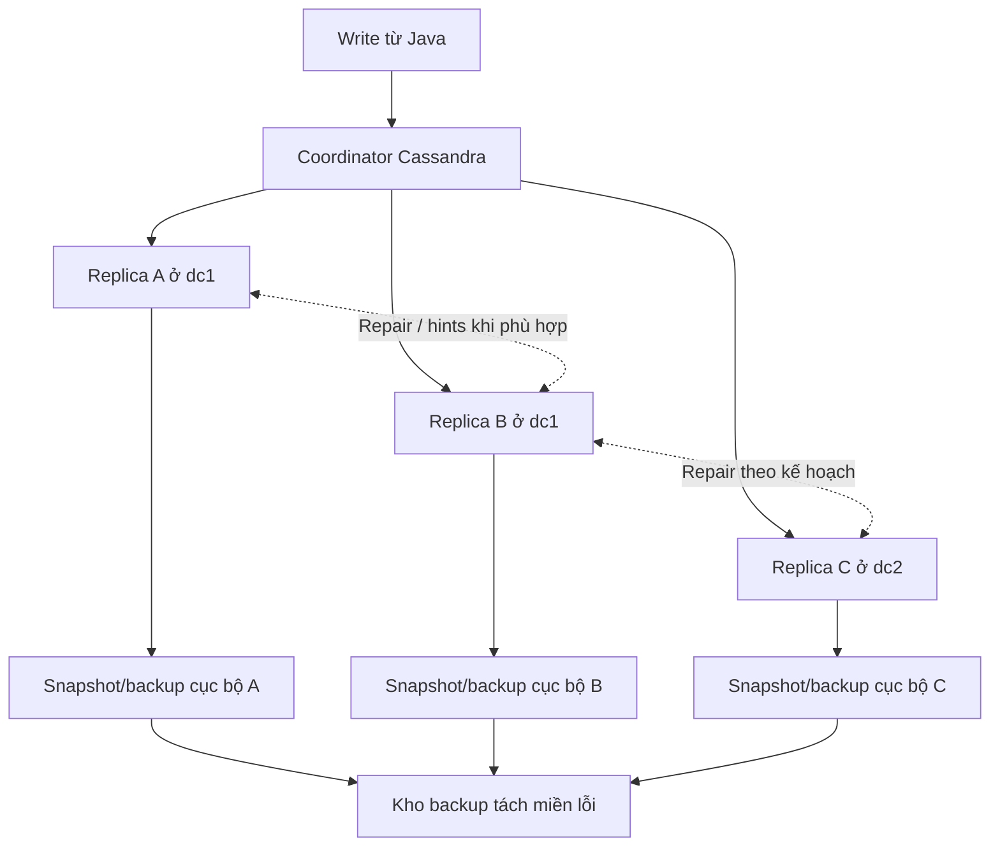
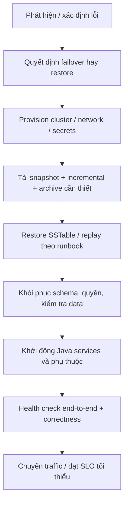

# Xác định dữ liệu cần bảo vệ và yêu cầu RPO/RTO

## 1. Bắt đầu từ nghiệp vụ, không bắt đầu từ lệnh snapshot

Trong Apache Cassandra, một partition được chọn theo **partition key**, gán token và nhân bản tới các **natural replicas** theo replication strategy và replication factor (RF). Cơ chế ghi vào commitlog, memtable và SSTable giúp Cassandra phục vụ CQL với độ bền và mức nhất quán có thể điều chỉnh. Nhưng **replication không đồng nghĩa backup**: một lệnh `DELETE` sai, lỗi ứng dụng ghi đè, sự cố mất cả DC hoặc tài khoản quản trị bị chiếm quyền có thể ảnh hưởng đến nhiều bản sao cùng lúc.

Vấn đề đầu tiên của **sao lưu và phục hồi** không phải là “chạy `nodetool snapshot` vào giờ nào?” mà là:

1. **Thông tin nào phải bảo vệ**, thuộc ứng dụng nào, được lưu ở keyspace/bảng nào, và có phụ thuộc gì bên ngoài Cassandra?
2. **Mất tối đa bao nhiêu dữ liệu** từ thời điểm sự cố đến điểm có thể khôi phục? Đó là **Recovery Point Objective (RPO)**.
3. **Dịch vụ được phép gián đoạn bao lâu** cho tới khi đáp ứng mức hoạt động đã thống nhất? Đó là **Recovery Time Objective (RTO)**.
4. Với sự cố cụ thể, phải khôi phục **một bảng, một tenant, một node, một DC hay toàn bộ hệ thống**?
5. Có bằng chứng nào cho thấy backup, công cụ restore và các phụ thuộc thực sự đạt RPO/RTO không?

Bài thuộc chương **Sao lưu và phục hồi** của mô-đun `DATABASE_ENGINE_WIDE_COLUMN_CASSANDRA`. Phạm vi kết nối mô hình wide-column, partition key, bảng thiết kế theo truy vấn, consistency đọc/ghi, CQL, replication, compaction, repair, xử lý lỗi và Java Driver để đưa ra **hợp đồng phục hồi đo được**.

**Kết quả học tập:** lập danh mục dữ liệu cần bảo vệ, phân loại mức độ ưu tiên, tính RPO/RTO trong các tình huống, chọn phương án giữ bản sao phục hồi phù hợp và lập kế hoạch **diễn tập restore + xác minh dữ liệu nghiệp vụ**.

## 2. RPO và RTO là hai trục độc lập

### RPO — có thể quay lại thời điểm nào?

**Recovery Point Objective** là mức **mất dữ liệu tính theo thời gian tối đa được nghiệp vụ chấp nhận** trong một kịch bản thảm họa. Nếu RPO mục tiêu là 15 phút, doanh nghiệp chấp nhận khả năng phải khôi phục về điểm không cũ hơn khoảng 15 phút trước thời điểm sự cố, theo định nghĩa phạm vi và dữ liệu đã thống nhất.

Một phép tính đơn giản khi phục hồi từ mốc cuối cùng:

\[
\mathrm{Data\ loss\ window} =
t_{\mathrm{incident}} - t_{\mathrm{latest\ recoverable}}
\]

Ví dụ **giả định**: dữ liệu bị phá hỏng lúc **14:00 UTC**, mốc đã kiểm chứng có thể khôi phục là **13:42 UTC**. Khi đó cửa sổ mất dữ liệu tiềm năng là **18 phút**. Chính sách RPO ≤ 15 phút **không đạt**, dù backup được tạo thành công lúc 13:55 nhưng chưa upload đủ file hoặc không restore được.

**Chú ý:** “mốc có thể khôi phục” không tự bằng thời gian `nodetool snapshot` được gọi. Cần biết SSTable và những mutation chưa flush, bản incremental đã chuyển đi, commitlog archive có đầy đủ hay không, tính nhất quán giữa các bảng và kết quả diễn tập.

### RTO — bao lâu mới khôi phục được dịch vụ?

**Recovery Time Objective** là giới hạn thời gian gián đoạn được nghiệp vụ chấp nhận **đến khi một mức dịch vụ xác định được khôi phục**. Phải chốt “phục vụ trở lại” là:

- Đọc được một bảng quan trọng ở `LOCAL_QUORUM`?
- Đã xác thực được đơn hàng và tiếp nhận ghi mới?
- Cả API, message consumer, background jobs và luồng thanh toán đều chạy?
- Đạt mức p95/p99, error rate và throughput tối thiểu nào?

Ví dụ **giả định**: xảy ra sự cố lúc **14:00 UTC**, API chỉ đạt đầy đủ health check, ghi/đọc theo hợp đồng và lưu lượng tối thiểu lúc **15:10 UTC**. RTO thực đo được là **70 phút**; nếu mục tiêu RTO ≤ 60 phút thì **không đạt**, kể cả dữ liệu khôi phục hoàn toàn không thiếu.

### Bảng đối chiếu

| Tiêu chí | RPO | RTO |
| --- | --- | --- |
| Trả lời câu hỏi | “Có thể mất bao nhiêu dữ liệu mới nhất?” | “Ứng dụng được gián đoạn bao lâu?” |
| Đơn vị | Thời gian/tuổi của điểm khôi phục | Thời gian tính từ sự cố hoặc thời điểm phát hiện được định nghĩa |
| Phụ thuộc trực tiếp | Chu kỳ capture, flush, sao chép, commitlog archive, tính nhất quán và restore được | Phát hiện sự cố, quyết định, hạ tầng dự phòng, tốc độ copy/restore, khởi động, kiểm thử, chuyển traffic |
| Có được chứng minh chỉ bằng RF? | **Không** | **Không** |
| Cách xác nhận | Diễn tập mất dữ liệu và xác định transaction cuối có thể đọc đúng | Bấm giờ một đợt phục hồi end-to-end tới tiêu chí phục vụ |

**RPO = 0** là một yêu cầu rất mạnh về khả năng bảo toàn toàn bộ ghi đã được xác nhận trong phạm vi thảm họa, **không phải** hệ quả mặc định của RF = 3 hoặc `LOCAL_QUORUM`. **RTO = 0** gần với yêu cầu không gián đoạn hoặc kiến trúc chịu lỗi liên tục, khác hẳn “có bản snapshot mới”.

## 3. Kịch bản sự cố quyết định phạm vi bảo vệ

Hợp đồng RPO/RTO phải ghi **kịch bản lỗi**, không chỉ viết “RPO 15 phút, RTO 1 giờ” chung cho mọi tình huống.

| Kịch bản | Cái gì bị mất/sai? | Cơ chế phục hồi có thể cần | Tại sao chỉ có replica chưa đủ? |
| --- | --- | --- | --- |
| Một replica/node hỏng phần cứng | Một node không còn phục vụ, dữ liệu local có thể mất | Failover sang replica còn sống, replace/rebuild, repair | Replica khác có thể giúp, nhưng không bảo đảm mọi write cũ đều tới đủ replica |
| Một rack hoặc cả DC dừng hoạt động | Một miền lỗi mất truy cập | Chuyển tuyến ứng dụng/driver, DC dự phòng, tái đồng bộ khi quay lại | RPO của dữ liệu đã ACK cục bộ không được suy ra từ RF ở DC kia |
| `DELETE`/`TRUNCATE` nhầm bảng | Dữ liệu bị xóa theo CQL ở nhiều replica | Backup/snapshot trước thời điểm xóa, kiểm thử restore | Replication lan truyền thao tác xóa có chủ đích |
| Ứng dụng ghi đè bằng dữ liệu sai | Giá trị hợp lệ về cú pháp nhưng sai nghiệp vụ | Point-in-time recovery hoặc sự kiện/backup nguồn nghiệp vụ | Các replica đều có thể đồng ý với giá trị sai |
| Ransomware/tài khoản quản trị bị chiếm | Cả dữ liệu hoạt động và backup trong cùng domain có thể bị phá | Bản sao ngoài miền lỗi, immutable/offline, tài khoản/khóa riêng | Snapshot hard-link trên cùng ổ không chống phá hoại/chiếm quyền |
| SSTable/volume hỏng hoặc thao tác compaction lỗi | Một phần file local không đọc được | Khôi phục từ replica khỏe hoặc bản SSTable backup hợp lệ | Nếu nhiều bản giống nhau bị lỗi hoặc mất đồng thời, cần backup độc lập |
| Sai schema, migration hoặc code mới | Bảng/UDT/index, mapping ứng dụng sai | DDL/schema version, backup phù hợp, rollback migration | SSTable đơn lẻ không chứa toàn bộ code/config/identity hệ thống |
| Sai dữ liệu giữa hai bảng denormalized | Cùng sự kiện nghiệp vụ được ghi lệch giữa hai bảng | Đối soát theo event ID, backfill có thứ tự, replay nguồn nghiệp vụ | Cassandra không cung cấp giao dịch xuyên toàn bộ các partition tùy ý |

**Mỗi kịch bản có RTO khác nhau.** Khi chỉ một node hỏng mà RF/CL còn đủ, API có thể tiếp tục phục vụ không cần restore SSTable ngay. Nhưng một lỗi xóa dữ liệu lan tới toàn bộ replica có thể đòi rollback dữ liệu và đối soát nghiệp vụ lâu hơn nhiều.

## 4. Danh mục dữ liệu phải được bảo vệ

Cassandra thường lưu **nhiều bảng denormalized cho một thực thể nghiệp vụ**. Vì vậy danh mục chỉ ghi một bảng “đơn hàng” có thể bỏ sót bảng truy vấn theo khách hàng, trạng thái xử lý, bảng hỗ trợ idempotency và dữ liệu phục hồi.

### 4.1. Bốn nhóm dữ liệu bắt buộc rà soát

| Nhóm | Ví dụ trong hệ thống Java + Cassandra | Cần bảo vệ và kiểm chứng |
| --- | --- | --- |
| **Dữ liệu nghiệp vụ không thể tái tạo** | Đơn hàng, thanh toán, entitlement, sổ đối soát, giao dịch đã xác nhận | Mỗi keyspace/table chứa dữ liệu gốc, giá trị, khóa, phiên bản, TTL, deletion marker; nguồn nghiệp vụ chéo |
| **Dữ liệu có thể tái tạo có điều kiện** | Bảng query projection, materialized view (nếu có), cache, bảng thống kê | Nguồn dữ liệu nào dùng để rebuild, thời gian rebuild, replay event, dependency và chi phí |
| **Metadata/Cassandra runtime** | Schema DDL, replication, table settings, UDT, index, role/permission, cấu hình snitch/DC, version | IaC, exports, snapshot metadata, chiến lược restore theo version, quyền truy cập và consistency |
| **Phụ thuộc ngoài Cassandra** | Java service config, secret/KMS, DNS/load balancer, queue/event log, object storage, container images | Khả năng dựng dịch vụ end-to-end; dữ liệu Cassandra phục hồi không đủ nếu các phần này mất |

**Không tự sao chép nguyên trạng mọi file của node Cassandra thành “backup logic”.** Host ID, system metadata, commitlog, token, SSTable và cấu hình có ngữ nghĩa khác nhau; khôi phục nguyên data directory sang node/cluster khác có thể gây xung đột danh tính hoặc topology. Định rõ phần cần **recreate bằng IaC** và phần cần **restore SSTable/commitlog** theo runbook từng phiên bản.

### 4.2. Một đơn hàng có thể nằm ở nhiều bảng

Ví dụ hệ thống dùng bảng `orders_by_id` làm nguồn đọc chính theo ID và `orders_by_customer` làm projection cho trang danh sách:

```sql
CREATE TABLE recovery_lab_ks.orders_by_id (
    order_id uuid PRIMARY KEY,
    customer_id text,
    status text,
    total decimal,
    updated_at timestamp
);

CREATE TABLE recovery_lab_ks.orders_by_customer (
    customer_id text,
    order_created_at timestamp,
    order_id uuid,
    status text,
    total decimal,
    PRIMARY KEY ((customer_id), order_created_at, order_id)
) WITH CLUSTERING ORDER BY (order_created_at DESC, order_id DESC);
```

Thực tế hai bảng thường được cập nhật từ cùng sự kiện nghiệp vụ. Nếu khôi phục `orders_by_id` về 13:45 nhưng `orders_by_customer` về 13:30, một đơn hàng có thể có ở bảng thứ nhất mà không có ở bảng thứ hai. **RPO của “đơn hàng” cần xác định ở mức nghiệp vụ**, bao gồm cách đối soát những projection không cùng snapshot thời điểm.

Khi phân loại, đặt câu hỏi:

1. Bảng nào là **source of truth**, bảng nào là read model có thể dựng lại?
2. Ghi/xóa/TTL có đi qua hàng đợi, event log hoặc dịch vụ khác không?
3. Mất một bản ghi có thể tạo hậu quả tài chính/pháp lý hay chỉ gây trễ hiển thị?
4. Có thể dựng lại hoàn toàn từ event log còn giữ hay event log cũng phải được backup?
5. Dữ liệu cũ có phải **được xóa theo quy định**? Restore không được vô tình tái xuất hiện thông tin đã phải xóa.

## 5. Phân loại quan trọng và điền RPO/RTO theo nhóm

Một ví dụ **ma trận chính sách giả định**, không phải khuyến nghị mặc định:

| Tập dữ liệu / luồng | Mức quan trọng | RPO mục tiêu | RTO mục tiêu | Quyết định cần thống nhất |
| --- | --- | --- | --- | --- |
| Order state đã xác nhận, idempotency keys | P0 | ≤ 5 phút | ≤ 30 phút | Có chấp nhận xác nhận đơn bị mất? Có event log/đối soát độc lập không? |
| Catalog/pricing có nguồn authoritative bên ngoài | P1 | ≤ 30 phút | ≤ 2 giờ | Có thể đồng bộ lại từ nguồn? Thời gian tải đủ dữ liệu bao lâu? |
| Lịch sử hoạt động cần tra cứu | P2 | ≤ 4 giờ | ≤ 8 giờ | Được phép tạm tắt API lịch sử hoặc phục vụ read-only? |
| Dashboard aggregate tái tạo từ event | P3 | ≤ 24 giờ | ≤ 24 giờ | Dựng lại mất bao nhiêu CPU/giờ và có ảnh hưởng bảng gốc? |

Mục tiêu phải được **owner nghiệp vụ phê duyệt**, không do DBA tự chọn theo chi phí backup. Với P0, nếu “mất 5 phút” gây tổn thất không thể chấp nhận, cần điều chỉnh mục tiêu hoặc thiết kế thêm nguồn ghi/nhân bản/khôi phục, **không chỉ tăng tần suất snapshot và giả định đạt**.

### Mẫu phiếu kiểm kê

```text
Business capability: order-confirmation
Owner/approver: <vai trò phụ trách, không ghi bí mật vào template>
Keyspaces/tables: recovery_lab_ks.orders_by_id, orders_by_customer
Primary key/query pattern: order_id; (customer_id), created_at
Source of truth: orders_by_id + authoritative event stream (nếu có)
Dependent systems: queue, order API, IAM/KMS, object storage, DNS
Data classification: restricted/internal; PII? [yes/no]
Lifecycle: TTL? retention? legal hold? deletion obligations?
Failure scenarios: wrong DELETE / lost DC / ransomware / corrupted table
Required RPO: <minutes> by scenario
Required RTO: <minutes> by recovery service state
Recovery point mechanism: snapshot + incremental SSTables + optional commitlog archive
Location/copy isolation: <offsite, region, account, immutable policy>
Restore unit: keyspace / table / tenant / cluster
Validation: business IDs, row counts, point-in-time cutoff, CL, API checks
Owner of restore runbook: <role>
Last successful restore test and actual RPO/RTO: <UTC>
```

Đây là tài liệu quản lý phục hồi, **không** phải cách ghi trực tiếp dữ liệu điều hành vào file kiến thức. Trong triển khai thật, lưu phiếu trong nơi có kiểm soát truy cập, cập nhật khi có schema migration, table mới hoặc thay đổi RF/DC.

## 6. Replication, consistency và repair không thay backup

### Cùng một partition, nhiều loại bảo vệ



**Replication** tạo nhiều bản sao *đang hoạt động*. Nó giúp tiếp tục phục vụ khi một node mất và hỗ trợ khôi phục bản sao, nhưng cũng có thể lan truyền xóa và giá trị sai. **Anti-entropy repair** đối soát các replica; nó **không lưu lịch sử phiên bản nghiệp vụ** và không hoàn tác một `DELETE` đúng cú pháp.

**Consistency level** là điều kiện xác nhận request tại thời điểm gọi, không phải mô tả backup. Ví dụ với `NetworkTopologyStrategy {'dc1':3,'dc2':3}`, write `LOCAL_QUORUM` ở `dc1` chỉ cần ACK từ quorum tại dc1. Nó **không đảm bảo** mutation đó đã đến dc2 trước khi dc1 mất. Vì vậy không thể ghi “RPO đa DC = 0” chỉ từ việc có RF ở cả hai DC.

**Snapshot/backup độc lập** cung cấp một điểm phục hồi lịch sử nếu dữ liệu đang hoạt động bị xóa hoặc phá. Muốn chống cùng miền lỗi, phải đưa bản backup ra khỏi node/volume/credentials/region rủi ro, kiểm tra quyền và khả năng giải mã. Bản hard-link SSTable còn ở cùng disk với nguồn **chưa phải bản sao disaster recovery tách biệt**.

### Phân biệt RPO theo kịch bản

| Thiết kế | Hỏng một node | Mất cả DC | Xóa nhầm được nhân bản |
| --- | --- | --- | --- |
| RF3 trong một DC | Có thể tiếp tục nếu đủ replica/CL | Không có DC khác, cần phục hồi ngoài DC | Các replica có thể cùng bị xóa |
| RF3 ở mỗi hai DC + `LOCAL_QUORUM` | Local availability tốt theo điều kiện | DC còn lại có thể phục vụ, nhưng write cuối ở DC mất có thể chưa tới | Xóa vẫn có thể lan tới cả hai DC |
| Có backup ngoài miền lỗi | Cung cấp phương án restore nếu replica không đủ | Có thể dựng dữ liệu khi DC mất, tùy tốc độ truy xuất | Có thể quay về điểm trước thao tác sai |
| Backup + commitlog archiving được kiểm chứng | Có thể giảm khoảng mất mutation nếu cần PITR | Phụ thuộc bản archive tách miền lỗi và quy trình phục hồi | Có thể chọn điểm trước thao tác xóa, cần xử lý các ghi hợp lệ sau đó |

**Không đặt RPO/RTO đồng nhất cho mọi lỗi.** Một failover đọc sang DC sống sót có thể nhanh nhưng không bảo đảm rollback lỗi nghiệp vụ; còn restore từ backup có thể bảo toàn trạng thái cũ tốt hơn nhưng mất thời gian hơn nhiều.

## 7. Cơ chế backup Cassandra và ý nghĩa đối với RPO

Cassandra lưu dữ liệu đã flush trong **SSTable bất biến**. Theo tài liệu Cassandra, có hai cách backup dựa trên SSTable phổ biến: **snapshot** và **incremental backup**. Nếu cần khôi phục theo một thời điểm, có thể cần thêm cơ chế **commitlog archiving/replay** được cấu hình và kiểm thử.

| Cơ chế | Chứa gì | Giới hạn phải nêu trong hợp đồng RPO |
| --- | --- | --- |
| **`nodetool snapshot`** | Hard-link tới SSTable của **node được gọi** tại thời điểm snapshot; thường có metadata/DDL cho bảng | Snapshot trong node **chưa** là bản backup ngoài miền lỗi; không là snapshot giao dịch atomic toàn cluster/mọi bảng |
| **Incremental SSTable backup** | Link tới SSTable khi flush/stream trên node, trong thư mục `backups/` khi bật | **Không** tự chứa mutation chỉ còn trong memtable/commitlog; phải copy và quản lý retention |
| **Commitlog archiving** | Các commitlog segment được lưu theo cấu hình tùy chọn | Cần xác minh khoảng trễ archive, tính đầy đủ, replay/version và điểm thời gian; **không mặc định được bật** |
| **Backup schema/config** | DDL, UDT/index, replication settings, IaC, version, auth, certificates/keys | Không nên dựa duy nhất vào một bộ SSTable; cần tái tạo được topology và quyền |
| **Backup event log/source of truth** | Sự kiện nghiệp vụ hoặc nguồn có thể replay | Phải giữ retention/cursor/offset và idempotency; Cassandra backup không chứa dữ liệu ngoài Cassandra |

### 7.1. Snapshot không giống backup chuyển khỏi node

Ở chế độ thông thường, `nodetool snapshot` tạo **hard links** tới SSTable files; các SSTable không bị nhân byte ngay tại thời điểm tạo link, nhưng hard links có thể **ngăn disk space được giải phóng** khi SSTable gốc bị compact hoặc xóa. Snapshot cũng có thể chứa `schema.cql` giúp tham khảo DDL.

```bash
# Kiểm tra cú pháp phiên bản trên node LAB:
nodetool help snapshot
nodetool help listsnapshots

# Chỉ chạy trong lab/đã được cấp quyền:
nodetool snapshot --tag rpo-lab-20261121 recovery_lab_ks

# Xác minh snapshot vừa được tạo trên node đang hỏi:
nodetool listsnapshots
```

**Lệnh trên thao tác node được chỉ định**, không tự tạo một ảnh chụp **toàn cluster có ranh giới thời gian nhất quán**. Phải có lịch điều phối/chính sách backup theo node và coverage token range/replica nếu muốn đảm bảo toàn bộ dữ liệu.

Nếu dùng tùy chọn `--skip-flush` (ở các phiên bản hỗ trợ), snapshot có thể **không chứa mutation chưa flush**; tuyệt đối không suy RPO từ timestamp của lệnh mà bỏ qua lựa chọn này. Đối chiếu đúng tài liệu của binary đang chạy.

### 7.2. Incremental backup không đồng nghĩa “mỗi commitlog write được bảo vệ”

Trong những version hỗ trợ, bật `incremental_backups: true` hoặc công cụ `nodetool enablebackup` khiến node tạo hard-link cho SSTable **khi được flush/stream**. Các file đó có thể còn ở cùng ổ cứng; cần có **pipeline sao chép ra kho backup**, kiểm tra manifest/checksum, thông tin owner/range, và dọn retention thích hợp.

```bash
# Chỉ kiểm tra trạng thái, không bật backup trên production:
nodetool help statusbackup
nodetool statusbackup
nodetool help enablebackup
nodetool help disablebackup
```

Vì thời gian flush không phải thời điểm mỗi write được xác nhận, **upload incremental backup 5 phút một lần chưa đủ để tự cam kết RPO 5 phút**. Phải đo mutation chưa được chụp trong SSTable, độ trễ commitlog archive và khả năng phục hồi sau một sự cố thực.

### 7.3. Commitlog archive và point-in-time recovery (PITR)

Một số phiên bản Cassandra cung cấp cấu hình `commitlog-archiving.properties` với những trường như `archive_command`, `restore_command`, `restore_directories`, `restore_point_in_time` và `precision`. Đây là phần **tùy chọn**, cần thử khả năng archive các segment, đảm bảo chúng được đưa tới kho bền vững và kiểm tra thứ tự/định dạng khi replay.

```text
Ví dụ ý tưởng pipeline (không phải script chạy được):
  SSTable snapshot đã kiểm chứng
       + incremental SSTables phù hợp
       + tập commitlog archives đầy đủ
       + schema và version tương ứng
       -> restore trong môi trường cô lập
       -> kiểm tra mốc thời gian, row và event ID
       -> chuyển ứng dụng sang dữ liệu đã xác minh
```

**PITR không phải công tắc bật một lần để tự đạt RPO = 0.** Commitlog segment có thể chưa được archive ra khỏi node khi gặp lỗi, checkpoint và timestamp do client cung cấp ảnh hưởng semantics, restore nhiều bảng/partition không đồng nghĩa một giao dịch nghiệp vụ atomic. Việc replay cũng có yêu cầu tương thích version, cách copy SSTable và thời gian dừng ghi; chỉ dùng runbook đã được diễn tập.

## 8. Dữ liệu không thể phục hồi chỉ bằng SSTable

Một restore “thành công” ở cấp file có thể vẫn là **thất bại nghiệp vụ** nếu quên các thành phần:

| Thành phần | Khi mất sẽ ảnh hưởng gì? | Giải pháp quản lý |
| --- | --- | --- |
| Schema/UDT/index/table settings | Không đọc được SSTable hoặc query khác semantics | Versioned CQL DDL, migration repository, schema backup theo từng release |
| Cassandra version/SSTable compatibility | Không đọc được file hoặc không dùng được quy trình refresh/loader | Inventory version, test restore sang binary tương ứng |
| Keyspace RF, snitch, DC/rack và token map | Replica placement không khớp hoặc thiếu dữ liệu sau restore | IaC/topology manifest, kế hoạch bootstrap/streaming riêng |
| Role/permission và service credentials | Ứng dụng không đăng nhập hoặc quyền không đúng | Kho cấu hình bảo mật, quy trình tái tạo/rotate, KMS |
| TLS certificates/encryption keys | Không kết nối, không giải mã backup hoặc dữ liệu đã mã hóa | Escrow key có phân quyền, quy trình KMS DR, rotation |
| Java config, connection string, local DC, CL | Ứng dụng trỏ nhầm vùng hoặc trả lỗi dù DB đã phục hồi | IaC, secrets, config và integration test |
| Kafka/outbox/CDC/external workflow | Bỏ sót/nhân đôi tác vụ sau mốc restore | Event offset checkpoint, idempotency, replay có thứ tự |
| Object storage/attachments | Bảng metadata trỏ tới tệp đã mất | Chính sách backup phối hợp và tính nhất quán tham chiếu |
| Legal deletion/retention catalog | Restore làm sống lại bản ghi phải xóa | Áp lại danh sách xóa, chính sách kiểm tra sau restore |

**Auth và system keyspaces đặc biệt:** không giả định copy toàn bộ `system/*` từ cluster cũ sang cluster mới là an toàn. Metadata nội bộ có thể gắn chặt với host ID, token, trạng thái cluster và version. Phần cần tái tạo phải được xác định cùng DBA/security, không dùng “backup cả data directory” như hướng dẫn phục hồi chung.

## 9. Suy ngược lịch backup từ RPO mục tiêu

Giả sử chủ nghiệp vụ yêu cầu **RPO ≤ 15 phút**. Một lịch snapshot mỗi 24 giờ rõ ràng **không đủ nếu đó là điểm phục hồi duy nhất**. Ngay cả snapshot mỗi 15 phút cũng chưa đủ nếu tạo, sao chép và xác minh tốn thêm 10 phút và bản gần nhất có thể bị hỏng.

Đặt:

- \(I\): khoảng giữa các cơ hội tạo điểm dữ liệu phục hồi.
- \(L\): độ trễ tệ nhất từ khi dữ liệu được capture đến khi bản sao nằm ở **nơi sống sót sau kịch bản lỗi**.
- \(G\): khoảng hở/không đầy đủ do flush, commitlog và các phụ thuộc chưa được bảo vệ.
- \(M\): khoảng dự phòng cho thất bại/trễ lịch và sự không chắc chắn.

Một cách lập **ngân sách thiết kế thận trọng**:

\[
\mathrm{Budget\ RPO} \gtrsim I + L + G + M
\]

Đây là **khung tư duy**, không phải công thức bảo đảm RPO của Cassandra: các thành phần có thể chồng nhau, lỗi tương quan và việc capture không có ranh giới giao dịch; số đúng phải được **đo bằng restore và kiểm tra dữ liệu**.

Ví dụ minh họa:

| Thành phần | Giá trị giả định |
| --- | ---: |
| Khoảng mốc capture/recoverable checkpoint \(I\) | 5 phút |
| Độ trễ copy tới kho DR \(L\) | 3 phút |
| Khoảng hở chưa bảo vệ khác \(G\) | 2 phút |
| Dự phòng lịch lỗi/gián đoạn \(M\) | 3 phút |
| Tổng ngân sách dự kiến | 13 phút |

Ngân sách 13 phút **chưa phải lời hứa RPO ≤ 15 phút**. Điều kiện quan trọng hơn là chứng minh bằng thử nghiệm rằng *toàn bộ dữ liệu cần bảo vệ có điểm phục hồi không quá 15 phút cũ trong các tình huống thiết kế*, bao gồm trường hợp một batch upload hoặc một archive segment bị trễ/mất.

### Đặt câu hỏi về xác nhận của client

Nếu Java service ghi một đơn hàng và trả “đã xác nhận” sau `LOCAL_QUORUM`, thì khi thảm họa xảy ra, nghiệp vụ muốn bảo vệ **các ACK đã trả cho client**, không chỉ SSTable được flush. RPO phải đo dựa trên **transaction/event ID cuối đã ACK và có thể khôi phục**, đối chiếu với thời gian client ghi nhận thành công. Không dùng thời gian file modified làm đại diện duy nhất.

## 10. Phân rã RTO thành các bước có thể bấm giờ

Một đợt khôi phục toàn bộ service thường có đường găng:



Để đặt ngân sách thời gian:

| Công đoạn | Ví dụ giả định (phút) | Rủi ro làm trễ |
| --- | ---: | --- |
| Detect + triage | 5 | Không có alert xác định phạm vi |
| Quyết định/phê duyệt | 10 | Không rõ người điều hành, dữ liệu được phép mất |
| Provision hạ tầng/identity | 20 | Không có quota hoặc KMS ở vùng dự phòng |
| Lấy dữ liệu từ kho backup | 25 | Băng thông thấp, danh mục file thiếu, egress |
| Restore/replay | 40 | SSTable/commitlog, version không tương thích, node không đủ disk |
| Kiểm tra data + khởi động API + chuyển traffic | 20 | Schema, config, service phụ thuộc, read-only mode |
| **Tổng tuần tự giả định** | **120** | Có thể rút ngắn nếu các bước hợp lệ chạy song song |

Không tự coi đây là “RTO thật = 120 phút”; cần **đo một diễn tập end-to-end** với lượng dữ liệu và tốc độ thực tế. Các bước song song sẽ có thời gian bằng **đường găng phụ thuộc**, không đơn giản là tổng mọi task. RTO của một API read-only có thể khác RTO khôi phục đầy đủ writes, event processing và đối soát.

### Ước lượng thời gian truyền dữ liệu là cần nhưng chưa đủ

Giả sử cần kéo **2 TiB** backup, băng thông có ích đạt **200 MiB/s** ổn định. Chỉ thời gian truyền tối thiểu xấp xỉ:

\[
\frac{2 \times 1024 \times 1024\ \mathrm{MiB}}{200\ \mathrm{MiB/s}}
\approx 10.486\ \mathrm{s} \approx 175\ \mathrm{phút}
\]

Con số này **chưa gồm** lập cụm, I/O giải nén, nạp SSTable, replay, repair, kiểm tra ứng dụng hay overhead. Nếu RTO mục tiêu là 60 phút, chỉ riêng bước download đã vượt xa mục tiêu: cần **hạ tầng nóng/ấm, bản sao đặt gần vùng phục hồi hoặc kiến trúc DR khác**, chứ không thể khắc phục bằng việc tăng số cron backup.

## 11. Chọn mức khôi phục tương ứng với RTO

| Cách chuẩn bị | Điểm mạnh | Giới hạn |
| --- | --- | --- |
| **Cold recovery** từ backup lưu ngoài vùng | Chi phí chạy thường xuyên thấp hơn | Provision, transfer, restore thường kéo dài; RTO ngắn rất khó |
| **Warm standby** (hạ tầng dựng sẵn, dữ liệu/backup gần vùng) | Giảm provisioning, có thể rút ngắn đường găng | Tốn chi phí; phải kiểm tra tính mới dữ liệu và khả năng khởi động app |
| **Active multi-DC** có replica và ứng dụng tại vùng dự phòng | Có thể chuyển tuyến nhanh khi một DC không truy cập | Không thay backup/PITR cho lỗi xóa lan truyền; write `LOCAL_QUORUM` không tự bảo đảm RPO=0 xuyên DC |
| **Backup với PITR + replay nghiệp vụ** | Có cơ hội quay trước thời điểm sai và tái áp các giao dịch hợp lệ | Phức tạp về timestamp, nguồn sự kiện, idempotency và xác minh multi-table |

Đôi khi mục tiêu tốt nhất là **phục hồi theo tầng**:

1. P0: mở chế độ đọc trạng thái đơn hàng từ DC còn sống nếu data freshness được phép.
2. P1: tiếp nhận ghi mới khi đã xác định writer/CL và xử lý request kết quả chưa rõ.
3. P2: backfill projection, dữ liệu lịch sử và tác vụ báo cáo sau.

Tuy nhiên **không được báo RTO đạt** nếu doanh nghiệp định nghĩa “đã khôi phục” bao gồm cả ghi/tính năng P0 mà mới chỉ mở được trang trạng thái read-only.

## 12. Lập kế hoạch backup theo phạm vi Cassandra

### 12.1. Node-local snapshot chưa phải cluster-wide recovery point

`nodetool snapshot` vận hành trên **node được gọi**. Một cluster có nhiều node, keyspace và DC cần có **danh mục token range, node/replica, bảng và thời điểm** để biết liệu các bản backup đang có đủ phục hồi tập dữ liệu mục tiêu. Snapshot node A lúc 10:00 và node B lúc 10:20 **không tạo một giao dịch chụp đồng thời trên toàn cluster**.

Khi lập manifest, nên ghi:

```text
Backup set ID: dr-set-20261121-a
Cassandra version / partitioner / table IDs / schema version:
Cluster / dc / rack / node host ID:
Keyspace / table / RF:
Snapshot tag / node-local creation time:
Included SSTable components and checksums:
Incremental SSTable files, time interval covered:
Commitlog archive coverage/checkpoints (nếu dùng):
Storage URI, encryption key reference, retention/immutability:
Upload verified at UTC:
Recoverable point validated at UTC:
Last restore drill / restored business ID range:
```

**Backup đủ byte nhưng thiếu metadata** có thể khiến đội DR mất hàng giờ để đoán những SSTable nào thuộc bảng/token range nào, schema version nào và backup đã về kho offsite chưa.

### 12.2. Lịch và retention

Các câu hỏi phải được trả lời bằng chính sách:

- Snapshot bao lâu một lần, giữ bao nhiêu phiên bản, incremental SSTable/commitlog giữ bao lâu?
- Dữ liệu có TTL, tombstone hoặc yêu cầu xóa pháp lý không?
- Backup ở **bao nhiêu miền lỗi độc lập** (node, rack, DC, account/cloud region, offline) và có khả năng chống sửa/xóa không?
- Có bản khôi phục **trước** một lỗi logic được phát hiện trễ nhiều ngày không?
- Ai có quyền xóa snapshot/backup? Quyền delete có tách khỏi quyền ghi production không?
- Restore keys/credentials có còn hoạt động sau một sự cố làm mất KMS/IAM gốc không?

Mẫu RPO ngắn có thể cần snapshot định kỳ + incremental + commitlog archive, nhưng **số giờ retention không thể suy từ RPO**: RPO nói dữ liệu mới nhất có thể mất, còn retention xác định **quay về quá khứ bao xa** để sửa lỗi được phát hiện trễ.

### 12.3. Dữ liệu xóa và tombstone

Cassandra biểu diễn xóa bằng **tombstone** với cơ chế dọn SSTable sau thời gian bảo vệ liên quan `gc_grace_seconds`. Restore backup cũ có thể làm **tái xuất hiện hàng đã xóa** nếu không theo đúng thứ tự restore/replay và thực thi yêu cầu xóa. Khi phục hồi node lâu không đồng bộ, cũng phải xem xét zombie data và repair coverage.

Đừng giảm `gc_grace_seconds` chỉ để tiết kiệm disk cho backup. Chính sách xóa, độ dài outage, lịch repair và retention là các ràng buộc khác nhau; cần đánh giá cùng nhau.

## 13. Phòng thí nghiệm: chuyển yêu cầu thành kế hoạch sao lưu

### 13.1. Tạo một keyspace dữ liệu thử nghiệm

Chỉ dùng **cluster lab** đủ node theo RF trong `dc1`; không chạy DDL dưới đây trên production:

```sql
CREATE KEYSPACE recovery_lab_ks
WITH replication = {'class': 'NetworkTopologyStrategy', 'dc1': 3}
AND durable_writes = true;

CREATE TABLE recovery_lab_ks.orders_by_id (
    order_id uuid PRIMARY KEY,
    customer_id text,
    status text,
    total decimal,
    updated_at timestamp
);

CREATE TABLE recovery_lab_ks.orders_by_customer (
    customer_id text,
    order_created_at timestamp,
    order_id uuid,
    status text,
    total decimal,
    PRIMARY KEY ((customer_id), order_created_at, order_id)
) WITH CLUSTERING ORDER BY (order_created_at DESC, order_id DESC);

INSERT INTO recovery_lab_ks.orders_by_id
    (order_id, customer_id, status, total, updated_at)
VALUES (
    11111111-2222-4333-8444-555555555555,
    'synthetic-customer-1', 'CREATED', 125.50,
    '2026-11-21T08:30:00+0000'
);

INSERT INTO recovery_lab_ks.orders_by_customer
    (customer_id, order_created_at, order_id, status, total)
VALUES (
    'synthetic-customer-1', '2026-11-21T08:30:00+0000',
    11111111-2222-4333-8444-555555555555,
    'CREATED', 125.50
);
```

Đoạn dữ liệu tổng hợp minh họa **một đơn hàng được ghi vào hai bảng theo truy vấn**. Các lệnh INSERT riêng **không tạo giao dịch nguyên tử xuyên hai partition tùy ý**; khi khôi phục sau một lỗi giữa hai ghi, bắt buộc đối soát theo `order_id` hoặc nguồn sự kiện nghiệp vụ.

### 13.2. Ghi dữ liệu cần bảo vệ và kiểm tra schema

```sql
SELECT keyspace_name, replication
FROM system_schema.keyspaces
WHERE keyspace_name = 'recovery_lab_ks';

SELECT table_name, gc_grace_seconds
FROM system_schema.tables
WHERE keyspace_name = 'recovery_lab_ks';

SELECT order_id, customer_id, status, total
FROM recovery_lab_ks.orders_by_id
WHERE order_id = 11111111-2222-4333-8444-555555555555;

SELECT order_created_at, order_id, status, total
FROM recovery_lab_ks.orders_by_customer
WHERE customer_id = 'synthetic-customer-1';
```

Ghi **hai tập khóa**, số hàng và kết quả được chấp nhận, không lấy riêng row count làm bằng chứng đủ của nghiệp vụ. Phân loại `customer_id` là identifier có thể nhạy cảm, nên lab dùng dữ liệu giả; tránh chép ID khách hàng thật vào ticket.

### 13.3. Khảo sát bản backup tại node lab

```bash
nodetool version
nodetool status recovery_lab_ks
nodetool help snapshot
nodetool help listsnapshots
nodetool listsnapshots
nodetool statusbackup

# Chỉ thực thi trong lab hoặc kế hoạch backup được duyệt:
nodetool snapshot --tag dr-lab-check-20261121 recovery_lab_ks
nodetool listsnapshots
```

Ghi thời gian bắt đầu/kết thúc snapshot, tag, node, số file, dung lượng và liệu bản dữ liệu đã được **copy ra kho độc lập** hay chưa. Nếu chưa copy, bài lab mới chứng minh tạo hard-link cục bộ, **chưa** chứng minh đạt RPO khi cả node/volume bị phá.

### 13.4. Bài tập khôi phục suy luận, không thao tác xóa thật

Giả sử:

- 09:00: snapshot và metadata đã được upload, kiểm tra checksum.
- 09:10: một bản incremental hợp lệ được chuyển sang kho DR.
- 09:18: client xác nhận cập nhật `order_id = ...` sang `PAID`.
- 09:25: lỗi logic xóa một số dữ liệu trong cả hai bảng.
- 09:28: phát hiện sự cố.

Hãy xác định:

1. Nếu chỉ restore snapshot **09:00**, data loss window đến 09:25 dài bao nhiêu? Có giữ được sự kiện `PAID` lúc 09:18 không?
2. Nếu có incremental SSTables chuyển đi tới 09:10 nhưng **không** có commitlog archive/replay, có thể cam kết giữ write 09:18 không? Vì sao?
3. Nếu archive cho phép phục hồi được đến **09:24**, các write hợp lệ trước 09:24 có thể được bảo vệ tới mức nào? Phải kiểm chứng thứ tự, timestamps và các bảng gì?
4. Có cần dừng writers/tránh replay thao tác xóa ở 09:25? Phải đối soát nghiệp vụ như thế nào để không bỏ các giao dịch hợp lệ sau mốc restore?
5. Nếu restore 2 TiB từ xa mất hơn 2 giờ, mục tiêu RTO 60 phút có khả thi với thiết kế hiện tại không?

Không xóa bảng thật hoặc ép replay commitlog trên production để làm bài. Thực hành thao tác restore phá hủy nên được tổ chức **trên cluster cô lập có snapshot riêng và quy trình được duyệt**, không được nhầm lệnh `TRUNCATE`/`DROP` với “mô phỏng harmless”.

## 14. Java Driver: tiêu chí nghiệm thu ở cấp ứng dụng

**Khôi phục được SSTable** chưa đủ: ứng dụng Java cần đọc/ghi đúng dữ liệu theo partition key, CL và local DC. Ví dụ kiểm tra nghiệp vụ an toàn trên cluster lab đã phục hồi:

```java
PreparedStatement byId = session.prepare(
    "SELECT customer_id, status, total FROM recovery_lab_ks.orders_by_id " +
    "WHERE order_id = ?"
);

BoundStatement request = byId.bind(
    UUID.fromString("11111111-2222-4333-8444-555555555555")
).setConsistencyLevel(DefaultConsistencyLevel.LOCAL_QUORUM);

long startedNs = System.nanoTime();
Row row = session.execute(request).one();
double elapsedMs = (System.nanoTime() - startedNs) / 1_000_000.0;

if (row == null || !"CREATED".equals(row.getString("status"))) {
    throw new IllegalStateException("Missing or unexpected recovered order");
}
System.out.printf("restoreSmokeTest=PASS elapsedMs=%.2f%n", elapsedMs);
```

Đoạn ví dụ giả định `session` đã kết nối, có import Java Driver 4.x và `java.util.UUID`; cặp ID/trạng thái ở đây là **fixture**. Trong một bản restore tới 09:24 theo tình huống trước, expected status có thể là `PAID`, không phải `CREATED`; **test assertion phải dựa trên mốc phục hồi mục tiêu và event ledger đã xác minh**.

Nhóm kiểm chứng cần có:

- **Correctness:** danh sách IDs/values được bảo vệ, số hàng theo bảng, phép nối nghiệp vụ giữa các bảng denormalized, dữ liệu đã xóa hợp lệ không tái xuất hiện.
- **Consistency/availability:** thử CL đã cam kết, RF và topology thực, không đổi từ `LOCAL_QUORUM` xuống `ONE` chỉ để test PASS.
- **Client routing:** đúng local DC, contact points, auth/TLS, prepared statements, page size và retry.
- **Performance:** p95/p99, timeout, throughput tối thiểu và capacity trong trạng thái phục hồi, không đo từ một request duy nhất.
- **Idempotency:** retry các hành động chưa rõ kết quả phải dùng cùng business ID, tránh tạo hai đơn hàng/giao dịch.

## 15. Runbook xác định và kiểm chứng yêu cầu RPO/RTO

### Bước 1 — Lập bản đồ dữ liệu/điểm phục hồi

Phỏng vấn owner nghiệp vụ, tìm keyspace/bảng, partition key, read model, event log, phụ thuộc và phân loại dữ liệu. Ghi rõ trường hợp xóa nhầm, hỏng một node, mất DC và mất credential. Xác định **dữ liệu gốc không thể tái tạo**.

### Bước 2 — Chốt hợp đồng đo lường

Ví dụ: “Với sự cố mất DC, khi failover, dữ liệu trạng thái đơn hàng đã ACK tại DC gốc được phục hồi tới mốc cách sự cố tối đa 5 phút; API đọc/ghi lại theo `LOCAL_QUORUM` trong ≤ 30 phút, p99 dưới ngưỡng X và errors dưới ngưỡng Y”. Nếu thiết kế không thể đạt, báo **GAP** thay vì mặc định hạ yêu cầu.

### Bước 3 — Chọn phương án và kiểm tra miền lỗi

Quyết định dùng active multi-DC, warm/cold standby, snapshot, incremental SSTables, commitlog archive, backup schema/IaC và nguồn sự kiện. Bảo đảm bản sao **nằm ngoài miền lỗi** và người có quyền xóa dữ liệu hoạt động không mặc nhiên xóa được tất cả backup.

### Bước 4 — Xác minh tạo và sao chép dữ liệu

Kiểm tra backup job thành công **cùng checksum/manifest, retention, encryption, key access, offsite verification**. Không đánh dấu thành công chỉ vì `nodetool snapshot` exit code 0 trong khi upload thất bại. Theo dõi thời gian từ acknowledged write → mốc dữ liệu thực sự có thể phục hồi.

### Bước 5 — Diễn tập restore trong môi trường cách ly

Lấy một backup set thực sự từ **kho offsite**, dựng môi trường phù hợp version/DDL/keys, thực hiện restore theo runbook đã thử, replay nếu cần, kiểm tra token/replica theo kế hoạch. Không copy tùy ý thư mục `system/*` sang cluster mới.

### Bước 6 — Bấm giờ và đối soát

Ghi thời điểm sự cố giả lập, phát hiện, bắt đầu restore, kết thúc copy, hoàn tất data load, API mở, API đạt p99/error/throughput. Đối chiếu **order IDs đã ACK**, state, deleted records, event offsets và các bảng projection theo đúng mốc. Tính **RPO thực và RTO thực**, ghi giá trị tệ nhất trong các đợt diễn tập đại diện.

### Bước 7 — Xác định gap và chốt hành động

Nếu RPO > mục tiêu, kiểm tra capture/archive lag, flush gap, lịch lỗi và backup không đủ vùng. Nếu RTO > mục tiêu, kiểm tra đường găng như provision, transfer, restore, secrets và kiểm chứng. Cân nhắc warm standby, backup gần vùng, tự động hóa runbook và giảm dependency; thay đổi kỹ thuật phải đo lại.

### Bước 8 — Duy trì khả năng phục hồi

Diễn tập lại khi schema/volume tăng, đổi version, thêm DC, thay KMS, có bảng quan trọng mới hoặc thay CL. Báo cáo theo **kết quả diễn tập gần nhất và độ tuổi backup có thể phục hồi**, không chỉ “backup job xanh mỗi ngày”.

## 16. Những bẫy phổ biến và câu trả lời đúng

| Ngộ nhận | Cách hiểu đúng |
| --- | --- |
| “RF = 3 nên không cần backup.” | Replication giúp chịu một số lỗi node, không cứu bản ghi bị xóa nhầm ở mọi replica hoặc thảm họa cùng miền lỗi. |
| “Snapshot mỗi giờ nên RPO đúng 1 giờ.” | Phải tính upload/checksum, memtable/commitlog, lịch bị lỗi và mốc đã restore thử được. |
| “Incremental backup bật là giữ được mọi ghi 5 phút gần nhất.” | Nó gắn với SSTable flush/stream, không tự bảo vệ mọi mutation chưa flush; cần đo và có cơ chế thích hợp khác. |
| “Commitlog archive bật là tự có PITR chuẩn.” | Cần đủ segments, cấu hình replay, version, timestamp và thử end-to-end; không có bảo đảm tự động. |
| “Snapshot tại node A là backup toàn cluster.” | Node-local; cần đảm bảo token range/replica/table coverage qua nhiều node, DC và thời điểm. |
| “RTO của database bằng RTO của ứng dụng.” | Không. Phụ thuộc auth/TLS, Java, message broker, API, traffic cutover và kiểm thử dữ liệu. |
| “Chỉ cần khôi phục bảng orders_by_id.” | Projection, idempotency, event log và các dịch vụ khác có thể là một phần của hợp đồng nghiệp vụ. |
| “Một `SELECT` thành công nghĩa là restore đúng.” | Một query kiểm tra một partition/CL; cần kiểm tra đầy đủ tập dữ liệu, tính nhất quán và hiệu năng. |
| “Có backup trên cùng disk đủ chống ransomware.” | Cùng miền lỗi/quyền xóa có thể phá cả dữ liệu và backup; cần phân quyền và bản offsite/immutable. |
| “RPO 15 phút đồng nghĩa retention 15 phút.” | RPO là mức mất dữ liệu mới nhất, retention là khả năng quay về thời điểm cũ khi lỗi bị phát hiện trễ. |
| “Restore cũ không làm thay đổi dữ liệu đã xóa hợp lệ.” | Có thể tái xuất hiện dữ liệu phải xóa; cần tombstone/deletion policy và đối soát. |
| “Mất DC nhưng dc2 còn Up thì mọi write cuối dc1 chắc ở dc2.” | `LOCAL_QUORUM` dc1 không yêu cầu ACK dc2; phải đánh giá data freshness/RPO thực. |

## 17. Bài tập và câu hỏi tự kiểm tra

1. Hệ thống chỉ có RF3 một DC. Hãy đưa ra ba tình huống replication **không** thay thế được backup.
2. Sự cố lúc 14:00, mốc phục hồi cuối đã xác minh là 13:42, API hoạt động lại lúc 15:10. Tính cửa sổ mất dữ liệu và RTO thực; đánh giá với mục tiêu RPO 15 phút/RTO 60 phút.
3. Nếu snapshot chạy mỗi 15 phút, upload mất 10 phút và một job có thể thất bại, có được cam kết RPO 15 phút không? Cần đo/kiểm thử điều gì?
4. Khi write `LOCAL_QUORUM` thành công ở dc1, vì sao dc2 có thể thiếu mutation mới nếu dc1 mất ngay sau đó?
5. So sánh snapshot, incremental SSTable backup và commitlog archiving: loại nào bao phủ dữ liệu còn trong memtable/commitlog và điều kiện đi kèm?
6. Vì sao snapshot trên một node không bảo đảm đủ dữ liệu cho mọi token range khi khôi phục cả cluster?
7. Bảng `orders_by_id` và `orders_by_customer` được backup ở hai mốc khác nhau. Cần chiến lược nào để cùng một order ID không lệch giữa hai bảng sau restore?
8. Với RTO 60 phút nhưng chỉ download 2 TiB qua đường truyền thực 200 MiB/s đã cần khoảng 175 phút, hãy đề xuất hai thay đổi kiến trúc.
9. Những artifact nào ngoài SSTable cần để Java service đọc/ghi đúng sau restore? Kể cả khóa giải mã, DDL, local DC và event offsets.
10. Vì sao không được công bố RTO đạt khi mới có một node `UN` nhưng API, auth và business correctness chưa PASS?
11. Nếu retention backup 30 ngày và khách hàng yêu cầu xóa dữ liệu, khi restore phiên bản 20 ngày trước cần xử lý rủi ro gì?
12. Hãy lập phiếu RPO/RTO cho một nhóm dữ liệu P0 và mô tả **đợt diễn tập phục hồi** đo hai tiêu chí đó.

**Tiêu chí hoàn thành:** người học biết xác định **những bảng và dependency thực sự mang thông tin cần bảo vệ**, phân loại theo hậu quả nghiệp vụ, định nghĩa RPO/RTO gắn với kịch bản, không nhầm RF/repair với backup, chọn chiến lược SSTable/commitlog/offsite phù hợp và xác nhận bằng **restore drill có đối soát dữ liệu và thời gian**.

## 18. Tài liệu tham khảo

- [Apache Cassandra — Backups](https://cassandra.apache.org/doc/stable/cassandra/managing/operating/backups.html): snapshot, incremental backup, hard links, metadata SSTable và phương án restore theo version.
- [Apache Cassandra — commitlog-archiving.properties](https://cassandra.apache.org/doc/stable/cassandra/managing/configuration/cass_cl_archive_file.html): các trường archive/replay và điểm phục hồi theo thời gian.
- [Apache Cassandra — cassandra.yaml](https://cassandra.apache.org/doc/stable/cassandra/managing/configuration/cass_yaml_file.html): `incremental_backups`, `auto_snapshot` và thiết lập backup của phiên bản.
- [Apache Cassandra — Repair](https://cassandra.apache.org/doc/stable/cassandra/managing/operating/repair.html): anti-entropy và phạm vi đồng bộ bản sao, khác với phục hồi lịch sử.
- [Apache Cassandra — nodetool snapshot](https://cassandra.apache.org/doc/stable/cassandra/managing/tools/nodetool/snapshot.html) và [listsnapshots](https://cassandra.apache.org/doc/stable/cassandra/managing/tools/nodetool/listsnapshots.html): cách tạo/xem điểm snapshot của node.
- [Apache Cassandra — Topology changes](https://cassandra.apache.org/doc/stable/cassandra/managing/operating/topo_changes.html): node bootstrap/rebuild/replace, DC/rack, lưu ý không đánh đồng phục hồi membership với PITR.
- [Apache Cassandra Java Driver 4.x — Core](https://apache.github.io/cassandra-java-driver/4.18.0/core/): session, topology routing và CL khi kiểm chứng API sau phục hồi.

**Kết luận:** Mục tiêu sao lưu Cassandra phải được bắt đầu bằng **dữ liệu nghiệp vụ và yêu cầu RPO/RTO**, không phải thời gian chạy một lệnh snapshot. Replication và repair giúp dữ liệu bản sao hội tụ, nhưng không thay lịch sử backup độc lập. Để khẳng định một hệ thống có khả năng phục hồi, cần **danh mục keyspace/bảng/những phụ thuộc liên quan, bản backup nằm ngoài miền lỗi, điểm khôi phục đã kiểm chứng, kiểm thử read/write đúng CL và một đợt diễn tập bấm giờ từ sự cố đến khi ứng dụng đáp ứng SLO**.
