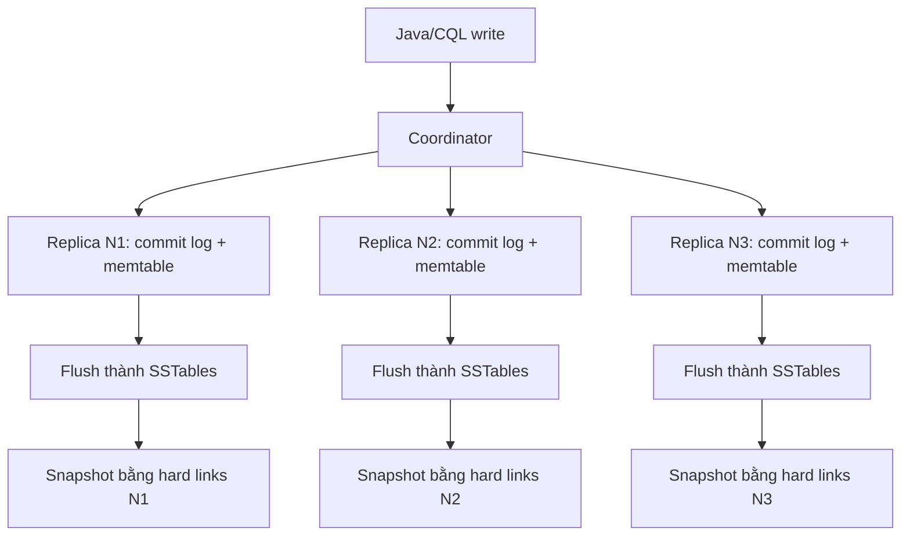
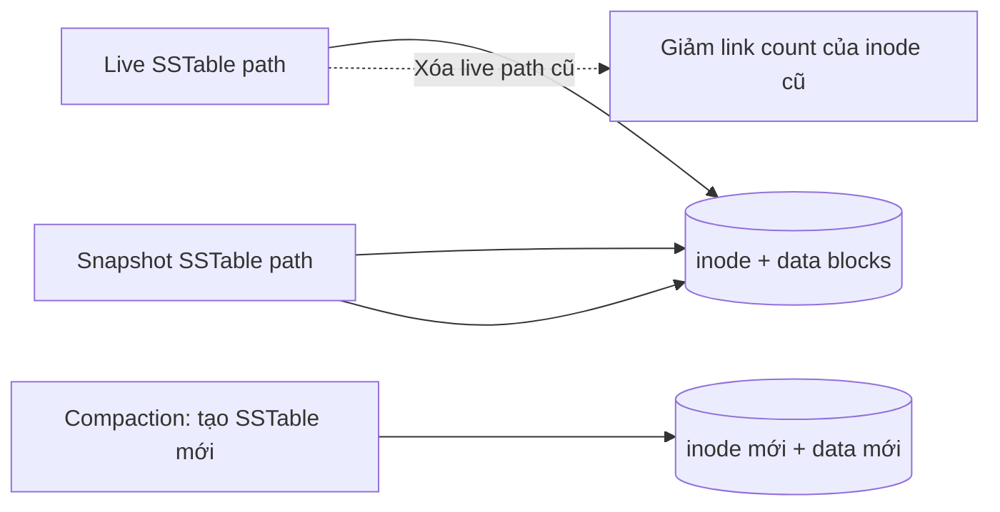
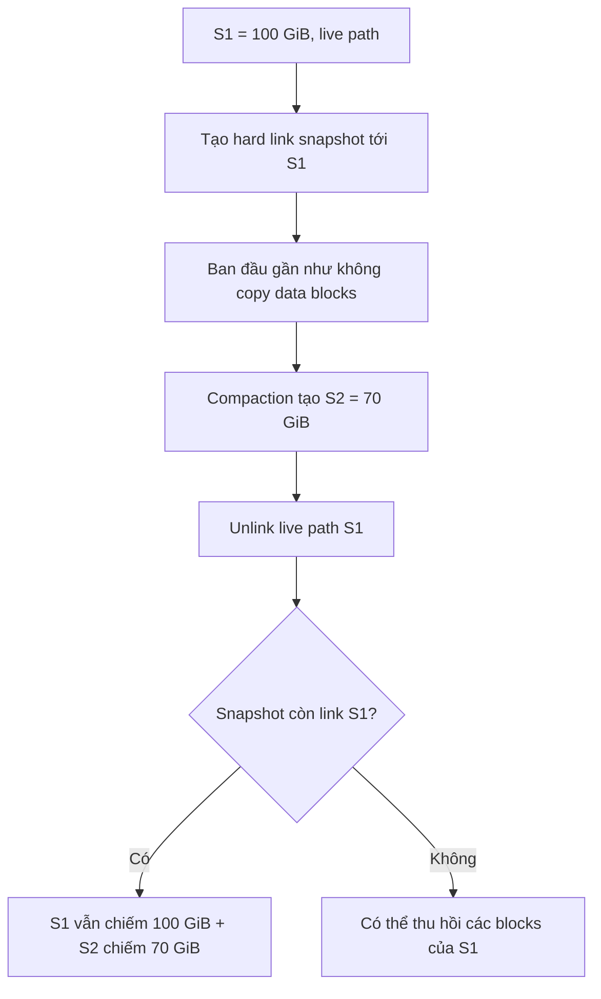
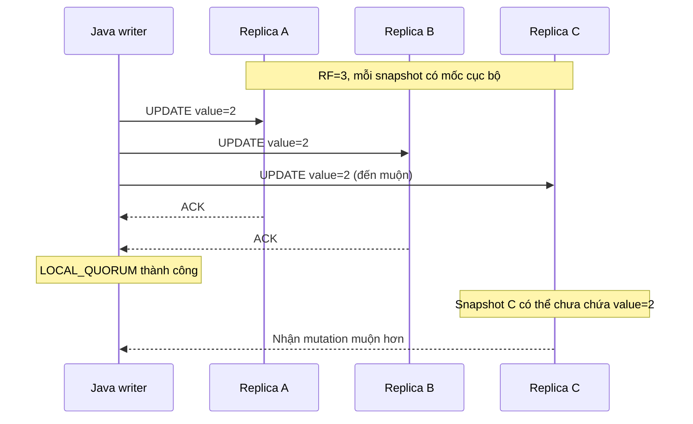

# Snapshot SSTable, hard link và dữ liệu schema đi kèm trong Apache Cassandra

## 1. Bài toán: snapshot đã tạo thành công thì đã có backup an toàn chưa?

Một hệ thống **Apache Cassandra** vận hành ba replica cho mỗi partition. Trước khi nâng cấp phần mềm, DBA chạy `nodetool snapshot` và nhìn thấy thông báo thành công gần như tức thì dù bảng chứa hàng trăm GiB. Sáng hôm sau, một ổ đĩa hỏng; đội vận hành mới phát hiện snapshot vẫn nằm **trên chính ổ đĩa đó**, chưa được chuyển ra kho lưu trữ độc lập.

Đây là hiểu nhầm kinh điển: **snapshot Cassandra là một tập tham chiếu ổn định tới các tệp SSTable trên node tại một thời điểm, không tự động là bản backup ngoài node và cũng không phải ảnh chụp nhất quán toàn cluster**.

Bài thuộc chương **Sao lưu và phục hồi** của mô-đun `DATABASE_ENGINE_WIDE_COLUMN_CASSANDRA`, gắn với kiến trúc phân tán/wide-column, partition key, mức nhất quán đọc ghi, CQL, replication, compaction, repair, xử lý lỗi và ứng dụng Java. Trọng tâm là cách hoạt động thực tế của snapshot ở tầng **SSTable/hard link**, vai trò của **manifest và schema**, cũng như quy trình bảo vệ và khôi phục đáng tin cậy.

### Mục tiêu học tập

Sau bài này, bạn có thể:

1. Giải thích vì sao SSTable **bất biến** cho phép tạo snapshot bằng **hard link** thay vì copy ngay mọi byte.
2. Phân biệt **live SSTable**, **snapshot**, **incremental backup**, **commit log archive** và **backup ngoài node**.
3. Biết `nodetool snapshot` thường flush memtable như thế nào; khi nào `--skip-flush` gây thiếu dữ liệu chưa flush.
4. Nhận diện đường dẫn snapshot, các thành phần SSTable, `manifest.json` và `schema.cql`; chuẩn bị đủ schema dependencies cho phục hồi.
5. Phân tích dung lượng snapshot khi compaction xóa SSTable cũ, và vì sao hard link không đồng nghĩa “không tốn disk”.
6. Lập quy trình **chụp → chuyển ra ngoài → xác minh → diễn tập restore → retention/cleanup** cho nhiều node/DC.
7. Xử lý các rủi ro restore: schema/table ID không khớp, TTL/tombstone, phiên bản SSTable, RF và replica ownership.

## 2. Các thuật ngữ cần phân biệt

| Khái niệm | Nội dung | Điều không được suy ra |
| --- | --- | --- |
| **Memtable** | Dữ liệu đang ở bộ nhớ của node, có thể được ghi vào commit log trước khi flush thành SSTable | Snapshot chỉ copy SSTable mặc nhiên có đủ mọi memtable |
| **Commit log** | Log ghi trước (write-ahead log) hỗ trợ độ bền và replay sau crash | `nodetool snapshot` tự lưu tất cả commit log để PITR |
| **SSTable** | Tập tệp immutable trên đĩa chứa dữ liệu/metadata theo format Cassandra | Một SSTable bằng đúng một tệp `Data.db` |
| **Snapshot** | Bản tham chiếu tới SSTable components được giữ trong thư mục snapshot tại node | Có ngay bản sao ngoài host hoặc toàn cluster nhất quán |
| **Hard link** | Một tên/đường dẫn filesystem khác tham chiếu đến **cùng inode** trên cùng filesystem | Copy nội dung sang filesystem/vùng khác |
| **Manifest** | Metadata mô tả tập tệp SSTable thuộc snapshot theo version | Đủ schema, backup, commit log và bằng chứng restore |
| **Schema đi kèm** | DDL/table metadata được lưu trong snapshot hoặc tài liệu backup riêng | Có đủ keyspace RF, UDT, quyền, roles và toàn topology |
| **Incremental backup** | Các SSTable mới sau flush được lưu bằng cơ chế backup được bật | Tự động cho point-in-time recovery chính xác |
| **PITR** | Phục hồi tới mốc thời gian mục tiêu có quy trình lưu/replay log phù hợp | Chỉ cần giữ một snapshot là làm được |

**Một snapshot có thể nhất quán ở mức tệp của một node mà không là snapshot giao dịch phân tán.** Các replica có thể nhận ghi ở thời điểm khác nhau; bảng/keyspace cũng có thể được flush tại các thời điểm khác nhau.

## 3. Đường ghi Cassandra và lý do snapshot phải xét memtable

Một request ghi đến coordinator được chuyển tới các replica mục tiêu theo token và replication strategy. Ở mỗi replica, dữ liệu được ghi qua cơ chế commit log/memtable rồi về sau flush thành SSTable. Request có thể thành công khi đủ ACK theo **consistency level**, trong khi một số replica chưa nhận mutation.



Đây là sơ đồ khái niệm, không biểu thị thứ tự ACK/mạng chính xác của mọi ghi.

**Tại thời điểm snapshot:**

- Nếu **chưa flush** một phần memtable, snapshot chỉ trỏ đến SSTable hiện có có thể **không chứa** dữ liệu chỉ còn trong memtable.
- Theo hành vi thông dụng, `nodetool snapshot` **flush các memtable liên quan trước khi tạo hard links**, trừ khi người vận hành chọn chế độ bỏ flush tương ứng như `--skip-flush` / `-sf` ở phiên bản có hỗ trợ.
- Flush giúp đưa dữ liệu đã có ở **node được snapshot** vào SSTable, nhưng **không** biến các replica thành một ảnh chụp đồng nhất cùng thời điểm.
- Dữ liệu ghi **sau mốc flush/snapshot** không nằm trong snapshot đó; một ghi đang in-flight trong thời gian snapshot cần được xét theo timestamp, node và consistency.

**Commit log thường không nằm trong bản `nodetool snapshot` SSTable.** Nếu muốn khôi phục chính xác tới mốc giữa các snapshot, cần thiết kế lưu trữ/replay commit log và các công cụ/phiên bản hỗ trợ, không được đánh đồng snapshot với PITR.

## 4. SSTable là gì và vì sao có thể hard-link?

SSTable của Cassandra là cấu trúc **immutable**: khi compaction hợp nhất dữ liệu, Cassandra tạo SSTable mới rồi xóa tham chiếu tới tệp cũ khi an toàn; nó không sửa trực tiếp các byte SSTable cũ để cập nhật hàng.

Một SSTable thường có nhiều component, tên và tập component phụ thuộc định dạng/phiên bản:

```text
<descriptor>-Data.db              dữ liệu
<descriptor>-Index.db             partition index (khi format có)
<descriptor>-Summary.db           index summary (khi có)
<descriptor>-Filter.db            bloom filter (khi có)
<descriptor>-Statistics.db        thống kê/metadata
<descriptor>-CompressionInfo.db   thông tin nén (khi có)
<descriptor>-Digest.crc32         checksum metadata (tùy format)
<descriptor>-TOC.txt              danh sách components (tùy format)
```

Các ví dụ trên **không phải danh sách tệp bắt buộc** cho mọi bản Cassandra. Backup phải giữ **đầy đủ SSTable components thực tế**, không chỉ copy tệp `Data.db`.

### 4.1. Hard link ở tầng filesystem

Trên filesystem hỗ trợ hard link kiểu POSIX, hai tên tệp có thể trỏ tới **cùng inode**:



Ví dụ:

```text
/var/lib/cassandra/data/backup_lab/orders_by_id-<tableid>/
  nb-101-big-Data.db                      # đường dẫn live
  snapshots/pre-upgrade-01/
    nb-101-big-Data.db                    # hard link tới CÙNG inode
```

Thao tác tạo hard link chỉ bổ sung **mục nhập thư mục**; nó không nhân đôi các data blocks ngay lúc đó. Đây là lý do snapshot có thể nhanh dù SSTable rất lớn. **Hard link phải nằm trong cùng filesystem**, không thể dùng hard link như một bản copy sang S3, máy khác hay volume vật lý độc lập.

### 4.2. Thí nghiệm hệ điều hành mang tính minh họa

Trên **Linux** (không cần dùng ở production), với những đường dẫn thực đã được cấp quyền đọc:

```bash
# Xem inode number và hard-link count của cùng SSTable component.
ls -li /var/lib/cassandra/data/backup_lab/orders_by_id-<tableid>/nb-101-big-Data.db
ls -li /var/lib/cassandra/data/backup_lab/orders_by_id-<tableid>/snapshots/pre-upgrade-01/nb-101-big-Data.db

# In inode, số hard links và số byte file; lệnh read-only.
stat -c '%i %h %s %n' \
  /var/lib/cassandra/data/backup_lab/orders_by_id-<tableid>/nb-101-big-Data.db
```

`<tableid>` và tên SSTable là placeholder; **không paste nguyên dạng** vào shell mà không thay bằng đường dẫn thật. Nếu hai tệp cùng inode trên cùng filesystem, dữ liệu được chia sẻ. Số hard link `2` cũng có thể tăng nếu có nhiều snapshot/backup link khác.

## 5. Snapshot thực sự lưu ở đâu?

Ví dụ thư mục dữ liệu Cassandra trên Linux (đường dẫn thực có thể cấu hình khác):

```text
<data_directory>/
  backup_lab/
    orders_by_id-<table_uuid>/
      nb-101-big-Data.db
      nb-101-big-Index.db
      ...
      snapshots/
        pre-upgrade-01/
          nb-101-big-Data.db
          nb-101-big-Index.db
          ...
          manifest.json
          schema.cql
      backups/
        ...  # incremental backups nếu bật, tùy version/config
```

**Ba chi tiết quan trọng:**

1. Với Cassandra hiện đại, tên thư mục bảng thường bao gồm **table ID/UUID**. Đường dẫn snapshot vì thế gắn với một **bảng vật lý cụ thể**, không chỉ tên hiển thị. Nếu drop rồi tạo lại bảng cùng tên, table ID có thể đã thay đổi.
2. Snapshot của **mỗi bảng trên mỗi node** nằm dưới data directory của node đó. Nếu một node có nhiều data directories, dữ liệu/snapshots của bảng có thể phân bố trên nhiều volume; backup phải khám phá **tất cả** đường dẫn tương ứng.
3. `manifest.json` và `schema.cql` được tạo trong snapshot theo các phiên bản có hỗ trợ, nhưng nội dung, vị trí và chi tiết format có thể khác. **Phải xác minh trực tiếp** trong snapshot của bản Cassandra đang vận hành.

**Không** suy ra có đầy đủ backup vì chỉ tìm thấy một thư mục `snapshots/<tag>` trên một node.

## 6. manifest.json, schema.cql và những gì không nằm trong snapshot

### 6.1. `manifest.json`: tập SSTable components thuộc lần chụp

Manifest giúp nhận diện các tệp/thành phần của snapshot. Nó hữu ích để kiểm tra **snapshot đã chọn những SSTable nào**, đặc biệt khi nội dung live directory đã đổi sau compaction.

Một manifest minh họa cấu trúc khái niệm:

```json
{
  "files": [
    "nb-101-big-Data.db",
    "nb-101-big-Index.db",
    "nb-101-big-Statistics.db"
  ]
}
```

Đây là **ví dụ giải thích**, không phải cam kết rằng manifest của mọi Cassandra release chứa đúng JSON trên. Thực tế manifest có thể liệt kê theo descriptor hoặc component và có trường khác. **Không tự tạo manifest giả để thay bản gốc**; hãy giữ nguyên metadata đi kèm snapshot và kiểm tra chúng.

### 6.2. `schema.cql`: công thức diễn giải byte SSTable

SSTable không có ý nghĩa nghiệp vụ nếu không biết **định nghĩa bảng**:

- Partition key và clustering columns quyết định cách dữ liệu được tổ chức/truy vấn.
- Kiểu cột (bao gồm frozen collections/UDT), static columns, thứ tự clustering ảnh hưởng decode/restore.
- Table options như compaction, compression, default TTL, `gc_grace_seconds` ảnh hưởng hành vi sau phục hồi.
- Indexes và materialized views, nếu có, có vòng đời/backfill riêng; không suy ra các cấu trúc phụ đã sẵn sàng chỉ từ SSTable của bảng chính.

`schema.cql` có thể lưu DDL của bảng từ thời điểm snapshot. Tuy nhiên, **đừng mặc định nó chứa toàn bộ schema của keyspace, các UDT phụ thuộc, replication map hiện hành, roles/permissions, topology, node tokens hoặc backup configuration**. Cần xuất và lưu các phần bổ trợ theo quy trình riêng.

### 6.3. Bảng mức độ hoàn chỉnh của một bản sao lưu

| Thành phần | Snapshot SSTable thông thường có? | Cần làm gì cho restore? |
| --- | --- | --- |
| SSTable files/components | **Có**, nếu snapshot thành công và chụp đúng bảng/data directories | Đối chiếu manifest và kiểm tra tính toàn vẹn |
| Table DDL (`schema.cql`) | **Thường có** ở phiên bản hỗ trợ | Kiểm tra thực tế; lưu bản DDL đầy đủ độc lập |
| Keyspace RF/strategy | Có thể **không đầy đủ** trong schema table snapshot | Xuất `DESCRIBE KEYSPACE` hoặc metadata an toàn tương đương |
| UDT/function/aggregate dependencies | Không nên giả định đã đủ | Xuất phụ thuộc theo đúng thứ tự triển khai |
| Roles/permissions/secrets | **Không** là mục đích snapshot table | Phục hồi qua chính sách IAM/RBAC/secrets riêng |
| Node membership, tokens, DC/rack | **Không** là cluster-wide backup | Lưu topology/config inventory |
| Memtable chưa flush | **Không** nếu bỏ flush và chưa có SSTable | Không dùng skip-flush cho mục tiêu cần đủ dữ liệu đã nhận |
| Commit logs để PITR | **Không** theo cơ chế snapshot SSTable | Kế hoạch archive/replay riêng nếu cần |
| Dữ liệu của node/DC khác | **Không** | Snapshot và sao lưu từng node cần thiết |
| Bảo đảm nhất quán toàn cluster một mốc | **Không tự động** | Phối hợp cut/backup và xác minh theo SLA |

Điều kiện khôi phục thành công là **tập dữ liệu, schema, công cụ, phiên bản và topology phù hợp**, không chỉ tồn tại một thư mục có tên snapshot.

## 7. CQL lab: tạo bảng để hiểu snapshot

Chỉ thực hiện trong **lab Cassandra** có DC hợp lệ. Ví dụ giả định cụm có ít nhất ba node ở `dc1` và dùng full replicas:

```sql
CREATE KEYSPACE IF NOT EXISTS backup_lab
WITH replication = {
    'class': 'NetworkTopologyStrategy',
    'dc1': 3
};

CREATE TABLE IF NOT EXISTS backup_lab.events_by_device_day (
    device_id text,
    event_day date,
    event_time timestamp,
    event_id uuid,
    value double,
    PRIMARY KEY ((device_id, event_day), event_time, event_id)
) WITH CLUSTERING ORDER BY (event_time DESC, event_id ASC);

INSERT INTO backup_lab.events_by_device_day
    (device_id, event_day, event_time, event_id, value)
VALUES (
    'device-lab-42', '2026-11-21', '2026-11-21T08:30:00Z',
    11111111-1111-1111-1111-111111111111, 25.7
);

SELECT event_time, event_id, value
FROM backup_lab.events_by_device_day
WHERE device_id = 'device-lab-42'
  AND event_day = '2026-11-21';
```

Khi muốn kiểm tra logic snapshot, hãy giữ một tập kiểm thử gồm **partition keys, số row/expected values, bản ghi cập nhật, deletion/TTL và timestamp**. Chỉ đếm tổng số row không đủ để xác nhận restored data không có giá trị stale hoặc dữ liệu đã xóa xuất hiện lại.

## 8. Tạo snapshot bằng nodetool: thứ tự an toàn

### 8.1. Cú pháp mẫu

```bash
# Trên MỘT node; chụp các bảng của keyspace.
nodetool snapshot -t lab-20261121-0830 backup_lab

# Giới hạn một bảng theo option --table nếu version hỗ trợ.
nodetool snapshot -t lab-20261121-0830 --table events_by_device_day backup_lab

# Kiểm tra lệnh và option thực tế trước khi chạy production.
nodetool help snapshot
```

Tên tag nên **duy nhất, có thời điểm UTC, không chứa thông tin nhạy cảm**. Không chạy hai lệnh mẫu cùng tag mà chưa hiểu hành vi ghi đè/lỗi duplicate của phiên bản. Ví dụ trên thể hiện **hai lựa chọn thay thế** (snapshot toàn keyspace *hoặc* một table), không phải quy trình bắt buộc phải chạy cả hai.

Theo quy trình thông dụng, mỗi lần chạy `nodetool snapshot` áp dụng trên **node đang kết nối**; nó không tự điều phối tất cả node trong cluster. Khi cần bản phục hồi nhiều replica/DC, phải lập lịch **cho từng node cần sao lưu**, ghi thời gian bắt đầu/kết thúc và xác minh coverage.

### 8.2. Snapshot có flush hay không?

```bash
# Ví dụ flush rõ ràng bảng tại node, nếu cần tách thời điểm flush.
nodetool flush backup_lab events_by_device_day

# Chỉ dành cho trường hợp đã hiểu rằng dữ liệu chưa flush
# KHÔNG được đưa vào snapshot:
nodetool snapshot --skip-flush -t lab-no-flush backup_lab
```

Hãy xác nhận option `--skip-flush`/`-sf` bằng `nodetool help snapshot` trên bản thực. **Không dùng skip-flush cho backup yêu cầu chứa đầy đủ dữ liệu có mặt trên node**, trừ khi có một cơ chế phối hợp bảo đảm flush đúng thời điểm hoặc chấp nhận mất dữ liệu chưa flush.

Ngay cả snapshot **có flush** cũng không cung cấp một **cluster-wide transaction boundary**. Nếu một ghi được ACK ở `LOCAL_QUORUM`, replica thứ ba có thể chưa nhận ghi lúc node đó snapshot. Mỗi node có mốc flush riêng. Khôi phục phải cân nhắc consistency/RF và nguồn dữ liệu theo mốc.

### 8.3. Quan sát snapshot vừa tạo

```bash
nodetool listsnapshots

# Kiểm tra thông tin bảng và dung lượng snapshot trên node.
nodetool tablestats backup_lab.events_by_device_day

# Chỉ đọc filesystem, thay path thực theo data_directory.
ls -lah /var/lib/cassandra/data/backup_lab/events_by_device_day-<tableid>/snapshots/lab-20261121-0830/
```

**`listsnapshots` và `tablestats` báo thống kê theo node**, không khẳng định đã sao lưu ra kho ngoài. Phạm vi và ý nghĩa “size on disk”, “true size” có thể khác theo phiên bản; dùng chúng cùng `df`/dung lượng filesystem khi thiết kế retention.

## 9. Tại sao snapshot nhanh nhưng dung lượng ổ vẫn tăng về sau?

Giả sử bảng có SSTable S1 = 100 GiB:

1. Trước snapshot: đường dẫn `live/S1` trỏ inode I1 (100 GiB).
2. Snapshot tạo `snapshots/tag/S1` cũng trỏ I1: **không copy 100 GiB ngay lập tức**.
3. Cassandra compaction sinh SSTable S2 = 70 GiB, nội dung hợp nhất từ S1 và nguồn khác.
4. Cassandra bỏ đường dẫn live S1. **I1 vẫn còn** vì snapshot còn hard link tới I1.
5. Lúc này, filesystem vẫn giữ **100 GiB cho I1** cộng **70 GiB cho S2** và những SSTable khác.
6. Chỉ khi **không còn hard link/tham chiếu** tới I1, và filesystem cho phép, các block mới được thu hồi.



Những con số chỉ để minh họa; compaction thực tế có nhiều SSTable, dữ liệu nén và overhead riêng.

### 9.1. “Snapshot gần như 0 byte” là phát biểu thiếu điều kiện

**Chi phí tức thời** tạo hard link có thể nhỏ, nhưng **chi phí giữ lâu dài** có thể lớn vì những SSTable cũ bị pin không được giải phóng sau flush/compaction/delete. Tính cả snapshot lịch sử, auto-snapshot, incremental backup hard links, temporary SSTables và snapshot/backup từ filesystem.

### 9.2. Các công cụ dung lượng dễ gây hiểu nhầm

| Công cụ | Cần đọc thế nào? |
| --- | --- |
| `nodetool listsnapshots` | Xem tag, bảng/node và thống kê snapshot; phân biệt kích thước logic với không gian **riêng thực sự có thể thu hồi** theo output phiên bản |
| `nodetool tablestats` | So live SSTable, total và snapshots theo table; các trường có semantics riêng, tránh cộng tùy tiện |
| `du -sh <snapshots_dir>` | Có thể báo dung lượng tệp dưới đường dẫn dù block đang chia sẻ với live hard links; thứ tự duyệt ảnh hưởng việc quy phần hard links |
| `df -h` | Cho biết filesystem free/used thực tế; không nói snapshot tag nào giữ block |
| `stat`/`ls -li` | Kiểm tra inode và link count, hỗ trợ nhận diện hard link |

**Không kết luận có thể thu hồi đúng N GiB bằng cách cộng kích thước tất cả thư mục snapshot.** Một SSTable có thể được nhiều tag giữ và link cũng chia sẻ với live.

## 10. So sánh snapshot, incremental backup và commit log archive

| Cơ chế | Thời điểm ghi dữ liệu | Ưu điểm | Hạn chế |
| --- | --- | --- | --- |
| **Manual snapshot** | Khi gọi `nodetool snapshot` | Điểm khôi phục SSTable có tên tag, tạo nhanh | Node-local, không tự off-host, không PITR |
| **Auto-snapshot** | Trước một số thao tác schema như DROP/TRUNCATE nếu được bật, theo version | Cơ hội khôi phục trước thao tác phá dữ liệu | Không nên thay lịch backup/retention chính thức |
| **Incremental backups** | SSTable mới được ghi/flush khi tính năng đã bật | Giúp giữ SSTable thay đổi giữa các snapshot cơ sở | Không tự mang lại commit log/PITR; cần quy trình ghép và restore phù hợp |
| **Commit log archiving** | Lưu những đoạn commit log theo cơ chế được cấu hình | Có thể là một thành phần của thiết kế recovery gần thời điểm cụ thể | Replay, mapping/schema/version và correctness phức tạp; không phải chức năng của snapshot |
| **External backup** | Sao chép bản snapshot/metadata ra kho độc lập | Chống mất node/volume/site khi thiết kế đúng | Cần checksum, bảo mật, inventory, restore test và retention |

Không bật incremental backup rồi giả định “đã có bản backup hoàn chỉnh”. Thường cần **mốc full snapshot**, chuỗi SSTable increments tương ứng và chiến lược replay/restore đã thử nghiệm. Việc lắp ghép SSTables tùy tiện từ những khoảng thời gian khác nhau có thể gây sai lệch tombstone/TTL/metadata.

## 11. Snapshot trên nhiều node không phải ảnh chụp toàn cluster tại một thời điểm

Với `NetworkTopologyStrategy` và RF=3, một key được giữ trên ba replica. Một read/write request ở `LOCAL_QUORUM` có thể thành công khi chỉ hai replica ACK, trong khi replica còn lại nhận mutation sau. Nếu DBA chụp từng node cách nhau vài phút, snapshot của các replica có thể phản ánh **những tập phiên bản khác nhau**.



Với hệ thống nhiều DC, thời gian và phạm vi khác biệt còn lớn hơn vì WAN và RF theo DC.

### Điều này có nghĩa gì với RPO/RTO?

- **RPO** (Recovery Point Objective) là lượng dữ liệu có thể chấp nhận mất sau sự cố, không phải “thời điểm tag snapshot mới nhất”.
- **RTO** (Recovery Time Objective) là thời gian cần để phục hồi hoạt động, không chỉ thời gian sao chép file.
- Một snapshot node-local đã flush không chứng minh **RPO=0 cho những ghi ACK ở toàn cụm**.
- Muốn có mốc backup chặt chẽ hơn, ứng dụng có thể cần **quiesce/barrier writes**, backup phối hợp nhiều node và kiểm chứng kết quả, hoặc kiến trúc phục hồi chuyên biệt. Phải ghi rõ trade-off availability và maintenance window.
- Thời gian restore còn bao gồm chuẩn bị schema, chuyển SSTables, import/stream, repair, test correctness và đổi routing của Java clients.

Nếu backup cần bảo đảm ở quy mô cluster, hãy xác định **tập node/range/source dữ liệu phục hồi đủ** ngay khi thiết kế, không đợi có sự cố mới suy luận từ một bản snapshot của một replica.

## 12. Quy trình backup ngoài node: snapshot chỉ là bước đầu

Một runbook thực dụng:

1. **Chốt phạm vi:** keyspace/table, cluster/DC/node, Cassandra version, data directories, RF, nhu cầu RPO/RTO, retention và người phê duyệt.
2. **Thu schema độc lập:** DDL keyspace/table, UDT/phụ thuộc, options, topology, build/version, nếu có index/materialized view và yêu cầu quyền; không sao chép bí mật.
3. **Kiểm tra sức khỏe:** `nodetool status`, schema agreement, snapshot/compaction đang chạy, disk headroom, lịch backup, node down.
4. **Tạo tag UTC thống nhất** và lần lượt chạy snapshot trên **mọi node dự kiến**, ghi start/end, kết quả và snapshot contents. Có chiến lược nhất quán ứng dụng nếu nghiệp vụ yêu cầu.
5. **Xác minh địa phương:** tag tồn tại, SSTable components/manifest/schema ở mỗi data directory và tables được chọn; không có task snapshot lỗi.
6. **Chuyển ra kho độc lập:** sao chép bytes cùng manifest/schema sang object storage hoặc máy backup được bảo vệ; tránh lưu chỉ trên cùng ổ/host.
7. **Kiểm tra archive:** manifest inventory, counts, checksums hoặc hệ thống kiểm tra toàn vẹn tương đương; kiểm tra từng tệp và tổng bytes, từ **đích** chứ không chỉ nguồn.
8. **Ghi provenance:** source cluster/DC/node, tag, table ID, thời gian, version, object location, checksum, encryption key references, trạng thái copy/restore test.
9. **Diễn tập khôi phục:** restore vào cluster staging/cô lập, kiểm tra dữ liệu và read CL theo yêu cầu.
10. **Chỉ sau validation** mới áp dụng retention/`clearsnapshot` cục bộ, với khả năng bảo đảm backup từ xa vẫn đủ.

### Mẫu manifest cho kho backup độc lập

```yaml
backup_id: cassandra-full-20261121T083000Z
cluster_alias: staging-cluster
cassandra_version: "RECORD_ACTUAL_VERSION"
consistency_contract: "node-local snapshots; no global transaction cut"
snapshot_tag: lab-20261121-0830
scope:
  keyspace: backup_lab
  table: events_by_device_day
  data_centers: [dc1]
  nodes_expected: 3
  nodes_completed: 3
source:
  table_id: "CAPTURE_REAL_TABLE_UUID"
  data_directories: "CAPTURE_EACH_VOLUME"
schema:
  schema_cql_included: true
  full_keyspace_ddl_exported: true
archive:
  storage_uri: "BACKUP_REPOSITORY_REFERENCE"
  checksum_algorithm: SHA-256
  verified_from_destination: true
security:
  encrypted_at_rest: true
  key_reference: "KEY-MANAGEMENT-REFERENCE-NOT-SECRET"
validation:
  restore_drill: "NOT_YET_TESTED"
  application_data_check: "PENDING"
retention:
  expires_at_utc: "2026-12-21T08:30:00Z"
```

Manifest này là **mẫu tổ chức**, không phải `manifest.json` do Cassandra tạo ra. Các trường `true`/`nodes_completed` chỉ được điền như vậy sau khi có bằng chứng thực, không copy nguyên vào báo cáo hoàn thành.

## 13. Cẩn thận khi sao chép hard link ra kho khác

Không nên chỉ backup **đường dẫn live SSTable** hoặc chỉ backup một file `Data.db`. Nguồn đúng phải là **toàn bộ các tệp thuộc snapshot cần giữ** cùng metadata và schema phụ thuộc.

### 13.1. Truyền qua rsync/tar/object storage

```bash
# Ví dụ minh họa, phải thay path và quyền truy cập thực tế.
# Nguồn phải là snapshots/<tag> đã được xác nhận đầy đủ.
rsync -a --checksum \
  /var/lib/cassandra/data/backup_lab/events_by_device_day-<tableid>/snapshots/lab-20261121-0830/ \
  /mnt/independent-backup/nodeA/backup_lab/events_by_device_day/
```

Đây chỉ là **phác thảo copy**, không phải script production:

- `/mnt/independent-backup` **phải thực sự là storage độc lập**, không phải folder khác trên cùng disk. Kiểm tra mount/host và chính sách replication của kho.
- `--checksum` có thể tốn I/O đáng kể; có thể dùng công cụ backup có checksum/bản kiểm kê phù hợp. Tính tác động khi node đang chịu tải.
- Khi copy ra filesystem khác, bytes sẽ được tạo ở đích; **hard link không giữ một inode xuyên filesystem**. Nếu công cụ cần giữ quan hệ hard link **giữa nhiều đường dẫn trong cùng archive**, cấu hình của nó phải hỗ trợ; backup một thư mục snapshot thường chỉ cần kiểm chứng nội dung từng tệp.
- Archive/compress/encrypt phải giữ tên tệp và components nhất quán với manifest; không tự đổi tên descriptor SSTable.
- Object storage không có ngữ nghĩa hard link inode kiểu local FS; phải dự trù dung lượng **bản sao dữ liệu thật**.

### 13.2. Checksum là cần nhưng chưa đủ

`SHA-256` từ tệp nguồn và tệp đích giúp xác nhận **nội dung byte giống nhau**; nó không chứng minh:

- Snapshot đã bao gồm dữ liệu mới nhất theo yêu cầu RPO.
- Đã backup mọi node/table/data directory và các schema dependencies.
- SSTable có thể load bằng Cassandra version/format mục tiêu.
- Bản ghi đã xóa/TTL được phục hồi đúng logic.

Vì vậy cần **restore drill** và kiểm thử CQL, không dừng ở dòng “checksum PASS”.

## 14. Schema dependencies: cần lưu những thứ nào bên cạnh schema.cql?

Lưu `schema.cql` gốc của snapshot, đồng thời xuất những thông tin hệ thống cần để dựng lại môi trường:

| Nhóm | Điều cần xác nhận |
| --- | --- |
| **Keyspace DDL** | Replication strategy/RF theo DC, durable writes và các keyspace options |
| **Table DDL** | Partition/clustering columns, types, clustering order, static columns, table options |
| **UDT và kiểu phụ thuộc** | `CREATE TYPE` phải có trước những bảng/statement cần type đó |
| **Indexes/materialized views** | DDL và quy trình rebuild/refresh phù hợp, không giả định SSTable của bảng chính đã làm index/view sẵn sàng |
| **Functions/aggregates** | Có được bật/hỗ trợ ở cluster đích không, quyền và bảo mật |
| **Cassandra version/format** | SSTable format, compression, repair metadata và công cụ tương thích |
| **Node/DC configuration** | Cluster name, snitch, DC/rack, seeds và token placement cho môi trường khôi phục |
| **Authorization** | Roles/grants/secrets từ quy trình IAM độc lập; hạn chế khôi phục thẳng system auth keyspace |
| **Encryption** | Khóa giải mã SSTables/backup và đường truy cập tới KMS, không lưu secret cùng backup |

`DESCRIBE KEYSPACE` hoặc `DESCRIBE TABLE` trong `cqlsh` có thể giúp xuất CQL DDL theo phiên bản:

```sql
-- Đây là lệnh cqlsh; không gửi qua session.execute của Java Driver.
DESCRIBE KEYSPACE backup_lab;
DESCRIBE TABLE backup_lab.events_by_device_day;
```

Nếu schema giữa mốc backup và hiện tại đã thay đổi, **không dùng DDL hiện tại để giả định SSTable cũ tương thích**. Đánh giá từng bước ALTER TABLE, tên/type cột, UDT, table ID và dữ liệu bị drop trước khi restore.

## 15. Khôi phục: snapshot không phải nút “undo” tự động

Có hai hướng khôi phục khác nhau:

1. **Phục hồi node/disk** theo quy trình cho phiên bản Cassandra hiện tại, giữ membership/token khi thích hợp và dùng backup như nguồn bổ sung.
2. **Nạp SSTable vào cluster/table hiện hữu** bằng công cụ nhập/stream phù hợp, để dữ liệu được phân phối tới các replica theo topology hiện tại.

Các công cụ có thể gặp gồm `sstableloader` (stream dữ liệu SSTable tới cluster có schema phù hợp), và `nodetool refresh`/`nodetool import` tùy phiên bản cho các thao tác nạp tệp **trên một node**. **Chúng không hoán đổi**: nạp tệp ở một node không mặc định phân phối đúng replica ownership trong toàn cluster.

```bash
# HÌNH THỨC MINH HỌA, KHÔNG chạy nguyên dạng trên production.
# sstableloader đòi hỏi layout/tham số/schemas tương thích phiên bản.
sstableloader -d <contact_node> <staged_snapshot_table_directory>
```

Trước lệnh thật, xác nhận tài liệu **đúng Cassandra version**, đường dẫn nguồn phù hợp với loader, permissions, authentication/TLS và điều kiện node/cluster. Không tự copy SSTable vào live data directory trên node đang chạy hoặc xóa tệp cũ mà không có hướng dẫn restore được duyệt.

### 15.1. Trình tự restore drill an toàn

1. Dựng môi trường **cô lập** có Cassandra version và schema phù hợp; không trỏ thử nghiệm vào cụm production.
2. Khôi phục keyspace, UDT và table DDL **theo đúng phụ thuộc**; kiểm tra RF phù hợp số node trong lab.
3. Tải tệp backup **từ kho ngoài** và xác minh checksum, manifest, metadata; không dựa vào snapshot vẫn tồn tại trên node nguồn.
4. Dùng công cụ loader/import theo release để đưa SSTable vào table, lưu stdout/stderr/log và theo dõi stream/compaction.
5. Kiểm tra dữ liệu với partition keys được lưu trong kế hoạch trước snapshot: hàng sống, cập nhật, deletion, TTL, timestamps.
6. Kiểm tra các node/replica theo CL thực của ứng dụng, đánh giá repair sau restore nếu cần; không dùng một `SELECT` thành công làm bằng chứng mọi token range đã sẵn sàng.
7. Ghi duration, throughput, bytes loaded, disk headroom và lỗi để đánh giá **RTO thực tế**.
8. Chỉ sau khi bài test PASS mới coi backup có khả năng phục hồi đã được kiểm chứng.

### 15.2. Vì sao clone schema cần chú ý table ID?

Tạo lại `backup_lab.events_by_device_day` với cùng tên có thể sinh **table UUID mới**, khiến đường dẫn/table metadata của SSTable snapshot không thể dùng trực tiếp như cấu trúc gốc. Công cụ `sstableloader`/import có thể hỗ trợ quy trình theo schema đích; **không** tự đổi tên thư mục UUID rồi chép tệp vào live path để “lừa Cassandra nhận bảng”.

Schema tương thích nghĩa là cả CQL types/clustering/schema history và format/codec của SSTable được hỗ trợ. Dùng table ID đúng tên là điều cần kiểm tra, nhưng **chưa đủ** để đảm bảo nội dung đúng.

## 16. TTL, tombstone và rủi ro dữ liệu đã xóa quay lại

Snapshot SSTable lưu nội dung và metadata liên quan timestamp/TTL/tombstone tại **mốc snapshot**. Nó không “reset đồng hồ” của TTL.

### 16.1. TTL sau khi restore

Nếu một cell được ghi với TTL 7 ngày và snapshot được giữ 30 ngày, khi restore nó có thể đã hết hạn theo **thời điểm ghi/expiry vốn có**. Không nên hứa rằng toàn bộ row sống ở ngày chụp sẽ xuất hiện lại nguyên trạng sau một tháng.

### 16.2. DELETE và tombstone

Ví dụ:

```text
t0: Ghi key K = ACTIVE
t1: Tạo snapshot S1 (chứa ACTIVE)
t2: DELETE K, các replica nhận tombstone
t3: Compaction/repair diễn ra
t4: Restore S1 sai cách vào cluster đang phục vụ
```

Nếu chỉ nạp dữ liệu **cũ hơn** mà không xét dấu xóa/timestamp đã ghi sau snapshot, quá trình restore có thể đưa giá trị cũ trở lại hoặc gây sai lệch với dữ liệu hiện hành. Cassandra có quy tắc reconciliation theo timestamp và tombstone, nhưng bạn **không được dựa vào “bản mới tự thắng”** khi tombstone có thể đã bị purge, replica stale hoặc phạm vi restore không đầy đủ.

`gc_grace_seconds` và lịch repair ảnh hưởng khả năng purge tombstone an toàn. **Restore càng cũ, càng phải đánh giá tác động zombie data**, đặc biệt khi dùng snapshot để trộn với dữ liệu hiện tại thay vì dựng cluster cô lập tại một mốc.

### 16.3. Phục hồi có “quay về quá khứ” không?

- **Khôi phục cả môi trường riêng** về tập snapshot đã chọn là một bài toán khác **nhập dữ liệu cũ vào cụm sống**.
- Với nhập dữ liệu cũ vào cụm đang nhận ghi, phải thiết kế cách xử lý các mutation sau mốc snapshot, key đã xóa, idempotency và conflict resolution.
- Nếu nghiệp vụ yêu cầu PITR, cần kết hợp lưu logs, schema history và quy trình replay có chứng cứ, không dùng snapshot SSTable như dịch vụ rollback transaction.

## 17. Kiểm chứng bằng CQL và Java Driver 4.x sau restore

Trước backup, ghi tập kiểm thử (sample/expected values đã ẩn danh), sau restore kiểm tra cùng query shape và **CL thực tế**. Ví dụ Java 17+ với Java Driver 4.x, `session` đã kết nối tới **cluster restore cô lập**, không phải production:

```java
import com.datastax.oss.driver.api.core.DefaultConsistencyLevel;
import com.datastax.oss.driver.api.core.cql.PreparedStatement;
import com.datastax.oss.driver.api.core.cql.Row;
import java.time.LocalDate;
import java.util.UUID;

PreparedStatement ps = session.prepare("""
    SELECT event_time, event_id, value
    FROM backup_lab.events_by_device_day
    WHERE device_id = ? AND event_day = ?
    """);

long startedNs = System.nanoTime();
try {
    int rows = 0;
    boolean expectedRowFound = false;
    for (Row row : session.execute(
        ps.boundStatementBuilder()
            .setString(0, "device-lab-42")
            .setLocalDate(1, LocalDate.of(2026, 11, 21))
            .setConsistencyLevel(DefaultConsistencyLevel.LOCAL_QUORUM)
            .build())) {
        rows++;
        if (UUID.fromString("11111111-1111-1111-1111-111111111111")
            .equals(row.getUuid("event_id"))) {
            expectedRowFound = (Double.compare(row.getDouble("value"), 25.7) == 0);
        }
    }
    long elapsedNs = System.nanoTime() - startedNs;
    // Ghi: snapshot_tag, rows, expectedRowFound, elapsedNs, CL, target DC.
    // So với dữ liệu expected tại thời điểm snapshot, không đoán bằng tên tag.
} catch (RuntimeException error) {
    // Log timeout, unavailable, driver errors riêng để biết restore thiếu
    // replica hay node bị nghẽn; không mặc định dữ liệu mất.
    throw error;
}
```

**Giới hạn của phép thử:**

- Một row đúng tại `LOCAL_QUORUM` **không chứng minh** tất cả replica có toàn bộ lịch sử.
- Kiểm tra `rows`, timestamps, TTL còn hiệu lực, tombstone/deletion cases và nhiều token ranges; chỉ nhìn `expectedRowFound` là chưa đủ.
- Nếu cluster restore có RF nhỏ hơn số node dùng cho `LOCAL_QUORUM` hoặc topology không giống nguồn, bài test có thể thất bại do cấu hình chứ không do backup hỏng.
- Driver chỉ **xác minh** dữ liệu; `CqlSession` không tự tạo snapshot/restore SSTable.
- Dùng môi trường staging, quota và dữ liệu được phép; không ghi production key nhạy cảm vào log kiểm thử.

## 18. Snapshot retention và clearsnapshot an toàn

Mục tiêu retention không phải “giữ tất cả snapshot càng lâu càng tốt”. Snapshot lâu ngày **pin** SSTable cũ, tiêu tốn disk và có thể tăng rủi ro đầy ổ khi compaction/streaming.

### Quy trình xóa tag đúng cách

1. Liệt kê snapshot và xác định **tag/keyspace/node** nào đã được chuyển và xác minh ở kho ngoài.
2. Kiểm tra **restore drill, chính sách lưu trữ và legal hold** (nếu có), không xóa tag đang cần cho recovery.
3. Xác nhận đã lưu đủ schema/manifest/hash của tag tương ứng và không có backup job đang copy tag đó.
4. Dùng **`nodetool clearsnapshot`** với tag cụ thể và keyspace nếu phiên bản hỗ trợ, không xóa tệp SSTable bằng thao tác thủ công.
5. Theo dõi dung lượng filesystem thực tế (`df`), đồng thời hiểu rằng xóa một tag **có thể không** giải phóng byte nếu SSTable còn được live/other snapshots giữ.

```bash
# CHỈ minh họa cú pháp; thao tác thực sự xóa snapshot links.
# Không chạy nếu chưa xác minh backup ngoài node.
nodetool clearsnapshot -t lab-20261121-0830 backup_lab

# Kiểm tra lại sau cleanup.
nodetool listsnapshots
```

`clearsnapshot` xóa hard links và metadata snapshot trên node; nó **không** đồng nghĩa xóa dữ liệu live còn được Cassandra sử dụng. Nhưng nếu đây là **bản duy nhất** còn giữ một SSTable đã bị compaction/unlink, việc xóa snapshot có thể làm mất khả năng khôi phục phiên bản cũ của dữ liệu. Các option như `--all`, `-t` có thể khác theo version, phải đọc `nodetool help clearsnapshot` trước production.

## 19. Những sai lầm vận hành thường gặp

| Sai lầm | Hậu quả | Cách phòng tránh |
| --- | --- | --- |
| “Snapshot nhanh nên có copy dữ liệu” | Mất disk/node thì snapshot cùng disk cũng mất | Sao chép archive ra kho độc lập |
| “Hard link không chiếm thêm byte” | Compaction pin SSTable cũ, disk free giảm | Theo dõi true size, `df` và retention |
| Chụp **một node** rồi gọi backup cluster | Thiếu các replica/range/table ở node khác | Lập inventory nhiều node/DC |
| Dùng `--skip-flush` mà không hiểu | Thiếu dữ liệu chưa flush trong snapshot | Flush mặc định hoặc có thủ tục nhất quán riêng |
| Chỉ copy `Data.db` | Thiếu component và metadata SSTable | Copy trọn snapshot theo manifest |
| Chỉ lưu `schema.cql` | Thiếu UDT/keyspace RF/roles/topology | Lưu DDL/phụ thuộc/config độc lập |
| Coi `manifest.json` là checksum hoặc proof restore | Backup vẫn có thể hỏng/thiếu hoặc schema không tương thích | Hash tại đích và restore drill |
| Xem RPO=0 vì RF=3 | Snapshot từ các replica khác thời điểm, ACK không toàn bộ | RPO contract, phối hợp backup và validation |
| Dùng snapshot cũ nạp vào cluster sống tùy tiện | TTL/tombstone và ghi mới xung đột, zombie | Restore cô lập, reconciliation theo plan |
| Chạy `clearsnapshot` trước khi backup hoàn tất | Mất điểm khôi phục nếu các live links đã mất | Retention chỉ sau verify từ kho ngoài |
| Copy backup trên cùng mount giả “remote” | Node/disk failure làm mất cả nguồn và backup | Kiểm tra physical failure domains |
| Nhầm incremental backup với PITR | Không thể phục hồi đúng thời điểm yêu cầu | Commit log archive/replay và diễn tập phù hợp |

## 20. Bài tập thực hành

### Bài tập A — vì sao 100 GiB snapshot nhanh?

Trên một node, live SSTable S1 có kích thước 100 GiB. `nodetool snapshot` tạo tag T chỉ sau vài giây. Sau đó compaction tạo S2 70 GiB và xóa live link S1, nhưng tag T vẫn còn.

1. Snapshot T giữ cùng inode hay copy 100 GiB sang inode mới?
2. Sau khi live S1 bị unlink, điều gì khiến 100 GiB của S1 chưa được thu hồi?
3. Nếu xóa tag T, filesystem có chắc giải phóng đúng 100 GiB không? Vì sao?
4. Nếu toàn bộ volume hỏng, tag T có giúp phục hồi không?

### Bài tập B — snapshot với skip-flush

Ứng dụng gửi ghi ở `LOCAL_QUORUM` và được báo thành công. DBA chạy `nodetool snapshot --skip-flush` trên một replica, sau đó thử khôi phục từ riêng snapshot đó.

1. Vì sao dữ liệu đã ACK có thể không nằm trong SSTable snapshot?
2. Commit log có tự xuất hiện trong thư mục snapshot không?
3. Thay `--skip-flush` bằng snapshot có flush giải quyết điều gì và **chưa giải quyết** điều gì ở toàn cluster?
4. Phải thu thêm bằng chứng nào để bảo vệ yêu cầu RPO của nghiệp vụ?

### Bài tập C — chỉ có schema.cql

Nhóm phục hồi có `Data.db` và `schema.cql` nhưng thiếu manifest, một số SSTable components và thông tin UDT/keyspace replication. Họ tạo lại table cùng tên trên cluster khác rồi định copy file vào data directory.

1. Vì sao phương án này không an toàn?
2. Tập metadata/DDL tối thiểu nào phải thu thập?
3. Khi nào cân nhắc `sstableloader` thay vì copy vào thư mục live?
4. Table ID và SSTable version ảnh hưởng quyết định restore thế nào?

### Bài tập D — backup đã có nhưng RPO/RTO chưa được kiểm chứng

Các node có snapshot tag mỗi ngày. Archive ngoài host lưu đúng bytes và SHA-256, nhưng chưa từng restore thử; sau sự cố WAN giữa DC, một số ghi `LOCAL_QUORUM` ở DC1 chưa đến DC2.

1. Checksum chứng minh được điều gì? Điều gì vẫn chưa biết?
2. Phải backup node/range/DC nào để phục vụ kịch bản mất DC1?
3. Vì sao không thể tuyên bố RPO=0 chỉ vì RF=3 mỗi DC?
4. Thiết kế một restore drill có kiểm tra schema, TTL, tombstones và dữ liệu lịch sử.

### Câu hỏi tự kiểm tra

1. SSTable **immutable** có vai trò gì trong việc tạo snapshot bằng hard link?
2. Hard link khác symbolic link và copy độc lập ở điểm nào?
3. Vì sao snapshot chỉ chụp SSTable có thể bỏ sót memtable nếu dùng skip-flush?
4. `manifest.json` và `schema.cql` có cùng nhiệm vụ không?
5. Đường dẫn bảng chứa UUID/table ID quan trọng thế nào khi restore?
6. Vì sao `du` có thể trông như “snapshot chiếm đủ dung lượng” khi hard links vẫn chia sẻ data blocks?
7. Sau compaction, xóa live path SSTable có luôn giải phóng block không?
8. Một tag snapshot trên một node có đủ chứng minh backup toàn cluster không?
9. Snapshot có thay thế incremental backup hoặc commit log archiving cho PITR không?
10. Vì sao TTL có thể làm row biến mất sau restore dù snapshot lúc tạo còn row đó?
11. Khi nào `clearsnapshot` có thể làm mất điểm phục hồi duy nhất?
12. Một query Java trả đúng ở `LOCAL_QUORUM` có bảo đảm mọi replica đã được restore đầy đủ không?

## 21. Mẫu biên bản kiểm chứng sao lưu và phục hồi

```text
BACKUP ID / UTC TAG:
CLUSTER / VERSION / DC / NODE SET / DATA DIRECTORIES:
KEYSPACE.TABLE / TABLE ID / RF / CONSISTENCY CONTRACT:

CAPTURE:
  snapshot command/options, skip_flush?:
  node and UTC start/end:
  snapshot location and manifest file inventory:
  schema.cql + extra keyspace/UDT/index DDL:
  data volume/headroom before/after:

EXTERNAL ARCHIVE:
  destination storage/failure domain:
  per-file size/checksum and verification AT DESTINATION:
  encryption/key access policy:
  per-node/table completed and missing ranges:

RESTORE DRILL:
  isolated target cluster/version/schema:
  import/stream tool and exact approved procedure:
  output/error log, bytes imported, time elapsed:
  test keys before snapshot, updates, deletes, TTL:
  read CL and replica validation, RTO measured:

DECISION:
  RPO assumptions/known gaps:
  STATUS: VERIFIED / INCOMPLETE / FAILED
  retention and local clearsnapshot approval:
  owner, timestamp, next drill:
```

Chỉ ghi `VERIFIED` khi **archive tồn tại độc lập, checksum/coverage đạt và restore drill chứng minh dữ liệu đúng** theo contract. Nếu chưa diễn tập, cần ghi `INCOMPLETE — RESTORE_NOT_TESTED` thay vì coi lệnh `snapshot` exit code 0 là đủ.

## 22. Tài liệu chính thức để đối chiếu theo phiên bản

- [Apache Cassandra – nodetool snapshot](https://cassandra.apache.org/doc/latest/cassandra/managing/tools/nodetool/snapshot.html): cách chụp snapshot, tag, phạm vi bảng và skip-flush.
- [Apache Cassandra – nodetool listsnapshots](https://cassandra.apache.org/doc/latest/cassandra/managing/tools/nodetool/listsnapshots.html): danh sách snapshot và các số liệu dung lượng.
- [Apache Cassandra – nodetool clearsnapshot](https://cassandra.apache.org/doc/latest/cassandra/managing/tools/nodetool/clearsnapshot.html): xóa snapshot theo tag và phạm vi.
- [Apache Cassandra – Backups](https://cassandra.apache.org/doc/stable/cassandra/managing/operating/backups.html): snapshot, incremental backup và nội dung sao lưu.
- [Apache Cassandra – Repair](https://cassandra.apache.org/doc/stable/cassandra/managing/operating/repair.html): đồng bộ giữa replica và tác động tombstone.

Đường dẫn docs có thể chuyển theo bản phát hành. Luôn kiểm tra **`nodetool help snapshot`, `help listsnapshots`, `help clearsnapshot`**, Cassandra/Java Driver version và chính sách vận hành thực trước khi thao tác production.

## 23. Kết luận

**Snapshot Apache Cassandra là một tập hard links tới các SSTable bất biến, kèm metadata như manifest và schema ở các phiên bản hỗ trợ.** Tạo snapshot nhanh vì các tên tệp thường dùng chung inode/data blocks; chính sự chia sẻ này cũng khiến **snapshot giữ SSTable cũ sau compaction và có thể tiêu tốn dung lượng lâu dài**. Một snapshot trên ổ local **không thay** bản backup ngoài node, không tự ghi commit logs cho PITR và không tự tạo thời điểm nhất quán toàn cluster.

Quy trình đúng phải nối đủ các bước: **flush theo hợp đồng → snapshot đúng bảng/node → lưu trọn SSTable components + manifest/schema phụ thuộc → chuyển ra storage độc lập → xác minh bytes và coverage → thử phục hồi có kiểm tra TTL/tombstone/CL → retention và cleanup có kiểm soát**. Chỉ khi restore được xác minh mới có cơ sở tin vào RPO/RTO; một tag snapshot thành công chưa phải kết thúc công việc sao lưu.
