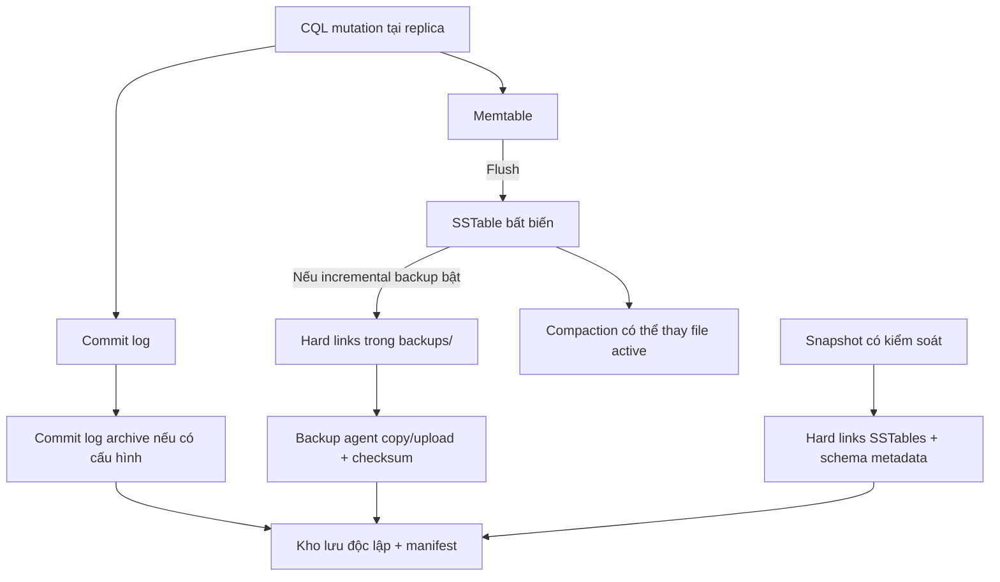
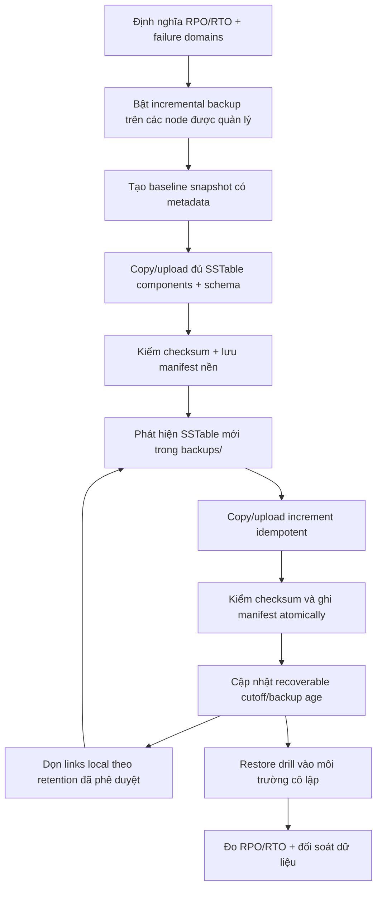

# Sao lưu tăng dần và quan hệ với dữ liệu đã flush

> **Chương:** Sao lưu và phục hồi  
> **Mô-đun:** `DATABASE_ENGINE_WIDE_COLUMN_CASSANDRA` — Apache Cassandra, cơ sở dữ liệu wide-column phân tán.  
> **Trọng tâm:** Hiểu chính xác *khi nào* một mutation đi vào incremental backup, vì sao backup gắn với **SSTable được flush hoặc stream**, cách phối hợp với snapshot nền và commit log, cùng những giới hạn RPO, dung lượng, nhất quán và phục hồi.

Trong Cassandra, thao tác ghi thành công ở một consistency level (CL) **không đồng nghĩa** dữ liệu ấy đã nằm trong bản sao lưu tăng dần. Một mutation thường đi vào **commit log** và **memtable** ở replica trước. Khi memtable được **flush** thành SSTable bất biến, Cassandra mới có thể tạo **hard link tới các tệp SSTable mới** trong thư mục `backups/` nếu incremental backup đã được bật. Cassandra cũng tạo backup link cho SSTable được **stream** vào node theo các phiên bản/cấu hình hỗ trợ.

Do vậy, có ba mốc phải tách biệt:

1. **Ghi đã được ACK:** Cassandra đáp ứng số replica theo CL; trên các replica xác nhận, độ bền ghi có liên quan tới commit log.
2. **Dữ liệu đã flush:** các mutation có mặt trong một SSTable bất biến ở node đó, đủ điều kiện tạo incremental-backup link.
3. **Backup đã an toàn ngoài node:** tất cả tệp cần thiết đã được copy/upload đến nơi lưu độc lập, kiểm checksum và có thể restore.

**Mốc 1 không suy ra mốc 2; mốc 2 cũng không tự suy ra mốc 3.** Đây là nguyên tắc quan trọng nhất để đặt RPO và thiết kế khôi phục.

Bài học tập trung vào **incremental backup của SSTable**, không phải **incremental repair**. Cả hai đều có chữ “incremental”, nhưng mục đích, metadata và cách vận hành khác nhau.

## 1. Mục tiêu học tập

Sau bài này, bạn có thể:

- Mô tả đường đi của mutation: CQL → commit log/memtable → flush → SSTable → local backup link → kho backup ngoài node.
- Phân biệt snapshot đầy đủ tại một mốc với tập SSTable phát sinh bổ sung sau đó; giải thích tại sao incremental backup **không phải bản ghi từng row thay đổi**.
- Hiểu tác động của flush chưa diễn ra, commit log chưa archive, một node restart/crash và một replica Down đến độ mới của backup.
- Cấu hình và kiểm tra incremental backup theo phiên bản Cassandra bằng `cassandra.yaml` hoặc các lệnh `nodetool` phù hợp.
- Đọc cấu trúc thư mục `snapshots/`, `backups/`, thành phần SSTable và ý nghĩa hard link.
- Ước lượng disk headroom, tốc độ sao chép và thời gian giữ file; nhận ra những SSTable cũ vẫn chiếm dung lượng sau compaction.
- Xây dựng baseline + increment manifest, xác minh checksum, lưu đủ schema/topology và thực hiện restore có kiểm thử.
- Phân biệt RPO của backup SSTable với độ bền commit log, replication, repair và RTO khôi phục.
- Viết lab CQL/`nodetool` và kiểm thử từ Java Driver mà không nhầm ACK ứng dụng với “backup đã hoàn tất”.

## 2. Đường ghi của Cassandra: từ mutation đến SSTable

### 2.1. Các thành phần và vai trò

Cassandra là hệ lưu trữ theo hướng **LSM-tree**. Với một mutation ghi lên replica:

- **Commit log:** ghi thông tin mutation phục vụ durability và replay khi tiến trình lỗi trước khi flush, theo cấu hình/semantics của phiên bản.
- **Memtable:** cấu trúc dữ liệu đang hoạt động ở bộ nhớ (có thể kết hợp on/off heap).
- **Flush:** chuyển dữ liệu memtable thành các SSTable mới trên đĩa.
- **SSTable:** file bất biến chứa dữ liệu, primary index và metadata; nhiều phiên bản của row/tombstone có thể nằm trong nhiều SSTable.
- **Compaction:** gộp/viết lại SSTables cục bộ để quản lý read/write/space amplification và, khi an toàn, thu hồi dữ liệu cũ.
- **Incremental backup:** hard link tới **SSTable được flush/stream vào node** nếu chức năng đang bật; đây là bản sao bảo toàn các file nguồn của một thời điểm tạo file, **không phải bản sao trực tiếp của memtable**.



Đường từ SSTable tới `backups/` tạo **liên kết tới cùng nội dung file trên filesystem**, không có nghĩa Cassandra vừa chép đủ SSTable qua mạng sang cloud. Đường upload phải được đội vận hành xây dựng hoặc cung cấp bằng hệ backup riêng.

### 2.2. Khi nào Cassandra flush?

Các nguyên nhân phổ biến:

- Memtable đạt ngưỡng sử dụng bộ nhớ.
- Áp lực commit log/chu kỳ ghi khiến cần giải phóng hoặc tái sử dụng segment.
- Lệnh quản trị chủ động gọi `nodetool flush`.
- Tác vụ đặc biệt như một số quy trình snapshot/shutdown phù hợp phiên bản có thể flush dữ liệu trước khi thao tác.

**Flush không nhất thiết xảy ra ngay sau từng `INSERT`.** Với bảng lưu lượng thấp, mutation có thể ở memtable một khoảng thời gian đáng kể trong khi đã có commit log phục vụ crash recovery.

Ví dụ:

```text
09:00 Client INSERT → replica ACK; dữ liệu có trong memtable + commit log
09:05 Chưa flush → chưa có SSTable mới cho mutation này
09:07 Node tạo SSTable sau flush → incremental backup link mới xuất hiện
09:09 Backup agent copy/upload SSTable + checksum thành công
09:10 Xác nhận manifest đã lưu an toàn ngoài node
```

Nếu toàn bộ node bị mất lúc **09:06**, bản incremental backup `backups/` chưa chứa mutation từ 09:00; commit log trên node đó cũng có thể mất nếu chỉ nằm ở cùng failure domain. Nếu node chỉ **restart** nhưng disk/commit log còn nguyên, Cassandra có thể replay commit log để khôi phục các mutation chưa flush. **Hai kịch bản mất tiến trình và mất toàn bộ đĩa khác nhau.**

### 2.3. “Write ACK” là xác nhận theo CL, không theo backup

Với keyspace RF=3 và CL `LOCAL_QUORUM`, client thường cần hai full replicas ở local DC đáp ứng. Giả sử:

| Replica | Mutation đã nhận? | Đã flush? | Đã export backup? |
|---|---|---|---|
| A | Có | Có | Có |
| B | Có | Chưa | Chưa |
| C | Down, chưa nhận | Không | Không |

Client có thể đã nhận write success vì A/B ACK. Nhưng không được tuyên bố toàn bộ ba replica đã có backup của mutation.

**Backup coverage và replica consistency là hai trục khác nhau.** Cần lịch backup theo từng node/range và lịch repair để tránh bị ngộ nhận rằng RF/CL tự tạo ra bản sao lưu độc lập.

## 3. Incremental backup là gì và không phải gì?

### 3.1. Định nghĩa theo mức SSTable

Trong Cassandra, incremental backup là cơ chế tạo hard link tới **các SSTable phát sinh do flush hoặc stream vào node** sau khi chức năng được bật. Tập tệp này nằm ở thư mục `backups/` của từng table trên node đó.

Nó **không** phải:

- Bản ghi dạng JSON/CDC của từng `INSERT`, `UPDATE`, `DELETE`.
- Cơ chế lưu mỗi dòng khác biệt giữa hai lần query `SELECT`.
- Một global snapshot nhất quán của mọi node, table và DC.
- Một bản copy sang object storage được Cassandra tự thực hiện.
- Một phép khôi phục point-in-time chính xác bất kỳ nếu không có thêm log và quy trình.
- Một phiên **incremental anti-entropy repair**.

Ví dụ: cùng một row X được update năm lần ở memtable trước flush, incremental backup có thể lưu **một SSTable biểu diễn trạng thái/metadata được flush** chứ không nhất thiết có năm bản file riêng cho từng update. Ngược lại, nếu row X được flush nhiều lần trong những version khác nhau, các SSTable liên quan có thể được giữ qua nhiều increment.

### 3.2. Tại sao không chỉ sao chép active SSTables mỗi ngày?

Active SSTables có thể bị thay bằng output của compaction. Nếu chỉ copy những file “đang active” một cách tùy ý giữa lúc compaction chạy, có nguy cơ:

- Bỏ lỡ file mới xuất hiện giữa hai lần liệt kê.
- Copy bộ thành phần SSTable không đầy đủ.
- Mất một SSTable cũ đã được compaction loại bỏ trước khi agent kịp copy.
- Không biết tệp nào thuộc baseline/mốc nào hoặc có cùng dữ liệu sau rename/generation.

Hard link tạo lúc flush/stream bảo toàn **một tên trỏ tới nội dung SSTable đó**, kể cả khi file active sau này bị xóa bởi compaction. Nhưng để có bản backup bền vững, vẫn cần **copy tất cả components liên quan sang kho khác** và quản lý retention/checksum.

### 3.3. Incremental backup so với incremental repair

| Khía cạnh | Incremental backup | Incremental repair |
|---|---|---|
| Mục tiêu | Bảo tồn SSTable mới để có khả năng phục hồi | Đồng bộ các replica trên những ranges cần thiết |
| Đơn vị cơ bản | SSTable files phát sinh do flush/stream | Replica ranges, repaired/unrepaired data và sessions |
| Trạng thái | Links trong `backups/`, manifest và kho lưu ngoài | Repair sessions, pending/repaired metadata, anti-compaction |
| Thay thế backup độc lập? | Có thể là thành phần backup, **chưa đủ nếu còn local** | **Không** |
| Khả năng khôi phục DELETE nhầm đã nhân bản? | Có thể nếu có mốc backup lịch sử tin cậy và restore đúng cách | Không, repair thường đồng bộ trạng thái đã sai |
| Tài nguyên | Giữ file, disk, upload bandwidth | Validation I/O, CPU, streaming, compaction |
| Rủi ro điển hình | RPO do flush/upload lag, disk-full do retention | Repair lag, node Down, tombstone grace, zombie data |

Đừng tắt incremental backup chỉ vì incremental repair đã thành công; hai chức năng bảo vệ những rủi ro khác nhau.

## 4. Thư mục chứa incremental backups và snapshots

### 4.1. Cấu trúc minh họa trên một node

Giả sử keyspace `lab_backup`, table `events_by_account` với table ID ngẫu nhiên. Một data directory có thể có cấu trúc:

```text
<data_directory>/
  lab_backup/
    events_by_account-<table_id>/
      nb-1-big-Data.db
      nb-1-big-Index.db
      nb-1-big-Statistics.db
      nb-1-big-TOC.txt
      ...
      backups/
        nb-1-big-Data.db
        nb-1-big-Index.db
        nb-1-big-Statistics.db
        nb-1-big-TOC.txt
        ...
      snapshots/
        base-20261121/
          nb-1-big-Data.db
          nb-1-big-Index.db
          ...
          schema.cql
          manifest.json
```

**Đây là sơ đồ minh họa.** SSTable format prefix (ví dụ `nb`), component names, snapshot metadata và cách sắp xếp thư mục thay đổi theo Cassandra version/bản phân phối. Không dùng một tên file ví dụ để viết script cố định áp dụng cho mọi cluster.

Mỗi node có data directories riêng; với nhiều `data_file_directories`, backup có thể nằm trong các vị trí tương ứng. Tên thư mục bảng có **table ID** để phân biệt các incarnation của một tên bảng sau DROP/CREATE. Đừng chỉ so tên `events_by_account` rồi cho rằng SSTables đều thuộc cùng table identity.

### 4.2. Vì sao `backups/` chỉ là local?

Cassandra tạo hard links trên **filesystem của node**. Nếu toàn bộ host/disk bị mất, những links trong `backups/` thường mất cùng SSTables gốc. Vì vậy:

\[
\text{Local hard link} \ne \text{off-node backup}.
\]

Để chống mất node/DC, một backup pipeline phải **copy file ra miền lỗi khác**, bảo đảm upload hoàn tất, checksum hợp lệ và có quyền giải mã/khôi phục.

### 4.3. Một SSTable gồm nhiều components

Không phải chỉ copy `Data.db` là đủ. Một SSTable có thể có:

- `Data.db` — nội dung dữ liệu nén/không nén theo format.
- `Index.db` — partition index.
- `Summary.db` — index summary.
- `Statistics.db` — statistics/metadata phục vụ reconciliation.
- `CompressionInfo.db` — metadata compression nếu table dùng nén.
- `Filter.db` — Bloom filter hoặc cấu trúc tương ứng.
- `Digest.crc32`/checksum components theo format.
- `TOC.txt` — danh sách các component.

Một tập hợp khác có thể tồn tại tùy phiên bản và các loại index. **Backup/restore phải xem một SSTable generation cùng đủ components cần thiết**, không chọn vài file theo tên quen thuộc.

### 4.4. Hard link khác copy vật lý

Giả sử một file SSTable chiếm **5 GiB** trên filesystem:

```text
active/nb-10-big-Data.db  ─┐
                           ├── Cùng nội dung/inode trên filesystem
backups/nb-10-big-Data.db ─┘
```

Lúc tạo hard link, không cần ghi lại 5 GiB dữ liệu thành hai file độc lập. Khi compaction về sau xóa đường dẫn `active/...` nhưng link `backups/...` còn, block 5 GiB **chưa được giải phóng**.

Hệ quả:

- Listing cộng kích thước hiển thị của cả hai path có thể **đếm trùng logical bytes**.
- Tổng dung lượng vật lý filesystem vẫn phụ thuộc inode/link count và block thực.
- Khi chỉ còn backup link giữ SSTable cũ, dung lượng đĩa có thể tiếp tục tăng.
- Copy ra kho ngoài node có thể tiêu tốn **byte truyền và dung lượng kho thực**, trừ khi hệ lưu trữ đích có dedup/compression phù hợp.
- Xóa local backup link chỉ sau khi đã xác minh **khả năng khôi phục** từ kho bền vững và chính sách retention.

**Không xóa thủ công file trong active data directory để giải phóng disk** khi chưa có runbook Cassandra đúng phiên bản.

## 5. Bật, kiểm tra và tắt incremental backups

### 5.1. Cấu hình `cassandra.yaml`

Tùy bản Cassandra, có cấu hình:

```yaml
# Ví dụ minh họa; áp dụng theo quy trình quản lý cấu hình cluster.
incremental_backups: true
```

Ở các bản Apache Cassandra thông dụng, tính năng này **mặc định không bật**. Phải xác nhận giá trị thực ở mỗi node. Thay file cấu hình có thể cần restart/rollout tùy cách áp dụng và phiên bản; không chỉnh sửa thủ công đồng loạt trên production nếu chưa có change plan.

Trong một số phiên bản mới, table có thể có option để bật/tắt incremental backup riêng. Khả năng đó **không được giả định** trên tất cả phiên bản; kiểm tra tài liệu table options và configuration thực tế.

### 5.2. `nodetool` để thao tác runtime

Những lệnh thường được hỗ trợ:

```bash
# Xem trạng thái tính năng ở node được chọn.
nodetool statusbackup

# Bật incremental backups trên node theo quy trình lab/runbook.
nodetool enablebackup

# Kiểm tra lại.
nodetool statusbackup

# Tắt chức năng sau khi kết thúc thí nghiệm có kiểm soát:
nodetool disablebackup
```

**Cảnh báo:** đây là thao tác **theo node**, không phải câu lệnh CQL bật backup cho mọi node trong cluster. Đừng gọi một lần trên A rồi ghi “all DC covered”. Cần orchestration/config management và kiểm tra trạng thái trên **từng node** trong phạm vi backup policy.

Các thao tác `enablebackup`/`disablebackup` không tự upload những SSTable đã có trước đó, không tự tạo snapshot nền, và **không tự xóa các links cũ** khi tắt. Các file local được tạo từ trước vẫn phải được quản lý bằng retention job an toàn.

### 5.3. Bật chức năng giữa vòng đời table có nghĩa gì?

Giả sử một table đã có SSTables S0, S1, S2 trước thời điểm bật:

```text
08:00  SSTables cũ: S0 + S1 + S2 đã tồn tại
08:30  Bật incremental_backups
08:40  Memtable flush → tạo S3, tạo hard link S3 trong backups/
09:00  Flush tiếp → S4, link S4 trong backups/
```

Tập `backups/` mới có **S3 và S4** không đồng nghĩa bạn đã backup toàn bộ trạng thái dữ liệu của bảng; dữ liệu từ S0–S2 còn cần **baseline snapshot** hoặc phương án bảo tồn tương đương.

**Incremental backups phải đi kèm baseline đáng tin.** Không có baseline, những SSTable chỉ tồn tại trước khi bật tính năng có thể bị thiếu hoàn toàn trong chuỗi khôi phục.

### 5.4. Tạo baseline snapshot

Ví dụ lệnh minh họa trên **một node lab**:

```bash
# Kiểm tra nodetool help snapshot theo phiên bản trước khi chạy.
nodetool snapshot --tag base-20261121 lab_backup

# Liệt kê snapshot node hiện tại.
nodetool listsnapshots
```

Snapshot thông thường tạo hard links tới **SSTables đang tồn tại**, thường kèm schema DDL. Ở các phiên bản/tùy chọn hỗ trợ, quá trình snapshot **có thể flush memtables trước** để bao phủ dữ liệu đang ghi; nếu dùng chế độ `--skip-flush` thì dữ liệu memtable chưa flush không vào snapshot SSTable. Cần xác định hành vi cụ thể của lệnh đã chạy.

**Một `nodetool snapshot` trên node A không phải snapshot nhất quán toàn cluster.** Phải orchestrate phạm vi node/replica/DC cần sao lưu và lưu mốc/thành công của từng node.

## 6. Quan hệ giữa snapshot nền và các increment

### 6.1. Timeline cơ bản

Ví dụ một node có:

```text
T0  Snapshot nền B0: chứa các SSTable trước T0
    ├── S0
    └── S1

T1  UPDATE/INSERT/DELETE → commit log + memtable (chưa flush)

T2  Flush tạo S2 → backups/S2
    [increment #1]

T3  Flush tạo S3 → backups/S3
    [increment #2]

T4  Mutation mới đang ở memtable; chưa flush

T5  Sự cố mất đĩa
```

Nếu **B0 + S2 + S3** đã được copy/upload đủ, kho ngoài node có cơ sở để khôi phục những dữ liệu đã được materialize trong các SSTables đến T3. Mutation đang ở memtable tại T4 **không tự xuất hiện** trong bộ backup SSTable.

Đối với restore thật, phải xét:

- Có đủ SSTable components và metadata của cùng node/table ID không?
- Có dòng deletion/tombstone cần thiết hay không?
- Increment có bị thất lạc hoặc chưa upload không?
- Snapshot nền có đúng thời điểm và phạm vi không?
- Có các file mới được **stream** vào node nhưng chưa được lưu ngoài không?
- Có commit log archive để khôi phục phần sau T3 không?
- Có dữ liệu trùng/overlap giữa baseline và increment cần xử lý không?

### 6.2. Increment không đồng nghĩa row-level “delta”

Một SSTable mới có thể bao gồm:

- Một tập mutation mới.
- Một số partition/row đã được ghi đè ở SSTable cũ.
- Tombstones của DELETE/TTL.
- Metadata timestamp/cell cần cho reconciliation.

Vì vậy, **bộ increment không có nghĩa “chỉ những row đang sống được bổ sung”**. Một incremental backup S3 có thể chứa tombstone xoá row X, trong khi baseline B0 vẫn chứa giá trị cũ X. Khi restore cả chuỗi, Cassandra phải reconcile theo timestamps/tombstone để tránh tái hiện dữ liệu đã xóa.

Không thể chỉ “nối CSV của snapshot với CSV của increment” rồi có bảng hiện hành đúng; cần công cụ hỗ trợ SSTable và semantics của Cassandra.

### 6.3. Mô hình tập file

Ký hiệu:

- \(B_0\): tập SSTable từ snapshot nền.
- \(I_1,I_2,\dots,I_n\): các tập SSTable increment có thể phục hồi và cần thiết sau baseline.
- \(M\): metadata schema, format version, manifest và checksums.
- \(L\): commit log segments được archive phù hợp (nếu có).

Tập file phục hồi theo mốc có thể mô hình hóa:

\[
\mathcal{R} = B_0 \cup I_1 \cup I_2 \cup \cdots \cup I_n
\]

cùng với \(M\), và có thể replay \(L\) khi **được hỗ trợ, có thứ tự và quy trình chính xác**.

Đây là mô hình **tập file cần có**, không phải thuật toán restore hoàn chỉnh; không phải cứ đặt files vào một folder là tất cả dữ liệu tự hợp nhất chính xác. SSTable generations, schema/table ID, timestamps, CRC/checksums, version và token ownership phải được xử lý đúng.

### 6.4. Baseline và increment có thể trùng SSTable

Nếu snapshot chụp sau khi chức năng incremental đã bật, SSTable S2 có thể xuất hiện qua **hai đường link**:

- Trong `snapshots/base-tag/...`.
- Trong `backups/...`.

Khi copy sang object storage, hệ thống backup cần **nhận diện file/generation/checksum** để tránh chiếm đôi dung lượng không cần thiết. Nhưng việc dedup **không được bỏ sót tệp**; manifest phải giữ logic rằng snapshot nền và incremental chain đã đủ.

Không suy rằng hai tên file bằng nhau trên **hai node khác nhau** là cùng một SSTable. Mỗi node có topology/replica set và file generations riêng.

## 7. RPO: khoảng trống giữa flush, upload và sự cố

### 7.1. RPO thực tế của backup SSTable

**RPO (Recovery Point Objective)** mô tả mức mất dữ liệu theo thời gian có thể chấp nhận khi phục hồi.

Cần phân biệt:

- **ACK time:** mutation đã được Cassandra xác nhận theo CL.
- **Flush time:** mutation xuất hiện trong SSTable và có thể được hard-link.
- **Upload-complete time:** file đã đến kho bên ngoài, đủ components/checksum, manifest ghi thành công.
- **Restore-verified time:** pipeline chứng minh dữ liệu backup có thể đọc/khôi phục được.

Không có cam kết rằng incremental backups **một mình** đáp ứng RPO 5 phút hay RPO=0. RPO phải được đo ở mốc dữ liệu **cuối cùng có thể phục hồi**, không chỉ nhìn trạng thái `statusbackup=enabled`.

### 7.2. Ví dụ tính khoảng trống

Giả sử:

| Mốc | Sự kiện |
|---|---|
| 09:00 | Snapshot nền hoàn tất và export an toàn |
| 09:10 | S1 flush xong, local backup link được tạo |
| 09:12 | S1 upload + checksum hoàn tất |
| 09:25 | S2 flush xong |
| 09:29 | S2 upload + checksum hoàn tất |
| 09:35 | Ứng dụng ghi các mutation mới trong memtable |
| 09:37 | Thảm họa mất toàn bộ node/đĩa |

Nếu **điểm phục hồi được xác minh mới nhất** là S2 ở 09:29, khoảng thời gian từ mốc đó đến sự cố là khoảng:

\[
37 - 29 = 8\text{ phút}.
\]

Tuy nhiên, **không được khẳng định RPO chính xác = 8 phút** chỉ từ giờ upload. S2 được flush ở 09:25 và có thể không bao gồm mutation ghi sau thời điểm memtable swap/flush; cần gắn **mutation cutoff/watermark** với manifest để biết dữ liệu nào đã vào SSTable. Thời điểm upload xong **không biến file S2 thành ảnh của 09:29**.

Nếu có commit log archive và quy trình replay đáng tin, điểm phục hồi có thể gần sự cố hơn. Nếu không có, những mutation còn trong memtable hoặc chưa đến kho có thể mất khi cả failure domain bị phá hủy.

### 7.3. “Flush mỗi 5 phút” có đủ cho RPO 5 phút?

**Không tự động.** Một chính sách “flush tối đa mỗi 5 phút” vẫn còn:

- Trễ copy/upload, retry và checksum.
- Lỗi agent, mất mạng tới backup store hoặc snapshot storage.
- Các node flush không cùng thời điểm.
- Write ACK ở replica chưa nằm trong phạm vi backup đã upload.
- Mất commit log có thể đồng thời với mất node.
- Sự thiếu đồng bộ giữa các replica trước backup.

Một quy tắc dự phòng đơn giản:

\[
T_{\mathrm{unflushed}} +
T_{\mathrm{backup\_lag}} +
T_{\mathrm{verification\ margin}}
\lesssim RPO_{\mathrm{budget}}
\]

Chỉ dùng để **định hướng ngân sách độ trễ**, không phải công thức bảo đảm RPO trong mọi lỗi. RPO thực tế cần kiểm chứng qua failure-injection/restore drill và source-of-truth data.

### 7.4. Không ép flush quá thường xuyên chỉ để “có backup”

Flush chủ động làm xuất hiện thêm SSTable nhỏ; nếu quá thường xuyên, có thể dẫn tới:

- Tăng SSTable count và compaction backlog.
- Read amplification do nhiều file chồng lấn.
- Tăng hard links/files cần quản lý.
- Tăng upload requests và metadata overhead.
- Đọc/ghi client p99 xấu đi vì disk I/O.

Phải cân bằng RPO mục tiêu với chi phí **flush + compaction + upload**, thay vì đặt lịch flush mỗi vài giây một cách thiếu kiểm soát.

## 8. Commit log: durability khác backup có khả năng khôi phục

### 8.1. Commit log phục hồi crash của cùng node

Khi replica nhận mutation theo đường ghi thông thường, commit log lưu bản ghi để có thể replay khi process/host khởi động lại mà memtable chưa flush. Đây là **cơ chế durability vận hành**, không phải kho backup độc lập.

Nếu host restart bình thường và disk còn:

- Cassandra có thể replay commit log cho mutation chưa flush.
- Dữ liệu ứng dụng có thể còn nguyên dù `backups/` chưa có SSTable tương ứng.
- Bộ backup incremental không cần thiết để xử lý **mọi** process restart.

Nếu toàn bộ disk/volume chứa commit log và SSTables mất:

- Commit log local cũng mất.
- Local `backups/` hard links cũng có thể mất.
- Chỉ các bản copy ở **miền lỗi khác** có khả năng phục hồi, nếu đủ mốc.

### 8.2. Commit log archiving là một cơ chế bổ sung

Một số triển khai Cassandra cấu hình archive/replay các commit log segments. Nếu được thiết kế đúng, nó có thể thu hẹp khoảng trống RPO so với chỉ dùng snapshot + incremental SSTables.

Tuy nhiên, để làm point-in-time recovery (PITR) cần:

1. Baseline dữ liệu đáng tin.
2. Tập file SSTable và/hoặc log archive không thiếu, có trình tự/cutoff phù hợp.
3. Phiên bản/format tương thích và quy trình replay chính xác.
4. Xác minh không replay một mutation sai/ngoài mốc mong muốn.
5. Thử restore thực tế với TTL/tombstones, table schema và ứng dụng.
6. Quản lý encryption keys/permissions/retention.

**Chỉ bật lưu commit log không đủ để tuyên bố PITR đã hoạt động.** Hãy đo lag archive, missing segments, log checksums và khả năng replay.

### 8.3. Commit log lưu theo node, không tạo transaction snapshot toàn cụm

Một keyspace có RF=3 có thể có mutation được ACK bởi hai replica. Commit logs của chúng có thể khác thời điểm flush/rotate. Một snapshot ở node A và một snapshot ở node B lúc khác nhau **không tự có một cut nhất quán** cho tất cả mutation.

Nếu ứng dụng cần đảm bảo không mất một event nghiệp vụ quan trọng, hãy có **nguồn sự kiện/audit/idempotency** và quy tắc đối soát riêng, thay vì suy tính nhất quán toàn cục từ file timestamp.

## 9. Compaction, tombstone và vòng đời file đã backup

### 9.1. Compaction tạo trạng thái vật lý mới

Giả sử:

```text
Trước compaction:
  Active SSTables: S1 + S2 + S3
  backups/: links tới S1, S2, S3

Sau compaction:
  Active SSTable mới: S4 = kết quả merge
  Active S1/S2/S3 được bỏ khi an toàn
  backups/: links tới S1/S2/S3 VẪN CÒN
```

Việc `backups/` vẫn giữ links cũ có hai tác dụng:

- Bảo tồn lịch sử SSTables để khôi phục theo chain.
- **Giữ block trên disk**, có thể ngăn không gian được giải phóng dù compaction đã loại tệp active.

Thông thường incremental backup sinh link theo **SSTable được flush hoặc stream**, không phải cam kết sao mọi output compaction như một increment mới; phải kiểm tra semantics cụ thể của phiên bản. Backup agent phải hiểu không phải mọi SSTable active mới đều đại diện cho một lần “ghi ứng dụng mới”.

### 9.2. Tombstone khi restore: phần rất dễ sai

Giả sử tại T0 có row X=`ACTIVE`. T1 client xóa X, Cassandra ghi tombstone; T2 flush tạo SSTable S_del chứa dấu xóa.

- **Snapshot nền T0** có thể chứa giá trị sống X.
- **Increment S_del** chứa tombstone che X.
- Nếu restore **chỉ baseline mà thiếu S_del**, row X có thể xuất hiện lại.
- Nếu restore pha trộn nhiều mốc và không có quy trình đúng, kết quả có thể phụ thuộc timestamp, TTL, tombstone và compaction.

Tombstone chỉ đủ điều kiện purge sau các điều kiện retention/`gc_grace_seconds` và compaction; **không có nghĩa mọi tombstone chắc chắn biến mất đúng hạn**.

Khi restore dữ liệu cũ sang cluster đang sống, những tombstone hiện tại có thể che giá trị cũ; hoặc dữ liệu cũ được nhập sai cách có thể gây **zombie data**. Vì vậy:

> **Không thực hiện “copy một số SSTable cũ vào live data directory” như một thao tác khôi phục tùy ý.** Hãy dùng restore plan có kiểm tra schema/version, cutoff, tombstone và công cụ SSTable loader/refresh được hỗ trợ.

### 9.3. TTL làm việc chọn mốc phức tạp

Với table có TTL:

- Hàng có thể được ghi và xuất hiện trong snapshot/increment.
- Đến khi restore, TTL theo timestamp/expiry có thể đã hết hạn.
- Một bản backup **không phải** lời hứa dữ liệu đó sẽ còn sống mãi khi được restore ở thời điểm sau.
- Việc “đếm row trước/sau restore” phải hiểu TTL, giá trị tombstone và cutoff.

Nếu nghiệp vụ cần giữ bản ghi lâu dài bất chấp TTL, phải có **hệ lưu trữ archival và mô hình retention riêng**, không dựa đơn thuần vào việc còn file SSTable backup.

## 10. Mô hình dung lượng: backup link không miễn phí lâu dài

### 10.1. Điều gì chiếm dung lượng vật lý?

Gọi:

- \(D_{\mathrm{active}}\): dung lượng active SSTables đang chiếm.
- \(D_{\mathrm{pinned}}\): các block chỉ còn được giữ bởi backup/snapshot links hoặc các tệp retained khác.
- \(D_{\mathrm{temp}}\): compaction/repair/streaming temporary.
- \(D_{\mathrm{other}}\): commit log, logs, index, system files, filesystem overhead.
- \(H\): headroom dự phòng theo policy.

Ước tính nhu cầu:

\[
D_{\mathrm{required}}\approx
D_{\mathrm{active}}+D_{\mathrm{pinned}}+
D_{\mathrm{temp}}+D_{\mathrm{other}}+H.
\]

**Không đếm đôi** một inode/file được nhiều hard links trỏ tới khi tính dung lượng vật lý. Nhưng khi compaction thay active file, phần `pinned` có thể tăng mạnh vì backup giữ SSTable cũ.

### 10.2. Ví dụ sau compaction

Giả sử:

- 500 GiB active SSTables.
- 180 GiB chỉ còn tồn tại vì incremental backup/snapshot links.
- 100 GiB compaction temporary trong cao điểm.
- 40 GiB commit log/index/OS-related storage khác.
- 160 GiB headroom reserve theo policy.

Khi đó:

\[
D_{\mathrm{required}}\approx
500+180+100+40+160=980\ \mathrm{GiB}.
\]

Nếu filesystem usable chỉ **1.024 GiB**, còn 44 GiB ngoài phần dự phòng theo mô hình. Việc “SSTable active chỉ 500 GiB” **không có nghĩa** node còn hơn 500 GiB trống có thể dùng an toàn.

### 10.3. Backup retention gây disk-full như thế nào?

1. CQL writes tạo nhiều SSTables qua flush.
2. Mỗi SSTable có thêm link trong `backups/`.
3. Compaction thay active SSTables và xóa các tên cũ.
4. Local backup links vẫn giữ những inode cũ.
5. Snapshot/backup links không được cleanup theo chính sách.
6. Disk free giảm dù active data size tăng chậm.

Hậu quả có thể là disk pressure, compaction failure, streaming/repair fail, read/write latency tăng và nguy cơ mất availability.

**Retention và copy-off-node phải là một pipeline tự động có kiểm chứng**, không phải tác vụ dọn chỗ tùy hứng sau sự cố.

### 10.4. Chọn retention theo phiên bản và yêu cầu khôi phục

Một chính sách ví dụ:

- Baseline snapshot được tạo theo chu kỳ phù hợp RPO/RTO.
- Incremental SSTables được chuyển nhanh tới object storage.
- Backup archive giữ qua các khoảng cần thiết để phục hồi baseline.
- Local links chỉ được xóa khi bộ file đã upload và kiểm chứng, không còn cần cho restore chain.
- Có immutable retention nếu chính sách dữ liệu yêu cầu.
- Có quy trình xóa vòng đời ở remote store **không làm đứt chain**.

Điểm mấu chốt là **tính đầy đủ của chuỗi khôi phục**, không phải một con số “giữ 7 ngày” áp dụng mọi table.

## 11. Thiết kế pipeline snapshot + incremental backup

### 11.1. Quy trình tổng thể



### 11.2. Baseline snapshot

Một baseline có ý nghĩa khi:

- Biết chính xác **node, keyspace/table, table ID, snapshot tag**, thời điểm và version.
- Phạm vi token ranges/replica được backup phù hợp với mục tiêu phục hồi.
- Có đủ SSTable components cần thiết và schema DDL.
- Tất cả file cần thiết đã được upload và checksum khớp.
- Có manifest xác định trạng thái `VERIFIED`, không chỉ `COPYING`.
- Có thể giải mã và tải về để restore.

Snapshot tại một node là baseline **của node đó**, không phải snapshot nhất quán toàn cluster. Với RF=3, **một node thường chỉ có một phần token ranges**; không được suy “backup node A là đủ cho cả keyspace”.

### 11.3. Bắt incremental sau baseline

Các nguyên tắc:

1. Bật incremental backup trước hoặc đồng thời với thiết lập baseline theo runbook, tránh khoảng trống coverage.
2. Theo dõi mỗi SSTable generation phát sinh trong `backups/`.
3. Chỉ upload một SSTable khi **bộ components đầy đủ và ở trạng thái có thể đọc ổn định**; tránh agent copy file đang hình thành.
4. Dùng object key có cluster/node/table identity, generation và checksum; tránh collision.
5. Retry upload theo idempotent object naming để không tạo thiếu/trùng manifest.
6. Chỉ xác nhận đã backup một increment khi **tất cả components** cần thiết tới đích.
7. Đối chiếu định kỳ local backlog với remote manifest; cảnh báo nếu file chưa upload quá thời hạn.

### 11.4. Metadata manifest mẫu

```yaml
# Format minh họa của backup pipeline, KHÔNG phải manifest bắt buộc của Cassandra.
backup_set_id: labbackup-20261121
cluster: cassandra-lab
cassandra_version: "5.x-example"
partitioner: Murmur3Partitioner
node:
  host_id: "<host-id>"
  datacenter: dc1
  rack: rack1
table:
  keyspace: lab_backup
  name: events_by_account
  table_id: "<table-id>"
baseline:
  snapshot_tag: base-20261121
  status: VERIFIED
  complete_file_set: true
increments:
  - generation: "<sstable-generation-1>"
    source: "backups/"
    source_kind: FLUSH
    status: VERIFIED
    components_complete: true
    sha256_manifest: "<checksum-manifest>"
  - generation: "<sstable-generation-2>"
    source: "backups/"
    source_kind: FLUSH
    status: COPYING
restore:
  verified_recoverable_cutoff: null
  last_drill: null
```

Các trường `source_kind`/`sha256_manifest` là do **pipeline do tổ chức xây dựng** gán, không phải Cassandra bắt buộc xuất. Manifest này cố ý chưa được coi là hoàn tất vì còn increment `COPYING` và chưa xác nhận recoverable cutoff.

### 11.5. Idempotency và crash giữa lúc upload

Nếu agent mất mạng khi upload 70% `Data.db`:

- Không ghi increment là `VERIFIED` chỉ vì file đích xuất hiện.
- Giữ trạng thái `COPYING/FAILED` và tên object tạm nếu cần.
- Retry hoặc resume theo công cụ lưu trữ có checksum/part integrity.
- Xác minh **file set đủ**, checksums khớp và commit manifest **sau cùng**.
- Không dọn local link trước khi remote được xác nhận.

Một backup pipeline cũng cần xử lý **agent restart** hoặc node restart giữa lúc scan thư mục: phải có cơ chế reconcile danh sách SSTables, không chỉ dựa vào sự kiện filesystem có thể bị bỏ lỡ.

## 12. Bảo mật và miền lỗi của bản backup

Một bản sao chỉ có ích khi tồn tại ngoài lỗi cần chống:

| Mức backup | Có thể chịu được | Không bảo đảm |
|---|---|---|
| Hard link trong `backups/` cùng disk | Giữ file qua compaction/đổi tên active | Mất disk/host/ransomware cùng quyền truy cập |
| Copy trên disk khác cùng node | Một số lỗi filesystem/volume | Mất cả host hoặc credential compromise |
| Copy sang node khác cùng rack | Một số lỗi node | Rack/nguồn điện/mạng cùng miền |
| Copy ngoài DC/region, retention riêng | Mất DC và một số sự cố diện rộng | Khả năng restore nếu thiếu schema/keys/manifest |
| Kho immutable/offline phù hợp policy | Hạn chế xóa nhầm/ransomware một phần | Mọi rủi ro nếu access keys hoặc quy trình khôi phục bị lỗi |

Nên có:

- Encryption in transit/at rest, key management ngoài manifest.
- Quyền tối thiểu cho agent upload và tài khoản xóa/retention riêng.
- Audit truy cập backup (bản sao có thể chứa dữ liệu cá nhân nhạy cảm).
- Retention phù hợp quy định và xóa có kiểm soát.
- Test restore dưới account/quyền tương ứng tình huống khẩn cấp.
- Theo dõi chi phí lưu trữ/egress và tốc độ tải về (ảnh hưởng RTO).

Không ghi credential hoặc encryption keys trực tiếp vào bài lab, script backup, ticket hoặc manifest chia sẻ rộng.

## 13. Khôi phục từ baseline + increments

### 13.1. Thứ tự nghĩ trước khi chạy lệnh

Một quy trình restore tốt bắt đầu từ câu hỏi: **Cần khôi phục cái gì, ở mốc nào, vào đâu, và có thể làm gián đoạn ứng dụng không?**

Cần xác định:

1. **Mục tiêu:** một table, một node, một token range, một DC hay cả cluster.
2. **Nguồn và mốc:** baseline nào, incremental SSTables nào, commit log archive đến đâu.
3. **Tính tương thích:** Cassandra/SSTable version, schema, partitioner, table identity, compression, encryption.
4. **Phạm vi:** đã có đủ ranges/replicas từ tất cả node cần thiết chưa.
5. **TTL/tombstone:** một phiên bản cũ có làm sống lại dữ liệu đã xóa hoặc bị che không.
6. **Consistency:** có đang restore vào cluster sống và liệu ứng dụng còn ghi trong lúc đó không.
7. **Kiểm chứng:** queries và đối soát nghiệp vụ, checksum, row identity, RPO/RTO, DC/CL.

**Không trực tiếp chép file ngẫu nhiên vào thư mục data của node production đang chạy** rồi hi vọng Cassandra hiểu đó là một “increment”.

### 13.2. Môi trường restore cô lập

Thực hành tốt thường là:

- Dựng một cluster/lab cô lập đúng version và schema tương thích.
- Tải baseline và increments từ kho ngoài, kiểm checksum.
- Chọn công cụ nạp SSTable được hỗ trợ, ví dụ **`sstableloader`** cho luồng bulk-load vào ring, hoặc phương thức local `nodetool refresh` trong trường hợp thích hợp, theo runbook phiên bản.
- Kiểm chứng các primary keys, TTL/tombstone, tập ranges và dữ liệu nghiệp vụ.
- Chỉ sau khi đã xác minh mới lên kế hoạch đưa dữ liệu trở lại cluster production nếu cần.

Các công cụ đó **không tự làm point-in-time undo** của một DELETE/UPDATE sai trong cluster sống. Timestamp reconciliation có thể che phiên bản cũ; cần quy trình logical restore hoặc business-level replay.

### 13.3. Snapshot DDL và table identity

Snapshot thường lưu `schema.cql`; incremental `backups/` **không tự chứa đầy đủ DDL**. Nếu table đã `DROP` và tạo lại với cùng tên, table ID và schema có thể khác. Vì vậy manifest phải giữ:

- CQL schema tại baseline.
- DDL changes sau baseline theo thứ tự.
- Table ID của SSTable gốc.
- Version/partitioner/compression settings.
- Thông tin roles/permissions cần phục vụ ứng dụng (lưu qua kênh bảo mật).
- Mapping từ physical node/token ranges tới nguồn SSTables.

Không restore SSTable của incarnation cũ vào table mới mà chưa kiểm tra công cụ/semantics hỗ trợ.

### 13.4. Phải restore những SSTable nào?

**Không** chỉ lấy “increment mới nhất”. Vì SSTable của nhiều flush có thể chứa dữ liệu/tombstone bổ sung không trùng nhau, bỏ một file có thể mất cả các row hoặc deletion:

```text
B0: X=v1, Y=v1
I1: X=v2
I2: DELETE Y
I3: Z=v1

B0 + I3 không tương đương B0 + I1 + I2 + I3:
- X có thể trở về v1
- Y có thể xuất hiện lại
```

Mỗi increment cần được chọn theo **file identity và cutoff/chain**, không phải cắt/ghép dựa vào timestamp file name một cách tùy tiện.

### 13.5. Tránh phục hồi gây zombie data

Nếu một snapshot cũ chứa row đã bị DELETE, còn tombstone cần thiết không nằm trong restore set, row có thể sống lại. Đặc biệt:

- Nếu dữ liệu cũ đưa vào cluster khỏe mà tombstone đã được purge theo grace/compaction, reconciliation có thể làm row cũ xuất hiện trở lại.
- Nếu restore kết hợp nhiều node ở mốc khác nhau, một replica có thể mang dữ liệu cũ hơn.
- Nếu dữ liệu có TTL, trạng thái logic còn sống/hết hạn khác nhau theo thời gian.

Vì vậy khôi phục **phải có mốc nghiệp vụ** và kiểm thử xóa/TTL, không chỉ xác nhận Cassandra mở SSTable mà không lỗi.

## 14. Phục hồi sau các kiểu sự cố

| Sự cố | Vai trò incremental backup | Điều cần thêm |
|---|---|---|
| **JVM restart, disk còn** | Thường không cần restore từ backup; commit log replay có thể phục hồi memtable | Kiểm tra startup logs, commit log và CL |
| **Mất một node nhưng replica khỏe còn** | Backup là đường dự phòng | Thường xem xét replace/bootstrap/stream từ replica tin cậy |
| **Mất toàn bộ disk/node và không còn đủ replica** | Baseline + increments off-node có thể là nguồn phục hồi | Schema, manifest, SSTable loader/restore plan |
| **Một DC mất hoàn toàn** | Backup ngoài DC giúp khi replica tại DC khác không đủ/không tin cậy | RF/DC topology, WAN, RPO/RTO và restore drill |
| **DELETE/UPDATE nhầm được nhân lên mọi DC** | Backup trước sự cố có thể là nguồn lịch sử | Restore cô lập, reconcile hợp lệ sau cutoff, không sửa mù |
| **Ransomware xóa snapshot local** | Local links không giúp nếu cùng quyền bị xóa | Kho immutable/isolated, keys và kiểm thử restore |
| **Repair/compaction khiến dữ liệu nghi sai** | Backup lịch sử hỗ trợ đối soát | Audit, xác định nguyên nhân và nguồn tin cậy |
| **Backup agent lỗi 12 giờ** | Local links có thể vẫn giữ file để upload bù nếu disk còn | Cảnh báo backlog, disk headroom và phương án upload bù |

Không có một lệnh `nodetool` nào thay thế đánh giá nguồn dữ liệu tin cậy và phạm vi cần khôi phục.

## 15. Thực hành CQL: quan sát flush tạo incremental backup

### 15.1. Chuẩn bị lab có quyền trên node

Thí nghiệm cần:

- Cluster lab Cassandra có node quản trị qua `nodetool` và quyền quan sát data directory.
- DC thật tên `dc1`, tối thiểu ba full replicas nếu cấu hình RF=3.
- Ổ đĩa lab đủ dung lượng, không có workload production.
- Biết `data_file_directories` và Cassandra version.
- Có thể bật incremental backup trên node test và hoàn nguyên sau lab.
- Biết tách **thao tác tại một node** khỏi backup coverage của cả cluster.

### 15.2. Tạo keyspace và table

```sql
CREATE KEYSPACE IF NOT EXISTS lab_backup
WITH replication = {
    'class': 'NetworkTopologyStrategy',
    'dc1': 3
};

CREATE TABLE IF NOT EXISTS lab_backup.events_by_account (
    account_id uuid,
    event_day date,
    event_time timestamp,
    event_id timeuuid,
    event_type text,
    payload text,
    PRIMARY KEY ((account_id, event_day), event_time, event_id)
) WITH CLUSTERING ORDER BY (event_time DESC, event_id DESC);
```

- `(account_id,event_day)` là composite partition key, quyết định token và replica placement.
- `event_time,event_id` là clustering columns bên trong partition.
- Tổ chức dữ liệu theo truy vấn “xem các events của account trong ngày”; một partition quá lớn vẫn có thể cần bucket nhỏ hơn.
- RF=3 có nghĩa ba replica theo keyspace/DC, **không** phải ba bản backup off-node.

### 15.3. Bật backup trên node lab và kiểm tra

```bash
# Chạy tại node lab đã chọn; không tự kích hoạt trên production.
nodetool statusbackup
nodetool enablebackup
nodetool statusbackup
```

Ghi lại output và thời điểm. Để so đủ ba replica, thao tác và quan sát phải thực hiện tại các node được chọn theo kế hoạch; một node bật không bao phủ hết keyspace.

### 15.4. Ghi mutation số 1

Trong `cqlsh` kết nối tới cluster lab:

```sql
CONSISTENCY LOCAL_QUORUM;

INSERT INTO lab_backup.events_by_account (
    account_id, event_day, event_time,
    event_id, event_type, payload
) VALUES (
    11111111-1111-1111-1111-111111111111,
    '2026-11-21',
    '2026-11-21 08:00:00+0000',
    7c627d5a-a6b0-11ef-8ae8-0242ac120002,
    'CREATED', 'v1'
);

SELECT event_time, event_id, event_type, payload
FROM lab_backup.events_by_account
WHERE account_id = 11111111-1111-1111-1111-111111111111
  AND event_day = '2026-11-21';
```

Ngay sau `INSERT`, kiểm tra local `backups/` **có thể chưa thấy SSTable mới** vì memtable chưa flush. Đây là hành vi cần học, không phải chắc chắn backup hỏng.

### 15.5. Flush có kiểm soát

```bash
# LAB ONLY: yêu cầu node được gọi flush memtable của table.
nodetool flush lab_backup events_by_account
```

Sau khi flush xong, quan sát thư mục table tương ứng trong `data_file_directories` tại **chính node đã flush**. Khi incremental backup đang bật và có dữ liệu cần flush trên node, các hard links SSTable mới được kỳ vọng nằm trong `backups/`.

**Nếu không có tệp:** có thể node vừa gọi không phải replica của partition, memtable rỗng, table khác directory, job flush không tạo SSTable mới, backup chưa bật, hoặc phiên bản khác hành vi. Không kết luận “Cassandra luôn lỗi” từ một listing rỗng.

### 15.6. Ghi mutation số 2, chưa flush

```sql
INSERT INTO lab_backup.events_by_account (
    account_id, event_day, event_time,
    event_id, event_type, payload
) VALUES (
    11111111-1111-1111-1111-111111111111,
    '2026-11-21',
    '2026-11-21 08:05:00+0000',
    8c627d5a-a6b0-11ef-8ae8-0242ac120002,
    'UPDATED', 'v2'
);
```

Trước flush thứ hai, `SELECT` có thể thấy cả hai sự kiện nhưng `backups/` **chưa chắc** có increment cho mutation mới.

Đây là kiểm thử trực tiếp của khác biệt:

\[
\text{CQL-visible} \ne \text{incremental-backup-exported}.
\]

### 15.7. Flush lần hai và snapshot baseline

```bash
nodetool flush lab_backup events_by_account

# Tạo snapshot có tag rõ ràng trên node lab.
nodetool snapshot --tag lab-base-20261121 lab_backup

nodetool listsnapshots
```

Quan sát:

- Một hoặc nhiều SSTable generations mới xuất hiện.
- `backups/` có thể giữ links từ cả hai lần flush.
- `snapshots/lab-base-20261121/` trỏ tới những SSTables hiện hữu tại mốc snapshot.
- Một số SSTable có thể được thấy qua cả snapshot và incremental paths.
- Filesystem disk used không tăng bằng tổng logical bytes của các hard links ngay tại lúc tạo link.

Không dùng tổng `ls -l` nhiều thư mục làm dung lượng vật lý thực; kiểm tra filesystem/inode/hardlink semantics.

### 15.8. Thực nghiệm xóa và tombstone

```sql
DELETE FROM lab_backup.events_by_account
WHERE account_id = 11111111-1111-1111-1111-111111111111
  AND event_day = '2026-11-21'
  AND event_time = '2026-11-21 08:00:00+0000'
  AND event_id = 7c627d5a-a6b0-11ef-8ae8-0242ac120002;
```

Tiếp tục flush trong lab và quan sát increment có SSTable tombstone. Tập dữ liệu snapshot trước DELETE và increments sau DELETE cần được xử lý đúng trong restore; nếu bỏ tombstone ra khỏi chain, kết quả có thể sai.

**Không giảm `gc_grace_seconds` hoặc xóa file active để thử nghiệm** nếu chưa hiểu hậu quả zombie data.

### 15.9. Kết thúc lab và dọn dữ liệu an toàn

Sau khi đã ghi lại logs và manifest, có thể tắt incremental backup trên node thử nghiệm:

```bash
nodetool disablebackup
nodetool statusbackup
```

Tắt tính năng **không nhất thiết xóa links đã tạo**. Chỉ thu hồi file/snapshot theo quy trình retention của lab sau khi xác minh nó không còn cần cho bài thực hành hoặc restore; không đưa lệnh xóa file thủ công vào runbook chung.

## 16. Java Driver: ACK ứng dụng không phải “incremental backup ready”

Java service thường thực hiện CQL qua Java Driver chứ không truy cập thư mục SSTable. Ví dụ Java Driver 4.x ghi một event ở `LOCAL_QUORUM`:

```java
import com.datastax.oss.driver.api.core.CqlSession;
import com.datastax.oss.driver.api.core.DefaultConsistencyLevel;
import com.datastax.oss.driver.api.core.cql.BoundStatement;
import com.datastax.oss.driver.api.core.cql.PreparedStatement;

import java.net.InetSocketAddress;
import java.time.Instant;
import java.time.LocalDate;
import java.util.UUID;

public final class BackupVisibilityLab {
    public static void main(String[] args) {
        UUID accountId = UUID.fromString(
            "11111111-1111-1111-1111-111111111111");
        UUID eventId = UUID.fromString(
            "9c627d5a-a6b0-11ef-8ae8-0242ac120002");
        LocalDate day = LocalDate.of(2026, 11, 21);

        try (CqlSession session = CqlSession.builder()
                .addContactPoint(new InetSocketAddress("127.0.0.1", 9042))
                .withLocalDatacenter("dc1")
                .build()) {

            PreparedStatement insert = session.prepare(
                "INSERT INTO lab_backup.events_by_account " +
                "(account_id, event_day, event_time, event_id, " +
                "event_type, payload) VALUES (?, ?, ?, ?, ?, ?)"
            );

            BoundStatement mutation = insert.bind(
                    accountId, day,
                    Instant.parse("2026-11-21T08:15:00Z"),
                    eventId, "CHECKPOINT", "java-client")
                .setConsistencyLevel(DefaultConsistencyLevel.LOCAL_QUORUM);

            session.execute(mutation);
            System.out.println("CQL write ACK received.");

            // ACK != SSTable flush completion.
            // ACK != hard-link in backups/ being created.
            // ACK != off-node backup upload/verify completion.
        }
    }
}
```

**Giải thích:**

- `session.execute` thành công chứng minh **request đã đạt CL tương ứng** theo semantics Cassandra, không chứng minh mọi replica đã flush.
- Cassandra không flush riêng cho một request chỉ vì Java client kết thúc.
- Java Driver không cung cấp một lời gọi CQL chuẩn kiểu `BACKUP THIS ROW NOW` hoặc `WAIT FOR CLOUD BACKUP`.
- Nếu write timeout, mutation có thể đã được áp dụng ở một số replica; retry cần xem idempotency và khả năng trùng ghi.
- Nếu business yêu cầu xác nhận “giao dịch đã ở offsite backup”, cần **workflow riêng** theo event/backup watermark hoặc durability contract; không dựa vào CQL ACK duy nhất.
- Với keyspace nhiều DC, `LOCAL_QUORUM` chỉ ràng buộc local DC; không có nghĩa mọi DC đã nhận mutation.

### 16.1. Theo dõi read-your-write và backup watermark

Một chương trình kiểm thử có thể:

1. Ghi event với ID cố định.
2. Đọc lại partition theo CL mong muốn.
3. Ghi log logical event time/ID và write ACK time.
4. Quan sát **node owner và flush/backup manifest** qua hệ thống vận hành.
5. Đối chiếu backup watermark/cutoff đã được verify.
6. Thực hiện restore cô lập để xác nhận event có thể được khôi phục.

Chỉ thực hiện bước 4/5 qua pipeline được cấp quyền. Không làm Java service trực tiếp gọi `nodetool flush` sau mỗi transaction — đây là tác vụ quản trị có ảnh hưởng hiệu năng toàn node/table.

## 17. Đo lường và cảnh báo cho backup tăng dần

### 17.1. Bốn độ tuổi cần đo

| Chỉ số | Định nghĩa gợi ý | Ý nghĩa |
|---|---|---|
| **Last flush age** | Thời gian từ flush gần nhất có tạo SSTable cho table/node | Dữ liệu có thể còn trong memtable lâu |
| **Oldest unuploaded increment age** | Tuổi của SSTable link chưa upload/verify thành công | Backup backlog có thể khiến RPO rủi ro |
| **Last verified backup age** | Thời gian từ mốc dữ liệu được kiểm chứng restore được gần nhất | Phản ánh recoverability hơn lịch scheduler |
| **Last successful restore drill age** | Thời gian từ diễn tập restore thành công gần nhất | Backup có thể xuống cấp mà không ai biết |

Không thay `last verified backup age` bằng `time since nodetool enablebackup`: tính năng bật chỉ chứng minh cấu hình.

### 17.2. Metrics nên có theo node và table

- Cassandra/JVM uptime, node `UN/DN/UJ/UL`.
- Memtable data size, pending flushes, flush writer backlog/latency.
- Number/size SSTables mới, SSTable generation và checksum.
- Incremental backup enabled/disabled state.
- Local `backups/` pending bytes, số SSTable chưa upload.
- Upload MiB/s, success/failure, retry age, checksum mismatch.
- Disk used/free, pinned bytes, snapshot size và compaction pending tasks.
- Commit log archive lag (nếu có) và missing segments.
- Bản backup đủ token ranges/node/DC theo RF và mục tiêu khôi phục.
- Client read/write p95/p99 và timeout khi flush/backup tăng tải.
- Thời gian download/restore/verify thực trong restore drills.

Tên metric JMX/Prometheus khác nhau theo Cassandra version/exporter; không giả định mọi metric được Cassandra xuất sẵn. Những chỉ số `oldest unuploaded increment age` và `recoverable backup age` thường **phải do backup orchestrator/pipeline tự phát hành**.

### 17.3. Cảnh báo đặc biệt quan trọng

| Cảnh báo | Điều kiện gợi ý | Điều tra ưu tiên |
|---|---|---|
| Backup disabled unexpectedly | `statusbackup` khác policy trên node | Cấu hình/drift, rollout |
| No new increment despite active writes | Flush chưa xảy ra hoặc pipeline lỗi | Memtable/flush; không báo file missing vội |
| Upload backlog rising | SSTables/bytes pending tăng liên tục | Network/object store/permissions |
| Disk free falling while active data stable | Local links/snapshots giữ tệp sau compaction | Retention và pinned inodes |
| Verified restore point too old | Mốc recoverable vượt RPO budget | Backup chain/manifest/log archive |
| Manifest incomplete | Một hoặc nhiều SSTable components thiếu | Retry, checksum, schema/version |
| Restore drill failed | Không load được SSTable hoặc data mismatch | Nguồn backup và runbook |
| Node Down beyond expected grace window | Replica có thể stale, ảnh hưởng repair/restore | Tombstone/repair history và cách rebuild |

Một hệ thống “backup pipeline xanh” nhưng không có restore drill hoặc thiếu key giải mã **chưa đủ** để tuyên bố an toàn dữ liệu.

## 18. So sánh backup với repair và replication khi gặp sự cố

### 18.1. Một node mất nhưng các replica khác còn khỏe

Trong RF=3, nếu một node chết:

- Cassandra có thể có đủ replica còn sống cho `LOCAL_QUORUM`.
- Quy trình **replace/bootstrap/stream** có thể đưa dữ liệu từ replica khỏe sang node thay thế.
- Anti-entropy **repair** có thể đối chiếu những token ranges sau khi khôi phục.
- Incremental backup là đường dự phòng, không phải lúc nào cũng là nguồn phục hồi nhanh nhất.

Nếu các replica khỏe đều đã ghi một mutation sai, streaming/repair có thể cũng đưa **dữ liệu sai** sang node mới; bản backup lịch sử vẫn cần.

### 18.2. Hai DC không đồng nghĩa có backup

Với `NetworkTopologyStrategy` RF riêng mỗi DC, replication giúp tăng availability nhưng:

- Một DELETE sai vẫn có thể lan qua cả hai DC.
- Một schema change sai có thể ảnh hưởng dữ liệu ở mọi nơi.
- Local backups tại mỗi DC có thể bị mất nếu quyền admin chung bị xâm phạm.
- Sự cố dài hơn tombstone grace làm việc khôi phục replica cũ trở nên nguy hiểm.

Bản backup cần **miền lỗi, retention và quyền truy cập tách biệt** theo mục tiêu phục hồi.

### 18.3. Repair không phải restore

Repair dùng đối chiếu Merkle tree và streaming để các replica hội tụ theo thông tin hiện có. Nếu dữ liệu đã bị xóa/ghi đè ở **tất cả replica**, repair không tự suy ra giá trị lịch sử cần đưa lại. Baseline + increments hoặc audit/CDC có thể cung cấp thông tin lịch sử, nhưng việc đưa chúng trở lại phải theo **quy trình khôi phục có mốc tin cậy**.

## 19. Năm tình huống xử lý sự cố

### Tình huống A — INSERT thành công nhưng `backups/` chưa có file mới

**Chẩn đoán:** khả năng bình thường nếu mutation vẫn ở memtable. Kiểm tra backup enabled, node có thực sự là replica, flush backlog và mốc SSTable cuối; trong lab có thể flush chủ động để quan sát.

**Không làm:** tuyên bố write bị mất hoặc chuyển Cassandra sang flush mỗi request chỉ vì folder chưa có file.

### Tình huống B — Compaction đã hoàn tất nhưng disk không giảm

**Chẩn đoán:** snapshot/incremental links có thể giữ SSTables cũ; cũng có thể compaction output tạm hoặc dữ liệu mới tăng. So filesystem/inodes/link count, retained backup files và snapshots.

**Xử lý:** xác minh off-node copy/manifest, áp retention đã phê duyệt, dọn local backup links theo quy trình an toàn.

**Không làm:** xóa active SSTables hoặc giảm tombstone grace như một mẹo lấy chỗ.

### Tình huống C — Backup enabled nhưng restore thiếu dữ liệu trước ngày bật

**Chẩn đoán:** thiếu snapshot nền hoặc một số SSTable có trước khi bật incremental; incremental backup không tự quay về quá khứ.

**Xử lý:** tìm backup baseline hợp lệ, bổ sung full snapshot và xây lại chain; xác định mức RPO có thể đáp ứng thực sự.

### Tình huống D — Local backups đầy nhưng kho offsite thiếu file

**Chẩn đoán:** upload agent lỗi, network/object storage/permissions, manifest không commit, checksum mismatch. Local hard links có thể là bản duy nhất còn giữ SSTables sau compaction.

**Xử lý:** ưu tiên cứu file, mở rộng disk/giảm tải có kiểm soát, sửa upload, chỉ dọn local sau khi remote verify. Không xóa links để giảm disk trước khi có nguồn phục hồi.

### Tình huống E — Restore baseline làm row đã DELETE xuất hiện lại

**Chẩn đoán:** thiếu tombstone từ increment hoặc đang restore về mốc trước DELETE, cũng có thể do cách ghép file sai. Đánh giá timeline, timestamp, `gc_grace_seconds` và nghiệp vụ: có muốn hoàn tác DELETE hay không?

**Xử lý:** restore vào cluster cô lập, lựa chọn mốc/chain đúng, so dữ liệu và đối soát. Không trực tiếp import snapshot cũ vào production mà không hiểu reconciliation.

## 20. Bài tập tính toán và tự kiểm tra

### Bài 1 — Ba mốc khác nhau

CQL INSERT được ACK lúc 10:00, memtable flush lúc 10:07, backup agent upload xong lúc 10:11. Hãy nêu những bằng chứng tương ứng với ba mốc và điều gì sẽ mất nếu cả host/đĩa bị phá hủy lúc 10:05 mà không có replica/backup khác.

### Bài 2 — Bật incremental giữa kỳ

Table đã có S0, S1, S2. Đến 13:00 mới bật incremental; các flush sau sinh S3, S4. Chỉ copy `backups/` có đủ để phục hồi table không? Cần bổ sung gì?

### Bài 3 — Snapshot và hard links

Một SSTable 10 GiB xuất hiện ở `active/`, `backups/` và `snapshots/base/` qua hard links cùng filesystem. Tổng kích thước hiển thị khi cộng ba `ls -l` là 30 GiB. Có nhất thiết đã chiếm 30 GiB physical blocks ngay tại thời điểm tạo links không? Khi xóa active path thì sao?

### Bài 4 — Tính ngân sách disk

Node có 420 GiB active SSTables, 190 GiB backup-only pinned files, 110 GiB compaction temp, 60 GiB các dữ liệu khác, cần reserve 140 GiB. Dung lượng usable 1.024 GiB. Tính nhu cầu theo mô hình phần 10 và headroom còn lại.

### Bài 5 — RPO mơ hồ

Một snapshot/backup upload hoàn tất lúc 12:00, nhưng SSTable cuối cùng được tạo từ flush lúc 11:50; sau đó app vẫn ghi. Node mất lúc 12:08. Vì sao không được báo “RPO=8 phút” chỉ từ giờ upload?

### Bài 6 — Snapshot trước và sau DELETE

Baseline B0 chứa X=`ACTIVE`. Increment I1 chứa tombstone DELETE X. Nếu restore B0 nhưng bỏ I1, điều gì có thể xảy ra? Nếu nghiệp vụ cố ý muốn khôi phục trạng thái **trước** DELETE, cần quyết định điều gì?

### Bài 7 — Incremental backup và incremental repair

Giải thích vì sao `nodetool repair` thành công không chứng minh dữ liệu đã lưu ngoài DC, và vì sao `nodetool enablebackup` cũng không chứng minh mọi replica đang đồng bộ.

### Bài 8 — Upload một SSTable chưa đủ components

Backup pipeline copy `Data.db` thành công nhưng `Statistics.db` và `TOC.txt` thất bại. Có thể đánh dấu increment `VERIFIED` chưa? Cần làm gì?

### Bài 9 — Node Down và flush

Keyspace RF=3 ở `dc1`, A/B ghi nhận mutation và ACK quorum, C Down. Incremental backup chỉ bật trên C. Mutation có chắc được off-node backup không? Trình bày các điều kiện cần bổ sung.

### Bài 10 — Tần suất flush

Muốn RPO=5 phút, một đội định lịch `nodetool flush` mỗi 10 giây cho tất cả tables. Liệt kê ít nhất bốn rủi ro và một kế hoạch thay thế có tính kiểm thử.

### Bài 11 — Mất toàn DC

Hai DC cùng chứa replicas; các incremental backup links chỉ nằm trên data disks trong DC1. DC1 bị mất hoàn toàn, còn DC2 vẫn khỏe. Những gì có thể dùng để phục vụ/khôi phục? Tại sao vẫn cần offsite backup độc lập?

### Bài 12 — Đánh giá “backup completed”

Báo cáo: `incremental_backups=true` trên cả sáu node, `backups/` có file, nhưng không có manifest/restore drill và storage repo đang báo checksum error. Có thể tuyên bố RPO/RTO đạt yêu cầu chưa?

### Gợi ý đáp án

1. ACK=CL; flush=SSTable/link; upload=remote verified. Khi mất disk trước flush, mutation chưa có trong incremental SSTable; commit log local cũng có thể mất.
2. Không. Cần baseline snapshot/copy đầy đủ S0–S2 và schema/manifest phù hợp.
3. Không; hard links chia sẻ inode/blocks. Xóa một path không giải phóng block nếu các links khác còn.
4. \(420+190+110+60+140=920\) GiB; còn \(1.024-920=104\) GiB theo mô hình giả định.
5. Mốc dữ liệu trong SSTable có thể chỉ tới 11:50 hoặc trước đó, không phải 12:00; phải có recoverable data watermark.
6. Nếu thiếu tombstone, X có thể xuất hiện lại. Nếu muốn hoàn tác DELETE, chọn mốc tin cậy, đối soát changes hợp lệ và restore có kiểm soát.
7. Repair đối chiếu/đồng bộ replica; backup giữ SSTable history. Hai chức năng không thay thế nhau.
8. Chưa. Retry để đủ components và checksum, rồi commit manifest atomically.
9. Không. C Down không nhận mutation/không flush; cần backup coverage từ A/B, remote copy và kiểm chứng.
10. Nhiều SSTables nhỏ, compaction overhead, disk I/O, backup metadata/upload pressure, p99 tăng; cân nhắc snapshot/incremental/commitlog archive và đo lag/restore drill.
11. DC2 có thể phục vụ theo RF/CL và là nguồn streaming rebuild nếu tin cậy; không thể phục hồi DELETE sai lan cả cluster chỉ từ replicas sống; backup offsite vẫn cần.
12. Không. Thiếu proof upload/verify và restore; checksum error làm chain có nguy cơ không phục hồi được.

## 21. Runbook chuẩn bị và vận hành

**Thiết kế chính sách**

- [ ] Xác định mục tiêu RPO/RTO theo loại sự cố: process crash, disk loss, DC loss, logical delete.
- [ ] Ghi RF theo DC, token ranges/replica coverage và backup node plan.
- [ ] Định nghĩa snapshot baseline cadence và incremental SSTable chain.
- [ ] Quyết định có dùng commit log archive, CDC/audit và cutoff watermark hay không.
- [ ] Chọn kho ngoài miền lỗi với encryption, IAM, retention và đủ tốc độ restore.

**Cấu hình**

- [ ] Xác nhận incremental backup thực sự bật ở các node/table thuộc policy.
- [ ] Bảo đảm disk headroom cho active SSTables, pinned links, compaction, streaming và log.
- [ ] Có agent upload idempotent và manifest từng SSTable generation.
- [ ] Có schema/version/table ID/checksum và quản lý encryption keys.
- [ ] Đảm bảo backup agent không copy file đang hình thành hoặc bỏ sót events sau restart.

**Giám sát hằng ngày**

- [ ] Kiểm tra backup enabled trên các node trong phạm vi.
- [ ] Kiểm tra oldest unuploaded increment và recoverable backup age.
- [ ] Theo dõi upload failures, checksum mismatches, snapshot/backup disk usage.
- [ ] Kiểm tra flush/compaction health, node down, backup coverage và replica repair.
- [ ] Cảnh báo khi một node/table không có mốc recoverable mới theo policy.

**Phục hồi và kiểm thử**

- [ ] Có manifest baseline + increments + schema hợp lệ.
- [ ] Restore thử được trong cluster cô lập trên phiên bản tương thích.
- [ ] Đối soát primary keys, deleted rows, TTL/tombstones và dữ liệu nghiệp vụ.
- [ ] Đo RPO/RTO thực từ restore drill, không suy từ mốc tạo links.
- [ ] Thử cả lỗi upload partial, process crash, disk loss và lost DC.
- [ ] Lưu quy trình để đội trực ca có thể làm mà không đoán lệnh.

**Dọn dẹp**

- [ ] Chỉ thu hồi links/snapshots khi remote file set đã verify và retention cho phép.
- [ ] Không làm đứt chuỗi baseline/increments hoặc mất quyền giải mã.
- [ ] Không xóa SSTable active hay commit log tùy tiện.
- [ ] Xác minh disk free thực tăng và cluster vẫn đáp ứng SLO.

## 22. Tài liệu đối chiếu theo phiên bản

- [Apache Cassandra — Backups: snapshots và incremental backups](https://cassandra.apache.org/doc/latest/cassandra/managing/operating/backups.html).
- [Apache Cassandra — Storage Engine: memtable, commit log, SSTables, flush](https://cassandra.apache.org/doc/latest/cassandra/architecture/storage-engine.html).
- [Apache Cassandra — `cassandra.yaml`: `incremental_backups` và các tùy chọn liên quan](https://cassandra.apache.org/doc/stable/cassandra/managing/configuration/cass_yaml_file.html).
- [Apache Cassandra — `nodetool enablebackup`](https://cassandra.apache.org/doc/latest/cassandra/managing/tools/nodetool/enablebackup.html).
- [Apache Cassandra — `nodetool disablebackup`](https://cassandra.apache.org/doc/latest/cassandra/managing/tools/nodetool/disablebackup.html).
- [Apache Cassandra — Backup restore và `sstableloader`/`refresh`](https://cassandra.apache.org/doc/latest/cassandra/managing/operating/backups.html).
- [Apache Cassandra — Bulk loading SSTables](https://cassandra.apache.org/doc/latest/cassandra/managing/operating/bulk_loading.html).

Các đường dẫn có thể hiển thị tài liệu của Cassandra 5.x hay “latest”, không nhất thiết trùng với cụm production. **Trước khi thực thi**, kiểm tra version, `nodetool help`, schema và runbook của hệ thống.

## 23. Những điều cần nhớ

- **Incremental backup của Cassandra gắn với SSTable đã flush hoặc stream**, không gắn trực tiếp với mỗi câu `INSERT`/`UPDATE` được ACK.
- **Memtable chưa flush có thể được bảo vệ bởi commit log local**, nhưng không tự nằm trong incremental SSTable backup. Mất cả disk/node có thể mất cả memtable lẫn commit log nếu chưa có bản lưu độc lập.
- **Hard link trong `backups/` chưa phải backup ngoài node**. Muốn chịu mất host/DC, phải upload đủ SSTable components và verify manifest/checksum.
- **Baseline snapshot là nền của chuỗi khôi phục**. Incremental files sinh sau khi bật tính năng không tự bảo tồn những SSTable đã tồn tại từ trước.
- **Incremental files không phải row-level diff**. Chúng có thể chứa ghi đè, TTL và tombstone; mất một increment có thể làm hồi sinh dữ liệu đã xóa hoặc mất một số row.
- **Compaction không tự dọn các backup links**. File cũ có thể tiếp tục chiếm đĩa và gây disk-full nếu retention không được quản lý.
- **RPO tính theo mốc dữ liệu khôi phục được**, không theo giờ viết CQL, giờ tạo hard link hay giờ upload đơn lẻ; commit log archiving chỉ giúp thêm khi thực sự được restore thử.
- **Backup, replication và repair bảo vệ các loại rủi ro khác nhau**. Có RF=3, repair hoàn tất hoặc `statusbackup=enabled` vẫn chưa chứng minh phục hồi được DELETE nhầm.
- Quy trình đáng tin là **snapshot nền + incremental SSTable chain + manifest/checksum + kho độc lập + dọn local có điều kiện + restore drill và đối soát nghiệp vụ**.
