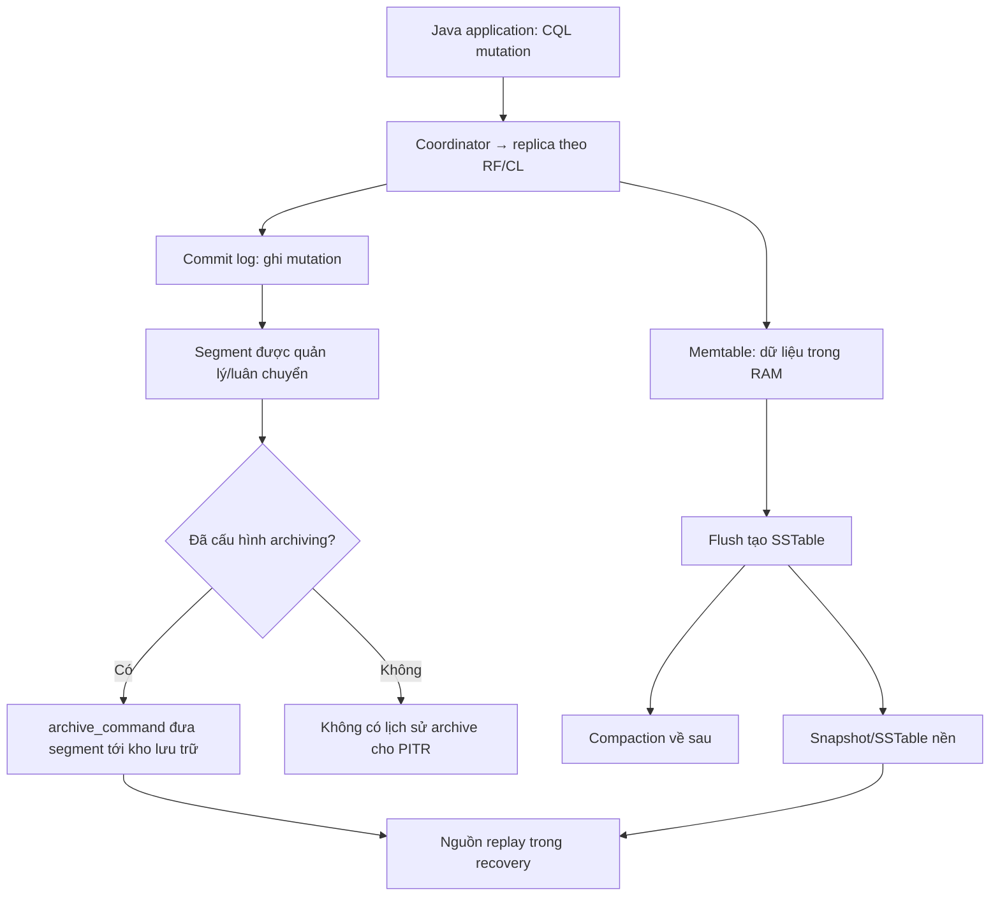
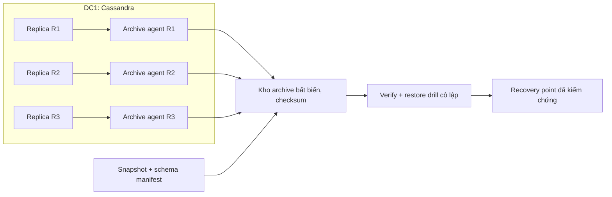

# Commit log archiving và phục hồi theo thời điểm khi được cấu hình trong Cassandra

## 1. Bài toán: cần quay dữ liệu về trước một thao tác sai

Apache Cassandra là cơ sở dữ liệu **wide-column phân tán**: dữ liệu được đặt theo **partition key**, nhân bản lên các replica theo **replication factor (RF)** và truy cập bằng CQL từ ứng dụng, chẳng hạn ứng dụng Java dùng `LOCAL_QUORUM`. Replication giúp chịu lỗi node, nhưng **không phải là lịch sử phiên bản để hoàn tác mọi thay đổi**.

Giả sử lúc 10:20 một tác vụ triển khai nhầm chạy `DELETE` trên nhiều đơn hàng. Đến 10:25, cả ba replica đã nhận tombstone. Việc tăng consistency level, chạy repair hoặc đợi replica khác **không thể tự đưa dữ liệu về trạng thái lúc 10:15**: các replica có thể đều nhất quán về một thay đổi sai.

Do đó doanh nghiệp có thể cần **point-in-time recovery (PITR)**: khôi phục một tập dữ liệu vào thời điểm cắt (*cutoff*) đã chọn, ví dụ ngay trước thay đổi nhầm. Trong Cassandra, một cơ chế phục vụ mục tiêu này khi được thiết kế và **cấu hình sẵn** là:

1. Có **snapshot/SSTable nền** đủ cũ, ở thời điểm trước điểm cần phục hồi.
2. Có **chuỗi commit log segment đã được archive** đủ để replay các mutation phát sinh từ nền tới điểm cắt.
3. Có **schema, topology, token/ownership và phiên bản tương thích**, cùng kế hoạch khôi phục từng node/replica.
4. Dùng cấu hình **commit log restoration** và kiểm chứng kết quả trong môi trường cô lập.

**Bài học cốt lõi:** Cassandra **không mặc định bảo đảm PITR** chỉ vì có commit log trên đĩa. Nếu chưa bật archiving hoặc đã thiếu segment, không thể giả định rằng một thời điểm trong quá khứ vẫn có thể khôi phục.

### Kết quả học tập

- Phân biệt commit log, memtable, SSTable, snapshot, incremental backup, repair và archiving.
- Hiểu các trường thường gặp trong `commitlog_archiving.properties` và ý nghĩa của cutoff.
- Biết tại sao phải kết hợp **base snapshot + commit logs đúng cửa sổ thời gian**.
- Thiết kế RPO/RTO, kiểm soát archive gaps, checksum, bảo mật và khả năng restore.
- Xây playbook PITR **trên cluster lab cô lập**, đồng thời hiểu giới hạn của khôi phục nhiều node/DC và ứng dụng Java.

## 2. Commit log tham gia đường ghi như thế nào?

Ở replica nhận mutation, Cassandra lưu thông tin cần thiết vào **commit log** và cập nhật **memtable**. Khi đủ replica xác nhận theo CL, coordinator có thể trả thành công cho ứng dụng. Việc ghi nhận bền vững chi tiết còn phụ thuộc **commit log sync policy** và cấu hình phiên bản, không phải mọi ACK đồng nghĩa fsync theo một cách duy nhất.

Memtable sau đó được **flush** thành SSTable bất biến; SSTable có thể tiếp tục được compaction. Commit log segment có thể được tái sử dụng/giải phóng theo những điều kiện an toàn khi dữ liệu liên quan đã được flush.



Sơ đồ là khái niệm. **Thời điểm segment được xét lưu trữ, quay vòng, giải phóng và các cơ chế kiểm tra lỗi phụ thuộc phiên bản Cassandra**. Không khẳng định một mutation vừa ACK sẽ ngay lập tức nằm trong bản archive bên ngoài.

### Tại sao commit log là nhật ký phục hồi, nhưng chưa phải backup?

Commit log cục bộ vốn có nhiệm vụ hỗ trợ **replay khi node khởi động lại sau sự cố**, nhất là những mutation chưa flush thành SSTable. Nó thường có chính sách quay vòng và thu hồi dung lượng để ổ đĩa không tăng vô hạn.

Nếu chỉ lưu commit log trong cùng volume của node:

- Mất ổ đĩa có thể làm mất cả SSTable và commit log.
- Segment cũ có thể đã được thu hồi sau khi không còn cần cho crash recovery.
- Không có **snapshot nền** thì replay một số segment riêng lẻ không thể tạo ra toàn bộ trạng thái của bảng.
- Không có schema và metadata tương thích thì không thể diễn giải dữ liệu đáng tin cậy.

**Archiving** bổ sung đường lưu giữ segment bên ngoài vòng đời log cục bộ, nhưng nó vẫn chỉ là **một thành phần** của hệ thống backup/restore.

## 3. Phân biệt các công cụ phục hồi

| Cơ chế | Bảo tồn điều gì? | Phục vụ mục tiêu | Không tự bảo đảm |
| --- | --- | --- | --- |
| **Replication** | Nhiều replica dữ liệu hiện tại | Chịu lỗi node/DC và đáp ứng CL | Quay lại trạng thái trước một `DELETE` đã replicate |
| **Commit log cục bộ** | Mutation phục vụ crash recovery của node | Replay sau process crash | Lịch sử vô hạn hoặc bản sao ngoài node |
| **Commit log archiving** | Bản archive của segment được giữ theo chính sách | Replay mutation trong khoảng đã giữ | PITR khi thiếu snapshot, segment hoặc cấu hình |
| **Snapshot** | Một tập SSTable được chốt bằng cơ chế snapshot | Base backup/khôi phục dữ liệu | Các mutation phát sinh sau snapshot |
| **Incremental backup** | Các SSTable mới được sao lưu theo tính năng đã bật | Giảm nhu cầu copy lại toàn bộ SSTable | Một dòng thời gian mutation chính xác thay commit log |
| **Anti-entropy repair** | Đối chiếu/sửa replica trong phạm vi repair | Đồng bộ bản sao đã lệch | Hoàn tác mutation nghiệp vụ sai |
| **Compaction** | Hợp nhất SSTable trên một replica | Điều chỉnh read/write/space amplification | Backup độc lập hoặc replica reconciliation |

Không dùng `nodetool flush`, `nodetool repair` hoặc `nodetool snapshot` như ba cách gọi khác nhau của “PITR”. Chúng có mục đích riêng và thường phải phối hợp với nhau trong một **kế hoạch dữ liệu hoàn chỉnh**.

## 4. Cấu hình commit log archiving là opt-in, không phải mặc định

Các bản Apache Cassandra có cơ chế quản trị này thường dùng file cấu hình **`commitlog_archiving.properties`** trong thư mục cấu hình của Cassandra. Những khóa thường gặp:

| Khóa | Mục đích | Điều cần xác minh |
| --- | --- | --- |
| `archive_command` | Chạy chương trình lưu bản sao commit log segment vào archive | Đường dẫn, quyền, placeholder, exit code, tính bền vững của bản copy |
| `restore_command` | Cách khôi phục một segment từ nguồn lưu trữ tới đích phục hồi | Tính toàn vẹn, quyền file, cùng phiên bản công cụ |
| `restore_directories` | Nơi tìm các segment đã chuẩn bị để restore | Đường dẫn, segment set, identity, đủ dung lượng |
| `restore_point_in_time` | Giới hạn thời điểm replay theo cơ chế được hỗ trợ | Format, timezone, clock skew, độ chính xác timestamp |
| `precision` | Độ chính xác timestamp mutation phục vụ replay/điểm cắt | Giá trị hỗ trợ và cách sinh timestamp trong ứng dụng |

Đây là các tên quen thuộc với cơ chế Cassandra commit log archiving; **kiểm tra tài liệu và file mẫu của phiên bản đang chạy** trước khi copy cấu hình. Một số thay đổi cần restart, quá trình archive/replay có thể có hành vi khác nhau, và phần mềm quản lý Cassandra có thể dùng quy trình riêng.

### Ví dụ cấu hình để đọc hiểu, không áp dụng trực tiếp lên production

```properties
# commitlog_archiving.properties -- ví dụ lab Unix
archive_command=/opt/cassandra-pitr/bin/archive-segment %path %name
restore_command=/opt/cassandra-pitr/bin/restore-segment %from %to
restore_directories=/srv/cassandra-pitr/replay
restore_point_in_time=2026:11:20 10:15:00
precision=MICROSECONDS
```

Trong ví dụ:

- `%path` biểu thị đường dẫn segment nguồn cho archive, `%name` là tên segment.
- `%from` và `%to` thường biểu thị nguồn và đích của một lần restore.
- `/opt/cassandra-pitr/bin/archive-segment` và `restore-segment` là **script giả định**, không có sẵn mặc định.
- `/srv/cassandra-pitr/replay` là thư mục chuẩn bị segment cho **node lab**.
- Thời điểm `2026:11:20 10:15:00` chỉ là ví dụ chọn cutoff; phải làm rõ timezone, format và độ chính xác theo phiên bản.

**Không bật `restore_command` và `restore_point_in_time` trên cluster production đang phục vụ rồi restart hàng loạt.** Cấu hình phục hồi chỉ được đưa vào quy trình restore có chủ đích, thường là môi trường cô lập.

### Vì sao cần script archive/restore riêng?

Lệnh ví dụ dạng `cp` chỉ phù hợp với những bài test đơn giản. Production cần kiểm soát:

1. **Atomic publish:** không công bố tên segment archive như đã hoàn tất khi file mới copy một phần.
2. **Checksum:** đối chiếu kích thước và checksum trước/sau chuyển.
3. **Retry có giới hạn:** thất bại tạm thời của storage không tạo vòng lặp vô tận hoặc xóa mất nguồn.
4. **Identity:** đường dẫn lưu giữ phân biệt cluster, DC, node/host ID, phiên bản và segment.
5. **Retention:** không xóa bản duy nhất trước khi thời hạn phục hồi và restore test cho phép.
6. **Bảo mật:** TLS/mã hóa khi lưu ngoài node, quyền truy cập tối thiểu, audit và khóa giải mã được quản lý.

Thành công của lệnh `archive_command` phải gắn với **archive thực sự tồn tại và đọc lại được**. “Lệnh shell trả code 0” không đủ nếu script chỉ đưa tác vụ sang background rồi thoát trước khi dữ liệu được lưu an toàn.

## 5. Vòng đời segment và khoảng trống archive

Một segment commit log có thể vẫn đang hoạt động trong khi có nhiều mutation mới. Bản archive thường được tạo theo **đơn vị segment** khi Cassandra xử lý vòng đời của chúng, thay vì lưu riêng từng mutation ngay khi ACK.

Điều này tạo khác biệt giữa:

- **Mutation đã được ACK ở local/quorum**.
- **Mutation đã được ghi trong commit log trên replica**.
- **Segment chứa mutation đã được archive thành công ra nơi độc lập**.
- **Archive đã được copy/replicate tới vùng lưu trữ chịu được thảm họa**.

Không đồng nhất bốn mốc trên. Một hỏng đĩa xảy ra giữa mốc hai và ba có thể làm mất cơ hội khôi phục mutation bằng **archive bên ngoài** dù request đã từng thành công.

### Minh họa thời gian

```text
10:00:00  Snapshot S0 đã lưu an toàn
10:03:00  Segment A archive thành công
10:07:00  Segment B archive thành công
10:12:00  Segment C vẫn đang mở / chưa archive
10:13:00  Ổ đĩa node gặp sự cố

Chỉ có S0 + A + B chắc chắn không bảo đảm khôi phục tới 10:12.
Khoảng còn thiếu phụ thuộc các mutation trong C và những nguồn phục hồi khác.
```

Đây là minh họa khái niệm, không phải một lịch quay vòng cố định của Cassandra. Khi chọn mục tiêu RPO, phải **đo độ trễ archive thực tế trên từng node** và tính tới việc node có thể mất cả storage trước khi segment cuối được đưa ra ngoài.

### Đừng biến yêu cầu RPO thành lệnh “flush thường xuyên”

`nodetool flush` có thể làm thay đổi vòng đời memtable/SSTable/commit log; nó **không phải lời cam kết archive mọi mutation ngay thời điểm được gọi**. Ép flush quá thường xuyên còn tạo nhiều SSTable, tăng compaction debt và I/O.

Muốn đạt RPO thấp phải thiết kế **tần suất snapshot, archiving, cơ chế lưu trữ, giám sát gap và khả năng khôi phục** theo đúng hành vi phiên bản; không chỉ tăng lịch gọi `flush`.

## 6. Snapshot nền phải trước cutoff và không chứa dữ liệu tương lai

Giả sử muốn khôi phục trạng thái trước thao tác xóa nhầm lúc 10:20, chọn cutoff `T=10:15`.

```mermaid
timeline
    title Minh họa một chuỗi khôi phục
    09:00 : Snapshot S0
    09:10 : Mutation M1 hợp lệ
    09:15 : Mutation M2 hợp lệ
    10:15 : Điểm cắt PITR
    10:20 : DELETE nhầm
    10:25 : Trạng thái cluster hiện tại
```

Một restore hợp lý cần **base snapshot S0 trước T**, sau đó replay mutation đã được archive cần thiết **đến T**, bỏ phần mutation sau T theo semantics cutoff của phiên bản.

Nếu lấy snapshot **10:25** làm nền cho cutoff **10:15**, snapshot đã có tombstone/dữ liệu mới sau thời điểm cần quay lại. **Commit log replay không phải công cụ đảo ngược SSTable đã chứa thay đổi tương lai**. Đặt cutoff sớm hơn không tự xóa những thứ đã nằm trong base SSTable.

Do đó:

- Không restore vào data directory đang chứa SSTable mới hơn cutoff rồi mong timestamp filter tự hoàn tác.
- Không trộn snapshot của những ngày khác nhau trên các node mà thiếu lý giải về tính nhất quán.
- Không coi incremental backup của SSTable tạo **sau cutoff** là vô hại nếu mục tiêu khôi phục đúng trạng thái cũ.
- Luôn lưu manifest của snapshot với thời gian, node, schema, keyspace/table, checksums và nguồn segment.

**Snapshot nền tốt là snapshot mà tập dữ liệu và ngữ cảnh schema/topology của nó có thể được phục dựng có kiểm chứng**; bản thân tên thư mục snapshot không bảo đảm điều này.

## 7. Phân biệt thời gian tường, timestamp mutation và thứ tự thực thi

Trong Cassandra, dữ liệu thường được hòa giải theo **timestamp của cell/mutation** và quy tắc tombstone. Timestamp có thể đến từ coordinator hoặc **được ứng dụng cung cấp**, ví dụ CQL `USING TIMESTAMP`.

Để PITR có ý nghĩa, phải hiểu sự khác nhau:

| Khái niệm | Ví dụ | Rủi ro nếu nhầm |
| --- | --- | --- |
| Wall-clock của API | Người dùng bấm nút lúc 10:14 | Không chứng minh mutation có timestamp 10:14 |
| Timestamp do Java/caller tạo | Caller truyền `USING TIMESTAMP` | Có thể ở quá khứ/tương lai so với lúc gửi |
| Thời gian coordinator/replica nhận | Replica xử lý sau network delay | Không đồng nhất với timestamp dữ liệu |
| Segment được archive | File được copy lúc 10:18 | Không có nghĩa mọi mutation trong đó xảy ra lúc 10:18 |
| `restore_point_in_time` | Ngưỡng replay theo cấu hình | Cần xác định độ chính xác/timezone và semantics bản Cassandra |

### Ví dụ nguy hiểm với timestamp tự đặt

```sql
-- Truy vấn ví dụ dùng timestamp CQL microsecond,
-- không phải mốc thời gian hệ thống hiện tại.
UPDATE pitr_lab.orders_by_id
USING TIMESTAMP 1795170000000000
SET status = 'PAID'
WHERE order_id = 11111111-1111-4111-8111-111111111111;
```

Giá trị timestamp chỉ dùng để minh họa cơ chế; không gán ý nghĩa lịch cụ thể nếu chưa chuyển đổi và đối chiếu timezone. Nếu timestamp do ứng dụng **đi trước clock thật**, việc chọn cutoff bằng giờ tường có thể cho kết quả khác với mong đợi.

**PITR bằng commit log replay không phải cơ sở để tuyên bố có snapshot transaction nhất quán toàn cluster tại một microsecond.** Một batch, LWT, counter và các thao tác qua nhiều partition/DC có thể có semantics riêng; phải kiểm chứng trên dữ liệu và loại mutation thực tế.

## 8. Chuẩn bị schema và metadata: commit log không đủ tái tạo cluster

Một lần restore cần biết nhiều hơn các byte của SSTable và commit log:

- **CQL schema:** keyspace, table, partition/clustering key, kiểu dữ liệu, UDT, index, TTL/defaults.
- **Replication/topology:** RF theo DC, snitch/DC/rack, tokens và replica placement.
- **Cluster/node identity:** host ID, data directory, commit log path, phiên bản SSTable/commit log.
- **Bảo mật:** roles, permissions, certificates và secrets theo quy trình backup riêng.
- **Vận hành:** compaction settings, GC grace, compression, JMX/driver endpoints và runbook.

Không mặc định tất cả metadata kể trên được khôi phục đúng bằng **replay commit log của bảng nghiệp vụ**. Cần backup schema và các cấu hình liên quan độc lập, kiểm tra tương thích trước khi bắt đầu replay.

### Rủi ro schema drift

```text
09:00  Snapshot có bảng orders_by_id(status text)
10:00  Deploy thay schema, đổi tên cột hoặc kiểu dữ liệu
10:15  Cutoff mong muốn
11:00  Recovery lên cluster mới với schema không tương thích

Kết quả: replay có thể lỗi hoặc cho dữ liệu không như mong đợi.
```

Runbook phải xác định **schema tại thời điểm snapshot và thời điểm cutoff**, cũng như quy trình quản lý DDL giữa hai mốc. Không “tự sửa schema cho chạy” trong lúc restore mà không ghi nhận những khác biệt đó.

## 9. Đặc thù nhiều replica và nhiều datacenter

Commit log là **nhật ký cục bộ từng node**, không phải một dòng log transaction toàn cluster. Trong một cluster RF3:

- R1, R2, R3 có thể nhận các mutation theo thời điểm khác nhau.
- Với `LOCAL_QUORUM`, một ghi có thể được ACK khi đủ replica địa phương trả lời; replica khác/DC khác vẫn có thể đang chậm.
- Nếu chỉ backup commit log của R1, nó không đại diện cho mọi partition hoặc mọi replica.
- Snapshot và archive từ các node phải được liên kết với **token ownership**, thời điểm, RF và topology.

Ví dụ hai DC có `RF(dc1)=3` và `RF(dc2)=3`. Ghi tại dc1 với `LOCAL_QUORUM` có thể thành công dù WAN sang dc2 đang gián đoạn. Khi muốn khôi phục vào 10:15, **không thể giả định bộ log ở dc2 có đầy đủ mutation đã ACK tại dc1 trước 10:15**.

### Phục hồi toàn cluster khác phục hồi một node

| Phạm vi | Mục tiêu | Khó khăn |
| --- | --- | --- |
| Một node mất đĩa | Khôi phục trách nhiệm replica của node | Identity/tokens, bootstrap/replacement, đồng bộ replica còn sống |
| Một bảng/keyspace | Khôi phục dữ liệu nghiệp vụ đã bị sửa/xóa nhầm | Snapshot đủ sớm, archive đầy đủ, schema và cách đưa dữ liệu trở lại |
| Một DC | Phục vụ lại vùng dữ liệu bị mất | WAN, RF, thứ tự mutation, băng thông streaming |
| Toàn cluster về T | Dựng trạng thái logic tại thời điểm cắt | Khó có điểm cắt nguyên tử qua mọi node; cần manifest và validation nghiêm ngặt |

Không tự kết luận “snapshot trên ba node cùng tên tag” là **atomic consistent snapshot toàn cluster**. Cassandra không cung cấp transaction xuyên mọi partition và mọi DC chỉ vì các snapshot được đặt cùng tên.

## 10. Kiến trúc lưu trữ archive và bảo vệ dữ liệu

Một pipeline PITR đáng tin cậy có thể tổ chức như sau:



Tùy nền tảng, archive có thể đi qua staging directory rồi chuyển lên object storage. **Đừng xóa bản local/source trước khi có xác nhận archive hoàn chỉnh theo chính sách**, nhưng cũng phải đặt giới hạn dung lượng staging để lỗi kho ngoài không làm đĩa commit log đầy.

### Gợi ý cấu trúc object key

```text
backup-root/
  cluster-id/
    dc1/
      host-id-r1/
        snapshots/2026-11-20T09-00-00Z/...
        commitlog/CommitLog-<version>-<segment-id>.log
        manifests/...
      host-id-r2/
        ...
    schema/
      schema-at-2026-11-20T09-00-00Z.cql
```

Đây là **quy ước tổ chức minh họa**, không phải cấu trúc mà Cassandra tạo tự động. Tên đối tượng phải chống trùng lặp và gắn đúng node; không gộp hai segment cùng tên từ những node khác nhau vào một key.

### Chính sách giữ và khôi phục

Lưu tối thiểu:

1. **Snapshot baseline** đủ thường xuyên so với RTO và chi phí replay.
2. **Segment archive liên tục** trong khoảng giữa các snapshot còn giữ.
3. **Manifest** liệt kê segment được mong đợi, checksum, thời gian, nguồn và kết quả copy.
4. **Bản sao ngoài miền lỗi** của cluster, tránh cùng storage/cùng region bị xóa đồng thời.
5. **Khóa giải mã và quyền truy cập** có khả năng phục hồi khi hệ thống chính gặp sự cố.
6. **Bằng chứng restore drill** đo RTO/RPO thực tế, không chỉ bằng chứng upload thành công.

Retention phải được tính ngược từ **điểm khôi phục cũ nhất mà doanh nghiệp cần**. Không giữ snapshot 30 ngày nhưng xóa hết commit log archive sau 2 ngày rồi hứa PITR tới ngày thứ 20.

## 11. RPO/RTO thực tế: giới hạn trước tiên nằm ở archive và replay

**RPO (recovery point objective)** là khoảng dữ liệu có thể bị mất được phép; **RTO (recovery time objective)** là thời gian dịch vụ cần phục hồi.

Giả sử:

```text
Snapshot S0:      09:00, đã kiểm tra checksum
Archive gần nhất: 10:10, đầy đủ tới một segment đã lưu
Sự cố:            10:16
Mục tiêu phục hồi:10:15
```

Nếu có mutation trong các segment chưa được lưu từ 10:10 tới 10:15, **không đủ dữ liệu để bảo đảm RPO = 1 phút**. Replay chỉ hoạt động với dữ liệu thực sự có; cấu hình `restore_point_in_time=...` không thể tái tạo mutation chưa archive.

RTO phụ thuộc:

- Thời gian tải về và kiểm tra snapshot + toàn bộ segment liên quan.
- Băng thông object storage/WAN và dung lượng SSTable.
- Số node cần dựng, token ownership và quá trình startup/replay.
- Thời gian kiểm tra schema/permission và CQL correctness.
- Công việc repair/streaming hoặc tái phân phối khi chuyển trạng thái.
- Việc đổi kết nối/traffic cho Java clients.

Ví dụ minh họa:

| Công việc | Ước lượng lab giả định |
| --- | ---: |
| Tải và kiểm tra snapshot | 45 phút |
| Chuẩn bị config/schema | 20 phút |
| Replay log và đưa node lên | 35 phút |
| Kiểm tra dữ liệu, routing ứng dụng | 25 phút |
| **Tổng tuần tự minh họa** | **125 phút** |

Không dùng 125 phút làm cam kết RTO cho production. Các bước có thể thực hiện song song hoặc bị kéo dài vì storage, version, missing segment, dữ liệu lớn và số lượng node.

## 12. Runbook PITR lab: lập kế hoạch trước khi đụng dữ liệu

**Chỉ thực hành trên cluster lab cô lập hoặc môi trường khôi phục được phê duyệt.** Một thao tác restore lên node production đang có dữ liệu mới hơn cutoff có thể gây mất dữ liệu hoặc trạng thái replica không hợp lệ.

### Giai đoạn A — Bảo vệ nguồn chứng cứ

1. Ghi **incident timeline**: thao tác sai bắt đầu khi nào, mốc T cần quay lại, API/tenant/keyspace nào bị ảnh hưởng.
2. Ngăn nguồn ghi nghiệp vụ sai **theo quy trình ứng dụng**, tránh để dữ liệu tiếp tục bị hỏng.
3. Bảo tồn snapshot và archived logs hiện có; **không xóa** segment để “giải phóng dung lượng” trước khi lập manifest.
4. Kiểm tra có snapshot từ **trước cutoff T** và đủ dải commit log từ nền tới T.
5. Xác định những ứng dụng khác có ghi đồng thời hợp lệ sau T: PITR toàn bảng có thể loại bỏ cả các thay đổi hợp lệ này.

Nếu sự cố chỉ là một số hàng bị sửa nhầm, đôi khi **khôi phục chọn lọc từ bản backup sang bảng/cluster khác rồi áp dụng lại bằng CQL có kiểm soát** an toàn hơn cố tua toàn cluster về T. PITR cấp cụm không tự phân biệt “mutation tốt” với “mutation xấu”.

### Giai đoạn B — Chuẩn bị môi trường cô lập

- Tạo cluster/VM lab với **phiên bản Cassandra, định dạng SSTable/commit log, topology, RF và schema tương thích** theo runbook.
- Đặt mạng tách khỏi ứng dụng production; không để ứng dụng thật vô tình gửi request tới cluster lab.
- Có đủ disk cho snapshot SSTable, restored segments, compaction/replay và logs.
- Có thông tin chính xác về **node identity, tokens, data directories, commit log directories**.
- Kiểm tra checksum, thứ tự và tính đầy đủ các archived segments trên từng node.
- Chỉ rõ **UTC**, múi giờ của timestamp cutoff và cách sinh timestamp trong Java/CQL.

**Không copy bừa file system tables/host identity từ một cluster sang cluster đang tồn tại**. Nếu cần tái tạo nguyên node/cluster, dùng quy trình backup/restore phù hợp phiên bản; nếu chỉ cần dữ liệu nghiệp vụ, cân nhắc dựng cluster tách biệt và nhập dữ liệu có kiểm soát.

### Giai đoạn C — Phục hồi snapshot nền

Khôi phục SSTable theo **đúng keyspace/table và data-directory layout** của phiên bản, dựa trên runbook snapshot restore. Với snapshot tạo bằng hard links, phải hiểu mối liên hệ file và đường dẫn khi copy ra kho lưu trữ.

Không tự trộn các SSTable từ node khác, thời điểm khác hoặc schema khác vào cùng table directory. Không đưa SSTable mới hơn cutoff vào baseline rồi mong commit log replay tự loại bỏ dữ liệu đó.

### Giai đoạn D — Chuẩn bị commit log replay và cutoff

Đưa đúng archived segments cho **node tương ứng** vào restore staging directory. Cấu hình `restore_command`, `restore_directories`, `restore_point_in_time` và `precision` theo **file mẫu của bản Cassandra** và mốc đã chọn.

```properties
# Ví dụ tham chiếu cho node lab được restore.
restore_command=/opt/cassandra-pitr/bin/restore-segment %from %to
restore_directories=/srv/cassandra-pitr/replay
restore_point_in_time=2026:11:20 10:15:00
precision=MICROSECONDS
```

Kiểm tra trên lab rằng:

1. File nguồn có thể đọc và được giải mã.
2. Script restore ghi đúng destination và xác minh checksum.
3. Cassandra tìm thấy segment hợp lệ, không có khoảng trống cần thiết.
4. Cutoff được diễn giải đúng **timezone và timestamp precision**.
5. Logs startup cho biết quá trình restore/replay hoàn thành theo semantics bản Cassandra.

**Đừng dùng timestamp của tên file hoặc thời điểm upload làm cutoff thay cho timestamp mutation.** Khi một mutation có timestamp do Java client tự cung cấp, chênh lệch clock phải được tính vào quy trình kiểm chứng.

### Giai đoạn E — Khởi động và xác minh từng giai đoạn

Khởi động các node theo trình tự mà runbook topology yêu cầu. Quan sát:

```bash
nodetool status
nodetool describecluster
nodetool netstats
nodetool tablestats pitr_lab.orders_by_id
nodetool tpstats
```

Lệnh `tablestats` chỉ hợp lệ khi schema/bảng lab đã được tạo và node đã khởi động; nếu chưa có bảng, hãy dùng bảng đang phục hồi. `nodetool status` thấy `UN` không chứng minh replay đã khôi phục **đúng trạng thái tại T**.

Sau khi cluster ổn định và có kết quả đọc phù hợp, kiểm chứng theo CQL, sau đó mới cân nhắc có đưa dữ liệu trở lại production hay không. Bước chuyển dữ liệu phải có playbook riêng cho **merge, conflict, write freeze, rollback và ứng dụng Java**; không trỏ production ngay vào cluster mới dựng chỉ vì startup không báo lỗi.

## 13. CQL lab: tạo timeline trước và sau cutoff

Ví dụ chỉ dành cho lab có DC `dc1` với đủ node cho RF3; trên lab một node hãy dùng RF/CL tương ứng hạ tầng thật. Đảm bảo archiving và snapshot đã được cấu hình/kiểm chứng **trước** khi tạo timeline.

### Tạo schema

```sql
CREATE KEYSPACE IF NOT EXISTS pitr_lab
WITH replication = {
    'class': 'NetworkTopologyStrategy',
    'dc1': 3
}
AND durable_writes = true;

CREATE TABLE IF NOT EXISTS pitr_lab.orders_by_id (
    order_id uuid PRIMARY KEY,
    customer_id text,
    status text,
    updated_at timestamp
);
```

### Ghi dữ liệu hợp lệ ban đầu

```sql
INSERT INTO pitr_lab.orders_by_id
    (order_id, customer_id, status, updated_at)
VALUES (
    11111111-1111-4111-8111-111111111111,
    'customer-42',
    'CREATED',
    '2026-11-20 09:00:00+0000'
);
```

Trong cqlsh ở DC phù hợp:

```text
CONSISTENCY LOCAL_QUORUM;
```

### Tạo snapshot nền có tên

Sau khi đã chốt trạng thái nền trong lab, có thể sử dụng:

```bash
nodetool help snapshot
nodetool snapshot -t before_pitr_lab pitr_lab
```

Lệnh snapshot theo phạm vi **node được hỏi**. Để có bản backup phù hợp cho nhiều replica, cần điều phối snapshot, manifest và sao chép theo kế hoạch trên những node cần thiết. **Snapshot có tên giống nhau trên nhiều node không tự trở thành một transaction snapshot toàn cluster.**

### Tạo mutation trước cutoff

```sql
UPDATE pitr_lab.orders_by_id
SET status = 'PAID',
    updated_at = '2026-11-20 10:10:00+0000'
WHERE order_id = 11111111-1111-4111-8111-111111111111;
```

Trong lab, muốn gắn mutation timestamp theo một timeline cố định phải kiểm soát đồng bộ clock/`USING TIMESTAMP` theo runbook. Cột `updated_at` ở đây là **dữ liệu nghiệp vụ**, không tự là timestamp của mutation trong commit log.

### Tạo thao tác sai sau cutoff

```sql
DELETE FROM pitr_lab.orders_by_id
WHERE order_id = 11111111-1111-4111-8111-111111111111;
```

Thứ tự thao tác đúng yêu cầu là: tạo snapshot trước, cập nhật hợp lệ, rồi xóa nhầm. Để kiểm thử **cutoff 10:15**, phải bảo đảm timestamp mutation `PAID` thực sự nằm **trước cutoff** và timestamp delete nằm **sau cutoff**; **không chỉ dựa vào giá trị cột `updated_at`**.

### Kỳ vọng khi khôi phục thành công

| Mốc thời gian | Trạng thái nghiệp vụ minh họa | Kết quả restore ở T=10:15 |
| --- | --- | --- |
| 09:00 | `CREATED` | Có trong snapshot S0 |
| 10:10 | `PAID` | Phải được replay từ archive đúng đoạn |
| 10:15 | Cutoff | Chốt trạng thái mong muốn |
| 10:20 | `DELETE` nhầm | Không được áp dụng trong trạng thái mục tiêu |

Kiểm tra:

```sql
SELECT order_id, customer_id, status, updated_at
FROM pitr_lab.orders_by_id
WHERE order_id = 11111111-1111-4111-8111-111111111111;
```

Kỳ vọng nghiệp vụ là `status = 'PAID'` và hàng vẫn tồn tại. Nếu thấy `CREATED`, có thể thiếu mutation archive trước T; nếu hàng vắng mặt, có thể snapshot/segment hoặc cutoff đã sai, hoặc dữ liệu tương lai đã nằm trong baseline. Phải điều tra **theo log và manifest**, không chẩn đoán chỉ từ một câu SELECT.

## 14. Kiểm chứng không chỉ bằng một partition

PITR được coi là có giá trị khi test cho thấy **tập dữ liệu** khôi phục có giới hạn rõ ràng và đúng theo mục tiêu. Nên kiểm chứng:

| Mẫu dữ liệu | Cần kiểm tra |
| --- | --- |
| Hàng tạo trước snapshot | Không bị mất khi load baseline |
| Hàng tạo sau snapshot, trước cutoff | Có nếu commit log archive chứa mutation |
| Hàng tạo sau cutoff | Không xuất hiện trong trạng thái mục tiêu |
| UPDATE trước cutoff | Giá trị mới được áp dụng |
| UPDATE/DELETE sau cutoff | Không làm thay đổi trạng thái mục tiêu |
| TTL và tombstone | Không có dữ liệu xóa hồi sinh ngoài mong đợi |
| Nhiều partition/tenant | Coverage không chỉ một khóa test |
| Nhiều replica/DC | Kết quả và CL phù hợp topology đã restore |
| LWT/counter/batch | Có test riêng theo semantics, không suy luận từ upsert |

Nếu khôi phục trên một cluster mới, dữ liệu có thể **đúng về logic theo test** nhưng vẫn cần bảo đảm replica coverage, network, auth và performance trước khi tiếp nhận production traffic.

### Tránh sửa kết quả test bằng cách ép sửa dữ liệu

Nếu kết quả sai cutoff, không vội chạy `UPDATE`/`DELETE` thủ công trên cluster restore rồi kết luận PITR thành công. Điều đó che giấu lỗi archive/replay. Phải **lập lại restore từ baseline sạch**, sửa nguyên nhân (segment, schema, timestamp, version hoặc topology) và chạy lại test.

## 15. Java Driver 4.x: giúp xác minh trạng thái sau restore

Ứng dụng Java có thể dùng prepared statement để đọc theo partition key ở CL phù hợp. Ví dụ repository kiểm tra dữ liệu hồi phục:

```java
import java.net.InetSocketAddress;
import java.util.Optional;
import java.util.UUID;

import com.datastax.oss.driver.api.core.CqlSession;
import com.datastax.oss.driver.api.core.DefaultConsistencyLevel;
import com.datastax.oss.driver.api.core.cql.BoundStatement;
import com.datastax.oss.driver.api.core.cql.PreparedStatement;
import com.datastax.oss.driver.api.core.cql.Row;

public final class RestoredOrderVerifier {
    private final CqlSession session;
    private final PreparedStatement getStatus;

    public RestoredOrderVerifier(CqlSession session) {
        this.session = session;
        this.getStatus = session.prepare(
            "SELECT status FROM pitr_lab.orders_by_id WHERE order_id = ?"
        );
    }

    public Optional<String> findStatus(UUID orderId) {
        BoundStatement stmt = getStatus.bind(orderId)
            .setConsistencyLevel(DefaultConsistencyLevel.LOCAL_QUORUM)
            .setIdempotent(true);
        Row row = session.execute(stmt).one();
        return row == null || row.isNull("status")
            ? Optional.empty()
            : Optional.of(row.getString("status"));
    }

    public static CqlSession openRecoveryLab() {
        return CqlSession.builder()
            .addContactPoint(new InetSocketAddress("10.20.0.11", 9042))
            .withLocalDatacenter("dc1")
            .build();
    }
}
```

Địa chỉ `10.20.0.11` và tên DC chỉ minh họa. Production cần TLS, auth, nhiều contact points, connection management và xác định đúng local DC. **Không dùng thông tin truy cập production trên lab không được bảo vệ.**

### Truy vấn sau restore không phải bằng chứng PITR toàn diện

Khi `findStatus` trả `PAID`:

- Nó chứng minh **một truy vấn** đọc được giá trị đó theo CL tại thời điểm kiểm tra.
- Không chứng minh mọi partition/replica đã được restore đúng.
- Không chứng minh `DELETE` sau cutoff đã bị lọc chính xác nếu còn dữ liệu cũ trong baseline.
- Không chứng minh RPO/RTO hay khả năng phục hồi trong lần sự cố tiếp theo.

Nên bổ sung kiểm tra nhiều ID mẫu, các trạng thái null/missing/deleted, timestamps, số hàng, tổng hợp theo nghiệp vụ, metrics p95/p99 và kết quả repair/consistency check theo runbook.

## 16. Những sai lầm nguy hiểm thường gặp

| Sai lầm | Vì sao sai? | Cách phòng tránh |
| --- | --- | --- |
| “Commit log local đã đủ để PITR” | Segment có vòng đời ngắn và cùng miền lỗi với node | Archiving ngoài node, snapshot, retention và restore drill |
| “Bật archiving hôm nay khôi phục được tuần trước” | Những segment cũ có thể không tồn tại | Không hứa phục hồi trước khi đủ nguồn dữ liệu |
| “Snapshot mới nhất luôn tốt nhất” | Có thể đã chứa DELETE/UPDATE sai sau cutoff | Chọn baseline trước T và không trộn SSTable tương lai |
| “Thêm restore_point_in_time là tự hoàn tác dữ liệu” | Chỉ giới hạn replay được hỗ trợ, không đảo ngược SSTable | Chuẩn bị snapshot sạch, đúng logs/schema |
| “File archive tồn tại nghĩa nội dung hợp lệ” | Có thể copy chưa xong hoặc bị hỏng | Atomic publish, size/checksum và restore validation |
| “Một node có log đầy đủ cho mọi dữ liệu” | Commit log là local, dữ liệu theo replica/token range | Thiết kế per-node manifests và coverage |
| “LOCAL_QUORUM bảo đảm hai DC cùng trạng thái” | Quorum local không chờ DC khác ACK | Hiểu replication/WAN và kiểm thử multi-DC |
| “updated_at tự quyết định cutoff” | Cột nghiệp vụ khác timestamp mutation | Kiểm tra `USING TIMESTAMP`, clock và precision |
| “Replay log cũng replay mọi DDL/role” | Metadata/schema cần backup riêng | Quản lý schema, config và quyền riêng |
| “Repair có thể quay ngược DELETE nhầm” | Repair hội tụ replica, không hoàn tác thay đổi đã lan | Dùng backup/PITR hoặc selective recovery |
| “Có ba replica thì không cần backup” | Lỗi nghiệp vụ và ransomware có thể ảnh hưởng cả ba | Backup độc lập, phân quyền và immutable retention |
| “Restore test thành công nếu node UN” | Membership không đồng nghĩa dữ liệu đúng ở cutoff | CQL validation, checksums, sample và RPO/RTO |

## 17. Bài tập tình huống

### Tình huống A — Archive thiếu đoạn cuối

Snapshot được tạo lúc 09:00, archive có đủ segment đến 10:10, dữ liệu bị xóa nhầm lúc 10:20. Doanh nghiệp muốn trạng thái 10:19. Có thể khẳng định PITR sẽ đáp ứng không?

**Gợi ý:** Không. Có thể thiếu mutation từ 10:10 tới 10:19 nếu chúng nằm trong segment chưa archive. Cần kiểm tra tập segment và những nguồn dữ liệu khác; nếu thiếu, phải báo giới hạn RPO thay vì cam kết quá mức.

### Tình huống B — Snapshot tạo sau DELETE nhầm

Có snapshot 10:25, DELETE sai lúc 10:20, còn archive từ 10:00 đến 10:30. Đặt cutoff 10:15 có đủ không?

**Gợi ý:** Không. Snapshot 10:25 đã có thay đổi tương lai. Replay có cutoff không phải công cụ xóa tombstone đã nằm trong SSTable nền. Phải tìm snapshot cũ hơn hoặc phương án khôi phục dữ liệu chọn lọc khác.

### Tình huống C — Java ghi với timestamp tương lai

Một ứng dụng gửi mutation lúc 10:05 nhưng đặt `USING TIMESTAMP` tương ứng 11:00. Team chọn cutoff 10:15 theo wall-clock. Có thể mutation này không xuất hiện sau restore không?

**Gợi ý:** Có rủi ro vì timestamp mutation khác thời gian gửi. Cần đánh giá semantics cutoff và precision của bản Cassandra, kiểm tra clock/timestamp policy và test cụ thể.

### Tình huống D — Hai DC mất WAN

`dc1` và `dc2` đều RF3. Java tại dc1 ghi `LOCAL_QUORUM` thành công trong lúc WAN đứt; kho archive dc2 không thấy mutation. Có thể dùng duy nhất snapshot+logs dc2 làm “bản chuẩn” toàn cluster lúc đó?

**Gợi ý:** Không. CL địa phương không chứng minh dc2 đã nhận mutation. Phải xem nguồn dữ liệu tại từng DC, archive/manifest và chọn chính sách khôi phục nhất quán với yêu cầu nghiệp vụ.

### Tình huống E — REST API sau khôi phục vẫn trả sai

Cluster lab replay thành công, CQL theo partition key trả `PAID`, nhưng API Java lại báo `NOT_FOUND`. Nên kiểm tra gì?

**Gợi ý:** Kiểm tra API đang kết nối đúng cluster/DC/keyspace chưa, cache, routing, CL, query/schema, điều kiện nghiệp vụ và timestamp, thay vì khẳng định lỗi PITR chỉ từ một API response.

### Tình huống F — Storage archive hết dung lượng

Script `archive_command` đưa file vào staging trên chính volume commit log rồi upload bất đồng bộ, nhưng object storage mất kết nối và staging đầy. Script vẫn báo thành công. Điều gì nguy hiểm?

**Gợi ý:** Bản archive bền vững chưa tồn tại dù hệ thống có thể nghĩ việc đã xong; RPO có thể mất bảo đảm và disk pressure tăng. Cần kiểm soát exit code, durable acknowledgment, staging headroom, báo động và chính sách dừng/điều tiết.

## 18. Checklist vận hành commit log archiving và PITR

**Trước khi tuyên bố có khả năng PITR**

- [ ] Đã bật và kiểm chứng `archive_command` trên **tất cả node cần thiết**, không chỉ một node.
- [ ] Có snapshot nền, schema/config manifest và chuỗi archive khớp node/token/phiên bản.
- [ ] Archive copy theo cơ chế atomic/durable; checksum và kiểm tra đọc lại thành công.
- [ ] Kho lưu trữ tách khỏi miền lỗi chính; có mã hóa, phân quyền, retention và bản sao ngoài vùng.
- [ ] Giám sát archive lag, thiếu segment, lỗi script, staging disk, archive age và khả năng đọc object.
- [ ] Mục tiêu RPO được tính theo **dữ liệu có thể replay thực sự**, không chỉ từ SLA lưu trữ.
- [ ] Mục tiêu RTO được đo bằng restore drill với dữ liệu gần quy mô production.

**Khi thực hiện phục hồi**

- [ ] Xác định chính xác phạm vi dữ liệu sai, thời điểm cutoff, timezone và timestamp policy.
- [ ] Chọn base snapshot **trước cutoff**, không chứa dữ liệu tương lai.
- [ ] Xác minh liên tục/có đủ archived segments cần thiết và checksum từng node.
- [ ] Khôi phục trong **môi trường cô lập**, với schema, RF, DC, tokens và version được kiểm soát.
- [ ] Xác minh `restore_command`, `restore_directories`, `restore_point_in_time`, `precision` theo phiên bản.
- [ ] Không khởi động lại production với tùy chọn PITR hoặc trộn SSTable từ nhiều thời điểm vô kế hoạch.
- [ ] Ghi rõ những mutation hợp lệ sau cutoff cũng có thể bị loại bỏ khi quay về T.
- [ ] Kiểm thử read, write và những dữ liệu TTL/delete/LWT/counter theo phạm vi thực tế.
- [ ] Dùng CQL/Java đối chiếu nhiều partition và ứng dụng; xác minh RPO, RTO, p95/p99.
- [ ] Chỉ chuyển dữ liệu/traffic khi có kế hoạch merge, rollback và kiểm tra replica consistency.

**Ghi nhớ:** Commit log archiving của Cassandra, **khi được cấu hình và vận hành đúng**, giữ lại các segment có thể dùng để replay mutation sau một **snapshot nền phù hợp**. Phục hồi theo thời điểm không phải nút “undo”: nó đòi đủ segment, timestamp/cutoff đúng, schema/topology tương thích và kiểm chứng **theo từng node, từng replica và nghiệp vụ**. Replication và repair không thay thế backup; bản archive chưa được test restore cũng chưa phải một cam kết RPO/RTO đáng tin cậy.
