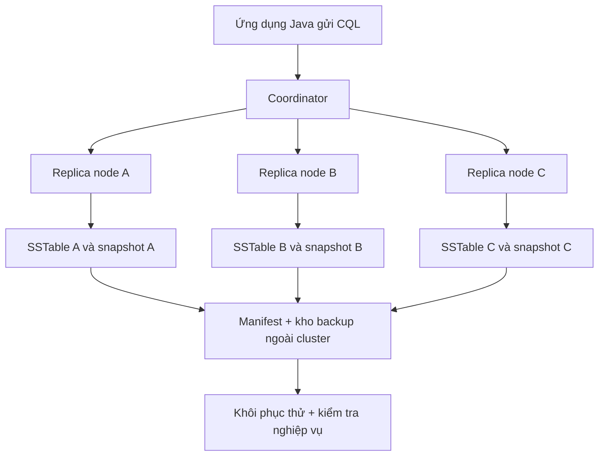
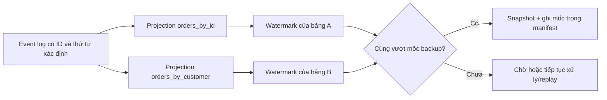

# Tính nhất quán bản sao ở cấp bảng, nhiều bảng và toàn cụm trong Apache Cassandra

## 1. Vấn đề: backup đầy đủ tệp chưa chắc khôi phục được trạng thái nghiệp vụ đúng

Apache Cassandra là cơ sở dữ liệu phân tán **wide-column**, phân chia dữ liệu theo **partition key**, nhân bản lên các node theo replication factor (RF) và tối ưu bảng dựa trên truy vấn. Module `DATABASE_ENGINE_WIDE_COLUMN_CASSANDRA` cũng đặt trọng tâm vào CQL, mức nhất quán đọc/ghi, compaction, repair, xử lý lỗi và tích hợp với ứng dụng Java. Tất cả những yếu tố đó ảnh hưởng trực tiếp đến **tính nhất quán của dữ liệu khi sao lưu và phục hồi**.

Xét dịch vụ đặt hàng có hai bảng phục vụ những truy vấn khác nhau:

- `orders_by_id` giúp tìm trạng thái đơn hàng theo `order_id`.
- `orders_by_customer` giúp liệt kê đơn hàng theo `customer_id`.

Ứng dụng cập nhật đơn hàng từ `CREATED` sang `PAID`, rồi cập nhật bảng liệt kê. Một snapshot có thể ghi nhận `PAID` trong bảng đầu tiên nhưng vẫn ghi nhận `CREATED` ở bảng thứ hai. Cả hai tệp snapshot đều hợp lệ về mặt định dạng; **bộ dữ liệu sau restore lại mâu thuẫn về nghiệp vụ**.

Câu hỏi của bài không chỉ là “có chạy `nodetool snapshot` thành công không?”, mà là:

1. **Cấp bảng:** các hàng, partition và replica có phản ánh một trạng thái có thể phục hồi đúng không?
2. **Cấp nhiều bảng:** những bảng biểu diễn cùng một thực thể có thuộc cùng một mốc thay đổi nghiệp vụ không?
3. **Cấp toàn cụm:** các snapshot lấy trên nhiều node, token range và datacenter có tạo thành một tập backup đầy đủ, tương thích và có thể khôi phục không?

**Mục tiêu học tập:** xác định hợp đồng nhất quán của backup, hiểu giới hạn snapshot của Cassandra, lựa chọn cách điều phối khi đang có ghi, lập manifest đa node/đa bảng, thiết kế kiểm chứng và xử lý các kịch bản thất bại.

## 2. Năm thuộc tính phải tách biệt

Từ “nhất quán” dễ gây nhầm lẫn khi dùng chung cho truy vấn và backup.

| Thuộc tính | Câu hỏi cần trả lời | Cách kiểm chứng |
| --- | --- | --- |
| **Toàn vẹn vật lý** | Các thành phần SSTable, manifest và metadata có đủ, đọc được không? | Đối chiếu file count, checksum, thử đọc/restore SSTable |
| **Đầy đủ phạm vi** | Có đủ keyspace, bảng, node, DC và token range cần thiết không? | Inventory theo node/DC/table, topology ở thời điểm backup |
| **Hội tụ replica** | Các replica của một partition đã nhận những mutation cần có chưa? | Kiểm tình trạng replica, repair/đối soát theo quy trình; kiểm thử đọc |
| **Nhất quán logic** | Các bảng có cùng phản ánh một quyết định nghiệp vụ đã hoàn thành không? | Ràng buộc nghiệp vụ, event ID/version, kiểm tra chéo bảng |
| **Nhất quán theo thời điểm** | Bộ khôi phục phản ánh cùng một ranh giới thay đổi có chủ đích không? | Mốc dừng/điều phối ghi, barrier, watermark và lịch sử replay |

Ngoài ra cần đo **RPO** (mức mất dữ liệu có thể chấp nhận theo thời gian) và **RTO** (thời gian cần để phục hồi dịch vụ). Snapshot mỗi giờ có thể là một điểm khởi đầu cho chính sách RPO, nhưng RPO thực tế còn phụ thuộc lần backup cuối cùng đã **xuất khỏi cluster, được xác thực và có thể restore**.

### Nhất quán truy vấn không phải nhất quán bản sao lưu

Cassandra cho phép chọn consistency level riêng cho read/write. Với `RF = 3` trong cùng một DC, `QUORUM` cần hai replica phản hồi, và `LOCAL_QUORUM` xét đa số replica của DC cục bộ. Trong phạm vi replica tương ứng, công thức `R + W > RF` giúp tập replica đọc và ghi giao nhau khi không có tình huống bất thường.

Tuy nhiên:

- Write ở `LOCAL_QUORUM` không có nghĩa **mọi replica** đã nhận mutation trước khi API trả thành công.
- Hai DC cùng đọc ở `LOCAL_QUORUM` có thể thấy dữ liệu khác nhau khi replication liên DC chưa kịp.
- Quorum không tạo giao dịch ACID xuyên nhiều partition hay nhiều bảng.
- LWT với `IF` xử lý cạnh tranh có điều kiện trong phạm vi áp dụng, **không** tạo snapshot nguyên tử cho toàn keyspace.
- Chạy snapshot trên các node vào những thời điểm khác nhau không được biến thành “một thời điểm chung” bằng cách chọn CL cao hơn.

Vì vậy cần lập **hợp đồng backup** riêng với hợp đồng truy vấn CQL.

## 3. Cassandra snapshot thực chất chụp những gì?

Cassandra ghi mutation vào commit log và memtable, sau đó flush thành SSTable bất biến. `nodetool snapshot` tạo **hard link tới SSTable** trong thư mục snapshot của **node đang chạy lệnh**; thông thường lệnh sẽ flush trước khi chụp để đưa dữ liệu còn ở memtable vào SSTable, nhưng hành vi/tùy chọn cần được kiểm tra theo phiên bản.



Snapshot giữ lại các **tệp** có trên node tại thời điểm chụp. Nó không tự làm các việc sau:

- Khóa mọi ghi đang diễn ra trong cluster.
- Chờ tất cả replica nhận đủ mọi mutation đã xác nhận trước đó.
- Chụp nguyên tử nhiều bảng, nhiều node hoặc nhiều DC.
- Sao chép snapshot sang nơi lưu trữ nằm ngoài node/cluster.
- Đảm bảo schema và topology ở thời điểm restore tương thích.
- Kiểm chứng rằng dữ liệu khôi phục thỏa quy tắc nghiệp vụ.

Do snapshot dùng hard link, dung lượng không tăng ngay bằng tổng kích thước SSTable, nhưng các SSTable cũ vẫn bị giữ khi compaction thay thế chúng. Việc dọn bằng `nodetool clearsnapshot` có thể giải phóng dung lượng hoặc không, tùy tệp còn được dữ liệu sống/snapshot khác tham chiếu hay không. **Compaction không phải backup; repair cũng không phải backup.**

## 4. Cấp bảng: tính nhất quán của một bảng có nhiều partition

Giả sử một bảng tra cứu theo khóa:

```sql
CREATE KEYSPACE IF NOT EXISTS commerce
WITH replication = {
  'class': 'NetworkTopologyStrategy',
  'dc1': 3,
  'dc2': 3
};

CREATE TABLE IF NOT EXISTS commerce.orders_by_id (
  order_id uuid PRIMARY KEY,
  customer_id uuid,
  status text,
  version bigint,
  updated_at timestamp
);
```

Đây là bảng được thiết kế theo truy vấn `WHERE order_id = ?`. Mỗi `order_id` xác định một partition, nhưng **cả bảng có nhiều partition** và được phân bố trên nhiều node. Một snapshot trên một node chỉ chứa những SSTable node đó quản lý; không có nghĩa nó chứa toàn bộ bảng.

### 4.1. Một snapshot cục bộ không phải mốc giao dịch của cả bảng

Xét hai partition khác nhau, A và B:

| Thời điểm | Sự kiện | Node X | Node Y |
| --- | --- | --- | --- |
| `t0` | A có `status=CREATED`; B có `status=CREATED` | Chưa có mutation mới | Chưa có mutation mới |
| `t1` | Ghi A thành `PAID` và nhận xác nhận quorum | Có thể đã có A mới | Có thể vẫn còn A cũ |
| `t2` | Snapshot trên node X | Chụp SSTable tại X | Chưa chụp |
| `t3` | Ghi B thành `PAID` | Có thể nhận B mới | Có thể nhận B mới |
| `t4` | Snapshot trên node Y | Đã snapshot trước đó | Chụp SSTable tại Y |

Cả snapshot X và Y đều hợp lệ, nhưng bộ dữ liệu được thu thập **không có một ranh giới thời gian chung**. Nếu quy trình restore kết hợp chúng, người vận hành phải hiểu mutation nào đã hiện diện trên từng replica và sẽ được Cassandra hòa giải bằng timestamp ra sao. Không thể suy ra ảnh chụp `t2` hoặc `t4` cho toàn bộ bảng.

Ngay cả trên một node, snapshot có thể bao gồm nhiều partition được cập nhật ở các thời điểm khác nhau. “Toàn vẹn tệp SSTable” khác với “mọi hàng cùng thuộc một giao dịch toàn bảng”.

### 4.2. Cách nâng độ tin cậy ở cấp bảng

Khi cần backup bảng để có thể khôi phục trạng thái đã được ứng dụng xác nhận:

1. **Xác định phạm vi partition:** bảng nào, toàn bộ token range hay chỉ tập khóa có thể tái tạo.
2. **Chốt ranh giới ghi:** nếu cần snapshot ổn định, dừng nhận ghi mới và chờ các ghi đang xử lý hoàn tất; bao gồm retry, message consumer và background writer.
3. **Xác nhận trạng thái replica:** một write quorum đã xác nhận chưa nhất thiết hiện diện ở mọi replica. Kiểm tra node, hinted handoff và lịch repair; nếu yêu cầu các bản sao hoàn toàn hội tụ, cần có quy trình đối soát/repair được lên kế hoạch, không chỉ một lệnh flush.
4. **Snapshot mọi node cần thiết** với cùng tag, rồi kiểm kê từng node theo keyspace/table.
5. **Sao chép và kiểm chứng tệp** từ từng nguồn sang kho backup độc lập.
6. **Restore thử** vào môi trường riêng và truy vấn các partition mẫu có version/status đã biết.

Một **bảng** không phải đơn vị transaction tổng quát của Cassandra. Một số mutation hay batch cùng partition có tính nguyên tử theo giới hạn mô hình Cassandra, nhưng không được suy rộng thành ảnh chụp nguyên tử trên mọi partition.

### 4.3. TTL, tombstone và timestamp sau restore

Khôi phục có thể cho kết quả khác kỳ vọng dù tệp không hỏng:

- **TTL** gắn với thời điểm dữ liệu được ghi. Restore bản cũ không tự kéo dài tuổi thọ; dữ liệu có thể đã hết hạn theo đồng hồ thời gian thực.
- **Tombstone** đánh dấu xóa. Khôi phục snapshot cũ cùng dữ liệu đang chạy có thể làm giá trị đã xóa xuất hiện lại trong một số trường hợp nếu tombstone tương ứng không còn hoặc phạm vi dữ liệu không được quản lý đúng.
- **Timestamp / last-write-wins** quyết định cách Cassandra hòa giải cell cạnh tranh. Trộn SSTable cũ và mới không bảo đảm “giữ lại cái đúng về nghiệp vụ”.
- **gc_grace_seconds** và repair ảnh hưởng đến việc tombstone còn có thể che dữ liệu cũ trên replica hay không. Backup/restore phải xét retention và lịch sửa lệch replica.

Cách kiểm chứng an toàn là dựng bản khôi phục **cô lập**, giữ schema và dữ liệu theo kế hoạch rõ ràng rồi thử truy vấn; không tự đổ SSTable cũ vào cluster production đang ghi để “bù” dữ liệu.

## 5. Cấp nhiều bảng: denormalization tạo ra bài toán nhất quán nghiệp vụ

Cassandra khuyến khích tạo bảng theo từng mẫu truy vấn. Cùng một sự kiện có thể cập nhật nhiều bảng:

```sql
CREATE TABLE IF NOT EXISTS commerce.orders_by_customer (
  customer_id uuid,
  order_id uuid,
  status text,
  version bigint,
  PRIMARY KEY ((customer_id), order_id)
);
```

Ứng dụng Java khi chuyển trạng thái đơn hàng có thể thực hiện:

```text
1. UPDATE commerce.orders_by_id        SET status='PAID', version=2 ...
2. UPDATE commerce.orders_by_customer  SET status='PAID', version=2 ...
3. Xác nhận hoàn tất nghiệp vụ cho người dùng.
```

Nếu snapshot bảng thứ nhất xảy ra **sau bước 1** nhưng snapshot bảng thứ hai xảy ra **trước bước 2**, sau restore chúng mâu thuẫn. Nếu dữ liệu có thêm bảng báo cáo, materialized view hoặc bảng tra cứu khác, số trường hợp sai lệch tăng.

### 5.1. Vì sao dùng BATCH vẫn chưa đủ?

CQL `BATCH` nhóm các mutation; logged batch hỗ trợ cơ chế hoàn tất mutation khi có lỗi trong quá trình thực hiện. Nhưng **batch không mang nghĩa giao dịch cô lập xuyên nhiều partition như trong RDBMS**, và không biến snapshot nhiều bảng đang thực hiện trên các node thành một ảnh chụp toàn cục nguyên tử.

Đặc biệt, với các bảng có partition key khác nhau, một reader hay quá trình snapshot có thể quan sát trạng thái trung gian. Cần mô hình hóa **ranh giới “đã hoàn tất một thay đổi nghiệp vụ”** bằng cơ chế của ứng dụng và quy trình khôi phục.

### 5.2. Ba chiến lược cho nhiều bảng

| Chiến lược | Cách thực hiện | Điểm mạnh | Đánh đổi / điều kiện |
| --- | --- | --- | --- |
| **Điều phối tạm dừng ghi (quiesce)** | Chặn writer trên mọi instance, đợi tác vụ đang chạy kết thúc, kiểm chứng, chụp tất cả bảng liên quan | Dễ hiểu khi có cửa sổ bảo trì | Ảnh hưởng availability; còn phải xử lý replica trễ và node lỗi |
| **Nguồn sự thật + bảng có thể dựng lại** | Lưu trạng thái chuẩn hoặc event log có ID/version, coi bảng truy vấn là projection | Sau restore có thể rebuild/đối soát bảng phụ | Chi phí rebuild, replay; log và thứ tự phải đủ tin cậy |
| **Mốc xử lý / watermark** | Ghi nhận mốc event đã xử lý xong cho từng projection, backup kèm metadata mốc | Giảm nhu cầu dừng mọi ghi lâu | Phải chứng minh không bỏ sót/đảo thứ tự, có replay idempotent và điều phối nhiều consumer |

Không có một chiến lược phù hợp mọi ứng dụng. Nếu nghiệp vụ yêu cầu giao dịch nguyên tử giữa nhiều tài khoản/partition thì chỉ đổi consistency level hoặc thêm snapshot không đáp ứng. Có thể cần hệ lưu trữ transactional làm nguồn sự thật, trong khi Cassandra phục vụ tra cứu.

### 5.3. Ví dụ dùng version và watermark

Giả sử sự kiện có cấu trúc:

```json
{
  "event_id": "evt-1042",
  "order_id": "11111111-1111-1111-1111-111111111111",
  "version": 2,
  "new_status": "PAID",
  "source_sequence": 1042
}
```

Hai projector cập nhật hai bảng theo truy vấn. Quy trình backup muốn tuyên bố trạng thái **đến event 1042** thì phải xác nhận **cả hai projector** đã xử lý đầy đủ những sự kiện cần thiết **đến cùng một mốc**, theo quy tắc thứ tự của hệ thống. Một con số `1042` chỉ có ý nghĩa nếu nguồn event thực sự cấp thứ tự đầy đủ cho phạm vi liên quan; trong hệ thống partitioned log thường cần **offset theo từng partition**, không thể áp một offset toàn cục tùy tiện.



Sau restore, đối chiếu `order_id` và `version` giữa các bảng, sau đó replay những sự kiện chưa được phản ánh. **Version field một mình không tạo transaction;** nó giúp phát hiện và sửa sai lệch khi hệ thống có cơ chế idempotency, xác nhận hoàn thành và nguồn sự thật rõ ràng.

## 6. Cấp toàn cụm: nhiều node, nhiều datacenter, nhiều phiên bản dữ liệu

Mô hình ví dụ:

- `dc1`: node `a1`, `a2`, `a3`; RF của keyspace bằng 3.
- `dc2`: node `b1`, `b2`, `b3`; RF cũng bằng 3.
- Ứng dụng ghi chủ yếu tại `dc1`, đọc ở cả hai DC.
- Snapshot tag chung: `commerce-20261121T020000Z`.

Một lệnh `nodetool snapshot` chạy trên `a1` chỉ tạo snapshot ở `a1`. Muốn một bộ backup có phạm vi toàn cluster, cần **inventory các node và các keyspace/table liên quan ở cả hai DC**, cùng quy trình upload và xác thực rõ ràng.

### 6.1. Thế nào là “đầy đủ toàn cụm”?

Thông thường, manifest của một đợt backup phải ghi:

| Nhóm thông tin | Những trường nên có |
| --- | --- |
| Định danh | `backup_id`, cluster/environment, tag, thời gian bắt đầu/kết thúc UTC |
| Topology | DC, rack, node, trạng thái node, phạm vi token range, RF từng keyspace |
| Schema | Keyspace/table DDL, table ID, indexes/view liên quan, phiên bản Cassandra/SSTable |
| Phạm vi | Bảng cần backup, bảng loại trừ, node phải tham gia, lý do loại trừ |
| Kết quả theo node | Snapshot tạo thành công/chưa tạo/lỗi, đường dẫn, số tệp |
| Tệp và kho lưu trữ | Manifest SSTable, checksum, byte size, remote URI, trạng thái upload |
| Ranh giới dữ liệu | Quiesce window, watermark/event offset, cảnh báo replica chưa hội tụ |
| Vận hành | Người điều phối, retention, mã hóa, restore test, RPO/RTO đã xác nhận |

Nếu sáu node đều được liệt kê nhưng node `b2` upload lỗi, không thể tuyên bố một **backup vật lý đầy đủ của cả sáu node**. Có thể còn đủ dữ liệu từ những replica khác để dựng lại **một phần hay toàn bộ nội dung logic**, nhưng điều đó phải được chứng minh bằng token coverage, dữ liệu thực tế và phép thử restore; không được tự suy từ RF.

### 6.2. Một tag không có nghĩa là cùng thời điểm

Ví dụ:

| Thời gian | Node | Hành động |
| --- | --- | --- |
| 02:00:00 | `a1` | Chụp tag T |
| 02:00:12 | `a2` | Chụp tag T |
| 02:00:40 | `a3` | Chụp tag T |
| 02:01:25 | `b1` | Chụp tag T |
| 02:02:10 | `b2` | Chụp tag T |
| 02:03:00 | `b3` | Chụp tag T |

Nếu ghi vẫn tiếp diễn, đây là **sáu trạng thái cục bộ được lấy trong khoảng ba phút**, không phải snapshot toàn cluster vào chính xác 02:00. Tag T là nhãn để **nhóm và kiểm kê**, không phải một global transaction ID.

Ngay cả khi `LOCAL_QUORUM` ở `dc1` ghi thành công, `dc2` có thể chưa nhận mutation vào lúc `b1` snapshot. Quorum theo DC và snapshot theo node phải được phân tích tách biệt.

### 6.3. Topology thay đổi trong lúc backup

Khi đang thêm node, bootstrap, decommission hoặc thay đổi RF, dữ liệu có thể streaming giữa các node và phạm vi token ownership thay đổi. Bộ backup tạo trước/sau nhiều bước khác nhau có thể **thiếu hoặc trùng token range** so với manifest topology.

Vì vậy, nên tránh thay đổi topology/schema trong cửa sổ thu thập có yêu cầu backup nhất quán. Nếu không thể tránh, công cụ backup phải ghi chính xác topology/token-range tại từng thời điểm và thực hiện kiểm tra coverage tương ứng. Đừng chỉ dựa vào danh sách IP sau khi các node đã thay đổi.

## 7. Chọn hợp đồng backup theo yêu cầu nghiệp vụ

| Loại yêu cầu | Mức độ cần thiết | Phương án tham khảo |
| --- | --- | --- |
| Khôi phục một bảng cache có thể xây lại | Chấp nhận lệch ngắn hạn, có nguồn tái tạo | Snapshot/restore riêng bảng hoặc dựng lại từ hệ nguồn |
| Khôi phục toàn bộ bảng đơn hàng | Cần đủ dữ liệu, tránh mất partition/replica | Snapshot và inventory toàn cluster theo phạm vi; xác thực dữ liệu mẫu |
| Khôi phục các bảng projection cùng một order | Không chấp nhận trạng thái mâu thuẫn kéo dài | Quiesce + xác thực, hoặc nguồn sự thật + replay theo version/watermark |
| Rollback schema/migration nhiều bảng | Cần tương thích schema, dữ liệu và cutoff | Lưu DDL, tag chung, dừng/điều phối writer, restore thử trước migration |
| Khôi phục sau mất toàn DC | Cần backup nằm ngoài DC lỗi | Backup ở fault domain độc lập, manifest toàn DC, kiểm tra restore/failover |
| Khôi phục “đúng 10:15:00” | Ranh giới theo thời gian rất chặt | Snapshot kết hợp cơ chế log/PITR được thiết kế, triển khai và kiểm thử; snapshot đơn thuần không đủ |
| Giao dịch tài chính xuyên nhiều thực thể | Bất biến xuyên partition và mốc giao dịch | Nguồn transactional/ledger phù hợp; Cassandra làm hệ tra cứu nếu cần |

**RPO/RTO là cam kết có đo lường.** Ví dụ “backup mỗi 30 phút” không đồng nghĩa RPO bảo đảm 30 phút nếu snapshot mất nhiều phút, upload thất bại, hoặc các bảng có độ trễ projector. Hãy dựa vào **bản backup đã xác thực và thử restore**, không chỉ lịch cron.

## 8. Runbook điều phối snapshot nhất quán khi có thể tạm dừng ghi

Đây là quy trình tham khảo cho một cửa sổ bảo trì có quyền điều phối tất cả writer. Nó chỉ đạt ranh giới nghiệp vụ có thể kiểm chứng nếu không còn writer bỏ sót và các replica đã được đối soát theo mục tiêu đề ra.

### Pha A — Chốt phạm vi và điều kiện

1. Lập danh sách keyspace, bảng chính, bảng denormalized, view/index và các nguồn trạng thái cần restore cùng nhau.
2. Chụp metadata schema, RF, topology, phiên bản Cassandra, token ownership, chính sách TTL/tombstone và cấu hình backup.
3. Kiểm tra node `UP`, tình trạng disk/compaction, repair, hinted handoff và việc thay đổi topology. Node lỗi hay replica chưa hội tụ phải có quyết định rõ ràng.
4. Chọn `backup_id` duy nhất và kho backup độc lập. Có quota đĩa, retention, quyền mã hóa và deadline thao tác.
5. Công bố “barrier”: mọi HTTP writer, queue consumer, batch job, scheduled task, retry worker và writer từ DC khác đều phải tôn trọng.

### Pha B — Đưa ứng dụng tới ranh giới ổn định

```text
STOP_ACCEPTING_MUTATIONS
  -> DRAIN_IN_FLIGHT_WRITES
  -> WAIT_FOR_PROJECTORS_AND_RETRIES
  -> VERIFY_BUSINESS_INVARIANTS
  -> VERIFY_REPLICA_READINESS / REPAIR_IF_REQUIRED_AND_SAFE
  -> SNAPSHOT_ALL_SCOPED_NODES
  -> VERIFY_LOCAL_SNAPSHOTS
  -> RELEASE_APPLICATION_WRITE_BARRIER
  -> COPY_REMOTE_AND_VERIFY
```

**Điểm cần thận trọng:** nếu chỉ dừng HTTP API nhưng consumer vẫn cập nhật bảng phụ, ứng dụng chưa thật sự quiescent. Nếu chỉ đợi write ở `LOCAL_QUORUM` xong, các replica còn lại có thể chưa hội tụ. Nếu thực hiện repair, phải lên lịch theo chính sách vận hành: repair có chi phí mạng/I/O, có thể kéo dài và không nên coi là một lệnh “đồng bộ ngay mọi replica” trong mọi điều kiện.

Khi tất cả writer đã dừng ở ranh giới nghiệp vụ, có thể chụp các node theo thứ tự mà không có mutation mới từ ứng dụng. Tuy vậy, vẫn cần kiểm tra việc chuyển mutation còn tồn, TTL và thay đổi trạng thái tự nhiên của dữ liệu. **Không tuyên bố có global transaction chỉ vì đã dừng ghi.**

### Pha C — Chụp và kiểm kê theo node

Trên node Cassandra được phép vận hành, kiểm tra phiên bản/cú pháp trước:

```bash
nodetool status
nodetool version
nodetool help snapshot
nodetool help listsnapshots
```

Ví dụ snapshot keyspace `commerce` với **cùng tag** trên từng node thuộc phạm vi:

```bash
# Thực hiện riêng tại a1, a2, a3, b1, b2, b3
# bằng quy trình quản trị/điều phối được cấp quyền.
nodetool snapshot -t commerce-20261121T020000Z commerce

# Lệnh này chỉ liệt kê snapshot CỤC BỘ của node được hỏi.
nodetool listsnapshots
```

Trong một số phiên bản Cassandra, `nodetool snapshot` sẽ flush memtable trước khi hard-link SSTable. Xác nhận behavior theo version và tránh tùy chọn bỏ flush nếu đang cần backup bao gồm dữ liệu đã ghi còn ở memtable.

Với mỗi node/table, ghi `STARTED`, `SUCCESS` hoặc `FAILED`; **thiếu kết quả không đồng nghĩa thành công**. Bộ backup chỉ được chuyển sang trạng thái `LOCAL_CAPTURED` khi các node bắt buộc đều đã có snapshot và metadata phù hợp.

### Pha D — Xuất dữ liệu, kiểm tra và lưu bằng chứng

Sau khi đã chụp xong local snapshot tại tất cả node trong phạm vi, có thể cho phép ứng dụng ghi tiếp **nếu** chính sách backup cho phép hoàn tất upload bất đồng bộ và snapshot local được giữ nguyên cho đến khi upload được xác thực.

Quy trình thu thập nên:

1. Đọc đúng đường dẫn snapshot từ các `data_file_directories` trên mỗi node; thư mục bảng chứa table ID, không hard-code tên folder.
2. Lưu đủ SSTable components, manifest và schema/DDL cần thiết; ghi source node/table/token coverage.
3. Sao chép sang object storage hoặc nơi lưu trữ độc lập với cluster, theo đường dẫn có `backup_id/dc/node/keyspace/table`.
4. So khớp file count, checksum và kích thước tại nguồn/đích. Dùng cơ chế upload idempotent để retry không làm trộn các đợt.
5. Đánh dấu `REMOTE_VERIFIED` cho từng mục; chỉ khi đạt policy toàn bộ thì mới đánh dấu backup tổng thể `VERIFIED`.
6. Đặt retention/WORM nếu chính sách yêu cầu và ghi bằng chứng thử restore trong môi trường cô lập.

**Không xóa snapshot local** trước khi bản remote liên quan đã đầy đủ, được kiểm tra và qua thời hạn giữ local theo chính sách. Cần dọn thì dùng `nodetool clearsnapshot` với tag và keyspace chính xác trên **từng node đã được phép dọn**, không xóa hàng loạt không kiểm kê.

## 9. Sao lưu khi không thể dừng ghi: phải công bố giới hạn

Trong dịch vụ 24/7, không phải lúc nào cũng có thể quiesce toàn cụm. Có thể chọn **snapshot “fuzzy” + cơ chế replay/đối soát** với một nguồn thay đổi được quản lý.

Giả sử mỗi thay đổi đơn hàng được ghi trước vào một nguồn sự thật có thứ tự rõ ràng trong phạm vi từng đơn hàng. Các bảng Cassandra là projection; backup gồm:

- Snapshot vật lý có manifest đầy đủ cho các node cần thiết.
- Watermark/offset của từng projector tại thời điểm snapshot; ghi rõ **phạm vi và cơ sở thứ tự**.
- Bản lưu độc lập của những sự kiện chưa được phản ánh đồng đều hoặc cần replay.
- Quy tắc chống trùng và thứ tự theo khóa để cập nhật lại các bảng sau restore.
- Kiểm thử đưa cả hai bảng về cùng version nghiệp vụ.

**Không tự động coi CDC hoặc commitlog của Cassandra là một hệ PITR có thể sử dụng ngay.** Cần thiết kế pipeline lưu, phát hiện khoảng trống, retention, replay, mapping schema và test từ đầu đến cuối. Với workload có cập nhật cạnh tranh, đồng hồ và timestamp/hòa giải Cassandra cũng phải được đưa vào quy tắc phục hồi.

Một hướng khác là chụp một **hệ nguồn giao dịch** có khả năng snapshot giao dịch rồi xây lại các bảng Cassandra theo truy vấn. Đây có thể là phương án đơn giản hơn nếu Cassandra chỉ đóng vai trò read model.

## 10. Kiểm chứng bộ backup: ba lớp xác thực

### 10.1. Xác thực vật lý

- Snapshot đã có trên **từng node** theo phạm vi đợt backup, với đúng tag/keyspace/table.
- Manifest/DDL và thành phần SSTable đã có ở remote, tên tệp và checksum trùng với nguồn.
- Đã kiểm topology, token range, RF và node không có kết quả.
- Không có file chỉ tồn tại ở vùng lưu trữ đang bị xóa hoặc nằm trên cùng điểm hỏng.
- Có thông tin phiên bản Cassandra và quy trình import/restore tương thích.

### 10.2. Xác thực logic

Các phép kiểm cần dựa vào **truy vấn theo partition key**, tránh dùng `SELECT COUNT(*)` toàn bảng lớn làm phép thử chính vì có thể rất tốn tài nguyên. Ví dụ:

```sql
-- Thực hiện trên cluster khôi phục thử, với giá trị order_id đã lưu trong
-- tập kiểm chứng trước backup.
SELECT order_id, status, version, updated_at
FROM commerce.orders_by_id
WHERE order_id = 11111111-1111-1111-1111-111111111111;

SELECT customer_id, order_id, status, version
FROM commerce.orders_by_customer
WHERE customer_id = 22222222-2222-2222-2222-222222222222
  AND order_id = 11111111-1111-1111-1111-111111111111;
```

Đối chiếu `status` và `version` của cùng `order_id`, lấy mẫu nhiều partition thuộc các token range, gồm bản ghi mới, bản ghi đã xóa, TTL và những đơn có ghi cạnh tranh. Tập mẫu nên có **đáp án kỳ vọng được lưu độc lập** theo backup ID; không so sánh hai bảng với nhau rồi kết luận cả hai đúng nếu cùng cũ.

### 10.3. Xác thực vận hành

Một backup chỉ đáng tin nếu có thể **restore thật** vào môi trường riêng trong khoảng RTO yêu cầu. Kiểm tra:

- DDL/schema và table ID tương thích, đường nạp SSTable hoặc công cụ phù hợp với phiên bản.
- Replica ownership và consistency sau restore; repair/streaming nếu quy trình yêu cầu.
- Latency các truy vấn nghiệp vụ, số partition có thể truy cập, các hàng được kỳ vọng.
- Quy tắc dữ liệu đa bảng, khoảng thời gian mất dữ liệu và thời gian phục hồi thực tế.
- Khả năng replay log/projection, ghi idempotent và không tái xuất hiện dữ liệu đã xóa trái kỳ vọng.

**Chỉ chạy `nodetool listsnapshots` không phải thử restore.** Một snapshot có thể liệt kê được nhưng vẫn thiếu file remote, thiếu schema hoặc không tái tạo được quan hệ nghiệp vụ.

## 11. Ma trận lỗi thường gặp

| Tình huống | Nguy cơ nhất quán | Hành động cần thiết |
| --- | --- | --- |
| Snapshot của bảng A thành công, bảng B chưa chụp | Khác mốc của cùng một order | Giữ trạng thái incomplete, retry quy trình có kiểm soát hoặc khôi phục từ nguồn sự thật |
| Một node trong `dc2` không phản hồi | Thiếu snapshot cục bộ/token range tại node đó | Không báo full backup; đánh giá node và replica khác, lập phương án bù có kiểm chứng |
| Quiesce API nhưng consumer vẫn chạy | Bảng projection còn đổi giữa các snapshot | Dừng/drain toàn bộ writer, hoặc lưu watermark + replay |
| Ghi `LOCAL_QUORUM` thành công rồi snapshot ngay DC khác | DC còn lại có thể chưa nhận write | Không suy R+W xuyên DC; đồng bộ/đối soát hoặc quy định restore cut rõ ràng |
| Restore snapshot cũ vào cluster đang ghi | Tombstone/timestamp xung đột, dữ liệu cũ có thể tái xuất hiện | Restore cô lập, chọn quy trình import/merge có kiểm thử |
| Snapshot giữa topology change | Token ownership và bảng kê node thay đổi | Đóng băng topology hoặc lưu đầy đủ chuyển đổi, kiểm token coverage |
| Upload đã hoàn thành nhưng checksum sai | Backup remote không toàn vẹn | Tạo lại/copy lại file từ nguồn đáng tin, xác minh và giữ local |
| Snapshot quá cũ, event log đã hết retention | Không replay được khoảng thời gian thiếu | Chuyển trạng thái backup unusable cho RPO đó; điều chỉnh lịch và retention |
| Dữ liệu TTL đã hết hạn khi restore | Khác trạng thái kiểm tra tại thời điểm backup | Định nghĩa kỳ vọng TTL theo thời gian, thử restore với workload thật |
| Repair/compaction chạy sau snapshot | Tập SSTable hoạt động thay đổi | Không coi biến động này là tạo backup mới; theo dõi disk và hard link |

## 12. Bài tập thực hành: thiết kế backup cho đơn hàng ở hai DC

Một cluster có `dc1` gồm `a1,a2,a3` và `dc2` gồm `b1,b2,b3`, RF bằng 3 mỗi DC. Ứng dụng Java ghi `orders_by_id` tại `dc1` với `LOCAL_QUORUM` và cập nhật `orders_by_customer` bằng một worker bất đồng bộ. Lúc 09:00, API xác nhận đơn hàng X đã thanh toán. Worker cập nhật bảng phụ lúc 09:00:04. Nhóm vận hành snapshot bảng đầu ở 09:00:02 tại `a1`, rồi các bảng còn lại và node khác ở 09:01–09:03.

**Câu hỏi:**

1. Tại sao bộ snapshot có thể phục hồi `orders_by_id.status = PAID` nhưng `orders_by_customer.status = CREATED`?
2. `LOCAL_QUORUM` xác nhận ở `dc1` có bảo đảm mọi snapshot của `dc2` ghi nhận `PAID` không? Vì sao?
3. Cần thêm thông tin gì vào manifest để biết backup đủ node, đủ bảng và token range?
4. Nếu không thể dừng hệ thống, bạn sẽ dùng event ID/version và watermark theo từng worker ra sao?
5. Nếu mất `b2` nhưng năm node còn lại đều có snapshot, có thể gọi là “bộ backup đầy đủ sáu node” không? Làm thế nào để đánh giá có khôi phục đủ dữ liệu logic không?
6. Viết điều kiện để được phép dọn bản snapshot local đã chuyển sang kho backup.

**Gợi ý giải:**

- Hai bảng được cập nhật tại **hai thời điểm khác nhau**; snapshot cắt ngang chuỗi xử lý nghiệp vụ có thể thu nhận hai version khác nhau.
- Quorum trong `dc1` chỉ khẳng định số replica ở vùng tương ứng đã xác nhận; **không** buộc mọi replica của `dc2` đã cập nhật trước snapshot.
- Manifest cần liệt kê node/DC, tag, schema, bảng, token coverage, timestamp, kết quả per-node, checksum/file count và trạng thái remote verification.
- Muốn nhất quán đa bảng khi không dừng ghi, phải dùng một nguồn sự thật và **đảm bảo replay** đến các mốc xử lý đã xác định cho từng projection. Với log phân vùng, ghi watermark/offset theo từng log partition và quy tắc thứ tự theo khóa.
- Thiếu `b2` khiến inventory vật lý **không đầy đủ**. Có thể có replica khác chứa cùng dữ liệu, nhưng cần xác minh coverage và restore; RF không tự biến thiếu tệp thành thành công.
- Chỉ dọn bản local đã có remote backup **đầy đủ, checksum hợp lệ, retention cho phép và kế hoạch restore không còn phụ thuộc bản local**.

## 13. Checklist quyết định trước khi tuyên bố backup an toàn

- [ ] Đã định nghĩa **mục tiêu** ở cấp bảng, nhiều bảng hay toàn cluster và RPO/RTO thực tế.
- [ ] Đã xác định **nguồn sự thật**, bảng theo truy vấn, bảng liên quan và dữ liệu có thể xây lại.
- [ ] Đã ghi nhận schema/phiên bản, replication, topology và token ranges.
- [ ] Đã xác định snapshot là mốc quiesce, snapshot “fuzzy” hay backup kèm log/watermark.
- [ ] Đã kiểm mọi writer/consumer/retry/backfill có thể tiếp tục làm thay đổi dữ liệu.
- [ ] Đã đánh giá **replica hội tụ**, repair, hinted handoff và các DC có thể chưa bắt kịp.
- [ ] Đã tạo snapshot đúng phạm vi tại các node yêu cầu và kiểm kê kết quả từng node.
- [ ] Đã sao chép tất cả tệp/manifest/DDL cần thiết sang kho độc lập và xác thực checksum.
- [ ] Đã giữ bằng chứng backup per-node, per-table, version và logical watermark.
- [ ] Đã restore thử trong môi trường độc lập và kiểm tra các invariant nghiệp vụ.
- [ ] Đã kiểm tra TTL/tombstone, tính idempotent, replay, RPO/RTO và rủi ro missing token.
- [ ] Đã có retention, owner, lịch thử restore và quy trình dọn snapshot cục bộ an toàn.

**Kết luận:** Trong Cassandra, một tập snapshot **toàn vẹn về tệp** chưa chắc **đầy đủ về replica**, càng chưa chắc **nhất quán về nghiệp vụ giữa nhiều bảng hoặc toàn cụm**. Hãy xác định ranh giới dữ liệu cần khôi phục, điều phối writer hoặc chuẩn bị nguồn replay đáng tin, kiểm kê đủ node/bảng/token range và chỉ công nhận backup khi đã xác thực, thử khôi phục thành công.
