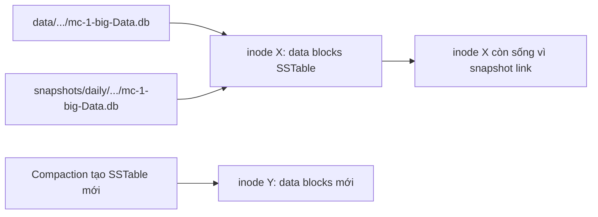
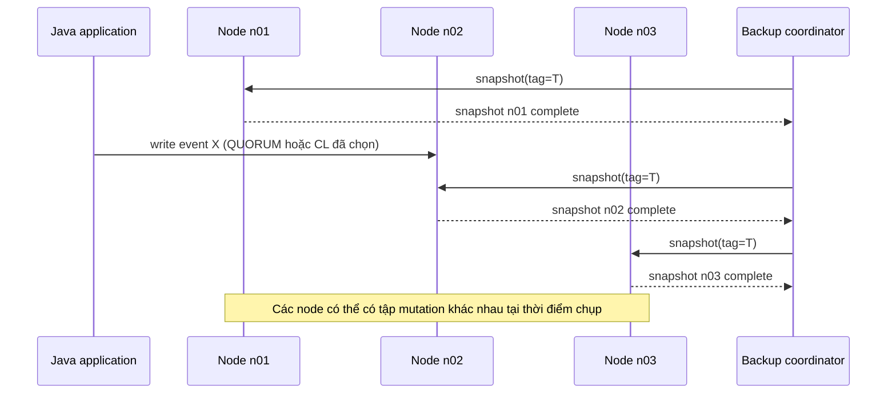
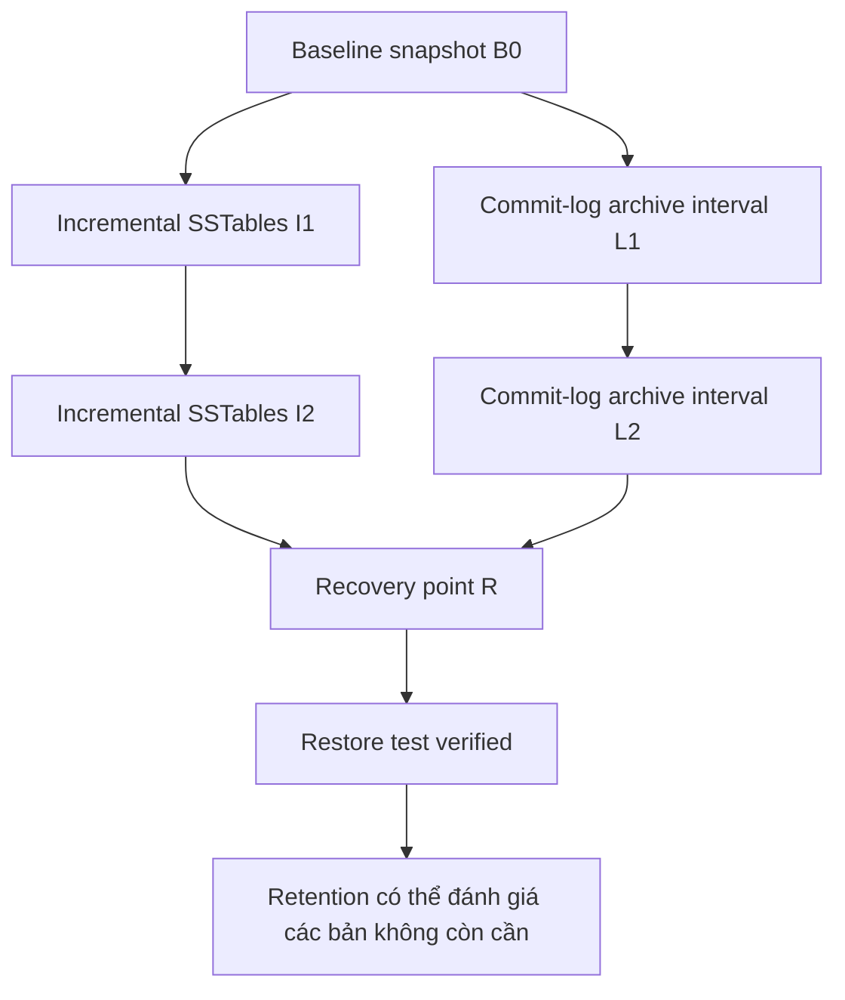
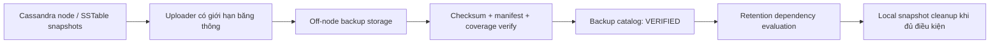
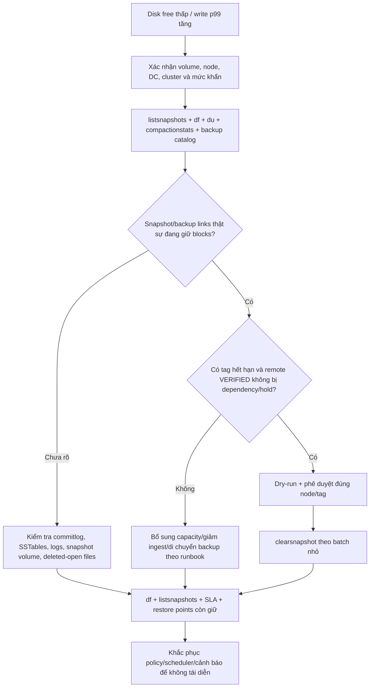

# Quản lý dung lượng snapshot và chính sách giữ lại

Trong Apache Cassandra, `nodetool snapshot` là công cụ quan trọng để tạo điểm sao lưu dữ liệu SSTable. Nhưng việc tạo snapshot thành công **không có nghĩa đã có một bản backup an toàn**: snapshot thường nằm **trên cùng node/thiết bị lưu trữ** với dữ liệu hiện hành, có thể cùng mất khi disk hoặc node hỏng. Ngược lại, một snapshot tạo bằng **hard link** có thể tiêu tốn rất ít dung lượng mới ở thời điểm tạo, rồi giữ lại nhiều SSTable cũ khi compaction diễn ra. Nếu không có chính sách giữ lại (*retention*) và xóa có kiểm soát, các snapshot tưởng như “miễn phí” có thể làm đầy disk, cản trở flush, compaction, streaming và gây lỗi ghi.

Bài thuộc chương **Sao lưu và phục hồi** của mô-đun **DATABASE_ENGINE_WIDE_COLUMN_CASSANDRA**. Trọng tâm là **đo đúng dung lượng snapshot**, định nghĩa lịch giữ lại dựa trên RPO/RTO và yêu cầu kiểm toán, lưu bản sao **ngoài node/cụm**, bảo vệ chuỗi backup cần để restore, thực hiện cleanup an toàn và diễn tập khôi phục. Nội dung kết hợp CQL, SSTable/compaction, replication, repair, tombstone, quản trị node và Java Driver để tránh những ngộ nhận thường gây mất dữ liệu khi có sự cố.

> **Nguyên tắc vận hành:** chỉ xóa snapshot sau khi xác định rõ **snapshot nào, trên node nào, thuộc điểm phục hồi nào, còn cần để khôi phục hay không**, và đã có bằng chứng bản sao ngoài node đủ/đọc được. `nodetool clearsnapshot` là thao tác **phá hủy điểm phục hồi cục bộ**, không phải công cụ dọn dung lượng tùy tiện.

## 1. Mục tiêu học tập

Sau bài này, bạn có thể:

1. Giải thích snapshot SSTable hoạt động bằng **hard link**, quan hệ với memtable flush, compaction và các file `snapshots/`, `backups/`.
2. Phân biệt **dung lượng logic được liệt kê**, **dung lượng vật lý độc nhất của inode/data blocks**, **dung lượng giải phóng thật sự khi xóa** và disk headroom.
3. Đọc `nodetool listsnapshots`, `status`, `tablestats` và số liệu OS để nhận diện nguồn chiếm disk.
4. Thiết kế retention theo ngày/tuần/tháng và theo **RPO/RTO**, tránh xóa các thành phần còn cần cho restore/PITR.
5. Phân biệt **manual snapshots**, **auto-snapshots**, **incremental backups**, **commit-log archiving** và bản sao off-node.
6. Xây quy trình backup → upload → xác minh manifest/checksum → catalog → retention → cleanup có khả năng kiểm toán.
7. Mô tả một bài lab CQL/nodetool an toàn và hậu kiểm dữ liệu bằng Java Driver 4.x.
8. Lập runbook khi disk gần đầy vì snapshots nhưng vẫn bảo toàn dữ liệu, khả năng repair/compaction và các điểm phục hồi.

## 2. Snapshot Cassandra thực sự chứa gì?

Cassandra ghi mutation vào **commit log** và **memtable**, sau đó flush memtable thành các **SSTable** bất biến trên disk. `nodetool snapshot` tạo snapshot của SSTable thuộc bảng/keyspace được chọn, thường yêu cầu flush trước khi liên kết file để bao gồm những dữ liệu đã được ghi vào memtable; một số phiên bản/tùy chọn hỗ trợ bỏ qua flush. Snapshot là tập các thành phần SSTable tại thời điểm chụp **ở một node**, không phải ảnh chụp nguyên khối giao dịch toàn bộ cluster.

Thư mục dữ liệu có thể có cấu trúc khái niệm:

```text
<data_file_directory>/
  backup_lab/
    events_by_tenant_day-<table_id>/
      <SSTable components hiện hành>
      snapshots/
        daily-20261121-0000/
          manifest.json
          schema.cql
          <SSTable components được liên kết>
      backups/
        <SSTable components do incremental backup giữ>
```

Cách đặt tên directory, nội dung manifest, hỗ trợ `schema.cql` và nhiều data directories có thể thay đổi theo bản Cassandra. Đường dẫn này chỉ để giải thích; **không suy rằng mọi node dùng `/var/lib/cassandra/data`**. Tìm đúng `data_file_directories` của môi trường và kiểm tra phiên bản trước khi vận hành.

### Vì sao snapshot không cần copy toàn bộ SSTable ngay lúc tạo?

Trên hệ thống file hỗ trợ **hard links**, Cassandra tạo directory entry mới trỏ đến cùng inode/file content với SSTable gốc. Tạo hard link không nhân đôi toàn bộ data blocks:



**Diễn giải đúng**:

- **Trước compaction:** SSTable gốc và snapshot link tham chiếu cùng inode. Chênh lệch dung lượng vật lý tức thời có thể nhỏ so với dung lượng logic SSTable.
- **Sau compaction:** Cassandra có thể thay SSTable cũ bằng SSTable mới và xóa tên file gốc. Nếu snapshot vẫn giữ hard link, **inode cũ chưa thể được giải phóng**.
- **Khi clear snapshot:** gỡ một hoặc nhiều hard links. Data blocks chỉ được giải phóng khi **không còn hard link/open reference khác** tới nội dung đó, và hệ thống file xác nhận đã giải phóng.
- **SSTable bất biến:** không chỉnh sửa nội dung file đang được hard link để “giảm dung lượng snapshot”; thay đổi file có thể phá cả dữ liệu hiện hành.

Do đó, **snapshot không phải copy-on-write volume snapshot** theo nghĩa LVM/ZFS/EBS. Cơ chế hard link của Cassandra và snapshot ở tầng volume/storage là hai công nghệ có tính nhất quán, hiệu năng, vận hành và chi phí khác nhau.

### Snapshot chứa những gì và thiếu những gì?

| Thành phần | Có được đảm bảo từ `nodetool snapshot` không? | Việc cần làm |
| --- | --- | --- |
| **SSTable được chọn trên node** | Có, theo phạm vi snapshot và file đã flush/phù hợp tùy chọn. | Sao chép đủ mọi SSTable components, giữ manifest và checksum. |
| **Dữ liệu mới còn trong memtable** | Thường được đưa vào qua flush trước snapshot; nếu `skip-flush` hoặc flush lỗi thì không được mặc định có. | Ghi lại tùy chọn và kết quả flush; xác định RPO thực tế. |
| **Commit log** | Không phải thành phần dữ liệu được bảo vệ đầy đủ chỉ bằng bản SSTable snapshot. | Nếu cần PITR, thiết kế commit-log archiving và replay có kiểm thử. |
| **Schema/keyspace/UDT/index definitions** | Có thể có `schema.cql` hỗ trợ trong snapshot, tùy version/phạm vi. | Catalog và sao lưu DDL tương thích, kiểm chứng trước restore. |
| **Users/roles/permissions/config/secrets** | Không phải bản backup ứng dụng/cluster hoàn chỉnh. | Bảo vệ metadata bảo mật, cấu hình, TLS/cert, JDK/version theo quy trình riêng. |
| **Backup ngoài node/DC** | **Không**; hard link vẫn nằm trên disk của node. | Upload/copy tới nơi lưu độc lập, đủ bền, kiểm tra đọc lại và kiểm soát truy cập. |
| **Ảnh chụp giao dịch nhất quán toàn cụm** | **Không** mặc định; mỗi node/table có thời điểm flush/snapshot riêng. | Định nghĩa consistency cut, RPO và phối hợp ingest/DDL nếu yêu cầu. |

## 3. Bốn nguồn lưu giữ dữ liệu thường bị cộng sai

Một ổ disk Cassandra có thể chứa đồng thời:

1. **SSTable hiện hành** trong `data_file_directories` đang phục vụ read/write.
2. **Snapshot SSTable hard links** được giữ để restore.
3. **Incremental backup links/files** trong `backups/` (khi bật).
4. **SSTable tạm/đang tạo**, commit log, snapshots của file system, logs, repair/streaming và những file khác.

Không đếm mọi file xuất hiện trong cây directory thành **một bản copy vật lý độc lập**, vì nhiều đường dẫn có thể trỏ cùng inode. Ngược lại, không cho rằng snapshot **miễn phí** vì ở thời điểm đầu chỉ tạo hard link.

### Công thức dung lượng có ích

```text
Vật lý thực dùng trên volume (xấp xỉ) =
  các data blocks độc nhất của SSTable còn được giữ
  + các dữ liệu khác trên volume
  + overhead metadata/filesystem

Các SSTable còn được giữ có thể do:
  active table OR snapshot(s) OR incremental backup link(s)

Dung lượng phải dự trù khi chạy:
  current physical usage
  + headroom cho compaction/flush
  + headroom cho repair/bootstrap/streaming
  + tăng trưởng ingest đến lần cleanup tiếp theo
  + margin cho sự cố và hoạt động hệ thống
```

**Không cộng `SSTable hiện hành + mọi snapshot logical size + mọi incremental backup logical size` như thể chúng độc lập**, rồi tuyên bố dung lượng vật lý chính xác. Mức trùng inode/hard link phụ thuộc trạng thái compaction, backup và file system.

### Ví dụ có số liệu minh họa

Giả sử một volume 300 GiB có:

| Thành phần vật lý độc nhất | Ước tính |
| --- | ---: |
| SSTable hiện hành | 120 GiB |
| SSTable đã obsolete nhưng còn bị **snapshot links** giữ | 70 GiB |
| SSTable độc nhất còn bị **incremental backup links** giữ, không trùng nhóm trên | 10 GiB |
| Commit log/logs/hệ thống khác | 15 GiB |
| **Tổng đang sử dụng (xấp xỉ)** | **215 GiB** |
| Dung lượng còn lại trước growth/compaction | **85 GiB** |

Nếu một compaction/streaming dự kiến cần thêm 60 GiB headroom và ingest có thể tăng 35 GiB trước kỳ cleanup kế tiếp, tổng nhu cầu đỉnh có thể vượt phần trống 85 GiB. Trên thực tế số đo phải lấy từ volume, **không** từ bảng giả định này.

**Bài học:** trong lúc snapshot mới tạo, disk có thể chưa tăng nhiều. Sau vài chu kỳ compaction, SSTable cũ bị snapshot giữ lại, disk tiếp tục tăng dù dung lượng live data và số row không đổi.

## 4. Đo dung lượng: `listsnapshots`, `du`, `df` và inode

### `nodetool listsnapshots`

```bash
nodetool help listsnapshots
nodetool listsnapshots
```

Đầu ra tùy version có thể cho biết **keyspace**, **table**, **snapshot name/tag**, **true size**, **size on disk** hoặc thống kê gần tương đương. Cần kiểm tra định nghĩa từng cột trong **đúng phiên bản đang chạy**: khi có hard links giữa active/snapshot/backups, các số này không nhất thiết cộng được để ra dung lượng sẽ giải phóng khi xóa một tag.

Ví dụ **số giả định**:

```text
Snapshot Tag          Keyspace    Table                  Logical Size
daily-20261118-0000   backup_lab  events_by_tenant_day   80 GiB
daily-20261119-0000   backup_lab  events_by_tenant_day   83 GiB
daily-20261120-0000   backup_lab  events_by_tenant_day   85 GiB
daily-20261121-0000   backup_lab  events_by_tenant_day   86 GiB
```

Không được báo “xóa tag ngày 18 chắc chắn lấy lại 80 GiB” vì file có thể vẫn được tag ngày 19/20 hoặc active SSTable liên kết tới cùng inode. Chênh lệch dung lượng giải phóng phải **đo trước/sau** cleanup đã được cho phép.

### Đối chiếu với hệ điều hành (Linux)

```bash
# Đọc-only; đường dẫn là ví dụ, thay bằng data_file_directories thực tế.
df -h /var/lib/cassandra/data
df -i /var/lib/cassandra/data
du -sh /var/lib/cassandra/data

# Dung lượng hiển thị riêng thư mục snapshots có thể gây hiểu nhầm
# vì hard links trùng nội dung với file đang dùng hoặc tag khác.
du -sh /var/lib/cassandra/data/backup_lab

# Kiểm tra link count/inode của một SSTable component đã chọn:
stat -c '%n inode=%i links=%h size=%s' /path/to/file-Data.db
```

Giới hạn quan trọng:

- `df` cho biết **khối dữ liệu còn chiếm trên filesystem/volume**, phù hợp để theo dõi free space thật, nhưng có thể khác `du` do sparse files, reserved blocks, deleted-but-open files, snapshots của storage hoặc mount khác.
- `du` với hard links thường **không tính lại cùng một inode** trong một lần duyệt toàn cây, nhưng một lần `du` trên snapshots **riêng** rồi một lần trên active **riêng** có thể **đếm trùng** khi cộng kết quả. Thứ tự duyệt và tùy chọn có thể ảnh hưởng cách phân bổ dung lượng.
- `ls -li` hoặc `stat` chỉ ra inode và hard link count, nhưng inode chỉ có nghĩa **trên cùng filesystem**. Hai ổ khác nhau có thể tình cờ có cùng số inode mà không liên quan.
- Một SSTable gồm **nhiều component files**; `Data.db` chỉ là một phần, không phải toàn bộ footprint của SSTable.
- Nhiều `data_file_directories` hoặc nhiều mounted volumes phải đo **từng volume**, không chỉ node-level `Load`.

### Bảng quan sát tối thiểu

| Metric | Câu hỏi trả lời | Cảnh báo |
| --- | --- | --- |
| Disk free bytes và % theo volume | Có đủ headroom cho compaction/streaming/retry? | Free giảm dưới ngưỡng đã đo, không phải một số chung cho mọi node. |
| Disk growth GiB/ngày | Khi nào volume có nguy cơ đầy? | Dự báo hết chỗ **trước kỳ cleanup/backup tiếp theo**. |
| Tổng tags, tuổi snapshot lâu nhất | Có snapshot ngoài chính sách hoặc không thuộc catalog? | Snapshot vô chủ/mồ côi, auto-snapshot không được thu gom. |
| Unique bytes bị snapshot giữ (ước tính) | Snapshot đang ngăn giải phóng bao nhiêu data blocks? | Phải định nghĩa đo theo filesystem, tránh cộng trùng. |
| Compaction/flush pending | Việc nền có đang tích tụ vì disk pressure? | Backlog tăng dài hạn, flush blocked, latency tăng. |
| Off-node backup verified bytes/restore points | Những bản backup nào **thực sự dùng được**? | Không có manifest/checksum, upload chưa hoàn tất hoặc thiếu node. |
| Commit-log archive lag | PITR có đang bắt kịp mục tiêu? | Có khoảng thời gian không có log hợp lệ dù snapshot đầy đủ. |

## 5. Snapshot thủ công, auto-snapshot và incremental backup

| Cơ chế | Khi nào tạo? | Dữ liệu giữ | Rủi ro retention |
| --- | --- | --- | --- |
| **Manual `nodetool snapshot`** | Người vận hành/scheduler chủ động tạo, có tag. | SSTable tại thời điểm chụp trên phạm vi node/bảng/keyspace. | Tags lịch sử tồn tại vô hạn nếu không có cleanup. |
| **Auto-snapshot** | Có thể tạo trước các thao tác như `DROP`/`TRUNCATE` khi tính năng cấu hình được bật. | Dữ liệu bảng trước thao tác destructive để hỗ trợ phục hồi. | Sau migration nhiều bảng có thể giữ nhiều snapshot ngoài lịch daily. |
| **Incremental backups** | Khi bật `incremental_backups`, SSTable mới được flush có thể được liên kết/copy theo cơ chế phiên bản vào `backups/`. | Dữ liệu SSTable mới sau baseline, cần phối hợp với snapshot và catalog. | Backups giữ các SSTable ngay cả sau compaction, có thể làm disk đầy nếu không upload/prune. |
| **Commit-log archiving** | Cấu hình archive các segments commit log để phục hồi tới thời điểm. | Mutation theo log, tùy retention/flush/replay và độ bền. | Thiếu một đoạn log có thể phá khả năng phục hồi tới thời điểm yêu cầu. |
| **Filesystem/cloud volume snapshot** | Hệ thống storage chụp block/volume. | Tùy cơ chế snapshot ở tầng block và khả năng phối hợp nhiều volumes. | Không mặc định nhất quán giữa nhiều Cassandra nodes/DC, chi phí giữ blocks riêng. |

### Auto-snapshot không thay thế lịch backup

Auto-snapshot trước `TRUNCATE`/`DROP` có thể cứu dữ liệu khi thao tác nhầm, nhưng chỉ xuất hiện trong những sự kiện nhất định. Nếu bảng mất dữ liệu do lỗi ứng dụng hoặc toàn node hỏng mà không có `DROP`, không thể dựa vào auto-snapshot để có điểm phục hồi mong muốn. Ngược lại, **xóa toàn bộ auto-snapshot ngay sau DDL** có thể loại chính bản dự phòng mà nhóm migration đang cần trong cửa sổ rollback.

### Incremental backup không có nghĩa “cứ bật là đủ PITR”

Incremental backups lưu những SSTable mới theo cơ chế flush, **không tự định nghĩa** một chuỗi restore point có tính nhất quán toàn cụm; cũng không đồng nghĩa có đầy đủ commit logs để phục hồi đến từng giây. Một thiết kế PITR cần **baseline SSTables + thành phần thay đổi/log phù hợp + metadata + công cụ replay có kiểm chứng**. Nếu thiếu một SSTable component hoặc khoảng commit log, khả năng khôi phục theo mục tiêu có thể không đạt.

### Những cấu hình thường liên quan

```yaml
# Chỉ minh họa ý nghĩa trường; KHÔNG phải cấu hình production đầy đủ.
auto_snapshot: true
incremental_backups: false
# commitlog_archiving.properties và các công cụ backup riêng
# phải được thiết kế/kiểm thử nếu tổ chức yêu cầu PITR.
```

Đường dẫn, default và cơ chế của từng tính năng thay đổi theo Cassandra release/distribution. Chỉ sửa `cassandra.yaml`/commitlog archive config sau khi tham chiếu đúng version, có kế hoạch rollout, backup, rollback và test restore. Không chuyển `auto_snapshot=false` chỉ để đỡ đầy disk mà bỏ qua chính sách bảo vệ các thao tác schema/destructive.

## 6. Tạo một snapshot có thể nhận diện và kiểm toán

Một snapshot chạy trong cluster có nhiều node cần được gắn với **backup run ID** thống nhất, scope rõ (DC/keyspace/table, các nodes được chụp), thời điểm và tùy chọn `flush`. Cùng một tag trên nhiều node giúp nhóm dễ kiểm toán, nhưng **mỗi node vẫn tạo bản riêng**; các thời điểm tạo không nhất thiết hoàn toàn trùng nhau.

### Cú pháp minh họa trên một node lab

```bash
# Xem đúng cú pháp của phiên bản trước:
nodetool help snapshot

# Ví dụ các option phổ biến -t (tag), -cf (table/column family).
# Chỉ chạy trên Cassandra lab và đúng node được chỉ định:
nodetool snapshot -t lab-daily-20261121-0000 \
  -cf events_by_tenant_day backup_lab

# Danh sách snapshots node này:
nodetool listsnapshots
```

Với các phiên bản mới, cú pháp có thể dùng `--table`, `--tag` hoặc những giới hạn khác. `nodetool snapshot` nếu không chọn bảng có thể ảnh hưởng **nhiều bảng/keyspace**. **Đừng copy câu lệnh vào production trước khi kiểm tra help và scope.**

### Checklist của một lần chụp

1. **Run ID**: ví dụ `backup-20261121T0000Z`, không chỉ ngày không có timezone.
2. **Cluster/node identity**: Cassandra version, Host ID, DC/rack, IP, node state; ghi đủ mọi node liên quan.
3. **Scope**: keyspace, table IDs/UUIDs và tag, schema version; thay schema trong lúc backup cần có chính sách rõ.
4. **Flush semantics**: `skip-flush` có dùng không, memtable/commit log được bảo vệ ra sao?
5. **Kết quả**: command exit/result từng node, manifest hiện diện và file list/checksum.
6. **Copy ngoài node**: object storage/backup vault có account/zone độc lập phù hợp RPO/RTO.
7. **Verification**: upload hoàn tất, checksum, manifest, đủ nodes/ranges, catalog và thử restore.
8. **Retention**: tag thuộc policy nào và thời điểm sớm nhất được xem xét xóa?

Một lệnh snapshot kết thúc thành công trên **n01** chưa chứng minh những node khác đã chụp thành công. Nếu chỉ có một node, backup có thể **không chứa dữ liệu của những token ranges khác** trong cluster RF thấp. Đừng tự coi snapshot “một node” là toàn bộ dữ liệu logic.

## 7. Snapshot nhiều node và consistency: đừng hứa snapshot nguyên tử toàn cụm

Cassandra không cung cấp một nút `nodetool snapshot` đơn lẻ biến tất cả node/table/DC thành **một transaction snapshot tại cùng timestamp**. Một backup run chụp lần lượt n01, n02, n03 có thể thấy những mutation khác nhau nếu ứng dụng tiếp tục ghi trong suốt quá trình.



Điều này **không nhất thiết làm backup vô ích**, vì replication và commit-log/mutation timestamps có thể được dùng trong một quy trình phục hồi được thiết kế. Nhưng **tính đúng đắn phục hồi** phải được xác minh theo yêu cầu dữ liệu/ứng dụng, đặc biệt với các cập nhật liên partition, LWT, counter và multi-DC active-active.

### Ba cấp độ kỳ vọng cần phân biệt

| Cấp độ | Bạn muốn đảm bảo | Thực tế cần chuẩn bị |
| --- | --- | --- |
| **Node-level SSTable snapshot** | Một tập SSTables trên một node ở một mốc chụp cục bộ. | `nodetool snapshot` + metadata/manifest + bản off-node. |
| **Logical dataset recoverable** | Có thể dựng lại các bảng/keyspace dự kiến ở cluster restore, đủ token ranges và data sources. | Backup từ đủ node/replica, schema đúng, restore test, xử lý các mutation bị trùng/khác thời gian. |
| **Application-consistent recovery point** | Các invariant nghiệp vụ qua nhiều bảng/partition đúng tại một mốc logic. | Phối hợp ứng dụng/ingest/fencing/checkpoint hoặc nguồn transaction/event log bổ sung, quy trình thử restore. |

Không gọi một bộ snapshot chụp không phối hợp là “strongly consistent full-cluster backup”. Đặc biệt với hai DC, `LOCAL_QUORUM` tại dc1 **không** đảm bảo mutation đã tới dc2 trước khi snapshot dc2 chạy.

## 8. RPO, RTO và retention: bắt đầu từ mục tiêu phục hồi

**RPO (Recovery Point Objective)** là mức mất dữ liệu theo thời gian tối đa được chấp nhận sau sự cố. **RTO (Recovery Time Objective)** là thời gian tối đa để hệ thống được đưa trở lại mức phục vụ chấp nhận được. Retention trả lời **giữ bao nhiêu điểm phục hồi và trong bao lâu**, nhưng chính sách retention đơn lẻ **không** chứng minh đã đạt RPO/RTO.

### Ví dụ mục tiêu (phải do nghiệp vụ phê duyệt)

| Hệ thống | Mục tiêu ví dụ | Chiến lược cần đánh giá |
| --- | --- | --- |
| Event archive không nhạy thời gian | RPO 24 giờ; RTO 1 ngày. | Daily off-node snapshots, đủ retention, restore test theo dung lượng thực. |
| Dữ liệu khách hàng cập nhật liên tục | RPO 1 giờ; RTO 4 giờ. | Daily snapshots **không đủ** nếu không có incremental/log/archive và quy trình phục hồi phù hợp. |
| Ledger hoặc nguồn tiền tệ | RPO gần bằng 0; RTO ngắn. | Cần kiến trúc consistency/authority/backup/DR nghiêm ngặt, có thể không giải quyết chỉ bằng Cassandra snapshots. |

Các con số đều **minh họa**, không phải khuyến nghị mặc định cho mọi Cassandra cluster.

### Retention phổ biến: daily / weekly / monthly

Chính sách ví dụ:

```yaml
backup_policy_example:
  timezone: UTC
  daily: 7           # giữ 7 điểm daily gần nhất đã verified
  weekly: 4          # giữ 4 điểm weekly đã verified
  monthly: 12        # giữ 12 điểm monthly đã verified
  off_node_required: true
  verify_manifest_and_checksums: true
  restore_drill: "periodic, based on RTO/RPO"
  delete_local_only_after_off_node_verification: true
```

**Đây là policy minh họa do nhóm tự thiết kế, không phải YAML Cassandra hỗ trợ nạp trực tiếp.** Một snapshot có thể đồng thời thỏa daily/weekly/monthly; catalog phải **hợp nhất các nhãn giữ lại** để không nhân số điểm vô ích. Quy tắc “giữ 7 daily” cũng phải nêu **7 ngày lịch, 7 điểm thành công gần nhất hay 7 chu kỳ ingest**; lựa chọn khác nhau khi scheduler có ngày chạy thất bại.

### Vì sao đếm ngày không đủ?

Giả sử retention là “7 ngày”, nhưng:

- Backup gần nhất thất bại, không upload được hết các node.
- Còn một bản cũ hơn 10 ngày là **điểm verified duy nhất** có thể restore.
- Bản daily của ngày thứ 3 bị checksum mismatch.
- Muốn PITR tới ngày thứ 5 nhưng đã xóa log/archive cần cho khoảng thời gian đó.

Nếu cleanup chỉ dựa vào `snapshot_age > 7 days`, nó có thể xóa **điểm phục hồi cuối cùng**. Chính sách đúng phải lựa chọn trong **tập restore points đã xác minh**, theo dependency và trạng thái health, không chỉ filename/timestamp.

## 9. Catalog backup và dependency graph

Một công cụ backup/automation nên lưu các record có thể kiểm toán:

| Field | Ví dụ / yêu cầu |
| --- | --- |
| `backup_run_id` | `backup-20261121T0000Z`. |
| `cluster_id / environment` | Nhận diện cụm, không chỉ tên snapshot tag trùng giữa môi trường. |
| `cassandra_version / schema_version` | Tránh restore sai version/schema và thất lạc metadata. |
| `host_id, dc, rack, table_id` | Xác định nguồn SSTables và coverage ở mỗi node. |
| `snapshot_tag, created_at_utc` | Tên chụp và mốc thời gian chuẩn. |
| `files, sizes, checksums, manifest_uri` | Kiểm tra tính toàn vẹn; bảo vệ manifest bằng quyền truy cập/không sửa. |
| `remote_location / storage_class` | Bucket/prefix/backup vault và phiên bản object nếu có. |
| `scope_and_coverage` | Các keyspace/table/token ranges và nodes cần để khôi phục dataset. |
| `status` | `CREATED, COPYING, VERIFIED, FAILED, EXPIRED, DELETED`. |
| `retention_labels` | Daily/weekly/monthly/legal hold, restore-base, DR test. |
| `dependencies` | Baseline + incremental files + commit-log intervals cần cho điểm phục hồi. |
| `restore_test_id / last_verified_at` | Bằng chứng đã đọc/restore/kiểm tra thực tế. |

### Quan hệ phụ thuộc cho PITR



Đồ thị chỉ minh họa ý tưởng **dependencies**. Không phải mọi hệ thống Cassandra đều dùng cả incremental SSTables và commit-log archiving trong cùng một PITR implementation; sự kết hợp phải được **công cụ restore hỗ trợ và đã kiểm thử**. Tránh dựng lại nhiều SSTable/log theo thứ tự tự nghĩ vì có thể tạo bản ghi lỗi thời, duplicate hoặc missing mutation.

**Bất biến xóa:** không xóa B0, I1, I2 hoặc L1/L2 nếu một recovery point còn được giữ **phụ thuộc** thành phần đó. Một object được đánh dấu `EXPIRED` chỉ có nghĩa policy cho phép **xét xóa**, không có nghĩa xóa vật lý ngay lập tức là an toàn.

## 10. Ước lượng dung lượng theo tăng trưởng và compaction

Dung lượng snapshot không tăng đều như kích thước live data. Snapshot tạo trước một kỳ compaction có thể giữ lại rất nhiều SSTables cũ; các lần snapshot sau có thể tham chiếu SSTables giống nhau. Vì vậy nên dự báo từ **tăng trưởng vật lý đo được qua nhiều chu kỳ**, kết hợp tốc độ ghi, TTL, compaction strategy và retention.

### Mô hình ngân sách đơn giản

```text
U(t) = physical_used_bytes của volume tại thời điểm t
G(t) = tăng trưởng vật lý ròng (bao gồm ingest và giữ SSTable cũ)
H(t) = headroom dự kiến cho compaction, stream, repair và sự cố
F(t) = physical_free_bytes

An toàn trong cửa sổ đến kỳ cleanup tiếp theo khi:
    F(t) > G_dự_kiến_trong_cửa_sổ + H(t) + margin

Nếu không, phải điều chỉnh lịch/capacity/retention trên cơ sở restore points
đã verified, không tự xóa snapshots và bỏ qua backup dependencies.
```

### Ví dụ tính “days to full”

Nếu volume còn 120 GiB, dùng ròng 10 GiB/ngày và cần giữ tối thiểu 50 GiB cho compaction/streaming, mức buffer thực tế trước khi chạm headroom chỉ còn `120 - 50 = 70 GiB`, tương đương khoảng **7 ngày ở tốc độ giả định 10 GiB/ngày**. Đây không phải lịch chắc chắn: compaction và snapshot cleanup tạo các bước nhảy dung lượng. Cần đo trên nhiều chu kỳ và alert **sớm hơn** lịch đầy disk.

### Đặc thù STCS / LCS / TWCS

| Chiến lược | Tác động tới hoạch định snapshot |
| --- | --- |
| **STCS** | SSTables có thể được merge theo kích thước; snapshot giữ bản input cũ nếu chưa clear, tăng physical retention sau compaction. |
| **LCS** | Dữ liệu có thể được viết lại qua nhiều levels; snapshot cũ có thể giữ nhiều bản SSTable đã obsolete; cần đo write amplification. |
| **TWCS** | Phù hợp workload time-series với TTL/điều kiện phù hợp; có thể tạo cơ hội thu hồi SSTables expired theo cửa sổ. Snapshot/backup links vẫn có thể giữ data blocks của các SSTables đó. |

Không chuyển compaction strategy hoặc ép **major compaction** chỉ để “xem xóa snapshot có lấy lại dung lượng không”. Major compaction có thể dùng thêm disk lớn, làm biến đổi bố cục SSTable và gây tác động đáng kể tới SLA.

## 11. Off-node backup: tách điểm phục hồi khỏi failure domain

Một snapshot local cùng ổ với Cassandra **không chống được** việc hỏng disk, bị xóa nhầm cả data directory, ransomware ở host, mất AZ hoặc mất DC. Cần sao chép **dữ liệu thực tế** từ các snapshot files tới storage độc lập, bảo vệ manifest và khả năng đọc lại.



### Checklist bản sao ngoài node

1. **Độc lập failure domain**: không cùng disk/node; nếu yêu cầu mất DC, backup phải tồn tại ngoài DC đó.
2. **Đúng dữ liệu**: đủ SSTable components, manifests, schema, Host IDs, table IDs và thông tin mã hóa cần thiết.
3. **Toàn vẹn**: checksum/end-to-end verification, phát hiện multipart upload thiếu object, kiểm tra remote object readable.
4. **Bảo mật**: encryption in transit/at rest, key management, least privilege, object immutability/versioning/retention lock khi phù hợp.
5. **Khả dụng khi cần**: recovery credentials, quyền truy cập, network/egress bandwidth, storage class retrieval delay, inventory.
6. **Kiểm soát chi phí**: storage, versioning, lifecycle transitions, API requests, egress/cross-region copy và chi phí restore drill.
7. **Không làm nghẽn Cassandra**: uploader đọc nhiều SSTable, tiêu tốn disk cache/IOPS và network; giới hạn song song để không gây p99 tăng.

### Copy snapshot sang remote không có nghĩa đã verified

`Copy completed` của uploader chỉ xác nhận một tầng vận chuyển. Một backup run chỉ nên thành `VERIFIED` khi đối chiếu số file/kích thước/checksum/manifest, scope node/table đầy đủ, quyền đọc và thử khôi phục mẫu nếu yêu cầu. Không cho lifecycle remote xóa file gốc trước khi chứng minh bản sao hợp lệ.

### Giữ backup bất biến

Tùy mức đe dọa, cần storage account/credentials tách biệt và chế độ immutable/WORM hoặc retention lock. Nếu cùng credential chạy ứng dụng có quyền xóa dữ liệu live **và** xóa mọi backup, snapshot/offsite copy có thể vẫn mất trong sự cố bảo mật. Khóa mã hóa và key-rotation plan phải được sao lưu/kiểm thử riêng: có đủ bytes backup mà mất chìa khóa giải mã vẫn không restore được.

## 12. Chính sách xóa snapshot local an toàn

**Không viết automation “xóa mọi thư mục snapshots cũ hơn 7 ngày” bằng `rm -rf`**. Cần điều phối `nodetool clearsnapshot` hoặc cơ chế được phiên bản hỗ trợ, chọn đúng node/keyspace/tag, chỉ sau kiểm tra catalog.

### Quy trình hai pha

**Pha A — Chọn ứng viên (dry-run/read-only)**

1. Lấy inventory từ `nodetool listsnapshots` **trên mọi node cần kiểm tra**, đối chiếu catalog.
2. Phân loại snapshot manual, auto-snapshot trước `DROP/TRUNCATE` và snapshot phục vụ rollback/incident.
3. Kiểm tra retention labels, legal hold, backup run dependencies, trạng thái remote verification và restore drill.
4. Dự kiến **khả năng giải phóng dung lượng** có thể thấp hơn logical size do trùng inode.
5. Tạo danh sách **node + keyspace + tag** và người phê duyệt, ghi lý do xóa.

**Pha B — Thực thi có kiểm soát**

1. Chạy từng batch nhỏ với change ID, giám sát `df`, latencies và filesystem.
2. Dùng lệnh chính thức `nodetool clearsnapshot`, sau khi kiểm tra `nodetool help clearsnapshot` **trên release thực tế**.
3. Đọc lại `listsnapshots` và đối chiếu catalog tag/node bị xóa.
4. Đo `df` trước/sau; không khẳng định giải phóng được đúng `size_on_disk` hay logical size.
5. Kiểm tra khả năng đọc snapshot/backup còn giữ và lịch restore của chúng.
6. Ghi kết quả `DELETED / FAILED / PARTIAL`; nếu một node thất bại, **không** báo toàn bộ retention run thành công.

### Ví dụ lệnh chỉ để học cú pháp

```bash
# Read-only:
nodetool help clearsnapshot
nodetool listsnapshots

# DESTRUCTIVE — chỉ chạy trong lab sau khi xác nhận đúng tag/scope.
# Tùy Cassandra version, option -t/--tag và cú pháp keyspace có thể khác.
nodetool clearsnapshot -t lab-daily-20261121-0000 backup_lab

# Quan sát lại, đối chiếu filesystem:
nodetool listsnapshots
df -h /var/lib/cassandra/data
```

**Không chạy** `nodetool clearsnapshot` không có tag/giới hạn cụ thể, hoặc tùy chọn “all”, trên production vì có thể xóa nhiều điểm phục hồi cùng lúc. **Không sửa/xóa tệp SSTable bằng tay** trong cả `snapshots/` và `backups/` khi chưa có runbook của phiên bản: file có thể vẫn được tham chiếu và chứa dữ liệu cần restore.

## 13. Bảo vệ legal hold, incident snapshot và schema rollback

Một chính sách có lịch xóa tự động phải có **ngoại lệ có chủ sở hữu**:

| Loại snapshot | Vì sao giữ lâu hơn | Điều kiện giải phóng |
| --- | --- | --- |
| **Legal hold / audit** | Quy định, tranh chấp, yêu cầu bảo quản chứng cứ. | Được pháp chế/owner phê duyệt, đảm bảo retention pháp lý và bất biến backup. |
| **Incident forensic** | Cần tái hiện dữ liệu/metadata tại thời điểm lỗi. | Incident đóng, bằng chứng đã lưu và được phê duyệt xóa. |
| **Pre-migration schema rollback** | Trước `DROP/TRUNCATE` hoặc migration lớn. | Deployment ổn định, rollback window kết thúc, restore test nếu cần. |
| **Last known good backup** | Các lần sau failed hoặc chưa được verified. | Có ít nhất một restore point khác đủ scope/verified và đáp ứng RPO theo policy. |
| **PITR baseline** | Các incremental/log intervals đang được giữ phụ thuộc baseline. | Mọi recovery point dựa trên baseline đã hết hạn hoặc có baseline mới độc lập đã kiểm chứng. |

Các ngoại lệ phải có **expiry review date, owner, approval và trạng thái**, nếu không sẽ biến thành snapshots “giữ mãi” làm disk đầy. Khi legal hold có thời gian rất dài, nên ưu tiên kho offsite/immutable thay vì giữ toàn bộ snapshot trên data volume phục vụ ghi.

## 14. Lab: tạo, liệt kê và đánh giá chi phí snapshot

Thí nghiệm này chỉ thực hiện trên **Cassandra lab**. Cần ít nhất ba node trong `dc1` nếu dùng RF=3; với môi trường nhỏ hơn, điều chỉnh RF **trước bài lab** theo cấu hình thực tế. Dữ liệu, timestamp, tag là ví dụ; không phát thao tác xóa trên production.

### Bước 1 — Tạo keyspace và bảng theo truy vấn

```sql
CREATE KEYSPACE IF NOT EXISTS backup_lab
WITH replication = {
  'class': 'NetworkTopologyStrategy',
  'dc1': 3
}
AND durable_writes = true;

CREATE TABLE IF NOT EXISTS backup_lab.events_by_tenant_day (
  tenant_id text,
  event_day date,
  event_time timestamp,
  event_id uuid,
  event_type text,
  PRIMARY KEY ((tenant_id, event_day), event_time, event_id)
) WITH CLUSTERING ORDER BY (event_time DESC, event_id DESC);

CONSISTENCY LOCAL_QUORUM;

INSERT INTO backup_lab.events_by_tenant_day
  (tenant_id, event_day, event_time, event_id, event_type)
VALUES ('tenant-lab', '2026-11-21', '2026-11-21T08:00:00+0000',
        11111111-1111-4111-8111-111111111111, 'BEFORE_SNAPSHOT');

SELECT event_time, event_id, event_type
FROM backup_lab.events_by_tenant_day
WHERE tenant_id = 'tenant-lab' AND event_day = '2026-11-21';
```

**Vì sao dùng partition key đầy đủ?** Trong Cassandra, một SELECT theo `(tenant_id, event_day)` định vị đúng partition. Sau khi restore, dùng cùng khóa và UUID để kiểm chứng hàng cụ thể, thay vì `SELECT *` toàn keyspace làm cluster phải quét rất rộng.

### Bước 2 — Chụp baseline hệ thống

```bash
nodetool status
nodetool tablestats backup_lab.events_by_tenant_day
nodetool compactionstats
nodetool listsnapshots
df -h /var/lib/cassandra/data
```

Lưu node/Host ID, UTC, số node theo DC/rack, SSTable count/disk usage, backup tags hiện có và disk free. Chú ý **thư mục dữ liệu của lab** có thể khác ví dụ.

### Bước 3 — Tạo snapshot có tag rõ ràng trên node lab

```bash
nodetool help snapshot
nodetool snapshot -t lab-daily-20261121-0000 \
  -cf events_by_tenant_day backup_lab
nodetool listsnapshots
```

Đây là **snapshot node hiện hành**. Nếu lab có ba node, muốn có bộ backup theo toàn cụm, orchestration phải chạy trên **các node dự kiến** và lưu run ID/manifest của mỗi node; không coi một lần snapshot n01 là cả keyspace đã được lưu trên toàn token ring.

### Bước 4 — Quan sát hard links

Tìm thư mục `snapshots/lab-daily-20261121-0000/` trong **đúng table directory**. Chọn một SSTable component và so inode/link count với bản hiện hành bằng `stat`/`ls -li`. Không sửa file; không dùng `rm` trong lab này. Ghi số liệu:

| Trước snapshot | Ngay sau snapshot | Sau compaction/tăng dữ liệu (nếu có thử riêng) |
| --- | --- | --- |
| Volume used/free | Volume used/free | Volume used/free |
| Snapshot count | Snapshot count | Snapshot count |
| Unique inode/link count mẫu | Hard links tới cùng inode? | File cũ có còn bị snapshot giữ? |
| SSTable count | SSTable count | SSTable count |

Để quan sát tác động compaction một cách rõ hơn, cần dataset đủ lớn và nhiều flush/compaction cycles trong **lab**; không bắt buộc cố chạy major compaction. Với chỉ một/two SSTables nhỏ, có thể gần như không thấy thay đổi dung lượng.

### Bước 5 — Thử retention bằng kế hoạch dry-run

Giả sử catalog có các tags:

```text
lab-daily-20261118-0000   VERIFIED, không có legal hold
lab-daily-20261119-0000   VERIFIED, weekly retained
lab-daily-20261120-0000   COPY_IN_PROGRESS
lab-daily-20261121-0000   VERIFIED, latest
```

Hãy xác định tag nào **chưa** được xóa dù vượt thời gian giữ:

- Tag ngày 19 có nhãn **weekly retained**, còn nghĩa vụ retention.
- Tag ngày 20 **COPY_IN_PROGRESS**, chưa thể coi bản remote là verified.
- Tag ngày 21 là **latest verified** nếu policy yêu cầu điểm phục hồi gần nhất.
- Tag ngày 18 có thể là ứng viên nếu policy đã hết hạn, **nhưng** vẫn phải kiểm tra dependency/last-good/legal hold và scope của từng node.

Viết biên bản lựa chọn và **dừng ở dry-run** nếu chưa có phê duyệt. Nếu muốn thử `clearsnapshot` trên lab, tạo tag thử riêng, xác minh đã lưu bài lab/không còn cần, rồi dùng đúng lệnh/version theo hướng dẫn ở mục 12.

## 15. Kiểm chứng dữ liệu bằng Java Driver 4.x

Backup/restore chủ yếu là thao tác **vận hành trên SSTable/cluster**, không phải một câu CQL do ứng dụng gửi tới `CqlSession`. Tuy nhiên, ứng dụng Java có thể giúp đối soát **dữ liệu cụ thể** trên cụm restore cách ly sau khi quy trình phục hồi được thực hiện.

Ví dụ Java Driver 4.x; giả định đã có `CqlSession restoredSession` kết nối đúng cluster lab/restore (local DC đã cấu hình) và schema đã được tái tạo:

```java
import java.time.LocalDate;
import java.util.UUID;
import com.datastax.oss.driver.api.core.ConsistencyLevel;
import com.datastax.oss.driver.api.core.cql.PreparedStatement;
import com.datastax.oss.driver.api.core.cql.BoundStatement;
import com.datastax.oss.driver.api.core.cql.ResultSet;
import com.datastax.oss.driver.api.core.cql.Row;

UUID expectedEventId =
    UUID.fromString("11111111-1111-4111-8111-111111111111");

PreparedStatement byDay = restoredSession.prepare(
    "SELECT event_id, event_type " +
    "FROM backup_lab.events_by_tenant_day " +
    "WHERE tenant_id = ? AND event_day = ?");

BoundStatement bound = byDay.bind(
        "tenant-lab", LocalDate.of(2026, 11, 21))
    .setConsistencyLevel(ConsistencyLevel.LOCAL_QUORUM)
    .setPageSize(100)
    .setIdempotent(true);

ResultSet rs = restoredSession.execute(bound);
boolean found = false;
for (Row row : rs) {
    if (expectedEventId.equals(row.getUuid("event_id"))
            && "BEFORE_SNAPSHOT".equals(row.getString("event_type"))) {
        found = true;
    }
}
if (!found) {
    throw new IllegalStateException(
        "Restore validation failed: expected lab event missing");
}
```

### Giới hạn của phép kiểm thử Java

- Có một hàng mẫu **không chứng minh toàn bộ table/cluster đã phục hồi**. Cần kiểm thử nhiều partitions/token ranges, row counts/checksums theo chiến lược phù hợp và ứng dụng invariants.
- `LOCAL_QUORUM` tại một DC không chứng minh mọi replica hoặc DC khác đã hội tụ; trên cluster restore cần xem RF/replica availability và repair scope.
- Không cho Java test **ghi lên cụm restore** trừ kịch bản được phép; dữ liệu khôi phục cần được bảo vệ để kiểm chứng.
- Nếu data có TTL, tombstone hoặc schema đổi sau backup, kết quả restore phụ thuộc thời điểm/log replay và chính sách expiry; không tự suy “hàng đang tồn tại hôm nay phải có trong snapshot cũ”.
- Khi `restoredSession` kết nối production do nhầm contact points, lab test có thể đọc dữ liệu thật và che lỗi. Bắt buộc xác nhận **cluster identity, keyspace, Host IDs/DC** trước khi thử.

## 16. Restore drill: kiểm tra backup trước lúc có thảm họa

Một điểm `VERIFIED` mới chỉ chứng minh manifest/checksum và coverage theo quy trình đã định. **Restore drill** mới cho thấy bytes đó có thể xây dựng hệ thống có khả năng đọc/ghi và đạt RTO mục tiêu.

### Quy trình kiểm thử trên môi trường cách ly

1. Chọn **restore point cụ thể** từ catalog: run ID, snapshot time, dependencies, schema/cluster version và owner.
2. Cấp **cluster restore cách ly** có storage/capacity, tên/identity và network phù hợp; không vô tình join cluster production bằng cùng Host ID/seeds/data directories.
3. Tải bản backup off-node, kiểm tra checksum/manifest/file count, giải mã bằng key đúng và kiểm tra file permissions.
4. Tái tạo schema/keyspace/table/UDT cần thiết theo quy trình được phiên bản hỗ trợ; xử lý credentials/roles và cấu hình riêng.
5. Khôi phục SSTables bằng **phương thức tương thích** (ví dụ utility/load/import/restore procedure của version), không copy tùy tiện vào thư mục node production đang chạy.
6. Nếu policy dùng incremental/commit logs, phục hồi đến **recovery target time** theo công cụ được hỗ trợ và ghi lại mọi gap/errors.
7. Xác minh replica placement/RF/DC, status node, dữ liệu CQL theo token ranges, số hàng/partition mẫu, tombstone và ứng dụng invariants.
8. Chạy Java/CQL readback có kiểm soát, đo thời gian thực tế để so với RTO; kiểm tra cả quyền truy cập và hiệu năng sau warm-up.
9. Ghi `RESTORE_PASS / PARTIAL / FAIL`, thời gian cần để tải data/stream/repair, chi phí và khả năng phục hồi lần sau.
10. Hủy **chỉ môi trường restore lab** theo change process sau khi lưu bằng chứng; không xóa backup gốc.

### Restore điểm cũ vào cluster đang có dữ liệu mới là nguy hiểm

SSTables chứa **timestamps và tombstones**. Nếu trộn một snapshot cũ vào cluster đang hoạt động, các phiên bản cũ có thể cạnh tranh với dữ liệu mới; nếu dấu xóa đã bị thu hồi trên replica hiện tại, còn có nguy cơ **resurrection/zombie**. Không sử dụng `sstableloader` hoặc copy SSTables của snapshot cũ vào production như “undo” một phần bảng nếu chưa có quy trình nhất quán, đối soát và đánh giá timestamps/tombstones.

### RTO không chỉ là thời gian download

Tổng thời gian phục hồi bao gồm: phát hiện sự cố, phê duyệt DR, cấp hạ tầng, tải/decrypt, import/load, streaming/repair, xác minh schema/dữ liệu, cập nhật routing/client Java và mở lại traffic. Một storage class “rẻ” có thể có thời gian lấy object dài, làm không đạt RTO dù giữ retention rất tốt.

## 17. Runbook khi snapshot làm đầy disk

Triệu chứng: một Cassandra node báo disk free giảm nhanh, p99 write tăng, compaction/flush pending; `listsnapshots` cho thấy nhiều tags cũ. **Không chạy ngay `nodetool clearsnapshot --all` hoặc xóa thư mục snapshot bằng shell**. Cần bảo toàn dữ liệu và định nghĩa mức khẩn cấp.



### Các bước triển khai

1. **Khoanh volume:** disk data nào đầy, còn bao nhiêu free bytes/inodes; đối chiếu `df` và `Load`, tránh nhầm filesystem.
2. **Đánh giá SLA/khả năng ghi:** có `WriteTimeout`, failed flush, pending compaction/repair, node DN hay lỗi disk không?
3. **Thu inventory:** mọi snapshot tags, tuổi, keyspace/table, off-node status, các backup links/snapshots volume khác.
4. **Xác nhận nguồn giữ bytes:** `du` toàn cây và mẫu inode/hard links, compaction log; không suy từ tổng logical snapshot sizes.
5. **Ngăn rủi ro tăng trưởng:** giới hạn bulk ingest/backup uploader không khẩn cấp theo SLA; giữ repair/compaction đúng mức cần thiết, không tắt vô thời hạn.
6. **Chọn tag có thể xóa** theo policy đã phê duyệt, ưu tiên những snapshot có remote verified và không có hold/dependency.
7. **Nếu không có ứng viên an toàn:** chọn bổ sung capacity/scale hoặc biện pháp khôi phục dịch vụ theo incident runbook; không hy sinh điểm phục hồi cuối cùng để lấy chỗ tạm.
8. **Cleanup từng batch có kiểm toán** dùng `clearsnapshot` đúng scope; quan sát disk free có tăng thực tế hay không.
9. **Xác nhận correctness và health**: keyspace CQL read/write theo policy, p95/p99, flush/compaction pending, repair/streaming, nodes UP/NORMAL.
10. **Postmortem**: vì sao retention job thất bại, tags có chủ sở hữu không, backup upload có backlog, compaction/ingest tăng trưởng thế nào, alert có đủ sớm không?

### Tình huống khó: xóa tag không giải phóng nhiều disk

Đây có thể là hiện tượng **bình thường** do nhiều snapshots/incremental backup links cùng giữ inode. Đừng lặp `clearsnapshot` với tag khác liên tục chỉ vì không thấy `df` tăng. Hãy kiểm tra hardlink counts, inventory các điểm còn giữ, file đang open và data directories khác, sau đó đưa ra quyết định mới có phê duyệt.

## 18. Thiết kế automation retention có rào chắn

Retention job production nên có **hai pha kiểm tra và thực thi**, không chỉ script chạy theo `find -mtime +7 -delete`:

```text
INPUTS:
  - policy version, timezone, retention labels, legal holds
  - inventory local snapshots tất cả nodes
  - off-node backup catalog với checksum/manifest/coverage verified
  - dependency graph của restore points/PITR
  - cluster/node health và disk headroom

PLAN:
  1. Hợp nhất daily/weekly/monthly labels cho mỗi restore point
  2. Tìm ứng viên hết hạn; loại trừ hold, incomplete, dependencies
  3. Bảo vệ minimum number of restoreable VERIFIED points
  4. Sinh danh sách node/keyspace/table/tag cần xử lý
  5. Dry-run, ký duyệt, lưu change ID

EXECUTE:
  6. Cleanup theo batch có giới hạn
  7. Readback listsnapshots + kiểm tra df và server metrics
  8. Audit kết quả từng node/tag; thất bại thì partial, không giả success

NEVER:
  - xóa trên cơ sở tuổi file đơn thuần
  - xóa local backup trước remote verification
  - xóa baseline/log còn được điểm PITR giữ phụ thuộc
  - xóa toàn bộ snapshot bằng wildcard trong sự cố disk pressure
```

### Ba rào chắn bắt buộc

1. **Recoverability gate:** ít nhất các restore points mà policy yêu cầu vẫn `VERIFIED` và có dependencies đầy đủ sau cleanup.
2. **Scope gate:** chỉ đúng cluster/Host ID/keyspace/tag đã được phê duyệt; một tag giống nhau ở môi trường khác không được xóa nhầm.
3. **Operational gate:** có quan sát disk/SLA, lệnh hỗ trợ bởi Cassandra version, rate limit/batch size và rollback ở cấp kế hoạch; hiểu rằng file đã xóa **không thể rollback** nếu remote backup cũng mất.

## 19. Theo dõi tài nguyên snapshot và ngăn cháy disk

### Dashboard đề xuất

| Biểu đồ | Độ phân giải và cách đọc | Cảnh báo nên thiết lập |
| --- | --- | --- |
| Disk used/free per volume/node/DC | Bytes tuyệt đối và tốc độ tăng GiB/giờ/ngày. | Dự đoán disk đầy trước khi có đợt backup/cleanup tiếp theo; headroom thiếu cho compaction. |
| Snapshot count/oldest age per node/table | Gắn policy owner và retention class. | Tags không có catalog, quá tuổi nhưng chưa được duyệt giữ. |
| Backup upload lag | Thời gian từ CREATED đến remote VERIFIED. | Upload kéo dài, bản mới nhất verified đã quá RPO/restore SLA. |
| Compaction/flush pending | Quan sát với disk free/IO latency. | Disk pressure bắt đầu cản flush/compaction. |
| Repair/streaming backlog | Repair progress, failed ranges, bytes/s. | Backup uploader tranh IO/network với repair, hoặc retention làm mất headroom. |
| Restore drill results | Last PASS, duration, scope và data validation. | Không diễn tập trong kỳ hoặc RTO chưa đạt. |
| Immutable/offsite backup health | Replication/storage account/accessibility, key validity. | Backup vault inaccessible, missing checksum hoặc không đủ điểm recovery. |

### Cảnh báo phải phối hợp nhiều tín hiệu

Ví dụ “free disk thấp **và** compaction pending tăng **và** snapshot retained bytes/growth cao” chỉ rõ rủi ro vận hành hơn một alert “có 100 snapshot”. Nhưng một bản backup cuối cùng không verified **vẫn phải cảnh báo ngay**, dù disk còn rất nhiều. Backup availability và disk pressure là hai rủi ro khác nhau.

## 20. Những ngộ nhận dễ gây sự cố

| Nhận định sai | Sửa lại cho đúng |
| --- | --- |
| “Snapshot Cassandra tạo một bản copy full file, nên disk tăng ngay gấp đôi.” | Hard links thường không copy data blocks ban đầu; **compaction sau đó** mới làm retention physical tăng. |
| “Hard links miễn phí nên có thể giữ snapshot vĩnh viễn.” | Data blocks cũ không được giải phóng nếu còn link, làm disk tăng qua nhiều chu kỳ. |
| “Cộng mọi snapshot size của `listsnapshots` sẽ ra free disk khi xóa.” | Có trùng inode/links; phải đo physical bytes theo filesystem và kiểm tra sau cleanup. |
| “Snapshot local là backup chịu mất node/DC.” | Cùng failure domain; cần off-node/off-DC copy đã verified. |
| “`nodetool status` đều UN nghĩa snapshot toàn cụm hoàn chỉnh.” | Membership khác backup coverage/manifest, restoreability và data consistency. |
| “Một node RF3 chụp snapshot đã có mọi dữ liệu mọi node.” | Phải kiểm toán token ranges/replica coverage; không mặc định node đủ toàn dataset. |
| “Snapshot là consistent transaction snapshot xuyên tất cả DC.” | Node/table chụp ở thời điểm khác; phải thiết kế application-consistent recovery nếu cần. |
| “Incremental backup tự cung cấp PITR đến từng giây.” | Cần baseline/archives/dependencies và restore replay được hỗ trợ, đã kiểm thử. |
| “Retention 7 ngày cứ xóa bất cứ file nào cũ hơn 7 ngày.” | Phải bảo vệ last-good, legal hold, schema rollback và các dependency PITR. |
| “Xóa snapshot ngay sau CREATE/INSERT không gây hại.” | Có thể xóa chính restore point gần nhất trước khi remote copy hoàn tất. |
| “Tắt auto_snapshot là cách giải quyết disk đầy bền vững.” | Chỉ chuyển rủi ro mất khả năng rollback sau DROP/TRUNCATE; cần chính sách giữ lại và capacity. |
| “Sau restore thấy một hàng đúng là xong.” | Phải xác minh schema, token ranges, dữ liệu nhiều partition, consistency và business invariants. |
| “Repair thay cho backup.” | Repair đồng bộ replica; nếu dữ liệu bị xóa sai đã lan tới mọi replica, repair không lấy lại lịch sử. |
| “RF=3 thay cho backup.” | Ba replica cùng cluster có thể cùng chịu lỗi vận hành, xóa logic, ransomware hoặc mất DC. |
| “Compaction sẽ tự xóa mọi snapshot cũ.” | Compaction không xóa hardlinks snapshot/backup còn giữ SSTable cũ. |

## 21. Bài tập thực hành

### Bài A — Đọc dung lượng vật lý

Một node có `Load=140 GiB`, `listsnapshots` liệt kê ba tags logical size 120, 125 và 130 GiB. `df` cho biết volume 500 GiB còn trống 190 GiB.

1. Có được cộng `140+120+125+130` rồi kết luận disk đã dùng 515 GiB không? Vì sao?
2. Dựa vào số nào để quyết định có đủ headroom compaction 80 GiB?
3. Hãy nêu phép kiểm tra inode/hardlinks và cách tránh đếm trùng `du`.
4. Nếu xóa tag đầu nhưng `df` chỉ tăng 5 GiB, những giải thích nào có thể đúng?

### Bài B — Thiết kế policy GFS

Hệ thống cần giữ **7 daily, 4 weekly, 12 monthly** bản backup offsite đã verified, và một legal hold kéo dài sáu tháng.

1. Định nghĩa rõ “bản daily/weekly” khi có ngày backup failed.
2. Thiết kế cách một snapshot mang nhiều nhãn retention mà không sao chép dữ liệu hai lần trong catalog.
3. Nêu điều kiện có thể xóa local snapshot sau off-node verification.
4. Tạo bảng catalog tối thiểu để chặn việc xóa bản last-known-good hoặc bản có legal hold.

### Bài C — RPO không đạt dù giữ rất nhiều snapshot

Ứng dụng ghi liên tục, chỉ chụp snapshot mỗi 24 giờ và giữ 90 ngày, nhưng nghiệp vụ yêu cầu **RPO 30 phút**.

1. Vì sao retention 90 ngày không đáp ứng RPO 30 phút?
2. Thiết kế cơ chế incremental/commitlog archiving hoặc DR phù hợp **với bằng chứng về recoverability**.
3. Nếu commit log archive thiếu một khoảng, điều gì xảy ra với PITR target?
4. Những phép diễn tập nào chứng minh RPO/RTO thật thay vì chỉ đếm số file backup?

### Bài D — Tính toán headroom

Volume 300 GiB, used 215 GiB (đã phân biệt unique blocks), cần 60 GiB cho compaction/streaming và tăng trưởng dự kiến 35 GiB tới kỳ cleanup.

1. Tổng nhu cầu đỉnh bao nhiêu? So với capacity 300 GiB.
2. Phương án an toàn nào nếu không có snapshot đủ điều kiện xóa?
3. Nếu `listsnapshots` báo 150 GiB logical tags cũ, có thể bảo đảm lấy lại 150 GiB không?

### Bài E — Runbook disk gần đầy

Node `n02` có free disk 6%, write p99 tăng, `compactionstats` có backlog. Catalog ghi daily gần nhất `COPY_IN_PROGRESS`, còn snapshot cũ hơn đang trong legal hold; incremental backup directory cũng tăng.

Hãy lập kế hoạch từ **đánh giá sự cố → đo physical space → kiểm tra offsite/dependencies → phê duyệt cleanup → xác minh**. Nêu ít nhất năm thao tác **không nên** thực hiện ngay và giải pháp capacity khi không có ứng viên được xóa an toàn.

### Bài F — Restore drill và Java

Một nhóm có remote snapshot đã verified. Hãy mô tả:

1. Những metadata cần giữ để tái tạo đúng table schema/RF/version.
2. Vì sao restore trong cluster riêng an toàn hơn nạp snapshot cũ vào production đang có data mới.
3. Dùng Java Driver đọc những partition keys/UUID đại diện nào?
4. Cần bổ sung kiểm thử gì ngoài việc một hàng trả về đúng ở `LOCAL_QUORUM`?
5. Nếu mất DC1, backup ở đâu để đạt mục tiêu DR và cách đo thời gian phục hồi?

### Bài G — Snapshot sau compaction

Tại t0 SSTable `S1` được snapshot T1; tại t1 compaction tạo S2, SSTable S1 không còn đường dẫn active nhưng snapshot T1 vẫn giữ một hard link. Tại t2 tạo snapshot T2 cho S2.

1. Khi nào data blocks của S1 có thể được giải phóng?
2. Xóa T2 có làm S1 biến mất không?
3. Xóa T1 có nhất thiết giải phóng toàn bộ logical size của T1 không, nếu còn incremental backup links?
4. Một retention policy cần theo dõi những quan hệ inode/dependency nào trước cleanup?

### Tiêu chí đạt

Học viên hoàn thành khi chứng minh đồng thời:

1. **Hiểu storage:** snapshot hardlink, logical vs unique physical bytes, compaction và `df/du` không bị cộng sai.
2. **Có chính sách phục hồi:** RPO/RTO, retention labels, last-known-good, off-node verification, legal hold và dependencies.
3. **Xóa an toàn:** dry-run, đúng node/tag/keyspace, phê duyệt, `clearsnapshot` theo version, readback và đo free disk thực.
4. **Restore được:** manifest/checksum, schema, cô lập cluster restore, CQL/Java validation, SLA và business invariants.

## 22. Câu hỏi tự kiểm tra

1. Vì sao snapshot mới tạo có thể không làm tăng disk used đáng kể?
2. Tại sao disk used vẫn tăng sau compaction dù số row sống không tăng?
3. `nodetool listsnapshots` cho biết những gì và tại sao size hiển thị không nhất thiết bằng dung lượng xóa được?
4. `df` và `du` khác nhau thế nào khi dữ liệu có hard links?
5. Tại sao `RF=3` và repair không thay thế backup?
6. Snapshot của một node có phải bản backup toàn cluster theo mặc định không?
7. Vì sao snapshot không phải ảnh chụp giao dịch nguyên tử mọi partition/DC?
8. Auto-snapshot thường hữu ích trong hoàn cảnh nào? Vì sao vẫn cần daily/off-node backup?
9. Incremental SSTable backup khác commit-log archiving và PITR ở điểm nào?
10. Vì sao retention theo tuổi file không đủ bảo vệ last-good và các PITR dependencies?
11. RPO và RTO khác nhau thế nào? Retention dài có tự đảm bảo RPO nhỏ không?
12. Khi nào một snapshot được coi là VERIFIED, và tại sao vẫn cần restore drill?
13. Vì sao `clear snapshot` phải được coi là thao tác phá hủy có scope và approval?
14. Nếu `df` không giảm nhiều sau cleanup, những hardlink references nào còn có thể tồn tại?
15. Vì sao không restore SSTable cũ trực tiếp vào cluster đang có mutation mới?
16. Khi snapshot uploader tranh disk/network với repair, bạn nên điều phối tài nguyên và deadline ra sao?
17. Mẫu cảnh báo nào nhận biết disk sẽ đầy **trước** thời điểm cleanup tiếp theo?
18. Ngoài data SSTables, những metadata/keys/permissions nào cần để DR thực sự hoạt động?

## 23. Tài liệu tham khảo và đối chiếu theo phiên bản

- [Apache Cassandra — Backup and Restore](https://cassandra.apache.org/doc/latest/cassandra/managing/operating/backups.html): cơ chế snapshots, incremental backup, phục hồi và lưu ý vận hành.
- [Apache Cassandra — nodetool](https://cassandra.apache.org/doc/latest/cassandra/managing/tools/nodetool/): `snapshot`, `listsnapshots`, `clearsnapshot` và cách xác nhận cú pháp version.
- [Apache Cassandra — Storage Engine](https://cassandra.apache.org/doc/latest/cassandra/architecture/storage_engine.html): commit log, memtable/SSTable, flush và compaction.
- [Apache Cassandra — Compaction](https://cassandra.apache.org/doc/latest/cassandra/managing/operating/compaction/overview.html): lý do SSTables bị thay thế và tác động tới disk usage.
- [Apache Cassandra — Repair](https://cassandra.apache.org/doc/latest/cassandra/managing/operating/repair.html): hội tụ replica, không thay backup và an toàn tombstone.
- [Apache Cassandra — Tombstones](https://cassandra.apache.org/doc/latest/cassandra/managing/operating/compaction/tombstones.html): `gc_grace_seconds`, dữ liệu xóa và rủi ro khôi phục sai thời điểm.
- [Apache Cassandra — CQL](https://cassandra.apache.org/doc/latest/cassandra/developing/cql/): schema/keyspace và kiểm chứng dữ liệu sau phục hồi.
- [Apache Cassandra Java Driver 4.x](https://apache.github.io/cassandra-java-driver/): prepared SELECT, consistency level và kết nối tới cluster restore.

**Ghi nhớ:** snapshot Cassandra thường bắt đầu là **hard links tới SSTables**; chi phí dung lượng bộc lộ qua compaction và retention lâu dài, không thể tính bằng cách cộng mọi kích thước logic. Một snapshot **trên cùng node không phải backup chịu mất node**. Chính sách tốt phải gắn **RPO/RTO, backup catalog, off-node verification, dependencies, legal hold và restore drill**; chỉ xóa đúng tag/node sau dry-run, kiểm tra điểm phục hồi còn lại và đo disk free thật. Mục tiêu của backup không phải “có nhiều thư mục snapshots”, mà là **khôi phục đúng dữ liệu, trong thời gian đã cam kết, khi sự cố thực sự xảy ra**.
