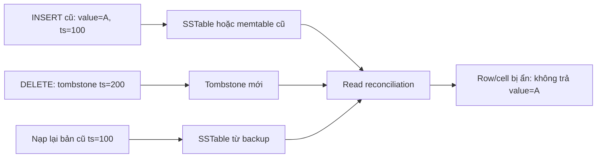
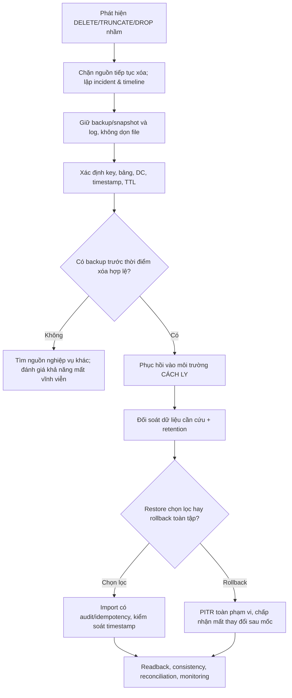
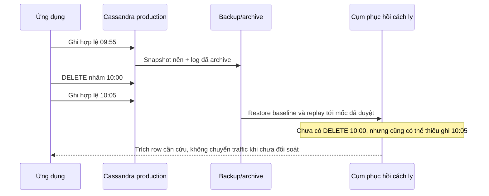

# Khôi phục sau xóa nhầm và giới hạn với TTL/timestamp/tombstone

> **Chương:** Sao lưu và phục hồi  
> **Học phần:** `DATABASE_ENGINE_WIDE_COLUMN_CASSANDRA` — Apache Cassandra

Một thao tác `DELETE` nhầm trong Apache Cassandra có thể được xác nhận thành công ở consistency level `LOCAL_QUORUM`, lan tới các replica khác rồi trở thành tombstone trong SSTable. Sau đó, dù còn snapshot chứa giá trị cũ, **không thể bảo đảm nạp lại SSTable từ snapshot vào cluster hiện tại sẽ làm dữ liệu xuất hiện trở lại**: Cassandra hòa giải nhiều phiên bản dựa trên timestamp, và tombstone mới hơn vẫn có thể che giá trị cũ. Với dữ liệu có TTL, bản sao cũ còn có thể đã hết hạn vào thời điểm phục hồi.

Vì vậy, chủ đề này không chỉ là “copy backup vào thư mục data”. Cần phân biệt:

1. **Khôi phục trạng thái toàn bộ hệ thống tại một thời điểm** (*point-in-time recovery*, PITR), có thể làm mất những thay đổi hợp lệ sau thời điểm đó.
2. **Khôi phục chọn lọc bản ghi bị xóa nhầm** bằng cách đọc từ môi trường phục hồi **cách ly**, rồi đưa dữ liệu được phê duyệt trở lại dưới dạng mutation mới và kiểm tra xung đột.
3. **Khôi phục từ snapshot/incremental SSTables** khi mất node hoặc table, trong đó phải xem xét schema, token, replica, commit log và dữ liệu đã thay đổi sau backup.

Đây là bài học thuộc Apache Cassandra, cơ sở dữ liệu *wide-column phân tán*. Partition key quyết định token và replica, bảng được thiết kế theo truy vấn, còn RF và consistency level xác định mức xác nhận đọc/ghi. Những cơ chế ấy **không thay thế backup**. Repair, hinted handoff và compaction cũng không phải nút “undo DELETE”.

**Sau bài này, bạn có thể** phân loại kiểu xóa nhầm, hiểu timestamp/tombstone/TTL quyết định dữ liệu nào còn nhìn thấy, chọn nguồn phục hồi, lập runbook khôi phục cô lập, đánh giá RPO/RTO, viết CQL/Java để kiểm chứng và tránh tái đưa dữ liệu đã xóa hợp lệ trở lại.

## 1. Cơ chế cốt lõi: xóa trong Cassandra là một mutation có timestamp

### 1.1. Vì sao DELETE không xóa vật lý ngay?

Cassandra ghi mutation trước vào commit log/memtable, sau đó flush thành SSTable bất biến. Một `DELETE` thường tạo **tombstone** để các replica biết giá trị cũ đã bị xóa về mặt logic, kể cả replica đã offline trong lúc lệnh xóa xảy ra.



Điểm quan trọng: **kết quả logic của một query không được quyết định bởi “file nào được copy sau cùng”**. Khi có các mutation cạnh tranh cho cùng dữ liệu, Cassandra so timestamp theo quy tắc hòa giải của kiểu tombstone/cell/range. Trong ví dụ, dữ liệu timestamp `100` từ backup không thắng tombstone timestamp `200`.

Với cả snapshot/stream/`sstableloader`, **bản ghi cũ thường vẫn mang write timestamp gốc**. Do đó thao tác import thành công ở mức file/network **không đồng nghĩa đã undo xóa nhầm**.

### 1.2. Không đánh đồng các loại xóa

| Thao tác | Hành vi cần lưu ý | Hệ quả phục hồi |
| --- | --- | --- |
| `DELETE cột` | Đánh dấu xóa ở phạm vi cột/cell | Khôi phục cột phải kiểm tra timestamp xóa và trạng thái các cột khác. |
| `DELETE hàng` | Tombstone ở phạm vi row (có thể che nhiều cột) | Reinsert một cột không nhất thiết khôi phục đầy đủ row nếu thiếu giá trị khác. |
| `DELETE partition` | Partition tombstone che các row/cell phù hợp | Nạp lại SSTable chứa nhiều row cũ có thể vẫn bị tombstone che. |
| `UPDATE ... SET col = null` | Trong CQL, gán `null` có thể tạo tombstone | Không chỉ lệnh `DELETE` mới tạo dấu xóa. |
| `TTL hết hạn` | Giá trị tự hết hiệu lực và được xem như tombstone | Nạp lại giá trị với TTL cũ thường **không làm sống lại** vì hạn đã qua. |
| `TRUNCATE TABLE` | Xóa dữ liệu cả bảng theo cơ chế truncate; có metadata/ngữ nghĩa đặc biệt ngoài từng row | Không nên xem như DELETE hàng loạt; restore đòi hỏi quy trình riêng và có thể có auto-snapshot. |
| `DROP TABLE/KEYSPACE` | Mất schema và dữ liệu logic; auto-snapshot phụ thuộc cấu hình | Cần phục hồi schema phù hợp trước dữ liệu và xem lại table ID/index. |

**Đặc biệt:** `TRUNCATE` và `DROP` có thể tạo snapshot tự động khi `auto_snapshot` được bật, nhưng không được mặc định backup đó chắc chắn có đủ thông tin hoặc tồn tại mãi. Người vận hành phải kiểm tra **cấu hình thực tế, snapshot theo node, retention và nguồn backup độc lập**.

### 1.3. `gc_grace_seconds` không phải thời gian “undo”

Một tombstone đủ tuổi theo `gc_grace_seconds` **có thể** được compaction thu hồi khi đáp ứng điều kiện an toàn (chẳng hạn không cần che dữ liệu cũ trong SSTable khác). Nó **không biến thành lệnh khôi phục** ở mốc grace; ngược lại, nếu replica offline quá lâu và tombstone bị thu hồi trước khi repair đầy đủ, dữ liệu cũ từ replica đó có thể **sống lại ngoài ý muốn** (*zombie data*).

Vì thế:

- Không chờ hết grace để mong giá trị cũ tự trở lại.
- Không giảm `gc_grace_seconds` hoặc chạy major compaction để “bỏ tombstone rồi lấy backup”.
- Không bỏ repair để giữ “cơ hội lấy bản cũ”: làm vậy có thể phá độ nhất quán của cụm.
- Việc **khôi phục có chủ đích** khác hoàn toàn **zombie data không được kiểm soát**.

## 2. Timestamp: tại sao backup cũ thua lệnh xóa mới?

### 2.1. Ba loại thời gian phải phân biệt

| Thời gian | Đơn vị/nguồn | Dùng cho điều gì? |
| --- | --- | --- |
| **Write timestamp của cell/tombstone** | Thường là microsecond từ Unix epoch; coordinator hoặc ứng dụng đặt | Hòa giải mutation cho cùng dữ liệu. |
| **Local deletion time** | Thường là giây Unix epoch, lưu cho tombstone/TTL | Hỗ trợ thu hồi tombstone theo grace và compaction. |
| **Thời điểm tạo snapshot/SSTable trên filesystem** | Thời gian của hệ điều hành hoặc nhãn snapshot | Tìm nguồn backup, **không phải** timestamp chiến thắng khi CQL đọc. |

CQL hỗ trợ `USING TIMESTAMP` cho một số lệnh ghi/xóa và `WRITETIME(column)` để đọc timestamp của cell phù hợp. Đừng so timestamp của cell theo microsecond với `gc_grace_seconds` (thời lượng giây) hoặc mốc local deletion time mà không đổi đơn vị.

### 2.2. Một ví dụ hòa giải có chủ đích

Giả sử chỉ có **một row thử nghiệm trong lab**, với hai mutation:

- Giá trị `status='PAID'` được ghi ở timestamp `1.760.000.000.000.000` microseconds.
- Lệnh `DELETE` sau đó ở timestamp `1.760.000.000.000.100` microseconds.

Nếu import giá trị `PAID` từ snapshot mà timestamp vẫn là `1.760.000.000.000.000`, tombstone mới hơn tiếp tục che giá trị. Để **chủ động re-create** dữ liệu, một mutation mới cần vượt được các quy tắc hòa giải liên quan; nhưng **không nên tùy tiện đặt timestamp rất xa tương lai** vì mutation đó có thể che các cập nhật hợp lệ tiếp theo trong thời gian dài.

Không nên chỉ dùng `WRITETIME(status)` trên row đã bị xóa để tìm timestamp tombstone: vì row/cell không còn sống, CQL có thể không trả dữ liệu. Khi phục hồi, cần đối chiếu **audit log/CDC/commit-log archive**, bản ghi thao tác của dịch vụ, backup và thông tin ứng dụng. Nếu không biết lịch sử đủ chính xác để giải quyết xung đột, ưu tiên **bảng/khoá đích tách biệt** rồi chuyển traffic có kiểm soát.

### 2.3. Cùng timestamp không có nghĩa “restore sẽ thắng”

Cassandra có quy tắc hòa giải khi timestamp bằng nhau; tombstone và các giá trị có thể được xử lý theo tie-break riêng. **Không cố phục hồi bằng cách tái gửi mutation với đúng timestamp cũ rồi trông chờ thứ tự thực thi**. Khi chọn viết lại dữ liệu, phải có một chính sách timestamp rõ ràng, version/fencing theo nghiệp vụ và kiểm tra bằng readback.

## 3. TTL: khôi phục không đơn giản là đặt lại đồng hồ

TTL (*time to live*) được áp dụng cho **giá trị được ghi**, tính theo giây; sau khoảng thời gian đó, giá trị hết hiệu lực. Trong bảng có `default_time_to_live`, câu lệnh ghi còn chịu chính sách TTL mặc định của bảng. Ghi cập nhật cùng cột có thể gán TTL mới tùy câu lệnh và schema.

Các tình huống khác nhau:

| Tình huống | Điều bạn có thể nhìn thấy | Điểm quyết định |
| --- | --- | --- |
| Snapshot chứa giá trị có TTL **chưa hết hạn** | Giá trị có thể đọc được trong môi trường phục hồi tại thời điểm hiện tại | Thời hạn hết hiệu lực của dữ liệu lưu vẫn tiếp tục trôi. |
| Snapshot chứa giá trị có TTL **đã hết hạn** | Giá trị không còn hiện ra qua truy vấn CQL bình thường | Snapshot không tự reset TTL hay khôi phục giá trị đã hết hiệu lực. |
| CQL reinsert cùng value với `USING TTL 3600` ở thời điểm mới | Tạo một **thời hạn mới tính từ lần ghi mới** | Có thể vi phạm retention/tuân thủ nếu nghiệp vụ muốn hạn gốc. |
| CQL reinsert mà **không ghi TTL** | Có thể tạo dữ liệu sống lâu hơn dự kiến, tùy `default_time_to_live` | Phải xác định chính sách retention và schema trước. |
| Phục hồi vào thời điểm giả định trước khi TTL hết hạn | Cần môi trường/replay thời gian phù hợp và hiểu semantics TTL | PITR không mặc nhiên làm đồng hồ thực quay lại, kể cả khi replay cũ. |

**Ví dụ nghiệp vụ:** event được tạo lúc 10:00 ngày 1, TTL 7 ngày, dự kiến hết hạn lúc 10:00 ngày 8. Xóa nhầm xảy ra ngày 3, phục hồi ngày 5. Nếu cần giữ **hạn gốc**, reinsert phải được thiết kế để hết hạn quanh ngày 8, không phải ngày 12. Cần tính remaining TTL từ thời hạn nghiệp vụ tuyệt đối, có biên an toàn cho clock skew/latency.

Một công thức thiết kế khi reinsert từ bản sao logic:

\[
TTL_{\text{restore}} =
\max\left(0,\ \left\lfloor
\frac{t_{\text{expiry-original}} - t_{\text{restore}}}{1\ \text{giây}}
\right\rfloor\right)
\]

Nếu kết quả `0`, **không** dùng `USING TTL 0` để “giữ 0 giây”: trong CQL, TTL bằng 0 có ngữ nghĩa **không TTL** cho giá trị được ghi trong bối cảnh tương ứng. Khi mục tiêu là không tái tạo dữ liệu đã hết hạn, **bỏ qua bản ghi đó**. Cần kiểm tra `default_time_to_live`, độ chính xác thời gian và giới hạn TTL/version khi triển khai.

### 3.1. `WRITETIME` không cho biết đầy đủ nguồn TTL

`WRITETIME(column)` trả timestamp của cell đang sống; `TTL(column)` trả thời gian sống **còn lại**, hoặc `null` nếu không có TTL. Hai hàm này chỉ cung cấp góc nhìn của **giá trị logic hiện tại** và không thay thế audit về TTL ban đầu sau khi row đã bị xóa.

Nếu cần **khôi phục đúng thời hạn tuyệt đối**, nên lưu `expires_at` hoặc thông tin retention ngoài dữ liệu TTL trong nguồn đáng tin cậy, thay vì đòi suy ngược hoàn toàn từ một snapshot không còn đủ metadata ứng dụng.

## 4. Có những nguồn phục hồi nào?

Apache Cassandra lưu dữ liệu lâu dài trong SSTable bất biến. Các cách bảo vệ phổ biến có mức bảo đảm rất khác nhau:

| Nguồn | Nó giữ gì? | Khi nào có ích? | Điều không bảo đảm |
| --- | --- | --- | --- |
| **Snapshot** | Hard link tới các component SSTable được chụp, thường có `schema.cql`/manifest | Khôi phục toàn bảng hoặc xây môi trường để trích dữ liệu cũ | Không là snapshot transaction **toàn cụm** tuyệt đối; không chứa những mutation chưa flush nếu dùng `--skip-flush`. |
| **Incremental backup** | Hard link các SSTable mới từ flush/stream khi được bật | Bổ sung dữ liệu giữa các snapshot nền | Không thay snapshot nền và schema; không tự bảo vệ khỏi mất toàn disk nếu chỉ giữ cùng máy. |
| **Commit-log archive** | Segment commit log được sao lưu khi đã cấu hình archiving | Có thể hỗ trợ replay/PITR theo thời điểm có log đầy đủ | **Không có mặc định**; không khôi phục dữ liệu thiếu trong baseline, không tự đảm bảo điểm chụp đồng bộ toàn DC. |
| **CDC/event log/outbox của ứng dụng** | Dòng sự kiện nghiệp vụ được lưu độc lập nếu hệ thống thiết kế | Truy hồi chính xác key/giá trị và chọn event cần phục hồi | Chỉ đầy đủ nếu đã bật trước sự cố, retention đủ, có kiểm soát trùng và thứ tự. |
| **Replica còn sống** | Các phiên bản đang có theo token range | Phục hồi node chết, repair/rebuild có nguồn hợp lệ | Nếu DELETE đã tới các replica, replica **không phải bản sao “undo”**. |
| **Backup ngoài cụm** | Tập dữ liệu và metadata đã upload sang kho độc lập | Chịu lỗi disk/node/DC và sự cố do người dùng trong cluster | Cần thử restore; không bảo đảm nhất quán nếu copy thiếu component hoặc không có manifest. |

### 4.1. Snapshot là cấp **node/table**, không phải cam kết nhất quán toàn cluster

Ví dụ cú pháp đã được tài liệu Cassandra công bố:

```bash
# CẢNH BÁO: tác vụ vận hành tạo snapshot và tốn thêm dung lượng giữ SSTable.
# Chỉ chạy trên LAB hoặc trong kế hoạch đã được phê duyệt.
nodetool snapshot --tag before-schema-change commerce

# Quan sát snapshot trên node hiện tại:
nodetool listsnapshots

# Xem cấu hình trạng thái incremental backup trên bản hỗ trợ:
nodetool statusbackup
```

`nodetool snapshot` chụp trên **node được điều khiển**, không tự trở thành điểm phục hồi nhất quán cho mọi node/replica/đồng thời trên nhiều DC. Cần orchestrator để bao phủ toàn cụm và ghi manifest gồm thời điểm, node, host ID, token, DC, phiên bản, schema, danh sách file, hash, nơi lưu và kết quả upload.

Thông thường snapshot **flush memtable trước khi chụp**; nếu dùng `--skip-flush`, mutation mới chưa có SSTable **không xuất hiện** trong snapshot. Do đó RPO thực tế phụ thuộc snapshot/flush, incremental backup và commit-log archive chứ không chỉ nhãn thời gian chụp.

**Cũng cần phân biệt hai việc:** chụp snapshot **sau khi DELETE nhầm** có thể rất hữu ích để **giữ nguyên hiện trạng phục vụ forensic**, nhưng nó không phải backup “trước DELETE”. Không được đặt tên snapshot “pre-delete” để khiến người vận hành hiểu sai thời điểm.

### 4.2. Incremental backup phải được cấu hình từ trước

Trong `cassandra.yaml`, tùy phiên bản:

```yaml
# Ví dụ chính sách: chỉ dùng trên Cassandra có option phù hợp.
incremental_backups: true
auto_snapshot: true
```

`incremental_backups` không được bật mặc định trong tài liệu Apache Cassandra hiện hành. Khi bật, SSTable mới được flush/stream có hard link trong thư mục `backups/`. Những hard link trên **cùng filesystem** chưa phải bảo vệ chống mất disk, ransomware hoặc administrator xóa nhầm tất cả file. Cần upload ra kho khác, kiểm tra checksum và retention.

Từ góc độ phục hồi, **snapshot nền + tập SSTable incremental phù hợp + schema + commit log (nếu có)** mới có khả năng đáp ứng nhiều thời điểm; một thư mục `backups/` tự nó không phải “trả database về 14:32” chính xác.

### 4.3. Commit-log archiving phải được thiết kế trước

Apache Cassandra có `commitlog-archiving.properties` với các trường như `archive_command`, `restore_command`, `restore_directories`, `restore_point_in_time` và `precision`. Ví dụ **minh họa định dạng**, không phải cấu hình sẵn dùng:

```properties
# KHÔNG copy trực tiếp vào production; cần scripts bảo mật/idempotent.
archive_command=/opt/cassandra/bin/archive-segment %path %name
restore_command=/opt/cassandra/bin/restore-segment %from %to
restore_directories=/secure/commitlog-archive
restore_point_in_time=2026:11:21 09:59:59
precision=MICROSECONDS
```

Trong tài liệu Apache, mốc `restore_point_in_time` sử dụng định dạng `yyyy:MM:dd HH:mm:ss` **theo GMT/UTC** và áp dụng các mutation có timestamp phù hợp. Điểm thời gian này có thể bị ảnh hưởng bởi **timestamp do client cung cấp**: nếu client đặt timestamp ngoài thứ tự thời gian nhận request hoặc đồng hồ node lệch, PITR dựa vào timestamp không đơn giản là “bỏ mọi request đến sau giờ X”.

**Cảnh báo:** cấu hình mẫu chỉ thể hiện các tên property. Trong production, `archive_command`/`restore_command` phải là chương trình có retry, checksum, kiểm soát quyền, giám sát, không ghi đè bừa log và phù hợp với restore workflow của phiên bản Cassandra. Không thể “bật PITR sau khi sự cố đã xảy ra” rồi kỳ vọng có các segment trước đó.

## 5. Khi phát hiện DELETE nhầm: runbook 10 bước đầu

Giả sử một API vô tình xóa toàn bộ các đơn hàng của tenant `tenant-a` vào 10:00, trong khi các tenant khác vẫn đang ghi bình thường. Mục tiêu là **cứu dữ liệu đúng phạm vi mà không quay lùi hoặc ghi đè các giao dịch hợp lệ sau 10:00**.



**1. Chặn nguồn sai.** Dừng job/script/API gây DELETE, chặn retry hoặc revoke quyền nguy hiểm có kiểm soát. Nếu tạm dừng ghi cho một tenant, phải báo trạng thái và lên kế hoạch tiếp nhận các ghi hợp lệ bị hoãn; **không tự tắt toàn cluster** khi chưa tính quorum và ảnh hưởng các tenant khác.

**2. Ghi mốc sự cố.** Lưu thời gian UTC, statement/bind values nếu audit có, application deployment, user, trace ID và request outcome. Với write timeout, DELETE **vẫn có thể đã áp dụng ở một số replica**; không suy ra không thành công.

**3. Xác định phạm vi.** Đây là DELETE cột/row/partition, TTL hết hạn, TRUNCATE hay DROP? Keyspace/table, partition keys, TTL/default TTL, CDC/event log và những projection/bảng liên quan là gì?

**4. Bảo toàn bằng chứng hiện tại.** Giữ logs, metrics, snapshot đang có, manifest, các bản sao ngoài cụm; **đừng chạy `clearsnapshot`/dọn backup, xóa SSTable/commit log hoặc ép major compaction** như cách “làm sạch”.

**5. Kiểm tra khả năng phục vụ.** `nodetool status`, RF theo DC, consistency level, disk free, compaction/repair/hints đang chạy. Nếu cần dừng một node để thao tác offline, xác minh quorum vẫn đủ và đã có phê duyệt; tốt hơn ưu tiên clone trong môi trường cách ly.

**6. Tìm nguồn phục hồi.** Liệt kê snapshot **trước** sự cố, incremental backup, archive commit log, storage versioning, event source và thời hạn retention; ghi checksum và các khoảng thời gian bị thiếu.

**7. Quyết định RPO/RTO.** Nếu chỉ xóa 50 row, rollback toàn table về 09:59 có thể xóa hàng nghìn ghi hợp lệ từ 10:00 đến hiện tại. Trường hợp này ưu tiên **selective recovery**.

**8. Khôi phục trên hệ cách ly.** Không import thẳng các SSTable cũ vào cụm live rồi xem kết quả. Dùng cluster hoặc keyspace tách biệt, có version/schema tương thích và giới hạn quyền mạng, sau đó trích dữ liệu theo primary key.

**9. Phê duyệt chính sách timestamp/TTL.** Bản ghi nào còn hợp lệ? Có cần giữ expiry gốc? Có update mới hợp lệ đè lên row cũ không? Đưa ra cách khôi phục mà không tạo timestamp xa tương lai.

**10. Import, đối soát và theo dõi.** Ghi dữ liệu có audit, giới hạn tốc độ, xác minh readback theo CL/DC, kiểm tra projection/secondary tables và API nghiệp vụ, giám sát repair/compaction/timeout trước khi đóng incident.

## 6. Bảng quyết định: nên chọn loại khôi phục nào?

| Sự cố | Nguồn khả dụng | Hướng ưu tiên | Rủi ro cần chấp nhận |
| --- | --- | --- | --- |
| Xóa nhầm vài row, còn backup trước xóa | Snapshot/CDC/event log có dữ liệu | **Cách ly → trích row → CQL restore chọn lọc** | Timestamp xóa mới, TTL gốc, cập nhật hợp lệ sau xóa. |
| Xóa nhầm cả partition, nhiều row | Snapshot và schema phù hợp | Trích toàn tập partition trong clone, đối soát row/cell, import theo ngân sách | Partition tombstone có thể che SSTable cũ khi import live. |
| `TRUNCATE` nhầm cả bảng | Auto-snapshot trước truncate hoặc backup ngoài cụm | Clone từ snapshot, đánh giá whole-table restore/switch table | Truncate khác DELETE; phải phục hồi cả schema và dữ liệu đúng phạm vi. |
| `DROP TABLE` nhầm | Snapshot auto nếu bật, schema.cql/manifest | Recreate schema đúng phiên bản, phục hồi cách ly rồi cutover hoặc reimport | Thiếu schema/table ID/index và ghi mới sau thời điểm DROP. |
| Cần “toàn hệ thống lúc 09:59” | Baseline backup và commit-log archive liên tục, đã thử restore | **PITR** theo runbook đã kiểm chứng | Rollback cả những thay đổi hợp lệ sau mốc; không có snapshot giao dịch đa DC tự động. |
| Chỉ có SSTable trên replica đang sống sau DELETE | Tombstone đã tới mọi replica | Không có undo đáng tin cậy từ dữ liệu logic hiện tại; tìm nguồn ngoài | Repair/streaming không xóa lịch sử xóa nhầm. |
| TTL đã thực sự hết hạn từ lâu | Snapshot có dữ liệu vật lý cũ | Đánh giá retention/legal rồi quyết định không khôi phục hoặc trích có kiểm soát | Không “hồi sinh” dữ liệu đã đến hạn bị xóa nếu chính sách không cho phép. |
| Mất toàn bộ replica và không có backup | Không còn nguồn hợp lệ | Công bố giới hạn, điều tra upstream logs/exports nếu có | Cassandra không thể tạo lại giá trị từ không có dữ liệu. |

**Không nhầm khôi phục chọn lọc với repair.** Repair đối soát các replica và có thể **lan tombstone mới** sang replica chưa biết thao tác xóa; đó là đúng theo ngữ nghĩa database, nhưng không giúp khôi phục dữ liệu người dùng muốn lấy lại.

## 7. Khôi phục an toàn vào môi trường cách ly

Một phương pháp thực dụng cho DELETE nhầm khi còn backup là **dựng bản sao ở nơi không thể nhận ghi production và không thể tham gia ring production**.

### 7.1. Điều kiện khởi tạo clone

- **Isolate network và cluster identity:** cluster riêng, không seed/gossip với production, không để client production vô tình kết nối.
- **Đúng Cassandra/SSTable version:** binary phải đọc được định dạng SSTable và schema của backup; nếu nguồn có bảng/index/UDT, phải dựng phụ thuộc đúng thứ tự.
- **Đúng dữ liệu:** snapshot file set có manifest/checksum, component cùng descriptor, từ node/token range thích hợp; cần hiểu RF/replica để tránh bỏ vùng dữ liệu.
- **Đúng thời điểm:** snapshot trước DELETE, incremental phù hợp; replay commit log **chỉ** nếu dùng quy trình PITR và biết mốc cắt.
- **Đủ tài nguyên:** disk headroom cho SSTable, compaction/streaming, số node/RF trong clone, thời gian tải phù hợp RTO.
- **Quyền an toàn:** chỉ đọc dữ liệu cần cứu bằng tài khoản phục hồi; log redaction, mã hóa, retention và kiểm soát export.

### 7.2. File restore và CQL restore khác nhau

Tài liệu Cassandra đề cập `sstableloader` và `nodetool refresh` khi nạp SSTable. Hai công cụ có phạm vi khác nhau:

| Cách | Dùng khi nào | Rủi ro đối với xóa nhầm |
| --- | --- | --- |
| **`sstableloader`** | Stream dữ liệu SSTable từ thư mục hợp lệ vào cluster đích theo topology đích | Giữ ngữ nghĩa/timestamp dữ liệu cũ: tombstone mới ở đích có thể vẫn thắng. |
| **`nodetool refresh`** | Nạp SSTable đã chuẩn bị vào thư mục dữ liệu bảng của node theo runbook | Dễ sai schema/table ID/component hoặc dữ liệu trùng nếu thao tác live không kiểm soát. |
| **Restore SSTable offline** | Khôi phục toàn node/bảng từ backup khi Cassandra đã dừng theo quy trình | Có thể cần xử lý commit log, topology và retention, không tự giải xung đột với state hiện tại. |
| **CQL import chọn lọc** | Sau khi đọc được bản ghi logic trong clone và đã kiểm tra timestamp/TTL | Tạo mutation mới; có thể ghi đè thay đổi hợp lệ hoặc reset TTL nếu không có policy. |

**Khuyến nghị cho xóa chọn lọc:** sử dụng cách file-level/SSTable để **xây môi trường phục hồi**, sau đó xuất dữ liệu logic theo primary key và import có kiểm soát. Điều này giúp tách “đọc giá trị trước xóa” khỏi “quyết định mutation nào thắng trong production”.

### 7.3. Trình tự trích dữ liệu

1. Tạo inventory các partition bị ảnh hưởng (tenant, customer, order IDs) từ audit/event log; tránh `SELECT *` quét cả bảng nếu có thể.
2. Đối chiếu snapshot trước DELETE và các bản ghi hợp lệ sau backup; không tự giả định backup tại một node bao phủ **mọi token range**.
3. Trong cluster clone, thực hiện `SELECT` theo **đầy đủ partition key**, lưu payload, write timestamp nếu có, thời hạn TTL gốc (nếu xác định được) và provenance file/backup.
4. So sánh với state hiện tại production **chỉ đọc**, phân biệt (a) đã bị xóa nhầm, (b) đã được tạo lại hợp lệ, (c) đã update hợp lệ sau xóa, (d) vốn phải hết hạn.
5. Tạo *restore plan* từng row: restore/skip/manual review, intended value, TTL/expiry, timestamp policy, lý do và approval.
6. Chạy canary cho vài row trong phạm vi có quyền; theo dõi readback, replica consistency và dữ liệu ở projection/derived tables trước khi mở rộng.

Đừng tự chạy đồng loạt `sstableloader` trên mọi node của một cụm đang phục vụ request chỉ vì tài liệu cho thấy lệnh có thể đọc SSTable. Phải thiết kế nguồn/đích, RF/CL, schema, current tombstone và khả năng rollback.

## 8. CQL lab: chứng minh timestamp cũ không thắng tombstone

Các ví dụ sau **chỉ dành cho cluster lab riêng**. Tất cả timestamp minh họa là số microseconds do người học đặt, không phải mốc thời gian hiện tại; không dùng timestamp nhân tạo này trên production.

### 8.1. Schema và một hàng thử nghiệm

```sql
-- Lab: thay RF/DC đúng topology. Không áp dụng DDL này nguyên xi lên production.
CREATE KEYSPACE IF NOT EXISTS recovery_lab
WITH replication = {
    'class': 'NetworkTopologyStrategy',
    'dc1': 3
};

CREATE TABLE IF NOT EXISTS recovery_lab.orders_by_id (
    tenant_id text,
    order_id uuid,
    status text,
    amount decimal,
    note text,
    PRIMARY KEY ((tenant_id, order_id))
) WITH gc_grace_seconds = 864000;
```

Khóa phân vùng `(tenant_id, order_id)` giúp tra cứu chính xác một đơn. Với sản phẩm thật, có thể cần bảng projection theo trạng thái/ngày và quy trình đối soát riêng; restore một bảng nguồn **không tự khôi phục mọi bảng denormalized**.

### 8.2. Minh họa timestamp “cũ không thắng xóa”

```sql
INSERT INTO recovery_lab.orders_by_id
    (tenant_id, order_id, status, amount)
VALUES (
    'tenant-a',
    11111111-1111-4111-8111-111111111111,
    'PAID', 100.00
) USING TIMESTAMP 1760000000000000;

SELECT status, WRITETIME(status) AS status_ts_us
FROM recovery_lab.orders_by_id
WHERE tenant_id = 'tenant-a'
  AND order_id = 11111111-1111-4111-8111-111111111111;

-- Tạo row tombstone có timestamp MỚI HƠN giá trị gốc.
DELETE FROM recovery_lab.orders_by_id
USING TIMESTAMP 1760000000000100
WHERE tenant_id = 'tenant-a'
  AND order_id = 11111111-1111-4111-8111-111111111111;

-- Tái ghi bằng timestamp cũ hơn tombstone: vẫn bị che.
INSERT INTO recovery_lab.orders_by_id
    (tenant_id, order_id, status, amount)
VALUES (
    'tenant-a',
    11111111-1111-4111-8111-111111111111,
    'PAID', 100.00
) USING TIMESTAMP 1760000000000050;

SELECT status
FROM recovery_lab.orders_by_id
WHERE tenant_id = 'tenant-a'
  AND order_id = 11111111-1111-4111-8111-111111111111;
```

Trong thử nghiệm đó, row vẫn có thể **không xuất hiện** do tombstone timestamp `1760000000000100` mới hơn mutation restore `1760000000000050`. Đây là minh họa cốt lõi của lý do copy lại backup cũ không bảo đảm có tác dụng.

Nếu trong **lab đã xác nhận không có ghi cạnh tranh**, một mutation timestamp mới hơn có thể được chọn:

```sql
-- CHỈ LAB: mutation có timestamp sau tombstone để chứng minh hòa giải.
INSERT INTO recovery_lab.orders_by_id
    (tenant_id, order_id, status, amount)
VALUES (
    'tenant-a',
    11111111-1111-4111-8111-111111111111,
    'PAID', 100.00
) USING TIMESTAMP 1760000000000200;

SELECT status, WRITETIME(status) AS status_ts_us
FROM recovery_lab.orders_by_id
WHERE tenant_id = 'tenant-a'
  AND order_id = 11111111-1111-4111-8111-111111111111;
```

**Không biến ví dụ này thành lời khuyên “chọn một timestamp thật lớn”.** Trên production, những cập nhật hợp lệ sau xóa, clock skew, client-supplied timestamp và policy nghiệp vụ có thể làm thao tác đó gây sai dữ liệu lâu dài. Chỉ dùng explicit timestamp khi đã **biết và kiểm soát thứ tự mutation**, có quyền quyết định dữ liệu nào phải thắng và cách quay lui.

### 8.3. TTL lab riêng

```sql
-- Dùng một order_id khác để không lẫn với demo tombstone bên trên.
INSERT INTO recovery_lab.orders_by_id
    (tenant_id, order_id, status, note)
VALUES (
    'tenant-a',
    22222222-2222-4222-8222-222222222222,
    'OPEN', 'expires-after-one-hour'
) USING TTL 3600;

SELECT status, note,
       WRITETIME(note) AS note_ts_us,
       TTL(note) AS remaining_ttl_seconds
FROM recovery_lab.orders_by_id
WHERE tenant_id = 'tenant-a'
  AND order_id = 22222222-2222-4222-8222-222222222222;
```

`TTL(note)` giảm theo thời gian. Nếu clone/restore file sau khi TTL đã hết hạn, **không tự tạo thêm một giờ**. Còn khi reinsert bằng CQL với `USING TTL 3600`, đó là **lần gán TTL mới**, phải được business owner duyệt. Không dùng `TTL 0` nếu mục tiêu là “hết hạn ngay”.

### 8.4. Kiểm tra schema/retention bằng truy vấn chỉ đọc

```sql
SELECT keyspace_name, table_name, gc_grace_seconds,
       default_time_to_live, compaction
FROM system_schema.tables
WHERE keyspace_name = 'recovery_lab'
  AND table_name = 'orders_by_id';
```

Cần xem cả backup schema **tại thời điểm dữ liệu bị xóa**, không chỉ schema đang chạy: cột đã bị rename/drop, kiểu UDT thay đổi, materialized view/index bị thêm hoặc xóa có thể làm restore khó hơn.

## 9. Khôi phục chọn lọc: dữ liệu nào cần reinsert?

### 9.1. Phân loại từng key

Đối với mỗi row `(tenant_id, order_id)`, tạo bảng quyết định:

| Tình trạng hiện tại | Dữ liệu từ backup | Quyết định mặc định |
| --- | --- | --- |
| Row thực sự bị DELETE nhầm, không có thay đổi mới hợp lệ | Giá trị trước xóa còn đủ và chưa đến hạn retention | **Ứng viên restore**, qua duyệt timestamp/TTL. |
| Row đã được tạo lại hợp lệ sau sự cố | Backup có trạng thái cũ | **Không overwrite** theo nguyên tắc mặc định. |
| Row có bản cập nhật hợp lệ sau xóa | Backup trước cập nhật | Merge theo chính sách nghiệp vụ, có thể chỉ phục hồi vài trường. |
| Row đã hết hạn TTL đúng chính sách | Backup có bản vật lý cũ | **Skip**, trừ khi có quyết định pháp lý/nghiệp vụ đặc biệt. |
| Row bị xóa có chủ đích trước đó | Backup vẫn chứa giá trị | **Skip** để tránh zombie do import. |
| Chỉ còn metadata hoặc bản ghi không xác minh được | Giá trị thiếu chứng cứ | Manual review, không tự suy đoán payload. |

**Tuyệt đối tránh:** import tất cả row từ snapshot cũ vào production. Một snapshot không biết mutation nào **đúng** sau mốc backup. Hồi sinh mọi giá trị cũ có thể phá retention, làm sai số dư, hoặc lộ dữ liệu người dùng đã yêu cầu xóa.

### 9.2. TTL/timestamp policy cho restore plan

Tài liệu khôi phục nên ghi:

```text
incident_id: INC-EXAMPLE
source: snapshot-tag + node list + checksums + extraction query
target: commerce.orders_by_id (tenant_id, order_id)
scope: approved keys only
original_state: BEFORE_ACCIDENTAL_DELETE
current_state_checked_at_utc: ...
post_delete_valid_updates: none / list
expiration_policy: preserve original expires_at / do not restore expired
timestamp_policy: controlled mutation, no far-future timestamp
idempotency_key: incident_id + tenant_id + order_id + payload-version
write_rate_limit: ...
consistency_level: LOCAL_QUORUM (RF and local DC verified)
verification: readback, audit, projection reconciliation, business owner sign-off
rollback: correction event / previously captured state with approved policy
```

Đây là **manifest vận hành minh họa**, không phải YAML cấu hình Cassandra. Việc định nghĩa `rollback` phải là một quyết định ứng dụng (ví dụ correction event), không giả định có thao tác undo CQL sau khi đã ghi mutation mới.

## 10. Java Driver 4.x: phục hồi có định danh và kiểm soát concurrency

Một Java job phục hồi không nên gửi các ghi không kiểm soát rồi retry vô hạn. Nó cần danh sách key đã được duyệt, payload xác minh từ clone, timestamp policy phù hợp và giới hạn lượng request đang thực thi.

Ví dụ dưới đây minh họa **một write được phép** với timestamp đã được chọn theo restore plan. Cùng khóa, payload và timestamp được tái sử dụng khi retry; **không dùng đoạn mã để tự tìm timestamp “cao nhất” trên production**. Job phải tạm dừng các ghi cạnh tranh cho cùng key theo cơ chế nghiệp vụ phù hợp.

```java
import java.math.BigDecimal;
import java.util.UUID;

import com.datastax.oss.driver.api.core.CqlSession;
import com.datastax.oss.driver.api.core.DefaultConsistencyLevel;
import com.datastax.oss.driver.api.core.cql.BoundStatement;
import com.datastax.oss.driver.api.core.cql.PreparedStatement;

public final class ApprovedOrderRecovery {
    private final CqlSession session;
    private final PreparedStatement restore;

    public ApprovedOrderRecovery(CqlSession session) {
        this.session = session;
        this.restore = session.prepare(
            "INSERT INTO commerce.orders_by_id " +
            "(tenant_id, order_id, status, amount) " +
            "VALUES (?, ?, ?, ?) USING TIMESTAMP ?");
    }

    public void restoreApprovedRow(
        String tenantId, UUID orderId, String status,
        BigDecimal amount, long approvedTimestampMicros
    ) {
        // Phải xác minh trước: không có update hợp lệ mới hơn;
        // timestamp có trong approved restore plan, KHÔNG đẩy ra tương lai.
        BoundStatement statement = restore.bind(
                tenantId, orderId, status, amount, approvedTimestampMicros)
            .setConsistencyLevel(DefaultConsistencyLevel.LOCAL_QUORUM)
            .setIdempotent(true);

        session.execute(statement);
    }
}
```

Vì cùng key, payload và timestamp không đổi và không có TTL/side effect khác, việc retry **cùng statement** có thể được coi là idempotent theo dữ liệu của row minh họa. Trong hệ thống thực, còn phải:

- **Đảm bảo schema:** `commerce.orders_by_id` có đúng cột/kiểu như code. `CqlSession` được cấu hình local DC, xác thực/TLS và quyền tối thiểu.
- **Duyệt timestamp:** operator không có cách suy ra tombstone timestamp một cách đơn giản từ `WRITETIME` khi row đã mất; phải dùng audit và chính sách xung đột có căn cứ.
- **Bảo toàn TTL:** code này **không có TTL**. Không dùng nguyên xi với dữ liệu có retention ngắn; chọn explicit `USING TTL` và kế hoạch expiry khác có xác nhận, đồng thời xem xét khả năng retry làm thay đổi hạn.
- **Giới hạn tải:** dùng producer queue hữu hạn, rate limit, backpressure, chia batch logic theo partition, theo dõi timeout/latency và dừng khi vượt SLO.
- **Không nhầm logged batch với transaction:** batch nhiều partition trong Cassandra không tạo isolation đầy đủ cho cả đợt khôi phục. Cần audit/idempotency và đối soát.
- **Không retry counter/cas/tác vụ có side effect** như row thường. Những loại mutation này phải có kịch bản phục hồi riêng.

Để kiểm tra hậu ghi, đọc theo **đầy đủ partition key** và CL đã chọn, đồng thời đối chiếu trạng thái của các projection khác. `LOCAL_QUORUM` thành công không chứng minh mọi replica đã có dữ liệu: đảm bảo repair và lịch đồng bộ phù hợp.

## 11. PITR toàn hệ thống: cách nghĩ về điểm cắt và mất dữ liệu mới

Một **point-in-time restore** khôi phục một vùng dữ liệu về một mốc trước sự cố, thường từ snapshot nền rồi replay các nguồn log hợp lệ đến điểm cắt. Điều này khác hoàn toàn với “chỉ hoàn tác DELETE nhầm”.

### 11.1. Vì sao PITR không phải nút tua lại toàn cluster?

- **Snapshot chụp theo node**, không mặc nhiên là giao dịch đồng bộ toàn DC.
- Commit log được lưu theo **node/segment**; không phải một global transaction log có thứ tự tuyệt đối cho toàn cụm.
- Client có thể cung cấp write timestamp; transaction request đến sau vẫn có timestamp cũ, hoặc ngược lại.
- Những ghi hợp lệ sau điểm cắt sẽ **không có** trong bản phục hồi, trừ khi có quy trình replay nghiệp vụ riêng.
- Multi-table denormalization và event streaming bên ngoài Cassandra có thể **không rollback cùng thời điểm**, gây chênh lệch.



**Quy tắc:** chỉ áp dụng PITR ở quy mô lớn khi chấp nhận RPO và phạm vi dữ liệu bị rollback, có kế hoạch đổi endpoint/traffic, kiểm tra schema/index, reconcile các hệ thống phụ và thông báo business owner.

### 11.2. Bảng so sánh hai phương án

| Tiêu chí | PITR toàn keyspace/cluster | Restore chọn lọc từ clone |
| --- | --- | --- |
| Mục tiêu | Trạng thái hệ thống trước mốc sự cố | Phục hồi một tập key/row bị ảnh hưởng |
| Dữ liệu mới hợp lệ sau mốc | Có thể **mất** trong vùng rollback | Có thể **giữ**, nếu import không ghi đè |
| Tác động dịch vụ | Thường lớn, cần cutover/điều phối | Có thể theo từng batch nhỏ |
| Phụ thuộc | Baseline + archive hoàn chỉnh + schema + công cụ restore | Có nguồn lịch sử đáng tin, danh sách key, audit |
| Xung đột timestamp | Trong cùng snapshot/replay vẫn cần xét thứ tự và TTL | Phải kiểm soát chủ động timestamp khi reinsert |
| Rủi ro | RPO vượt mức, nhiều DC/trang thái phụ không đồng bộ | Bỏ sót row/cột, reset TTL, overwrite update hợp lệ |
| Khả năng test | Cần diễn tập toàn chuỗi backup/restore | Có thể canary theo key trong môi trường riêng |

## 12. Repair, hinted handoff, compaction và backup không thay thế nhau

| Cơ chế | Nó làm gì? | Có undo DELETE nhầm được không? |
| --- | --- | --- |
| **Hinted handoff** | Replay mutation coordinator đã lưu cho replica tạm vắng | **Không.** Nếu hint mang DELETE nhầm, replay còn giúp DELETE lan tới replica. |
| **Read repair** | Hòa giải khác biệt trong dữ liệu được đọc theo cơ chế phiên bản | **Không.** Nó tuân theo timestamp/tombstone hiện có. |
| **Anti-entropy repair** | So sánh token ranges giữa replica và stream khác biệt | **Không.** Có thể lan tombstone đúng theo trạng thái logic hiện tại. |
| **Compaction** | Hợp nhất SSTable, thu hồi dữ liệu/tombstone đủ điều kiện | **Không.** Không cung cấp rollback; có thể làm mất dấu vết vật lý cũ. |
| **Bootstrap/rebuild** | Stream dữ liệu phục vụ topology/replica mới | **Không.** Không chọn “bản trước DELETE” theo nghiệp vụ. |
| **Snapshot/incremental backup** | Bảo tồn tập SSTable trước sự cố khi được tổ chức đúng | **Có thể là nguồn phục hồi**, nhưng cần restore/merge logic. |
| **Commit-log archive/PITR** | Tái dựng mutation theo chính sách mốc thời gian đã cấu hình | **Có thể hỗ trợ**, nếu đầy đủ, phù hợp timestamp và được thử trước. |

### 12.1. Vì sao lấy bản cũ từ replica offline rất nguy hiểm?

Một replica offline có thể còn row cũ vì chưa nhận DELETE. Đưa nó trở lại mà không có tombstone phù hợp rồi để anti-entropy repair diễn ra sau khi tombstone đã được thu hồi ở replica khác có thể tạo **zombie data**. Không được lợi dụng tình huống đó như phương án restore: giá trị có thể sai, không đầy đủ, không có provenance, và có nguy cơ làm sống lại **những xóa hợp lệ khác**.

Để phục hồi có kiểm soát, hãy **sao chép dữ liệu từ replica/bản backup trong điều kiện cách ly**, phân tích key nào được phép phục hồi và reinsert có audit. Không cho một replica cũ tự quyết định lịch sử nghiệp vụ của cả cụm.

### 12.2. Snapshot không phải một bản “đóng băng server” miễn phí

Snapshot thường là hard link tới các SSTable, nên tạo tương đối nhanh, nhưng **giữ SSTable cũ không được giải phóng** khi compaction cần dọn; ảnh hưởng disk headroom và chi phí backup. Khi `auto_snapshot` hoặc incremental backup có quá nhiều bản cũ, cần retention/copy-offsite/cleanup **sau khi đã xác minh nguồn phục hồi an toàn**.

Không chạy `nodetool clearsnapshot --all` khi đang điều tra DELETE nhầm. Đây là thao tác xóa bằng chứng và nguồn khôi phục có thể quan trọng.

## 13. Những giới hạn đặc biệt theo kiểu dữ liệu và API

| Kiểu dữ liệu hoặc thao tác | Điều cần xem riêng khi khôi phục |
| --- | --- |
| **Counter** | Increment/decrement không idempotent. Không “replay lại +1” từ audit mù quáng; cần so tổng hợp nghiệp vụ, snapshot nguồn và phương án correction phù hợp. |
| **LWT/CAS** | Ghi có điều kiện phải kiểm tra trạng thái cạnh tranh; không áp timestamp thủ công vào một phép CAS theo cảm tính. |
| **Collection/UDT nhiều cell** | Timestamp/TTL có thể khác nhau giữa các thành phần; một row-level restore đơn giản có thể sai. |
| **Row với cột null/xóa riêng** | Reinsert toàn row có thể đưa trở lại cột đã bị xóa hợp lệ trước đó. |
| **Dữ liệu có TTL và legal deletion** | Không phục hồi bản đã hết hạn/được yêu cầu xóa hợp lệ chỉ vì backup còn lưu nó. |
| **Bảng projection/denormalized** | Phục hồi một bảng không tự cập nhật các bảng read model khác; cần reconcile qua event/outbox. |
| **Materialized view/SAI/index** | Sau restore cần kiểm tra khả năng rebuild/cập nhật index theo version và data flow; không coi index là nguồn backup row. |
| **Dữ liệu trong nhiều DC** | Khả năng phục hồi và lưu lượng cross-DC khác nhau; kiểm tra theo RF/CL/DC và repair coverage. |

**Tóm lại:** phục hồi dữ liệu phải được xem là một **thao tác nghiệp vụ có kiểm soát**, không chỉ một lệnh storage-level.

## 14. Kế hoạch kiểm chứng sau khi khôi phục

Một restore thành công về mặt công cụ vẫn có thể sai về mặt logic. Hãy xác nhận bốn lớp:

**Lớp 1 — Độ đầy đủ của nguồn.** Manifest/checksum khớp, backup và schema có provenance, đã xác định tập key ảnh hưởng, các key không nằm trong phạm vi không bị động tới.

**Lớp 2 — Đúng dữ liệu.** Query theo primary key trả giá trị dự kiến; so payload/hash, các cột quan trọng, `WRITETIME` khi thích hợp, TTL còn lại và quyền truy cập. Nếu row có trạng thái cập nhật sau DELETE, phải xác nhận restore **không ghi đè** update hợp lệ.

**Lớp 3 — Replication và khả năng phục vụ.** RF theo DC và `LOCAL_QUORUM`/CL nghiệp vụ được đáp ứng, timeout/latency ổn định, hints/repair/compaction có lịch xử lý, các truy vấn từ từng DC cần phục vụ hoạt động đúng.

**Lớp 4 — Tính nhất quán nghiệp vụ.** Projection, hệ thống thanh toán, ledger, CDC/queue, search index, cache và audit trail được đối soát; không tạo đơn hàng/số dư mới bằng cách nhân bản lại event cũ.

Ví dụ checklist lưu trong ticket:

| Nhóm kiểm tra | Bằng chứng cần lưu | PASS khi |
| --- | --- | --- |
| Nguồn backup | Snapshot ID, node IDs, checksum, schema, mốc UTC | Không thiếu file/range cần cứu |
| Phạm vi | List keys và phân loại restore/skip/manual | Không còn key không có quyết định |
| Timestamp | Policy và mốc mutation thực tế | Không ghi timestamp xa tương lai/đè update hợp lệ |
| TTL | `expires_at` gốc, remaining TTL, schema defaults | Không reset retention sai chính sách |
| CQL readback | Query theo partition key, expected value/hash | Giá trị đúng trên tập key đã duyệt |
| Java/API | p95/p99, timeout, idempotency audit | Dịch vụ đạt SLO và không gửi lại vô hạn |
| Multi-DC | RF, CL, probes mỗi DC, repair plan | Không thiếu dữ liệu do DC chưa bắt kịp |
| Hệ phụ | Projection/cache/search/payment | Trạng thái nghiệp vụ thống nhất |
| Hậu kiểm | Incident review, bảo mật, retention, restore drill | Có owner và bài học phòng ngừa |

Đừng dùng một lượt `SELECT COUNT(*)` trên bảng lớn làm tiêu chí duy nhất: vừa tốn tài nguyên trong Cassandra vừa không chứng minh từng key quan trọng đúng.

## 15. Phòng tránh lần xóa nhầm tiếp theo

1. **Least privilege:** service thường không được quyền `DROP`/`TRUNCATE`, tài khoản admin và backup tách biệt; thao tác xóa diện rộng yêu cầu phê duyệt.
2. **Safety rails ở API:** giới hạn scope theo tenant, max affected keys, dry-run, xác nhận hai bước cho batch xóa và idempotency key cho job.
3. **Event/audit độc lập:** lưu actor, action, request ID, key range, timestamp và lý do xóa trong hệ thống bảo mật phù hợp; không ghi payload nhạy cảm tràn lan.
4. **Backup tự động, độc lập:** snapshot có lịch + incremental + archive nếu cần RPO thấp; upload offsite với checksum, kiểm soát quyền ghi/xóa và chính sách giữ bản.
5. **Restore drills:** đo RTO thực, thử khôi phục **DELETE cột, row, partition, TRUNCATE, TTL đã hết hạn**, đa DC và schema upgrade.
6. **Lưu retention metadata:** `created_at`/`expires_at` đáng tin cậy cho bản ghi có TTL để reinsert không reset thời gian sai.
7. **Tách source of truth và projection:** cần cơ chế tái dựng bảng read model từ sự kiện/nguồn nếu data flow cho phép.
8. **Cảnh báo sớm:** phát hiện spike `DELETE`/tombstone, truncate/drop events, backup stale, incremental upload failed, commit-log archive gap và backup store sắp đầy.
9. **Bảo vệ dữ liệu đã xóa hợp lệ:** restore plan phải xét quyền xóa dữ liệu và TTL, không biến snapshot thành kênh khôi phục trái chính sách.
10. **Tài liệu theo phiên bản:** thay đổi Cassandra/SSTable format, index, RF/topology/CL, tool `sstableloader`/`nodetool` phải được diễn tập lại sau upgrade.

## 16. Bài tập và tình huống tự kiểm tra

**Câu 1.** Một row có timestamp ghi `100` bị xóa nhầm bởi tombstone `200`. Bạn import SSTable cũ có bản ghi `100` bằng `sstableloader` vào chính cluster đang chạy. Có chắc row hiện lại không? Vì sao?

**Câu 2.** Backup tại 09:00, DELETE nhầm lúc 10:00, sau 10:00 có 5.000 giao dịch hợp lệ. Vì sao rollback toàn bảng về 09:00 có thể tệ hơn khôi phục chọn lọc 200 row bị ảnh hưởng?

**Câu 3.** Event ghi lúc ngày 1 với TTL 7 ngày, phục hồi lúc ngày 5. Nếu phải giữ hạn gốc ngày 8, có nên reinsert bằng `USING TTL 604800` không?

**Câu 4.** Một node có `gc_grace_seconds = 10 ngày`. Một replica offline 12 ngày còn bản ghi chưa nhận DELETE. Có thể dùng nó như “nguồn cứu dữ liệu” rồi chạy repair để tự phục hồi không?

**Câu 5.** `incremental_backups: true` tạo thư mục `backups/` trên cùng volume dữ liệu. Vì sao vẫn không đạt mục tiêu chống mất disk và PITR chính xác tới từng giây?

**Câu 6.** `nodetool snapshot` được chạy **sau** khi phát hiện DELETE nhầm. Snapshot này có ích gì và không thể bảo đảm điều gì?

**Câu 7.** Một row bị xóa nhầm nhưng sau đó người dùng đã cập nhật hợp lệ trạng thái mới. Bạn tìm thấy trạng thái cũ trong snapshot trước sự cố. Có nên import nguyên row không?

**Câu 8.** Trong CQL, `TTL(column)` trả `null`, còn backup ghi rằng cột từng có TTL. Có thể kết luận Cassandra đã làm mất thông tin không? Nêu hai khả năng hợp lý.

**Câu 9.** Commit log archive được bật **sau** khi có sự cố. Có thể replay log để trở về thời điểm trước sự cố không? Những điều kiện nào phải có sẵn?

**Câu 10.** Job Java reinsert cùng key/payload nhưng mỗi lần retry lại chọn timestamp mới và TTL mới. Có thật sự idempotent về retention không?

<details>
<summary>Gợi ý đáp án</summary>

1. **Không.** Tombstone mới hơn có thể tiếp tục che mutation cũ; file/stream import thành công không đảo ngược quy tắc hòa giải.
2. PITR toàn bảng có thể làm mất các giao dịch hợp lệ sau snapshot; selective restore từ clone cho đúng key giúp giảm phạm vi rollback, nhưng cần audit và kiểm soát xung đột.
3. **Không.** TTL 7 ngày tính lại từ ngày 5 sẽ hết hạn ngày 12. Nếu policy yêu cầu hạn ngày 8, tính remaining TTL khoảng 3 ngày (trừ thời gian xử lý thực tế) hoặc bỏ qua khi đã hết hạn.
4. **Không.** Replicas offline lâu có thể tạo zombie nếu tombstone đã bị thu hồi. Dùng môi trường cách ly để trích dữ liệu được duyệt; repair không phải undo DELETE.
5. Hard link cùng disk không bảo vệ khỏi mất disk; incremental SSTable không tự cung cấp baseline/schema và log đầy đủ để phục hồi chính xác mọi mốc. Cần offsite, snapshot, archive và thử restore.
6. Hữu ích để bảo toàn hiện trạng/logical forensic hoặc phục hồi những sự cố sau đó; **không** phải ảnh chụp trước DELETE, nên không tự cung cấp dữ liệu đã bị che nếu không có nguồn cũ.
7. **Không.** Cần so với state mới và merge theo nghiệp vụ. Import row cũ có thể ghi đè dữ liệu hợp lệ.
8. Có thể cột đã được ghi lại không TTL, hoặc snapshot ghi một phiên bản cũ còn CQL đọc phiên bản logic mới. Cũng cần xét schema default TTL và cell.
9. **Không** thể tạo log lịch sử chưa được archive. Cần baseline backup, commit log archived liên tục và đầy đủ, tool/config tương thích, policy point-in-time và kiểm tra timestamp.
10. **Không hoàn toàn.** TTL mới làm dời hạn hết hiệu lực và timestamp mới có thể ghi đè thay đổi cạnh tranh. Cần cùng timestamp/payload, TTL policy có hạn gốc và giới hạn retry.

</details>

## Ghi nhớ

- **DELETE là mutation có tombstone.** Nạp dữ liệu cũ không đương nhiên khôi phục được row nếu tombstone mới hơn vẫn thắng.
- **Timestamp của cell/tombstone** quyết định hòa giải; `WRITETIME`, local deletion time, snapshot time và `gc_grace_seconds` là những khái niệm khác nhau.
- **TTL không reset khi đọc backup/SSTable cũ**. Reinsert bằng CQL với TTL mới có thể kéo dài retention trái chính sách; `TTL 0` không có nghĩa “xóa ngay”.
- **Khôi phục chọn lọc từ clone cách ly** thường phù hợp với DELETE nhầm một phần; PITR toàn bảng/cluster có thể rollback cả các ghi hợp lệ sau mốc.
- **Snapshot + incremental backup + commit-log archiving** có vai trò khác nhau; chỉ nguồn được cấu hình/lưu từ trước sự cố mới giúp khôi phục lịch sử.
- **Repair, hints và compaction không phải undo**. Chúng có thể lan tombstone hoặc thu hồi dữ liệu cũ; tuyệt đối không tận dụng zombie data làm chiến lược.
- Một restore hoàn thành khi **đúng dữ liệu, đúng thời hạn, đúng replica/CL, đúng projection và có audit**, không chỉ khi lệnh upload/import thành công.

### Tài liệu tham khảo chính thức

- [Apache Cassandra — Backups: snapshots, incremental backups, sstableloader, refresh](https://cassandra.apache.org/doc/stable/cassandra/managing/operating/backups.html)
- [Apache Cassandra — commitlog-archiving.properties: archive/restore/point-in-time](https://cassandra.apache.org/doc/stable/cassandra/managing/configuration/cass_cl_archive_file.html)
- [Apache Cassandra — Tombstones, gc_grace_seconds và zombie data](https://cassandra.apache.org/doc/stable/cassandra/managing/operating/compaction/tombstones.html)
- [Apache Cassandra — CQL Data Manipulation: TTL, TIMESTAMP, DELETE, WRITETIME](https://cassandra.apache.org/doc/stable/cassandra/developing/cql/dml.html)
- [Apache Cassandra — Repair và replication](https://cassandra.apache.org/doc/stable/cassandra/managing/operating/repair.html)
- [Apache Cassandra — Hints](https://cassandra.apache.org/doc/stable/cassandra/managing/operating/hints.html)
- [Apache Cassandra — Topology changes, bootstrap, replace](https://cassandra.apache.org/doc/stable/cassandra/managing/operating/topo_changes.html)

