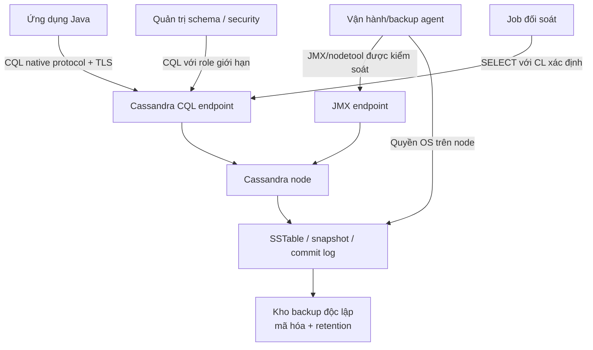
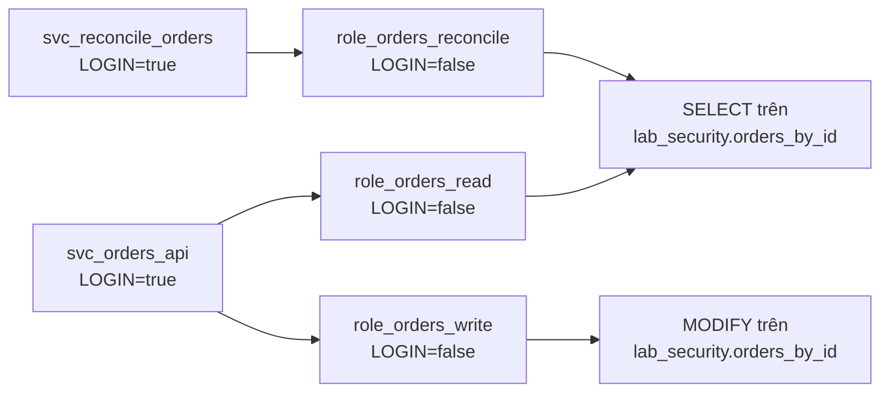

# Tách tài khoản ứng dụng, quản trị, sao lưu và đối soát

**Chương:** Bảo mật  
**Module:** `DATABASE_ENGINE_WIDE_COLUMN_CASSANDRA` — Apache Cassandra

Trong một cụm Apache Cassandra, **một mật khẩu dùng chung cho ứng dụng, DBA, backup job và tác vụ đối soát** biến nhiều luồng công việc thành một đặc quyền khổng lồ. Nếu mật khẩu bị lộ, rất khó biết thao tác do thành phần nào thực hiện; nếu thu hồi, có thể làm gián đoạn tất cả thành phần. Chỉ cần một lỗi trong service cũng có thể tạo cơ hội thay đổi schema, đọc dữ liệu không cần thiết hoặc phá hủy bảng ngoài ý định.

Cách thiết kế tốt hơn là **phân tách danh tính theo nhiệm vụ và lớp truy cập**:

- Ứng dụng chỉ đọc/ghi những bảng cần phục vụ request.
- Người/quy trình quản trị có quyền điều chỉnh schema, role hoặc vận hành node theo phạm vi được phê duyệt, không sử dụng tài khoản này trong đường xử lý API.
- Sao lưu dùng danh tính vận hành để snapshot/đọc file và đẩy backup tới nơi lưu an toàn, **không mặc định cần quyền CQL đọc mọi hàng**.
- Đối soát dùng tài khoản riêng, thường chỉ có quyền `SELECT` lên các bảng cần so sánh; tác vụ này **không được đồng nghĩa** với `nodetool repair`.

Bài liên hệ cơ chế roles/RBAC của Cassandra với kiến trúc wide-column, partition key, thiết kế bảng theo truy vấn, consistency level, replication, compaction, repair, xử lý lỗi và kết nối Java. Chủ đề là **ranh giới tin cậy, quyền tối thiểu và khả năng kiểm chứng**, không chỉ cú pháp `CREATE ROLE`.

> **Phạm vi:** Hướng dẫn tham chiếu Apache Cassandra 4.1/5.x với `CassandraRoleManager`, `PasswordAuthenticator` và `CassandraAuthorizer` hoặc cơ chế tương thích. Managed service, plugin authenticator/authorizer và phiên bản khác có thể cấp quyền theo cách riêng. Chỉ thực hành thay đổi role trong **cluster thử nghiệm có authentication/authorization đã cấu hình**. Không chạy lệnh tạo/thu hồi quyền trên production khi chưa có tài khoản phục hồi và kế hoạch rollback.

## 1. Mục tiêu học tập

Sau bài này, bạn có thể:

1. Phân biệt **authentication**, **authorization**, **encryption** và **audit**, cùng các lớp bảo vệ OS/JMX/CQL.
2. Thiết kế ma trận vai trò **application**, **schema/role admin**, **backup**, **reconciliation** và **break-glass**.
3. Giải thích vai trò `LOGIN`, `SUPERUSER`, quyền thừa kế role và tài nguyên `KEYSPACE`/`TABLE`.
4. Cấp `SELECT`, `MODIFY`, `CREATE` và `ALTER` ở phạm vi thích hợp, hiểu rõ **`MODIFY` bao gồm `TRUNCATE`**.
5. Dùng `LIST ROLES`, `LIST ALL PERMISSIONS` và `REVOKE` để chứng minh least privilege, không chỉ đọc tài liệu phân quyền.
6. Hiểu vì sao tài khoản backup thường hoạt động qua OS/filesystem và JMX; quyền CQL không tự cho phép copy SSTable hoặc gọi `nodetool snapshot`.
7. Xây dựng job đối soát read-only bằng CQL/Java, ghi rõ CL và giới hạn của việc đối soát logic.
8. Thiết kế secret rotation, khóa khẩn cấp, audit trail, phân tách nhiệm vụ và kiểm soát đường mạng.
9. Nêu rủi ro khi dùng tài khoản mặc định/superuser, chia sẻ mật khẩu hoặc cấp `ALL PERMISSIONS ON ALL KEYSPACES`.
10. Lập runbook tạo và thu hồi tài khoản có biên bản kiểm tra tác động tới ứng dụng/backup/đối soát.

## 2. Mô hình bảo mật nhiều lớp

### 2.1. Không thể chỉ bảo vệ cổng CQL

Một cluster Cassandra thường có nhiều đường truy cập:



Phải bảo vệ **tất cả** các đường tương ứng: CQL client-to-node TLS, authentication và authorization; internode TLS/đường mạng riêng; JMX; hệ điều hành và filesystem; bí mật của backup storage; hệ thống log. Cấu hình cài đặt mới của Cassandra có thể ưu tiên dễ dựng cluster nên **không được giả định các biện pháp này đều bật sẵn**.

### 2.2. Bốn câu hỏi trước khi cấp quyền

| Câu hỏi | Lớp liên quan | Ví dụ |
| --- | --- | --- |
| **Bạn là ai?** | Authentication / identity | `svc_orders_api` xác thực khi kết nối CQL |
| **Bạn được làm gì?** | Authorization / policy | `SELECT` trên một bảng, không có `DROP` |
| **Dữ liệu đi qua đâu?** | TLS/network/OS | Client chỉ đến DC được cho phép, internode có mã hóa |
| **Ai chứng minh thao tác đã xảy ra?** | Audit/monitoring | Log đăng nhập, thay role, SELECT/DML và thao tác JMX/OS theo nguồn |

Authentication trả lời danh tính, không tự giới hạn quyền. TLS bảo vệ lưu lượng trên mạng, không thay authorization. Audit ghi nhận hành động, không tự ngăn hành động đó. Backup hỗ trợ khôi phục, không ngăn tài khoản API gọi `TRUNCATE` nếu nó được quyền.

## 3. Phân tách theo nhiệm vụ và mức độ phá hủy

### 3.1. Ma trận vai trò mục tiêu

| Danh tính | Mục đích | Quyền cần cân nhắc | Không nên có |
| --- | --- | --- | --- |
| `svc_orders_api` | Xử lý request ứng dụng | `SELECT`/`MODIFY` trên các bảng thực sự dùng | `SUPERUSER`, quản lý role, `ALTER`/`DROP` schema, OS/JMX |
| `svc_orders_reader` (tùy thiết kế) | API chỉ đọc | `SELECT` trên một số bảng | `MODIFY`, quyền thay schema, đọc toàn keyspace khác |
| `operator_schema` | Migration có phê duyệt | `CREATE`/`ALTER` phạm vi keyspace/table, `DROP` nếu thật sự cần và được kiểm soát | Password nhúng vào Java API, chạy như một cron job không giám sát |
| `operator_identity` | Cấp/thu hồi role và policy | Quyền quản trị roles/`AUTHORIZE` được giới hạn | Dùng thường xuyên để đọc tất cả dữ liệu nghiệp vụ |
| `svc_backup_node` | Snapshot/copy SSTable sang kho backup | **OS/filesystem + JMX/nodetool** đủ dùng, backup repository write | `SUPERUSER` CQL mặc định, thay schema, query hàng loạt |
| `svc_reconcile_orders` | So sánh trạng thái nghiệp vụ | `SELECT` trên bảng/scope phục vụ đối soát | `MODIFY`, `DROP`, JMX repair/scrub, access mọi table |
| `break_glass_admin` | Sự cố khẩn cấp, recovery | Quyền cao có giám sát, phê duyệt và thời hạn | Tích hợp vào workload thường trực |

Một tổ chức có thể dùng danh tính khác nhau cho **mỗi dịch vụ, môi trường, datacenter hoặc pipeline**. Không cần tạo role người dùng cho mọi HTTP request; cần định danh ổn định và có thể truy vết cho mỗi **workload sở hữu quyền**.

### 3.2. Service account khác role chính sách

Cassandra sử dụng **role** vừa để xác thực user (`LOGIN=true`), vừa để nhóm các quyền (`LOGIN=false`). Ví dụ:



Điều này cho phép điều chỉnh **role quyền** mà không sửa từng tài khoản đăng nhập. Các quyền và role được thừa kế qua `GRANT role TO login_role`; không nên tạo vòng thừa kế. **`LOGIN` không được thừa kế** chỉ vì tài khoản thuộc role có LOGIN.

### 3.3. Quyền ít nhất tại đúng resource

Cấp `GRANT SELECT ON TABLE lab_security.orders_by_id` hẹp hơn `ON KEYSPACE lab_security`, còn `ON ALL KEYSPACES` là rất rộng. Keyspace chứa nhiều bảng; thêm một bảng mới có dữ liệu nhạy cảm có thể vô tình cho tài khoản quyền truy cập nếu trước đó cấp quyền ở mức keyspace.

Không cấp `ALL PERMISSIONS` chỉ vì việc migration/triển khai đang vướng một lỗi `Unauthorized`. Hãy xác định **request nào, resource nào và permission nào** thực sự thiếu, rồi cấp đúng một quyền cần thiết.

## 4. CQL permissions: những giới hạn quan trọng

### 4.1. Quyền trên dữ liệu và schema

| Permission | Resource thường dùng | Cho phép những gì? | Rủi ro |
| --- | --- | --- | --- |
| `SELECT` | TABLE / KEYSPACE | Đọc dữ liệu phù hợp phạm vi | Rò rỉ dữ liệu; không tự có row-level tenant isolation |
| `MODIFY` | TABLE / KEYSPACE | `INSERT`, `UPDATE`, `DELETE` **và `TRUNCATE`** trên tài nguyên tương ứng | Xóa/thay đổi dữ liệu quy mô lớn dù không có quyền `DROP` |
| `CREATE` | KEYSPACE, ALL KEYSPACES | Tạo bảng/keyspace theo scope | Schema sprawl; thay đổi tải hệ thống |
| `ALTER` | TABLE / KEYSPACE | Thay schema trong phạm vi | Thay mô hình/TTL/compaction hoặc replication |
| `DROP` | TABLE / KEYSPACE | Xóa schema/tài nguyên phù hợp | Phá hủy dữ liệu và đối tượng |
| `AUTHORIZE` | Resource/ROLE | Cấp/thu hồi permission hoặc quan hệ role theo tài nguyên | Leo thang quyền nếu scope quá rộng |
| `DESCRIBE` | ALL ROLES, MBEANS khi hỗ trợ | Xem metadata của roles/MBeans | Lộ cấu hình/khả năng quản trị |
| `EXECUTE` | FUNCTION/MBEAN khi hỗ trợ | Gọi function hoặc MBean operation | Có thể thực hiện thao tác vận hành nguy hiểm |

**Điểm dễ nhầm:** với Cassandra CQL RBAC thông thường, `MODIFY` không có tùy chọn tách riêng “INSERT nhưng không DELETE/TRUNCATE” ở cấp câu lệnh. Không nói rằng role `svc_orders_api` có `MODIFY` là “không thể xóa bảng” theo nghĩa dữ liệu: nó có thể xóa **hàng** hoặc `TRUNCATE` cả bảng nếu phiên bản/policy cho phép. Vì vậy phải kết hợp authorization với lớp service/API, kiểm tra lệnh bị cấm, tách luồng nhập dữ liệu và cơ chế khôi phục phù hợp.

### 4.2. Không có row-level RBAC cho mọi tenant bằng một GRANT thông thường

`GRANT SELECT ON TABLE orders_by_id` không hạn chế chỉ các hàng `tenant_id='tenant-01'`. Cassandra dựa vào partition key và query design để truy cập dữ liệu nhanh, nhưng RBAC phổ biến ở mức **keyspace/table**, không có một cú pháp `GRANT SELECT WHERE tenant_id=?` chung.

Nếu multi-tenant cần cô lập dữ liệu mạnh:

- Xét tách keyspace/table/cụm theo yêu cầu cách ly và chi phí vận hành.
- Bắt buộc truyền và kiểm tra tenant identity ở service layer.
- Thiết kế partition key/query theo tenant, tránh truy cập trái phép qua ID đoán được.
- Với phiên bản/bản phân phối có masking hoặc policy mở rộng, xác minh tính năng thực tế; **masking không tự tương đương row-level authorization**.
- Không coi “client không biết partition key” là biện pháp bảo mật.

### 4.3. Superuser được dành cho việc gì?

Role có `SUPERUSER=true` vượt qua các giới hạn quyền CQL thông thường. Tài khoản bootstrap/khẩn cấp nên:

- Không là credential mặc định của một service API.
- Không có mật khẩu dùng chung giữa nhiều người.
- Được lưu trong secret vault có phê duyệt hai người nếu chính sách yêu cầu.
- Ghi lại lý do, thời gian sử dụng và hành động sau sự kiện.
- Có quy trình thay mật khẩu/thu hồi khi nghi lộ.
- Có tài khoản khôi phục hoạt động được sau khi siết policy để tránh tự khóa toàn cụm.

Tách `operator_schema` khỏi `operator_identity` khi có điều kiện: người thay schema không nhất thiết được tạo user hoặc grant quyền cho chính mình.

## 5. Đảm bảo cơ chế authentication/authorization thực sự bật

Trong Apache Cassandra, các cài đặt liên quan thường nằm ở `cassandra.yaml`, ví dụ:

```yaml
# Minh họa tên provider, không phải cấu hình đầy đủ để copy chạy:
authenticator: PasswordAuthenticator
authorizer: CassandraAuthorizer
role_manager: CassandraRoleManager
```

Mặc định nhiều cấu hình lab có thể dùng `AllowAllAuthenticator`/`AllowAllAuthorizer`, làm `CREATE ROLE` không đại diện một biện pháp bảo vệ thực sự khi xác thực/phân quyền chưa được bật đúng. Các provider bên thứ ba có hành vi khác.

**Không tự sửa auth trên cluster production bằng một lần restart tất cả node.** Việc chuyển từ không xác thực sang xác thực cần kế hoạch bootstrap superuser, replication của `system_auth`, TLS, readiness và rolling restart theo version/runbook, kèm tài khoản dự phòng.

### 5.1. `system_auth` là dữ liệu nghiệp vụ của lớp bảo mật

Cassandra lưu một phần roles, credentials và permissions trong keyspace hệ thống `system_auth` khi dùng các provider mặc định. Nếu để RF không phù hợp hoặc replication/repair không ổn định, chính hoạt động login/phân quyền có thể gián đoạn khi một replica down.

Cần:

1. Xác minh RF của `system_auth` tại từng datacenter theo chính sách cụm.
2. Kiểm tra schema agreement/replica health trước khi chỉnh auth.
3. Lập lịch repair/backup phù hợp và hiểu các bảng auth không thể xử lý như một bảng ứng dụng thông thường.
4. Không tự sửa hàng trong `system_auth` để tạo/sửa user; dùng CQL role management.
5. Không sao chép trực tiếp hệ thống auth giữa các cụm rồi giả định metadata luôn tương thích.

Các role changes có cache/propagation semantics; không diễn giải một request vừa từ chối/chấp nhận là mọi node đã cập nhật ngay lập tức. Kiểm tra theo thời gian, phiên bản và provider.

### 5.2. TLS và network không phải phần tùy chọn

Bật CQL authentication nhưng truyền mật khẩu trên kết nối không mã hóa hoặc để cổng JMX/internode mở công khai vẫn tạo bề mặt tấn công. Cần bảo vệ:

- **Client-to-node TLS:** ứng dụng xác minh certificate/hostname và trust chain.
- **Internode encryption:** các node trao đổi mutation, gossip/streaming qua đường mạng được phép.
- **Cổng JMX/management:** chỉ truy cập từ management network, xác thực/ủy quyền và TLS khi phù hợp.
- **OS/data directory:** quyền file, disk encryption/volume policy, secret mounts.
- **Network segmentation:** firewall/security group hạn chế truy cập 9042, JMX và internode ports; không dựa vào password đơn độc.
- **Backup repository:** quyền write-only/append-only hoặc immutable retention nếu hệ thống hỗ trợ để giảm rủi ro xóa/sửa backup.

Không lưu certificate private key, password hoặc raw token trong Git hay log ứng dụng.

## 6. Lab: thiết lập một bảng và các role riêng biệt

> **Điều kiện:** Lab Cassandra đã bật authenticator/authorizer/role manager tương thích. Bạn có một tài khoản admin được ủy quyền tạo keyspace, bảng, role và grant. Các chuỗi mật khẩu trong lệnh **chỉ là placeholder minh họa**, không phải giá trị cần copy vào production. Trong thực tế dùng secret manager/provisioning được kiểm soát, tránh để password lộ trong shell history, transcript hoặc Git.

### 6.1. Xác nhận cluster và datacenter

```bash
nodetool status
cqlsh
```

Trong `cqlsh` (đăng nhập bằng danh tính admin lab thích hợp):

```sql
SELECT data_center, release_version FROM system.local;

SELECT keyspace_name, replication
FROM system_schema.keyspaces
WHERE keyspace_name = 'system_auth';
```

Tên DC bên dưới là `datacenter1` **giả định**; nếu khác thì phải chỉnh đúng tên. Với lab một node, dùng RF=1 để thao tác cấu hình đơn giản; RF=1 **không phải** cấu hình production có độ sẵn sàng cao.

### 6.2. Tạo keyspace và bảng ứng dụng

```sql
CREATE KEYSPACE IF NOT EXISTS lab_security
WITH replication = {
  'class': 'NetworkTopologyStrategy',
  'datacenter1': 1
}
AND durable_writes = true;

CREATE TABLE IF NOT EXISTS lab_security.orders_by_id (
    order_id uuid PRIMARY KEY,
    tenant_id text,
    state text,
    amount_cents bigint,
    updated_at timestamp
);

INSERT INTO lab_security.orders_by_id
    (order_id, tenant_id, state, amount_cents, updated_at)
VALUES (
    10000000-0000-4000-8000-000000000001,
    'tenant-lab',
    'CREATED',
    125000,
    '2026-11-21T00:00:00Z'
);
```

`order_id` là partition key của bảng này; CQL lookup chuẩn có điều kiện `WHERE order_id = ?`. `tenant_id` là trường nghiệp vụ chứ **không phải hàng rào RBAC**: role có `SELECT` trên bảng không tự bị hạn chế vào tenant đó.

### 6.3. Nhóm quyền không được đăng nhập

```sql
-- Chạy bằng role quản trị được phép, chỉ trên lab.
CREATE ROLE IF NOT EXISTS role_orders_read
WITH LOGIN = false AND SUPERUSER = false;

CREATE ROLE IF NOT EXISTS role_orders_write
WITH LOGIN = false AND SUPERUSER = false;

CREATE ROLE IF NOT EXISTS role_orders_reconcile
WITH LOGIN = false AND SUPERUSER = false;

GRANT SELECT ON TABLE lab_security.orders_by_id
TO role_orders_read;

GRANT MODIFY ON TABLE lab_security.orders_by_id
TO role_orders_write;

GRANT SELECT ON TABLE lab_security.orders_by_id
TO role_orders_reconcile;
```

Để tránh cấp thừa, role đối soát được tách khỏi role app read mặc dù hiện đều có `SELECT`. Khi sau này app được quyền đọc bảng mới, tài khoản đối soát **không tự** có thêm quyền nếu không grant riêng.

**Lưu ý về `MODIFY`:** role viết có khả năng `INSERT`, `UPDATE`, `DELETE` và `TRUNCATE` bảng phù hợp quyền. Không gắn role này cho một tác vụ chỉ cần đối soát.

### 6.4. Tài khoản đăng nhập theo workload

```sql
-- Các mật khẩu sau chỉ là placeholder. KHÔNG chạy nguyên trong production.
-- Công cụ provisioning phải thay bằng secret ngẫu nhiên được quản lý.
CREATE ROLE IF NOT EXISTS svc_orders_api
WITH LOGIN = true
 AND SUPERUSER = false
 AND PASSWORD = 'LAB_ONLY_REPLACE_ME_API';

CREATE ROLE IF NOT EXISTS svc_reconcile_orders
WITH LOGIN = true
 AND SUPERUSER = false
 AND PASSWORD = 'LAB_ONLY_REPLACE_ME_RECONCILE';

GRANT role_orders_read TO svc_orders_api;
GRANT role_orders_write TO svc_orders_api;

GRANT role_orders_reconcile TO svc_reconcile_orders;
```

Role có `LOGIN=true` được phép xác thực nếu authenticator hỗ trợ cách thức credential đó; role nhóm `LOGIN=false` không dùng để tạo session. Không chia sẻ một mật khẩu giữa hai account chỉ vì chúng cùng truy cập bảng.

### 6.5. Role quản trị schema là một đường khác

Trong lab, có thể tạo một login dành cho **schema migration** riêng, chỉ khi thực sự có quy trình migration:

```sql
CREATE ROLE IF NOT EXISTS role_schema_change
WITH LOGIN = false AND SUPERUSER = false;

CREATE ROLE IF NOT EXISTS operator_schema
WITH LOGIN = true
 AND SUPERUSER = false
 AND PASSWORD = 'LAB_ONLY_REPLACE_ME_SCHEMA';

-- Cho phép tạo bảng trong keyspace lab, không cho sửa mọi keyspace.
GRANT CREATE ON KEYSPACE lab_security
TO role_schema_change;

-- Chỉ cho phép ALTER bảng cụ thể, không tự cấp DROP.
GRANT ALTER ON TABLE lab_security.orders_by_id
TO role_schema_change;

GRANT role_schema_change TO operator_schema;
```

Đây chỉ là **ví dụ về scope**. Một migration thật có thể cần `ALTER`/`DROP` một bảng khác hoặc tạo materialized view/index; khi đó đánh giá quyền riêng cho migration/job, có phê duyệt và cửa sổ thời gian. Không mặc định cấp `DROP ON KEYSPACE` hoặc `ALL ON ALL KEYSPACES` để mọi migration có thể chạy không cần xem xét.

Cần chú ý quyền của **người tạo resource**: Cassandra có thể tự cấp các quyền thích hợp lên tài nguyên mới cho creator. Vì vậy, nếu `operator_schema` tạo bảng mới, sau migration cần kiểm kê các quyền có được từ hành động tạo, không chỉ các GRANT đã viết trong runbook.

## 7. Kiểm chứng quyền hiệu lực và quyền bị từ chối

### 7.1. Kiểm tra từ tài khoản quản trị được ủy quyền

```sql
LIST ROLES OF svc_orders_api;
LIST ROLES OF svc_reconcile_orders;

LIST ALL PERMISSIONS OF svc_orders_api;
LIST ALL PERMISSIONS OF svc_reconcile_orders;

LIST ALL PERMISSIONS
ON lab_security.orders_by_id
OF svc_orders_api;
```

`LIST ALL PERMISSIONS` thường bao gồm quyền thừa kế từ role khác. `NORECURSIVE` có thể giới hạn kết quả theo semantics phiên bản. Việc liệt kê **tất cả roles** của cụm có thể đòi `DESCRIBE ON ALL ROLES`; một tài khoản app thông thường không được phép kiểm kê toàn bộ tài khoản.

Kết quả kỳ vọng ở lab:

| Danh tính | `SELECT orders_by_id` | `MODIFY orders_by_id` | `ALTER orders_by_id` | `SUPERUSER` |
| --- | --- | --- | --- | --- |
| `svc_orders_api` | Có, qua role read | Có, qua role write | Không | Không |
| `svc_reconcile_orders` | Có | Không | Không | Không |
| `operator_schema` | Không cần SELECT mặc định | Không cần MODIFY mặc định | Có, theo GRANT | Không |

**Không diễn giải bảng kỳ vọng là bằng chứng cấu hình đã thực thi.** Phải kiểm tra `LIST...` và kiểm thử trên phiên đăng nhập thật vì có thể tồn tại quyền trực tiếp/thừa kế khác.

### 7.2. Test dương với SELECT

Đăng nhập bằng `svc_reconcile_orders` vào **lab** theo cách an toàn của công cụ/secret provider, rồi chạy:

```sql
SELECT order_id, tenant_id, state, amount_cents
FROM lab_security.orders_by_id
WHERE order_id = 10000000-0000-4000-8000-000000000001;
```

Kết quả logic dự kiến là hàng `tenant-lab` ở trạng thái `CREATED`. Nếu không đọc được, xem error cụ thể: sai password/authentication, role chưa được grant, cache permissions chưa cập nhật, sai keyspace, node/CL hay unavailable. Không “sửa” bằng cách cấp superuser.

### 7.3. Test âm không được làm hỏng production

Để chứng minh `svc_reconcile_orders` không ghi được, có thể thử **trong bảng disposable** với khóa thử riêng:

```sql
-- CHỈ dùng khi đăng nhập bằng svc_reconcile_orders trong cluster lab:
-- Nếu trả Unauthorized thì chính sách cấm ghi hoạt động.
-- Nếu bất ngờ thành công, dữ liệu mẫu đã bị thay đổi: dừng test,
-- ghi nhận lỗi phân quyền và xử lý theo runbook.
UPDATE lab_security.orders_by_id
SET state = 'SHOULD_NOT_BE_AUTHORIZED'
WHERE order_id = 10000000-0000-4000-8000-000000000099;
```

**Không chạy test âm phá hủy (TRUNCATE/DROP/DELETE) trên production.** Kết quả `Unauthorized` từ một lệnh không thay thế toàn bộ chính sách: còn quyền trên resource khác, role thừa kế, plugin access control và cấu hình node. Nên có test automation an toàn cho least privilege ở CI/staging khi policy thay đổi.

### 7.4. Thu hồi quyền một cách có kiểm soát

```sql
-- Ví dụ trên lab: tạm ngừng quyền đối soát của nhóm.
REVOKE SELECT ON TABLE lab_security.orders_by_id
FROM role_orders_reconcile;

-- Nếu muốn cấp lại trong bài lab:
GRANT SELECT ON TABLE lab_security.orders_by_id
TO role_orders_reconcile;
```

Nếu `svc_reconcile_orders` còn được SELECT qua role khác, việc revoke từ một role sẽ **không loại bỏ mọi đường cấp quyền**. Vì vậy sau revoke phải chạy lại `LIST ALL PERMISSIONS OF svc_reconcile_orders` và kiểm thử. Một số thay đổi quyền cần thời gian đến khi cache/auth state trên các node phản ánh; dùng cửa sổ xác minh phù hợp.

## 8. Tài khoản ứng dụng: đọc và ghi theo đúng chức năng

### 8.1. Không dùng cùng một identity cho mọi microservice

Nếu service `orders` và `billing` cùng dùng tài khoản `cassandra`, một lỗi trong service orders có thể đọc bảng billing hoặc thao tác schema toàn cụm. Nên tách:

- `svc_orders_api`: bảng đơn hàng cần thiết.
- `svc_billing_api`: chỉ bảng thanh toán được phê duyệt.
- `svc_orders_projection`: worker cập nhật read model riêng, nếu cần.
- `svc_reconcile_orders`: đọc để đối soát, không cập nhật.

Cùng một table có thể cần hai kiểu truy cập, nhưng tài khoản khác nhau giúp audit, rotation, hạn chế đường lan truyền khi bị lộ credential và giảm blast radius.

### 8.2. Quyền dựa theo API thật, không theo tên service

Trước khi grant, lập bảng:

| API/job | CQL query thực tế | Table | Permission cần xem |
| --- | --- | --- | --- |
| `GET /orders/{id}` | SELECT theo `order_id` | `orders_by_id` | `SELECT` |
| `POST /orders` | INSERT theo khóa chính | `orders_by_id` | `MODIFY`, kèm rào chắn application |
| `PATCH /orders/{id}` | UPDATE trạng thái | `orders_by_id` | `MODIFY` |
| `reconcile-orders` | SELECT kiểm tra dữ liệu | `orders_by_id` | `SELECT` |
| Schema migration | CREATE/ALTER TABLE | Keyspace/table cụ thể | `CREATE`/`ALTER` theo nhiệm vụ |
| Snapshot file | `nodetool snapshot` và copy SSTable | OS/JMX/data directory | **Không suy ra từ `SELECT` CQL** |

Quyền `MODIFY` rộng hơn câu API “được cập nhật trạng thái”; cần logic ứng dụng kiểm tra input, tenant, trạng thái nghiệp vụ và idempotency. Cassandra không tự bảo vệ bất biến “không cho amount âm” từ permission `MODIFY`.

### 8.3. Prepared statements và parameterization

Khi truy vấn dữ liệu từ Java, dùng prepared/bound statements thay vì ghép chuỗi CQL từ input. Việc dùng prepared statement **không tăng quyền**; server vẫn kiểm tra role trên session. Nó giúp tránh một số lỗi injection/query construction và nhất quán query shape.

Không cho ứng dụng chuyển username/password hoặc quyết định role theo một header do client cung cấp. Danh tính CQL được gắn với workload/cấu hình đã được hệ thống tin cậy, không phải với dữ liệu người dùng bên ngoài.

## 9. Quản trị: schema, roles và quyền vận hành

### 9.1. Quản trị CQL không giống quản trị host

Một người có thể:

- Được `ALTER TABLE` nhưng không có SSH vào node.
- Có quyền xem log/disk metrics nhưng không có quyền thay schema.
- Có quyền quản lý JMX snapshot nhưng không đọc bảng nghiệp vụ bằng CQL.
- Có quyền tài khoản break-glass theo quy trình, nhưng không dùng nó cho automation thường ngày.

Tách **schema change**, **security policy change**, **node maintenance** và **incident response** thành các nhiệm vụ có owner khác nhau khi tổ chức đủ lớn.

### 9.2. Dùng account quản trị mạnh theo mô hình break-glass

Runbook:

1. Xác nhận sự cố và tác vụ không thể thực hiện bởi role giới hạn.
2. Yêu cầu phê duyệt, ghi ticket/change ID.
3. Lấy credential từ vault bằng danh tính con người, có MFA/cấp quyền thời hạn nếu hạ tầng hỗ trợ.
4. Thực hiện các lệnh CQL/JMX/OS chính xác, lưu audit trail.
5. Kiểm tra kết quả và tác động tới replica/CL.
6. Thu hồi quyền tạm hoặc rotate credential theo chính sách.
7. Đối soát lại `LIST ROLES`/`LIST PERMISSIONS` để tìm quyền tồn dư.

Không dùng root/superuser để khắc phục lỗi application permission thông thường.

### 9.3. Những thao tác có blast radius lớn

| Thao tác | Vì sao nguy hiểm | Kiểm soát |
| --- | --- | --- |
| `DROP TABLE/KEYSPACE` | Xóa schema và làm dữ liệu không còn truy cập theo cách bình thường | Phê duyệt, backup, migration |
| `TRUNCATE TABLE` | Xóa dữ liệu cả bảng dù không phải DROP | Kiểm soát account có `MODIFY` và guardrail ngoài CQL |
| `ALTER KEYSPACE ... replication` | Đổi số/vị trí replica, có thể cần rebuild/repair | Runbook topology, capacity và khôi phục |
| `GRANT ALL ...` | Mở rộng quyền vượt mục tiêu | Least privilege review và kiểm tra định kỳ |
| `nodetool scrub/cleanup/removenode` | Có thể làm mất dữ liệu hoặc thay topology | Quyền JMX/OS, preflight, backup |
| Thay `cassandra.yaml`/certificates | Có thể làm mất truy cập hoặc hỏng kết nối internode | Change control, rollback, kiểm chứng node-by-node |

**Quyền CQL không bảo vệ tuyệt đối khỏi việc administrator có quyền filesystem:** ai có thể đọc/copy SSTable ở OS có thể mang dữ liệu ra khỏi cluster và phân tích riêng. Do đó tài khoản hạ tầng mạnh cần giám sát độc lập.

## 10. Sao lưu: tại sao không dùng tài khoản superuser CQL?

### 10.1. Backup ở mức SSTable là tác vụ node/filesystem

Một quy trình snapshot/backup Cassandra điển hình gồm:

1. Lập lịch snapshot theo node/table/keyspace phù hợp.
2. Gọi `nodetool snapshot` qua JMX (hoặc cơ chế quản lý của bản phân phối).
3. Xác nhận các tệp SSTable/snapshot, schema và metadata cần phục hồi.
4. Copy dữ liệu qua OS/agent sang storage **độc lập**, bảo vệ đường truyền.
5. Lưu manifest, checksum, phiên bản, timestamp, retention.
6. Định kỳ thử restore vào cluster disposable.

**`GRANT SELECT ON KEYSPACE` không tự cấp quyền đọc file SSTable**. Ngược lại, khả năng copy file/snapshot ở OS không đòi tài khoản backup phải `SELECT` mọi hàng bằng CQL. Hai lớp này cần được bảo vệ riêng.

### 10.2. Danh tính backup nên có gì?

| Lớp | Quyền nên có nếu job cần | Điều cần tránh |
| --- | --- | --- |
| OS/service | Quyền đọc snapshot của node, ghi vào thư mục tạm/backup được chỉ định | Shell/root toàn máy nếu không cần; ghi vào data directory sống |
| JMX/nodetool | Thao tác snapshot/status được quản lý, theo cơ chế JMX auth cụ thể | Cho phép mọi MBean operation hoặc remote JMX không mã hóa |
| Backup repository | Upload/append object, encryption và retention phù hợp | Quyền xóa toàn bộ lịch sử backup bằng credential thường trực |
| CQL (tùy job) | Metadata/schema hoặc SELECT thật sự cần cho *logical export* | Superuser, `ALL KEYSPACES` mặc định |
| Secret management | Credential riêng của job, rotation theo lịch | Đưa token vào script Git/CLI args/log |
| Observability | Nhật ký start/end, bytes, checksum, lỗi và restore test | Chỉ ghi “snapshot command success” rồi xem là xong |

**Hai loại backup khác nhau:** *SSTable snapshot backup* dùng file/OS/JMX; *logical export qua CQL* dùng SELECT và đọc dữ liệu thực. Không gộp chúng thành một identity superuser “để việc gì cũng làm được”.

### 10.3. Ví dụ lệnh snapshot (chỉ lab)

```bash
nodetool help snapshot

# Thực hiện trên node được phân công, khi có đủ quyền JMX:
nodetool snapshot -t lab_backup_20261121 -cf orders_by_id lab_security

nodetool listsnapshots
```

Với cluster nhiều replica, **snapshot trên một node không tự tạo backup trên mọi node/DC**. Cần nhất quán thời điểm, schema, topology, RF và chiến lược phục hồi. Snapshot cùng đĩa đang lỗi không phải backup độc lập. Dữ liệu trong commit log hoặc các mutation đang bay trong cluster có thể yêu cầu chính sách độ nhất quán/RPO riêng.

Không viết ví dụ copy file sang bucket public hay in credential storage. Tool backup thực tế nên dùng IAM/storage policy và mã hóa đúng tổ chức.

### 10.4. Restore là quyền nguy hiểm hơn backup

Khôi phục có thể ghi đè dữ liệu, dùng `sstableloader`, đổi keyspace/schema, hoặc thay node tùy tình huống. **Không tự cấp cho job backup hàng ngày quyền restore/delete/replace**. Dùng account/role riêng và phê duyệt khẩn cấp, thử quy trình trên cluster disposable. Để tránh sai lầm, phải xác định backup có chứa tombstone, TTL, schema, system metadata phù hợp và tương thích phiên bản.

Một bản backup không được kiểm thử restore chỉ là **một tập file đã sao chép**, chưa chứng minh RPO/RTO.

## 11. JMX và quyền vận hành là một miền ủy quyền khác

### 11.1. CQL permissions không tự cấp quyền JMX

`nodetool` thường truy cập JMX; các cấu hình JMX authentication/authorization có thể độc lập với client CQL. Cassandra cũng có **chế độ tích hợp JMX auth/authorization** cho phép dùng roles và quyền trên MBeans, nhưng **chỉ khi cấu hình tương ứng được bật**. Vì thế:

- Cấp `SELECT ON TABLE` không đủ để gọi snapshot.
- Có account login CQL không đồng nghĩa được kết nối JMX.
- `GRANT EXECUTE ON ALL MBEANS` sẽ rất rộng nếu chế độ tích hợp được bật; không dùng làm “fix” chung.
- JMX remote access cần network restriction, authentication và TLS phù hợp; JMX local mặc định có thể có hành vi xác thực khác remote tùy cấu hình.
- Một MBean operation có thể mang quyền quản trị đáng kể dù tài khoản không có `SUPERUSER` CQL.

### 11.2. Giới hạn MBean theo chức năng, không đoán permission

Để thiết kế account backup đọc/snapshot:

1. Kiểm kê tool backup gọi MBean/ObjectName/operation gì trên **phiên bản thực tế**.
2. Chọn cơ chế JMX auth được hỗ trợ (JMX standard hoặc tích hợp).
3. Cấp đúng quyền theo resource được xác minh; nếu mô hình JMX chuẩn không đủ granular, dùng operator/broker được kiểm soát thay vì cấp mọi quyền cho agent.
4. Thử **người dùng được phép** và **người dùng bị từ chối** trên lab.
5. Theo dõi thao tác JMX và OS bằng hệ thống audit thích hợp; Cassandra CQL audit log không chứa mọi lệnh `nodetool`.
6. Không mở JMX ra Internet để tiện chạy backup từ một cron job bên ngoài.

Một account có quyền đọc snapshot trên disk **không** có quyền sửa data directory sống; quyền POSIX/ACL và cách agent mount volume cần thiết kế riêng.

## 12. Đối soát dữ liệu: read-only không đồng nghĩa scan vô hạn

### 12.1. Đối soát có ít nhất hai nghĩa

**Đối soát nghiệp vụ (reconciliation):** so dữ liệu Cassandra với hệ thống nguồn/sổ cái, hoặc so những read models theo key/time window để tìm thiếu, thừa, sai trạng thái. Thường dùng CQL `SELECT` và báo cáo sai lệch, **không tự sửa dữ liệu**.

**Đối soát replica (anti-entropy repair):** Cassandra so các replica trên token ranges và stream phần chênh lệch theo `nodetool repair`. Đây là **thao tác vận hành**, cần JMX/quyền node và tài nguyên; **không** phải một câu SELECT read-only.

Hai nhiệm vụ này cần tài khoản, SLA và approval khác nhau.

### 12.2. Thiết kế job đối soát theo partition key

Giả sử bảng `lab_security.orders_by_id` có `order_id` làm partition key. Job chỉ kiểm tra những đơn hàng đã có từ bên nguồn, thực hiện:

```sql
SELECT order_id, tenant_id, state, amount_cents, updated_at
FROM lab_security.orders_by_id
WHERE order_id = 10000000-0000-4000-8000-000000000001;
```

Tránh `SELECT * FROM ...` quét toàn bộ keyspace hoặc thêm `ALLOW FILTERING` để truy vấn không có partition key. Một job đối soát read-only vẫn có thể gây **DoS hiệu năng** nếu nó scan hàng triệu partition liên tục, kéo p99 của ứng dụng tăng. Cần giới hạn rate, concurrency, page size, số khóa, khoảng thời gian và số DC truy cập.

### 12.3. Consistency level quyết định ý nghĩa kết quả

| CL / lựa chọn | Điều nó giúp quan sát | Điều không chứng minh |
| --- | --- | --- |
| `ONE` | Một replica đủ phản hồi, thường nhẹ hơn | Không chắc thấy mutation mới nhất từ replica khác |
| `LOCAL_QUORUM` (RF local phù hợp) | Đọc ở quorum trong DC đang phục vụ | Không audit mọi replica vật lý, không linearizable toàn cluster |
| `ALL` | Đòi mọi replica liên quan đáp ứng read | Không tự biến mỗi SELECT thành toàn keyspace snapshot; nhạy lỗi node |
| Read ở hai DC theo route riêng | Giúp so kết quả trong hai vùng | Hai phép đọc khác thời điểm không phải snapshot nguyên tử |
| `nodetool repair` | Đối chiếu replica/ranges | Không biết trạng thái nghiệp vụ nào phải thắng khi writer xung đột timestamp |

Cassandra có **eventual consistency** theo thiết kế. Nếu write đang diễn ra, một kết quả mismatch có thể do lag/điều kiện CL, không nhất thiết corruption. Khi so sánh dữ liệu nghiệp vụ, cần chọn cửa sổ **đã ổn định**, watermark/version từ nguồn, correlation ID và chính sách retry có kiểm soát.

### 12.4. Không dùng job SELECT để tự “chữa” inconsistency

Khi thấy mismatch:

1. Ghi cặp khóa, thời điểm, CL, DC/coordinator và kết quả đã được redacted.
2. Kiểm tra response error vs hàng không tồn tại.
3. Đối chiếu source-of-truth, tombstone/TTL, timestamp và sự kiện nghiệp vụ.
4. Điều tra hints/repair state nếu nghi replica divergence.
5. Nếu cần sửa, tạo **quy trình sửa dữ liệu riêng** có phê duyệt và credential khác (không cho job read-only tự nâng quyền).
6. Kiểm tra lại sau sửa, ghi những trường hợp còn không kết luận được.

**Không** cấp `MODIFY` cho `svc_reconcile_orders` chỉ vì muốn sửa một mismatch tự động; việc đó xóa ranh giới giám sát và quyền ghi.

## 13. Java Driver: ứng dụng và đối soát dùng danh tính khác nhau

### 13.1. Tách cấu hình theo deployment

Java Driver 4.x cho phép cấu hình username/password và TLS context cho mỗi `CqlSession`. Ví dụ dưới đây nhận credential **được truyền từ hệ thống bí mật tin cậy**, không hardcode. Trong thực tế nên tạo session một lần theo vòng đời service và xác minh certificates.

```java
import com.datastax.oss.driver.api.core.CqlSession;
import com.datastax.oss.driver.api.core.DefaultConsistencyLevel;
import com.datastax.oss.driver.api.core.cql.PreparedStatement;
import com.datastax.oss.driver.api.core.cql.Row;

import java.net.InetSocketAddress;
import java.util.UUID;
import javax.net.ssl.SSLContext;

public final class AccountSeparationExample {
    // username/password đến từ secret manager hoặc provider đáng tin cậy.
    // tlsContext phải có trust material xác minh server, không tắt verify.
    public static CqlSession connect(
            String hostname,
            int port,
            String localDc,
            String username,
            String password,
            SSLContext tlsContext) {
        return CqlSession.builder()
            .addContactPoint(new InetSocketAddress(hostname, port))
            .withLocalDatacenter(localDc)
            .withAuthCredentials(username, password)
            .withSslContext(tlsContext)
            .build();
    }

    // Chỉ gọi từ job đang dùng account svc_reconcile_orders.
    public static void reconcileOne(CqlSession readOnlySession,
                                    UUID orderId) {
        PreparedStatement query = readOnlySession.prepare(
            "SELECT order_id, tenant_id, state, amount_cents, updated_at " +
            "FROM lab_security.orders_by_id WHERE order_id = ?"
        );

        try {
            Row row = readOnlySession.execute(
                query.bind(orderId).setConsistencyLevel(
                    DefaultConsistencyLevel.LOCAL_QUORUM)
            ).one();

            if (row == null) {
                System.out.println("ABSENT: " + orderId);
                return;
            }

            // Trong hệ thống thật: so với source-of-truth có watermark;
            // chỉ in dữ liệu đã redacted, không log toàn bộ thông tin khách hàng.
            System.out.println(
                "FOUND: " + row.getUuid("order_id") +
                ", state=" + row.getString("state") +
                ", amount=" + row.getLong("amount_cents")
            );
        } catch (RuntimeException ex) {
            // Timeout/unavailable không đồng nghĩa "không tồn tại".
            System.err.println("READ_ERROR for " + orderId +
                ", type=" + ex.getClass().getSimpleName());
        }
    }
}
```

**Lưu ý phiên bản/lab:** `LOCAL_QUORUM` trong ví dụ chỉ có ý nghĩa khi DC có RF phù hợp và đủ replica để đáp ứng. Nếu bạn tạo lab RF=1 theo mục 6, local quorum cũng bằng 1, nhưng không cho khả năng chịu lỗi; trong production RF/CL phải thiết kế theo yêu cầu riêng.

Java Driver không tự phân biệt “session này là backup account” bằng tên method: server cấp quyền dựa trên role đã xác thực. Không để username/password của `operator_schema` trong cùng service runtime với `svc_orders_api` “cho tiện migration”.

### 13.2. Vì sao mỗi deployment nên có secret khác nhau?

Nếu tất cả replicas của microservice dùng chung account, blast radius khi secret lộ có thể bao trùm mọi region. Có thể dùng account riêng theo environment/region, nhưng cân nhắc số role, quota/management overhead và nhu cầu audit. Tối thiểu phải tách **production vs staging**, **API vs backup**, **read-only reconcile vs writer**.

Nên dùng secret manager với rotation có kiểm tra: old/new credential tồn tại song song trong giai đoạn chuyển đổi khi thiết kế cho phép, triển khai ứng dụng từng nhóm, quan sát auth failures rồi thu hồi cũ. Không đổi mật khẩu một role đang được tất cả clients dùng cùng lúc mà không lập kế hoạch lỗi kết nối.

### 13.3. Không đặt password trong CLI argument hay source

Lệnh `cqlsh -p <password>` hoặc `nodetool -pw <password>` có thể để lộ secrets trong process list, shell history, log automation hoặc CI output tùy nền tảng. Chọn cơ chế nhập/credential file có quyền chặt/secret injection của platform; không ghi credential thực vào bài lab, Git hay ticket.

Với Java, không log exception chứa cấu hình kết nối nguyên văn nếu có nguy cơ in ra secret. Chỉ ghi error class, request correlation ID và thông số không nhạy cảm cần để điều tra.

## 14. Secret lifecycle: tạo, phân phối, rotate, thu hồi

### 14.1. Phân biệt rotation và revoke

- **Rotate:** thay secret cho một identity vẫn được dùng; cần tránh downtime.
- **Revoke permission:** tài khoản vẫn login được nhưng không còn quyền trên resource cụ thể.
- **Disable login:** `ALTER ROLE role_name WITH LOGIN=false` theo cơ chế tương ứng; có thể ảnh hưởng session hiện tại khác nhau tùy version/cache.
- **DROP ROLE:** xóa định danh, làm mất khả năng đăng nhập/grants liên quan; cần kiểm tra các workload còn phụ thuộc.
- **Break glass:** cấp quyền cao tạm thời, sau đó thu hồi và đánh giá hậu kiểm.

### 14.2. Quy trình rotation an toàn cho dịch vụ

1. Kiểm kê account, nơi cất secret, owner, jobs dùng account, DC/endpoint.
2. Tạo credential mới qua secret manager/provisioning, không truyền qua nơi thiếu bảo vệ.
3. Thử kết nối TLS/auth và `SELECT`/`MODIFY` được phê duyệt trên canary.
4. Rollout secret theo nhóm instances; theo dõi auth error, request p99 và connection churn.
5. Xác nhận **không còn instance nào dùng secret cũ**.
6. Vô hiệu credential/role cũ hoặc hoàn tất cập nhật mật khẩu theo chiến lược đã chọn.
7. Kiểm kê `LIST PERMISSIONS`/`LIST ROLES`, ghi ticket/audit và rollback window.

Một số hệ thống không hỗ trợ nhiều mật khẩu đồng thời cho cùng một role. Khi cần zero-downtime rotation, có thể dùng **hai login roles với cùng policy group** trong cửa sổ chuyển tiếp, rồi thu hồi role cũ sau khi đã xác nhận traffic. Không tạo hàng trăm account song song vô thời hạn.

### 14.3. Xử lý credential bị lộ

- Ưu tiên giảm quyền/khóa danh tính bị lộ theo incident response policy.
- Ghi lại thời gian lộ, scope bảng/keyspace/đường JMX/backup repository mà credential có thể truy cập.
- Tìm sự kiện login và DDL/DML bất thường qua audit logs và telemetry; nhớ giới hạn của audit retention và node coverage.
- Rotate tất cả bí mật liên quan nếu có cơ sở bị ảnh hưởng.
- Kiểm tra thay đổi schema/roles, dữ liệu đã đọc hoặc sửa, backup bị xóa/sửa.
- Chỉ phục hồi quyền khi scope đã được đánh giá và owner phê duyệt.

Không xóa audit logs trước khi hoàn thành điều tra.

## 15. Audit: chứng minh được ai đã làm gì đến mức nào?

### 15.1. CQL audit logging

Apache Cassandra 4.0+ cung cấp cơ chế **audit logging** có thể ghi hoạt động CQL, đăng nhập thành công/thất bại, kiểm tra quyền và các thay đổi như `CREATE ROLE`/`GRANT`/`REVOKE`, tùy cấu hình include/exclude categories/users/keyspaces.

Ví dụ những sự kiện cần giám sát:

- Login bất thường của `svc_orders_api` từ địa chỉ/region không quen thuộc.
- `Unauthorized` đối với lệnh schema hoặc role changes.
- Tài khoản đối soát xuất hiện `MODIFY` hoặc `TRUNCATE`.
- `GRANT ALL PERMISSIONS` hoặc nâng `SUPERUSER`.
- Lưu lượng `SELECT` tăng vọt từ service account có quyền đọc rộng.
- Thay đổi quyền được tạo và thu hồi trong cửa sổ rất ngắn.

Audit log Cassandra thường được tạo **trên coordinator nơi nhận request**, không tự replicated như dữ liệu bảng. Không thể chỉ đọc audit file của một node rồi kết luận đã thấy mọi CQL request của cluster. Cần thu log từ **tất cả coordinator liên quan**, gửi về kho log bảo vệ và đặt retention.

### 15.2. Audit có phạm vi giới hạn

Audit log Cassandra **không thay**:

- Audit lệnh `nodetool`/JMX.
- Log của `sudo`/systemd/SSH và truy cập filesystem snapshot/SSTable.
- Log truy cập/xóa backup repository.
- Quy trình review quyền và service ownership.
- Audit của reverse proxy/API gateway hoặc identity provider.
- Đảm bảo tính bất biến/lưu trữ của chính log.

Với backup và recovery, thường cần **hai bộ bằng chứng**: sự kiện Cassandra/JMX ở node và sự kiện object storage/IAM của backup repository. Một dòng “backup completed” không chứng minh blob không bị thay, có thể restore được hoặc đúng thời điểm RPO.

### 15.3. PII và câu lệnh có mật khẩu trong log

Audit logs có thể chứa text CQL, địa chỉ nguồn, tên role và metadata khác. Dù Cassandra có cơ chế ẩn mật khẩu trong nhiều trường hợp DCL hợp lệ, **không được dựa vào đó để đặt secret thật trong transcript/git hoặc tự tin rằng mọi câu lệnh sai cú pháp đều được che kín**.

Thiết kế logging cần:
- Không log raw credentials hoặc toàn bộ payload nhạy cảm khi không cần.
- Phân quyền đọc log và mã hóa lưu trữ.
- Đồng bộ clock/UTC và correlation ID.
- Kiểm tra tốc độ tăng log, retention và storage.
- Phân biệt kết quả query success, auth failure, và các thao tác OS/JMX chưa được cover.

**Không bật Full Query Logging để thay thế audit** mà chưa hiểu sự khác biệt: FQL phục vụ ghi lại truy vấn thành công và replay/analysis theo tính năng, còn audit tập trung giám sát hoạt động và sự kiện xác thực/ủy quyền.

## 16. Access review định kỳ và chống quyền tích lũy

### 16.1. Role drift xảy ra thế nào?

Một service bắt đầu chỉ đọc một bảng. Tháng sau migration thất bại vì thiếu quyền, người trực cấp tạm `ALL PERMISSIONS ON KEYSPACE`. Vài tháng tiếp, user đổi nhóm nhưng không revoke role cũ. Kết quả là tài khoản có quyền rộng dần dù code không cần nữa.

Ngăn drift bằng:

1. **Policy as code** cho role → resource → permission và owner.
2. Review `LIST ALL PERMISSIONS`, bao gồm **quyền trực tiếp và thừa kế**.
3. So sánh quyền thực tế với manifest được phê duyệt.
4. Xác nhận tài khoản còn được service/job nào sử dụng; loại orphan accounts.
5. Thu hồi quyền không dùng, có canary trước khi áp dụng rộng.
6. Audit các trường hợp `SUPERUSER`, `AUTHORIZE`, `DROP` và `ALL KEYSPACES`.
7. Sau migration, thu hồi quyền cấp tạm và xác minh bản ghi thay đổi quyền.
8. Đảm bảo tài khoản break-glass không được dùng bởi service account.

### 16.2. Ma trận kiểm tra theo loại danh tính

| Kiểm tra | App | Admin | Backup | Đối soát |
| --- | --- | --- | --- | --- |
| Owner/credential riêng | Bắt buộc | Theo cá nhân/chức năng | Theo pipeline/host | Theo job |
| Có login CQL? | Có | Có nếu nhiệm vụ CQL | **Không bắt buộc** | Có nếu dùng CQL |
| `SELECT` trên dữ liệu? | Chỉ bảng cần | Chỉ khi nhiệm vụ cần | Không mặc định | Chỉ bảng đối soát |
| `MODIFY`? | Chỉ writer; lưu ý `TRUNCATE` | Theo thay đổi cụ thể | Không | **Không** |
| Schema/role management? | Không | Phân quyền có chủ đích | Không | Không |
| OS/JMX? | Không | Chỉ nhiệm vụ vận hành | Có giới hạn | Không |
| Backup storage write? | Không | Theo quy trình khẩn cấp | Có giới hạn | Không |
| Audit/rotation/disable test? | Có | Có | Có | Có |

Phân tách nhiệm vụ không có nghĩa mỗi loại tài khoản phải có một người quản lý hoàn toàn độc lập. Quan trọng là **một danh tính bị chiếm quyền không thể làm hết mọi thao tác**.

## 17. Thực hành đối soát quyền sau khi thêm bảng

Giả sử admin tạo bảng mới trong cùng keyspace:

```sql
CREATE TABLE lab_security.payment_events_by_id (
    payment_id uuid PRIMARY KEY,
    order_id uuid,
    status text,
    created_at timestamp
);
```

Nếu trước đó cấp `SELECT ON KEYSPACE lab_security TO role_orders_read`, role app có thể tự động đọc bảng mới. Nhưng vì bài lab cấp `SELECT ON TABLE lab_security.orders_by_id`, tài khoản `svc_orders_api` **không tự** được quyền đọc bảng `payment_events_by_id` do grant table-level.

**Bài tập về scope:** Người quản trị kiểm tra quyền:

```sql
LIST ALL PERMISSIONS ON lab_security.payment_events_by_id
OF svc_orders_api;

LIST ALL PERMISSIONS ON lab_security.orders_by_id
OF svc_orders_api;
```

Nếu bảng mới chứa dữ liệu thanh toán nhạy cảm, không cấp quyền chỉ vì nó chung keyspace. Lập approval riêng theo API và resource thực sự cần.

**Chú ý:** Những bảng `system.local`, `system_schema` hoặc metadata cần cho driver có cơ chế truy cập đặc biệt trong một số phiên bản; không lấy chúng làm bằng chứng rằng account có quyền SELECT toàn cluster. Kiểm thử access trên **bảng nghiệp vụ**.

## 18. Xử lý lỗi bảo mật thường gặp

### A. App dùng username/password đúng nhưng bị `Unauthorized`

Authentication có thể thành công nhưng role thiếu `SELECT`/`MODIFY` trên đúng table. Kiểm tra query thật, user logged in, `LIST ALL PERMISSIONS OF role`, role inheritance, resource name và phiên bản. Không cấp superuser để làm API chạy được.

### B. Job backup gọi `nodetool snapshot` không được nhưng SELECT vẫn chạy

CQL quyền SELECT không đồng nghĩa JMX quyền snapshot. Kiểm tra JMX auth/network, identity OS, permissions MBean và logs; không cấp `GRANT ALL ON ALL KEYSPACES`.

### C. Tài khoản đối soát đọc được nhiều bảng ngoài scope

Có thể role trực tiếp hoặc nhóm cha chứa `SELECT ON KEYSPACE`/`ALL KEYSPACES`. Kiểm kê toàn bộ quyền thừa kế bằng `LIST ALL PERMISSIONS`; thu hồi đúng nguồn grant, không chỉ revoke một permission trực tiếp trên một table.

### D. Sau khi rotate mật khẩu, một số instance Java vẫn lỗi kết nối

Một nhóm pod/service vẫn dùng secret cũ hoặc connection pool chưa được cập nhật. Xem authentication error rate theo instance, secret version, TLS handshake và rollout state. Dùng dual-login transition nếu chính sách yêu cầu zero downtime; đừng mở lại tài khoản cũ vô thời hạn.

### E. Backup file tồn tại nhưng restore không dùng được

Có thể thiếu schema, snapshot từ node chưa đủ phạm vi, tệp upload thiếu/checksum sai, phiên bản SSTable không tương thích hoặc encryption key không còn. Backup policy phải có restore test và manifest; account quyền rộng không giải quyết thiếu dữ liệu.

### F. Job đối soát thấy khác giá trị giữa hai DC

Xem thời điểm đọc, LOCAL_QUORUM/ONE, replication lag, timestamp, tombstone/TTL và cùng khóa hay không. Hai read ở hai thời điểm không tạo snapshot nguyên tử. Không cấp quyền MODIFY để job ghi sửa ngay khi chưa xác định source-of-truth.

### G. Một người có thể tạo role rồi tự cấp `SUPERUSER`

Quyền quản lý roles/`AUTHORIZE`/`ALTER` quá rộng hoặc thiếu phân tách nhiệm vụ. Kiểm tra permission graph và policy admin; chỉ quản trị danh tính được ủy quyền mới có thể thay đổi quyền cao, với audit/break-glass.

### H. Audit log chỉ có sự kiện ở một node

Audit entries gắn với coordinator xử lý request và không replicated như CQL data. Thu đầy đủ logs từng node, kiểm tra time sync và retention. Không kết luận các request không tồn tại chỉ vì node được xem không ghi nhận chúng.

### I. RF của `system_auth` không phù hợp với topology

Login/authorization có thể bị ảnh hưởng khi một replica down hoặc DC mới chưa nhận auth data. Kiểm tra replication schema, repair/bootstrapping theo runbook và failover; không sửa system tables trực tiếp.

### J. Role app có `MODIFY` nên chạy được TRUNCATE

Đây là semantics permission, không phải bug authorization. Cần guardrail ứng dụng, tách luồng ghi phù hợp, vận hành hạn chế DDL/destructive requests và backup/restore. Không ghi tài liệu “MODIFY không bao gồm TRUNCATE”.

## 19. Runbook triển khai phân tách tài khoản

### P0 — Inventory

Ghi tất cả service, job, người dùng, secret, role, keyspace/table, JMX/OS và backup credentials. Phân loại từng hành động thành **read, write, schema, identity, snapshot, restore, reconciliation**.

### P1 — Thiết kế policy và tài khoản

Tạo ma trận role/group đúng resource. Định danh service riêng theo môi trường. Chọn owner, hệ thống secret, rotation, TTL/time-bound elevation và phương án break-glass.

### P2 — Bảo vệ lớp hạ tầng

Kiểm tra client/internode TLS, auth/authorization providers, JMX, firewall, OS file ACL, encryption-at-rest và RF/repair của `system_auth`. Không chuyển toàn bộ traffic nếu hạ tầng chưa đáp ứng chính sách.

### P3 — Provisioning trên lab/staging

Tạo role không login, grant quyền, tạo login role rồi gắn role. Kiểm tra `LIST ROLES` và `LIST PERMISSIONS`. Test dương/âm an toàn trên bảng disposable; không dùng production table làm test quyền phá hủy.

### P4 — Canary theo workload

Chạy một instance của API, một reconcile job và một backup job nhỏ với credential riêng. Đo authentication failure, request p99, jobs success, data correctness và snapshots/restore readiness.

### P5 — Rollout và khóa tài khoản cũ

Triển khai secret theo nhóm, quan sát connection errors/permission denials. Sau khi không còn caller dùng credential cũ, disable/revoke theo kế hoạch. Không xóa default/break-glass account khi chưa có đường khôi phục kiểm chứng.

### P6 — Đối soát quyền và audit hậu kiểm

Kiểm tra effective permissions, review policy drift, audit entries từ tất cả coordinator, JMX/OS logs và backup repository events. Đặt lịch rotation, orphan-account cleanup, restore test và review `system_auth` health.

### Tiêu chí dừng/rollback

- Authentication failure hoặc `Unauthorized` tăng vượt ngưỡng.
- Backup/reconciliation không hoàn thành đúng SLA.
- Ứng dụng không đọc/ghi được các bảng thiết yếu.
- Role được phát hiện có quyền rộng hơn policy.
- Mất đường break-glass/management access.
- Audit/backup logs không có khả năng truy vết thay đổi quan trọng.

Rollback ưu tiên **định tuyến/secret/role policy** theo trạng thái thực tế, không vô hiệu hóa authentication trên toàn cluster để “khôi phục nhanh”.

## 20. Biên bản phân quyền và đối soát

```text
CHANGE_ID:
ENVIRONMENT:
CLUSTER / DATACENTERS / CASSANDRA_VERSION:
AUTHENTICATOR / AUTHORIZER / ROLE_MANAGER:
SYSTEM_AUTH_RF_AND_REPAIR_STATUS:
SERVICE_OR_JOB:
OWNER / BUSINESS_PURPOSE:
CQL_LOGIN_ROLE:
POLICY_GROUP_ROLES:
RESOURCE_PERMISSIONS:
JMX_ACCESS_SCOPE:
OS_DATA_DIRECTORY_SCOPE:
BACKUP_STORAGE_PERMISSIONS:
TLS_AND_NETWORK_RESTRICTIONS:
SECRET_REFERENCE (không ghi secret thật):
SECRET_ROTATION_DATE:
LAST_PERMISSION_REVIEW:
BREAK_GLASS_OWNER:
CANARY_TEST_RESULT:
POSITIVE_READ_TEST:
NEGATIVE_PERMISSION_TEST:
AUTH_FAILURES / UNAUTHORIZED_EVENTS:
BACKUP_RESTORE_TEST:
RECONCILIATION_SCOPE / CONSISTENCY_LEVEL:
AUDIT_LOG_LOCATIONS / RETENTION:
ROLLBACK_PLAN:
APPROVAL_AND_NEXT_REVIEW:
```

Trong biên bản thật, những gì chưa kiểm chứng phải ghi **chưa xác minh**, không thay bằng dấu tích. Không ghi mật khẩu, token, private key hoặc dữ liệu khách hàng vào biểu mẫu.

## 21. Câu hỏi tự kiểm tra

1. Vì sao sử dụng cùng một tài khoản `cassandra` cho API, backup và người quản trị làm tăng blast radius?
2. Tại sao đã bật `PasswordAuthenticator` vẫn cần `CassandraAuthorizer`, TLS và giới hạn JMX/OS?
3. `LOGIN=true` khác gì với permission `SELECT`? Role nhóm `LOGIN=false` có thể truyền quyền thế nào?
4. Tại sao role `svc_reconcile_orders` cần một login riêng dù có quyền SELECT giống role app read?
5. Permission `MODIFY` trên bảng Cassandra bao gồm các thao tác nào? Vì sao điều này cần guardrail bổ sung?
6. Có thể dùng CQL `GRANT SELECT WHERE tenant_id='tenant-01'` như một row-level policy mặc định không?
7. Cấp `SELECT ON KEYSPACE` khác cấp `SELECT ON TABLE` thế nào khi bảng mới được tạo?
8. Làm sao xem quyền trực tiếp và quyền thừa kế của một account?
9. `GRANT role_orders_write TO svc_orders_api` khác gì `GRANT MODIFY ON TABLE ... TO svc_orders_api`?
10. Vì sao tài khoản backup không mặc định cần `SELECT ON ALL KEYSPACES`?
11. Quyền OS đọc SSTable có thể làm lộ dữ liệu dù không có tài khoản CQL không?
12. Vì sao `nodetool snapshot` cần đánh giá JMX auth riêng với CQL authorization?
13. Một snapshot nằm cùng ổ với dữ liệu sống đã đủ đảm bảo phục hồi khi disk hỏng chưa?
14. Job đối soát dùng SELECT read-only khác `nodetool repair` về quyền, tác động và kết luận thế nào?
15. Vì sao hai phép đọc `LOCAL_QUORUM` ở hai DC có thể khác nhau ngay sau một write?
16. Nếu job đối soát thấy mismatch, vì sao không nên cho nó quyền tự UPDATE mọi bảng?
17. Tại sao rotation cần kiểm tra instance còn dùng credential cũ?
18. Nếu role dùng `SUPERUSER` cho một cron job, rủi ro lớn nhất là gì?
19. Những sự kiện nào Cassandra CQL audit log ghi được? Những lệnh vận hành nào cần nguồn audit bổ sung?
20. Vì sao chỉ lấy audit log từ một node không chứng minh đã thu mọi request của cluster?
21. Khi revoke một quyền trực tiếp mà tài khoản vẫn truy cập được, nguyên nhân nào cần kiểm tra?
22. Hãy xây ma trận cho API chỉ đọc, worker cập nhật, schema migration, backup agent và job đối soát.
23. Nếu account backup bị lộ, cần điều tra cả loại storage permission nào ngoài Cassandra?
24. Một người có thể tự cấp quyền cho mình thông qua role management như thế nào nếu admin policy quá rộng?
25. Trình bày cách chuyển một ứng dụng từ superuser sang dedicated service account **mà vẫn có khả năng rollback và không làm mất khả năng quản trị**.

### Checklist vận hành an toàn

- [ ] Mỗi service/job có danh tính riêng, owner và môi trường rõ ràng.
- [ ] API không dùng superuser/default admin và không có JMX/OS access.
- [ ] Đã phân biệt **role nhóm không login** và **login role**.
- [ ] Quyền `SELECT`/`MODIFY` theo table, không mặc định toàn keyspace.
- [ ] Đã ghi rõ `MODIFY` bao gồm khả năng `TRUNCATE`; có guardrail/backup bổ sung.
- [ ] Schema admin tách role/identity admin, không nhúng credential quản trị vào API.
- [ ] Backup account có OS/JMX/repository quyền tối thiểu, không mặc định có CQL superuser.
- [ ] Restore/break-glass là đường riêng có phê duyệt, logs và thử nghiệm.
- [ ] Job đối soát chỉ SELECT phạm vi cần thiết, có rate limit và CL rõ ràng.
- [ ] Có account lifecycle: provisioning, rotation, disable, revoke và orphan cleanup.
- [ ] Authentication/authorization thực sự bật; có TLS client/internode và JMX protection.
- [ ] `system_auth` có RF/repair/availability thích hợp và không bị sửa trực tiếp.
- [ ] Kiểm tra `LIST ROLES`/`LIST ALL PERMISSIONS` cả quyền thừa kế.
- [ ] Có test dương/âm an toàn trước khi đổi quyền production.
- [ ] Cassandra audit logs được thu từ các coordinator liên quan; JMX/OS/backup có audit bổ sung.
- [ ] Secret, private key, raw credentials không xuất hiện trong repo/log/ticket.
- [ ] Không có một danh tính thường trực vừa đọc mọi bảng, vừa sửa schema, vừa xóa backup.
- [ ] Có rollback/stop thresholds và biên bản quyền định kỳ.

**Ghi nhớ:** Phân tách tài khoản Cassandra là phân tách **danh tính, tài nguyên, hành động và lớp truy cập**. Ứng dụng cần quyền CQL tối thiểu; quản trị schema/role có đường phê duyệt riêng; backup cần quyền node/JMX/filesystem và repository thích hợp; đối soát dữ liệu chỉ cần đọc có kiểm soát, không tự repair hoặc sửa nghiệp vụ. **Không dùng superuser làm giải pháp chung cho thiếu quyền**, và không coi backup, audit hay TLS thay thế nhau.

## Tài liệu tham khảo

- [Apache Cassandra — Database roles và CQL permissions](https://cassandra.apache.org/doc/latest/cassandra/developing/cql/security.html).
- [Apache Cassandra — Security, authentication, authorization, TLS và JMX](https://cassandra.apache.org/doc/latest/cassandra/managing/operating/security.html).
- [Apache Cassandra — Audit logging và phạm vi log](https://cassandra.apache.org/doc/latest/cassandra/managing/operating/auditlogging.html).
- [Apache Cassandra — Tools: nodetool snapshot](https://cassandra.apache.org/doc/latest/cassandra/managing/tools/nodetool/snapshot.html).

Các tài liệu trên là cơ sở tham chiếu cho Cassandra OSS; **tên option, khả năng JMX, provider và chính sách cụm phải được xác minh trên phiên bản/bản phân phối đang chạy** trước khi triển khai thật.

