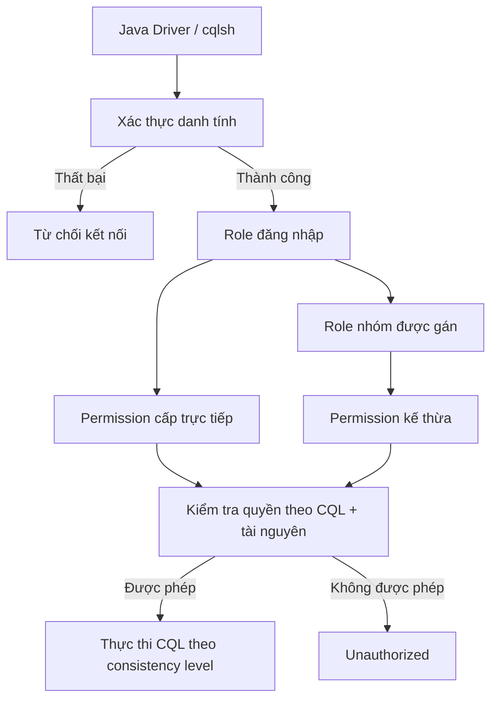
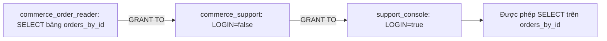

# Role, LOGIN, SUPERUSER và quan hệ kế thừa quyền trong Apache Cassandra

## 1. Vì sao quản lý role quan trọng với một cluster Cassandra?

Apache Cassandra lưu dữ liệu theo mô hình **wide-column**, phân phối partition trên nhiều node và nhân bản dữ liệu theo **replication factor**. Ứng dụng Java thường kết nối đến cluster qua Java Driver, dùng CQL để đọc/ghi những bảng được thiết kế theo truy vấn. Khi một cluster phục vụ nhiều dịch vụ, người dùng quản trị và công cụ vận hành, việc cho mọi kết nối sử dụng tài khoản toàn quyền tạo ra rủi ro lớn: lỗi ứng dụng hoặc thông tin xác thực bị lộ có thể dẫn đến đọc, sửa hoặc xóa dữ liệu ngoài phạm vi nghiệp vụ.

Trong module `DATABASE_ENGINE_WIDE_COLUMN_CASSANDRA`, phần **Bảo mật** tập trung vào ba thuộc tính của role:

- **`LOGIN`**: role có được phép xác thực và mở phiên đăng nhập hay không.
- **`SUPERUSER`**: role có đặc quyền quản trị cao nhất hay không.
- **Kế thừa quyền**: role nhận các **permission** được cấp trực tiếp hoặc thông qua những role khác mà nó là thành viên.

Bài học này giúp bạn thiết kế tài khoản cho ứng dụng Java, role nhóm theo nhiệm vụ, cách cấp/thu hồi quyền và quy trình kiểm tra kết quả bằng CQL. Mục tiêu là áp dụng **least privilege** (quyền tối thiểu) trong Cassandra, đồng thời hiểu rõ ranh giới giữa xác thực, phân quyền và tính nhất quán đọc/ghi.

**Tình huống xuyên suốt:** hệ thống đơn hàng có một dịch vụ Java tra cứu trạng thái, một dịch vụ cập nhật trạng thái và một nhóm hỗ trợ chỉ được đọc một số bảng. Các tác nhân này không nên có chung tài khoản superuser.

## 2. Phân biệt xác thực, phân quyền và đặc quyền

| Khái niệm | Câu hỏi | Cơ chế Cassandra liên quan |
| --- | --- | --- |
| **Authentication** | “Kết nối này là ai?” | `authenticator`, mật khẩu/chứng thực và role có `LOGIN=true` |
| **Authorization** | “Role này được làm gì trên tài nguyên nào?” | `authorizer`, `GRANT`/`REVOKE` permission |
| **Role membership** | “Role này được hưởng tập quyền của những nhóm nào?” | `GRANT role_a TO role_b` |
| **Superuser** | “Role có toàn quyền đặc biệt để quản trị cluster/role không?” | Thuộc tính `SUPERUSER=true` |
| **Read/write consistency** | “Bao nhiêu replica phải phản hồi trước khi một truy vấn thành công?” | `ONE`, `LOCAL_QUORUM`, `QUORUM`,… |

**Phân quyền và consistency là hai trục độc lập.** Một ứng dụng có `SELECT` trên bảng có thể chọn mức nhất quán đọc phù hợp theo cấu hình/statement; permission không đảm bảo dữ liệu mới nhất. Ngược lại, ghi `LOCAL_QUORUM` không cho phép bỏ qua quyền `MODIFY`.

### Mô hình khái niệm



Sơ đồ mô tả trường hợp **role thường**. Superuser được xử lý bằng đặc quyền cao và không cần từng permission riêng cho các thao tác mà nó có quyền thực hiện. Không nên thiết kế ứng dụng thường dựa vào khả năng đặc biệt này.

## 3. Điều kiện tiên quyết: bật cơ chế auth phù hợp

Trước khi thử các lệnh role trên môi trường thí nghiệm, kiểm tra phiên bản và cấu hình cluster. Cấu hình phổ biến của Apache Cassandra dùng:

```yaml
# Ví dụ các khóa cấu hình trong cassandra.yaml, minh họa:
authenticator: PasswordAuthenticator
authorizer: CassandraAuthorizer
role_manager: CassandraRoleManager
```

Ý nghĩa:

- `PasswordAuthenticator` yêu cầu thông tin đăng nhập phù hợp với role đã được cấp `LOGIN`; không nên giả định kết nối sẽ yêu cầu mật khẩu nếu authenticator chưa được bật.
- `CassandraAuthorizer` kiểm soát quyền với tài nguyên CQL; nếu đang dùng `AllowAllAuthorizer`, các lệnh `GRANT` có thể không tạo ra ranh giới bảo mật thực sự.
- `CassandraRoleManager` quản lý vòng đời role và quan hệ role membership trong thiết lập phổ biến; môi trường có plugin auth bên thứ ba có thể dùng cơ chế khác.

Đây là **cấu hình ví dụ**, không phải lệnh chỉnh trực tiếp vào cluster đang chạy. Thay đổi cơ chế xác thực/phân quyền thường cần kế hoạch cấu hình và restart/rolling restart theo phiên bản, đặc biệt để tránh khóa nhầm đường quản trị. Luôn giữ một đường khôi phục quyền quản trị đã được kiểm thử trước khi thay đổi auth.

Ngoài RBAC, cần bảo vệ **TLS phía client, kênh giữa các node, JMX, quyền đọc cấu hình và bí mật đăng nhập**. Bật role không tự mã hóa dữ liệu truyền qua mạng hoặc dữ liệu lưu trên đĩa.

### Role và metadata phân quyền được lưu ở đâu?

Trong triển khai Cassandra truyền thống, thông tin xác thực và phân quyền liên quan đến keyspace hệ thống `system_auth`. Vì đây là một phần thiết yếu của khả năng đăng nhập và quản trị:

1. Xem cấu hình replication của `system_auth` và topology/DC thực tế; nhiều cài đặt cần điều chỉnh RF sau bootstrap để phù hợp môi trường production.
2. Lập kế hoạch repair, backup và khôi phục metadata auth như một phần quy trình quản trị cluster.
3. Dự trù độ trễ cập nhật trong cache role/permission của node khi mới `GRANT` hoặc `REVOKE`; **không mặc định mọi phiên đang chạy thấy thay đổi cùng một thời điểm**.
4. Kiểm tra lại hành vi của phiên bản đang dùng, nhất là khi tích hợp bộ xác thực/authorizer tùy chỉnh.

**Không được tự chỉnh sửa bảng nội bộ `system_auth`** để cấp quyền thay cho CQL quản trị thông thường.

## 4. Role là gì? Khác gì với user ở Cassandra?

Cassandra dùng **role** làm khái niệm chung cho danh tính đăng nhập và nhóm quyền. Một role có thể:

- Là tài khoản ứng dụng/người dùng, có `LOGIN=true` để mở kết nối.
- Là role nhóm, có `LOGIN=false`, chỉ gom permission dùng lại.
- Có permission trực tiếp trên keyspace, table, role hoặc tài nguyên khác.
- Được gán một hay nhiều role khác để thừa hưởng quyền được cấp cho chúng.
- Có thuộc tính `SUPERUSER` trong các trường hợp quản trị đặc biệt.

`CREATE USER` là cú pháp cũ/tương thích ở các phiên bản hỗ trợ; khi thiết kế mới, nên hiểu mô hình **role** và dùng `CREATE ROLE` theo khả năng phiên bản đang triển khai.

Các thuộc tính quan trọng:

| Thuộc tính | Giá trị ví dụ | Ý nghĩa | Nhầm lẫn thường gặp |
| --- | --- | --- | --- |
| `LOGIN` | `true` / `false` | Cho phép hoặc không cho phép role đăng nhập | `LOGIN=true` không tự cấp `SELECT`, `MODIFY` |
| `SUPERUSER` | `true` / `false` | Đặc quyền quản trị toàn cục | Không phải “role nhóm tiện dụng” để phát cho dịch vụ |
| `PASSWORD` | Bí mật tài khoản | Thông tin dùng bởi cơ chế xác thực mật khẩu khi bật | Mật khẩu không đồng nghĩa được phép truy cập bảng |
| Permission | `SELECT`, `MODIFY`, `CREATE`,… | Quyền trên tài nguyên được chỉ định | Có thể được cấp trực tiếp hoặc kế thừa qua membership |
| Membership | `GRANT role_nhom TO role_dang_nhap` | Cho role đích hưởng permission của role nguồn | Không phải `GRANT SELECT`; đây là hai dạng `GRANT` khác nhau |

Với **role nhóm không đăng nhập**, thường đặt `LOGIN=false`, `SUPERUSER=false`. Với **role đăng nhập của ứng dụng**, đặt `LOGIN=true` nhưng vẫn `SUPERUSER=false`; chỉ cấp permission mà truy vấn nghiệp vụ thật sự cần.

## 5. Tạo role bằng CQL

Giả sử keyspace/bảng phục vụ đọc trạng thái đơn hàng đã tồn tại. Trên môi trường lab, quản trị viên có thể tạo schema minh họa:

```sql
CREATE KEYSPACE IF NOT EXISTS commerce
WITH replication = {
    'class': 'NetworkTopologyStrategy',
    'dc1': 3
};

CREATE TABLE IF NOT EXISTS commerce.orders_by_id (
    order_id uuid PRIMARY KEY,
    customer_id uuid,
    status text,
    updated_at timestamp
);

CREATE TABLE IF NOT EXISTS commerce.orders_by_customer (
    customer_id uuid,
    order_id uuid,
    status text,
    PRIMARY KEY ((customer_id), order_id)
);
```

**Lưu ý:** `dc1` phải trùng tên datacenter thật, và số replica không được lớn hơn kế hoạch topology một cách thiếu kiểm soát. Nếu lab không có DC như trên, sửa theo môi trường thử; không sao chép schema mẫu thẳng vào production.

### 5.1. Tạo nhóm chỉ đọc

```sql
-- Role nhóm; bản thân role này không dùng để đăng nhập.
CREATE ROLE IF NOT EXISTS commerce_order_reader
WITH LOGIN = false
 AND SUPERUSER = false;

-- Chỉ cho đọc đúng bảng cần thiết.
GRANT SELECT ON TABLE commerce.orders_by_id
TO commerce_order_reader;
```

Role nhóm giúp tái sử dụng permission: nếu có mười dịch vụ chỉ đọc bảng này, không cần cấp lặp lại `SELECT` cho từng role. Sau này thay đổi permission ở nhóm, các thành viên phụ thuộc nhận được thay đổi theo mô hình kế thừa.

### 5.2. Tạo role cho ứng dụng Java

```sql
-- Chạy với tài khoản quản trị có quyền tạo role.
-- 'THAY_BANG_MAT_KHAU_DUOC_QUAN_LY' là placeholder, không dùng thật.
CREATE ROLE IF NOT EXISTS orders_api
WITH LOGIN = true
 AND SUPERUSER = false
 AND PASSWORD = 'THAY_BANG_MAT_KHAU_DUOC_QUAN_LY';

-- Cho orders_api thừa hưởng quyền của nhóm chỉ đọc.
GRANT commerce_order_reader TO orders_api;
```

Từ đây, `orders_api` được phép đăng nhập nếu authenticator và cấu hình cho phép, và có quyền `SELECT` trên `commerce.orders_by_id` thông qua `commerce_order_reader`.

**Không nên đưa mật khẩu thật vào tài liệu, commit, lịch sử shell hoặc log CQL.** Câu lệnh trên chỉ là ví dụ. Trong triển khai thực, dùng quy trình tạo bí mật, quản lý vòng đời/rotation, kênh TLS và công cụ quản trị an toàn; tránh nhúng chuỗi password vào source code.

### 5.3. Tạo role cho dịch vụ cập nhật trạng thái

```sql
CREATE ROLE IF NOT EXISTS commerce_order_writer
WITH LOGIN = false
 AND SUPERUSER = false;

GRANT MODIFY ON TABLE commerce.orders_by_id
TO commerce_order_writer;

-- Role đăng nhập và nhóm quyền tách riêng:
CREATE ROLE IF NOT EXISTS orders_worker
WITH LOGIN = true
 AND SUPERUSER = false
 AND PASSWORD = 'THAY_BANG_MAT_KHAU_KHAC';

GRANT commerce_order_writer TO orders_worker;
```

`MODIFY` cho phép các thao tác thay đổi dữ liệu như `INSERT`, `UPDATE` và `DELETE` trên bảng được cấp (theo quyền mà phiên bản hỗ trợ). Nó **không** thay thế `SELECT` khi ứng dụng cần đọc. Với conditional update/LWT sử dụng `IF`, cần xem kỹ tập permission được phiên bản yêu cầu; thông thường cần cả khả năng đọc điều kiện và sửa dữ liệu. Hãy thử câu CQL thật bằng role dịch vụ, không chỉ nhìn vào danh sách quyền.

### Quy tắc quan trọng khi dựng account

**Tài khoản đăng nhập riêng cho từng workload.** Đừng dùng một tài khoản cho API đọc, worker ghi, batch export và quản trị. Khi lộ thông tin xác thực hoặc cần thu hồi quyền một dịch vụ, việc tách principal giúp giới hạn tác động và kiểm toán.

## 6. `LOGIN`: quyền mở kết nối, không phải quyền sử dụng dữ liệu

Một role với `LOGIN=false` không được dùng như tài khoản đăng nhập theo cơ chế role-based authentication thông thường, dù nó có nhiều permission. Ngược lại, role có `LOGIN=true` nhưng không được cấp quyền bảng vẫn có thể xác thực thành công rồi nhận lỗi authorization khi thực hiện CQL vượt quyền.

Ví dụ:

```sql
CREATE ROLE IF NOT EXISTS temp_auditor
WITH LOGIN = false
 AND SUPERUSER = false;

GRANT SELECT ON TABLE commerce.orders_by_id
TO temp_auditor;
```

Role này có `SELECT` nhưng không thể dùng trực tiếp để mở phiên đăng nhập. Muốn nhân viên hoặc ứng dụng hưởng quyền đọc, tạo **role đăng nhập riêng** rồi cấp nhóm `temp_auditor` cho role đó.

### Đổi khả năng đăng nhập

```sql
-- Tắt đăng nhập của tài khoản thử nghiệm khi không còn cần dùng:
ALTER ROLE orders_api WITH LOGIN = false;

-- Khôi phục theo quy trình vận hành đã phê duyệt:
ALTER ROLE orders_api WITH LOGIN = true;
```

Khi thay đổi `LOGIN`, phải xét sự tồn tại của **kết nối/phiên đang mở**, driver connection pool và cache trên các node. Không được mặc định đổi `LOGIN=false` sẽ đóng ngay mọi session đang hoạt động hoặc thu hồi tất cả tác vụ đang thực thi. Với sự cố lộ bí mật, phối hợp vô hiệu hóa role, thay mật khẩu/bí mật, chặn đường truy cập mạng và theo dõi hoạt động bất thường.

**Role membership không phải cách cấp thuộc tính `LOGIN` cho một nhóm**: để ứng dụng đăng nhập, hãy khai báo `LOGIN=true` trên đúng role mà driver thực sự dùng làm danh tính.

## 7. `SUPERUSER`: quản trị toàn quyền và lý do phải hạn chế

Role có `SUPERUSER=true` có các đặc quyền cao nhất để quản lý tài nguyên và role. Trong hệ thống thực, dùng nó cho một số ít tài khoản quản trị cần thiết, với cơ chế kiểm soát truy cập, audit và bảo vệ bí mật tương xứng.

```sql
-- Chỉ minh họa cú pháp; phải được thực hiện bởi principal có thẩm quyền.
CREATE ROLE IF NOT EXISTS cluster_admin_ops
WITH LOGIN = true
 AND SUPERUSER = true
 AND PASSWORD = 'THAY_BANG_BI_MAT_ADMIN';
```

**Không thực hiện ví dụ này trong ứng dụng thường.** Nếu role của một dịch vụ Java có `SUPERUSER=true`, lỗi injection hoặc lộ mật khẩu có thể khiến kẻ tấn công đọc/xóa bảng, chỉnh schema hoặc thao tác role vượt xa nhiệm vụ ban đầu.

Một số nguyên tắc:

1. **Giới hạn số lượng superuser.** Sử dụng tài khoản quản trị riêng với đường vào đã kiểm soát.
2. **Không coi `SUPERUSER` là “permission dễ cấp”.** Hãy cấp quyền trên đúng bảng/keyspace hoặc tài nguyên quản trị được phép.
3. **Kiểm tra riêng thuộc tính role và quyền kế thừa.** Quyền truy cập tài nguyên có thể do membership; đặc tính đăng nhập/quản trị cần được đánh giá theo cấu hình, phiên bản và quan hệ role thực tế. Không suy đoán một role có thể đăng nhập hoặc trở thành superuser chỉ từ tên nhóm.
4. **Tách vận hành khỏi ứng dụng.** Tài khoản dùng `nodetool`/JMX, quản trị role và tài khoản thực hiện CQL của dịch vụ có bề mặt quyền khác nhau; RBAC CQL không tự bảo vệ mọi giao diện quản trị ngoài CQL.
5. **Chủ động xoay vòng thông tin mặc định.** Với cluster vừa khởi tạo bằng cấu hình mặc định, cần xử lý role/mật khẩu bootstrap theo quy trình vận hành trước khi mở truy cập.

Thay đổi `SUPERUSER` là thao tác nhạy cảm. Chỉ người có thẩm quyền thực hiện sau khi xác định kế hoạch khôi phục quyền quản trị để tránh khóa chính cluster.

## 8. Permission: quyền nào cấp trên tài nguyên nào?

Cassandra phân quyền theo **resource**. Các dạng permission phổ biến gồm:

| Permission | Ví dụ thao tác | Phạm vi hay gặp |
| --- | --- | --- |
| `SELECT` | Đọc bằng `SELECT` | Table, keyspace, phạm vi lớn hơn |
| `MODIFY` | `INSERT`, `UPDATE`, `DELETE` | Table, keyspace |
| `CREATE` | Tạo keyspace/table hoặc role tùy loại tài nguyên | Cấp tài nguyên phù hợp |
| `ALTER` | Thay đổi schema hoặc thuộc tính role | Keyspace, table, role |
| `DROP` | Xóa table/keyspace/role | Tài nguyên phù hợp |
| `AUTHORIZE` | Cấp/thu hồi quyền cho role khác trên tài nguyên | Data resource và role resource khi phù hợp |
| `DESCRIBE` / quyền bổ sung | Quan sát metadata hoặc chức năng mới theo phiên bản | Kiểm cú pháp và phạm vi ở phiên bản triển khai |

Bảng chỉ mô tả **nhóm chức năng**, không phải danh sách đầy đủ cho mọi bản Cassandra. Permission mới hoặc tài nguyên đặc thù (function, MBean, masking…) phụ thuộc phiên bản và bản phân phối; hãy đối chiếu tài liệu/`HELP` của chính môi trường.

Ví dụ hai mức cấp quyền:

```sql
-- Hẹp: chỉ cho đọc một bảng.
GRANT SELECT ON TABLE commerce.orders_by_id
TO commerce_order_reader;

-- Rộng hơn: cho đọc các bảng trong keyspace commerce.
-- Chỉ dùng khi toàn bộ keyspace thực sự thuộc phạm vi công việc.
GRANT SELECT ON KEYSPACE commerce
TO commerce_report_reader;
```

Dòng thứ hai giả định role `commerce_report_reader` đã được tạo; nó minh họa **phạm vi** và không nhất thiết phải chạy trong bài thực hành.

**Nguyên tắc least privilege:** ưu tiên tài nguyên hẹp nhất đủ cho các câu CQL thực tế. Quyền `SELECT ON KEYSPACE` có thể rộng hơn dự kiến khi sau này nhóm phát triển bổ sung bảng nhạy cảm vào cùng keyspace. Việc mở rộng schema phải đi kèm rà soát permission.

### Quyền quản trị role khác với quyền trên dữ liệu

Thao tác `CREATE ROLE`, `ALTER ROLE`, `DROP ROLE`, `GRANT role` có các yêu cầu quyền quản trị riêng trên tài nguyên role. Không nên cấp quyền quản lý role cho một tài khoản chỉ cần đọc đơn hàng. Cấp `AUTHORIZE` cũng cần được kiểm soát chặt, vì nó liên quan khả năng ủy quyền cho role khác.

Một permission được cấp trên tài nguyên lớn có thể áp dụng cho tài nguyên con theo ngữ nghĩa phân quyền Cassandra. Khi kiểm tra quyền, phải xét **cả quyền trực tiếp, quyền từ role được kế thừa và phạm vi tài nguyên cấp trên**.

## 9. Kế thừa quyền: `GRANT role TO role`

Câu lệnh `GRANT` có **hai ý nghĩa khác nhau** tùy đối số:

```sql
-- Cấp PERMISSION cho một role:
GRANT SELECT ON TABLE commerce.orders_by_id
TO commerce_order_reader;

-- Cấp ROLE thành viên cho một role khác:
GRANT commerce_order_reader TO orders_api;
```

Ở câu thứ hai, đọc là: “`orders_api` được gán role `commerce_order_reader`”. `orders_api` hưởng những permission mà `commerce_order_reader` đã được cấp theo quan hệ role membership.

### 9.1. Kế thừa nhiều tầng

Ví dụ thêm một nhóm tổng hợp:

```sql
CREATE ROLE IF NOT EXISTS commerce_support
WITH LOGIN = false
 AND SUPERUSER = false;

-- Nhóm support hưởng quyền của nhóm reader.
GRANT commerce_order_reader TO commerce_support;

-- Một tài khoản hỗ trợ đăng nhập, rồi hưởng quyền qua support.
CREATE ROLE IF NOT EXISTS support_console
WITH LOGIN = true
 AND SUPERUSER = false
 AND PASSWORD = 'THAY_BANG_MAT_KHAU_SUPPORT';

GRANT commerce_support TO support_console;
```

Ta có quan hệ:



Quyền `SELECT` đi từ role nhóm gốc qua role `commerce_support` đến `support_console`. Nếu `commerce_support` có thêm quyền trực tiếp trên một bảng khác, `support_console` cũng có thể nhận quyền đó qua membership.

Cassandra không khuyến khích vòng lặp role membership. Đồ thị role phải được quản trị rõ ràng và tránh “một nhóm thành viên lại cấp ngược cho nhóm cha”; các ràng buộc/cú pháp chống vòng lặp được xử lý bởi hệ thống theo phiên bản.

### 9.2. Quyền hiệu lực là tổng hợp nhiều đường cấp

Giả sử `orders_api` vừa được cấp `SELECT` trực tiếp, vừa được gán hai role nhóm có `SELECT` trên cùng bảng. Sau khi `REVOKE` một đường cấp, role **có thể vẫn đọc được** nhờ đường còn lại.

Để thu hồi quyền thực sự, cần xem:

- Permission cấp trực tiếp cho chính role đăng nhập.
- Permission từ tất cả role tổ tiên (trực tiếp và nhiều tầng).
- Permission cấp ở phạm vi lớn hơn, ví dụ keyspace thay vì table.
- Những cache/phiên đang dùng và thời điểm node cập nhật permission.

Đây là lý do khi audit không chỉ liệt kê role đơn lẻ mà cần nhìn **đồ thị kế thừa và quyền hiệu lực**.

## 10. Đọc lại danh sách role và quyền

Trong `cqlsh`, tài khoản có thẩm quyền có thể dùng:

```sql
-- Kiểm kê role hiện có (tùy quyền role đang dùng).
LIST ROLES;

-- Kiểm tra vai trò được gán cho một principal; mặc định có thể đệ quy.
LIST ROLES OF support_console;

-- Xem quyền hiệu lực đã ghi nhận của role.
LIST ALL PERMISSIONS OF support_console;

-- Xem các permission liên quan đến một bảng.
LIST ALL PERMISSIONS ON TABLE commerce.orders_by_id;
```

Trên các phiên bản hỗ trợ `NORECURSIVE`, có thể dùng tùy chọn đó để quan sát quan hệ/permission trực tiếp thay vì truy hồi toàn bộ đồ thị. Đặt câu lệnh chính xác theo phiên bản đang chạy; kết quả `LIST` cũng phụ thuộc role có quyền xem metadata hay không.

Đối chiếu `LIST ROLES OF ...` với `LIST ALL PERMISSIONS OF ...` để trả lời:

1. Role đang đăng nhập có `LOGIN=true` hay không?
2. Có bị gán role nhóm rộng hơn dự kiến hay không?
3. Quyền `SELECT`/`MODIFY` đến từ role nào và được cấp trên bảng hay keyspace?
4. Có role nào được cấp `SUPERUSER=true` ngoài nhóm quản trị không?
5. Sau khi `REVOKE`, còn đường kế thừa nào giữ quyền cũ không?

**Không chỉ dựa vào tên role:** role tên `readonly` có thể đã được cấp `MODIFY` do thay đổi trước đó. Cần kiểm tra permission thực tế và truy vấn thí nghiệm.

### Kiểm tra bằng tài khoản ứng dụng

`cqlsh` hỗ trợ đăng nhập theo tài khoản; khi thử hãy dùng phương pháp nhập mật khẩu an toàn, tránh đưa secret vào tham số dòng lệnh hay lịch sử terminal nếu có thể.

Ví dụ sau chỉ minh họa câu lệnh CQL **sau khi đã đăng nhập** với role `orders_api`:

```sql
-- Kỳ vọng thành công do kế thừa SELECT qua commerce_order_reader:
SELECT order_id, status
FROM commerce.orders_by_id
WHERE order_id = 11111111-1111-1111-1111-111111111111;

-- Kỳ vọng bị từ chối nếu không có MODIFY từ bất kỳ đường cấp nào:
UPDATE commerce.orders_by_id
SET status = 'PAID'
WHERE order_id = 11111111-1111-1111-1111-111111111111;
```

**Thực hiện phép thử ghi bị từ chối trên môi trường lab**, dùng dữ liệu giả. Trên môi trường thật, cần kiểm tra bằng test phù hợp để tránh sửa dữ liệu không mong muốn nếu cấu hình quyền đang rộng hơn dự kiến. Lỗi `Unauthorized` trong tình huống này là tín hiệu mong đợi.

## 11. Thu hồi role hoặc permission: khác nhau về phạm vi

Có hai cú pháp `REVOKE` tương ứng với hai dạng `GRANT`:

```sql
-- Bỏ quyền SELECT được cấp trực tiếp cho role nhóm reader:
REVOKE SELECT ON TABLE commerce.orders_by_id
FROM commerce_order_reader;

-- Bỏ tư cách thành viên reader của principal orders_api:
REVOKE commerce_order_reader FROM orders_api;
```

Ý nghĩa:

- Câu thứ nhất làm nhóm `commerce_order_reader` không còn permission `SELECT` đó, ảnh hưởng mọi role hưởng quyền **thông qua nhóm**. Các quyền khác hoặc đường cấp khác vẫn có thể còn.
- Câu thứ hai làm `orders_api` không còn kế thừa quyền từ `commerce_order_reader` theo **cạnh membership** vừa bị thu hồi. Permission đã cấp riêng cho `orders_api` không tự mất.

Một chuỗi cấp/thu hồi đầy đủ để quan sát trong lab:

```sql
-- Bảo đảm role nhóm có quyền:
GRANT SELECT ON TABLE commerce.orders_by_id
TO commerce_order_reader;

-- Gán nhóm cho ứng dụng:
GRANT commerce_order_reader TO orders_api;

-- Đọc lại trạng thái:
LIST ROLES OF orders_api;
LIST ALL PERMISSIONS OF orders_api;

-- Thu hồi cạnh kế thừa:
REVOKE commerce_order_reader FROM orders_api;

-- Kiểm tra lại; nếu còn SELECT, tìm các đường cấp khác:
LIST ROLES OF orders_api;
LIST ALL PERMISSIONS OF orders_api;
```

**Tránh xóa role bằng `DROP ROLE` để xử lý thu hồi thông thường.** Việc xóa principal có phạm vi tác động rộng, làm thay đổi quan hệ membership và có thể khiến dịch vụ mất kết nối. Hãy xác định tài khoản cần vô hiệu hóa, permission cần thu hẹp và rollback rõ ràng.

### Cache có thể làm quan sát sau cấp/thu hồi bị trễ

Cassandra có thể cache thông tin role và permission trên node để giảm chi phí xác thực/phân quyền. Vì vậy `GRANT` hoặc `REVOKE` đã thành công không nhất thiết làm mọi node/connection thay đổi trạng thái tức khắc. Trong bài kiểm thử, ghi timestamp thao tác, node thực hiện và thời điểm nhận hành vi mới; kiểm tra cấu hình cache/invalidation của phiên bản.

Với thu hồi quyền khẩn cấp, đừng chỉ chờ lệnh `REVOKE`: phối hợp vô hiệu hóa đăng nhập, rotation bí mật, điều khiển network access và kiểm tra các kết nối đang mở theo runbook an ninh của cluster.

## 12. Kết nối từ Java Driver: dùng tài khoản đúng nhiệm vụ

Ứng dụng nên dùng một role đăng nhập riêng, có permission theo bảng/endpoint. Ví dụ Java Driver 4.x:

```java
import java.net.InetSocketAddress;
import com.datastax.oss.driver.api.core.CqlSession;
import com.datastax.oss.driver.api.core.cql.PreparedStatement;

public final class OrdersReader {
    public static void main(String[] args) {
        String username = System.getenv("CASSANDRA_USERNAME");
        String password = System.getenv("CASSANDRA_PASSWORD");
        if (username == null || password == null) {
            throw new IllegalStateException("Missing Cassandra credentials");
        }

        // Chỉ minh họa thông số kết nối lab. Production cần TLS và
        // cấu hình CA/trust material phù hợp trong driver.
        try (CqlSession session = CqlSession.builder()
                .addContactPoint(new InetSocketAddress("127.0.0.1", 9042))
                .withLocalDatacenter("dc1")
                .withAuthCredentials(username, password)
                .build()) {

            PreparedStatement ps = session.prepare(
                "SELECT order_id, status FROM commerce.orders_by_id " +
                "WHERE order_id = ?");
            // Bind UUID thật từ tham số đã kiểm tra, rồi execute theo
            // consistency level đáp ứng hợp đồng nghiệp vụ.
        }
    }
}
```

Trong thực tế:

- Cấp credential cho ứng dụng bằng secret manager hoặc cơ chế cấp phát bảo mật tương đương; không hard-code, commit hoặc log password.
- Bật và xác thực **TLS** để bảo vệ thông tin đăng nhập và dữ liệu; đoạn Java trên chưa tự cấu hình TLS.
- Tái sử dụng `CqlSession` trong vòng đời ứng dụng; tránh tạo session cho mỗi request HTTP.
- Dùng prepared/bound statement và hạn chế quyền theo bảng. Role dành cho API đọc không được phép tự tạo keyspace hay quản lý role.
- Tách tài khoản đọc/ghi nếu các workload có trách nhiệm khác nhau; đồng thời giới hạn in-flight request để tránh ứng dụng quá tải cluster.
- Mặc dù `orders_api` có `SELECT`, vẫn cần thiết kế truy vấn theo partition key và chọn `LOCAL_ONE`/`LOCAL_QUORUM` phù hợp yêu cầu nhất quán. RBAC không sửa truy vấn chậm hoặc dữ liệu stale.

Bảo mật quyền truy cập phải đi cùng vận hành replication, compaction, repair, snapshot/restore và xử lý timeout. Ví dụ khi backup keyspace `commerce`, không nên dùng credential ứng dụng làm “tài khoản backup toàn quyền”; quyền quản trị/`nodetool` phải được phân tách và kiểm soát riêng.

## 13. Ma trận quyền tham khảo cho hệ thống đơn hàng

| Role | LOGIN | SUPERUSER | Permission/Membership | Truy cập dự kiến |
| --- | --- | --- | --- | --- |
| `commerce_order_reader` | false | false | `SELECT` trên `orders_by_id` | Không đăng nhập; nhóm chỉ đọc |
| `orders_api` | true | false | Thành viên `commerce_order_reader` | Đọc `orders_by_id`, không sửa |
| `commerce_order_writer` | false | false | `MODIFY` trên `orders_by_id` | Không đăng nhập; nhóm ghi |
| `orders_worker` | true | false | Thành viên `commerce_order_writer` | Cập nhật `orders_by_id`, không đọc nếu chưa có `SELECT` |
| `commerce_support` | false | false | Thành viên `commerce_order_reader` | Nhóm trung gian hỗ trợ |
| `support_console` | true | false | Thành viên `commerce_support` | Chỉ đọc qua hai tầng kế thừa |
| `cluster_admin_ops` | true | true | Quản trị cấp cao | Chỉ dành cho kênh vận hành được kiểm soát |

**Đây là ma trận mục tiêu**, không thể thay cho kiểm chứng thực tế. Quyền hiệu lực có thể khác nếu có permission cấp trực tiếp, grant ở keyspace, membership bổ sung, hoặc role mới được tạo sau đó.

## 14. Các lỗi phổ biến khi thiết kế role

| Sai lầm | Hệ quả | Hướng sửa |
| --- | --- | --- |
| Dùng superuser của cluster trong ứng dụng Java | Lộ credential ảnh hưởng toàn cluster | Tạo role ứng dụng `LOGIN=true, SUPERUSER=false` và cấp ít permission nhất |
| Nghĩ `LOGIN=true` tự cho phép query | Đăng nhập thành công nhưng `Unauthorized` | Cấp đúng permission trên table/keyspace cần truy vấn |
| Dùng role nhóm `LOGIN=false` như tài khoản | Không thể đăng nhập | Tạo role đăng nhập riêng và gán nhóm |
| `GRANT SELECT ON KEYSPACE` khi chỉ cần một bảng | Quyền tự mở rộng khi thêm bảng vào keyspace | `GRANT SELECT ON TABLE` nếu phù hợp |
| Chỉ thu hồi một permission mà không kiểm tra membership | Vẫn truy cập qua đường cấp khác | Audit quyền trực tiếp, kế thừa và tài nguyên cha |
| Đặt tên nhóm “read only” nhưng cấp `MODIFY` | Chính sách tên và quyền thực tế lệch nhau | Kiểm tra `LIST ALL PERMISSIONS` và truy vấn bằng role thử |
| Cho phép role quản trị cấp `AUTHORIZE` rộng rãi | Rủi ro tự mở rộng quyền/ủy quyền sai | Giới hạn quyền quản lý role và data resource |
| Mặc định `REVOKE` chặn mọi phiên ngay lập tức | Kết nối/cache cũ có thể tiếp tục hành vi | Kiểm tra cache, vô hiệu hóa login/secret/network khi khẩn cấp |
| Bật CassandraAuthorizer nhưng bỏ qua JMX hoặc plaintext CQL | Những đường quản trị/kết nối khác vẫn rủi ro | Bảo vệ đồng thời TLS, JMX, inter-node và tài khoản vận hành |
| Tự sửa trực tiếp `system_auth` | Có thể làm lỗi auth/replication | Dùng CQL role management và runbook bảo trì chuẩn |

## 15. Bài tập thực hành và kiểm thử quyền

**Bối cảnh:** bạn phụ trách keyspace `commerce` với hai bảng `orders_by_id` và `orders_by_customer`. Ba đối tượng cần truy cập:

- `api_read`: đăng nhập để đọc riêng `orders_by_id`.
- `worker_write`: đăng nhập để cập nhật `orders_by_id`, không có quyền xóa schema.
- `support_read`: đăng nhập, được quyền như `api_read` thông qua nhóm `commerce_order_reader` và nhóm trung gian `commerce_support`.

**Yêu cầu:**

1. Viết `CREATE ROLE` cho hai nhóm không đăng nhập và ba principal đăng nhập; xác định rõ `LOGIN` và `SUPERUSER`.
2. Cấp `SELECT` hoặc `MODIFY` đúng trên bảng, sau đó gán membership qua `GRANT role TO role`.
3. Dùng `LIST ROLES OF support_read` và `LIST ALL PERMISSIONS OF support_read` để giải thích quyền `SELECT` được kế thừa qua mấy tầng.
4. Thử truy vấn `SELECT` và `UPDATE` bằng `api_read`; dự đoán thao tác nào bị từ chối.
5. Thu hồi membership `commerce_order_reader` khỏi `api_read`. Nếu ứng dụng vẫn đọc được, liệt kê ít nhất ba nguyên nhân cần kiểm tra.
6. Vì sao không nên dùng `SUPERUSER=true` cho cả ba role đăng nhập? Nếu cần role tạo keyspace cho migration, bạn sẽ quản lý quyền và vòng đời tài khoản đó thế nào?

**Gợi ý phần lời giải CQL:**

```sql
-- Nhóm:
CREATE ROLE IF NOT EXISTS commerce_order_reader
WITH LOGIN = false AND SUPERUSER = false;
CREATE ROLE IF NOT EXISTS commerce_order_writer
WITH LOGIN = false AND SUPERUSER = false;
CREATE ROLE IF NOT EXISTS commerce_support
WITH LOGIN = false AND SUPERUSER = false;

-- Quyền bảng:
GRANT SELECT ON TABLE commerce.orders_by_id
TO commerce_order_reader;
GRANT MODIFY ON TABLE commerce.orders_by_id
TO commerce_order_writer;

-- Chuỗi kế thừa:
GRANT commerce_order_reader TO commerce_support;

-- Các principal cần tạo với LOGIN=true, SUPERUSER=false,
-- PASSWORD được cấp an toàn, rồi gán nhóm:
GRANT commerce_order_reader TO api_read;
GRANT commerce_order_writer TO worker_write;
GRANT commerce_support TO support_read;

-- Kiểm tra:
LIST ROLES OF support_read;
LIST ALL PERMISSIONS OF support_read;
```

Trong ví dụ đáp án, các role `api_read`, `worker_write`, `support_read` phải được **tạo trước khi chạy GRANT**; phần gợi ý để người học tự viết đầy đủ `CREATE ROLE` và không đưa mật khẩu giả vào lệnh chạy thật.

Khi `api_read` không còn quyền sau khi thu hồi nhóm, nó có thể vẫn xác thực với `LOGIN=true` nhưng truy vấn `SELECT` sẽ thất bại nếu không có đường cấp khác. Nếu vẫn đọc được, hãy kiểm tra quyền cấp trực tiếp, permission từ role khác hoặc phạm vi keyspace, và khả năng cache/phiên chưa phản ánh thay đổi. Không dùng quyền `SUPERUSER` để “sửa” bài lab.

## 16. Checklist đưa cấu hình role vào production

- [ ] Đã bật authenticator/authorizer phù hợp và kiểm chứng bằng role thường; không ở chế độ bỏ qua authorization.
- [ ] Role nhóm có `LOGIN=false`, principal ứng dụng có `LOGIN=true` và `SUPERUSER=false`.
- [ ] Không có tài khoản ứng dụng dùng credential quản trị hoặc mật khẩu mặc định.
- [ ] Permission được cấp ở tài nguyên hẹp nhất đáp ứng các câu CQL thực tế.
- [ ] Đã phân tích role membership, quyền kế thừa nhiều tầng và permission ở tài nguyên cha.
- [ ] Đã thử các thao tác **được phép** và **phải bị từ chối** bằng từng principal thật trong lab.
- [ ] Đã có quy trình `REVOKE`, vô hiệu hóa role, xoay vòng bí mật và xử lý kết nối đang mở.
- [ ] Đã giới hạn ai được quản trị role, `SUPERUSER` và `AUTHORIZE`.
- [ ] Đã bảo vệ TLS client, kết nối nội bộ, JMX, secret và đường quản trị ngoài CQL.
- [ ] Đã xem replication/repair/backup cho `system_auth` và kiểm thử tình huống mất node.
- [ ] Đã ghi nhận kiểm toán thay đổi permission và lịch rà soát role định kỳ.
- [ ] Đã tách consistency, tối ưu truy vấn và chiến lược backup khỏi quyết định cấp quyền.

**Ghi nhớ:** `LOGIN` quyết định **ai có thể mở phiên**; `SUPERUSER` là đặc quyền quản trị cần bảo vệ; `GRANT SELECT/MODIFY...` quyết định **được làm gì trên tài nguyên**, còn `GRANT role TO role` tạo **quan hệ kế thừa quyền**. Thiết kế bảo mật Cassandra tốt bắt đầu bằng role nhóm không đăng nhập, account riêng cho ứng dụng Java, quyền tối thiểu ở đúng bảng và kiểm thử cả đường cấp lẫn đường thu hồi.
