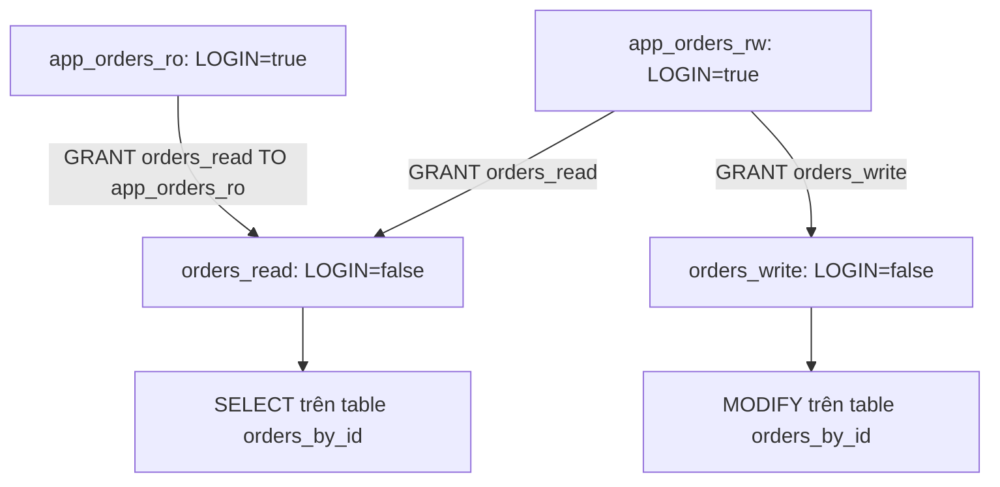

# Quyền trên keyspace, table, function và các tài nguyên liên quan

## 1. Vấn đề: cùng một cluster, mỗi ứng dụng được phép làm gì?

Trong Apache Cassandra, nhiều ứng dụng Java thường kết nối tới cùng cluster nhưng phục vụ các nhu cầu khác nhau: API tra cứu đơn hàng, service cập nhật trạng thái, bộ đọc báo cáo, công cụ migration và tài khoản vận hành. Các tài khoản này **không nên dùng chung quyền superuser**. Một ứng dụng chỉ đọc bảng đơn hàng không cần quyền thay đổi schema, xóa bảng, tạo role hoặc chạy thao tác JMX.

Chương **Bảo mật** trong mô-đun `DATABASE_ENGINE_WIDE_COLUMN_CASSANDRA` liên hệ kiến trúc phân tán và mô hình wide-column, thiết kế bảng theo truy vấn/partition key, CQL, replication, compaction, repair, khắc phục sự cố và kết nối Java Driver. Bài học này tập trung vào **cơ chế phân quyền theo tài nguyên**: keyspace, table, function, role và MBean; cách cấp/thu hồi/kiểm tra quyền; và rủi ro của việc cấp quá rộng.

Sau bài, người học cần có thể:

1. Phân biệt **authentication** (đăng nhập), **authorization** (được làm gì), **role** và **resource**.
2. Hiểu bốn nhánh phân cấp quyền: dữ liệu, function, role và MBean; biết quyền cấp ở tầng cha **lan xuống tài nguyên con**.
3. Dùng đúng `CREATE ROLE`, `GRANT`, `REVOKE`, `LIST ROLES` và `LIST PERMISSIONS`.
4. Phân biệt `SELECT`, `MODIFY`, `CREATE`, `ALTER`, `DROP`, `AUTHORIZE`, `EXECUTE`, `DESCRIBE`; đánh giá `UNMASK`/`SELECT_MASKED` ở phiên bản hỗ trợ.
5. Xây role **least privilege** cho ứng dụng Java và **kiểm thử cả hành động được phép lẫn bị từ chối**.
6. Xử lý tình huống thu hồi quyền nhưng role kế thừa, resource cấp rộng hoặc cache vẫn còn hiệu lực.

> Phạm vi: những ví dụ CQL dưới đây dùng Cassandra có **authentication và authorization thực sự được bật** với cơ chế phù hợp. Cú pháp/quyền mới, nhất là dynamic data masking, phụ thuộc phiên bản; xem tài liệu và `cassandra.yaml` của cluster đang chạy trước khi áp dụng. Tất cả DDL/GRANT trong bài chỉ thực hành trên **lab** hoặc theo change request đã được duyệt.

## 2. Ba lớp bảo mật phải được tách riêng

| Lớp | Câu hỏi | Cơ chế thường gặp | Giới hạn |
| --- | --- | --- | --- |
| **Authentication** | Ai đang đăng nhập? | `PasswordAuthenticator` hoặc plugin tương đương; danh tính role | Xác định danh tính **không** tự hạn chế thao tác nếu authorizer cho phép mọi thứ. |
| **Authorization** | Danh tính đó được thao tác tài nguyên nào? | `CassandraAuthorizer` hoặc authorizer tùy biến, ACL gắn role | Không thay TLS, network policy hay xác thực; phải bật đúng trên các node. |
| **Bảo vệ kết nối/dữ liệu** | Có thể đọc lén hoặc lấy secret ở đâu? | Client-to-node TLS, inter-node encryption, KMS/secret manager, firewall, audit | RBAC CQL không tự mã hóa dữ liệu trên đường truyền hay file backup. |

### Điều kiện tiên quyết quan trọng

Apache Cassandra cung cấp `AllowAllAuthenticator` và `AllowAllAuthorizer` như những implementation cho phép truy cập rộng; khi dùng chúng, `GRANT SELECT ...` không có ý nghĩa là hệ thống đã thực sự chặn những thao tác không được cấp. Muốn kiểm thử quyền cần sử dụng authenticator và authorizer **có thực thi kiểm soát**, ví dụ:

```yaml
# Chỉ là trích đoạn cấu hình mang tính minh họa,
# KHÔNG thay trực tiếp trên production để làm bài lab.
authenticator: PasswordAuthenticator
authorizer: CassandraAuthorizer
role_manager: CassandraRoleManager
```

Các lựa chọn này nằm trong `cassandra.yaml` và thường đòi quy trình triển khai/khởi động lại theo tài liệu **đúng phiên bản**. Thay đổi từ authorizer cho phép mọi thứ sang kiểm tra quyền có thể làm ứng dụng mất quyền ngay khi các node thực thi; cần **cấp quyền trước, kiểm tra node canary, triển khai theo kế hoạch và có đường break-glass**. Không coi việc kết nối thành công qua cqlsh là bằng chứng authorizer đã được bật.

**Mặc định từ chối** là nguyên tắc của `CassandraAuthorizer`: một role không tự có quyền trên toàn bộ dữ liệu. Tuy nhiên **superuser** có đặc quyền rất rộng và có thể bỏ qua kiểm tra quyền thông thường; tài khoản ứng dụng không được dùng `SUPERUSER = true`.

## 3. Role là danh tính đăng nhập và cũng là nhóm quyền

Từ Cassandra 2.2, **role** biểu diễn người dùng lẫn nhóm quyền. Một role có thể:

- **`LOGIN = true`**: được dùng để xác thực phiên CQL nếu authenticator cho phép và credential hợp lệ.
- **`LOGIN = false`**: role nhóm quyền; không thể đăng nhập trực tiếp.
- **`SUPERUSER = true`**: quyền quản trị đặc biệt, chỉ dùng cho số rất ít tài khoản được kiểm soát.
- Được **gán role khác** để nhận quyền kế thừa.



**Lưu ý:** Quyền và thậm chí trạng thái superuser có thể được **kế thừa** qua role graph; `LOGIN` thì **không kế thừa**. Cassandra từ chối vòng lặp role-grant. Vì vậy cấp một role quá rộng cho một login role nhỏ vẫn tạo ra quyền quá rộng.

### Vai trò trong một hệ thống theo truy vấn

| Role | Được phép | Không nên được phép |
| --- | --- | --- |
| `orders_read` | `SELECT` trên bảng đọc đơn hàng cụ thể | `MODIFY`, `DROP`, `ALTER`, quyền trên bảng PII khác |
| `orders_write` | `MODIFY` trên bảng cần ghi | Quyền thay schema, quản lý role/GRANT; lưu ý `TRUNCATE` đi kèm `MODIFY` |
| `orders_schema_migrator` | Quyền DDL cần cho một keyspace trong cửa sổ deploy | Toàn cluster, role management, JMX; giới hạn thời gian |
| `orders_function_executor` | `EXECUTE` trên function xác định | `CREATE/ALTER/DROP FUNCTION` |
| `security_admin` | Quản lý quyền theo phạm vi được ủy quyền | `SUPERUSER` thường trực, quyền đọc dữ liệu nghiệp vụ không cần thiết |
| `jmx_observer` | Chỉ những MBean/operation cần giám sát | Toàn bộ MBean EXECUTE/MODIFY và thao tác thay topology |

Ưu tiên **mỗi dịch vụ một login role**, còn capability role có thể dùng lại trong phạm vi được duyệt. Không dùng cùng một password cho account vận hành, batch job, dashboard và ứng dụng Java.

## 4. Cây tài nguyên: cấp ở cha thì áp dụng xuống con

Các nhánh tài nguyên quan trọng:

```text
DỮ LIỆU:
  ALL KEYSPACES
    └─ KEYSPACE security_lab_ks
         ├─ TABLE orders_by_id
         └─ TABLE audit_by_id

FUNCTION:
  ALL FUNCTIONS
    └─ ALL FUNCTIONS IN KEYSPACE security_lab_ks
         ├─ FUNCTION normalize_status(text)
         └─ FUNCTION normalize_status(int)   # giả định overload khác

ROLE:
  ALL ROLES
    ├─ ROLE app_orders_ro
    └─ ROLE orders_read

JMX:
  ALL MBEANS
    └─ MBEAN / MBEANS theo JMX ObjectName, wildcard
```

Điểm then chốt: **permission cấp trên một tài nguyên cha sẽ được áp dụng cho các tài nguyên con trong cùng nhánh**:

- `GRANT SELECT ON ALL KEYSPACES` cho phép đọc bảng ở nhiều keyspace, rộng hơn một ứng dụng thường cần.
- `GRANT SELECT ON KEYSPACE security_lab_ks` bao phủ **mọi bảng hiện tại và tương lai** trong keyspace đó.
- `GRANT SELECT ON TABLE security_lab_ks.orders_by_id` chỉ áp dụng bảng được nêu.
- `GRANT EXECUTE ON ALL FUNCTIONS` rộng hơn `EXECUTE` trên một function signature.
- `GRANT AUTHORIZE ON ALL ROLES` tạo năng lực ủy quyền role rất rộng, hoàn toàn khác quyền đọc bảng.

**Không có cơ chế `DENY` từng bảng để phủ định quyền `SELECT` đã cấp ở keyspace cha** theo mô hình whitelist cơ bản. Nếu một role đã nhận `SELECT ON KEYSPACE security_lab_ks`, việc `REVOKE SELECT ON TABLE security_lab_ks.audit_by_id` **không loại bỏ** quyền vẫn được kế thừa từ keyspace.

### Hai hướng kế thừa khác nhau

1. **Kế thừa tài nguyên:** quyền cấp trên `KEYSPACE` có hiệu lực với bảng con.
2. **Kế thừa role:** login role nhận quyền của các capability roles đã được cấp.

Quyền cuối cùng có thể đến từ **nhiều đường**. Khi thu hồi một quyền, phải kiểm tra mọi đường cấp khác còn tồn tại.

## 5. Ma trận permission và phạm vi

Cassandra không dùng các từ SQL tổng quát như `READ` hay `WRITE` làm tên permission. Các quyền trong CQL gồm:

| Permission | Tài nguyên tiêu biểu | Điều cho phép | Rủi ro khi cấp rộng |
| --- | --- | --- | --- |
| **`SELECT`** | Table, keyspace, all keyspaces | Đọc bảng, truy vấn SELECT | Lộ dữ liệu những bảng/tenant ngoài phạm vi |
| **`MODIFY`** | Table, keyspace, all keyspaces | `INSERT`, `UPDATE`, `DELETE`, **`TRUNCATE`** theo tài liệu | Không phải chỉ quyền update; có thể xóa lượng dữ liệu lớn |
| **`CREATE`** | All keyspaces, keyspace; all functions; all roles | Tạo tài nguyên con như keyspace/table, function/aggregate, role | Tạo schema, function chạy code hoặc role mới trái phép |
| **`ALTER`** | Keyspace/table; function; role | Đổi schema/thuộc tính hoặc thay function/role theo loại | Đổi RF, schema, password/role settings; ảnh hưởng downtime |
| **`DROP`** | Keyspace/table; function; role | Xóa tài nguyên được hỗ trợ | Mất dữ liệu, phá API, mất danh tính |
| **`AUTHORIZE`** | Data/function/role/MBean | Cấp hoặc thu hồi quyền/role tương ứng | **Privilege delegation**: cho người khác thêm quyền |
| **`EXECUTE`** | Function, MBean | Gọi function hoặc operation JMX được cấp | UDF chạy code trên server; JMX có thể điều hành cluster |
| **`DESCRIBE`** | All roles, MBean | Liệt kê role/metadata MBean | Lộ danh tính, topology và metadata quản trị |
| **`UNMASK`** | All keyspaces/keyspace/table ở phiên bản hỗ trợ | Xem giá trị **chưa che** của cột masked | Lộ thông tin nhạy cảm |
| **`SELECT_MASKED`** | All keyspaces/keyspace/table ở phiên bản hỗ trợ | Dùng cột masked trong điều kiện truy vấn khi được hỗ trợ | Có thể suy đoán dữ liệu qua các điều kiện lọc |

Không phải permission nào cũng có nghĩa trên mọi resource: ví dụ `EXECUTE ON TABLE` hoặc `SELECT ON FUNCTION` không phải cách cấp hợp lệ và có thể bị Cassandra từ chối. `GRANT ALL PERMISSIONS ON <resource>` cấp **tập quyền phù hợp resource đó**, không có nghĩa biến role thành superuser toàn cluster.

### Chi tiết dễ bị bỏ qua: `MODIFY` bao gồm `TRUNCATE`

```sql
-- Nếu cấp quyền này, ứng dụng có thể thực hiện nhiều thao tác ghi,
-- bao gồm thao tác TRUNCATE theo ngữ nghĩa Cassandra.
GRANT MODIFY ON TABLE security_lab_ks.orders_by_id TO orders_write;
```

Trong cơ chế RBAC CQL thông thường, không có `GRANT INSERT` riêng hay `GRANT UPDATE` riêng để chặn chính xác `TRUNCATE` trong khi vẫn cho phép các write khác trên cùng bảng. Với workload nhạy cảm, phải bù bằng **quy trình vận hành, kiến trúc cô lập bảng/keyspace, kiểm soát code và monitoring/audit**. Không viết “orders_write chỉ có INSERT/UPDATE” nếu thực tế role được cấp `MODIFY`.

## 6. Lab chuẩn: tạo bảng và login role ít quyền nhất

> Các câu lệnh sau chỉ chạy **một lần trên cluster lab đã bật PasswordAuthenticator/CassandraAuthorizer** và có người vận hành đủ quyền. Tên role/password là dữ liệu giả; không dùng chuỗi password trong ví dụ làm credential production. Không thực hiện những lệnh cấp quyền rộng trên cluster công ty chỉ để thử.

### 6.1. Dữ liệu theo truy vấn

```sql
CREATE KEYSPACE security_lab_ks
WITH replication = {'class': 'NetworkTopologyStrategy', 'dc1': 3}
AND durable_writes = true;

CREATE TABLE security_lab_ks.orders_by_id (
    order_id uuid PRIMARY KEY,
    customer_id text,
    status text,
    amount decimal
);

CREATE TABLE security_lab_ks.audit_by_id (
    audit_id uuid PRIMARY KEY,
    actor_id text,
    details text
);

INSERT INTO security_lab_ks.orders_by_id
    (order_id, customer_id, status, amount)
VALUES (
    11111111-2222-4333-8444-555555555555,
    'synthetic-customer-01', 'CREATED', 120.00
);
```

Trong ví dụ, `order_id` là partition key của bảng đầu và `audit_id` là partition key bảng thứ hai. Hai bảng cùng keyspace **không đồng nghĩa** ứng dụng đọc orders phải được đọc audit. Nếu môi trường không có DC mang tên `dc1` hay chưa có đủ node theo RF, phải thay cấu hình lab cho phù hợp trước khi chạy.

### 6.2. Tạo capability roles (không đăng nhập)

```sql
CREATE ROLE orders_read
WITH LOGIN = false AND SUPERUSER = false;

CREATE ROLE orders_write
WITH LOGIN = false AND SUPERUSER = false;

GRANT SELECT ON TABLE security_lab_ks.orders_by_id TO orders_read;
GRANT MODIFY ON TABLE security_lab_ks.orders_by_id TO orders_write;
```

Hai role này **không** có quyền đọc `audit_by_id`. Cấp riêng trên table tránh quyền “tất cả bảng hiện tại và tương lai” của keyspace. Quyền ghi vẫn phải được đánh giá như quyền thay đổi dữ liệu bao gồm `TRUNCATE`.

### 6.3. Tạo login roles và gán capability

```sql
-- Password ở đây là literal PLACEHOLDER hợp lệ về cú pháp CQL,
-- phải thay bằng secret ngẫu nhiên ở lab từ quy trình quản lý bí mật.
CREATE ROLE app_orders_ro
WITH PASSWORD = '<LAB_RANDOM_PASSWORD_RO>'
AND LOGIN = true AND SUPERUSER = false;

CREATE ROLE app_orders_rw
WITH PASSWORD = '<LAB_RANDOM_PASSWORD_RW>'
AND LOGIN = true AND SUPERUSER = false;

GRANT orders_read TO app_orders_ro;
GRANT orders_read TO app_orders_rw;
GRANT orders_write TO app_orders_rw;
```

Không đưa password thật vào Git, lịch sử terminal, ticket hay Markdown; khi triển khai production phải dùng secret manager và quy trình cấp/rotate an toàn. `CREATE ROLE` có thể được thực thi bằng công cụ triển khai được kiểm soát thay vì copy credential thủ công vào terminal.

Khi login bằng `app_orders_ro`, quyền hiệu lực gồm `SELECT` trên `orders_by_id` qua `orders_read`. Khi login bằng `app_orders_rw`, quyền gồm cả `SELECT` và `MODIFY` trên cùng bảng qua hai nhánh role.

```text
app_orders_ro ──► orders_read ──► SELECT orders_by_id
app_orders_rw ──► orders_read ──► SELECT orders_by_id
             └──► orders_write ─► MODIFY orders_by_id

Không có quyền được cấp tới audit_by_id.
```

## 7. Kiểm tra bằng CQL: “có quyền” và “không có quyền”

Với account quản trị có đủ quyền liệt kê, kiểm tra:

```sql
LIST ROLES OF app_orders_ro;
LIST ROLES OF app_orders_rw;
LIST ROLES OF app_orders_rw NORECURSIVE;

LIST ALL PERMISSIONS OF app_orders_ro;
LIST ALL PERMISSIONS OF app_orders_rw;
LIST ALL PERMISSIONS ON security_lab_ks.orders_by_id OF app_orders_rw;
LIST ALL PERMISSIONS ON security_lab_ks.audit_by_id OF app_orders_ro;
```

`NORECURSIVE` giới hạn việc mở rộng vai trò kế thừa trong các câu lệnh liệt kê liên quan. Đừng chỉ xem những grant trực tiếp rồi bỏ qua cấp trên keyspace, `ALL KEYSPACES` hoặc role group. `LIST PERMISSIONS ON TABLE ... OF role` là cách hữu ích để kiểm tra effective permissions **theo resource và hierarchy**.

### 7.1. Đăng nhập thử bằng hai tài khoản

Từ một terminal có đường mạng tới CQL port và TLS phù hợp:

```bash
# Không đưa -p <password> vào shell command/ps history.
# cqlsh sẽ yêu cầu nhập mật khẩu theo khả năng phiên bản/cấu hình.
cqlsh 192.0.2.11 9042 -u app_orders_ro
```

Trong phiên của `app_orders_ro`:

```sql
-- Kỳ vọng THÀNH CÔNG:
SELECT order_id, status, amount
FROM security_lab_ks.orders_by_id
WHERE order_id = 11111111-2222-4333-8444-555555555555;

-- Kỳ vọng bị từ chối: thiếu MODIFY:
INSERT INTO security_lab_ks.orders_by_id
    (order_id, customer_id, status, amount)
VALUES (22222222-3333-4444-8555-666666666666,
        'synthetic-customer-02', 'CREATED', 15.00);

-- Kỳ vọng bị từ chối: thiếu SELECT trên bảng audit:
SELECT audit_id, actor_id
FROM security_lab_ks.audit_by_id
WHERE audit_id = 33333333-4444-4555-8666-777777777777;
```

Với `app_orders_rw`, `SELECT` và `INSERT` vào `orders_by_id` có thể thành công. **Không cần thực thi `TRUNCATE` để chứng minh rủi ro**: tài liệu định nghĩa `MODIFY` bao gồm nó, và khi kiểm thử trên production có thể hủy dữ liệu. Tốt hơn là đọc ma trận quyền, kiểm tra cấu hình và dùng **lab phá hủy được** nếu buộc phải xác minh.

### 7.2. Ma trận nghiệm thu

| Danh tính | SELECT orders | INSERT/UPDATE orders | SELECT audit | ALTER/DROP orders | GRANT quyền cho role khác |
| --- | --- | --- | --- | --- | --- |
| `app_orders_ro` | Cho phép | Từ chối | Từ chối | Từ chối | Từ chối |
| `app_orders_rw` | Cho phép | Cho phép | Từ chối | Từ chối | Từ chối |
| Administrator được duyệt | Theo trách nhiệm | Theo trách nhiệm | Theo trách nhiệm | Theo trách nhiệm | Theo phạm vi được ủy quyền |

Nếu một hành vi **lẽ ra phải bị từ chối** lại thành công, **dừng rollout** và điều tra authorizer, superuser, role inheritance, quyền trên keyspace cha và permission cache. Không “vá” bằng cách cấp thêm permission rồi chỉ chạy lại một phép SELECT thành công.

## 8. Phạm vi keyspace so với table và bẫy REVOKE

Một service báo cáo cần đọc tất cả bảng hiện có và tương lai trong một keyspace *được chỉ định* mới có thể cân nhắc:

```sql
GRANT SELECT ON KEYSPACE security_lab_ks TO reporting_role;
```

Nó rộng hơn cấp riêng `SELECT ON TABLE security_lab_ks.orders_by_id`. Nếu ngày mai DBA thêm bảng `customer_pii_by_id` vào `security_lab_ks`, quyền `SELECT ON KEYSPACE` **cũng áp dụng cho bảng mới**. Khi không muốn vậy, cấp đúng từng table, kiểm soát tạo bảng và tách keyspace có mức phân loại dữ liệu khác nhau.

### Tại sao REVOKE “cấp con” không đủ?

Giả sử:

```sql
GRANT SELECT ON KEYSPACE security_lab_ks TO reporting_role;

-- Lệnh này KHÔNG phủ định SELECT kế thừa từ keyspace:
REVOKE SELECT ON TABLE security_lab_ks.audit_by_id FROM reporting_role;
```

Muốn reporting role **không** đọc audit nhưng vẫn đọc orders, thiết kế an toàn hơn:

```sql
REVOKE SELECT ON KEYSPACE security_lab_ks FROM reporting_role;
GRANT SELECT ON TABLE security_lab_ks.orders_by_id TO reporting_role;
```

Sau đó phải kiểm tra reporting role có nhận `SELECT` rộng từ **role khác**, `ALL KEYSPACES` hoặc cấp trực tiếp khác không. Có thể cần thay cả role graph và kiểm tra cache trước khi tuyên bố đã thu hồi hoàn toàn.

**Thu hồi không phải xóa dữ liệu:** `REVOKE` chỉ thay khả năng thực hiện request, không xóa dữ liệu đã đọc, bản dump, export, backup, caches phía client hoặc thông tin đã sao chép sang hệ thống khác.

## 9. Function và aggregate: một nhánh quyền riêng

Function không đồng nhất với table. `SELECT` trên bảng **không tự cấp** `EXECUTE` cho user-defined function (UDF) được gọi trong câu query. Đường phân cấp function là:

```text
ALL FUNCTIONS
  └── ALL FUNCTIONS IN KEYSPACE security_lab_ks
       ├── FUNCTION normalize_status(text)
       └── FUNCTION normalize_status(int) [ví dụ overload khác]
```

| Resource | Dùng khi nào? | Mức rộng |
| --- | --- | --- |
| `FUNCTION security_lab_ks.normalize_status(text)` | Chỉ muốn thực thi một phiên bản function cụ thể | Hẹp nhất |
| `ALL FUNCTIONS IN KEYSPACE security_lab_ks` | Nhóm được phép thực thi mọi function trong keyspace, bao gồm function thêm về sau | Rộng hơn |
| `ALL FUNCTIONS` | Thực thi tất cả function trên mọi keyspace | Rất rộng; tránh cấp cho service thường |

### 9.1. Function signature có chứa kiểu tham số

```sql
-- Ví dụ GRANT trong lab sau khi function đã tồn tại.
GRANT EXECUTE
ON FUNCTION security_lab_ks.normalize_status(text)
TO orders_read;

-- Kiểm tra theo resource:
LIST ALL PERMISSIONS
ON FUNCTION security_lab_ks.normalize_status(text)
OF orders_read;
```

Nếu có `normalize_status(text)` và `normalize_status(int)`, việc cấp `EXECUTE` cho bản `(text)` **không tự cấp** bản `(int)`. Đây là ranh giới quan trọng khi function được **overload**.

### 9.2. Tạo UDF chỉ là bài lab tùy chọn

Trên Cassandra 5.0, **UDF bị tắt theo mặc định vì rủi ro bảo mật**; trước khi chạy ví dụ dưới đây cần cluster lab được phép bật `user_defined_functions_enabled` theo tài liệu đúng version. **Không bật UDF production chỉ để học cách GRANT.**

```sql
-- Chỉ do lab admin thực hiện và chỉ khi UDF đã được cho phép.
CREATE FUNCTION security_lab_ks.normalize_status(v text)
RETURNS NULL ON NULL INPUT
RETURNS text
LANGUAGE java
AS $$ return v.trim(); $$;

-- Sau đó admin cấp riêng EXECUTE:
GRANT EXECUTE
ON FUNCTION security_lab_ks.normalize_status(text)
TO orders_read;
```

Một tài khoản có cả `SELECT` trên `orders_by_id` và `EXECUTE` function này mới có thể chạy truy vấn dùng UDF khi các điều kiện khác hợp lệ:

```sql
SELECT security_lab_ks.normalize_status(status)
FROM security_lab_ks.orders_by_id
WHERE order_id = 11111111-2222-4333-8444-555555555555;
```

Tạo hoặc thay UDF có thể làm mã do người dùng cung cấp thực thi trên node Cassandra; **quyền `CREATE/ALTER FUNCTION` nên được kiểm soát chặt hơn `EXECUTE`**. User-defined aggregate (UDA) và các state/final functions cũng thuộc phạm vi cần xét riêng khi triển khai; không suy `SELECT` trên bảng tương đương quyền tạo aggregate.

### 9.3. Tách quyền data và quyền function

```sql
-- Data: đọc toàn bộ bảng trong keyspace
GRANT SELECT ON KEYSPACE security_lab_ks TO analyst_role;

-- Function: đây là QUYỀN KHÁC, không tự suy ra từ SELECT bên trên
GRANT EXECUTE ON ALL FUNCTIONS IN KEYSPACE security_lab_ks
TO analyst_role;
```

Ví dụ thứ hai được cố ý đưa ra để **so sánh phạm vi**, không phải cấu hình khuyến nghị. Nếu analyst chỉ cần một UDF, hãy dùng `EXECUTE ON FUNCTION name(signature)` thay vì mở toàn keyspace.

## 10. Role như một tài nguyên quản trị

Vai trò trong Cassandra vừa là **danh tính/nhóm** vừa là **resource được phân quyền**.

| Permission | Resource | Tác động |
| --- | --- | --- |
| `CREATE` | `ALL ROLES` | Có thể tạo role mới theo các điều kiện của role manager |
| `ALTER` | `ROLE some_role` hoặc `ALL ROLES` | Thay đổi thuộc tính role trong giới hạn quyền |
| `DROP` | `ROLE some_role` hoặc `ALL ROLES` | Xóa role theo các điều kiện bảo vệ superuser |
| `AUTHORIZE` | `ROLE some_role` hoặc `ALL ROLES` | Có thể cấp/thu hồi role tương ứng |
| `DESCRIBE` | `ALL ROLES` | Liệt kê các role theo phạm vi được hỗ trợ |

Ví dụ tài khoản phụ trách provisioning role có thể cần:

```sql
-- Phạm vi ví dụ; chỉ trong lab hoặc thay đổi đã duyệt:
GRANT CREATE ON ALL ROLES TO role_provisioner;
GRANT DESCRIBE ON ALL ROLES TO role_auditor;

-- Ủy quyền được phép gán một role cụ thể:
GRANT AUTHORIZE ON ROLE orders_read TO role_provisioner;
```

**Không lạm dụng `AUTHORIZE`:** nếu một người có thể gán role có quyền đọc rộng hoặc superuser cho chính mình/đồng phạm, họ có thể leo thang đặc quyền. Các điều kiện kiểm soát superuser và gán role còn tùy role manager/version; không thiết kế account “chỉ được xem user” nhưng lại cấp `AUTHORIZE ON ALL ROLES`.

Khi một role được tạo, Cassandra có cơ chế **tự cấp các quyền áp dụng được trên tài nguyên mới cho role tạo ra nó** trong những trường hợp được tài liệu mô tả. Vì vậy một migration account có thể sở hữu quyền mới sau khi tạo bảng/function; cần **review quyền sau DDL**, không chỉ review quyền đã cấp trước migration.

## 11. Quyền JMX/MBean: một đường quản trị tách biệt

Ngoài CQL, Cassandra được quản trị qua JMX và các công cụ như `nodetool`. Với cấu hình hỗ trợ **JMX authorization** tích hợp, MBean cũng là một loại resource:

```text
ALL MBEANS
  ├─ MBEAN 'org.apache.cassandra.db:type=StorageService'
  └─ MBEANS '<ObjectName pattern có wildcard>'
```

Các permission trên MBean có ngữ nghĩa **khác** với `SELECT/MODIFY` của bảng:

- `SELECT`: đọc thuộc tính MBean được phép.
- `DESCRIBE`: xem metadata của MBean.
- `MODIFY`: thay đổi thuộc tính thông qua setter.
- `EXECUTE`: gọi operation của MBean.
- `AUTHORIZE`: cấp/thu hồi các quyền quản lý MBean đó.

Ví dụ chỉ để minh họa cú pháp:

```sql
CREATE ROLE jmx_observer WITH LOGIN = false AND SUPERUSER = false;
CREATE ROLE jmx_operator WITH LOGIN = false AND SUPERUSER = false;
GRANT SELECT ON ALL MBEANS TO jmx_observer;
GRANT DESCRIBE ON ALL MBEANS TO jmx_observer;

-- Ví dụ quyền EXECUTE trên MBean cụ thể:
-- Chỉ cấp sau khi kiểm tra rõ các operation được phép.
GRANT EXECUTE
ON MBEAN 'org.apache.cassandra.db:type=StorageService'
TO jmx_operator;
```

**Cực kỳ quan trọng:** `EXECUTE ON MBEAN` có thể mở các operation ảnh hưởng cluster (tùy MBean), không đồng nghĩa “chỉ được đọc trạng thái”. Ngay cả lệnh `nodetool status` cũng có thể cần EXECUTE trên một vài MBean theo tài liệu. Vì vậy phải **thử command thực**, giới hạn quyền JMX, khóa cổng quản trị và dùng TLS/authentication. Các GRANT CQL không tự thay thế cấu hình JMX remote authorization của JVM.

## 12. Data masking và ngoại lệ hệ thống theo phiên bản

### 12.1. Quyền `UNMASK` và `SELECT_MASKED`

Cassandra 5.0 có cơ chế dynamic data masking và hai quyền gắn với dữ liệu:

- **`UNMASK`**: xem nội dung thực, không bị che, của cột được cấu hình masked.
- **`SELECT_MASKED`**: được sử dụng cột masked làm điều kiện/hạn chế truy vấn trong những trường hợp ngữ nghĩa cho phép.

```sql
-- MINH HỌA CÚ PHÁP QUYỀN; chỉ có ý nghĩa với version và
-- schema có cấu hình data masking phù hợp.
GRANT UNMASK ON TABLE security_lab_ks.orders_by_id
TO pii_reviewer;

GRANT SELECT_MASKED ON TABLE security_lab_ks.orders_by_id
TO pii_filter_operator;
```

Không đưa hai quyền này vào role đọc dữ liệu phổ thông vì chúng có thể làm giảm tác dụng bảo vệ của masked columns. Trên Cassandra 3.11/4.x, không giả định parser hỗ trợ chúng. **Masking không phải mã hóa tại ổ đĩa và không tạo row-level ACL**.

### 12.2. Một số bảng metadata có quyền đọc đặc biệt

Theo tài liệu Cassandra, những bảng hệ thống phục vụ hoạt động driver như `system.local`, `system.peers` và một số bảng `system_schema.*` có thể được đọc bởi người dùng đã xác thực dù không được cấp `SELECT` thông thường. Đó là ngoại lệ cần tính đến khi đánh giá rò rỉ **metadata/topology**, không phải lỗ hổng để truy cập bảng nghiệp vụ.

**Cassandra RBAC CQL không phải row-level security hoàn chỉnh**. Nếu hai tenant chia sẻ một bảng với partition key `tenant_id`, việc cấp `SELECT ON TABLE` **không tự giới hạn** người dùng chỉ được đọc hàng mang tenant của họ. Cần kiểm soát ở lớp dịch vụ, thiết kế cô lập tài nguyên hoặc giải pháp an ninh được hỗ trợ đã kiểm thử. Không đưa credential Cassandra có quyền đọc chung vào ứng dụng frontend.

## 13. Quyền trên nhiều DC: đồng bộ auth và cache

Metadata role/permission trong mô hình nội bộ thường được lưu ở keyspace hệ thống `system_auth`. Nó cũng chịu ảnh hưởng của replication, topology và trạng thái cluster. Khi triển khai đa DC, cần bảo đảm **RF và khả năng phục vụ của system_auth**, tránh tình huống DB nghiệp vụ còn replica khỏe nhưng yêu cầu auth mới thất bại do metadata quyền không sẵn sàng.

Khi có thay đổi GRANT/REVOKE:

1. Permissions/role info thường được **cache** trên node để tránh đọc `system_auth` ở critical path quá nhiều.
2. Thay đổi quyền có thể **không hiện tức thì trên mọi coordinator** tùy cache validity, refresh và cơ chế version/plugin.
3. Phiên Java Driver đã kết nối **không nhất thiết phải reconnect để cập nhật quyền**, nhưng test ngay sau REVOKE có thể nhìn thấy quyền cũ trong cửa sổ cache.
4. Cấu hình cache có thể thay đổi tên/đơn vị giữa Cassandra versions, ví dụ các tham số `permissions_validity`, `roles_validity` và thời gian update; không copy tham số giữa nhánh mà không kiểm tra tài liệu.

**Với sự cố cần chặn truy cập khẩn cấp**, không chỉ trông vào một lệnh `REVOKE` rồi kết luận mọi session đã mất khả năng đọc ngay. Có thể cần xử lý credential, network access, session management, cache invalidation theo hướng dẫn vận hành chính xác, đồng thời kiểm thử từ **nhiều node/coordinator** và theo dõi truy vấn bị từ chối.

Một cấu hình mật khẩu mới không làm các bản export dữ liệu trước đó biến mất. Nếu nghi lộ credential, phải kết hợp rotate secret, kiểm soát danh tính, phạm vi dữ liệu bị truy cập và audit.

## 14. Kiểm thử quyền từ Java Driver 4.x

Mục tiêu là chứng minh **ứng dụng Java dùng đúng login role**, không dùng superuser do tiện cấu hình. Java Driver 4.x thường cho phép cung cấp credentials khi tạo session và chọn local DC.

```java
import java.net.InetSocketAddress;
import java.util.UUID;
import com.datastax.oss.driver.api.core.CqlSession;
import com.datastax.oss.driver.api.core.DefaultConsistencyLevel;
import com.datastax.oss.driver.api.core.cql.*;
import com.datastax.oss.driver.api.core.servererrors.UnauthorizedException;

// Chỉ LAB: mật khẩu được cấp qua môi trường test hoặc secret manager.
// Không log giá trị secret, không đặt trực tiếp vào Git.
String password = System.getenv("CASSANDRA_LAB_PASSWORD_RO");

try (CqlSession session = CqlSession.builder()
        .addContactPoint(new InetSocketAddress("192.0.2.11", 9042))
        .withLocalDatacenter("dc1")
        .withAuthCredentials("app_orders_ro", password)
        .build()) {

    PreparedStatement read = session.prepare(
        "SELECT status FROM security_lab_ks.orders_by_id WHERE order_id = ?");

    BoundStatement request = read.bind(
        UUID.fromString("11111111-2222-4333-8444-555555555555"))
        .setConsistencyLevel(DefaultConsistencyLevel.LOCAL_QUORUM);

    Row row = session.execute(request).one();
    System.out.println("SELECT allowed, rowPresent=" + (row != null));

    // Kiểm tra thao tác PHẢI BỊ TỪ CHỐI. Chỉ dùng fixture lab.
    try {
        session.execute(
            "INSERT INTO security_lab_ks.orders_by_id " +
            "(order_id, status) VALUES " +
            "(22222222-3333-4444-8555-666666666666, 'CREATED')");
        throw new IllegalStateException("SECURITY FAIL: read-only role wrote data");
    } catch (UnauthorizedException expected) {
        System.out.println("MODIFY denied as expected");
    }
}
```

**Giới hạn ví dụ:**

- Chỉ chạy trên lab đã được bật auth và có vai trò hợp lệ; `192.0.2.11` là IP TEST-NET minh họa, không phải contact point thực.
- Driver cần cấu hình TLS, truststore/certificate và secret manager theo môi trường thật; mật khẩu trong biến môi trường cũng cần đánh giá rủi ro lộ qua runtime/container tooling.
- `UnauthorizedException` là lỗi do **thiếu quyền**; không trộn với `AuthenticationException` (credential sai), `UnavailableException` (không đủ replica theo CL) hoặc kết nối thất bại.
- Trường hợp `SELECT` thất bại do `LOCAL_QUORUM` không đủ replica **không phải** chứng cứ RBAC đang chặn.
- Một thao tác ghi trả success dù lẽ ra phải bị từ chối là **FAIL cần điều tra ngay**.

Trong production, nên có **test xác thực và từ chối** cho những service roles thiết yếu trong pipeline canary, nhưng các phép thử viết phải dùng record an toàn/idempotent và **không thử DROP/TRUNCATE lên dữ liệu thật**.

## 15. Sổ tay cấp quyền tối thiểu và thu hồi an toàn

### P0 — Kiểm kê danh tính và khả năng

Lập danh sách service Java, batch, cqlsh vận hành, analytics, schema migration, JMX monitoring. Với từng workload, ghi **keyspace, table, function cần gọi, loại CQL, DC và thời điểm sử dụng**. Không suy từ việc service kết nối cluster rằng nó cần quyền trên mọi bảng.

### P1 — Phân quyền theo table/function trước, keyspace khi thật sự cần

Ánh xạ query shape:

```text
Orders GET  -> SELECT table security_lab_ks.orders_by_id
Orders PUT  -> MODIFY table security_lab_ks.orders_by_id
Analytics   -> SELECT những bảng báo cáo được duyệt
UDF call    -> EXECUTE function security_lab_ks.normalize_status(text)
DDL deploy  -> CREATE/ALTER theo phạm vi và thời hạn đã phê duyệt
JMX observe -> MBean attributes/operations đã phân tích rủi ro
```

Không cấp `ALL PERMISSIONS ON ALL KEYSPACES` cho ứng dụng, kể cả ở môi trường staging có kết nối tới dữ liệu thật.

### P2 — Tạo role nhóm, sau đó gán login

Tạo capability role `LOGIN=false`, cấp permission theo resource, rồi gán vào login role. Giữ sơ đồ role graph dễ đọc. Không dùng role group có `SUPERUSER=true` làm capability role được chia sẻ.

### P3 — Kiểm tra effective permissions trước triển khai

```sql
LIST ROLES OF app_orders_ro;
LIST ALL PERMISSIONS OF app_orders_ro;
LIST ALL PERMISSIONS ON security_lab_ks.orders_by_id OF app_orders_ro;
LIST ALL PERMISSIONS ON security_lab_ks.audit_by_id OF app_orders_ro;
```

Lưu một bản **permission manifest** đã được duyệt, phân quyền nơi lưu, kiểm tra diff so với trạng thái thực. Không đặt password/hash credential trong manifest.

### P4 — Test các trường hợp deny thật

Đăng nhập bằng **chính login role** của service, thực hiện:

- SELECT table cần đọc → được phép.
- SELECT table nhạy cảm không cần → **bị từ chối**.
- INSERT/UPDATE/DELETE nếu role read-only → **bị từ chối**.
- CREATE/ALTER/DROP, GRANT/REVOKE đối với service thường → **bị từ chối**.
- Gọi UDF chỉ khi role có EXECUTE trên function phù hợp.
- Nếu kiểm tra JMX, chỉ thử các thao tác không phá hủy được xác định trong runbook.

### P5 — Triển khai qua nhiều node và đo độ trễ hiệu lực

Kiểm tra authorizer/authenticator trên mỗi node; đo cache propagation qua nhiều coordinator. Khi có deny bất ngờ, kiểm tra role graph, parent grants, version và hệ thống auth; **không cấp vội `ALL PERMISSIONS`** để che lỗi.

### P6 — Thu hồi và quay lại trạng thái an toàn

Khi service ngừng dùng chức năng:

```sql
-- Thu hồi quyền đã cấp trực tiếp:
REVOKE SELECT ON TABLE security_lab_ks.orders_by_id FROM orders_read;

-- Hoặc ngắt hẳn nhánh kế thừa khỏi login:
REVOKE orders_read FROM app_orders_ro;
```

Chọn thao tác phù hợp phạm vi: thu hồi từ capability role có thể ảnh hưởng **mọi login nhận role đó**, còn `REVOKE orders_read FROM app_orders_ro` chỉ ngắt một cạnh role graph. Sau đó kiểm tra rằng quyền không còn qua keyspace cha hay role khác, thử deny qua nhiều coordinator và theo dõi cache. Nếu cần rollback, khôi phục grant từ manifest sau khi đánh giá rủi ro, không tự mở rộng hơn quyền cũ.

### P7 — Giám sát và rà soát định kỳ

Theo dõi quyền superuser, role không còn owner, credential hết hạn, các GRANT/REVOKE/CREATE ROLE mới, quyền `AUTHORIZE`, `ALL KEYSPACES`, `ALL FUNCTIONS` và JMX management. Kiểm tra security event/audit theo khả năng phiên bản, lưu với ACL/retention phù hợp và tránh log password hoặc CQL bind values.

## 16. Những tình huống vận hành thường gặp

| Hiện tượng | Nguyên nhân có thể | Kiểm chứng an toàn |
| --- | --- | --- |
| `GRANT SELECT` xong mà login vẫn SELECT được cả bảng khác | Role khác cấp keyspace/ALL KEYSPACES, superuser, AllowAllAuthorizer | `LIST ROLES`, `LIST PERMISSIONS` ở table bị lộ; xem authorizer |
| `REVOKE SELECT ON TABLE` nhưng query vẫn thành công | Grant ở keyspace cha hoặc role khác còn tồn tại | Kiểm tra effective permission; thu hồi đúng nguồn cấp |
| Cùng login nhưng một node từ chối, node khác cho phép | Cache cũ, cấu hình authorizer chưa đồng đều, metadata auth không nhất quán | So node/coordinator, cache policy, logs và `system_auth` replication |
| Java driver báo `AuthenticationException` | Password/role/secret sai, role `LOGIN=false`, auth config hoặc TLS | Kiểm tra danh tính và credential, không cấp SELECT để chữa lỗi login |
| Java driver báo `UnauthorizedException` | Thiếu SELECT/MODIFY/EXECUTE hoặc cần role inheritance | Kiểm tra resource và function signature của statement |
| Writer role có thể `TRUNCATE` | `MODIFY` bao gồm `TRUNCATE` | Không thử trên bảng thật; áp kiểm soát kiến trúc và vận hành |
| Role SELECT bảng nhưng gọi UDF bị từ chối | Chưa có `EXECUTE ON FUNCTION signature` | Kiểm tra function riêng, không nâng SELECT lên ALL KEYSPACES |
| Role vừa tạo bảng có nhiều quyền hơn dự kiến | Creator có thể tự được cấp quyền trên resource mới | Review permissions sau DDL và tách migrator khỏi service |
| User thường xem được `system.local` | Ngoại lệ metadata cho driver | Bảo vệ topology/network, không suy user có SELECT bảng nghiệp vụ |
| JMX observer chạy được operation nguy hiểm | `EXECUTE` MBean quá rộng hoặc JMX auth cấu hình thiếu | Rà scope MBean, ACL, network/JMX permissions |
| Deny query từ application nhưng cqlsh admin đọc được | Cqlsh admin có superuser/role khác | Test bằng đúng service identity và đúng DC |
| Quyền masking không tồn tại ở Cassandra 4.x | Version không hỗ trợ `UNMASK/SELECT_MASKED` | Kiểm tra CQL version và dynamic data masking documentation |

## 17. Lab tự kiểm tra và bài tập

**Bài A — Hai bảng, một keyspace:** Tạo `orders_by_id` và `audit_by_id`, cấp `SELECT` chỉ trên `orders_by_id` cho role không-login, gán role này vào một login. Dùng chính login để xác nhận SELECT orders thành công, SELECT audit thất bại. Giải thích vì sao không cấp SELECT ở keyspace.

**Bài B — Quyền ghi đi kèm rủi ro:** Account cần INSERT/UPDATE orders nhưng không được thay schema. So sánh `MODIFY`, `ALTER` và `DROP`. Vì sao `MODIFY` vẫn có rủi ro `TRUNCATE`? Nêu các biện pháp kiểm soát ngoài RBAC.

**Bài C — Thu hồi không hiệu lực:** Role `reader` được cấp SELECT cả ở table và keyspace. Thu hồi SELECT ở table nhưng vẫn đọc được. Vẽ hai đường cấp quyền và xác định nơi phải REVOKE để thực sự chặn bảng audit.

**Bài D — Function overload:** Keyspace có `normalize_status(text)` và `normalize_status(int)`. Role có EXECUTE bản `(text)`. Nó có quyền chạy bản `(int)` không? Nêu lệnh GRANT cụ thể và vì sao phải ghi kiểu tham số.

**Bài E — Cấp quyền cho migration:** Một ứng dụng cần tạo bảng trong một keyspace nhưng không cần tạo keyspace mới và không cần quản lý user. Hãy so sánh `CREATE ON KEYSPACE`, `CREATE ON ALL KEYSPACES` và `CREATE ON ALL ROLES`.

**Bài F — Sự cố lộ secret:** Credential `app_orders_rw` bị lộ, dù đã REVOKE một grant từ role con, một coordinator vẫn chấp nhận write trong một thời gian. Nêu playbook cách xác minh inherited grant, cache, credentials và network exposure; tránh khẳng định tức thì đã an toàn.

**Câu hỏi ngắn:**

1. Authentication khác authorization ở điểm nào? Tại sao `AllowAllAuthorizer` không bảo vệ bảng dù đã viết GRANT?
2. Ý nghĩa `LOGIN = false` và `SUPERUSER = false` của capability role là gì?
3. Quyền `SELECT ON KEYSPACE ks` khác `SELECT ON TABLE ks.tbl` ở các bảng thêm về sau như thế nào?
4. Khi nào `GRANT ALL PERMISSIONS ON TABLE ...` khác với superuser?
5. Vai trò của `AUTHORIZE` là gì, tại sao phải kiểm soát chặt?
6. `LIST ROLES OF r NORECURSIVE` và `LIST ALL PERMISSIONS OF r` trả lời những câu hỏi khác nhau nào?
7. Tại sao `REVOKE SELECT ON TABLE` không phủ định `SELECT` đã được cấp trên keyspace cha?
8. `EXECUTE` trên UDF và `EXECUTE` trên MBean khác nhau về mối nguy gì?
9. `UNMASK` và `SELECT_MASKED` có thể xuất hiện trên nhánh version nào? Có tạo row-level security không?
10. Java Driver lỗi `UnavailableException` có đồng nghĩa role bị thiếu quyền không?
11. Vì sao cần test *deny* trên những role có quyền hạn hẹp, thay vì chỉ kiểm tra SELECT thành công?
12. Khi nào cache của Cassandra có thể khiến việc thu hồi permission chưa thấy tức thời?

**Tiêu chí hoàn thành:** Người học thiết kế được tối thiểu hai service roles đọc/ghi có phạm vi hẹp, chứng minh phân cấp resource/role, dùng `GRANT/REVOKE/LIST` đúng cú pháp, phân biệt function/MBean permissions với table permissions, xác minh denied operations từ Java và biết kiểm soát tác động của role inheritance, quyền tầng cha và permission cache.

## 18. Tài liệu tham khảo

- [Apache Cassandra 5.0 — Database Roles / CQL Security](https://cassandra.apache.org/doc/5.0/cassandra/developing/cql/security.html): CREATE ROLE, GRANT/REVOKE, phân cấp resource, permission matrix, role inheritance và LIST.
- [Apache Cassandra 5.0 — Security Operations](https://cassandra.apache.org/doc/5.0/cassandra/managing/operating/security.html): authenticator, authorizer, caching, `system_auth` và JMX/MBean permissions.
- [Apache Cassandra 5.0 — CQL Reference](https://cassandra.apache.org/doc/5.0/cassandra/developing/cql/cql_singlefile.html): resource hierarchy, DCL, CREATE FUNCTION, masking permissions.
- [Apache Cassandra 5.0 — Functions](https://cassandra.apache.org/doc/5.0/cassandra/developing/cql/functions.html): UDF/UDA, overload và bảo vệ server khi chạy user-defined code.
- [Apache Cassandra 5.0 — CQL Changes](https://cassandra.apache.org/doc/5.0/cassandra/developing/cql/changes.html): `UNMASK`, `SELECT_MASKED` và thay đổi CQL mới.
- [Apache Cassandra — cassandra.yaml configuration](https://cassandra.apache.org/doc/5.0/cassandra/managing/configuration/cass_yaml_file.html): `permissions_validity`, `roles_validity` và auth settings theo phiên bản.
- [Apache Cassandra Java Driver 4.x](https://apache.github.io/cassandra-java-driver/4.18.0/): CqlSession, credentials, TLS và xử lý lỗi khi phân quyền.

**Kết luận:** Quyền trong Cassandra là **quyền của role trên tài nguyên**, với hai dạng kế thừa quan trọng: **tầng tài nguyên** (ALL KEYSPACES → KEYSPACE → TABLE) và **role được gán** (login role nhận quyền nhóm). Mô hình tốt bắt đầu từ SELECT/MODIFY trên từng table, EXECUTE trên từng function signature, chỉ mở rộng keyspace khi thật sự cần và dành AUTHORIZE/JMX quản trị cho vai trò riêng. Để khẳng định least privilege hoạt động, phải bật authorizer thật, kiểm tra effective permissions, **thử cả truy vấn hợp lệ và truy vấn phải bị từ chối**, đồng thời quản lý cache, secrets và triển khai qua mọi node.
