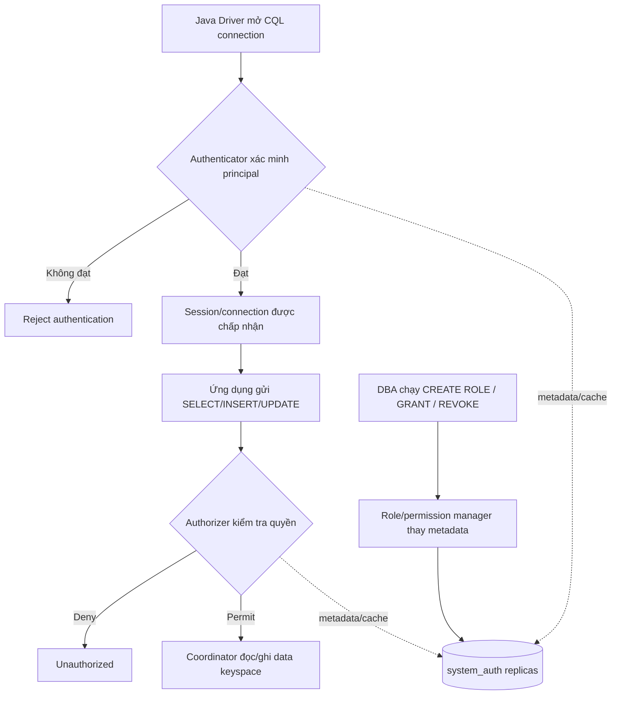
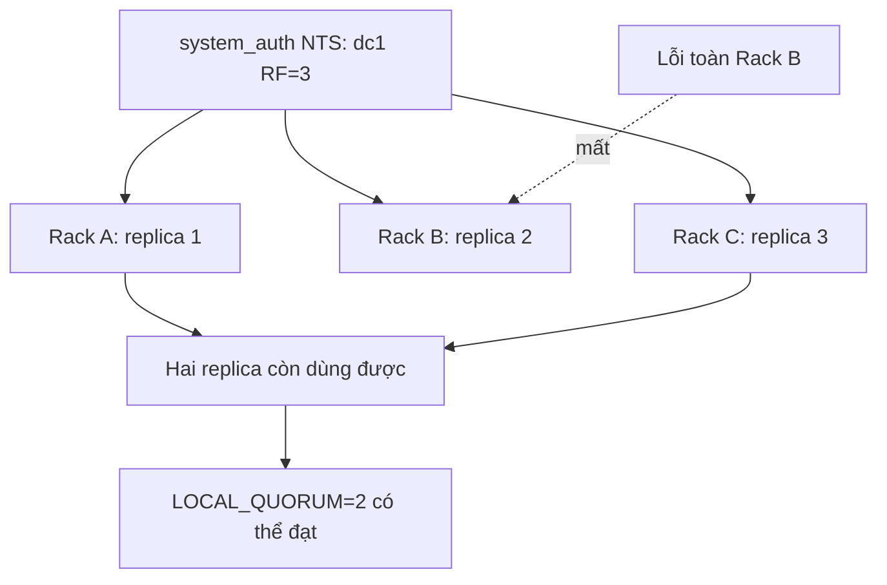
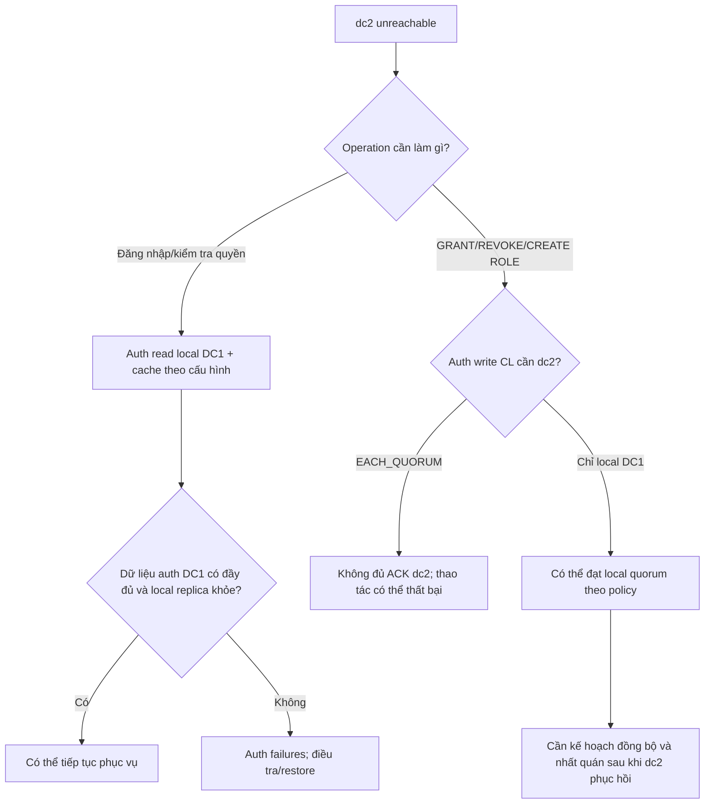

# system_auth, replication factor và điều kiện truy cập khi một miền lỗi gặp sự cố trong Apache Cassandra

## 1. Một cluster còn sống nhưng ứng dụng lại không đăng nhập được

Hãy xét một cluster **Apache Cassandra** có sáu node, chia hai data center (DC), mỗi DC có ba node. Dữ liệu nghiệp vụ nằm trong keyspace dùng `NetworkTopologyStrategy` với RF = 3 mỗi DC. Các request cũ từ ứng dụng Java vẫn đọc/ghi bình thường ở `LOCAL_QUORUM`, nhưng khi các pod ứng dụng mới khởi động, nhiều kết nối CQL nhận lỗi xác thực; một quản trị viên cố `GRANT` quyền cho role mới cũng thất bại.

Một giả thuyết đáng kiểm tra là **keyspace nội bộ `system_auth` chưa được thiết kế đủ bản sao hoặc chưa đồng bộ sau khi tăng RF**. Trong Cassandra dùng cơ chế xác thực/phân quyền nội bộ, metadata người dùng, role và quyền được lưu theo cơ chế phân tán của chính Cassandra. Khi node/rack/DC nắm replica của dữ liệu bảo mật gặp sự cố, đường xác thực và quản lý quyền có thể không sẵn sàng **dù một số bảng nghiệp vụ vẫn phục vụ tốt**.

Điều quan trọng là phải tách ba câu hỏi:

1. **Đăng nhập mới (authentication)** có đọc được thông tin xác thực/role để chấp nhận hoặc từ chối kết nối?
2. **Thực thi query (authorization)** có kiểm tra được quyền của principal đối với tài nguyên, và kết quả cache có còn hợp lệ?
3. **Thay đổi quyền/quản trị (role/permission management)** có ghi được metadata bảo mật theo consistency level áp dụng khi một failure domain bị mất?

Bài thuộc chương **Bảo mật** của mô-đun `DATABASE_ENGINE_WIDE_COLUMN_CASSANDRA`; kiến thức liên quan là kiến trúc phân tán, wide-column, partition key, replication/consistency, CQL, repair, xử lý lỗi và Java Driver. Trọng tâm là **`system_auth`, RF, vị trí replica, consistency của thao tác bảo mật và khả năng truy cập dưới các failure scenarios**, không phải một hướng dẫn tắt cơ chế xác thực khi xảy ra lỗi.

### Mục tiêu học tập

Sau khi học, bạn có thể:

- Giải thích `system_auth` dùng để làm gì và khi nào hệ thống **không** sử dụng nó làm nguồn dữ liệu xác thực chính.
- Đọc replication của `system_auth`, đánh giá RF theo DC/rack và ảnh hưởng khi mất node, rack hoặc toàn DC.
- Phân biệt **CL cho CQL nghiệp vụ** với **CL cho đọc/ghi metadata auth**, cùng tác động của auth caches.
- Lập kế hoạch tăng RF từ cấu hình yếu sang `NetworkTopologyStrategy` an toàn: thay schema, **full repair/backfill**, xác minh rồi thử lỗi.
- Phân biệt việc session đang mở còn hoạt động với đăng nhập mới và quản lý quyền mới khi một failure domain lỗi.
- Xây dựng runbook quan sát, kiểm chứng bằng CQL/`nodetool` và Java Driver, có tiêu chí **GO/NO-GO**, rollback và xử lý dữ liệu bảo mật nhạy cảm.

## 2. `system_auth` là gì?

`system_auth` là **keyspace nội bộ** mà các thành phần bảo mật Cassandra có thể dùng để lưu metadata xác thực/phân quyền, chẳng hạn:

- **Roles/principals** và thông tin dùng để đăng nhập đối với các triển khai `PasswordAuthenticator` và role manager tương ứng.
- Quan hệ **role membership** (role nào được cấp cho role nào).
- **Permissions** trên keyspace, table, role và các resource khác theo cơ chế `CassandraAuthorizer`.
- Một số thông tin bổ sung theo phiên bản và implementation.

Tên bảng/cột nội bộ có thể khác theo phiên bản: `system_auth.roles`, `system_auth.role_members`, `system_auth.role_permissions` là ví dụ thường gặp, **không** phải API ứng dụng hay giao thức quản trị ổn định để bạn tự ghi. Khi thao tác bình thường, sử dụng **CQL role/permission statements** được Cassandra hỗ trợ; không tự `INSERT`/`UPDATE` vào `system_auth` để “sửa quyền nhanh”.

### 2.1. Điều kiện áp dụng

Không phải cluster nào cũng sử dụng `system_auth` để quyết định toàn bộ đường truy cập:

| Cấu hình hoặc hệ thống | Vai trò của `system_auth` |
| --- | --- |
| `PasswordAuthenticator` + `CassandraRoleManager` + `CassandraAuthorizer` | Thường là nguồn metadata role/credential/permission trung tâm cần bảo vệ |
| `AllowAllAuthenticator` hoặc `AllowAllAuthorizer` | Không cung cấp cùng bảo đảm đăng nhập/phân quyền; **không** sử dụng để “khắc phục” lỗi availability production |
| LDAP/SSO/authorizer tùy biến hoặc bản phân phối thương mại | Có thể có nguồn role, authn/authz khác hoặc cache bổ sung | 
| TLS/mTLS ở network layer | Bảo vệ/kết hợp định danh transport, **không tự thay** role/permission policy trong Cassandra |

Trước khi phân tích `system_auth`, ghi **Cassandra version, authenticator, role manager, authorizer, network authorizer (nếu có), TLS mode và backend quản lý định danh thực tế**. Không chép mô hình `system_auth` vào một cluster sử dụng external identity service rồi kết luận nguyên nhân từ keyspace này.

### 2.2. Vì sao role/permission cũng chịu phân vùng dữ liệu?

Các record về role, role membership và permissions được đặt theo **partition key của những bảng nội bộ**. Mỗi partition được băm thành token, rồi replication strategy của `system_auth` chọn node lưu bản sao.

Điều này có hai hệ quả:

1. Một node down với RF quá thấp có thể khiến **một số record bảo mật** không đọc được, chứ không nhất thiết làm tất cả user đồng loạt lỗi.
2. Một request đăng nhập/kiểm tra quyền có thể cần **nhiều record/partition khác nhau**. Việc đọc được một record không chứng minh mọi bước của đường authn/authz đều sẵn sàng.

## 3. Authentication, authorization, role management: ba đường có failure mode khác nhau



**Authentication** xác định ai đang đăng nhập. **Authorization** quyết định principal đó được làm gì với resource. **Role management** tạo/sửa principal và quan hệ quyền; thao tác quản trị cũng chịu kiểm tra quyền trước khi ghi metadata.

Đừng gom tất cả vào nhãn “Cassandra lỗi login”. Những biểu hiện:

| Hiện tượng | Đường cần kiểm tra trước |
| --- | --- |
| Java mở session mới bị lỗi xác thực | Authenticator, thông tin credential, auth read/role lookup, network/TLS |
| Session cũ vẫn hoạt động, pod mới không kết nối được | Connection lifecycle, auth caches, node placement, auth backend availability |
| `SELECT` bị `Unauthorized` sau login thành công | Authorizer, resource permission, role membership, propagation/cache |
| `CREATE ROLE`/`GRANT`/`REVOKE` thất bại | Auth write consistency, coordinator/replica `system_auth`, chính sách quyền người thực thi |
| DBA thấy role mới ở DC1 nhưng chưa dùng được tại DC2 | Cross-DC data propagation, read CL, cache validity, schema/topology |

**Không dùng “đăng nhập còn được” làm bằng chứng rằng thay đổi quyền vừa thực hiện đã hiển thị trên mọi coordinator.**

## 4. Replication của `system_auth` độc lập với keyspace nghiệp vụ

Mỗi keyspace có **replication strategy và RF riêng**. Ví dụ:

```sql
-- Quan sát metadata, không truy cập trực tiếp bảng chứa credential.
SELECT keyspace_name, replication
FROM system_schema.keyspaces
WHERE keyspace_name IN ('system_auth', 'orders');
```

Ví dụ đầu ra minh họa:

```text
system_auth -> {'class':'SimpleStrategy', 'replication_factor':'1'}
orders      -> {'class':'NetworkTopologyStrategy', 'dc1':'3', 'dc2':'3'}
```

**Đây là tình huống minh họa** một hệ thống chưa harden, không phải giá trị mặc định bảo đảm cho mọi phiên bản hay mọi cluster. Một số cài đặt ban đầu có thể để `system_auth` với RF thấp hoặc `SimpleStrategy`; sau triển khai cần **xem cấu hình thật**.

Điều cần rút ra:

- RF = 3 của `orders` **không** bảo vệ metadata của `system_auth` nếu keyspace này RF = 1.
- `SimpleStrategy` không mô hình hóa placement theo DC/rack theo cách `NetworkTopologyStrategy` làm. Khi nhiều DC, nên đánh giá `NetworkTopologyStrategy` và RF thích hợp tại **từng DC chứa client cần dùng auth**.
- RF cao nhưng **replica không được đặt trên failure domains độc lập** vẫn có nguy cơ mất nhiều bản sao cùng lúc.
- RF metadata được chỉnh lên **không tự backfill mọi role/permission lịch sử**. Cần kế hoạch **full repair** và xác minh dữ liệu thực tế.

### 4.1. Tại sao không mặc định chọn RF = số node toàn cụm?

RF phải cân bằng **availability, durability, latency, chi phí lưu trữ và số failure domains**. Với ba node ở ba rack của một DC, RF = 3 là cấu hình thường được cân nhắc cho auth metadata. Nhưng nếu một DC chỉ có hai node thì yêu cầu RF 3 **không tạo ra ba replica độc lập**; còn nếu có ba node trong cùng rack thì một rack outage có thể ảnh hưởng tất cả.

Không dùng RF như lời hứa “an toàn tuyệt đối”: phải xác minh **placement thực, node health, timeout, CL và backup/restore**.

## 5. Mất node, mất rack, mất DC: mức độ ảnh hưởng khác nhau

Một **failure domain** là đơn vị có thể lỗi cùng nhau: node, disk, rack/availability zone (AZ), DC/khu vực hoặc đường WAN. Mục tiêu replication là đặt đủ bản sao ở các miền lỗi độc lập.



Sơ đồ giả định ba replica **thực sự** được phân bố vào ba rack khác nhau, mỗi rack chỉ mất một replica của partition đang xét và không có replica khác chậm. `NetworkTopologyStrategy` cố gắng phân bố replica theo rack, nhưng chỉ có thể dùng **failure domains đã khai báo và có node thực**.

### 5.1. Bảng ảnh hưởng tổng quan

| Sự cố | Với `system_auth` RF thấp/sai placement | Với NTS RF=3 mỗi DC và ba rack khỏe |
| --- | --- | --- |
| Một node down | Một số record role/permission có thể mất replica duy nhất | Nếu chỉ một replica/range bị ảnh hưởng, còn hai bản sao trong DC |
| Một rack/AZ down | Có thể mất phần lớn hoặc tất cả replica của nhiều partition | Có thể còn 2/3 bản sao cho từng partition nếu placement đủ ba rack |
| Toàn một DC down | Không có replica địa phương nếu keyspace không được nhân sang DC còn lại | DC còn lại có thể đọc auth metadata **nếu đã backfill và còn đủ replica/CL** |
| WAN partition | Một DC có thể không đọc/ghi auth đúng theo CL được cấu hình | Local reads có thể tiếp tục, nhưng cross-DC/quorum writes có thể không đạt |
| Một node trở lại sau outage dài | Record cũ/thiếu có thể ảnh hưởng xác thực/cấp quyền | Cần đánh giá repair, hints và an toàn dữ liệu trước cutover |

Không kết luận DC còn hoạt động chỉ từ `nodetool status` có node `UN`. **Sự sẵn sàng của auth cũng cần chứng minh bằng đăng nhập, quyền đọc hợp lệ, quyền bị từ chối và khả năng quản lý roles.**

## 6. Quorum math: đọc/ghi metadata bảo mật phải đợi bao nhiêu replica?

Trong một DC có RF = `r` full replicas, quorum nội bộ:

\[
Q(r) = \left\lfloor \frac{r}{2} \right\rfloor + 1
\]

| RF tại DC | LOCAL_ONE cần | LOCAL_QUORUM cần | Số replica có thể mất mà LOCAL_QUORUM vẫn còn đủ |
| ---: | ---: | ---: | ---: |
| 1 | 1 | 1 | 0 |
| 2 | 1 | 2 | 0 |
| 3 | 1 | 2 | 1 |
| 4 | 1 | 3 | 1 |
| 5 | 1 | 3 | 2 |

Ví dụ: trong dc1, RF 3, `LOCAL_QUORUM` cần 2 replica phản hồi; nếu một replica down nhưng hai replica khác trả lời đúng hạn thì quorum **có thể** đạt. `LOCAL_ONE` chỉ yêu cầu một phản hồi địa phương, có lợi về độ sẵn sàng/latency nhưng **không tự bảo đảm** nó có mọi thay đổi role/permission mới nhất nếu chưa đồng bộ.

### 6.1. EACH_QUORUM trong hai DC

Giả sử `system_auth` dùng NTS với `dc1=3` và `dc2=3`. Một thao tác ghi ở `EACH_QUORUM` (trong phạm vi phù hợp) phải nhận **ít nhất hai ACK từ mỗi DC**. Mất một node ở dc1 vẫn có thể đạt nếu hai node còn lại khỏe; nhưng **mất toàn dc2** khiến ghi `EACH_QUORUM` không thể đạt quorum của dc2.

Vì vậy:

- **Đọc authentication/authorization** dùng local CL có thể vẫn hoạt động tại dc1 khi dc2 mất.
- **Tạo role, đổi password, GRANT/REVOKE** dùng write CL yêu cầu cả hai DC có thể thất bại trong cùng thời gian, **dù DC1 còn hoạt động**.
- Thay đổi CL để lấy lại khả năng ghi roles có thể làm **permission metadata phân kỳ** giữa DC, cần chính sách đồng bộ/repair, giám sát và phê duyệt bảo mật.

**Tính khả dụng của một operation phụ thuộc CL thật đã cấu hình**, không chỉ RF. Nếu CL là `QUORUM` trên tổng replicas hoặc một biến thể cục bộ, phân tích lại đúng tập replica mà request phải chờ.

## 7. Auth read consistency và auth write consistency không giống CL của ứng dụng

Với các phiên bản Cassandra hỗ trợ những tùy chọn tương ứng, người vận hành có thể gặp:

```yaml
# Ví dụ MINH HỌA các khóa cấu hình có thể có trong cassandra.yaml.
# Không sao chép làm cấu hình production trước khi kiểm tra release.
authenticator: PasswordAuthenticator
authorizer: CassandraAuthorizer
role_manager: CassandraRoleManager

# Một số Cassandra release hỗ trợ hai option này:
auth_read_consistency_level: LOCAL_ONE
auth_write_consistency_level: EACH_QUORUM
```

Các giá trị trong ví dụ **không được trình bày như mặc định của mọi phiên bản**. Hãy đọc `cassandra.yaml` có hiệu lực, tài liệu đúng phiên bản/bản phân phối, và xác định các option này có hỗ trợ hay không. Thay cấu hình có thể cần rollout/restart theo tài liệu, phải thực hiện có kế hoạch và kiểm tra trên **mọi node coordinator**.

### 7.1. Bốn tầng consistency không được trộn

| Tầng | Ai quyết định? | Ví dụ | Lỗi khi nhầm |
| --- | --- | --- | --- |
| **Ứng dụng đọc/ghi dữ liệu** | Statement/driver/profile | `LOCAL_QUORUM` | Nghĩ đọc app data ở quorum nghĩa là auth metadata cũng quorum |
| **Auth metadata read** | Cassandra server/auth subsystem theo version/config | `LOCAL_ONE` | Login có thể đọc replica địa phương stale/thiếu |
| **Auth metadata write** | Cassandra server/auth subsystem theo version/config | `EACH_QUORUM` | `GRANT` thất bại khi remote DC down dù app query vẫn chạy |
| **Serial consistency cho LWT** | Statement/protocol khi có LWT | `SERIAL`/`LOCAL_SERIAL` | Không tự thay vai trò của auth read/write CL |

Trong Java, `statement.setConsistencyLevel(LOCAL_QUORUM)` **chỉ đặt CL của query dữ liệu đó**, không ép các truy vấn role/permission **nội bộ do server thực hiện** cùng CL.

### 7.2. Không tối ưu latency bằng cách âm thầm hạ CL bảo mật

Chọn auth read quá yếu khi vừa thay quyền có thể tạo **cửa sổ nhìn thấy chính sách cũ**; chọn auth write yêu cầu đa DC có thể tăng latency và giảm khả năng quản trị khi WAN lỗi. Đây là **quyết định bảo mật và khả dụng**, cần người sở hữu chính sách phê duyệt, đo propagation và quy trình xử lý khi phân vùng mạng.

Không dùng một thay đổi tạm thời như `AllowAllAuthenticator`, `AllowAllAuthorizer` hoặc tắt TLS để “khôi phục dịch vụ” khi `system_auth` lỗi. Điều đó mở rộng quyền truy cập không được bảo vệ và không xử lý nguyên nhân gốc.

## 8. Cache khiến tình trạng lỗi có thể bị che lấp

Cassandra có các cache liên quan **credentials, roles, permissions** theo version và cấu hình; chúng giảm số lần phải đọc `system_auth` cho mỗi hoạt động. Có thể gặp các tùy chọn như `credentials_validity_in_ms`, `roles_validity_in_ms`, `permissions_validity_in_ms` cùng thời gian refresh và kích thước cache tùy release.

**Cache là tối ưu hóa, không phải một replica bền vững mới.**

### 8.1. Ba tình huống dễ gây hiểu nhầm

1. **Session đã mở:** authentication có thể đã hoàn tất khi kết nối được thiết lập; request trên connection cũ vẫn thành công trong một số điều kiện, dù mở session mới không xác thực được. Không dùng điều đó làm bằng chứng hệ thống auth sẵn sàng.
2. **Coordinator có permission cache:** cùng một truy vấn có thể tiếp tục được cho phép từ cache, trong khi coordinator khác chưa có cache hoặc cache hết hạn lại cần đọc `system_auth`. Kết quả quan sát giữa các node có thể khác.
3. **Vừa REVOKE role/permission:** việc thu hồi có thể **chưa có hiệu lực tức thời** tại mọi node nếu cache/propagation chưa cập nhật. Đây là rủi ro bảo mật thực, không chỉ lỗi UX.

### 8.2. Điều gì cần đo?

| Phép thử | Ý nghĩa |
| --- | --- |
| Kết nối Java **mới** bằng principal hợp lệ | Authentication path thực sự hoạt động, không chỉ session cũ |
| Kết nối mới bằng principal không hợp lệ | Cơ chế từ chối vẫn hoạt động, không fail-open |
| `SELECT` bằng role chỉ có quyền đọc | Authorization path đúng cho resource được phép |
| `INSERT` bằng role chỉ đọc | Bị từ chối theo policy; tránh thử trên dữ liệu production |
| `GRANT`/`REVOKE` trong lab bằng DBA authorized | Kiểm chứng đường ghi auth metadata |
| Lặp trên **mỗi DC/coordinator** sau expiry/refresh cache | Phát hiện cache chỉ che thiếu replica hoặc quyền stale |

Không tự xóa hết cache hoặc giảm cache validity xuống 0 trên toàn cluster giữa sự cố chỉ để “thử”. Việc đó có thể làm tăng request tới `system_auth` và biến sự cố tiềm ẩn thành outage. Dùng canary có giới hạn và thao tác invalidate cache theo **runbook phiên bản** khi thật sự cần.

## 9. Thiết kế RF theo node, rack, DC và consistency

### 9.1. Một DC có ba rack

Giả sử dc1 có ba rack A/B/C, mỗi rack chứa một node, RF `system_auth=3`:

```text
dc1:
  rack A: N1 — auth replica
  rack B: N2 — auth replica
  rack C: N3 — auth replica

Auth read LOCAL_ONE:   có thể đọc nếu một replica còn hoạt động và có dữ liệu.
Auth read LOCAL_QUORUM: cần 2/3 replica.
Rack B down:          còn N1,N3, LOCAL_QUORUM có thể thành công.
```

Không biến minh họa thành bảo đảm cho mọi keyspace: điều kiện ba rack độc lập phải thực sự tồn tại và snitch phải cung cấp rack topology chính xác. Với nhiều vnode và partition, verify placement bằng công cụ/phép thử tương ứng, không chỉ nhìn sơ đồ.

### 9.2. Hai DC, mỗi DC ba replica

```text
system_auth NTS:
  dc1: RF=3
  dc2: RF=3

DC1 có thể đọc auth bằng LOCAL_ONE/LOCAL_QUORUM nếu replica local khỏe.
DC2 có thể đọc auth tương tự nếu đã có dữ liệu lịch sử.
Ghi auth ở EACH_QUORUM cần quorum ở cả dc1 và dc2.
DC2 down toàn bộ -> auth write EACH_QUORUM thất bại.
```

**Một DC down** và **một rack down** không đồng nghĩa. Với NTS, nếu các DC có replica đầy đủ thì mất DC1 không loại dữ liệu ở DC2; nhưng client chạy ở DC2 còn cần **driver local DC đúng, kết nối native/TLS còn hoạt động và auth caches/records đã đồng bộ**.

### 9.3. RF2 có thể tệ hơn RF3 cho một số CL

RF=2 tại DC1, `LOCAL_QUORUM` = 2/2. Nếu một replica down, không còn quorum; RF=3, quorum 2/3 và có thể chịu một replica down. Vì vậy giảm RF từ 3 → 2 để tiết kiệm vài bản sao `system_auth` có thể gây mất khả năng quản trị/quyền khi một node lỗi. Auth metadata thường có dung lượng nhỏ so với dữ liệu nghiệp vụ; **đừng ưu tiên tiết kiệm disk mà bỏ qua failure domain và yêu cầu khôi phục truy cập**.

## 10. Khi mất một rack: ma trận ba đường truy cập

Giả sử `system_auth` NTS RF=3 tại dc1, replica của mỗi partition được phân bố phù hợp ba rack, và một rack down:

| Operation | Điều kiện thành công về mặt replica | Điều kiện khác cũng phải đạt |
| --- | --- | --- |
| Java mở connection mới, auth read `LOCAL_ONE` | Ít nhất một replica local chứa record liên quan phản hồi | Credential đúng, role có LOGIN, cache/schema/network/TLS |
| Java mở connection mới, auth read `LOCAL_QUORUM` | Hai replica địa phương phản hồi đúng hạn cho từng lookup | Thao tác đọc role/permissions có thể liên quan nhiều partition |
| Session đã mở tiếp tục query | Có thể không cần lặp authentication ban đầu; authorization phụ thuộc cache/chính sách | Data keyspace RF/CL, coordinator/replica khỏe |
| DBA đổi password/`GRANT` ở auth write `LOCAL_QUORUM` | Hai replica địa phương phản hồi theo cấu hình | Quyền DBA, propagation/caches, rollback/validation |
| DBA đổi quyền ở `EACH_QUORUM` với hai DC | Quorum yêu cầu ở **mỗi DC**, rack down ở dc1 vẫn có thể chịu | dc2 và WAN phải còn liên lạc; metadata backfill đủ |

**Nếu chỉ mất một rack nhưng tất cả ba auth replicas thực tế cùng rack đó thì RF=3 không cứu được.** Lý do phải xác minh topology/failure domain, không đọc RF như một phép bảo đảm tự động.

## 11. Khi mất toàn một DC: lựa chọn availability và tính nhất quán

Giả sử dc2 down, dc1 khỏe:



Mô hình không tự xác định cấu hình tốt nhất; đó là quyết định dựa trên SLA và rủi ro **thu hồi quyền chậm**. Nếu doanh nghiệp cần **đổi credential khẩn cấp ngay khi mất một DC**, phải có runbook được kiểm chứng **trước sự cố**. Nếu chính sách yêu cầu mọi thay đổi quyền được ACK từ cả hai DC mới coi là thành công, một DC outage có thể khiến thao tác quản trị không khả dụng theo thiết kế.

### 11.1. Không có cách “giữ mọi thứ” vô điều kiện khi WAN bị phân vùng

Trong network partition, yêu cầu write metadata bảo mật đạt quorum đa DC và yêu cầu vẫn chấp nhận ghi dù các DC tách nhau **có thể mâu thuẫn**. Chọn CL yếu hơn để mỗi bên tự đổi quyền sẽ làm tăng nguy cơ **stale permission và chính sách không đồng bộ**. Phải ưu tiên theo policy: fail-closed đối với thao tác nhạy cảm, quy trình break-glass được phê duyệt, hoặc hạn chế chức năng trong giai đoạn DC chưa hội tụ.

**Không** để một node/cụm bỏ qua authentication/authorization vì mất kết nối tới auth data store. Khi không xác định được quyền, hành vi an toàn là từ chối thao tác tương ứng thay vì vô điều kiện cho phép.

## 12. CQL quan sát an toàn: xem replication và role policy

Trước khi thay đổi, một DBA được phân quyền có thể xem:

```sql
SELECT keyspace_name, replication
FROM system_schema.keyspaces
WHERE keyspace_name = 'system_auth';
```

Trong `cqlsh`, nếu principal có quyền quản lý role:

```sql
LIST ROLES;

-- Tùy phiên bản và quyền người thực thi:
LIST ALL PERMISSIONS OF app_service;
```

**Không** truy vấn `SELECT * FROM system_auth.roles` rồi xuất ra ticket công khai: bảng nội bộ có thể chứa hash credential và metadata nhạy cảm, đồng thời schema hệ thống không được coi là API quản trị ổn định. **Không** sửa trực tiếp bảng `system_auth`; dùng `CREATE ROLE`, `ALTER ROLE`, `GRANT` và `REVOKE` theo CQL và quyền chuẩn.

### 12.1. Phòng lab: role chỉ được SELECT

Ví dụ này **chỉ dành cho cluster lab** bật authenticator/authorizer phù hợp, không tạo tài khoản ứng dụng thực trên production:

```sql
CREATE KEYSPACE IF NOT EXISTS security_lab
WITH replication = {
    'class': 'NetworkTopologyStrategy',
    'dc1': 3
};

CREATE TABLE IF NOT EXISTS security_lab.orders_by_id (
    order_id uuid PRIMARY KEY,
    status text
);

INSERT INTO security_lab.orders_by_id (order_id, status)
VALUES (11111111-1111-1111-1111-111111111111, 'CREATED');

-- Role không thể đăng nhập, chỉ dùng để gom quyền.
CREATE ROLE IF NOT EXISTS order_reader WITH LOGIN = false;
GRANT SELECT ON TABLE security_lab.orders_by_id TO order_reader;

-- Cấp role đọc cho một role login đã được quản lý/khởi tạo
-- qua quy trình credentials/secret store của môi trường lab.
GRANT order_reader TO app_service;
```

Lệnh cuối yêu cầu role `app_service` **đã tồn tại**, principal quản trị được phép `GRANT` và cluster thực sự đang bật authorizer kiểm tra quyền. Không dùng password thật trong command CQL được ghi vào shell history; tạo login role bằng workflow secrets đã phê duyệt. Đối với production, thêm `GRANT`/`REVOKE` chỉ thông qua quy trình change có owner và kiểm soát quyền.

### 12.2. Phép thử đúng/sai quyền

Đăng nhập bằng `app_service` trong lab và thử:

```sql
-- Mong đợi thành công nếu role inheritance/permission cache đã cập nhật.
SELECT status
FROM security_lab.orders_by_id
WHERE order_id = 11111111-1111-1111-1111-111111111111;

-- Mong đợi bị từ chối nếu app_service chỉ có SELECT:
INSERT INTO security_lab.orders_by_id (order_id, status)
VALUES (22222222-2222-2222-2222-222222222222, 'PAID');
```

Nếu `INSERT` thành công, **đừng kết luận Cassandra bỏ qua auth**: role có thể được thừa kế quyền khác, principal là superuser hoặc authorizer không bật. Kiểm tra role hierarchy, effective grants và cấu hình. Đừng tiếp tục thử phá dữ liệu production để xác minh denial.

## 13. Nâng RF `system_auth`: metadata change chỉ là bước đầu

Giả sử khảo sát thực tế thấy `system_auth` có RF không đủ để chịu một node/rack down hoặc chưa có bản sao trong DC dự phòng. Một kế hoạch mẫu:

```sql
-- Chỉ minh họa một cluster đủ node/rack ở dc1 và dc2.
-- Thực hiện qua quy trình DBA đã duyệt, không tự áp production.
ALTER KEYSPACE system_auth
WITH replication = {
    'class': 'NetworkTopologyStrategy',
    'dc1': 3,
    'dc2': 3
};
```

**Đặt đầy đủ các DC có liên quan trong replication map**; nếu bỏ DC đang dùng khỏi map, có thể vô tình loại placement của dữ liệu auth tại DC đó. Đảm bảo tên DC đúng snitch, DC có đủ node/rack và phương án mạng/availability phù hợp. Chỉ sau khi đánh giá CL auth reads/writes mới triển khai.

### 13.1. Điều gì xảy ra ngay sau `ALTER KEYSPACE`?

Placement mục tiêu thay đổi; các replica mới được chọn cho token ranges của `system_auth` có thể **chưa chứa** role/permission records trước đó. Một số connection mới có thể lỗi xác thực nếu truy vấn tới replica chưa được backfill, nhất là auth read CL yếu hoặc cache hết hạn.

**Không** đồng nhất schema agreement với data synchronization. Tăng RF của `system_auth` cần **full repair/backfill** thích hợp trên các token ranges/replicas mới, tương tự keyspace thường, rồi xác minh kết quả. Nếu bổ sung DC chưa có dữ liệu, có thể cần thêm **rebuild/streaming** theo runbook add-DC đúng phiên bản trước khi chuyển traffic/auth operations tới DC đó.

### 13.2. Checklist thay RF an toàn

1. **Chốt kiến trúc:** Cassandra/driver version, authenticator/role manager/authorizer, hiện trạng RF/DC, rack topology, local DC client, auth read/write CL.
2. **Backup và đường quản trị:** snapshot/backup bảo vệ metadata auth theo chính sách, xác minh nguồn khôi phục, kiểm tra quyền DBA và kế hoạch không bị khóa ngoài. Sao lưu `system_auth` là dữ liệu **nhạy cảm**, cần mã hóa/quyền truy cập chặt.
3. **Preflight node:** `nodetool status` và schema agreement; không chạy đồng thời bootstrap/decommission/replace hoặc repair xung đột chưa được xử lý.
4. **Thay metadata:** `ALTER KEYSPACE system_auth` theo map đầy đủ được phê duyệt; chờ schema agreement.
5. **Full repair/backfill:** xác định tập primary/token ranges, node/replica tham gia. Chạy full repair theo lịch phủ **tất cả range liên quan**, tránh chỉ một task ở một node rồi tuyên bố xong.
6. **Validation:** đối chiếu repair/streaming logs, task success/failure, role lookup và permission tests ở **mỗi DC**; thử login mới, denied access và role management trong lab/canary.
7. **Monitor sau thay đổi:** authentication/authorization error rate, permission propagation, coordinator/replica latency, client reconnect, disk/network và pending repair.
8. **Chỉ đóng change** khi dữ liệu và SLO auth path đạt; nếu không, trạng thái **INCOMPLETE** và ngừng cutover/cleanup.

### 13.3. Lệnh công cụ mẫu

```bash
nodetool status system_auth
nodetool describecluster
nodetool netstats
nodetool compactionstats

# Ví dụ full repair trên node có phạm vi đang chịu trách nhiệm.
# Lập lịch đủ token ranges/nodes, không chạy một node và coi toàn cụm đã xong.
nodetool repair -full system_auth

# Nếu dùng -pr, bắt buộc hoạch định coverage primary ranges trên
# các node liên quan; tham khảo options của Cassandra release đang chạy.
nodetool repair -full -pr system_auth
nodetool help repair
```

**Lưu ý version:** `-full`, `-pr`, phạm vi DC/host và tác vụ repair có những khác biệt theo release; kiểm tra lệnh đúng bản. Full repair có thể tiêu thụ disk I/O, CPU và network, gây ảnh hưởng tới cả dữ liệu nghiệp vụ. Không chạy repair cho tất cả node đồng thời không giới hạn concurrency.

### 13.4. Vì sao incremental repair chưa chắc đủ?

Dữ liệu role/permission lịch sử có thể nằm trong SSTable **đã được đánh dấu repaired** theo placement cũ. Sau tăng RF, incremental repair có thể không xét tất cả dữ liệu lịch sử cần backfill. Vì vậy lựa chọn full repair thường cần thiết khi **thêm replica**. Báo cáo phải chỉ rõ **range được repair thành công** và source còn dữ liệu hợp lệ, không chỉ exit code một lệnh.

## 14. Giảm RF và thay topology: đừng xóa bản sao bảo mật cuối cùng

Giảm RF của `system_auth` có thể làm mất khả năng chịu node/rack outage và làm CL như `LOCAL_QUORUM` đòi tất cả replica còn lại. Nếu giảm từ RF3 xuống RF2 ở một DC, `LOCAL_QUORUM` đổi từ 2/3 thành 2/2; khi một node của replica set down, quản trị/lookup dùng CL này có thể unavailable.

**Cleanup không phải repair.** Sau khi giảm RF, `nodetool cleanup` trên các node có dữ liệu không còn thuộc ownership có thể thu hồi bản sao dư. Nhưng cleanup trước khi bảo đảm **replica còn lại đầy đủ role/permission records** có thể loại mất nguồn dữ liệu bảo mật phục hồi.

Runbook giảm RF:

- Xác nhận có lý do và đánh giá ảnh hưởng failure domain/CL.
- Xác minh dữ liệu các replica sẽ tiếp tục giữ, đồng bộ/repair thích hợp khi cần.
- Chỉnh metadata và đợi schema agreement.
- Chỉ thực hiện cleanup sau backup và data coverage/availability validation.
- Thử authn/authz và quản trị roles trong kịch bản một node down trước khi chốt.

**Rollback sau cleanup** không chỉ là `ALTER KEYSPACE` ngược; có thể cần full repair/stream/restore lại metadata đã bị xóa khỏi một số node.

## 15. Role/permission propagation và cửa sổ thu hồi quyền

Hai loại thay đổi phải đánh giá riêng:

1. **Cấp quyền (GRANT):** principal mới có thể chưa dùng được quyền ở một coordinator/DC do replica lag hoặc cache cũ.
2. **Thu hồi quyền (REVOKE) hoặc đổi credential:** principal vẫn có thể được phép một thời gian nếu cache cũ còn hiệu lực, session đã mở, hoặc metadata mới chưa lan tới replica được đọc.

Điểm thứ hai có **hệ quả bảo mật nghiêm trọng hơn lỗi trải nghiệm**. Người vận hành không thể chỉ nói “eventual consistency sẽ tự ổn” nếu chính sách yêu cầu thu hồi khẩn cấp trong vài giây.

### 15.1. Hợp đồng revocation cần định lượng

Một chính sách mẫu (giá trị chỉ minh họa, không phải SLA Cassandra mặc định):

```text
Sự kiện: REVOKE SELECT khỏi role R tại t0.
Yêu cầu: trong tối đa 60s, mọi coordinator ở DC1/DC2
         phải từ chối request SELECT mới của principal R.
Điều kiện cần:
  - Auth write đạt CL đã phê duyệt.
  - Replica đã nhìn thấy metadata mới.
  - Permission/role cache được làm mới/hết hạn theo policy.
  - Client mới và client đã tồn tại được test ở nhiều node/DC.
Khi không đạt:
  - Escalate security incident.
  - Có biện pháp chặn tạm ở network/app gateway phù hợp policy.
  - Không tuyên bố revocation hoàn tất.
```

Đây là **hợp đồng kiểm thử của tổ chức**, không phải tính năng Cassandra tự cam kết. Cần xác nhận cache semantics, khả năng invalidate, session behavior và chi phí của policy qua diễn tập trên release thực tế.

### 15.2. Authentication cache khác data repair

Full repair làm **data replicas** hội tụ theo phạm vi, nhưng **không tự đảm bảo mọi cache của mọi coordinator lập tức đổi giá trị**. Ngược lại, xóa cache không làm tăng RF hoặc tạo lại role record đã mất. Đây là lý do runbook phải có **cả data synchronization lẫn cache propagation validation**.

## 16. Java Driver 4.x: kiểm chứng đường truy cập thực tế

Ứng dụng Java không được kiểm tra `system_auth` bằng cách đọc bảng credential trực tiếp. Hãy kiểm tra qua **đường đăng nhập hợp lệ và một truy vấn có quyền**, từ các vùng/DC mục tiêu. Mẫu Java 17+ và Java Driver 4.x dưới đây dùng contact point thử nghiệm (IP phải thay bằng node thật), TLS/authentication được cấu hình qua policy hệ thống:

```java
import com.datastax.oss.driver.api.core.CqlSession;
import com.datastax.oss.driver.api.core.DefaultConsistencyLevel;
import com.datastax.oss.driver.api.core.cql.PreparedStatement;
import com.datastax.oss.driver.api.core.cql.Row;
import java.net.InetSocketAddress;
import java.util.Objects;
import java.util.UUID;

// Lab only: lấy password từ secret manager trong production.
// Biến môi trường cũng cần được bảo vệ, không print/log.
String password = Objects.requireNonNull(
    System.getenv("CASSANDRA_LAB_PASSWORD"),
    "Missing lab credential");

// Chạy từ môi trường có thể route tới dc1 và certificate hợp lệ.
try (CqlSession session = CqlSession.builder()
        .addContactPoint(new InetSocketAddress("127.0.0.1", 9042))
        .withLocalDatacenter("dc1")
        .withAuthCredentials("app_service", password)
        .build()) {

    PreparedStatement ps = session.prepare("""
        SELECT status FROM security_lab.orders_by_id
        WHERE order_id = ?
        """);

    long started = System.nanoTime();
    Row row = session.execute(
        ps.boundStatementBuilder()
            .setUuid(0, UUID.fromString(
                "11111111-1111-1111-1111-111111111111"))
            .setConsistencyLevel(DefaultConsistencyLevel.LOCAL_QUORUM)
            .build()).one();

    long durationNs = System.nanoTime() - started;
    // Ghi success, duration, local DC, query fingerprint.
    // Không log password hoặc raw auth metadata.
}
```

Địa chỉ `127.0.0.1` chỉ là **placeholder**, không đại diện một DC thực. Khi ứng dụng production cần TLS, hãy thiết lập truststore/identity verification và kết nối bảo mật theo cấu hình phiên bản driver. Ví dụ tập trung kiểm tra **principal và quyền đọc**, không thay thế TLS config.

### 16.1. Bốn bài test theo trạng thái failure domain

| Test | Cách làm ở lab/canary | Điều chứng minh |
| --- | --- | --- |
| **Fresh login** | Tạo session mới với credential hợp lệ ở từng DC | Authentication không chỉ đang hoạt động nhờ session cũ |
| **Authorized query** | Role đọc thực hiện `SELECT` đúng table | Role inheritance và permission lookup có hiệu lực |
| **Denied query** | Role chỉ đọc thử `INSERT` vào bảng lab riêng | Authorizer thực sự từ chối ngoài phạm vi được cấp |
| **Admin role mutation** | DBA có quyền thử `GRANT`/`REVOKE` trong lab | Auth write CL và metadata propagation có thể kiểm chứng |

Nên đo riêng **connection setup latency, authentication failures, unauthorized denials, query latency/errors và elapsed permission propagation**. Một `SELECT` ở `LOCAL_QUORUM` dùng **data keyspace RF/CL**; nếu nó thành công, điều đó **không** có nghĩa auth write `EACH_QUORUM` cũng sẽ thành công lúc DC khác bị mất.

### 16.2. Phân loại lỗi đúng

- **Authentication failed:** có thể do password sai, LOGIN=false, auth data thiếu/stale, timeout backend hoặc TLS/auth handshake; điều tra message và server logs an toàn, không suy tự động “password sai”.
- **Unauthorized:** authenticator đã cho phép principal, nhưng authorizer từ chối resource. Có thể là đúng policy hoặc metadata/cache chưa cập nhật.
- **Unavailable/timeout khi query:** cần phân biệt **data keyspace CL/replica** với lỗi nội bộ xảy ra ở auth lookup, dựa trên stack trace và server metrics.
- **All nodes failed/TLS failure:** có thể do client routing/network/certificate, không liên quan trực tiếp `system_auth`.

Không log credential, token hoặc kết quả chứa hash mật khẩu vào hệ thống tracing/ticket.

## 17. Quan sát cụm và gói bằng chứng khi auth bị gián đoạn

### 17.1. Lệnh chỉ đọc

```bash
nodetool status system_auth
nodetool describecluster
nodetool tpstats
nodetool netstats
nodetool compactionstats
nodetool tablestats system_auth
```

Tùy phiên bản, `tablestats` cho biết trạng thái table-level của keyspace và các chỉ số read/write/space/SSTable. `tpstats` cho thấy queue/stages, không tự chỉ ra chính xác role nào đang lỗi. `netstats` có thông tin streaming/bootstrap/repair, **không** là đồng hồ đo mọi mutation auth từ DC1 sang DC2. Lệnh `status` chỉ nói node membership, không chứng minh auth replicas đã đồng bộ hay caches đúng.

### 17.2. Bộ bằng chứng tối thiểu

| Nhóm | Thu thập |
| --- | --- |
| **Cấu hình bảo mật** | Cassandra version/distribution, authenticator, role manager, authorizer, auth read/write CL và cache settings có hiệu lực |
| **Placement** | `system_auth` RF trước/sau từng DC, strategy, rack mapping, node UN/DN và schema agreement |
| **Sự kiện lỗi** | UTC timeline node/rack/DC outage, network partition, rollout/restart, repair/streaming |
| **Ứng dụng** | Driver local DC, fresh login success rate, authentication/unauthorized errors, connection timeouts, failed query classes |
| **Quản trị** | Kết quả `GRANT`/`REVOKE`/role create trong lab/canary, propagation trong DC khác |
| **Repair** | Node/range/task coverage, thành công/thất bại, streaming và pending state |
| **An toàn** | Tình trạng TLS, backup, audit events, cache validity, bản ghi nhạy cảm được redact |

Thu theo **UTC** và nhiều node/coordinator. Một lần đăng nhập bằng tài khoản quản trị ở node A không chứng minh mọi role và coordinator ở DC khác đã sẵn sàng.

## 18. Runbook khi mất một miền lỗi nhưng người dùng không truy cập được

### Giai đoạn A — phân loại và bảo vệ hệ thống

1. Xác định sự cố là **fresh authentication**, **authorization**, **role management** hay **CQL data request**.
2. Ghi node/rack/DC nào mất, thời điểm UTC, tên keyspace và service/DC liên quan.
3. Giữ nguyên bảo vệ TLS/auth; **không** chuyển sang `AllowAllAuthorizer` hoặc tắt credential validation.
4. Xác định ứng dụng **đang dùng session cũ** hay **đang khởi tạo connection mới**.
5. Bảo đảm account quản trị/break-glass có quyền và quy trình sử dụng được phê duyệt; không chia sẻ secret trong incident ticket.

### Giai đoạn B — điều tra RF, CL và placement

1. Đọc `system_schema.keyspaces` của `system_auth`, kiểm tra NTS/RF theo DC; không suy từ keyspace nghiệp vụ.
2. Đối chiếu snitch DC/rack và replica placement theo topology thật.
3. Kiểm tra auth read/write CL **có hiệu lực** và cache TTL/refresh theo Cassandra version.
4. Đo login success/denied và `GRANT`/`REVOKE` ở phạm vi **lab/canary** phù hợp; log lỗi riêng từng loại.
5. Nếu vừa tăng RF, xác minh **full repair/backfill đủ token ranges** và auth data đã đến DC/replica mới.

### Giai đoạn C — khôi phục theo nguyên nhân

| Kết quả điều tra | Hướng xử lý |
| --- | --- |
| RF=1 và node lưu auth partition bị mất | Khôi phục node/nguồn backup, sau đó thiết kế RF/NTS đầy đủ và repair; không giả định metadata ở node khác |
| RF tăng, replica mới thiếu lịch sử | Hoàn thành full repair/backfill và validation; hoãn cutover/failover |
| Một rack down khiến LOCAL_QUORUM thiếu replica | Khôi phục rack/node hoặc phương án sẵn có theo SLA; rà placement độc lập của RF |
| Một DC down, auth write EACH_QUORUM fail | Theo policy chấp nhận tạm thời không quản lý role, hoặc kích hoạt runbook security-approved; không âm thầm giảm CL |
| Đăng nhập mới lỗi nhưng session cũ chạy | Xem auth read/cache, credential, TLS, node availability và session lifecycle |
| REVOKE đã ghi nhưng quyền còn hiệu lực | Kiểm tra propagation/cache, thử trên nhiều coordinator, dùng biện pháp chặn tạm theo security policy |
| Auth metadata bị mất, không còn replica hợp lệ | Recovery từ backup/restore được kiểm chứng, đánh giá an toàn role/permission, không hy vọng repair tạo lại dữ liệu từ hư không |

### Giai đoạn D — kiểm chứng và đóng incident

1. **Fresh login** ở DC cần phục vụ phải đạt, từ cả node/coordinator được định tuyến.
2. Query hợp lệ được **allow**, query không được cấp phải **deny**.
3. Auth metadata write theo yêu cầu chính sách được xác nhận ở DC liên quan, hoặc ghi rõ tính năng quản trị còn bị hạn chế khi WAN/DC lỗi.
4. Các token ranges đã repair/stream đạt coverage, backup và rollback path còn hiệu lực.
5. Mức độ lỗi/latency của Java Driver, TLS, coordinator, auth cache ổn định sau phục hồi; có kế hoạch diễn tập failure domain tiếp theo.

Nếu chưa kiểm chứng một nhóm, trạng thái phải là **INCOMPLETE**, không lấy `nodetool status UN` làm bằng chứng đóng sự cố.

## 19. Diễn tập chaos/fault injection trong môi trường an toàn

**Chỉ thực hiện trong lab/staging cô lập**, có phê duyệt và khả năng phục hồi. Tắt/partition node ở production mà không có maintenance plan là không phù hợp.

### Kịch bản 1 — RF1 và mất một node

Giả định có `system_auth` RF1 ở cluster lab. Định danh một node lưu một số auth partitions và ngắt node theo thao tác lab an toàn.

**Quan sát:** fresh login/permissions nào lỗi, session cũ có khác không? Vì sao một số role có thể còn login được và role khác thất bại? Đó là đặc trưng **partition placement và cache**, không phải tất cả roles cùng nằm trên một node mặc định.

### Kịch bản 2 — NTS RF3 và mất một rack

Phân bố ba replica ở ba rack độc lập, thử mất một rack, so:

- Auth read `LOCAL_ONE`/`LOCAL_QUORUM` theo cấu hình có hỗ trợ, trong khi role metadata đã hội tụ.
- Fresh login và `SELECT`/denied query trên các coordinator còn sống.
- `GRANT` theo auth write CL và khả năng thao tác khi một replica down.

**Yêu cầu:** phân biệt kết quả của **auth CL** và **data CL**, không chỉ so response time một `SELECT`.

### Kịch bản 3 — mất toàn DC2 nhưng DC1 còn khỏe

Với NTS RF3 cả hai DC, mô phỏng WAN isolation giữa DC1/DC2. Nếu auth read local và dữ liệu đã backfill, login tại DC1 có thể tiếp tục; nếu auth write EACH_QUORUM, thay quyền có thể không hoàn tất. Ghi rõ timeout vs unauthorized, RTO của phục hồi và điều kiện policy cho phép làm gì.

### Kịch bản 4 — REVOKE và cache propagation

Trong lab, cấp một role đọc, kết nối từ DC1/DC2, sau đó `REVOKE SELECT` khi mạng hoạt động và khi WAN bị partition. Đo thời gian cho tới khi request mới bị deny trên mọi coordinator theo cấu hình cache. Nếu quyền còn hiệu lực dài hơn policy, thiết kế quy trình **invalidate/expire cache được hỗ trợ** hoặc chặn tạm ở lớp network/app, không tự can thiệp vào bảng nội bộ.

## 20. Sai lầm phổ biến

| Sai lầm | Vì sao sai? | Cách làm đúng |
| --- | --- | --- |
| “Keyspace app RF3 nên auth cũng RF3” | RF độc lập theo keyspace | Đọc riêng `system_auth` replication |
| “Node `UN` thì login chắc chắn ổn” | Có thể thiếu auth partitions, cache hoặc role metadata | Fresh login và auth path validation |
| “RF3 luôn chịu được một rack down” | Phụ thuộc snitch/placement và rack thật | Xác nhận 3 failure domains độc lập |
| “RF2 cũng chịu một replica down ở LOCAL_QUORUM” | RF2 yêu cầu 2/2 | Tính quorum và test failure |
| “Ghi role ở LOCAL_QUORUM app là đủ” | Auth write CL do subsystem riêng quyết định | Xem config auth write thật |
| “Đang truy vấn được thì GRANT cũng làm được” | Auth read/data operation khác auth write | Test management path riêng |
| “Session cũ hoạt động nghĩa là login mới ổn” | Cache và connection authentication lifecycle | Tạo session mới để kiểm chứng |
| “REVOKE thành công nghĩa mọi node đã chặn ngay” | Cache/propagation có thể trễ | Đo revocation trên nhiều DC/coordinator |
| “Tăng RF là hoàn tất” | Metadata không tự backfill lịch sử | Full repair/stream coverage rồi validate |
| “Chạy incremental sửa mọi record sau tăng RF” | SSTables repaired cũ có thể bị bỏ qua | Full repair cho phạm vi thay đổi |
| “Tắt auth để chữa outage” | Tạo lỗ hổng truy cập nghiêm trọng | Khôi phục dữ liệu/CL/placement an toàn |
| “Mở toàn quyền quản trị để canary” | Quyền vượt cần thiết, khó thu hồi | Least privilege và test trong lab |
| “Đọc system_auth.roles để debug rồi đưa log lên ticket” | Rò rỉ hash credential/metadata nhạy cảm | Dùng API role CQL, redact và audit |
| “Sửa bảng system_auth trực tiếp nhanh hơn” | Bỏ qua cơ chế quản lý, dễ hỏng cache/index/schema | Dùng CQL ROLE/GRANT/REVOKE được hỗ trợ |

## 21. Mẫu change/incident report cho `system_auth`

```text
CHANGE / INCIDENT:
  id, owner, UTC window, environment, Cassandra version
  affected domain: node / rack / DC / WAN partition
  business impact: fresh login? authorization? role management? query?

AUTH CONFIG (EFFECTIVE):
  authenticator, role_manager, authorizer, network_authorizer
  auth_read_consistency_level, auth_write_consistency_level
  roles/credentials/permissions cache validity + refresh
  Java driver local DC, TLS and trust configuration

TOPOLOGY / REPLICATION:
  system_auth strategy, RF per DC BEFORE/AFTER
  node status, snitch/DC/rack, expected replica placement
  schema agreement and topology change timeline

BACKUP / DATA VALIDATION:
  system_auth backup/restore evidence (restricted access)
  full repair/streaming tasks and token-range coverage
  failed/pending sessions; missing data warning

TEST MATRIX:
  fresh valid login per DC: PASS/FAIL
  invalid login denied: PASS/FAIL
  authorized SELECT per DC: PASS/FAIL
  unauthorized INSERT denied: PASS/FAIL
  role/permission management under required CL: PASS/FAIL
  cache propagation/REVOKE: measured elapsed, policy threshold
  one rack/one DC outage simulation in lab: PASS/FAIL

SECURITY:
  encrypted/limited-access artifacts; no credentials in logs
  audit events, break-glass approver, incident classification

FINAL:
  GO / NO-GO for cutover
  COMPLETED / INCOMPLETE / ROLLED_BACK
  remaining risks, owner, next test, restore path
```

Không chèn nội dung `system_auth.roles` hay mật khẩu vào báo cáo. Role names của khách hàng, địa chỉ node và thông tin topology cũng có thể thuộc mức hạn chế và cần kiểm soát truy cập.

## 22. Câu hỏi luyện tập

### Tình huống A — ứng dụng vẫn chạy nhưng pod mới không login

Một cluster ba node dc1 có app keyspace RF3, `system_auth` RF1. N2 down, session Java cũ vẫn hoạt động, nhưng các pod Java mới có tỷ lệ authentication failure 40%.

1. Vì sao RF3 của keyspace app không bảo vệ đường login?
2. Vì sao **không nhất thiết** tất cả role đồng loạt thất bại?
3. Bạn thu những bằng chứng nào về auth CL/cache và token placement?
4. Lập trình tự sửa RF/backfill và test fresh login mà không tắt auth.

### Tình huống B — một rack lỗi trong hai cấu hình

Cluster có ba rack. Cấu hình X: `system_auth` RF2; cấu hình Y: RF3 NTS với ba replica ở ba rack. Auth read `LOCAL_QUORUM`.

1. Với RF2 cần mấy ACK, mất một replica có còn quorum không?
2. Với RF3 cần mấy ACK, mất một replica còn bao nhiêu?
3. Nếu ba node cùng một rack, RF3 có đủ khả năng chịu **rack outage** không?
4. Điều kiện về disk/network/timeout ngoài quorum là gì?

### Tình huống C — mất DC2 khi đang cần REVOKE

Hai DC mỗi DC RF3 cho `system_auth`. Auth read local; auth write được yêu cầu `EACH_QUORUM`. DC2 bị cô lập, DBA tại DC1 cần thu hồi quyền đọc một role có nguy cơ bị lộ credential.

1. Vì sao login ở DC1 **có thể** còn thành công nhưng `REVOKE` có thể thất bại?
2. Cần đánh giá gì về security policy, cache và session còn mở?
3. Có được tắt authorizer hoặc âm thầm hạ CL để thu hồi cho “xong” không?
4. Giải pháp chặn tạm ở tầng ứng dụng/network và quy trình sau khi DC2 hồi phục nên được mô tả thế nào?

### Tình huống D — tăng RF nhưng vẫn lỗi ngẫu nhiên

DBA đổi `system_auth` RF1 sang NTS RF3, mọi node `UN`. Một số login mới thành công ở N1 nhưng thất bại ở N3. Chưa có log full repair.

1. Vì sao metadata `ALTER KEYSPACE` thành công chưa đủ?
2. Auth read `LOCAL_ONE` có thể quan sát khác nhau thế nào giữa replica đã/ chưa backfill?
3. Cần kế hoạch full repair theo range và cách xác minh auth cache/data ra sao?
4. Tại sao không dùng incremental repair duy nhất rồi đóng ticket?

### Câu hỏi ngắn

1. `system_auth` khác keyspace nghiệp vụ ở dữ liệu và RF như thế nào?
2. Authentication, authorization và role management có cùng mục tiêu và failure mode không?
3. NTS RF3 có ý nghĩa gì nếu chỉ có một rack hoặc DC không đủ node?
4. Công thức `LOCAL_QUORUM` với RF4 cần mấy ACK?
5. `EACH_QUORUM` có thể ảnh hưởng thế nào tới thao tác `GRANT` khi một DC mất?
6. Driver `LOCAL_QUORUM` có bắt buộc auth metadata được đọc ở `LOCAL_QUORUM` không?
7. Permission cache có thể che mất loại sự cố nào?
8. Vì sao REVOKE đã trả thành công chưa chứng minh mọi coordinator đã ngừng cấp quyền?
9. Sau tăng RF, khi nào cần full repair hơn incremental repair?
10. Vì sao không được trực tiếp sửa bảng `system_auth` hoặc tắt authorizer khi outage?
11. Cần kiểm chứng fresh login hay chỉ dùng connection hiện có?
12. Những loại thông tin bảo mật nào không được xuất ra incident ticket?

## 23. Ghi chú theo phiên bản và nguồn tham khảo

Các chi tiết **tên table của `system_auth`, auth read/write consistency options, cache settings, khả năng cập nhật cấu hình động và behavior khi node/DC down** phụ thuộc Cassandra release và bản phân phối. Trước khi áp dụng ở production, tra cứu:

- Apache Cassandra Documentation: **Security / Authentication**, **Authorization**, **Roles and Permissions**.
- Apache Cassandra Documentation: **NetworkTopologyStrategy / Replication**, **Consistency Levels**.
- Apache Cassandra Documentation: **nodetool repair** và phần **full repair sau đổi RF**.
- `nodetool help repair` và `cassandra.yaml` có hiệu lực của bản đang chạy.
- Java Driver 4.x documentation: **authentication, local datacenter routing, connection/session lifecycle và exception mapping**.

Không dùng một ví dụ triển khai từ Cassandra 3.x làm bằng chứng option/tên bảng vẫn nguyên trên Cassandra 5.x. Với production, runbook cần được kiểm tra bởi DBA và người sở hữu chính sách bảo mật trước khi thay RF, cache hoặc auth CL.

## 24. Kết luận

**`system_auth` là dữ liệu vận hành bảo mật cần được đặt replica và phục hồi như một hệ thống phân tán thực sự.** RF của keyspace nghiệp vụ **không** bảo vệ login/permission metadata nếu `system_auth` có RF thấp hoặc replica cùng failure domain. `NetworkTopologyStrategy` với đủ replica phân bố theo DC/rack, auth read/write consistency thích hợp và full repair sau thay đổi RF giúp nâng khả năng chịu lỗi; nhưng **RF không thay thế placement thực, cache semantics, backup và phép thử truy cập từ Java client**.

Khi mất node/rack/DC, phải kiểm tra riêng **đăng nhập mới, kiểm tra quyền và thao tác quản lý role**. Session cũ, cache còn nóng hay một `SELECT` thành công không chứng minh `GRANT`/`REVOKE` có thể thành công hoặc quyền đã thu hồi trên mọi coordinator. Một thay đổi chỉ hoàn tất khi chứng minh đủ **metadata/placement, repair/backfill, fresh login/denied permissions, propagation/cache và SLO** trong những failure scenarios được thiết kế. Nếu còn thiếu, trạng thái đúng là **INCOMPLETE với giới hạn và phương án khôi phục rõ ràng**, tuyệt đối không tắt cơ chế bảo mật để che vấn đề.
