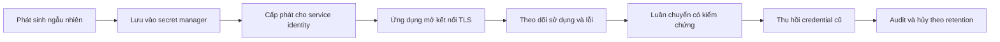
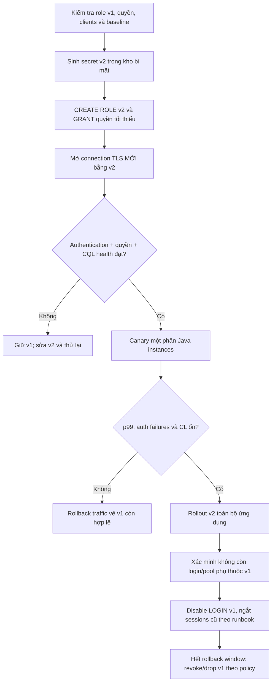

# Thông tin đăng nhập, kho bí mật và luân chuyển mật khẩu trong Apache Cassandra

## 1. Mục tiêu: bảo vệ danh tính truy cập mà không làm gián đoạn cluster

Apache Cassandra là cơ sở dữ liệu **wide-column phân tán**: ứng dụng Java dùng CQL để đọc/ghi partition, dữ liệu được đặt lên nhiều **replica** theo replication factor (RF), và kết quả được xác nhận theo consistency level (CL). Tuy nhiên, **RF = 3** và **`LOCAL_QUORUM`** bảo vệ những thuộc tính về dữ liệu/khả dụng, **không** thay thế xác thực và phân quyền.

Giả sử một service `orders-api` giữ tài khoản Cassandra `app_orders_v1` với mật khẩu ghi cứng trong `application.yml`. Khi repository bị lộ, đội vận hành phải thay mật khẩu. Nếu chỉ chạy `ALTER ROLE` rồi cập nhật một số pod Java, những pod còn giữ mật khẩu cũ có thể không mở được connection mới; nếu chỉ cập nhật secret store mà không đổi mật khẩu trên Cassandra, credential bị lộ vẫn dùng được.

Bài này hướng tới bốn năng lực:

1. **Cấp phát:** tạo riêng danh tính cho service/ngữ cảnh, áp dụng quyền tối thiểu.
2. **Bảo quản:** lưu credential trong hệ thống quản lý bí mật, không để lộ qua mã nguồn, logs, command line hoặc CQL history.
3. **Luân chuyển:** đổi credential có trình tự, kiểm chứng đường kết nối mới trước khi vô hiệu hóa đường cũ.
4. **Ứng phó:** phát hiện và xử lý lộ credential, giữ được khả năng thu hồi, khôi phục và kiểm toán.

**Nguyên tắc quan trọng:** đổi mật khẩu là thay đổi **phía Cassandra lẫn phía ứng dụng và kho bí mật**. Thành công của một lệnh CQL không đồng nghĩa tất cả Java Driver sessions đã dùng credential mới.

## 2. Phân biệt xác thực, phân quyền, mã hóa và danh tính

| Khái niệm | Câu hỏi | Ví dụ Cassandra |
| --- | --- | --- |
| **Authentication (xác thực)** | Ai đang kết nối? | `PasswordAuthenticator` kiểm tra username/password |
| **Authorization (phân quyền)** | Danh tính đó được làm gì? | `CassandraAuthorizer` kiểm tra `SELECT`, `MODIFY`… |
| **Role management** | Ai tạo role, đổi quyền, khóa login? | `CassandraRoleManager` quản lý role |
| **Transport security** | Thông tin đi qua mạng có được bảo vệ? | TLS cho client ↔ node, TLS giữa các node theo cấu hình |
| **Secret management** | Credential được lưu, phát hành, xoay và kiểm toán ở đâu? | Secret manager và service identity |
| **Audit/observability** | Ai/ứng dụng nào gặp lỗi auth hoặc được đổi quyền? | Audit trail, logs đã làm sạch dữ liệu nhạy cảm |

Ví dụ `PasswordAuthenticator` xác định caller là `app_orders_v2`, nhưng role này vẫn cần quyền `SELECT` hoặc `MODIFY` trên tài nguyên tương ứng. **Xác thực thành công không tự mang lại quyền truy cập tất cả keyspace.**

TLS và mật khẩu cũng giải quyết hai vấn đề khác nhau. **Không dùng việc có password để biện minh cho CQL kết nối plaintext.** Cơ chế đăng nhập bằng username/password cần đường truyền TLS đúng cấu hình, chứng chỉ tin cậy và kiểm tra danh tính server để tránh lộ credential khi truyền.

### Ba bề mặt tấn công cần tính

- **Client ↔ coordinator:** có thể bị nghe lén, bị cấu hình sai trust store hoặc kết nối nhầm endpoint.
- **Coordinator ↔ replica:** internode traffic ảnh hưởng bảo mật và khả năng hoạt động của nhiều DC; cấu hình TLS nội bộ là trách nhiệm riêng.
- **Control plane:** người/công cụ có quyền tạo role, thay mật khẩu hoặc đọc secret manager có thể tạo đường truy cập mới dù không trực tiếp đọc bảng nghiệp vụ.

Tối ưu thiết kế phải bảo vệ cả **credentials** lẫn **quyền thay đổi credentials**.

## 3. Cấu hình bảo mật Cassandra: kiểm tra trước khi cấp tài khoản

Trong những triển khai Apache Cassandra tự quản lý, các lựa chọn thường gặp ở `cassandra.yaml` là:

```yaml
# Ví dụ khái niệm; kiểm tra cấu hình đúng phiên bản và runbook.
authenticator: PasswordAuthenticator
authorizer: CassandraAuthorizer
role_manager: CassandraRoleManager
```

Ý nghĩa:

- `PasswordAuthenticator` bật xác thực bằng mật khẩu cho kết nối client theo cơ chế được hỗ trợ.
- `CassandraAuthorizer` kiểm tra permission, thay vì cho phép mọi tài khoản thực hiện mọi câu CQL.
- `CassandraRoleManager` hỗ trợ tạo, sửa và quản lý role.

**Đừng áp dụng ba dòng này lên một cluster production vốn cho phép mọi kết nối mà không có kế hoạch migration.** Bật auth/authz khi client, internal tooling và các tài khoản quản trị chưa sẵn sàng có thể khiến dịch vụ và công cụ vận hành bị khóa ngoài.

Cấu hình có thể cần restart theo từng node, phiên bản và cách operator triển khai; cần quy trình chuyển đổi, kiểm tra trước khi triển khai toàn cụm.

### TLS là điều kiện riêng, không được bỏ qua

Một cấu hình khái niệm cho client encryption có thể có dạng:

```yaml
client_encryption_options:
  enabled: true
  optional: false
```

Chỉ minh họa **ý định yêu cầu TLS**, không phải cấu hình TLS đầy đủ. Production cần certificate/key, trust store, phiên bản TLS, kiểm tra hostname/identity và chính sách rotate certificate; tên option và cách chỉ định file khác theo Cassandra 3.x/4.x/5.x hoặc distribution.

Lưu ý `client_encryption_options` và `server_encryption_options`/internode TLS là hai phần khác nhau. Bảo vệ mật khẩu từ Java đến coordinator **không đồng nghĩa** đã mã hóa đúng đường truyền replica giữa các DC.

## 4. Tài khoản mặc định và quyền quản trị: phạm vi ảnh hưởng lớn

Một số triển khai dùng `PasswordAuthenticator` có tài khoản bootstrap mang quyền quản trị cao, thường được biết đến dưới tên `cassandra` trong cấu hình mặc định của Cassandra. Quy trình production phải:

1. Dùng kênh quản trị an toàn để khởi tạo **danh tính quản trị riêng**, kiểm tra đăng nhập và quyền tương ứng.
2. Vô hiệu hóa hoặc thay credential mặc định **theo runbook** sau khi chắc chắn không mất đường truy cập quản trị.
3. Cấp riêng **break-glass access** có kiểm soát, được kiểm toán và thử phục hồi định kỳ.
4. Không dùng superuser làm tài khoản mặc định cho microservice.
5. Không đặt mật khẩu bootstrap trong image, chart, source code, tài liệu chia sẻ rộng hoặc ticket.

**Không vội DROP role quản trị duy nhất.** Đặc biệt trong quá trình đổi authenticator/role manager, nếu role mới chưa hoạt động đúng, xóa đường truy cập cũ có thể làm đội vận hành tự khóa khỏi cluster.

### `system_auth` cũng cần khả dụng

Với các cơ chế xác thực/phân quyền tích hợp, dữ liệu role và permission thường gắn với các bảng trong keyspace hệ thống `system_auth`. Nếu một bản `system_auth` không khả dụng hoặc replication chưa phù hợp, xác thực có thể hỏng ngay khi dữ liệu nghiệp vụ còn khỏe.

Khi thiết kế nhiều DC:

- Đánh giá RF của `system_auth` theo topology thực, không mặc định dữ liệu auth tự có RF như các keyspace ứng dụng.
- Có kế hoạch repair và sao lưu metadata/role theo khả năng phiên bản.
- Thử kết nối **từ mỗi DC** ở local CL/ngữ cảnh phù hợp.
- Không sửa RF của system keyspace vô kế hoạch; thay đổi replication cần quy trình đồng bộ dữ liệu và kiểm chứng.

Khả năng quản trị credential phụ thuộc **cả nền tảng xác thực** chứ không chỉ secret manager.

## 5. Thiết kế role theo nguyên tắc đặc quyền tối thiểu

Một quy ước dễ kiểm toán:

| Role | `LOGIN` | Quyền ví dụ | Người dùng |
| --- | --- | --- | --- |
| `app_orders_reader` | false | `SELECT` trên bảng đọc cần thiết | Nhóm quyền |
| `app_orders_writer` | false | `MODIFY` trên bảng ghi cần thiết | Nhóm quyền |
| `app_orders_v1` | true | Được cấp `app_orders_reader` và/hoặc `app_orders_writer` | Danh tính đăng nhập cũ |
| `app_orders_v2` | true | Quyền tương đương, credential mới | Danh tính dùng trong đợt luân chuyển |
| `db_security_admin` | true | Chỉ những quyền quản trị được phê duyệt | Người/công cụ quản trị |

Phân tách **role không login** (gom permission) và **role login** (được ứng dụng sử dụng) giúp dễ luân chuyển danh tính mà không phải lặp thủ công hàng chục lệnh `GRANT`. Tuy nhiên, role inheritance, đặc quyền quản trị và loại permission được hỗ trợ cần kiểm tra theo phiên bản.

### Ví dụ cấp role bằng CQL

Giả sử keyspace và bảng nghiệp vụ đã tồn tại:

```sql
-- Nhóm quyền, không phải tài khoản đăng nhập.
CREATE ROLE IF NOT EXISTS app_orders_reader
WITH LOGIN = false AND SUPERUSER = false;

CREATE ROLE IF NOT EXISTS app_orders_writer
WITH LOGIN = false AND SUPERUSER = false;

GRANT SELECT ON TABLE sales.orders_by_id
TO app_orders_reader;

GRANT MODIFY ON TABLE sales.orders_by_id
TO app_orders_writer;

-- Gán nhóm quyền cho danh tính đăng nhập theo chính sách.
GRANT app_orders_reader TO app_orders_v2;
GRANT app_orders_writer TO app_orders_v2;
```

Hai lệnh `GRANT` cuối **giả định `app_orders_v2` đã được tạo riêng** với password sinh ngẫu nhiên theo quy trình an toàn. Không chạy toàn bộ đoạn ví dụ trước khi role login tồn tại.

Khi ứng dụng chỉ được phép đọc, không cần grant `MODIFY`. Khi một job ghi vào một bảng cụ thể, không cấp `ALL PERMISSIONS ON ALL KEYSPACES` chỉ vì cách đó nhanh. Các permission `CREATE`, `ALTER`, `DROP`, `AUTHORIZE` hoặc `DESCRIBE` (nếu phiên bản có) cần được xem là quyền khác với đọc/ghi dữ liệu.

### Kiểm tra quyền hiệu lực

Các lệnh tra cứu thường gặp:

```sql
LIST ROLES;
LIST ALL PERMISSIONS OF app_orders_v2;
```

Chi tiết cú pháp/khả năng liệt kê role inheritance và yêu cầu quyền đọc metadata phụ thuộc phiên bản. Sau khi kiểm tra trên phía quản trị, phải **đăng nhập thật bằng tài khoản app trên một session mới** để kiểm tra:

1. `SELECT` được phép trên bảng dự kiến.
2. `INSERT`/`UPDATE` đúng quyền đã cấp.
3. Một bảng ngoài phạm vi trả lỗi authorization.
4. Danh tính không có khả năng `CREATE ROLE`, cấp quyền hay truy cập dữ liệu tenant khác trái chính sách.

**Cassandra role permissions không tự thực thi phân quyền từng hàng (row-level ACL) theo `tenant_id`.** Mô hình multi-tenant cần ranh giới keyspace/table, application authorization hoặc cơ chế cách ly khác phù hợp.

## 6. Vòng đời credential: không chỉ là trường `PASSWORD`

Một secret đáng tin cậy đi qua nhiều trạng thái:



Các thuộc tính cần lưu cùng metadata, **không để password trong metadata công khai**:

| Thuộc tính | Mục đích |
| --- | --- |
| Credential/secret ID | Định danh logic, tránh gắn trực tiếp secret vào đường dẫn trong mã |
| Owner/team/service | Ai chịu trách nhiệm luân chuyển và ứng phó |
| Cluster/environment | Ngăn dùng nhầm credential `dev` trên `prod` |
| Cassandra role | Role sẽ xác thực; không gắn quyền dựa trên secret path |
| Secret version | Hỗ trợ cutover, canary và rollback có kiểm soát |
| Issued/rotation due | Kiểm soát tuổi và lịch luân chuyển |
| Last validated | Lần kiểm tra được dùng để mở connection và quyền tối thiểu |
| Audit reference | Dấu vết thay đổi role/secret, không chứa plaintext |

Trong production, password cần **đủ mạnh, ngẫu nhiên, riêng cho từng identity**, không tái dùng cho nhiều cluster hoặc dịch vụ. Hạn luân chuyển nên dựa trên chính sách bảo mật và rủi ro thực tế; **mật khẩu bị nghi lộ cần thu hồi sớm**, không đợi lịch định kỳ.

## 7. Kho bí mật (secret manager) cung cấp gì?

Một secret manager có thể là hệ thống doanh nghiệp chuyên quản lý bí mật, dịch vụ cloud secrets hoặc giải pháp tương đương. Khái niệm quan trọng không phải tên nhà cung cấp mà là các khả năng:

1. **Encryption at rest và in transit:** bảo vệ secret khi lưu/đọc.
2. **IAM/service identity:** xác thực ứng dụng gọi secret manager bằng workload identity hoặc cơ chế tương đương thay vì một master password khác ghi cứng.
3. **Least privilege:** `orders-api` chỉ đọc secret riêng của nó; quyền **write/rotate** thuộc job quản trị, không thuộc service data plane.
4. **Versioning:** quản lý secret đang dùng, secret mới và trạng thái cutover.
5. **Audit:** ghi *ai đọc/đổi secret*, khi nào, từ danh tính nào; **không ghi giá trị secret**.
6. **Availability:** có kế hoạch khi kho bí mật chậm/down, token hết hạn hoặc KMS không truy cập được.
7. **Rotation orchestration:** phối hợp việc đổi ở Cassandra, cập nhật phiên bản secret và rollout ứng dụng.
8. **Revocation:** xóa/thu hồi quyền truy cập và xử lý secret version cũ sau khi đã kết thúc rollback window.

### Không đồng nhất “Kubernetes Secret” với an toàn toàn diện

Nếu dùng Kubernetes:

- `Secret` object có thể chỉ là dữ liệu được mã hóa base64 ở API representation; **base64 không phải mã hóa bảo mật**.
- Cần quyền RBAC cho service account, bảo vệ etcd/encryption at rest, network policy, audit và integration với secret manager nếu yêu cầu.
- Secret inject qua **environment variable** có thể tồn tại trong snapshot tiến trình, tool debug và môi trường process; rotate biến môi trường không tự cập nhật giá trị trong JVM đang chạy.
- Mount file có thể hỗ trợ cập nhật dữ liệu tùy cơ chế triển khai, nhưng **Java Driver session hiện tại không tự re-authenticate** chỉ vì file đổi.

**Quản lý secret trên nền tảng không thay thế quản lý account/permission bên trong Cassandra.** Nếu secret manager cập nhật nhưng role Cassandra chưa được đổi, credential cũ vẫn có giá trị.

## 8. Các con đường làm lộ credential phổ biến

| Kênh rò rỉ | Ví dụ sai | Thực hành tốt |
| --- | --- | --- |
| Git/repository | `password: "myProdPassword"` | Chỉ lưu reference secret, không lưu giá trị |
| Docker image | `ENV CASSANDRA_PASSWORD=...` trong image | Inject tại runtime qua identity và secrets |
| Shell command | `cqlsh -u user -p actual-password` | Tránh mật khẩu ở command line/process list; dùng cách nhập an toàn được tool hỗ trợ |
| CQL history | Câu `CREATE/ALTER ROLE ... PASSWORD = '...'` bị giữ lại | Chạy qua kênh quản trị được kiểm soát; bảo vệ/xóa history theo chính sách |
| Logs/tracing | In toàn bộ JDBC/driver config hoặc secret snapshot | Redact, log secret ID/version thay cho value |
| CI/CD | Echo biến môi trường chứa password | Mã hóa, masking, quyền job tối thiểu; không in secret |
| Chat/ticket | Dán mật khẩu để nhờ sửa lỗi kết nối | Chia sẻ secret reference và mô tả lỗi đã làm sạch |
| Backup | Config/heap dump chứa password plaintext | Mã hóa và kiểm soát retention/bảo vệ backup |
| Metrics labels | Secret/tenant/customer ID làm label | Dùng query template, role và mã lỗi, tránh high cardinality/sensitive labels |

Nếu secret đã được commit vào Git, **chỉ xóa khỏi commit mới là chưa đủ**: bản cũ có thể còn trong lịch sử, cache, fork hoặc artifact. Phải coi secret đã lộ, **thu hồi/rotate** rồi xử lý lịch sử và quyền truy cập theo chính sách incident response.

### Không tự tạo “mã hóa” bằng cách che nửa mật khẩu

Ví dụ log `password=abcd******` vẫn làm lộ một phần thông tin, đồng thời tạo thói quen ghi credential vào log. Hãy log `credential_version`, `secret_id` hoặc mã tham chiếu có kiểm soát; **không log bất kỳ ký tự nào của mật khẩu**.

## 9. Java Driver 4.x: kết nối bằng credential lấy từ secret manager

Java Driver 4.x hỗ trợ xác thực bằng username/password khi tạo `CqlSession`. Ví dụ dưới đây cố tình **không** triển khai SDK của một secret manager cụ thể; interface `CredentialProvider` đại diện cho adapter đã được cấu hình bằng workload identity.

```java
import java.net.InetSocketAddress;
import javax.net.ssl.SSLContext;

import com.datastax.oss.driver.api.core.CqlSession;

public final class SecureCassandraSessionFactory {
    public interface CredentialProvider {
        Credentials loadCurrent(String secretId);
    }

    public interface Credentials {
        String username();
        String password();
        String version();
    }

    private SecureCassandraSessionFactory() {
    }

    public static CqlSession open(
            CredentialProvider provider,
            SSLContext trustedTlsContext) {

        Credentials credentials =
            provider.loadCurrent("prod/orders-api/cassandra");

        // trustedTlsContext phải được tạo từ trust material đã kiểm chứng.
        // Không log đối tượng credentials hoặc chuỗi mật khẩu.
        return CqlSession.builder()
            .addContactPoint(new InetSocketAddress("10.30.0.11", 9042))
            .addContactPoint(new InetSocketAddress("10.30.0.12", 9042))
            .withLocalDatacenter("dc1")
            .withSslContext(trustedTlsContext)
            .withAuthCredentials(
                credentials.username(), credentials.password())
            .build();
    }
}
```

Các địa chỉ, DC và secret ID là **minh họa**, không phải endpoint hoặc secret thật. Trong hệ thống thực:

- `SSLContext` phải dùng trust store/certificate policy đáng tin cậy; xác minh hostname/identity theo cấu hình driver và kiểm thử chống kết nối sai server.
- Không tắt xác minh TLS hoặc tin mọi chứng chỉ để chữa lỗi certificate.
- Secret manager phải xác thực ứng dụng độc lập với mật khẩu Cassandra, ví dụ workload identity được nền tảng hỗ trợ.
- Không mở một `CqlSession` cho mỗi request; sử dụng một session dài hạn có quản lý lifecycle/pooling.
- Java `String` giữ dữ liệu nhạy cảm trong bộ nhớ và khó xóa ngay; hạn chế thời gian sống, không log, không đưa vào `toString()`/exception và kiểm soát heap dump.
- Không cho secret manager SDK tự retry vô hạn hoặc khiến mọi API request đồng loạt phụ thuộc truy cập tới secret store.

**`withAuthCredentials(...)` không phải cơ chế hot reload password.** Khi password trong secret manager đổi, connection đã mở có thể tiếp tục một thời gian; connection mới có thể dùng credential snapshot cũ. Ứng dụng phải có chiến lược **tạo session mới, xác minh, chuyển traffic và đóng session cũ** hoặc cơ chế refresh được phiên bản driver hỗ trợ/kiểm chứng.

## 10. Luân chuyển tại sao khó: tài khoản và connection pool không đổi cùng lúc

Giả sử service có 20 instance, mỗi instance giữ một `CqlSession`; secret manager đổi từ secret version `v1` sang `v2`.

```text
T0: 20 instance dùng user=app_orders, password=v1.
T1: Cassandra đổi password của app_orders thành v2.
T2: 10 instance đã reload, 10 instance còn v1.
T3: Network làm một số connection cũ bị đóng.
T4: Các instance còn v1 tạo connection mới => authentication failed.
```

Ngay cả khi những connection đã xác thực còn xử lý CQL được, **chúng không phải bằng chứng password cũ vẫn hợp lệ cho đăng nhập mới**. Độ trễ phát hiện lỗi có thể phụ thuộc connection pool, cache và topology; vì vậy phải đo **new-connection authentication**, không chỉ chạy một `SELECT` trên session đang sống.

### Hai chiến lược cơ bản

| Chiến lược | Lợi ích | Rủi ro |
| --- | --- | --- |
| **Đổi password tại chỗ** (`ALTER ROLE` cùng username) | Không đổi tên role và grant | Thời điểm chỉ một password hợp lệ dễ làm client lệch phiên bản; không bảo đảm zero downtime |
| **Hai danh tính A/B** (`app_orders_v1` → `app_orders_v2`) | Cho phép hai bộ credential song song trong một cửa sổ chuyển đổi | Cần tạo role/grant, kiểm thử quyền, rồi thu hồi role cũ và theo dõi audit |

Trong môi trường cần **rolling rollout và tránh gián đoạn**, A/B thường dễ kiểm soát hơn. Tuy nhiên, không được giữ cả hai danh tính hoạt động vô hạn; phải có thời điểm thu hồi rõ ràng.

## 11. Quy trình ưu tiên: đổi luân phiên hai role A/B

Giả định `app_orders_v1` đang phục vụ production, có nhóm quyền `app_orders_reader`; muốn chuyển sang `app_orders_v2`.



### Bước 1 — Kiểm kê phạm vi credential

Tìm **chủ sở hữu** của `app_orders_v1`: service/pod/job, dashboard, backup agent, ETL, môi trường, connection pool và scripts vận hành. Không quét hoặc in plaintext secret vào báo cáo.

Đặt tiêu chí có thể đo:

- Login mới bằng v2 thành công qua TLS tới các node dự kiến.
- Truy vấn hợp lệ đạt `LOCAL_QUORUM`/CL thực tế.
- Truy vấn trái quyền bị từ chối như mong đợi.
- Authentication failure/unauthorized, connection creation, driver retries và API p95/p99 không vượt ngưỡng SLO.
- Có cách dừng rollout và khôi phục traffic về v1 trước thời điểm thu hồi.

### Bước 2 — Sinh secret version và tạo login role mới

Sử dụng công cụ được phê duyệt để sinh password ngẫu nhiên, lưu vào secret manager. **Không dán mật khẩu thật vào ví dụ, tài liệu, Git hoặc ticket.**

Mẫu CQL **không chạy nguyên văn**; chuỗi trong dấu nhọn là placeholder phải được thay thế qua phiên quản trị an toàn:

```sql
-- Chỉ là TEMPLATE; không dùng literal placeholder làm mật khẩu.
CREATE ROLE app_orders_v2
WITH PASSWORD = '<GENERATED_SECRET_FROM_VAULT>'
AND LOGIN = true
AND SUPERUSER = false;

GRANT app_orders_reader TO app_orders_v2;
GRANT app_orders_writer TO app_orders_v2;
```

Hãy thực thi trong phiên CQL qua **TLS có kiểm chứng**, giới hạn quyền và bảo vệ nơi câu lệnh có thể bị lưu lại (shell/cqlsh history, audit logs, CI traces). Một secret manager không tự động ẩn nội dung câu `CREATE ROLE ... PASSWORD` nếu chính script quản trị làm lộ nó.

Nếu muốn cấu hình quyền hẹp hơn, thay nhóm `writer` bằng nhóm chỉ đọc. Mục tiêu là **v2 tương đương đúng phần quyền ứng dụng cần**, không phải vô tình rộng hơn v1.

### Bước 3 — Kiểm tra bằng kết nối thật

Dùng **một CqlSession mới** với v2, kiểm tra:

1. Cassandra xác thực thành công trên endpoint cấu hình.
2. `SELECT` trên bảng hợp lệ thành công theo CL.
3. `MODIFY` chỉ thành công nếu role được grant quyền ghi.
4. Thao tác đọc một bảng ngoài phạm vi hoặc `CREATE ROLE` bị từ chối.
5. Logs không chứa username/password values ngoài những trường định danh đã cho phép.

Truy vấn có thể kiểm tra trong lab:

```sql
SELECT order_id, status
FROM sales.orders_by_id
WHERE order_id = 11111111-1111-4111-8111-111111111111;
```

Đây là **query mẫu theo partition key**: `sales.orders_by_id` phải được tạo trước, và việc trả 0 hàng vẫn có thể chứng minh quyền `SELECT`/đường kết nối nếu truy vấn thực thi thành công.

### Bước 4 — Canary, rollout và quản lý session

Triển khai một phần service dùng secret version v2. Vì driver giữ pooled connections, cần triển khai sao cho:

- Mỗi canary **mở session mới với v2**, không chỉ đổi biến môi trường.
- Khi session mới đã khỏe, traffic mới được chuyển dần; session cũ được cho hoàn tất request rồi đóng.
- Có giới hạn connection churn và retry; tránh mọi pod reconnect đồng thời.
- Khi một node Cassandra restart trong rollout, kết nối mới vẫn phải xác thực được.
- Session dùng `dc1`/local DC và TLS phù hợp, không tùy tiện hạ CL để vượt health check.

Sau canary, mới rollout tới các service còn lại và những tác vụ định kỳ có thể ít khi mở connection (batch jobs, cron, ETL).

### Bước 5 — Thu hồi v1 và kiểm soát giai đoạn chuyển

Chỉ khi đã chứng minh **không còn thành phần nào phụ thuộc v1**, mới khóa login cũ:

```sql
ALTER ROLE app_orders_v1 WITH LOGIN = false;
```

Sau đó theo dõi lỗi xác thực và quản lý các session hiện hữu theo runbook. Việc đổi `LOGIN = false` **không phải bảo đảm mọi connection đã xác thực bị ngắt tức thời**; cache/connection lifecycle có thể giữ hiệu lực trong một khoảng thời gian. Khi hết thời hạn rollback theo chính sách, cân nhắc revoke các quyền dư và drop role cũ:

```sql
-- Chỉ khi đã kiểm kê phụ thuộc và kết thúc thời hạn rollback.
REVOKE app_orders_reader FROM app_orders_v1;
REVOKE app_orders_writer FROM app_orders_v1;
DROP ROLE app_orders_v1;
```

**Không tự xóa role có thể đang được job hoặc hệ thống quản trị sử dụng.** Các thay đổi role/permission có thể chịu ảnh hưởng cache; để xác minh thu hồi, phải thử **new authentication và thao tác bị cấm** từ client test có kiểm soát.

## 12. Khi bắt buộc đổi mật khẩu trên cùng role

Đôi khi chính sách hoặc hệ thống tích hợp chưa cho phép tạo role song song, nên phải sử dụng `ALTER ROLE`:

```sql
-- TEMPLATE: tuyệt đối không chạy với placeholder như mật khẩu thật.
ALTER ROLE app_orders
WITH PASSWORD = '<NEW_GENERATED_SECRET>';
```

**Cẩn trọng:** Cassandra thường chỉ có một mật khẩu đang có hiệu lực cho danh tính password-based trong mô hình này; không có “hai password song song” mặc định cho cùng một role như ở mô hình A/B.

Runbook có thể gồm:

1. Chuẩn bị credential mới trong secret manager với trạng thái **staged**, chưa để tất cả client bắt đầu dùng khi server còn v1.
2. Thống nhất maintenance/change window và kiểm kê workload, đặc biệt batch jobs.
3. Đổi password trên Cassandra qua kênh quản trị an toàn.
4. Kích hoạt secret version mới ở client, tạo **new sessions** và chuyển traffic dần hoặc đồng thời theo khả năng.
5. Giám sát `AuthenticationException`, `AllNodesFailedException`, connection attempts và p99.
6. Nếu lỗi, rollback bằng một đợt đổi đồng bộ có kiểm soát theo chính sách; **đừng giả định chỉ revert secret store sẽ khôi phục được v1 khi server đã đổi password**.

Đây là thay đổi có **cửa sổ lệch trạng thái giữa server và client**. Không hứa zero downtime nếu chưa thử với đúng phiên bản Cassandra, driver, topology và cơ chế rollout.

### Vì sao cắt traffic không thay cho rotate password?

Chặn `app_orders` ở application gateway có thể làm API ngừng sử dụng credential, nhưng kẻ có mật khẩu cũ vẫn có thể tìm cách kết nối thẳng tới Cassandra nếu mạng/authorization cho phép. **Thu hồi ở nguồn xác thực** mới là thành phần cần thiết của rotation/incident response.

## 13. Xác thực an toàn trong Java Driver: lifecycle và lỗi cần theo dõi

Các trường hợp lỗi khác nhau:

| Triệu chứng tại ứng dụng | Lớp nghi vấn | Cách kiểm tra đầu tiên |
| --- | --- | --- |
| Đăng nhập mới trả lỗi authentication | Password/username sai, role `LOGIN=false`, auth backend không sẵn sàng | Secret version, role, TLS handshake, logs đã redact |
| Đăng nhập được nhưng `SELECT` bị cấm | Authorization/grants | Role inheritance, table permission, auth cache |
| TLS handshake failed | Certificate/trust/hostname/TLS version | Chứng chỉ, trust store, thời hạn cert, endpoint |
| `AllNodesFailedException` | Không có node nào thực thi được request; có thể nhiều nguyên nhân | Root causes theo node (network/auth/TLS), tránh gán chung |
| Connection cũ vẫn chạy, connection mới lỗi | Credential trên server/client lệch sau rotation | Test new session với đúng secret version |
| Chỉ batch job ban đêm lỗi | Job vẫn dùng secret v1 hoặc secret đã bị thu hồi | Kiểm kê workload định kỳ, deployment/job configs |
| Đổi quyền nhưng vẫn có request chạy được | Session/cache có thể chưa cập nhật hoặc permission rộng hơn dự kiến | Kiểm tra quyền thực tế, cache/re-auth và log |

**Đừng in full exception object nếu exception chứa URL hoặc config nhạy cảm**. Log nên có service, role name đã cho phép, secret version, cluster/DC, exception class, request correlation ID và thời gian; không log password, token hay nội dung credential object.

### Không lạm dụng retry

Một lỗi sai mật khẩu không thể được sửa bằng retry mù. Nếu 500 instance liên tục thử kết nối bằng v1 đã bị thu hồi, chúng có thể:

- Gây lũ authentication attempts tới cluster.
- Làm nghẽn connection pool và ảnh hưởng QPS.
- Tạo cảnh báo sai hoặc che lỗi khác.
- Tăng chi phí logs và audit.

Driver/application nên giới hạn reconnect/backoff theo cơ chế phiên bản, có jitter khi phù hợp và **đưa lỗi auth vào luồng xử lý cấu hình/credential** chứ không phải read/write retry policy.

## 14. CQL lab: role và permission có thể kiểm chứng

**Chỉ thực hành trên cluster lab cô lập**, đã bật authentication, authorization và TLS theo phiên bản. Không tạo tài khoản quản trị thật bằng các mật khẩu được in trong tài liệu.

### Bước 1 — Tạo keyspace/bảng

Giả sử lab có DC `dc1` và đủ ba replica:

```sql
CREATE KEYSPACE IF NOT EXISTS sales
WITH replication = {
    'class': 'NetworkTopologyStrategy',
    'dc1': 3
}
AND durable_writes = true;

CREATE TABLE IF NOT EXISTS sales.orders_by_id (
    order_id uuid PRIMARY KEY,
    customer_id text,
    status text,
    updated_at timestamp
);

INSERT INTO sales.orders_by_id (
    order_id, customer_id, status, updated_at
) VALUES (
    11111111-1111-4111-8111-111111111111,
    'customer-42', 'CREATED',
    '2026-11-20 10:00:00+0000'
);
```

DDL và seed data do **tài khoản quản trị lab** thực hiện. Trên cluster ít node hơn RF3, `LOCAL_QUORUM` có thể không khả dụng; điều chỉnh RF/CL theo điều kiện lab thay vì bỏ qua kiểm tra.

### Bước 2 — Tạo nhóm quyền chỉ đọc

```sql
CREATE ROLE IF NOT EXISTS lab_orders_reader
WITH LOGIN = false AND SUPERUSER = false;

GRANT SELECT ON TABLE sales.orders_by_id
TO lab_orders_reader;
```

### Bước 3 — Tạo hai danh tính theo mẫu

Hai lệnh dưới đây có **placeholder** cần thay bằng password khác nhau, sinh ngẫu nhiên từ kho bí mật lab và nhập qua **kênh quản trị kín**:

```sql
CREATE ROLE lab_orders_a
WITH PASSWORD = '<GENERATED_LAB_SECRET_A>'
AND LOGIN = true AND SUPERUSER = false;

CREATE ROLE lab_orders_b
WITH PASSWORD = '<GENERATED_LAB_SECRET_B>'
AND LOGIN = true AND SUPERUSER = false;

GRANT lab_orders_reader TO lab_orders_a;
GRANT lab_orders_reader TO lab_orders_b;
```

Nếu role name tồn tại từ lần chạy trước, cần kiểm tra trước thay vì tạo trùng hoặc tự ghi đè credential. Các ví dụ role trong bài chỉ mang tính minh họa; **không dùng placeholder nguyên văn làm password**.

### Bước 4 — Thử hành vi thực sự

Mở hai phiên CQL/Java mới bằng hai credential đã phát hành:

```sql
-- Thao tác phải được phép với cả A và B.
SELECT order_id, status
FROM sales.orders_by_id
WHERE order_id = 11111111-1111-4111-8111-111111111111;

-- Thử trong lab: tài khoản chỉ đọc phải bị từ chối.
UPDATE sales.orders_by_id
SET status = 'PAID'
WHERE order_id = 11111111-1111-4111-8111-111111111111;
```

Việc câu `UPDATE` bị từ chối là **tín hiệu mong muốn của test phân quyền**, không phải lỗi Cassandra. Không thử write trái quyền trên production hoặc với dữ liệu thật. Nếu update bất ngờ được phép, xem permission inherited/superuser và quy tắc auth cache trước khi tuyên bố least privilege.

### Bước 5 — Mô phỏng khóa account cũ

Sau khi xác minh B hoạt động và đúng quyền:

```sql
ALTER ROLE lab_orders_a WITH LOGIN = false;
```

Thử **new connection** bằng credential A và B để thấy sự khác biệt. Một session A đã mở trước khi đổi có thể vẫn tồn tại theo cache/connection lifecycle; đây là lý do test chỉ bằng query trên session cũ chưa đủ.

Khi kết thúc lab, thu hồi/dọn role và secret versions qua quy trình được phê duyệt; không để lại tài khoản thử trong cluster dùng chung.

## 15. Incident response khi nghi ngờ credential bị lộ

Thứ tự ứng phó an toàn phải cân bằng **thu hồi đường truy cập trái phép** và **duy trì dịch vụ**:

1. **Phân loại mức độ lộ:** secret nào, cluster/env, quyền của role, thời điểm, logs/audit và khả năng truy cập network.
2. **Cô lập khẩn cấp nếu cần:** chặn network/identity/role theo quy trình incident, chấp nhận downtime cần thiết nếu rủi ro quá cao.
3. **Phát hành credential thay thế:** ưu tiên danh tính A/B khi có thể; tránh gửi password qua chat/ticket.
4. **Kiểm chứng kết nối/permission mới** bằng TLS từ một client sạch.
5. **Di chuyển service và job** sang credential mới, theo dõi failed auth.
6. **Thu hồi credential lộ ở Cassandra**, không chỉ xóa phiên bản secret trong kho.
7. **Điều tra dấu vết:** quyền đã được dùng để đọc/ghi gì, có bị tạo role khác hay đổi permission không.
8. **Làm sạch nguồn rò rỉ:** CI traces, Git history, artifacts, dashboard, compromised hosts/heap dumps và backup theo chính sách.
9. **Báo cáo và cải tiến:** cập nhật owner, rotation SLA, audit/alert, hardening và diễn tập lần sau.

Nếu lộ **superuser credential**, phạm vi rủi ro cao hơn nhiều: kẻ tấn công có thể tác động tới role/permission và dữ liệu. Chỉ đổi password của một account không bảo đảm các role phụ hay thay đổi khác chưa bị tạo. Cần điều tra toàn bộ quyền, schema và những hành động khả nghi.

## 16. Giám sát hiệu quả luân chuyển mật khẩu

Một dashboard phục vụ rotation nên theo **thời gian, service, cluster/DC và credential version**, không theo secret plaintext:

| Tín hiệu | Kỳ vọng khi rollout tốt | Dấu hiệu cần dừng |
| --- | --- | --- |
| New authentication success rate | v2 tăng lên và ổn định | Lỗi auth tăng trên canary hoặc node riêng |
| Unauthorized CQL | Không tăng ngoài test chủ đích | Service thiếu permission hoặc grant sai |
| TLS handshake failures | Gần baseline | Trust/hostname mismatch |
| Java Driver connection creation | Có chuyển sang kết nối mới có kiểm soát | Reconnect storm, pool exhausted |
| API p95/p99 và timeout | Giữ trong SLO | Tăng sau cutover |
| Secret access audit | Service chỉ đọc đúng secret | Role lạ/địa chỉ bất thường truy cập |
| Old role active usage | Giảm về 0 trước revoke | Batch job/worker vẫn dùng v1 |
| Rotation completion | Có bằng chứng v1 bị thu hồi | Chỉ đổi kho bí mật mà chưa đổi Cassandra |

Chỉ số authentication ở Cassandra/JMX/logs/audit khác theo phiên bản hoặc bản phân phối; cần xác định nguồn có sẵn. **Không tuyên bố đã thu hồi an toàn dựa duy nhất vào việc secret manager không còn hiển thị v1.**

### Quy tắc cảnh báo

- Secret quá hạn luân chuyển theo chính sách nhưng không có owner.
- Tài khoản superuser dùng từ service data plane.
- Có nhiều login thất bại sau một rotation.
- Một service mới truy cập secret ngoài danh sách đã phê duyệt.
- Role cũ vẫn có login sau rollback window.
- Sự kiện `GRANT`, `ALTER ROLE` hoặc `DROP ROLE` ngoài change window.

Audit phải tránh ghi password. Không đặt mật khẩu hay token vào label metrics, traces hoặc nội dung cảnh báo gửi qua nhiều kênh.

## 17. Khả năng phục hồi khi secret manager hoặc auth backend có sự cố

Lưu ý hai lớp có thể lỗi độc lập:

1. **Secret manager không truy cập được:** instance Java mới không lấy được credential để mở session; instance cũ có thể còn chạy với credential đã lấy trước đó.
2. **Cassandra auth metadata/role không khả dụng:** secret có thể đúng nhưng node không xác thực/ủy quyền được theo cơ chế phiên bản.

Một chiến lược ứng dụng có kiểm soát:

- Lấy credential ở **startup/refresh có kiểm soát**, không bắt buộc gọi secret store trên mọi CQL request.
- Dùng cache trong bộ nhớ có TTL và chính sách refresh phù hợp; **không ghi ra disk/log** tùy tiện.
- Trên lỗi refresh tạm thời, áp dụng hạn sử dụng và khả năng fail closed theo mức nhạy cảm; không duy trì credential cũ vô thời hạn.
- Có rate-limit/backoff tránh mọi instance dồn vào secret store khi nó hồi phục.
- Có kênh quản trị **break-glass** bảo vệ độc lập, diễn tập và kiểm toán.
- Với nhiều DC, kiểm tra auth và secret retrieval từ từng vùng theo chính sách network của hệ thống.

**Không bảo đảm “chỉ cần cache password thì hệ thống luôn sẵn sàng”.** Nếu Cassandra đã vô hiệu hóa role cũ, cache đó không giúp new connections xác thực; nếu kẻ tấn công lấy được cache trên host, nó vẫn là credential cần bảo vệ.

### Backup/restore liên quan đến bảo mật

Đội vận hành cần phục hồi không chỉ bảng nghiệp vụ mà cả schema, role/permission, cấu hình TLS và quyền truy cập secret manager theo runbook. **Không nên lưu các password plaintext trong bộ backup để phục hồi cho nhanh.** Quản lý recovery keys, IAM và khả năng tái phát hành credential là một phần của DR.

## 18. Các tình huống tự đánh giá

### Tình huống A — Đã đổi secret store nhưng Cassandra vẫn dùng mật khẩu cũ

Job quản trị tạo secret version v2 trong kho, sau đó ghi “rotation done” dù chưa chạy `ALTER ROLE` hoặc tạo role mới. Password v1 đã từng xuất hiện trong logs. An toàn chưa?

**Đáp án:** Chưa. Nếu role Cassandra còn chấp nhận v1, credential rò rỉ vẫn hợp lệ. Cần đổi/thu hồi ở Cassandra và xác minh new login bằng v1 thất bại, v2 thành công.

### Tình huống B — Đổi password tại chỗ, API lỗi sau một giờ

Đã đổi password của `app_orders`, phần lớn API vẫn chạy. Sau một giờ, node restart khiến một số instance phải mở connection mới và `AuthenticationException` tăng. Vì sao?

**Đáp án:** Connection đang sống có thể vẫn được dùng; các connection mới từ instance còn giữ secret v1 không xác thực được. Cần quan sát **new sessions** và đảm bảo mọi instance/job cập nhật đồng bộ; A/B role thường giúp giảm cửa sổ xung đột.

### Tình huống C — Role có `SELECT` nhưng đọc chéo tenant

Service A có quyền `SELECT ON TABLE shared.orders`. Nó cố truy vấn partition của tenant B và Cassandra cho phép. `CassandraAuthorizer` bị lỗi?

**Đáp án:** Không nhất thiết. Quyền bảng không tự kiểm tra `tenant_id` từng hàng. Cần authorization ở ứng dụng và/hoặc ranh giới tách dữ liệu thích hợp; không nhầm table-level GRANT với row-level access control.

### Tình huống D — `Secret` của Kubernetes được mã hóa base64

Một nhóm nói rằng việc biểu diễn `data.password` ở dạng base64 giúp bí mật an toàn dù mọi pod trong namespace đều được phép đọc Secret. Có đúng không?

**Đáp án:** Không. Base64 chỉ là encoding. Cần RBAC, mã hóa at rest, workload identity, audit và bảo vệ kênh nhận secret, cùng chính sách rotation.

### Tình huống E — Thu hồi role cũ nhưng một session vẫn đọc được

Đã chạy `ALTER ROLE app_orders_v1 WITH LOGIN = false`; phiên đăng nhập mới bằng v1 thất bại, nhưng một session cũ vẫn đọc được. Có nên khẳng định thu hồi hoàn toàn?

**Đáp án:** Không. Có thể còn connection đã xác thực hoặc cache theo phiên bản. Phải đóng/recycle connection và kiểm tra quyền, thời hạn cache, logs, network controls theo runbook incident.

### Tình huống F — Mật khẩu mạnh nhưng CQL không dùng TLS

Client có password dài ngẫu nhiên nhưng kết nối CQL qua mạng không mã hóa. Có thể chấp nhận vì credential khó đoán?

**Đáp án:** Không. Mật khẩu mạnh không bảo vệ khỏi interception khi truyền. Cần TLS và xác minh certificate/server identity đúng, đồng thời bảo vệ internode traffic theo yêu cầu.

## 19. Checklist production

**Thiết kế danh tính và kho bí mật**

- [ ] Authenticator/authorizer/role manager được cấu hình theo phiên bản và kiểm tra migration an toàn.
- [ ] Tài khoản ứng dụng **không phải superuser**, quyền tối thiểu theo bảng/keyspace cần thiết.
- [ ] Service, môi trường và cluster có login role/secret tách biệt; không dùng chung password.
- [ ] `system_auth` và đường kết nối xác thực có RF, repair, availability và backup phù hợp.
- [ ] Secret sinh ngẫu nhiên, do secret manager giữ; IAM/write access và audit phân tách.
- [ ] Không lưu password trong Git, Docker image, shell flags, tickets, logs hoặc metrics.
- [ ] Client TLS bật và có kiểm tra trust/hostname; internode TLS được đánh giá riêng.

**Thực hiện rotation**

- [ ] Kiểm kê mọi Java service, cron/batch job, CI tool và connection pool dùng credential cũ.
- [ ] Có secret version, người chịu trách nhiệm, ngưỡng dừng và rollback window.
- [ ] Ưu tiên tạo **role A/B** để hai credential hợp lệ trong giai đoạn chuyển khi cần tránh downtime.
- [ ] Kiểm chứng **new connection**, GRANT đúng và thao tác không được phép bị từ chối.
- [ ] Canary rồi rollout, không mặc định secret store thay đổi là `CqlSession` hot reload.
- [ ] Giám sát login error, unauthorized, API p99, timeouts, reconnects và retry storms.
- [ ] Không thu hồi v1 trước khi toàn bộ consumers đã chuyển; không giữ v1 vĩnh viễn.
- [ ] Kiểm chứng v1 không còn tạo được connection và xử lý sessions cũ theo runbook.

**Phục hồi và kiểm toán**

- [ ] Có kế hoạch xử lý credential lộ, kể cả superuser và những quyền/role bị kẻ xấu tạo thêm.
- [ ] Có break-glass access độc lập, kiểm toán, diễn tập và thu hồi sau sử dụng.
- [ ] Có audit log **không chứa secrets** cho `GRANT`, `ALTER ROLE`, `DROP ROLE` và secret reads.
- [ ] Có runbook khi secret store hoặc auth metadata không khả dụng.
- [ ] Việc chuyển đổi và thu hồi được xác minh từ client mới, không chỉ từ giao diện secret manager.

**Ghi nhớ:** Trong Cassandra, **credential** xác định danh tính, **role/permission** giới hạn hành động, còn **TLS** bảo vệ kênh truyền. Secret manager quản lý vòng đời bí mật nhưng **không tự đổi mật khẩu trong Cassandra**; Java Driver giữ connection/session nên **không tự cập nhật credential chỉ vì secret version thay đổi**. Luân chuyển an toàn cần phát hành bí mật mới, kiểm thử quyền trên **connection mới**, rollout có kiểm soát, thu hồi danh tính cũ và theo dõi hậu quả đối với availability, p95/p99 cũng như kiểm toán bảo mật.
