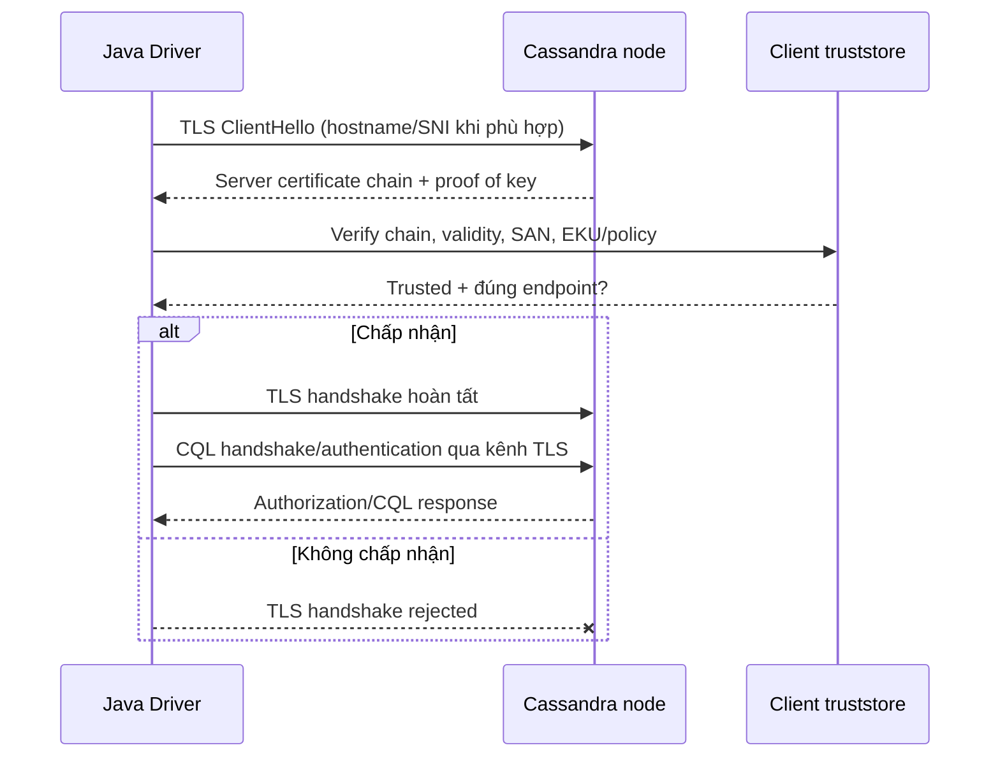
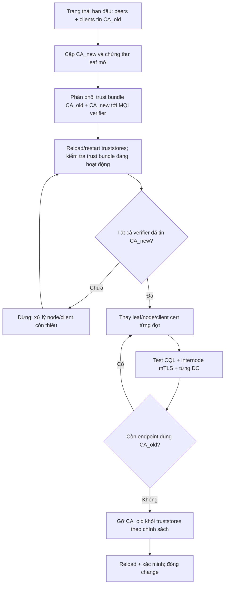
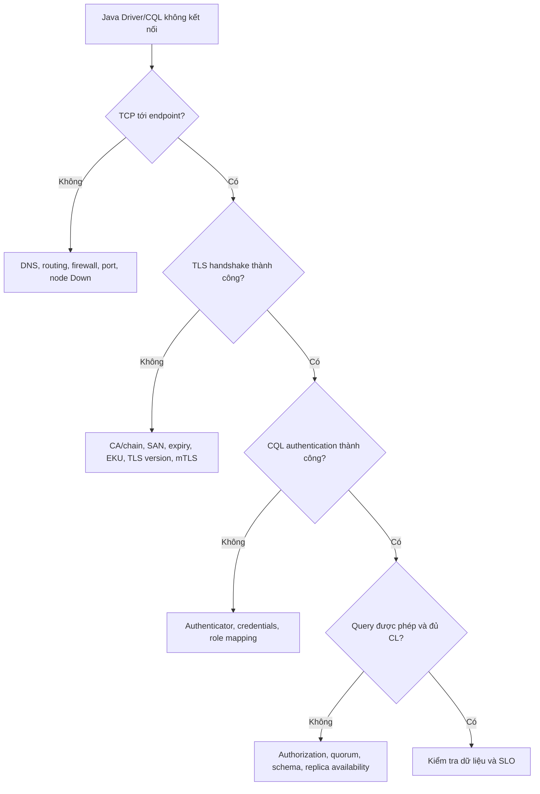

# Truststore, keystore, xác minh danh tính và đổi chứng thư

> **Chương:** Bảo mật  
> **Mô-đun:** `DATABASE_ENGINE_WIDE_COLUMN_CASSANDRA` — hiểu kiến trúc phân tán và mô hình wide-column của Apache Cassandra, khóa phân vùng, thiết kế bảng theo truy vấn, nhất quán đọc/ghi, CQL, replication, compaction, repair, xử lý lỗi và kết nối Java.  
> **Trọng tâm:** Bảo vệ kênh client–node và node–node bằng TLS, hiểu truststore/keystore cùng xác minh danh tính, và thay chứng thư (certificate rotation) mà không làm mất khả năng phục vụ của Cassandra.

Trong cụm Cassandra, dữ liệu đi qua ít nhất hai loại đường truyền: **ứng dụng Java/cqlsh ↔ node Cassandra** và **node Cassandra ↔ node Cassandra**. Các đường này mang CQL, request giữa replica, gossip, streaming, hints hoặc những giao tiếp khác tùy phiên bản và thiết kế. Chỉ cấu hình username/password cho CQL **không bảo đảm** traffic được mã hóa hoặc node đang nói chuyện đúng là node dự định.

Để một phiên TLS đáng tin cậy, cần trả lời ba câu hỏi:

1. **Bên kết nối xuất trình danh tính gì?** Chứng thư X.509, public key và **private key tương ứng** thường được tải từ *keystore* hoặc từ key/certificate files do một SSL-context factory quản lý.
2. **Đầu kia có được tin cậy không?** Chuỗi chứng thư phải dẫn tới một CA/trust anchor được phía xác minh tin tưởng; thường được chứa trong *truststore*.
3. **Danh tính đó có khớp với nơi định kết nối không?** Hostname/IP, SAN, mục đích sử dụng chứng thư, hạn hiệu lực và chính sách xác minh phải phù hợp. Chỉ tin một CA bất kỳ **chưa đủ** để chứng minh đã kết nối đến đúng node.

Khi đổi chứng thư, thứ tự làm sai có thể khiến tất cả replica trong một DC mất liên lạc dù dữ liệu SSTable vẫn nguyên vẹn. Bài này xây dựng cách hiểu và runbook an toàn dựa trên **chuỗi tin cậy có giai đoạn chồng lấn, đổi identity từng bước và kiểm chứng thực tế**.

> **Ràng buộc phiên bản:** Các ví dụ chủ yếu theo Apache Cassandra 4.x/5.x và Java Driver 4.x. Tên cấu hình, SSL-context factory, hot reload, thuật toán xác thực chứng thư, ciphers và cách triển khai certificate authentication có thể khác theo bản phát hành, JDK và bản phân phối. Kiểm tra tài liệu **đúng phiên bản đang chạy** trước khi thực hiện thay đổi trên production.

## 1. Mục tiêu học tập

Sau bài này, bạn có thể:

- Phân biệt **private key**, **leaf certificate**, **certificate chain**, **CA**, **keystore** và **truststore**.
- Giải thích TLS một chiều, mTLS, xác thực danh tính máy chủ, xác thực CQL role và authorization là các lớp **khác nhau**.
- Hiểu rõ `client_encryption_options` và `server_encryption_options` trong `cassandra.yaml`.
- Thiết kế SAN/hostname/IP để xác minh node đúng đích trong mạng có nhiều DC, NAT và tên DNS riêng.
- Kiểm tra keystore/truststore với `keytool`, chứng thư/handshake với `openssl` và kết nối bằng Java Driver.
- Thực hiện rotation chứng thư máy chủ/certificate authority theo các bước **trust old+new → đổi leaf → chỉ trust new**.
- Sử dụng `nodetool reloadssl` khi phiên bản hỗ trợ, hiểu giới hạn hot reload với kết nối đã thiết lập.
- Nhận diện lỗi `PKIX path building failed`, `unknown_ca`, SAN mismatch, certificate expiration và sự cố mutual TLS.
- Tạo runbook preflight, canary, kiểm thử sau đổi, rollback, monitoring và diễn tập gần hết hạn.
- Liên hệ rủi ro TLS với quorum, topology, repair, streaming, backup và khả năng phục vụ của Java application.

## 2. Thuật ngữ: truststore và keystore khác nhau như thế nào?

### 2.1. Từ khóa riêng tới chứng thư X.509

Một chứng thư TLS thường chứa:

- **Subject**: danh tính được chứng nhận, theo format chứng thư.
- **Subject Alternative Name (SAN)**: các DNS/IP (hoặc định danh khác) được phép đối chiếu.
- **Public key**: khóa công khai gắn với private key của chủ thể.
- **Issuer**: tổ chức/CA ký chứng thư.
- **Validity**: `NotBefore`, `NotAfter`.
- **Key Usage (KU)** và **Extended Key Usage (EKU)**: mục đích hợp lệ, ví dụ `serverAuth` hoặc `clientAuth`.
- **Signature**: chữ ký số của tổ chức cấp chứng thư.

Một certificate **không chứa private key**. CA xác nhận mối liên hệ giữa public key và danh tính trong phạm vi chính sách của CA. Đối phương muốn giả mạo server phải có private key tương ứng hoặc tìm cách phá/tránh quá trình kiểm tra.

### 2.2. Keystore: “Tôi là ai?”

**Keystore** thường chứa *private key entry* và certificate chain kèm theo. Khi node Cassandra làm TLS server, nó xuất trình leaf certificate và chứng minh đang nắm private key bằng handshake.

Ví dụ:

```text
node-a-keystore.p12  (PKCS#12)
└── alias: node-a
    ├── Private key            [BÍ MẬT: không xuất ra ticket/log]
    ├── Leaf certificate       CN/SAN = node-a.dc1.internal
    ├── Intermediate CA cert
    └── Root CA cert           [nếu chính sách chain yêu cầu]
```

Trong **mTLS**, cùng một node Cassandra có thể vừa là TLS server (nhận kết nối từ peer) vừa là TLS client (mở kết nối tới peer). Chứng thư được dùng cho vai trò client cần phù hợp yêu cầu của cấu hình và chính sách EKU. Các bản Cassandra mới có thể cấu hình `outbound_keystore` tách biệt với keystore inbound.

### 2.3. Truststore: “Tôi tin ai?”

**Truststore** là tập trust anchors/certificates mà phía xác minh dùng để quyết định **có tin chữ ký/chuỗi chứng thư của bên kia không**.

Ví dụ:

```text
node-a-truststore.p12  (PKCS#12)
├── alias: cassandra-root-ca-old
│   └── Public CA certificate
└── alias: cassandra-root-ca-new
    └── Public CA certificate
```

Truststore **thông thường không cần chứa private key** để xác minh peer; một store PKCS#12 có thể chứa các loại entry khác nhau, nhưng chính sách nên tách riêng key material và trust anchors. Đừng gửi keystore có private key cho đối tác chỉ để họ “tin chứng thư”; hãy cung cấp **CA/public certificates** cần thiết.

### 2.4. Bảng phân biệt nhanh

| Thành phần | Chứa gì? | Mục đích | Bảo mật |
|---|---|---|---|
| **Private key** | Khóa bí mật | Chứng minh danh tính, ký bước handshake | Chỉ chủ sở hữu, quyền đọc tối thiểu |
| **Leaf certificate** | Public key, danh tính, SAN, chữ ký CA | Được trình cho phía bên kia | Có thể phân phối công khai |
| **Certificate chain** | Leaf + CA intermediates | Giúp verifier dựng đường tin cậy | Có thể phân phối công khai |
| **Root CA / trust anchor** | Public certificate được tin | Gốc của đường xác minh | Kiểm soát phân phối/chính sách tin |
| **Keystore** | Thường private key + cert chain | Xác định danh tính local | Mã hóa và kiểm soát truy cập |
| **Truststore** | CA/public certs được tin | Xác minh danh tính peer | Bảo vệ khỏi sửa trái phép |
| **Store password** | Bí mật mở store/key entry khi áp dụng | Giải mã/đọc tài liệu key | Không hardcode vào Git/log |
| **CQL credentials** | Role/password/token theo authenticator | Xác thực vào database | Tách khỏi TLS key material |

**Tên gọi phụ thuộc công cụ.** JKS và PKCS#12 là định dạng store của Java. Với PEM-based SSL factory, private key/certificate có thể là các file `.pem` thay cho JKS/PKCS#12, nhưng **vai trò identity vs trust không thay đổi**.

## 3. TLS handshake: mã hóa, xác minh và xác thực

### 3.1. TLS một chiều từ ứng dụng đến node

Với **server-authenticated TLS**:

1. Java Driver mở TCP tới endpoint Cassandra.
2. Node gửi server certificate chain.
3. Driver xác minh chain tới một CA đáng tin trong truststore của client.
4. Driver xác minh **SAN phù hợp hostname/IP mà nó đang kết nối** nếu hostname verification được bật.
5. Driver xác minh certificate còn hạn, phù hợp KU/EKU/policy và thực hiện handshake mã hóa.
6. Sau đó Cassandra có thể tiếp tục yêu cầu **CQL username/password hoặc cơ chế authenticator tương ứng**.



Kênh được mã hóa **không đồng nghĩa** application đã được cấp quyền `SELECT`/`INSERT`. Authenticator và authorizer của Cassandra điều khiển các quyền dữ liệu; TLS giữ an toàn cho đường truyền và danh tính peer theo cấu hình.

### 3.2. mTLS: hai phía trình chứng thư

Trong **mutual TLS**:

- Node Cassandra xuất trình certificate; client xác minh bằng **client truststore**.
- Client xuất trình certificate/private key; Cassandra xác minh bằng **server truststore**.
- Với internode mTLS, hai node đều có thể giữ vai trò TLS server hoặc client ở những kết nối khác nhau; mỗi chiều cần bộ material và policy phù hợp.

```text
Ứng dụng Java                             Cassandra
──────────────────                        ──────────────────
Client keystore ──> client certificate ──> Server truststore
Client truststore <── server certificate <── Server keystore

TLS handshake 2 chiều ≠ tự động có quyền CQL.
CQL role mapping/authenticator/authorizer là lớp kiểm soát riêng.
```

Một số hệ tích hợp authenticator dựa trên chứng thư hoặc SPIFFE, nhưng **mTLS thành công không mặc nhiên ánh xạ subject thành một Cassandra role** trong mọi bản triển khai. Cần xác minh authenticator/authorizer thực, không suy từ cấu hình `require_client_auth=true`.

### 3.3. Những sai lầm dễ thấy

- **Chỉ bật encryption, bỏ hostname verification:** một certificate do CA đáng tin cấp cho máy khác có thể bị chấp nhận nếu không kiểm tra tên đích đúng cách.
- **Tắt kiểm tra chứng thư để “cho kết nối được”:** che lỗi CA/SAN/expiry, tạo đường MITM.
- **Nhầm truststore với keystore:** client cần CA của server để verify; server cần private key để chứng minh danh tính.
- **Tin chứng thư tự ký của từng node không có quy trình rotation:** khi thêm/replace node phải quản lý hàng loạt truststore và nguy cơ sai sót.
- **Nghĩ có mTLS là đã có row-level authorization:** chưa đúng nếu CQL authz không cấu hình.
- **Dùng một private key trên toàn bộ node:** tăng blast radius nếu một máy bị lộ; nên cấp danh tính/key riêng cho mỗi node.

## 4. Xác minh danh tính: CA đúng chưa đủ, SAN phải đúng

### 4.1. SAN là dữ liệu chính để kiểm tra endpoint

Giả sử Java Driver kết nối tới:

```text
node-a.dc1.internal:9042
```

Server certificate nên có SAN kiểu:

```text
DNS:node-a.dc1.internal
```

Nếu ứng dụng/peer kết nối bằng IP `10.20.1.11`, certificate cần có **IP SAN** tương ứng, không chỉ DNS SAN. Certificate chỉ có `CN=node-a.dc1.internal` mà thiếu SAN có thể bị các client/JDK hiện đại từ chối hoặc xử lý khác theo thư viện; không dựa vào fallback CN khi thiết kế mới.

### 4.2. Địa chỉ nào Cassandra thực sự dùng?

Cần lập bản đồ:

| Đường kết nối | Tên/địa chỉ cần cân nhắc | Cần kiểm tra |
|---|---|---|
| Java Driver → Cassandra native transport | Contact points và **discovered node endpoints** | SAN của từng node, trust chain, driver hostname validation |
| Node A → Node B internode | `broadcast_address`/`listen_address` hay endpoint cấu hình thực | Server SAN/DNS/IP và endpoint verification |
| Liên datacenter | Địa chỉ dùng để liên DC/NAT/routing | SAN phù hợp địa chỉ được TLS verifier đối chiếu |
| Proxy/LB nếu có | DNS được client kết nối và điểm kết thúc TLS | TLS terminate ở đâu; backend cert riêng thế nào |
| JMX/nodetool | Cổng quản trị/JMX và phương thức bảo vệ riêng | Không mặc định được bảo vệ bởi client_encryption_options |

**Một SAN không phải “càng nhiều càng tốt”.** Danh sách rộng như wildcard không kiểm soát hoặc cấp cùng danh tính cho mọi node có thể làm giảm khả năng ràng buộc danh tính. Thiết kế SAN theo địa chỉ thực và chính sách PKI.

### 4.3. ServerAuth, ClientAuth và key usage

Certificate cần tương thích với vai trò:

- `serverAuth` cho phía được xác minh như TLS server.
- `clientAuth` cho phía được xác minh như TLS client trong mTLS.
- `Key Usage` phù hợp thuật toán và handshake.
- Thuật toán, chữ ký và độ dài khóa đáp ứng policy bảo mật/JDK.
- Certificate validity và chain đầy đủ, kể cả intermediate CA nếu cần.

Một certificate có chain đúng nhưng EKU chỉ `serverAuth` có thể không được chấp nhận làm client certificate trong môi trường kiểm tra EKU nghiêm ngặt.

### 4.4. Name mismatch từ DNS/NAT/service discovery

Tình huống thường gặp:

1. Certificate cấp cho `node-b.dc2.internal`.
2. Cassandra advertise `10.30.2.12` cho peer/driver.
3. Client/peer xác minh **IP**, trong khi certificate chỉ có DNS SAN.
4. TLS handshake thất bại dù CA là đúng.

Sửa **certificate SAN hoặc cách công bố/định tuyến địa chỉ** để hai phía thống nhất, thay vì tắt endpoint verification. Với Kubernetes, LoadBalancer, proxy hoặc NAT, cần biết **đầu cuối TLS thực** và tên dùng để verify; service name không thay thế tự động danh tính từng node.

## 5. Client-to-node và internode: hai miền cấu hình độc lập

Trong `cassandra.yaml`:

- `client_encryption_options` quản lý **TLS của native CQL transport**, thường trên port `9042` nếu chưa đổi cấu hình.
- `server_encryption_options` quản lý **TLS inter-node**, nơi node làm cả client lẫn server ở các mối liên lạc.

Việc bảo vệ một đường **không tự bật bảo vệ đường còn lại**. Cũng không tự mã hóa JMX, metrics, backup object storage, commit logs hay các tệp SSTable trên đĩa.

### 5.1. Client-to-node: TLS bắt buộc

Ví dụ cấu hình mang tính **minh họa**, không copy nguyên xi vào production:

```yaml
client_encryption_options:
  enabled: true
  optional: false
  keystore: /etc/cassandra/tls/client-server-identity.p12
  keystore_password: "<managed-secret>"
  store_type: PKCS12
  require_client_auth: false
```

Giải thích:

- `enabled=true`: mở TLS cho native transport.
- `optional=false`: **không chấp nhận native CQL không mã hóa** theo cấu hình này.
- `keystore`: identity server của node; certificate có SAN phù hợp endpoints mà driver sẽ dùng.
- `require_client_auth=false`: không bắt TLS client phải trình certificate; **CQL authenticator/authorizer có thể vẫn yêu cầu credentials**.
- Để bật **mTLS client-to-node**, đổi `require_client_auth=true` và cấu hình **server truststore**, sau khi clients đã có chứng thư hợp lệ.

Các trường secret chỉ là **placeholder mô tả**. Cassandra không tự thay `"<managed-secret>"` bằng secret manager/env var chỉ vì text trông giống placeholder; production phải cung cấp secret bằng cơ chế config/SSL factory đã được phép và bảo vệ quyền đọc.

### 5.2. Internode: mã hóa tất cả peer traffic thuộc phạm vi

Ví dụ mục tiêu ở một cluster đã chuẩn bị đầy đủ keystore/truststore, nhất là với mTLS:

```yaml
server_encryption_options:
  internode_encryption: all
  optional: false
  keystore: /etc/cassandra/tls/internode-identity.p12
  keystore_password: "<managed-secret>"
  store_type: PKCS12
  truststore: /etc/cassandra/tls/internode-trust.p12
  truststore_password: "<managed-secret>"
  require_client_auth: true
  require_endpoint_verification: true
```

**Đây là trạng thái đích, không phải bước nâng cấp một phát.** Nếu chuyển một cụm đang không mã hóa hoặc tin CA cũ sang `all + require_client_auth=true + require_endpoint_verification=true` mà các node chưa có key/cert/trust đúng, có thể mất internode connectivity và quorum.

`require_endpoint_verification` giúp buộc tên endpoint phù hợp certificate theo hành vi Cassandra/phiên bản; kiểm tra SAN của địa chỉ mà node thật sự dùng. Khi vận hành mTLS, hãy xác minh chiều inbound và outbound, đặc biệt nếu cấu hình `outbound_keystore` riêng.

### 5.3. Các lựa chọn internode encryption

| Giá trị | Ý nghĩa khái quát | Rủi ro khi dùng không đúng |
|---|---|---|
| `none` | Không mã hóa internode theo cơ chế này | Dữ liệu/gossip/replication có thể bị lộ trên mạng |
| `dc` | Mã hóa kết nối giữa các DC | Trong DC có thể không được mã hóa |
| `rack` | Mã hóa kết nối giữa các rack theo cơ chế cấu hình | Trong cùng rack có thể không mã hóa |
| `all` | Mã hóa internode giữa tất cả node | Cần bảo đảm cert/trust/CPU/compatibility toàn cụm |

Trong môi trường có yêu cầu bảo vệ traffic end-to-end, `all` thường là lựa chọn mục tiêu, nhưng phải kiểm tra phiên bản và network policy. Không coi `dc` hoặc `rack` là “mã hóa mọi nơi”.

### 5.4. `optional=true` chỉ dành cho chuyển đổi có kiểm soát

Tài liệu Apache Cassandra nêu mô hình chuyển tiếp:

- Bật TLS và tạm `optional=true` để cho phép giai đoạn **cả kết nối mã hóa lẫn chưa mã hóa**.
- Cập nhật mọi peer/client và kiểm tra TLS.
- Đặt `optional=false` khi đã sẵn sàng yêu cầu TLS bắt buộc.

**Đừng để optional=true lâu dài** nếu chính sách yêu cầu mã hóa bắt buộc. Nó tạo đường fallback không mã hóa. Khi chuyển chế độ, tuân thủ **hướng dẫn chính xác của phiên bản**; một số thay đổi cần rolling restart, không được hứa hot reload cho mọi cờ cấu hình.

### 5.5. Đừng nhầm TLS với các lớp bảo vệ khác

| Tính năng | Giải quyết | Không thay thế |
|---|---|---|
| Client TLS | Mã hóa + xác minh node ở đường CQL | CQL role/authorization |
| Internode TLS | Bảo vệ đường giữa Cassandra nodes | Cấu hình DC/rack/replication đúng |
| mTLS | Phía nhận xác minh peer certificate | Tự động phân quyền dữ liệu |
| PasswordAuthenticator | Xác minh credentials CQL | Mã hóa network |
| CassandraAuthorizer | Quyền trên keyspace/table/role | TLS identity validation |
| Encryption at rest | Bảo vệ file/đĩa theo cơ chế lưu trữ | TLS internode/client |
| Backup encryption | Bảo vệ bản backup xuất ra | Khả năng restore, RPO/RTO |
| JMX auth/TLS/network policy | Bảo vệ cổng quản trị | TLS native transport |

Khi một DC bị cô lập hoặc TLS sai, cả replication/repair/hints/streaming có thể bị ảnh hưởng. **Security misconfiguration có thể trở thành availability incident**, chứ không chỉ cảnh báo bảo mật.

## 6. Chuẩn bị certificate và keystore đúng cách

### 6.1. Thiết kế PKI trước khi sinh file

Trong production, ưu tiên PKI/CA có quy trình phát hành, thu hồi và audit:

1. Chọn root CA (offline/bảo vệ cao) và issuing intermediate CA theo chính sách.
2. Xác định certificate profile cho **internode server/client** và **CQL server/client**.
3. Cấp **private key riêng** cho mỗi node hoặc workload.
4. Ghi các SAN DNS/IP thực tế cho từng endpoint, không dùng chung danh tính vô nghĩa.
5. Chọn `NotBefore/NotAfter`, thuật toán, KU/EKU và thời gian xoay vòng có biên.
6. Định nghĩa trust bundle phân phối tới Java Driver, Cassandra peers, backup/monitoring clients cần thiết.
7. Lưu private key trong secret manager hoặc volume có quyền đọc tối thiểu; không commit vào Git.

Với chain nhiều tầng, phía xuất trình certificate thường cần gửi **leaf + intermediate certificates** phù hợp; root CA là trust anchor ở phía verifier. Đừng cho rằng truststore chứa root thì bên gửi có thể bỏ mọi intermediate.

### 6.2. Ví dụ tạo keypair và CSR trong lab

Dùng `keytool` từ JDK. Ví dụ dưới **chỉ minh họa** với DNS/IP giả định:

```bash
# LAB: keytool sẽ yêu cầu mật khẩu qua prompt.
keytool -genkeypair \
  -alias node-a \
  -keyalg RSA -keysize 3072 \
  -storetype PKCS12 \
  -keystore node-a.p12 \
  -dname "CN=node-a.dc1.internal,OU=Database,O=Example" \
  -ext "SAN=dns:node-a.dc1.internal,ip:10.20.1.11" \
  -validity 30

# Sinh Certificate Signing Request cho CA nội bộ ký.
keytool -certreq \
  -alias node-a \
  -storetype PKCS12 \
  -keystore node-a.p12 \
  -file node-a.csr \
  -ext "SAN=dns:node-a.dc1.internal,ip:10.20.1.11"
```

CA ký CSR với profile phù hợp, sau đó cần import chain/leaf certificate vào **đúng private-key alias**. Quy trình chính xác phụ thuộc PKI và định dạng được cấp. **Đừng tạo self-signed certificate rồi dùng thẳng cho production** chỉ vì lab kết nối được. Nếu cần dùng EC keys, chọn thuật toán/cipher theo security policy và khả năng JDK/Cassandra.

### 6.3. Tạo truststore từ public CA

Giả sử PKI đã cấp file public `cassandra-ca-old.pem` và `cassandra-ca-new.pem`:

```bash
# LAB/PROVISIONING: chỉ import public CA certificates.
keytool -importcert -trustcacerts \
  -alias cassandra-ca-old \
  -file cassandra-ca-old.pem \
  -storetype PKCS12 \
  -keystore cassandra-trust.p12

keytool -importcert -trustcacerts \
  -alias cassandra-ca-new \
  -file cassandra-ca-new.pem \
  -storetype PKCS12 \
  -keystore cassandra-trust.p12

# Xem nội dung public/trust entries, không in private key.
keytool -list -v \
  -storetype PKCS12 \
  -keystore cassandra-trust.p12
```

Chỉ tin các CA phù hợp vai trò. Truststore chứa một CA quá rộng có thể cho phép **nhiều chứng thư ngoài dự kiến** đi qua bước kiểm tra chain; khi cần ràng buộc node cụ thể, phải có endpoint verification/identity policies và trust scope thích hợp.

### 6.4. Kiểm tra certificate được cấp

```bash
# Public cert: kiểm tra validity, subject/issuer, SAN và EKU.
openssl x509 \
  -in node-a.crt \
  -noout -subject -issuer -dates \
  -ext subjectAltName,extendedKeyUsage

# Kiểm chứng chuỗi với root CA và intermediate chain.
openssl verify \
  -CAfile cassandra-root-ca.pem \
  -untrusted cassandra-intermediate-ca.pem \
  node-a.crt
```

Các lệnh dùng file public. Trước khi deploy, còn phải chắc chắn **private key trong keystore khớp public key của leaf certificate**, alias và certificate chain hoàn chỉnh. Với PKCS#12:

```bash
keytool -list -v \
  -storetype PKCS12 \
  -keystore node-a.p12
```

Kiểm tra entry là `PrivateKeyEntry` khi cần identity keystore, không chỉ `trustedCertEntry`. Việc có một certificate public trong keystore **không đủ** để server thực hiện TLS handshake.

### 6.5. Mật khẩu và private key

Tránh:

- Viết password thực vào shell history, issue tracker hay ví dụ đào tạo.
- Chèn key/private certificate vào logs hoặc công cụ chat.
- Đặt quyền world-readable cho keystore, PEM key hoặc secrets.
- Dùng cùng private key trên mọi node, mọi DC, mọi môi trường.
- Lưu cert/key trong image không có quy trình rotation.
- Thay password keystore cùng lúc rotate certificate nếu chưa có kế hoạch reload config tương thích.

Các placeholder trong bài là **tên giả**, không phải thông tin để đưa nguyên vào cấu hình. Với hot reload file-based của Cassandra, cần biết password đang được cấu hình từ đâu; việc đổi password có thể cần change khác với đổi nội dung store.

## 7. Java Driver: truststore, keystore và kiểm tra hostname

### 7.1. Driver cần tin CA của node

Java Driver 4.x hỗ trợ TLS qua **SSL engine factory** hoặc cấu hình SSLContext. Với cấu hình file theo tài liệu Driver, một ví dụ `application.conf` là:

```hocon
datastax-java-driver {
  advanced.ssl-engine-factory {
    class = DefaultSslEngineFactory

    # Trong production, các path/secret được inject từ cấu hình an toàn.
    truststore-path = "/etc/app/tls/cassandra-client-trust.p12"
    truststore-password = "<managed-secret>"

    # Giữ hostname validation, không tắt để sửa lỗi SAN.
    hostname-validation = true

    # CHỈ dùng nếu Cassandra yêu cầu mTLS client certificate:
    # keystore-path = "/etc/app/tls/cassandra-client-identity.p12"
    # keystore-password = "<managed-secret>"
  }
}
```

Cấu hình trên **mang tính khái niệm**: các mật khẩu placeholder phải được thay bằng cơ chế bảo mật thật của ứng dụng; không commit secret vào repo. Nếu driver sử dụng `SSLContext` tự tạo, cần xác minh hostname validation vẫn bật trong engine factory/driver; chỉ nạp CA vào SSLContext **chưa phải kiểm tra tên máy chủ**.

### 7.2. Ví dụ CqlSession dùng TLS đã cấu hình

```java
import com.datastax.oss.driver.api.core.CqlSession;
import com.datastax.oss.driver.api.core.DefaultConsistencyLevel;
import com.datastax.oss.driver.api.core.cql.PreparedStatement;
import com.datastax.oss.driver.api.core.cql.BoundStatement;

import java.net.InetSocketAddress;

public final class SecureCassandraRead {
    public static void main(String[] args) {
        String user = System.getenv("CASSANDRA_USERNAME");
        String password = System.getenv("CASSANDRA_PASSWORD");

        if (user == null || password == null) {
            throw new IllegalStateException("Missing CQL credentials");
        }

        // Driver SSL configuration is loaded from application.conf.
        try (CqlSession session = CqlSession.builder()
                .addContactPoint(new InetSocketAddress(
                    "node-a.dc1.internal", 9042))
                .withLocalDatacenter("dc1")
                .withAuthCredentials(user, password)
                .build()) {

            PreparedStatement ps = session.prepare(
                "SELECT account_id, state " +
                "FROM app.accounts_by_id WHERE account_id = ?");

            BoundStatement stmt = ps.bind("user-001")
                .setConsistencyLevel(
                    DefaultConsistencyLevel.LOCAL_QUORUM);

            session.execute(stmt).forEach(row ->
                System.out.println(
                    row.getString("account_id") + ": " +
                    row.getString("state")));
        }
    }
}
```

**Điều kiện:** Ví dụ giả định bảng `app.accounts_by_id` đã tồn tại với PK phù hợp, Cassandra đã cấu hình TLS, authenticator dùng credentials trong env, truststore/keystore thật được cung cấp và local DC là `dc1`. Nếu môi trường không bật PasswordAuthenticator thì phần credentials cần điều chỉnh theo authenticator thực; không mặc định mọi cluster đều dùng password.

### 7.3. Contact points chưa phải toàn bộ endpoints

Driver kết nối tới **contact points ban đầu**, sau đó thường khám phá thêm nodes qua metadata Cassandra. Trong môi trường multi-DC:

- Certificate phải có SAN phù hợp với **mọi endpoint driver có thể kết nối**, không chỉ `node-a` được cấu hình ban đầu.
- Nếu driver khám phá IP và kết nối bằng IP, DNS SAN đơn lẻ có thể không đủ.
- Tên/địa chỉ advertise, TLS SNI và certificate profile phải phù hợp nhau.
- Không tắt hostname verification khi thêm/replace node; cập nhật PKI và endpoint discovery.

### 7.4. SSL handshake đúng chưa đủ chứng minh dữ liệu an toàn

Sau khi Java Driver mở được TLS:

- Cần xác thực/ủy quyền CQL thành công.
- Cần đọc/ghi đúng bảng và **partition key** theo thiết kế truy vấn.
- RF/CL và trạng thái local DC phải đáp ứng yêu cầu; TLS không đổi `LOCAL_QUORUM` thành `ALL`.
- Repair/replica freshness vẫn cần giám sát độc lập.
- TLS **không cung cấp encryption-at-rest cho SSTables, commit log hay backup**.

## 8. Kiểm thử TLS với openssl, keytool và nodetool

### 8.1. Kiểm tra certificate chain và tên endpoint

Ở máy được cấp quyền kiểm tra mạng:

```bash
openssl s_client \
  -connect node-a.dc1.internal:9042 \
  -servername node-a.dc1.internal \
  -CAfile cassandra-ca-bundle.pem \
  -verify_hostname node-a.dc1.internal \
  -verify_return_error \
  -showcerts
```

Nếu kiểm tra bằng IP và certificate có IP SAN:

```bash
openssl s_client \
  -connect 10.20.1.11:9042 \
  -CAfile cassandra-ca-bundle.pem \
  -verify_ip 10.20.1.11 \
  -verify_return_error
```

**Lưu ý:** `openssl s_client` kiểm tra TLS, không thực hiện CQL protocol/authentication, không chứng minh quyền truy cập dữ liệu hoặc đủ quorum. TLS probe qua một proxy có thể kiểm tra **proxy cert**, không phải certificate của node backend; phải hiểu TLS terminate ở đâu.

### 8.2. mTLS client test

Nếu Cassandra yêu cầu client cert:

```bash
openssl s_client \
  -connect node-a.dc1.internal:9042 \
  -servername node-a.dc1.internal \
  -CAfile cassandra-ca-bundle.pem \
  -cert lab-client.crt \
  -key lab-client.key \
  -verify_hostname node-a.dc1.internal \
  -verify_return_error
```

Chỉ làm trong lab hoặc host an toàn có key được cấp riêng. Không chia sẻ `lab-client.key` để “chạy thử trên laptop mọi người”. Handshake mTLS thành công vẫn chưa chứng minh CQL role/permissions.

### 8.3. Kiểm tra nodetool trên cluster

```bash
# Các thao tác đọc để kiểm tra availability:
nodetool status
nodetool describecluster
nodetool netstats
nodetool tpstats

# Apache Cassandra 4+ với hỗ trợ lệnh này:
nodetool reloadssl
```

Các lệnh `nodetool` kết nối tới cơ chế quản trị/JMX; **không** đồng nghĩa native TLS/handshake CQL đã đúng. `reloadssl` là lệnh **tác động trạng thái TLS**, phải dùng theo runbook; các lệnh đầu là quan sát.

### 8.4. Kiểm thử âm tính bắt buộc

Một bài test PKI tốt phải chứng minh hệ thống **từ chối**:

1. Server certificate được ký bởi CA **không** nằm trong client truststore.
2. Server cert có SAN không trùng endpoint đang kết nối.
3. Cert đã hết hạn hoặc chưa tới `NotBefore`.
4. mTLS client certificate thiếu hoặc không có `clientAuth`/chain phù hợp.
5. Chứng thư bị chính sách thu hồi/từ chối (nếu PKI tích hợp kiểm tra revocation).
6. Kết nối plaintext khi `optional=false` và native TLS bắt buộc.

**Không làm thử nghiệm phá TLS trên production**; dùng lab/staging cô lập. Một test chỉ chứng minh “happy path connect được” là chưa đủ để kiểm tra chính sách xác minh danh tính.

## 9. Vòng đời chứng thư: thời điểm hết hạn và trách nhiệm

### 9.1. Các mốc phải ghi

Mỗi certificate phải có:

- Certificate ID/serial, fingerprint, issuer/chain.
- `NotBefore` và `NotAfter`; múi giờ UTC.
- Node/service identity, DNS SAN/IP SAN, key usage/EKU.
- Owner, workload, cluster/DC/rack và môi trường.
- Nơi lưu private key, secret manager và quyền đọc.
- Nguồn CA/PKI và thời gian phát hành lại.
- Thời điểm rotation đã kiểm chứng và rollback window.
- Chính sách thu hồi/CRL/OCSP nếu môi trường hỗ trợ và cần.
- Người chịu trách nhiệm cấp mới, phê duyệt, triển khai và giám sát.

### 9.2. Đừng chờ tới sát hạn

Nếu chứng thư hết hạn tại `T_expiry`, nên bắt đầu rotation tại:

\[
T_{\mathrm{start}}
\le T_{\mathrm{expiry}} -
(T_{\mathrm{issue}}+T_{\mathrm{deploy}}+
T_{\mathrm{verify}}+T_{\mathrm{rollback}}+
T_{\mathrm{margin}})
\]

Các thành phần là **ngân sách theo tổ chức**, không phải mặc định Cassandra. Ví dụ issuance 2 ngày, rollout 1 ngày, verify/rollback 1 ngày và margin 7 ngày → cần bắt đầu **trước tối thiểu 11 ngày**. Nếu đa DC hoặc PKI khó cấp, cần biên lớn hơn.

Đồng hồ node và client phải được đồng bộ; cert còn hạn tại CA không có nghĩa mọi node/client đánh giá như nhau nếu thời gian lệch. Giám sát cả certificate lẫn clock skew/NTP.

### 9.3. Theo dõi certificate đang phục vụ, không chỉ file trên disk

Một hệ thống có thể có file `node-a.p12` mới nhưng process vẫn đang dùng SSLContext cũ hoặc driver giữ connection lâu đời. Vì vậy cần so:

- Fingerprint/serial của **file/keystore mới**.
- Fingerprint/serial của **certificate được TLS endpoint trình ra trong handshake mới**.
- Cassandra logs sau `reloadssl`/polling.
- Java Driver reconnect và certificate validation errors.
- Node health/repair/streaming sau rotation.

Nếu hai fingerprint khác nhau, đừng ghi “đã rotate hoàn tất” chỉ vì file timestamp mới.

## 10. Kỹ thuật xoay vòng leaf certificate dưới cùng CA

Đây thường là loại rotation dễ nhất: **CA/trust anchor không đổi**, chỉ thay cert/private key của một node. Dù vậy, cần kiểm soát SAN và cluster availability.

### 10.1. Trình tự an toàn

1. **Preflight:** kiểm tra CA trust, SAN, current leaf, expiry, topology, RF/CL và baseline kết nối.
2. **Issue:** PKI cấp leaf mới + private key riêng, cùng SAN/identity cần thiết và EKU.
3. **Verify offline:** chain, key match, keystore alias, passwords, file permissions, NotBefore/NotAfter.
4. **Distribute:** đưa file vào vị trí mới qua kênh an toàn; tránh ghi đè trực tiếp file đang đọc nếu công cụ backup/secret mount có semantics không atomic.
5. **Canary:** cập nhật **một node** hoặc một nhóm nhỏ theo maintenance policy.
6. **Reload:** dùng hot reload hoặc rolling restart **đúng phiên bản**, kiểm tra logs.
7. **Handshake mới:** xác minh node trình leaf mới ở CQL và internode path tương ứng.
8. **Health:** quan sát `UN`, CL success, Java Driver errors, p99, internode traffic, streaming/repair.
9. **Rollout có kiểm soát:** lần lượt từng node/rack/DC, không làm mất quorum.
10. **Hậu kiểm:** số cert mới đang phục vụ, fingerprint inventory, log, test âm tính và ngày hết hạn.

### 10.2. Hot reload của Cassandra 4+

Tài liệu Apache Cassandra mô tả từ Cassandra 4:

- Với TLS bật và **file-based key/trust material** của built-in/default SSL context factory, Cassandra có cơ chế thăm dò thay đổi store theo chu kỳ **khoảng 10 phút**.
- `nodetool reloadssl` có thể yêu cầu nạp lại nhanh hơn.
- SSL contexts mới thường áp dụng cho **các kết nối thiết lập sau** khi reload thành công.
- Nếu dùng custom `ssl_context_factory`, behavior reload phụ thuộc implementation.
- Password của keystore/truststore trong config cần tương thích với file thay thế; **đổi password không thể mặc định hot reload như đổi cert**.

Không tuyên bố đây là **zero-downtime tuyệt đối**: reload có thể thất bại, mTLS có thể không hợp lệ, client có thể giữ kết nối cũ. Cần test handshake mới và có rollback plan.

### 10.3. Certificate đang dùng bởi kết nối cũ

TLS handshake được thực hiện khi **mở kết nối**. Một kết nối Java Driver/TCP lâu đời có thể vẫn hoạt động sau khi node cập nhật certificate. Vì vậy:

- Test một **kết nối mới** để chứng minh cert mới được phục vụ.
- Đừng ép toàn bộ clients reconnect cùng lúc; có thể gây connection storm.
- Khi cần khẳng định mọi client mới đều tin cert, kiểm tra các phiên bản driver và truststore deployed.
- Existing connection còn hoạt động không chứng minh cert cũ sẽ được chấp nhận ở lần reconnect tiếp theo.
- Lập lịch rollover sessions/connection pools có kiểm soát nếu chính sách yêu cầu.

### 10.4. Rollback cho leaf rotation

Nếu node canary trình cert mới nhưng drivers báo `No subject alternative names matching`:

1. **Dừng rollout**; bảo toàn log và fingerprint.
2. Xác nhận endpoint advertised và certificate SAN.
3. Nếu có cert/key cũ còn hạn và chain vẫn được tin, có thể khôi phục cặp file cũ theo runbook, reload hoặc restart phù hợp.
4. Kiểm tra handshake và CQL đúng CL trước khi cho phép rollout tiếp.
5. Phát hành lại cert mới với SAN đúng; **không tắt hostname verification** làm cách rollback.

Private key cũ phải được giữ **chỉ trong thời gian rollback được phê duyệt**, có quyền hạn chế và hủy an toàn khi kết thúc.

## 11. Xoay vòng CA: giai đoạn “trust cả cũ lẫn mới”

Thay **CA/trust anchor** phức tạp hơn đổi leaf dưới cùng CA vì mọi verifier phải **tin CA mới trước khi bất cứ bên nào bắt đầu trình chứng thư do CA mới ký**.

### 11.1. Thứ tự chuẩn

Giả sử hệ đang tin `CA_old`, muốn chuyển sang `CA_new`.



**Không được đảo thứ tự** bằng cách thay CA-signed leaf ở một node trước khi các peers và clients tin CA mới. Với mTLS, phải xét **hai chiều** xác minh: server tin chứng thư client, client tin chứng thư server.

### 11.2. Bảng trạng thái tin cậy

| Giai đoạn | Certificate được trình ra | Truststore của verifier | Mục tiêu |
|---|---|---|---|
| 0. Ban đầu | Leaf do `CA_old` ký | `CA_old` | Hệ đang hoạt động |
| 1. Mở rộng trust | Leaf old | `CA_old + CA_new` | Không đổi traffic, sẵn sàng nhận leaf mới |
| 2. Thay identity | Một phần old, một phần new | `CA_old + CA_new` | Hai thế hệ cùng hoạt động |
| 3. Hoàn tất leaf | Tất cả new | `CA_old + CA_new` | Kiểm chứng không còn client/node cũ |
| 4. Thu hẹp trust | Tất cả new | `CA_new` | Loại bỏ trust cũ sau xác nhận |

Bảng này là nguyên tắc quản lý trust. Trong PKI nhiều intermediate, có thể cần cấp cả chain mới và giữ root anchors phù hợp; **không phải cứ import một file CA mới là mọi chain sẽ verify thành công**.

### 11.3. Ai là “mọi verifier”?

Trong Cassandra multi-DC:

- Từng node xác minh các **peer internode**.
- Từng Java Driver/cqlsh/BI/export/backup client xác minh **CQL server**.
- Từng node xác minh **mTLS client certificates** nếu `require_client_auth=true`.
- Các monitoring/backup tools kết nối native transport TLS cũng có truststores riêng.
- Những container image/app versions cũ có thể chưa được rollout.
- Đường WAN hoặc gateway có thể có **TLS termination khác**, cần inventory riêng.

Một node ở DC2 không được nâng cấp truststore có thể cắt liên lạc với các nodes đã chuyển cert ở DC1. Cũng có thể Java service vẫn chạy qua kết nối cũ, rồi **đột ngột lỗi sau restart** vì nó chưa trust CA mới.

### 11.4. Chọn thời điểm loại CA cũ

Chỉ gỡ `CA_old` khi:

1. Inventory cho thấy **tất cả server/client identities** cần kết nối đã chuyển sang chain mới.
2. Các clients/peer đang hoạt động đã được kiểm tra trên **handshake mới**.
3. Không còn external tool/worker định kỳ chỉ tin `CA_old`.
4. Rollback policy chấp nhận rằng gỡ CA cũ có thể khiến cert cũ không dùng được.
5. Security team đã phê duyệt thời gian overlap và revocation.
6. Test âm tính chứng minh cert chỉ ký bởi `CA_old` không còn được tin khi policy yêu cầu.

Nếu cần rollback sau giai đoạn 4, phải triển khai lại trust cũ có kiểm soát hoặc cấp certificate tương thích; không assume còn “đường lùi” sau khi đã thu hẹp trust.

## 12. Rotation trong cụm nhiều datacenter và RF/CL

### 12.1. TLS sai có thể gây tình trạng Down giả

Giả sử `NetworkTopologyStrategy` RF=3 ở `dc1` và RF=3 ở `dc2`. Một sai lệch truststore làm node A không bắt tay TLS được với B/C. Từ góc nhìn mạng Cassandra:

- Gossip/internode messaging có thể thất bại.
- Node có thể bị coi Down/unreachable.
- Hint delivery, streaming, repair bị gián đoạn.
- Writes/reads tại `LOCAL_QUORUM` có thể thiếu replica cần thiết.
- Cross-DC consistency/replication bị trì hoãn.

**Dữ liệu không nhất thiết bị xóa**, nhưng cluster có thể tạm mất quorum hoặc phát sinh khoảng lệch replica cần repair sau đó.

### 12.2. Giữ quorum qua từng đợt

Với RF=3 local DC, `LOCAL_QUORUM` cần hai full replicas phù hợp phản hồi. Khi rotate:

1. Lập kế hoạch theo DC/rack và tránh làm mất đồng thời nhiều replicas cùng token range.
2. Canaries trước, theo dõi node health và CQL latency.
3. Nếu phải restart, thực hiện **rolling restart** theo runbook (không giả định một node Down là luôn an toàn cho mọi keyspace và failure mode).
4. Giữ lịch repair/topology khác ổn định, không kết hợp bootstrap/decommission lớn với rotation TLS nếu không có kế hoạch.
5. Kiểm tra peer connections, streaming, hints và request errors sau mỗi đợt.
6. Chỉ chuyển DC tiếp theo khi DC hiện tại được xác nhận khỏe.

Nếu client dùng `EACH_QUORUM` cho writes hoặc CL khác yêu cầu cả DC, một sự cố TLS ở DC remote có thể ảnh hưởng client dù DC local còn khỏe. Không suy rằng `LOCAL_QUORUM` và `EACH_QUORUM` có cùng tính sẵn sàng.

### 12.3. Kiểm tra bảo mật liên DC

Một runbook phải kiểm tra:

- Chứng thư internode node ở từng DC có SAN phù hợp endpoint advertise thực.
- CA/trust bundle được phân phối tới cả hai phía của WAN.
- Firewall/TCP và TLS handshake từ DC1 tới DC2, và chiều ngược lại.
- Java clients tại từng DC dùng local DC đúng, có truststore CA mới.
- Node không bị lỗi clock skew khiến cert `NotBefore`/`NotAfter` bị đánh giá sai.
- Sau rotation, repair/streaming dự kiến hoạt động bình thường qua WAN.

Nếu TLS endpoint handshake tốt nhưng `nodetool status` vẫn báo nodes Down, cần kiểm tra **gossip, ports, internode address và cluster state**; `openssl s_client` đơn lẻ không chứng minh mọi thành phần Cassandra đúng.

## 13. Lệnh `nodetool reloadssl` và những điều không được giả định

### 13.1. Cú pháp minh họa

Trên bản Cassandra hỗ trợ:

```bash
# Trên một node lab sau khi keystore/truststore file đã được thay hợp lệ.
nodetool reloadssl
```

Lệnh gửi yêu cầu reload SSL material tới node qua cơ chế quản trị. Nó **không**:

- Tự tạo certificate/CA.
- Tự phân phối keystore/truststore tới các node khác.
- Tự sửa `cassandra.yaml` hoặc secret manager.
- Bật TLS nếu cơ chế TLS chưa được cấu hình.
- Ép mọi driver đang giữ kết nối cũ phải bắt tay lại.
- Chứng minh certificate mới được chấp nhận ở cả client-to-node và internode.
- Chứng minh mọi node trong cluster đã xoay vòng.

### 13.2. Kiểm tra sau khi reload

Ngay sau khi gọi lệnh:

1. Xem Cassandra logs tại node về reload success/failure.
2. Dùng `keytool` xác minh keystore/truststore trên disk.
3. Tạo **kết nối TLS mới** và kiểm tra fingerprint/issuer/SAN/expiry của chứng thư đang được trình.
4. Tạo một **CQL session mới** từ Java Driver/cqlsh tương ứng.
5. Kiểm tra node internode connections và health `UN`.
6. Kiểm tra các node khác có nhìn thấy node canary bình thường không.
7. Xem timeout, handshake failures và retry theo thời gian.
8. Nếu thất bại, giữ nguyên số lượng canary và rollback theo plan.

### 13.3. Trường hợp vẫn cần restart

- Bản Cassandra không hỗ trợ reload tương ứng.
- Đổi **chế độ TLS/encryption options**, password/SSL factory hoặc JVM provider theo cách không hot reload được.
- Secrets được mount hoặc cấu hình qua custom factory không hỗ trợ reload.
- Rollout cần cập nhật driver app configuration hoặc reload connection pool.
- Có lỗi reload không thể xử lý chỉ bằng thay file.

Không quảng cáo `reloadssl` là cơ chế “mọi thay đổi bảo mật không downtime”. Nếu có restart, đánh giá CL, RF và rolling maintenance đúng chuẩn.

## 14. Chẩn đoán lỗi TLS theo triệu chứng

| Lỗi/triệu chứng | Nguyên nhân thường gặp | Kiểm tra |
|---|---|---|
| `PKIX path building failed` | CA/intermediate thiếu trong truststore, chain không xây được | `keytool -list`, issuer/chain, `openssl verify` |
| `unable to find valid certification path` | Trust anchor chưa được import hoặc dùng sai store | Java Driver truststore path, CA bundle thực |
| `No subject alternative DNS name matching` | DNS endpoint không có trong SAN | Advertise name, SAN, driver hostname-validation |
| `No subject alternative names matching IP` | Dùng IP để kết nối nhưng cert chỉ có DNS SAN | IP SAN, discovered endpoints |
| `certificate expired` | Leaf/intermediate hết hạn | `NotAfter`, clock skew, chain từng cert |
| `certificate not yet valid` | `NotBefore` ở tương lai hoặc đồng hồ sai | UTC/NTP, NotBefore |
| `unknown_ca` | Bên nhận không tin issuer certificate của bên trình | Truststore **ở phía nhận**, mTLS hai chiều |
| `bad_certificate` | Cert không đúng profile, chain, KU/EKU hoặc policy | EKU clientAuth/serverAuth, cert parser |
| `handshake_failure` | Không có suite/protocol chung, mTLS cert không đúng, lỗi key/cert | JDK/TLS versions, cipher list, logs phía hai đầu |
| `UnrecoverableKeyException` | Password, alias hoặc private-key entry không mở được | Keystore type/password/key entry |
| `Keystore was tampered with` | Store password sai hoặc format không đúng | File integrity, JKS/PKCS12 type |
| TLS probe OK, CQL login fail | Authenticator/credentials/roles khác TLS | Cassandra auth logs, role permissions |
| CQL trên node A OK, A ↔ B thất bại | Internode TLS/trust/endpoint config riêng | `server_encryption_options`, peer logs |
| Sau rotation ban đầu OK rồi lỗi | Driver reconnect dùng truststore cũ/leaf expired | New TLS handshake, app rollout, CA inventory |
| Sau replace chỉ node mới lỗi | SAN mới, CA chain, hostname/host ID thay đổi | Node certificate, topology metadata |
| `reloadssl` thành công nhưng cert vẫn cũ | Kết nối cũ, file path khác, reload failure bị bỏ qua | Handshake **mới**, path/alias/fingerprint, logs |

Thông điệp lỗi là **manh mối**, không thay thế log đầy đủ. Một lỗi `handshake_failure` có thể có nhiều nguyên nhân; thường phải thu từ **cả hai phía** để biết ai gửi TLS alert trước.

### 14.1. Không bao giờ chữa lỗi SAN bằng cách bỏ xác minh

Nếu ứng dụng báo `No subject alternative name matching`:

- Ghi lại hostname/IP app thực dùng.
- So với SAN certificate server trình ra.
- Kiểm tra contact points và discovered peers.
- Phát hành chứng thư đúng hoặc sửa routing/advertisement một cách có kiểm soát.

**Không** đặt `hostname-validation=false` hoặc bỏ qua `TrustManager` trong production như một fix. Điều đó loại bỏ lớp chống kết nối nhầm/giả mạo server.

### 14.2. Phải biết bên nào không tin bên nào

Một ví dụ mTLS:

```text
Java Driver -> Cassandra:
- Client không tin server cert -> lỗi phía Java.
- Server không tin client cert -> TLS alert phía Cassandra.
- Hai bên tin nhau nhưng CQL role sai -> TLS OK, CQL auth fail.

Internode A <-> B:
- A outbound không tin B server cert -> lỗi tại A outbound.
- B inbound không tin A client cert -> lỗi tại B inbound.
- Endpoint SAN B không khớp địa chỉ A kết nối -> A từ chối B.
```

Runbook nên có ma trận identity/trust **theo chiều kết nối**, không chỉ một danh sách CA chung.

## 15. Luồng kiểm tra thực tế: rotate cert cho một node

Giả sử node `node-a.dc1.internal` đang phục vụ CQL và internode TLS, ca hiện tại là `CA_old`. PKI cấp leaf mới cùng `CA_old`, SAN đúng.

### 15.1. Preflight checklist

- [ ] Cassandra version/JDK/driver versions, TLS provider và SSL factory hỗ trợ reload thế nào?
- [ ] Certificate hiện tại, fingerprints, NotAfter, CA chain, SAN, EKU đã được inventory.
- [ ] Keystore/truststore paths, aliases, store types, passwords và file permissions được xác minh.
- [ ] Node `UN`, DC/rack, RF/CL, streaming/repair/topology jobs và baseline CQL SLO bình thường.
- [ ] Có key/cert cũ còn hạn cho rollback, được giữ riêng an toàn.
- [ ] Chứng thư mới có full chain và private key tương ứng, hợp lệ trên các hostnames thực.
- [ ] Có canary scope, maintenance owner, thông báo và kế hoạch dừng nếu handshake lỗi.
- [ ] Các Java clients có thể mở **kết nối mới**, mTLS clients có key/trust tương thích.
- [ ] Backup/secret manager bảo đảm file replacement không làm lộ private key.

### 15.2. Chạy canary

1. Sao lưu an toàn current material và metadata (không copy key ra kho thiếu bảo mật).
2. Đưa keystore mới vào đúng path qua cơ chế atomic update/file mount được hỗ trợ.
3. Kiểm tra file, alias, cert chain, permissions **trước reload**.
4. Gọi `nodetool reloadssl` trên node canary nếu phiên bản/config hỗ trợ; nếu không, rolling restart theo runbook.
5. Kiểm tra log reload; probe **handshake mới** từ client.
6. Mở Java Driver session mới, thử query với partition key và CL đã chọn.
7. Đọc `nodetool status`, kiểm tra node-peer communications và lệnh CQL từ node khác.
8. Theo dõi p95/p99, connection errors, login failures và log TLS ít nhất theo cửa sổ vận hành xác định.
9. Nếu bình thường, mở rộng rollout theo rack/DC; nếu thất bại, dừng rollout/rollback.

### 15.3. Giới hạn của phép thử CQL

Ví dụ CQL hẹp sau rotation:

```sql
CONSISTENCY LOCAL_QUORUM;

SELECT account_id, state
FROM app.accounts_by_id
WHERE account_id = 'user-001';
```

Kết quả thành công chứng minh **đường client→coordinator, authentication, authorization và replica read theo CL ở lúc đó**. Nó **không** chứng minh:

- Mọi node trong DC đều đã chuyển certificate.
- Mọi internode peer đều bắt tay với chain mới.
- Streaming/repair có thể kết nối tới peers khác sau đó.
- Mọi app hoặc background worker đã cập nhật truststore.
- Truststore đã loại bỏ `CA_old` như chính sách dự kiến.

Vì thế phải bổ sung các phép thử theo matrix endpoint/DC và kiểm tra handshake từ nhiều phía.

## 16. Đổi CA trên cụm nhiều DC: runbook end-to-end

### Giai đoạn 0 — Chuẩn bị

- Lập danh sách **mọi verifier**: Cassandra nodes, Java apps, cqlsh, ETL, backup, monitoring, admin tools.
- Ghi SAN hiện tại và phiên bản driver/JDK; xác định peer endpoints được quảng bá qua WAN.
- Dựng CA_new và chính sách phát hành leaf; kiểm tra root/intermediate chain và EKU.
- Lập ma trận RF/CL và failure domains: node nào không được phép mất cùng lúc.
- Có phương án rollback **trước** khi xóa CA_old khỏi truststores.
- Thử quy trình trên staging có ít nhất hai DC giả lập nếu production có multi-DC.

### Giai đoạn 1 — Mở rộng trust

- Phân phối trust bundle `CA_old + CA_new` tới **tất cả nơi xác minh**.
- Reload/restart truststores theo ứng dụng/driver/node.
- Kiểm tra bằng certificate thử do CA_new cấp trong phạm vi lab/canary.
- Giữ tất cả production leaf cert cũ; **chưa** thay issuer của endpoint.
- Thu bằng chứng coverage: version/trust bundle fingerprint theo node/app.

### Giai đoạn 2 — Đổi server/client identities

- Cấp leaf cert mới với SAN và KU/EKU đúng, private keys riêng.
- Rotate server CQL cert tại một canary; kiểm tra Java Driver + mTLS nếu áp dụng.
- Rotate internode cert tại canary; kiểm tra các peers hai chiều, kể cả DC khác.
- Mở rộng từng rack/DC, theo dõi TLS alert errors, gossip, quorum và SLO.
- Rotate client certificates ở những app cần mTLS; không quên job định kỳ ít khi kết nối.
- Mỗi nhóm phải được xác nhận trước khi chuyển nhóm kế tiếp.

### Giai đoạn 3 — Thu hẹp trust

Chỉ khi **không còn** server/client leaf cert hợp lệ đang dùng chain `CA_old`:

- Gỡ CA_old ra khỏi trust bundles theo policy, giữ rollback plan được phê duyệt.
- Reload/restart những verifiers, kiểm tra handshake theo chain `CA_new`.
- Chạy test âm tính: cert cũ chỉ ký bởi CA_old bị từ chối nếu chính sách yêu cầu.
- Giữ logs, certificate inventory và time stamps; chứng minh không còn “legacy trust”.
- Nếu một client chưa thể cập nhật, xử lý exception được phê duyệt hoặc hoàn tất migration **trước** khi revoke old CA.

### Giai đoạn 4 — Đóng change

- Kiểm tra tất cả nodes `UN`, không còn handshake/auth errors, replication/streaming/repair bình thường.
- Kiểm tra CQL từ mỗi DC theo CL dự kiến và các ứng dụng Java trọng yếu.
- Ghi fingerprints/serial/expiry sau rotation, loại CA_old khỏi nơi cần loại.
- Cập nhật alert trước hạn và lịch rotation tiếp theo.
- Xác nhận rollback materials được thu hồi an toàn theo retention.

**Trình tự trust-first là cốt lõi.** Thay cert trước trust tạo outage; gỡ old CA trước khi mọi client/node đã chuyển cert cũng tạo outage.

## 17. Quan sát và cảnh báo

### 17.1. Chỉ số PKI/TLS

| Nhóm | Chỉ số nên có | Cần làm khi bất thường |
|---|---|---|
| Certificate expiry | Số ngày còn lại tới `NotAfter` của leaf/intermediate/root liên quan | Chuẩn bị rotation trước biên an toàn |
| Served certificate | Fingerprint/serial từ **handshake mới** mỗi endpoint | Phát hiện reload chưa áp dụng |
| Trust bundle version | Fingerprint/manifest từ các verifiers | Phát hiện Java app/node còn CA cũ |
| Handshake failures | Count/rate TLS alerts theo peer/DC/client | Khoanh vùng SAN/CA/expiry/EKU |
| CQL connectivity | Connection failures/timeouts/auth errors | Phân biệt TLS với CQL auth |
| Internode health | Gossip, peer reachability, `nodetool status` | Phát hiện cluster partition |
| Streaming/repair | Session failures, bytes/s, repair coverage | Tránh tồn dữ liệu lệch do mất kết nối |
| Clock health | NTP offset, certificate validity errors | Chống `not yet valid` sai do clock skew |
| Secret lifecycle | File permissions, version, update success, rollback age | Phát hiện key lộ/không thể reload |
| User SLO | Read/write p99, unavailable, retries theo DC | Quyết định rollback vì availability |

### 17.2. Alert không chỉ theo ngày hết hạn

Một dashboard hiển thị “certificate còn 90 ngày” nhưng **Java Driver đang dùng truststore sai** vẫn có thể lỗi. Vì vậy phải có cả:

- **Expiry alert**: thời gian còn lại thấp hơn ngân sách phát hành/rollout/rollback.
- **Fingerprint drift alert**: certificate phục vụ khác kỳ vọng.
- **Trust distribution alert**: chưa phân phối CA mới đủ verifiers trong thời gian mục tiêu.
- **Handshake error alert**: lỗi TLS/PKIX tăng.
- **Quorum/availability alert**: node Down/CL timeout sau rollout.
- **Certificate inventory completeness**: endpoint không được scan hoặc không có owner.

### 17.3. Lỗi hiện ra ở tầng nào?



**Không gom mọi exception vào “Cassandra lỗi SSL”.** Ví dụ `UnauthorizedException` xảy ra sau khi TLS và authentication đã thành công, khác với `SSLHandshakeException` khi client chưa tạo được kênh tin cậy.

## 18. Lab có kiểm soát: chứng minh kết nối tin cậy và rotation

Thực hành trong **cluster lab**, tuyệt đối không tự làm hết hạn/chặn certificate trên production.

### 18.1. Chuẩn bị

- Một Cassandra cluster lab có TLS client-to-node bật và ít nhất ba node nếu thực hành RF=3.
- Certificate profile serverAuth, các SAN khớp DNS/IP thật của lab.
- Một CA_old và CA_new thử nghiệm, truststore của Java test app.
- `cqlsh`/Java Driver 4.x, `openssl`, `keytool` và quyền truy cập logs.
- Bảng CQL `lab_tls.events_by_account` có partition key cụ thể.
- Môi trường để thay file hoặc rolling restart theo đúng phiên bản.

### 18.2. Tạo bảng phục vụ kiểm tra CQL

```sql
CREATE KEYSPACE IF NOT EXISTS lab_tls
WITH replication = {
  'class': 'NetworkTopologyStrategy',
  'dc1': 3
};

CREATE TABLE IF NOT EXISTS lab_tls.events_by_account (
    account_id text,
    event_time timestamp,
    event_id timeuuid,
    kind text,
    PRIMARY KEY ((account_id), event_time, event_id)
) WITH CLUSTERING ORDER BY (event_time DESC, event_id DESC);

INSERT INTO lab_tls.events_by_account (
    account_id, event_time, event_id, kind
) VALUES (
    'user-001', '2026-11-21 08:00:00+0000',
    7c627d5a-a6b0-11ef-8ae8-0242ac120002, 'LOGIN'
);
```

RF=3 đòi cluster lab có đủ node trong `dc1`. Trước khi test TLS rotation, xác nhận đọc/ghi/CL bình thường; không trộn lỗi schema hoặc quorum với lỗi certificate.

### 18.3. Baseline trước đổi

- `openssl s_client` tới từng node: lưu certificate serial/fingerprint, chain, SAN, handshake status.
- Java Driver mở session và `SELECT` ở `LOCAL_QUORUM`; ghi latency và lỗi.
- `nodetool status`, logs internode/JMX, stream/repair status bình thường.
- Cấu hình cert expiry, truststore aliases và file permissions được ghi lại.
- Kiểm tra một test âm tính với CA lạ hoặc sai hostname có **kết quả fail**, không bị phép xác minh bỏ qua.

### 18.4. Rotation thử nghiệm

1. Import CA_new vào truststore client/server (giữ CA_old).
2. Reload/restart trust trên từng bên theo phiên bản; kiểm tra trước khi đổi leaf.
3. Đổi leaf của node canary sang CA_new, cùng SAN đúng và private key mới.
4. Gọi `nodetool reloadssl` nếu được hỗ trợ; tạo handshake mới.
5. Xem fingerprint served cert đã đổi chưa; Java Driver vẫn connect?
6. Thay cert trên những node lab còn lại từng bước.
7. Thu hẹp trust, gỡ CA_old; kiểm tra kết nối new thành công, cert old bị từ chối theo policy.
8. Đối chiếu CQL read/write ở `LOCAL_QUORUM` và health sau rotation.

### 18.5. Thử lỗi và rollback

| Lỗi tạo trong lab | Kỳ vọng | Cách khôi phục |
|---|---|---|
| CA_new chưa được client trust | TLS handshake fail | Cập nhật truststore trước leaf rotation |
| SAN chỉ DNS, client connect IP | Hostname/IP verification fail | Cấp cert có IP SAN hoặc dùng DNS đúng |
| Server yêu cầu mTLS, client thiếu keystore | Client-cert handshake fail | Phát hành client cert/key hợp lệ |
| Leaf hết hạn | TLS verifier từ chối | Cấp cert còn hạn và deploy |
| Keystore password không khớp | Reload/open key lỗi | Sửa secret/store compatibility |
| Bỏ CA_old quá sớm | Các client/node còn leaf old lỗi | Dừng change; khôi phục trust old tạm có kiểm soát |
| Node mất internode kết nối sau rotate | `DN`, lỗi gossip/quorum | Rollback canary và xác minh peer trust/endpoint |

### 18.6. Báo cáo lab

```text
Cluster/version/JDK:
Node/DC/rack:
TLS path: client-to-node / internode / both
Old served certificate fingerprint:
New served certificate fingerprint:
Old and new issuer / SAN / EKU / expiry:
Truststore version before/after:
nodetool reloadssl result:
New handshake: pass/fail
CQL authentication/authorization: pass/fail
LOCAL_QUORUM read/write: pass/fail
Internode connectivity: pass/fail
Replication/repair checks:
Rollback result and remaining risks:
```

Không đưa private key, store passwords hoặc user passwords vào báo cáo.

## 19. Các câu hỏi tình huống

**Bài 1 — Truststore/keystore.** Java Driver dùng TLS một chiều để kết nối Cassandra. Bên nào cần private key? Bên nào cần truststore CA? Nếu đổi sang mTLS, thêm những material nào?

**Bài 2 — CA đúng, tên sai.** Client tin CA ký certificate của `node-b.dc1.internal`, nhưng connect tới `node-a.dc1.internal`. Vì sao không nên chỉ chấp nhận vì chain đúng?

**Bài 3 — SAN/IP.** Leaf certificate chỉ có `DNS:node-a.dc1.internal`. Driver khám phá node là `10.20.1.11` và kết nối bằng IP. Kết quả nào có thể xảy ra khi bật hostname verification?

**Bài 4 — Đổi leaf dưới cùng CA.** Tại sao việc thay leaf có thể không cần phát hành truststore mới, nhưng vẫn cần kiểm tra SAN/EKU/handshake?

**Bài 5 — Đổi CA.** Bạn có hai CA: old và new. Hãy sắp xếp ba hành động: (A) gỡ old CA; (B) thêm new CA vào các verifiers; (C) thay leaf cert sang new CA.

**Bài 6 — Local quorum.** RF=3 ở dc1, hai node bị lỗi TLS internode và không trao đổi được. Điều gì có thể xảy ra với `LOCAL_QUORUM` dù SSTable của các nodes còn trên disk?

**Bài 7 — Java Driver.** `openssl s_client` tới node-a thành công, nhưng Java Driver fail với `PKIX path building failed`. Cần kiểm tra gì ngoài việc node-a có certificate?

**Bài 8 — Hot reload.** Sau `nodetool reloadssl`, một connection Java cũ vẫn hoạt động và log chưa có error. Có đủ chứng minh certificate mới đang phục vụ chưa? Cần phép thử nào?

**Bài 9 — Authentication.** mTLS handshake thành công nhưng Cassandra trả `UnauthorizedException` khi `SELECT`. Nguyên nhân thuộc TLS, CQL authentication hay authorization?

**Bài 10 — Mất trust ở dc2.** Khi rotate CA ở dc1, một node tại dc2 không có CA_new trong truststore. Bạn dự đoán những triệu chứng nào ở internode, repair/streaming và client?

**Bài 11 — Store file.** File `node.p12` chỉ có `trustedCertEntry`, không có private key entry. Nó có làm TLS server keystore hợp lệ cho certificate-based identity không?

**Bài 12 — Certificate expiry.** Certificate còn 9 ngày; phát hành mất 2 ngày, deploy 2 ngày, verify/rollback 1 ngày, margin policy 7 ngày. Có còn đủ thời gian nếu bắt đầu lúc này không?

### Gợi ý đáp án

1. Server có private key/cert keystore, client có truststore server CA; mTLS cần thêm client key/cert và server truststore.
2. Chain đúng chỉ xác thực issuer, SAN phải khớp endpoint để chống mạo danh.
3. Verifier có thể từ chối vì IP không có IP SAN; sửa cert/endpoint, không tắt validation.
4. Trust anchor vẫn là CA cũ; nhưng leaf có thể sai SAN/EKU/expiry/key và phải kiểm tra handshake mới.
5. **B → C → A**; giữ overlap `old+new` trong quá trình đổi.
6. Nodes có thể bị đánh dấu Down/unreachable, thiếu replica ACK; replication/repair bị gián đoạn dù dữ liệu vật lý còn.
7. Driver có thể dùng truststore khác, thiếu CA/intermediate, sai path/password/chain; kiểm cả cert endpoint đã phục vụ.
8. Chưa. Phải mở **kết nối TLS mới**, kiểm serial/fingerprint và CQL/peer health.
9. Authorization/role permissions (hoặc identity mapping liên quan), không phải TLS handshake bị lỗi.
10. Handshake liên DC fail, gossip/replication/repair/streaming bị tác động, request CL yêu cầu remote có thể unavailable.
11. Không. TLS identity cần private key tương ứng để chứng minh sở hữu cert.
12. Cần \(2+2+1+7=12\) ngày; còn 9 ngày là thiếu margin, phải ưu tiên xử lý khẩn và quản lý rủi ro.

## 20. Runbook và checklist cuối cùng

**Trước khi phát hành certificate**

- [ ] Có inventory hostnames/IP/SAN của tất cả node CQL, internode và multi-DC.
- [ ] Certificate chain, key usage/EKU, algorithms, expiry và issuer được kiểm tra.
- [ ] Private key riêng cho từng identity, không xuất vào Git/ticket/log.
- [ ] Truststore của mọi verifier có phạm vi CA thích hợp.
- [ ] CQL authenticator/authorizer và JMX management security được kiểm riêng.
- [ ] Có thông báo/owner, change window, CL/RF/quorum impact, canary và rollback.
- [ ] Có số liệu baseline về node health, read/write p99, TLS errors, repair/streaming.

**Khi triển khai**

- [ ] Với CA rotation: **thêm trust mới trước khi đổi leaf**.
- [ ] Cập nhật keystore/truststore qua kênh an toàn, đúng path/store type/password.
- [ ] Reload/restart đúng phiên bản, không hứa hot reload cho mọi cấu hình.
- [ ] Kiểm tra cert từ **handshake mới**, không chỉ file trên disk.
- [ ] Java Driver/cqlsh tạo session mới, kiểm CQL auth và truy vấn theo CL.
- [ ] Kiểm cả internode connections, kể cả liên DC, stream/repair và node status.
- [ ] Triển khai từng canary/rack/DC, không gây mất quorum.
- [ ] Nếu lỗi, dừng mở rộng và rollback có kiểm soát; không tắt certificate verification.

**Sau khi triển khai**

- [ ] Tất cả certificate đang được trình có serial/fingerprint và expiry kỳ vọng.
- [ ] Mọi client/node/verifier đã đổi trust/identity theo inventory.
- [ ] Chỉ gỡ `CA_old` khi không còn endpoint cần nó; test âm tính sau gỡ.
- [ ] Không còn TLS handshake errors, client p99/timeout và unavailable trở lại SLO.
- [ ] RF/CL và repair/streaming hoạt động sau khi các peers reconnect.
- [ ] Logs, change record, key retirement và lịch rotation được cập nhật.
- [ ] Có kiểm thử định kỳ theo giả lập hết hạn, sai SAN, CA lạ và failure domain.

## 21. Tài liệu đối chiếu

- [Apache Cassandra — Security: TLS, client-to-node, inter-node và certificate hot reloading](https://cassandra.apache.org/doc/stable/cassandra/managing/operating/security.html).
- [Apache Cassandra — cassandra.yaml: client_encryption_options và server_encryption_options](https://cassandra.apache.org/doc/stable/cassandra/managing/configuration/cass_yaml_file.html).
- [Apache Cassandra — nodetool reloadssl](https://cassandra.apache.org/doc/stable/cassandra/managing/tools/nodetool/reloadssl.html).
- [Apache Cassandra Java Driver 4.19 — SSL và xác minh host](https://apache.github.io/cassandra-java-driver/4.19.0/core/ssl/).
- [Oracle Java — JSSE Reference Guide](https://docs.oracle.com/en/java/javase/17/security/java-secure-socket-extension-jsse-reference-guide.html).
- [OpenSSL — s_client và certificate verification](https://docs.openssl.org/master/man1/openssl-s_client/).

Tài liệu “stable/latest” có thể chỉ đến bản Cassandra/JDK/Driver khác cluster thực tế. Khi triển khai, xác minh **option names, default values, reload behavior, store formats và certificate validation** theo version, config/runtime logs và security policy của hệ thống.

## 22. Những điều cần ghi nhớ

- **Keystore** lưu danh tính và private key mà node/client xuất trình; **truststore** lưu CA/certificates phía còn lại được phép tin. Không thể hoán đổi vai trò.
- **TLS mã hóa kết nối, PKI xác minh peer, CQL auth/authorization quyết định quyền truy cập dữ liệu.** mTLS không tự cấp quyền `SELECT`.
- **CA tin cậy chưa đủ:** cần kiểm tra SAN hostname/IP, EKU, validity và chain; không bỏ hostname verification để chữa lỗi.
- Cassandra có **hai miền TLS riêng**: client-to-node và internode. Một node có thể đọc CQL được nhưng mất liên lạc replica nếu internode TLS sai.
- **Hot reload từ Cassandra 4** áp dụng cho key/trust material theo điều kiện hỗ trợ; `nodetool reloadssl` không tự cấp cert, phân phối trust hay buộc mọi kết nối cũ handshake lại.
- **Leaf rotation dưới cùng CA** vẫn cần canary/handshake mới; **CA rotation phải trust-new trước, thay leaf sau, rồi mới gỡ old**.
- Trong multi-DC, truststore sai có thể làm mất peer reachability và quorum, gián đoạn repair, hints, streaming và tạo rủi ro replica stale.
- Quan sát thành công phải có **served certificate fingerprint**, Java Driver/CQL connection, internode health, SLO và kiểm chứng trên từng DC—not just file timestamps.
- Luôn có inventory, expiry alert, secret management, rollback và test âm tính. Mục tiêu không chỉ là “TLS bật”, mà là **đúng danh tính, đúng quyền, không rơi traffic và đổi chứng thư có thể kiểm chứng**.
