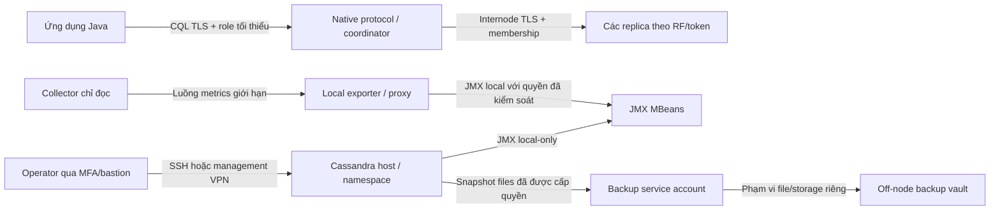
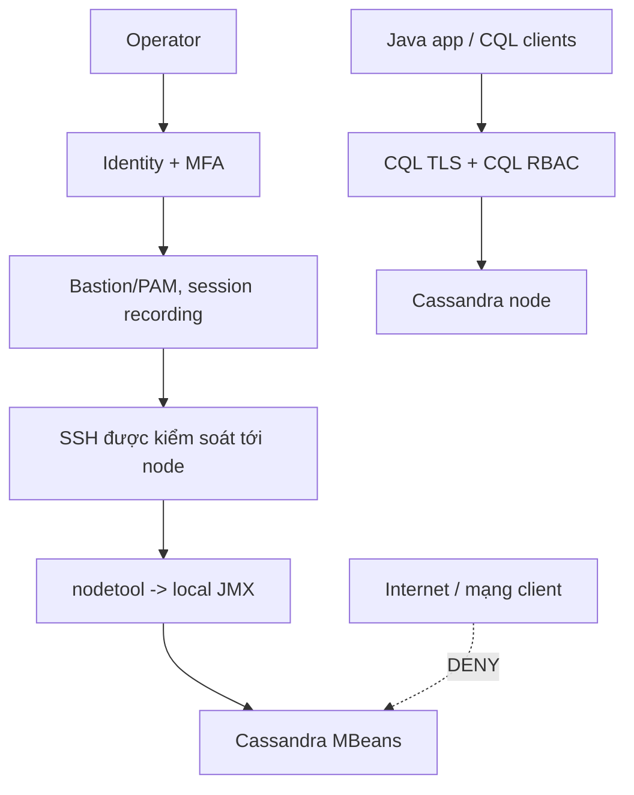
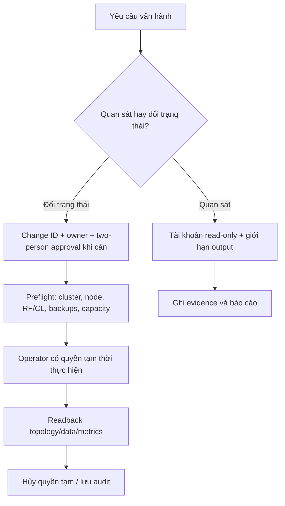
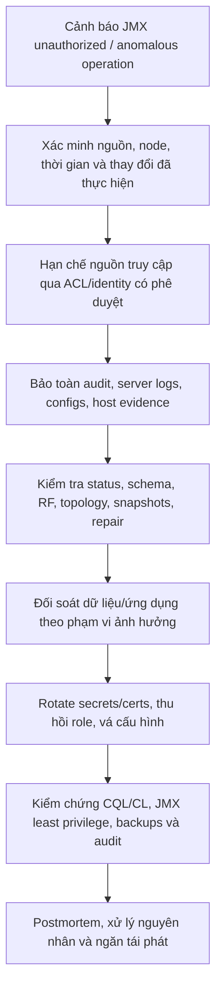

# JMX, công cụ vận hành và hạn chế truy cập quản trị

Một cụm Apache Cassandra có thể đã bật xác thực username/password cho CQL, cấu hình TLS cho Java Driver và cấp quyền `SELECT` rất chặt, nhưng vẫn bị thao tác trái phép nếu **cổng JMX quản trị** được mở rộng hoặc tài khoản vận hành có quyền quá lớn. Khác với truy vấn dữ liệu thông thường, nhiều lệnh `nodetool` gọi các **MBean/JMX operations** có thể ảnh hưởng tới cả node hoặc token ring: dừng dịch vụ, thay đổi tốc độ compaction, khởi động repair, snapshot, decommission hoặc các thao tác khẩn cấp khác. Một tài khoản có thể đọc dashboard không nên mặc nhiên được phép làm những việc đó.

Bài thuộc chương **Bảo mật** của mô-đun **DATABASE_ENGINE_WIDE_COLUMN_CASSANDRA**, với mục tiêu học kiến trúc phân tán/wide-column, partition key, thiết kế theo truy vấn, consistency, CQL, replication, compaction, repair, xử lý lỗi và Java. Trọng tâm là **bảo vệ management plane**: xác định điểm truy cập JMX, cách xác thực và phân quyền, hạn chế mạng/OS, ranh giới `nodetool`/`cqlsh`/driver, cùng quy trình thay đổi cấu hình và xử lý sự cố an toàn.

> **Nguyên tắc:** `nodetool status` thường là truy vấn quan sát, nhưng **quyền JMX để chạy được lệnh đó không nhất thiết chỉ cho phép đọc**. Cần đánh giá chính xác MBean và các method mà từng công cụ gọi trên **phiên bản Cassandra đang vận hành**, không cấp `EXECUTE ON ALL MBEANS` chỉ để sửa lỗi permission.

## 1. Mục tiêu học tập

Sau bài này, bạn có thể:

1. Phân biệt **native CQL plane**, **internode communication**, **JMX management plane**, **OS/service plane** và **backup/observability plane**.
2. Giải thích vì sao bảo mật CQL và quyền `GRANT SELECT ON TABLE` không tự bảo vệ JMX; nhận diện `nodetool` sử dụng JMX/RMI trong triển khai Cassandra truyền thống.
3. Mô tả mặc định **JMX local-only** ở những bản Cassandra phổ biến và các điều kiện bắt buộc nếu phải mở quản trị từ xa.
4. Phân biệt **standard JMX file-based authentication/authorization** và **Cassandra-integrated JMX authentication/authorization** qua roles/MBeans.
5. Đánh giá **least privilege**, đặc biệt quyền `SELECT`, `DESCRIBE` và `EXECUTE` trên MBeans; biết vì sao “read-only nodetool role” dễ cấu hình sai.
6. Thiết kế rào chắn mạng, TLS, jump host, quyền OS, secret management, audit và phân tách monitoring với vận hành có quyền ghi.
7. Thực hiện lab đọc trạng thái qua `nodetool status/info/describecluster` và truy vấn CQL bằng role có quyền giới hạn, không dùng thao tác phá hủy.
8. Xây checklist triển khai/luân phiên credential, chẩn đoán lỗi JMX và quy trình ứng phó khi nghi ngờ bị truy cập quản trị trái phép.

## 2. Mặt phẳng dữ liệu và mặt phẳng quản trị khác nhau

Trong một cụm Cassandra, cùng một host thường phục vụ nhiều giao thức/điểm quản lý:

| Mặt phẳng | Ví dụ | Ai nên truy cập? | Rủi ro nếu lộ |
| --- | --- | --- | --- |
| **CQL/native protocol** | Java Driver, `cqlsh`, thường trên `9042` hoặc cổng tùy cấu hình. | Ứng dụng/nhân sự có tài khoản DB đúng phạm vi, qua mạng được phép. | Đọc/sửa dữ liệu theo quyền CQL, lộ thông tin xác thực. |
| **Internode/gossip/streaming** | Kết nối giữa Cassandra nodes trên cổng và TLS tương ứng phiên bản. | Chỉ các node/endpoint được chấp thuận trong cluster. | Giả mạo peers, làm sai metadata/replication hoặc gây mất khả dụng nếu không bảo vệ. |
| **JMX management plane** | `nodetool`, JMX remote clients, monitoring JMX collector; thường liên quan cổng `7199`. | Operator/agent quản trị chuyên dụng, thường từ host cục bộ hoặc mạng quản trị hẹp. | Gọi MBean operations thay đổi trạng thái node, lộ thông tin JVM, gây outage/data risk. |
| **OS/service plane** | SSH, systemd, Kubernetes exec, quyền đọc `cassandra.yaml`, data files, keystore. | Nhóm hạ tầng được ủy quyền qua RBAC/sudo/MFA. | Truy cập trực tiếp bytes/credentials, ngừng process hoặc sửa cấu hình bất chấp quyền CQL. |
| **Metrics/log/backup plane** | JMX exporter, Prometheus, log collector, snapshot uploader, backup vault. | Service accounts chỉ đúng phạm vi và các hệ thống lưu trữ được tin cậy. | Lộ topology, thông tin vận hành, dữ liệu backup, hoặc quyền thao tác node nếu agent quá mạnh. |

**Không có một cổng duy nhất đại diện cho “bảo mật Cassandra”.** Chặn `9042` từ Internet là cần nhưng chưa đủ; cổng JMX, internode traffic, data directories, backups và secret distribution cũng cần có ranh giới.



Sơ đồ mô tả **thiết kế mục tiêu**, không phải cấu hình Cassandra có sẵn. Đặc biệt, một exporter truy cập local JMX không mặc nhiên “chỉ đọc”: phải kiểm tra quyền OS/JMX và code của exporter, giới hạn command surface, không để một endpoint metrics biến thành proxy gọi MBean tùy ý.

## 3. Vì sao JMX là mục tiêu bảo mật quan trọng?

**Java Management Extensions (JMX)** cho phép đọc attributes, nhận notifications và gọi operations của các **MBeans** mà JVM/ứng dụng đăng ký. Cassandra xuất nhiều MBeans liên quan trạng thái cụm, cache, thread pools, compaction, repair và thao tác quản trị. Công cụ `nodetool` kết nối tới JMX agent của node để gọi những phương thức thích hợp.

Ví dụ cùng một hệ thống MBean có thể cung cấp:

- **Thông tin:** trạng thái node, rack/DC, ring, uptime, heap, thread metrics, streaming.
- **Điều khiển cục bộ:** thay đổi logging level, cache behavior, thông lượng compaction/streaming hoặc refresh một số trạng thái.
- **Tác vụ nặng:** flush, compaction, repair, rebuild/snapshot, di chuyển dữ liệu.
- **Thao tác membership:** decommission, remove/replace hoặc thay đổi topology theo những lệnh được phiên bản hỗ trợ.

Mỗi lệnh có hậu quả và mức chi phí khác nhau. Điều quan trọng không phải chỉ phân loại tên lệnh `status`/`repair`, mà là **quyền JMX thực tế cho phép gọi operation nào trên MBean nào**.

### JMX và CQL không cùng cơ chế xác thực mặc định

Apache Cassandra cung cấp các thành phần CQL `authenticator` / `authorizer` (chẳng hạn `PasswordAuthenticator`, `CassandraAuthorizer`) và **cấu hình JMX riêng**. Nếu chỉ bật xác thực CQL, một endpoint JMX mở sai vẫn là bề mặt tấn công. JMX có lựa chọn:

1. **Standard Java JMX auth**: credentials và phân quyền theo password/access files của JMX.
2. **Cassandra-integrated JMX auth**: sử dụng vai trò Cassandra cùng quyền trên **MBean resources**, khi cấu hình provider tích hợp đúng.

**Không mặc định** một role chỉ có `SELECT ON TABLE myks.mytable` sẽ được truy cập JMX hoặc ngược lại. Chỉ khi tích hợp JMX auth đã được bật, Cassandra roles/grants mới thực sự tham gia kiểm soát JMX; vẫn phải xét quyền `SELECT/DESCRIBE/EXECUTE` trên MBeans.

## 4. Mối đe dọa: một lỗi cấu hình có thể mở cả cụm

| Tình huống | Đường tấn công hoặc sai sót | Hậu quả có thể |
| --- | --- | --- |
| JMX remote không auth/TLS, mở ra Internet/flat VPC | Client không được phép kết nối JMX và gọi MBeans. | Tiết lộ metadata/JVM; can thiệp node và tác vụ nền. |
| Dùng tài khoản JMX chung, `readwrite` cho monitoring | Monitoring credential bị lộ rồi tái sử dụng cho lệnh vận hành. | Nâng từ đọc metrics thành gọi thao tác có side effect. |
| Password trong `nodetool -pw ...` | Shell history, process listing, log CI/CD hoặc ticket có thể lưu secret. | Lộ credential quản trị mà không cần khai thác Cassandra. |
| Mở JMX remote nhưng thiếu TLS | Secret/management traffic có thể bị lộ/giả mạo trong mạng không đáng tin. | Chiếm credential/session, điều khiển node. |
| RMI kết nối qua địa chỉ/port ngoài dự kiến | JMX registry truy cập được nhưng connector stub chuyển tới endpoint khác. | Kết nối lỗi hoặc vô tình mở thêm đường mạng quản trị. |
| JMX exporter hoặc agent chạy với quyền OS quá lớn | Agent lỗi, lộ endpoint hay bị chiếm quyền trên node. | Đọc data files/secrets hoặc gọi MBean tùy ý. |
| Bỏ quên quyền access sau incident | Tài khoản break-glass/sudo quyền cao vẫn tồn tại sau khi hết ca. | Truy cập trái phép kéo dài, khó truy nguồn. |
| Sao chép cấu hình từ lab sang production | `LOCAL_JMX=no`, auth disabled, rộng firewall hoặc mật khẩu mẫu. | Exposure toàn bộ production. |

### Defense in depth

Không có một lớp bảo vệ duy nhất đủ:

1. **Mạng:** JMX mặc định local-only; remote nếu bắt buộc phải qua segment quản trị có ACL theo source/destination.
2. **Xác thực:** danh tính chuyên dụng, secret mạnh được luân phiên, không dùng credentials mặc định/chung.
3. **Ủy quyền:** roles phân tách metrics, read-only, operator và break-glass.
4. **Mã hóa:** TLS/JMX RMI được cấu hình đầy đủ, xác minh danh tính server/client phù hợp.
5. **OS & workload:** SSH/sudo/Kubernetes RBAC, quyền file, service accounts, cấu hình container và audit.
6. **Giám sát:** detection khi JMX port bất ngờ mở, auth failures, thay đổi MBean có side effect, lệnh nodetool và mất telemetry.
7. **Khả năng phục hồi:** backup, repair/consistency và runbook để giảm tác động nếu thao tác sai đã xảy ra.

## 5. Mặc định local-only và ý nghĩa của `LOCAL_JMX`

Trong các bản Cassandra phổ biến, gói cấu hình JMX thường mặc định giới hạn truy cập **tại localhost**. Trên Linux, thiết lập trong `cassandra-env.sh` có thể dùng biến `LOCAL_JMX`; đường dẫn/biến và cơ chế bind/transport có thể khác theo Cassandra release, bản phân phối hay packaging.

```bash
# Minh họa định hướng cấu hình an toàn trong các bản dùng LOCAL_JMX:
LOCAL_JMX=yes

# Chỉ khi quy trình có yêu cầu remote JMX đã được bảo vệ:
# LOCAL_JMX=no
```

Đoạn trên **không phải script để chạy vào shell production**. `LOCAL_JMX=yes` có nghĩa quản trị local theo cơ chế của bản Cassandra; không phải tuyên bố **mọi local process đều vô hại**. Khi ai đó có thể SSH/exec vào host/namespace, quyền truy cập tới JMX local còn phụ thuộc tài khoản OS, cơ chế JMX local auth và việc phân tách người dùng.

### Mô hình khuyến nghị: JMX không có địa chỉ công khai



Thực tế có thể dùng VPN, private endpoint, SSH tunnel hoặc deployment agent quản trị thay bastion truyền thống. Điều kiện an toàn là **định danh, giới hạn mạng, ủy quyền, audit và không mở đường vòng công khai**; không tạo tunnel/bypass để tránh policy của tổ chức.

### Remote JMX chỉ khi có lý do được phê duyệt

Một dashboard dùng JMX exporter có thể chạy **ngay trên node**, xuất metric qua một HTTP endpoint giới hạn riêng, tránh cho Prometheus trực tiếp truy cập remote JMX của Cassandra. Nếu hệ thống giám sát/điều phối buộc phải kết nối remote JMX, cần:

- Chỉ cho các **IP/subnet/identities** của management hosts truy cập; chặn Internet và các workload VLAN không liên quan.
- Bật xác thực JMX, TLS server (và mTLS khi policy yêu cầu), chuẩn hóa truststore/keystore.
- Quản lý **RMI registry + connector endpoint** (JMX có thể dùng nhiều cổng); firewall mọi đường thay vì chỉ 7199.
- Giữ nguyên danh tính TLS/certificate khi có load balancer/NAT; tránh đặt hostname public không kiểm soát.
- Tài khoản chỉ đủ quyền, có owner/TTL/rotation, log/alert khi đăng nhập lỗi hoặc truy cập bất thường.
- Test trên node canary trước và có rollback; thay đổi JMX có thể khiến toàn bộ `nodetool`/monitoring mất kết nối nếu cấu hình sai.

## 6. RMI/JMX: vì sao mở một cổng chưa chắc đã kết nối được?

JMX remote dùng **Java RMI** trong nhiều phiên bản Cassandra. Client có thể kết nối tới **RMI registry** trước, nhận connector stub rồi thực hiện kết nối tiếp tới endpoint/port/hostname mà stub công bố. Một số cấu hình dùng cùng port hoặc chỉ định port thứ hai; TLS cho registry và kết nối RMI có thể là hai phần cấu hình khác nhau.

```text
nodetool/JMX client
    |
    | 1. Kết nối JMX registry tại host:port đã cấu hình
    v
RMI registry
    |
    | 2. Trả connector stub (host/port/transport)
    v
RMI connector endpoint
    |
    | 3. Xác thực + TLS/authorization + thao tác MBean
    v
Cassandra JMX server
```

**Hai tình huống khác nhau:**

- `nodetool` báo **connection refused/timeout**: có thể listener/bind/ACL/JMX process không truy cập, không nhất thiết node Cassandra Down trên cổng CQL.
- TCP handshake tới registry **thành công** nhưng tool vẫn timeout: RMI stub có thể trỏ hostname/port không tới được, TLS trust mismatch, firewall chặn kênh thứ hai hoặc JMX auth thiếu quyền.

Đừng xử lý bằng cách **mở tất cả cổng** hoặc tắt TLS/auth. Xác nhận endpoint cụ thể theo cấu hình/JVM version và firewall rules, sau đó test từ **đúng nguồn được phép**. Công cụ như `curl` tới port JMX không phải bài kiểm tra JMX hợp lệ vì JMX/RMI không phải HTTP.

## 7. Standard JMX authentication: password file và access file

Trong cơ chế **standard Java JMX**, một tệp password xác định người được xác thực và một tệp access (nếu cấu hình) giới hạn thao tác. Chúng **khác** tài khoản đăng nhập CQL ở `system_auth`, trừ khi có tích hợp khác được chủ động thiết lập.

### Ý tưởng cấu hình (minh họa, không phải patch production)

```text
# Các JVM system properties tiêu biểu do cassandra-env.sh/packaging cung cấp:
-Dcom.sun.management.jmxremote.authenticate=true
-Dcom.sun.management.jmxremote.password.file=/etc/cassandra/jmxremote.password
-Dcom.sun.management.jmxremote.access.file=/etc/cassandra/jmxremote.access
```

Ví dụ **tệp access** chuẩn Java JMX:

```text
# /etc/cassandra/jmxremote.access  (chỉ mẫu)
metrics_reader readonly
ops_admin      readwrite
```

Lưu ý một số công cụ vận hành Cassandra gọi **operation** trên MBean ngay cả để thu thông tin, nên vai trò `readonly` của standard JMX **có thể không chạy được mọi lệnh `nodetool status/info`**. Ngược lại, `readwrite` là phạm vi rộng ở tầng JMX, **không** trở thành “chỉ được dùng nodetool status”. Cần kiểm chứng matrix các lệnh và chọn giải pháp monitoring khác nếu cần quyền quan sát thật sự hẹp.

### Bảo vệ secret và tệp

Trong môi trường Linux với user `cassandra`, password/access files và thư mục chứa phải có quyền chặt, thuộc người quản lý phù hợp; ví dụ policy vận hành thường yêu cầu password file **chỉ đọc bởi Cassandra service user**:

```bash
# Lệnh minh họa; chỉ dùng sau khi xác nhận path/user và có approval:
# chown cassandra:cassandra /etc/cassandra/jmxremote.password
# chmod 400 /etc/cassandra/jmxremote.password
```

Trong Kubernetes, dùng Secret provider/mount với permission phù hợp; tránh để secret lộ qua image layers, ConfigMap công khai, init logs hoặc shell history. Nếu không có provider bảo mật, **đừng bật remote JMX** để rồi đặt username/password ngay trong command line.

### Những sai sót nguy hiểm

- Chỉ bật `authenticate=true` nhưng để mật khẩu mẫu/ngắn, không dùng TLS ở mạng không tin cậy.
- Để file password có quyền đọc đối với mọi user/process.
- Dùng cùng tài khoản JMX `readwrite` cho metrics collector, automation, DBA và người phát triển.
- Đổi password file trên một node mà không phối hợp collector/automation, làm mất monitoring hoặc khả năng thao tác khi sự cố.
- Cho rằng `jmxremote.access` có thể thể hiện chính xác mọi operation an toàn trên MBeans của Cassandra; cơ chế này **tương đối thô**, cần kiểm thử và có thể phải chuyển sang integrated auth.

## 8. Cassandra-integrated JMX auth: roles và MBean resources

Cassandra hỗ trợ tích hợp xác thực/ủy quyền JMX với subsystem quản lý roles/permissions của Cassandra trên những phiên bản tương ứng. Lúc đó tài khoản có thể được quản lý tập trung, và CQL `GRANT/REVOKE` có thể phân quyền MBeans. **Tính năng không mặc định có hiệu lực chỉ vì đã bật `CassandraAuthorizer` cho CQL**: phải cấu hình riêng provider JMX trong JVM/JAAS và kiểm tra trên bản triển khai.

### Cấu hình provider ở mức khái niệm

Tài liệu Apache Cassandra mô tả các thuộc tính cho tích hợp JMX, chẳng hạn:

```text
# Ví dụ tên JVM properties trong Cassandra releases có hỗ trợ:
-Dcassandra.jmx.remote.login.config=CassandraLogin
-Djava.security.auth.login.config=<path-to-cassandra-jaas.config>
-Dcassandra.jmx.authorizer=org.apache.cassandra.auth.jmx.AuthorizationProxy
```

Đoạn trên **không phải bộ cấu hình đầy đủ**, chưa bao gồm network/TLS và chưa chuyển đổi/loại bỏ provider standard JMX đúng cách. Không bật song song các provider xung đột hoặc thay đổi trên tất cả node cùng lúc. Phải đối chiếu `cassandra-env.sh`, `cassandra-jaas.config`, cơ chế auth và bản Cassandra thực tế trước khi rollout.

### Các quyền MBean được đề cập trong Cassandra

| Permission | Khả năng tổng quát | Rủi ro quản trị |
| --- | --- | --- |
| `DESCRIBE` | Liệt kê/khám phá MBeans phù hợp phạm vi. | Có thể tiết lộ metadata cấu trúc management plane. |
| `SELECT` | Đọc attributes MBeans phù hợp. | Attributes có thể lộ thông tin node, đường dẫn, trạng thái/JVM; cần giới hạn. |
| `EXECUTE` | Gọi operations trên MBeans được cấp phép. | **Có thể gây side effect**, kể cả khi tool gọi một operation có tên nghe như đọc. |
| `AUTHORIZE` | Quản lý quyền trên resources khi được phép theo mô hình Cassandra. | Không dành cho tài khoản quan sát hay ứng dụng thường. |

**Mức hạt của grant không phải bảo đảm “chỉ một method an toàn”.** `EXECUTE ON MBEAN 'org.apache.cassandra.db:type=StorageService'` có thể cho gọi các operations khác trên **cùng MBean** chứ không chỉ method mà `nodetool status` cần. Phải kiểm tra bản chính xác và tránh cấp lệnh có side effect cho nhóm read-only.

### Ví dụ CQL về nhóm quan sát (lab, chỉ khi integrated auth đã cấu hình)

```sql
-- Chỉ một role dùng để gom permission, không có quyền đăng nhập trực tiếp.
CREATE ROLE IF NOT EXISTS ops_jmx_observer
WITH LOGIN = false AND SUPERUSER = false;

-- Cho phép đọc/khám phá attributes MBeans.
GRANT SELECT ON ALL MBEANS TO ops_jmx_observer;
GRANT DESCRIBE ON ALL MBEANS TO ops_jmx_observer;

-- KHÔNG cấp toàn bộ EXECUTE cho nhóm này.
-- Một số lệnh nodetool status/info có thể vẫn thiếu quyền
-- vì chúng cần gọi MBean methods; phải thiết kế và kiểm thử riêng.
```

Đây là **ví dụ khởi điểm**, không phải policy production bảo đảm read-only hoàn hảo: cấp `SELECT/DESCRIBE ON ALL MBEANS` cũng khá rộng về **thông tin được xem**. Khi có yêu cầu least privilege cao hơn, ưu tiên grant theo từng MBean cần thiết hoặc thu thập metrics qua một exporter đã được giới hạn chức năng.

### Cấp một method cấp MBean không tương đương cấp một lệnh nodetool

Ví dụ cú pháp sau **chỉ để thấy sự khác biệt, không chạy trên production**:

```sql
-- NGUY HIỂM NẾU DÙNG NHƯ QUYỀN "chỉ đọc status":
-- GRANT EXECUTE ON MBEAN
--   'org.apache.cassandra.db:type=StorageService'
-- TO ops_jmx_observer;
```

Việc cấp EXECUTE cho một MBean có nhiều operations không có cơ chế tự động kiểm tra **tên lệnh nodetool ở phía người dùng**. Một operator có thể dùng JMX client khác để gọi operation mà tài khoản được phép, không nhất thiết đi qua CLI đã được nhóm chuẩn hóa. Vì vậy quyền hạ tầng/mạng, wrapper với allowlist và audit vẫn cần song hành.

### Caveat khi bootstrap

Apache Cassandra lưu ý rằng **Cassandra-integrated JMX auth có thể chưa sẵn sàng cho tới khi node join ring**, vì auth subsystem chưa khởi tạo đủ trong giai đoạn bootstrap. Nếu cần quan sát/sửa lỗi lúc bootstrap, thiết kế **local JMX access được bảo vệ và kiểm soát**, rồi chuyển sang integrated remote auth khi node ổn định; không đợi đến incident mới phát hiện mọi công cụ JMX bị khóa.

## 9. Phân nhóm quyền: monitor, operator, DBA và break-glass

| Vai trò/luồng | Quyền nên có | Không nên có theo mặc định |
| --- | --- | --- |
| **Metrics collector** | Đọc metrics MBeans cần thiết hoặc scrape local exporter; quyền OS tối thiểu. | JMX unrestricted method calls, quyền sudo root, quyền xóa snapshots. |
| **App service account** | CQL `SELECT/MODIFY` đúng keyspace/table, local DC/TLS, secrets từ vault. | JMX, OS root, Cassandra superuser, quyền DDL hay internode network. |
| **Support/on-call observer** | `status/info/describecluster` và logs/metrics thông qua kênh đã giới hạn. | Decommission/removenode/cleanup/clearsnapshot; cấp rộng EXECUTE nếu không được duyệt. |
| **DBA/operator có change approval** | Tác vụ sửa chữa có scope: repair, snapshot, tuning, restart đúng runbook. | Superuser thường trực, vô hạn thời gian, tự duyệt thay đổi nguy hiểm. |
| **Topology/DR operator** | Thực hiện replace/remove/decommission/restore khi có two-person approval. | Quyền mở toàn cụm ngoài cửa sổ change, bỏ qua backup/replica checks. |
| **Break-glass** | Quyền cao tạm thời, có điều kiện, dùng khi sự cố nghiêm trọng. | Credential tồn tại vĩnh viễn trong CI/secrets dùng chung hoặc tài khoản cá nhân không audit. |

### Một phân chia hai lớp thường hiệu quả

1. **Quan sát:** dashboard/read-only API hoặc JMX exporter, có thể phát hiện lỗi nhưng **không thể** thay đổi Cassandra.
2. **Thao tác:** operator đăng nhập bastion/host có xác thực mạnh, chạy lệnh được duyệt theo change ticket; audit command, node, người duyệt và kết quả.

Nếu monitor phải gọi MBean `EXECUTE` để lấy trạng thái, không cố gọi nó “read-only” chỉ vì tên method, mà xây service exporter/wrapper giới hạn **chính xác những truy vấn được phép** (và hạn chế quyền bên dưới). Phải test xem wrapper có chặn input tùy ý/command injection hay không.

## 10. `nodetool`: phân loại lệnh theo mức tác động

Không phải mọi lệnh `nodetool` đều đọc-only. Một số lệnh có thể thay đổi dữ liệu, metadata, tài nguyên hoặc membership:

| Loại | Lệnh ví dụ | Tác động/rào chắn |
| --- | --- | --- |
| **Quan sát topology** | `status`, `info`, `describecluster`, `ring`. | Chủ yếu quan sát; quyền JMX method/attributes tùy bản phải kiểm chứng. |
| **Quan sát resource/workload** | `tpstats`, `tablestats`, `compactionstats`, `netstats`. | Có thể đọc metrics nhạy cảm và làm tăng tải nhỏ nếu poll quá dày; cần giới hạn collector. |
| **Tạo điểm phục hồi** | `snapshot`. | Tạo hard links/giữ SSTables, có thể chiếm disk sau compaction; phải có policy retention. |
| **Thu hồi điểm phục hồi** | `clearsnapshot`. | **Destructive:** xóa snapshot files của phạm vi chọn; cần remote backup verification và approval. |
| **Repair/đồng bộ** | `repair`, `rebuild`. | I/O/CPU/network lớn; có thể ảnh hưởng SLA/replica; cần phạm vi và lịch. |
| **Data maintenance** | `flush`, `compact`, `cleanup`, `scrub`. | Thay SSTable/dữ liệu cục bộ, disk pressure; `cleanup` sau topology cần đúng thời điểm. |
| **Thay behavior tạm thời** | `setcompactionthroughput`, `setlogginglevel` hoặc lệnh tuning tương ứng. | Ảnh hưởng performance/logging, có thể bị ghi đè sau restart; cần baseline/rollback. |
| **Thay membership/topology** | `decommission`, `removenode`, `move` khi hỗ trợ. | Ảnh hưởng token ownership/replica placement, khả năng mất quorum; cần runbook nghiêm ngặt. |
| **Thao tác cực nguy hiểm** | Các lệnh cưỡng bức/khôi phục metadata như `assassinate` khi release hỗ trợ. | Không dùng như cách sửa nhanh; có thể tăng nguy cơ mất dữ liệu nếu bypass luồng tái sao chép. |

**Một command được đặt tên “status” không đồng nghĩa role có thể gọi command đó mà không thể gọi command khác.** Sự phân quyền thực chất nằm tại JMX MBeans/JVM và cách team cấp đường vào host/CLI, không chỉ ở danh sách cho phép trong tài liệu.

### Cổng thao tác: read-only và state-changing



Không buộc mọi `nodetool info` đều phải qua một quy trình dài như decommission, nhưng **cấp quyền quản trị** cho người/công cụ chạy nó phải được thiết kế trước để không lỡ mở luôn quyền ghi.

## 11. Dùng `nodetool` với credential an toàn

Các bản Cassandra hỗ trợ những option như `-h`, `-p`, `-u`, `-pwf`. Luôn xem `nodetool help` trên bản thực tế trước.

```bash
# Trường hợp local-only JMX: thực hiện từ host/namespace được phép.
nodetool status
nodetool info
nodetool describecluster

# Trường hợp remote JMX đã được phê duyệt và có TLS/auth:
# --password-file chỉ đường dẫn client-side password file được bảo vệ.
nodetool -h cassandra-mgmt.internal -p 7199 \
  -u ops_observer --password-file /secure/path/nodetool-client-password status
```

Các tên host/đường dẫn là **minh họa**, không phải endpoint tồn tại. Chỉ chạy trên lab hoặc môi trường đã được cho phép. Mẫu trên giả định **kết nối JMX/TLS/truststore đã được cấu hình đầy đủ cho nodetool**; chỉ `--password-file` không tự bật TLS.

### Tránh đưa mật khẩu lên dòng lệnh

Không dùng mẫu sau trong tài liệu tự động hóa:

```bash
# KHÔNG NÊN: mật khẩu có thể lộ trong history/process listing/CI logs.
# nodetool -h node.example -u admin -pw 'plaintext-secret' status
```

Tệp `--password-file` phía client **không phải** tệp server `jmxremote.password`; nó được parser của nodetool đọc theo định dạng tool hỗ trợ. Secret phải do vault/secret provider cấp và được mount với quyền tối thiểu, không commit vào Git và không đưa vào artifact build. Kiểm tra chi tiết format và khả năng xử lý file theo phiên bản, không tự đoán.

### Tại sao `nodetool -h` không phải `cqlsh`?

`-h` của `nodetool` chỉ **đích quản trị/JMX**. `cqlsh host 9042` dùng **CQL/native protocol**. Một node có thể mở `9042` và trả CQL bình thường nhưng JMX bị firewall chặn, hoặc JMX local hoạt động trong khi native transport bị vô hiệu hóa. **Không suy cluster DOWN chỉ vì JMX unreachable**.

## 12. TLS cho JMX và những điểm khác với CQL/internode TLS

Ba loại kết nối cần cấu hình và kiểm tra riêng:

| Luồng | Bảo vệ cần có | Không được suy |
| --- | --- | --- |
| Java Driver ↔ Cassandra native protocol | CQL authentication, client TLS/server identity, quyền bảng/keyspace. | Client TLS không đồng nghĩa JMX đã bật TLS. |
| Cassandra node ↔ node | Internode encryption, xác thực endpoint/cluster, network segmentation. | Internode TLS không đồng nghĩa cổng JMX được bảo vệ. |
| `nodetool`/collector ↔ JMX | JMX authn/authz, TLS keystore/truststore, endpoint RMI/registry đúng, management ACL. | JMX TLS không tự phân quyền MBean hoặc bảo vệ OS/backup. |

Một số JVM properties liên quan JMX TLS theo tài liệu Java/Cassandra:

```text
-Dcom.sun.management.jmxremote.ssl=true
-Dcom.sun.management.jmxremote.ssl.need.client.auth=true
-Dcom.sun.management.jmxremote.registry.ssl=true
-Dcom.sun.management.jmxremote.ssl.enabled.protocols=<protocols-duoc-phe-duyet>
-Djavax.net.ssl.keyStore=<protected-key-store>
-Djavax.net.ssl.trustStore=<protected-trust-store>
```

Đây là **những nút cấu hình cần hiểu**, không phải recipe có thể paste đủ để production chạy: việc chọn JVM/Cassandra version, registry SSL, RMI port, certificate SAN, key/truststore passwords và client JVM options rất quan trọng. Một số release hỗ trợ cấu hình JMX TLS theo cơ chế mới trong `cassandra.yaml`; **không** bật đồng thời hai cơ chế xung đột. Cần đọc tài liệu **đúng bản**.

### Chẩn đoán lỗi TLS

- `SSLHandshakeException`: certificate/truststore/protocol/cipher hoặc yêu cầu client certificate có thể không khớp.
- Client tới được registry nhưng không gọi MBean được: có thể kết nối RMI thứ hai hoặc TLS cho registry/connector chưa đồng bộ.
- Dùng certificate theo IP/hostname khác `RMI hostname`: lỗi identity verification hoặc kết nối tới endpoint khác.
- Sau rotation certificate, một số collector mất kết nối: kiểm tra secret mount/trust reload/restart theo runbook của các thành phần, không tắt xác thực để “test nhanh” trên production.

**Không để truststore xác thực mọi certificate** hoặc dùng cờ disable hostname verification như phương án dài hạn. Nếu test ở môi trường lab, phải ghi rõ đó là test không đạt security acceptance.

## 13. Bảo vệ quyền OS, SSH/sudo, container và automation

JMX local-only chỉ hiệu quả nếu **ai có thể thực thi process trên host/namespace** đã được kiểm soát. Một người có quyền `kubectl exec` vào Cassandra pod hoặc sudo tới Cassandra service account có thể truy cập JMX local, data directory hoặc secret mounts, bất kể public network policy.

### Kiểm soát tối thiểu

1. **SSH và bastion:** MFA/SSO, nhóm quyền, session timeout, record command, không dùng shared root password.
2. **sudo:** cho phép đúng command/role được duyệt; kiểm tra escape routes, shell execution, `sudo -u cassandra` và khả năng đọc secret.
3. **Kubernetes:** RBAC cho `pods/exec`, `pods/portforward`, Secret read, StatefulSet edit và hostPath; NetworkPolicy giữa app/metrics/management namespaces.
4. **Service account:** Cassandra process, JMX exporter, backup uploader và automation dùng identities khác nhau; quyền file và credentials nhỏ nhất cần thiết.
5. **Data files:** SSTables, commit logs, snapshots, `system_auth` data, certificates và keystore là tài sản nhạy cảm; OS access thường bỏ qua CQL permission model.
6. **CI/CD:** không cấp mặc định JMX admin credentials cho các pipeline build/test; thao tác production phải có approval và audit.
7. **Secret rotation:** vault/short-lived credentials, không in ra stdout, không lưu trong chat/ticket hoặc source control.

### Một đường vòng nguy hiểm

Nếu Prometheus scrape được exporter tại `/metrics`, hãy đảm bảo exporter **không cung cấp endpoint cho phép người gọi tự chọn MBean operation**. Một web UI giám sát với quyền “chỉ xem biểu đồ” ở frontend không giúp ích nếu backend agent dùng JMX readwrite không được bảo vệ và người dùng có thể gửi request quản trị khác vào backend.

## 14. JMX exporter và metrics: quan sát có quyền hẹp

Đối với giám sát Cassandra, phổ biến là đọc các MBeans/JMX attributes liên quan read/write latency, thread pool, cache, compaction, JVM/GC, disk/resource. Một collector không nên phải có quyền gọi `decommission` hay `clearsnapshot`.

### Thiết kế tham khảo

```text
Prometheus / hệ thống metrics
   |
   | mTLS / private network / read-only scrape
   v
Exporter endpoint (không hỗ trợ arbitrary MBean invocation)
   |
   | local-only JMX; chỉ quyền đọc theo khả năng version
   v
Cassandra MBean attributes
```

Cần hiểu **rủi ro kép**:

1. Nếu exporter là Java agent chạy **trong Cassandra JVM**, nó thừa hưởng quyền process/JVM; không có “tài khoản JMX riêng” tự phát sinh. Bảo vệ artifact/code và endpoint, dùng bản phát hành tin cậy và kiểm soát vòng đời.
2. Nếu exporter là process khác kết nối JMX bằng user/password, áp dụng role/file permissions và giới hạn quyền như mọi JMX client khác.

**Metric labels** chỉ nên có những giá trị hữu hạn như `cluster`, `dc`, `rack`, `node`, `table`, `query_name` ổn định. Không gắn raw partition key, tenant ID, operation ID hay secret vào Prometheus labels. Hệ thống metrics có thể tiết lộ topology/hostnames và cần RBAC, retention và mã hóa.

### Tách collectors khỏi quyền admin

| Kiểm tra | Tiêu chí |
| --- | --- |
| Exporter bind address | Private/interface được phê duyệt; không mở trên Internet. |
| Scrape identity | Service account có allowlist network/certificate. |
| JMX privilege | Chỉ đọc attributes cần thiết hoặc dùng nội bộ agent được kiểm soát; không arbitrary EXECUTE. |
| CPU/GC overhead | Sampling/poll interval không tạo latency hoặc mất dữ liệu metrics. |
| Log/secret | Không log JMX password, TLS key hoặc payload nhạy cảm. |
| Availability | Khi monitoring hỏng, Cassandra vẫn phục vụ; có alert độc lập khi mất telemetry. |

## 15. Audit và định danh yêu cầu vận hành

Trong incident, cần biết **ai đã chạy lệnh gì, trên node nào, lúc nào và có approval nào**, không chỉ một dòng `nodetool completed`. JMX server logs mặc định có thể **không** chứa mỗi method invocation kèm danh tính người dùng và change ID theo định dạng nhóm mong muốn. Cần phối hợp audit tại bastion/PAM, automation runner, OS/SSH, collector và Cassandra logs.

### Schema log đề xuất

```json
{
  "time_utc": "2026-11-21T11:20:30Z",
  "event": "cassandra.management.command",
  "environment": "lab",
  "cluster_id": "cassandra-lab",
  "change_id": "CHG-LAB-42",
  "actor_identity": "ops-oncall-service",
  "approval_id": "APPROVED-LAB-17",
  "node_host_id": "11111111-1111-4111-8111-111111111111",
  "tool": "nodetool",
  "command_name": "status",
  "scope": "keyspace=security_lab",
  "intent": "OBSERVE",
  "result": "SUCCESS",
  "duration_ms": 126,
  "jmx_credential_reference": "vault://ops/jmx-observer",
  "secret_value": null
}
```

Đây là **log tự thiết kế**; Cassandra không tự phát ra toàn bộ các trường đó. Thực thi tốt cần nối `change_id` với danh tính bastion/session, lệnh CLI được chuẩn hóa, output hashes và request metadata. Không lưu password, private key hay token trong log. Khi người dùng chạy JMX client trực tiếp bỏ qua wrapper, audit app-layer có thể không ghi nhận được; vì thế cần **network và privilege controls** để hạn chế đường vòng.

### Những hành động cần alert

- JMX listener được phát hiện trên interface/port không nằm trong inventory.
- Nhiều lần JMX login thất bại từ host mới, certificate bất thường hoặc management ACL bị thay đổi.
- Tài khoản metrics hoặc support thực hiện operation có side effect.
- Nhiều lệnh repair/compaction/decommission/snapshot được khởi động cùng lúc ngoài change window.
- `nodetool status`/metrics collector đồng loạt mất kết nối sau thay đổi TLS/credentials.
- Tài khoản break-glass được kích hoạt, sử dụng quá TTL hoặc không có người phê duyệt.
- Sửa `cassandra-env.sh`/JMX configuration, password files, firewall, NetworkPolicy hoặc Kubernetes RoleBindings không theo change.

Audit logs cần retention, đồng bộ giờ UTC, quyền bảo vệ khỏi sửa/xóa và quy trình truy xuất khi có sự cố. Trong multi-DC, timestamp các host có thể lệch nên phải có NTP và ID độc lập để ghép timeline.

## 16. Lab an toàn: phân biệt quyền CQL và quyền JMX

**Môi trường:** Cassandra lab cách ly, có ít nhất một DC được đặt đúng tên theo cấu hình, tài khoản quản trị đã được cấp phép cho lab, backup và rollback. Bài này **không** yêu cầu mở remote JMX, đổi auth trên production, sửa files mật khẩu thật hoặc thực thi lệnh thay đổi topology.

### Bước 1 — Đọc-only qua `nodetool` local

```bash
# Chạy từ host/namespace Cassandra lab đã được cấp quyền.
nodetool help
nodetool version
nodetool status
nodetool info
nodetool describecluster
```

Lưu `time_utc`, node JMX/Host ID, phiên bản, `LOCAL_JMX` policy và output đã redaction. Nếu không kết nối được JMX, không thử mở firewall bất kỳ; kiểm tra đúng host, quyền OS và cấu hình JMX trước.

### Bước 2 — Tạo dữ liệu CQL lab để đối chiếu

Ví dụ keyspace chỉ có `dc1` với RF=3; cần ít nhất ba node khỏe trong DC đó. Nếu chỉ có một node, **đổi RF trong lab cho phù hợp trước khi chạy**, không chỉnh replication của production vì bài thực hành.

```sql
CREATE KEYSPACE IF NOT EXISTS security_lab
WITH replication = {
  'class': 'NetworkTopologyStrategy',
  'dc1': 3
}
AND durable_writes = true;

CREATE TABLE IF NOT EXISTS security_lab.events_by_tenant_day (
  tenant_id text,
  event_day date,
  event_id uuid,
  event_type text,
  PRIMARY KEY ((tenant_id, event_day), event_id)
);

CONSISTENCY LOCAL_QUORUM;

INSERT INTO security_lab.events_by_tenant_day
  (tenant_id, event_day, event_id, event_type)
VALUES ('tenant-lab', '2026-11-21',
        11111111-1111-4111-8111-111111111111,
        'SECURITY_BASELINE');

SELECT event_id, event_type
FROM security_lab.events_by_tenant_day
WHERE tenant_id = 'tenant-lab'
  AND event_day = '2026-11-21';
```

Bảng dùng partition key `(tenant_id, event_day)` để truy vấn hiệu quả. RF/CL là yêu cầu về **replica**, không phải về **ai được phép truy vấn**. Một CQL role bị từ chối `SELECT` vì thiếu quyền không có nghĩa node Down hoặc quorum thất bại.

### Bước 3 — Thử CQL role không có quyền admin

Chỉ khi lab đã bật `PasswordAuthenticator`/`CassandraAuthorizer` và người chạy có quyền quản lý role:

```sql
-- Role nhóm cho quyền đọc đúng một table.
CREATE ROLE IF NOT EXISTS security_lab_reader
WITH LOGIN = false AND SUPERUSER = false;

GRANT SELECT ON TABLE security_lab.events_by_tenant_day
TO security_lab_reader;

-- Một login role được quản lý bằng secret provider sẽ được
-- cấp security_lab_reader theo runbook tổ chức.
-- KHÔNG đưa password thật vào file bài học/CI.
```

Kiểm thử bằng một **tài khoản đăng nhập lab được cấp role này**: `SELECT` bảng được phép, `INSERT/ALTER/DROP` bị từ chối nếu không có quyền khác. Việc role được phép SELECT **không** trao cho nó quyền JMX; thử truy cập JMX chỉ qua con đường được policy lab cho phép để xác minh ranh giới.

### Bước 4 — Thử JMX least privilege trên lab

Nếu đã cấu hình **Cassandra-integrated JMX authentication/authorization** và có tài khoản quan sát lab:

```sql
CREATE ROLE IF NOT EXISTS ops_jmx_lab_viewer
WITH LOGIN = false AND SUPERUSER = false;

GRANT SELECT ON ALL MBEANS TO ops_jmx_lab_viewer;
GRANT DESCRIBE ON ALL MBEANS TO ops_jmx_lab_viewer;
```

Đây **chưa** phải chính sách production “least MBeans”; chỉ để chứng minh quyền CQL table và quyền JMX khác nhau. Dùng JMX viewer tool được phép để xác nhận có thể đọc attributes, nhưng những operations cần `EXECUTE` bị từ chối. Nếu `nodetool status` không chạy được, **không** tự cấp `EXECUTE ON ALL MBEANS`: đọc log permission, xác định method/MBean, xem rủi ro và đề xuất collector hoặc rule hẹp hơn.

### Bước 5 — Kiểm tra ranh giới mạng/OS bằng checklist

Không dùng port scanning trên môi trường khác hoặc cố bypass firewall. Trên node lab được phép, xem các listener bằng công cụ hệ điều hành:

```bash
# Đọc-only; lệnh Linux, output tùy quyền.
ss -lntp
nodetool status

# Nếu cần xác minh network policy từ management host:
# chỉ kết nối tới endpoint/JMX đã được phê duyệt.
```

Ghi JMX listener có nằm trên loopback/private interface không, remote management clients đi qua nguồn được phép nào, exporter có API ghi/điều khiển không và CQL/internode ports có tách biệt firewall policies không.

### Bước 6 — Đánh giá kết quả

| Kiểm thử | Kỳ vọng | Nếu không đạt |
| --- | --- | --- |
| `nodetool status/info` local | Quan sát được theo quyền đã cấp, không phải mở public JMX. | Xác định JMX listener/auth/TLS/role, không hạ bảo mật. |
| CQL reader SELECT table được cấp | Truy vấn thành công với CL phù hợp. | Phân biệt CQL auth failure với replica/CL failure. |
| CQL reader DROP/ALTER table | Bị từ chối nếu không có grant tương ứng. | Kiểm tra role inheritance/superuser/cấu hình authorizer. |
| JMX viewer đọc MBeans được cấp | Phù hợp vai trò và information policy. | Chỉnh phạm vi READ/DESCRIBE có phê duyệt. |
| JMX viewer gọi operation có side effect | **Bị chặn**. | Xem lại grant EXECUTE, access file, exporter/agent quyền OS. |
| JMX từ mạng không thuộc allowlist | **Không truy cập** theo network policy. | Sửa ACL/bind, không dùng việc fail auth làm lớp bảo vệ duy nhất. |

## 17. Java Driver 4.x: tài khoản ứng dụng không cần JMX

Java ứng dụng thông thường nên dùng native CQL protocol với **tài khoản có quyền SELECT/MODIFY đúng bảng**, không dùng JMX credential hoặc Cassandra superuser. Một request thành công ở `LOCAL_QUORUM` chứng minh đủ replica đáp ứng CL cho request đó, **không** xác minh JMX permission.

Ví dụ Java Driver 4.x, với `CqlSession session` đã được cấu hình **local datacenter, credentials lấy từ secret manager và CQL TLS**:

```java
import java.time.LocalDate;
import com.datastax.oss.driver.api.core.ConsistencyLevel;
import com.datastax.oss.driver.api.core.cql.PreparedStatement;
import com.datastax.oss.driver.api.core.cql.BoundStatement;
import com.datastax.oss.driver.api.core.cql.ResultSet;

PreparedStatement select = session.prepare(
    "SELECT event_id, event_type " +
    "FROM security_lab.events_by_tenant_day " +
    "WHERE tenant_id = ? AND event_day = ?");

BoundStatement query = select.bind(
        "tenant-lab", LocalDate.of(2026, 11, 21))
    .setConsistencyLevel(ConsistencyLevel.LOCAL_QUORUM)
    .setIdempotent(true)
    .setPageSize(100);

ResultSet result = session.execute(query);
// Log query_name, consistency, elapsed và coordinator khi biết,
// không log raw bind values, credentials hoặc toàn bộ session config.
```

### Bảo vệ ứng dụng trong thực tế

- **Không lưu secrets trong source** hoặc `application.properties` commit lên repository. Dùng vault/secret manager, quyền đọc giới hạn, rotation và audit.
- **Bật native protocol TLS và hostname/server identity verification**. TLS ở Java Driver không bật JMX TLS; cấu hình hai luồng riêng.
- **Giảm quyền CQL:** service chỉ SELECT/INSERT/UPDATE/DELETE trên bảng cần thiết; không SUPERUSER, CREATE/DROP/ALTER/GRANT nếu workload không cần.
- **Mỗi service một identity:** tách môi trường/tenant có yêu cầu bảo mật khác, không dùng shared DBA account.
- **Không tự hạ CL** nếu có auth error; `UnauthorizedException` không phải `UnavailableException`, cần phân biệt lỗi từ chối quyền với lỗi replica/quorum.
- **Log có cấu trúc**: `operation_id`, `query_name`, CL, DC, elapsed, outcome/error class; không đưa PII/secret vào metric labels.
- **Không làm JMX client từ code nghiệp vụ** trừ ứng dụng quản trị riêng có approval, network boundary và audit; admin API phải được thiết kế khác API dữ liệu.

## 18. Runbook triển khai hardening JMX từng bước

Thay đổi JMX configuration có thể làm `nodetool`/monitoring không kết nối được, ảnh hưởng khả năng xử lý khi node bootstrap, repair hoặc disk đầy. Vì vậy phải làm **có thứ tự**, không bật auth/TLS đồng loạt và đánh dấu thành công khi chưa test.

### Pha A — Khảo sát và thiết kế

1. **Inventory:** các Cassandra versions, host OS/container, endpoint `7199` (hoặc port tương đương), bind addresses, RMI registry/connector ports.
2. **Liệt kê clients:** operator, scripts, JMX exporter, monitoring, backup/repair automation; xác định những lệnh/MBeans chúng thật sự cần.
3. **Đánh giá exposure:** public/private listeners, firewall/security groups, bastion, Kubernetes NetworkPolicy/port-forward/exec quyền cao.
4. **Xác định mô hình auth:** local-only là mặc định ưu tiên; nếu remote thật sự cần, standard file-based hay Cassandra-integrated phù hợp bootstrapping/operations.
5. **Thiết kế roles:** monitor đọc metrics; on-call observer; operator thay trạng thái; break-glass theo TTL/approval.
6. **Thiết kế TLS/PKI:** RMI registry/connector, hostname, certificate/key/truststore và rotation.
7. **Tạo rollback:** bản cấu hình an toàn, kênh console/host access được kiểm soát, quyền break-glass không phụ thuộc duy nhất JMX remote đang sửa.

### Pha B — Canary/rollout

8. Thực hiện trên **lab**, kiểm tra lệnh đọc, MBean grants và **negative tests** cho operation bị cấm; thu audit.
9. Chọn node canary không có vai trò chịu tải đơn lẻ, chụp baseline RF/CL, trạng thái `UN`, repair/streaming và app p99.
10. Chỉnh **một node/lần** qua change process, lưu quyền file/secret, restart nếu JVM properties cần restart; không trộn thay đổi topology.
11. Xác minh **JMX local**, remote (nếu được phép), `nodetool status/info/describecluster` theo role, exporter/metrics và TLS handshake đúng.
12. Xác minh **native CQL** từ Java Driver và các replica vẫn đáp ứng CL, không có auth failures mới/tail latency hoặc repair backlog bất thường.
13. Luân chuyển dần clients/credentials, giữ khoảng rollback có kiểm soát; **không** mở JMX remote không auth để “giúp collector kết nối lại”.
14. Tiếp tục các node còn lại khi canary ổn, đánh giá fault tolerance với từng node restart (đặc biệt DC RF thấp).

### Pha C — Nghiệm thu và vận hành

15. Kiểm tra JMX unreachable từ **mạng không được phép** và những credentials cũ bị từ chối sau rotation.
16. Chạy negative tests: viewer không sửa MBean, monitoring không thể thao tác node, operator không có quyền ngoài scope.
17. Đối chiếu telemetry/app CL/RF, backup/repair monitoring, job scheduler và alerts, lưu kết quả trong change.
18. Xóa/thu hồi credentials cũ qua policy, đặt owner/expiry/rotation cadence, kiểm tra audit/secret scans.

### Gate nghiệm thu

| Gate | Bằng chứng |
| --- | --- |
| **Network isolation** | Port JMX chỉ trên loopback/management subnets đúng policy; RMI connector không mở đường vòng. |
| **Authentication** | Mọi kết nối remote có xác thực, bí mật được bảo vệ; không có user/password mặc định. |
| **Transport** | TLS được xác minh cho registry/connector theo cấu hình, certificate được kiểm tra đúng identity. |
| **Authorization** | Metrics/viewer không thể gọi side-effect methods; operation roles chỉ đủ quyền. |
| **Availability** | `nodetool` và monitoring còn dùng được lúc node có vấn đề; bootstrap/recovery runbooks còn khả dụng. |
| **CQL unaffected** | Java Driver/role CQL, RF/CL, p95/p99 và repair không bị regression do rollout. |
| **Audit & rollback** | Ai đổi, khi nào, approval gì, config version, test PASS/FAIL và kế hoạch khôi phục. |

Chỉ khi đủ các gate trên mới đóng change. Thấy `UN` toàn cluster **không chứng minh** JMX đã được harden hoặc operator còn truy cập được trong incident.

## 19. Luân phiên secret/certificate mà không làm mất khả năng vận hành

### Rotation JMX standard password

1. Lập danh sách tất cả **server files** và **client secret references** đang dùng (monitoring, nodetool, automation).
2. Định nghĩa chiến lược chồng lấn ngắn hoặc chuyển credentials có kiểm soát theo cơ chế JMX hiện hành; **không** để cả old/new secrets tồn tại vô thời hạn.
3. Triển khai secret vào vault/mount được bảo vệ, kiểm tra owner/permissions và logs không in secret.
4. Chuyển client/collector theo từng nhóm, kiểm tra `status`/metrics bằng credentials mới.
5. Thu hồi credentials cũ sau khi xác nhận tất cả consumers đã chuyển; xác minh old credential không còn hoạt động.
6. Ghi sự cố/rollback plan nếu JMX authentication config thay đổi cần restart JVM; không giả định chỉnh password file có hiệu lực tức thời cho mọi version/JMX agent.

### Rotation certificate

Certificate JMX có thể dùng keystore/truststore riêng với native CQL/internode TLS. Khi rotate cần bảo đảm trust chain và SAN/hostname phù hợp RMI connector; một client theo endpoint khác registry có thể bị TLS mismatch. Kiểm tra yêu cầu restart/reload của phiên bản trước; **không** nói “cứ thay file là TLS tự cập nhật” nếu chưa chứng minh.

### Break-glass khi lockout

Nếu cấu hình làm mọi JMX clients bị từ chối, dùng **kênh console/host được phê duyệt** và bản cấu hình đã lưu, không mở management port public hay tắt authentication. Trước restart một node, đánh giá RF/CL, trạng thái node khác và công việc repair/topology để không kéo availability xuống dưới mức an toàn.

## 20. Chẩn đoán lỗi truy cập JMX và phân biệt với lỗi Cassandra

| Triệu chứng | Khả năng cần kiểm tra | Không nên xử lý bằng |
| --- | --- | --- |
| `nodetool` không kết nối nhưng Java SELECT thành công | JMX bind/port, auth/TLS, OS/network policy, RMI stub, JVM stalled. | Kết luận Cassandra data plane Down hoặc bỏ native TLS. |
| `Connection refused` tới JMX | Listener chưa bật/sai endpoint, firewall, LOCAL_JMX=yes nhưng gọi remote. | Mở port JMX ra Internet. |
| TCP tới port JMX được nhưng method timeout | RMI connector/registry port, hostname, JVM/GC, TLS/method permissions. | Tắt firewall/TLS toàn bộ để thử trong production. |
| `SecurityException` / authentication failed | User/password, credential rotation, JAAS, disabled role, TLS client identity. | Dùng tài khoản superuser chung. |
| `AccessControlException` / unauthorized MBean | Standard access `readonly` hoặc Cassandra integrated `EXECUTE` thiếu trên bean. | Cấp `EXECUTE ON ALL MBEANS` cho mọi viewer. |
| `SSLHandshakeException` | Certificate SAN, truststore, TLS protocol/cipher, mutual TLS/registry SSL. | Bỏ kiểm tra certificate/hostname vĩnh viễn. |
| `status` báo node DN, `info` từ peer khỏe | Membership/gossip view khác với kết nối trực tiếp tới node nghi ngờ. | Xóa node/ring metadata theo phản xạ. |
| Monitoring mất metrics sau rollout | Collector chưa có secret/truststore mới, MBean permission bị thiếu, exporter lỗi. | Mở rộng mọi quyền và tắt auth để dashboard xanh. |
| App nhận `UnauthorizedException` CQL | CQL role/authorizer/table permissions, credential bị rotate. | Chỉnh JMX access file vì hai planes khác nhau. |
| App nhận `UnavailableException` | RF/CL, số replica sống theo partition/DC, topology, peer availability. | Chỉnh GRANT SELECT JMX hoặc tăng timeout vô hạn. |

### Quy trình xử lý theo thứ tự

1. Ghi **thời điểm**, client/tool version, node/port/nguồn network, exact **error class đã redaction**.
2. Đối chiếu CQL/native protocol và JMX là hai đường khác nhau; thử `nodetool` local trên host được phép nếu cần.
3. Kiểm tra listeners/firewall/RMI registry/connector/hostname theo cấu hình, không scan bừa các mạng không được ủy quyền.
4. Kiểm tra auth provider đang chạy, password/JAAS/role, TLS trust và audit authentication.
5. Kiểm tra MBean authorization ở mức bean/operation, không cấp rộng để thử.
6. Xác minh JVM/GC/OS có stall hoặc process Down không; so `system.log` và service health.
7. Thử lại **lệnh quan sát không phá hủy**, xác nhận các operations không được phép vẫn bị chặn.
8. Ghi nguyên nhân, thay đổi có kiểm soát, rollback/monitoring và điều kiện khép incident.

## 21. Runbook khi nghi ngờ JMX quản trị bị lạm dụng

Ví dụ SOC phát hiện kết nối JMX từ một host lạ hoặc nhiều sự kiện tác vụ nền không có change ID. **Đừng vội tắt/khởi động lại toàn bộ Cassandra cluster**: có thể làm mất quorum, gián đoạn streaming/repair và xóa mất bằng chứng.



### Các bước chi tiết

1. **Đặt mức độ sự cố:** management plane có thể bị truy cập trái phép, nhưng chưa khẳng định dữ liệu đã bị thay đổi.
2. **Khoanh scope:** host/source, JMX user, node/Host ID, thời điểm, các MBeans và jobs được gọi nếu audit đủ.
3. **Contain:** chặn nguồn bất hợp pháp ở policy network/identity, bảo toàn quyền vận hành cần thiết cho incident; không chặn internode traffic một cách bừa bãi.
4. **Thu bằng chứng:** bastion/SSH logs, automation jobs, JMX auth events nếu có, Cassandra `system.log`, metrics, node configs, cloud security events.
5. **Kiểm tra các thao tác nhạy cảm:** có `decommission/removenode`, repair/rebuild, compact, `clearsnapshot`, schema/RF change, snapshot/backup alteration không?
6. **Đánh giá correctness:** token/replica placement, schema agreement, snapshots còn, backup vault, repair gaps, query results và business audit.
7. **Thu hồi/rotate:** JMX passwords/certs, OS service accounts, CI secrets, role grants; phối hợp client availability.
8. **Phục hồi:** dùng runbook cho version, restore/repair khi có chứng cứ; không sửa `system` tables/SSTables bằng tay theo phản xạ.
9. **Nghiệm thu:** unauthorized path bị chặn, thao tác quan sát vẫn dùng được, role không có quyền ngoài scope, app p99/quorum/data checks đạt.
10. **Postmortem:** nguyên nhân lộ port/secret/permission, detection gaps và hành động ngăn tái phát có owner/deadline.

Nếu nghi có hành động xóa dữ liệu hoặc xóa backup, giữ nguyên các bản phục hồi còn lại và đánh giá trạng thái trước khi cleanup; **repair không thay thế backup** và không lấy lại được dữ liệu logic đã xóa hợp lệ ở mọi replica.

## 22. Những hiểu lầm thường gặp

| Ngộ nhận | Cách hiểu đúng |
| --- | --- |
| “Bật CQL PasswordAuthenticator là bảo vệ được nodetool.” | JMX auth/authorization được cấu hình riêng hoặc phải chủ động tích hợp với Cassandra roles. |
| “Chặn 9042 là Cassandra đã an toàn.” | Cần bảo vệ JMX/RMI, internode, OS/SSH, backup và metrics planes. |
| “JMX local-only là mọi người trên host đều không truy cập được.” | Local-only là network boundary; local process/OS privileges và JMX local auth vẫn quan trọng. |
| “Mở port 7199 cho monitoring là vô hại.” | Remote JMX có management methods; cần auth/TLS/ACL và kiểm soát RMI connector. |
| “TLS cho CQL tự mã hóa JMX.” | Hai đường kết nối có cấu hình TLS khác nhau. |
| “Kết nối được RMI registry nghĩa mọi JMX calls sẽ hoạt động.” | Stub có thể trỏ port/host khác; TLS/authorization vẫn có thể từ chối. |
| “JMX readonly có thể chạy tất cả nodetool status/info.” | Một số lệnh đọc có thể gọi methods, yêu cầu EXECUTE; cần kiểm thử đúng MBean/version. |
| “GRANT EXECUTE trên StorageService chỉ cho phép nodetool status.” | Cùng MBean có thể có nhiều operations, bao gồm thao tác có side effect. |
| “GRANT SELECT ON ALL MBEANS là tối thiểu tuyệt đối.” | Đó vẫn là phạm vi thông tin rộng; ưu tiên giới hạn MBeans/attributes theo nhu cầu. |
| “JMX exporter chỉ có endpoint GET nên tài khoản underlying luôn read-only.” | Underlying agent/JMX user có thể mang quyền rất rộng; frontend không chứng minh backend an toàn. |
| “Dùng `-pw` trong script là tiện và an toàn vì chỉ admin thấy.” | Secrets dễ lộ qua shell/process/CI logs; dùng vault/password file có kiểm soát. |
| “Mất kết nối JMX nghĩa Cassandra Down.” | JMX, native CQL và gossip là các subsystems khác nhau. |
| “App dùng CQL superuser để đỡ lỗi permission.” | Vi phạm least privilege, tăng blast radius khi app secret bị lộ. |
| “Mở quyền EXECUTE ALL để khôi phục monitoring là chấp nhận được.” | Mở toàn management plane; phải tìm MBean/method cụ thể hoặc dùng exporter hẹp hơn. |
| “Chỉ test happy path là đủ cho JMX hardening.” | Phải test quyền **bị cấm**, network deny, old secret rotation và bootstrap recovery. |
| “Thay JMX password file chắc chắn có hiệu lực ngay trên mọi release.” | Phải xác minh cơ chế load/restart/caching theo JVM/Cassandra version. |
| “Nodetool đều UN chứng minh hardening đã thành công.” | UN là membership; cần kiểm tra auth, TLS, permissions, audit và vẫn vận hành được. |

## 23. Bài tập thực hành và tình huống

### Bài A — Vẽ boundary

Cho hai DC `dc1` và `dc2`, Java services, Prometheus, bastion và backup uploader:

1. Vẽ sơ đồ CQL, internode, JMX, exporter và OS/backup planes; liệt kê tài khoản cho mỗi đường.
2. Xác định những port/subnet có thể mở và điều kiện dùng remote JMX.
3. Cơ chế TLS/auth/authorization nào bảo vệ từng đường? Không dùng CQL TLS để thay JMX TLS.
4. Nếu mất bastion, nhóm có còn đường break-glass được ủy quyền để quan sát node không?

### Bài B — Phân tích quyền nguy hiểm

Một nhóm tạo role “read-only monitoring” nhưng cấp:

```sql
-- Đây là cấu hình NGUY HIỂM để học viên phân tích, không thực thi:
-- GRANT EXECUTE ON ALL MBEANS TO ops_jmx_observer;
```

Hãy giải thích vì sao quyền này có thể gọi operations có side effect, tại sao `nodetool status` có thể cần MBean method mà không biến toàn bộ EXECUTE thành quyền an toàn, và cách thay bằng exporter/allowlist có giới hạn.

### Bài C — Xác thực thành công nhưng không gọi được status

Sau bật standard JMX access file, `nodetool` đăng nhập được với `metrics_reader readonly` nhưng `status` bị từ chối method. Nhóm muốn đổi toàn bộ accounts sang `readwrite`.

Hãy đưa ra ba phương án an toàn hơn, rủi ro từng phương án và cách thử **negative tests** để xác nhận viewer không thể làm thay đổi dữ liệu/topology.

### Bài D — CQL role khác JMX role

Một role có `SELECT ON TABLE security_lab.events_by_tenant_day` nhưng không thể chạy `nodetool info`.

1. Đây có phải lỗi Cassandra database engine không?
2. Nếu đã bật integrated JMX auth, quyền trên MBeans được cấp như thế nào?
3. Nếu chưa bật integrated JMX auth, tại sao GRANT CQL MBEAN không giúp remote standard JMX?
4. Khi ứng dụng cần đọc một partition, có nên cấp JMX cho nó không?

### Bài E — Mở JMX trên Kubernetes

Cassandra chạy StatefulSet; một Pod có cổng JMX bound localhost, một exporter ở cùng Pod và một metrics service chạy ở namespace khác. NetworkPolicy đã chặn cổng JMX từ namespace ứng dụng nhưng mọi developer đều có quyền `pods/exec` vào Cassandra Pod.

1. Local-only còn bảo vệ khỏi developer có `exec` không?
2. Quyền Kubernetes nào cần giảm (exec, port-forward, Secret read, StatefulSet edit)?
3. Exporter endpoint cần bảo vệ ra sao?
4. Một canary rollout authentication/TLS cần test cả CQL health, nodetool và exporter như thế nào?

### Bài F — TLS/RMI khó kết nối

Một operator qua management VPN tới được `7199` nhưng `nodetool info` timeout; Cassandra CQL vẫn chạy. JMX đã bật TLS nhưng RMI connector công bố hostname nội bộ không thể phân giải từ bastion.

Chỉ rõ thứ tự kiểm tra registry, connector stub, firewall/hostname, certificate SAN và truststore. Vì sao không mở firewall toàn bộ dải cổng hoặc tắt SSL để “giải quyết nhanh”?

### Bài G — Credential rotation và bootstrap

Nhóm chuyển sang Cassandra-integrated JMX auth, nhưng một node mới chưa join ring cần được quan sát bằng JMX trong bootstrap. Hãy xây phương án local JMX access bảo mật cho bước này và migration sang policy sau join; tránh để credentials local-only thành một backdoor remote vĩnh viễn.

### Bài H — Incident response

SOC thấy một IP không thuộc allowlist kết nối JMX, đúng lúc có một `removenode` ngoài lịch. Node khác `UN` nhưng app timeout và repair chưa hoàn tất.

1. Cần bảo toàn bằng chứng từ bastion, JMX, Cassandra logs, automation và cloud network gì?
2. Những thay đổi nào nên chặn ngay và những tác vụ nào không nên giết mù?
3. Kiểm tra RF/CL/quorum, token ownership và backup như thế nào?
4. Tại sao phải rotate secrets sau containment nhưng không restart toàn cluster cùng lúc?
5. Điều kiện nào cần đạt để mở lại thao tác vận hành thông thường?

### Tiêu chí đạt

Học viên cần chứng minh:

1. **Tách planes:** hiểu CQL auth ≠ JMX auth ≠ OS/backup access.
2. **Thiết kế quyền hẹp:** biết MBean SELECT/DESCRIBE/EXECUTE, rủi ro group grants và read-only command gọi method.
3. **Bảo vệ đường truy cập:** local JMX nếu có thể; remote dùng network ACL + TLS + credentials/roles đúng, bảo vệ RMI registry/connector.
4. **Kiểm chứng hai chiều:** admin hợp lệ có thể quan sát/khắc phục trong phạm vi được duyệt, user/monitor không thể thực hiện side-effect operations.
5. **Vận hành an toàn:** rollout, rotation, audit, incident response và correctness/RF/CL vẫn đạt sau thay đổi.

## 24. Câu hỏi tự kiểm tra

1. Vì sao bật `PasswordAuthenticator` cho CQL không tự bảo vệ JMX?
2. JMX local-only khác JMX remote về rủi ro và khả năng phục hồi khi incident thế nào?
3. Vì sao JMX có thể cần RMI registry lẫn connector port/hostname?
4. Nêu bốn khác biệt giữa `nodetool`, `cqlsh`, Java Driver và JMX exporter.
5. Standard JMX password/access files khác Cassandra-integrated JMX auth ở điểm nào?
6. Vì sao role `readonly` trong file access có thể không chạy được một số lệnh nodetool quan sát?
7. Vì sao `EXECUTE ON MBEAN 'org.apache.cassandra.db:type=StorageService'` không đồng nghĩa “chỉ gọi status”?
8. Có nên dùng `GRANT EXECUTE ON ALL MBEANS` để khôi phục monitoring nhanh không? Vì sao?
9. Những role nào cần tách giữa app, metrics collector, on-call và topology operator?
10. JMX TLS, native CQL TLS và internode TLS khác nhau thế nào?
11. Mất JMX nhưng CQL chạy bình thường nói lên điều gì về đường lỗi?
12. Những nguy cơ nào khi đưa password vào `nodetool -pw`?
13. Vì sao cần kiểm tra quyền `pods/exec` và SSH ngay cả khi JMX chỉ bind localhost?
14. Khi Cassandra-integrated JMX auth chưa sẵn sàng lúc bootstrap, có những phương án access an toàn nào?
15. Audit một lệnh `repair` hay `decommission` cần lưu những trường nào?
16. Vì sao `UN` toàn cluster chưa chứng minh JMX hardening đạt yêu cầu?
17. Điều kiện rollback nào cần có trước khi bật JMX TLS/auth trên một node production?
18. Vì sao có backup/repair không có nghĩa có thể bỏ kiểm soát quyền gọi `clearsnapshot` hoặc `removenode`?

## 25. Tài liệu tham khảo và đối chiếu phiên bản

- [Apache Cassandra — Security](https://cassandra.apache.org/doc/latest/cassandra/managing/operating/security.html): authentication/authorization, JMX local/remote, standard JMX auth, integrated auth và JMX SSL.
- [Apache Cassandra — Database Roles](https://cassandra.apache.org/doc/latest/cassandra/developing/cql/security.html): `CREATE ROLE`, `GRANT`, `REVOKE`, quyền `SELECT/DESCRIBE/EXECUTE` trên MBeans khi provider phù hợp.
- [Apache Cassandra — nodetool](https://cassandra.apache.org/doc/latest/cassandra/managing/tools/nodetool/nodetool.html): cú pháp CLI và options `-h`, `-p`, `-u`, `-pwf`; phân biệt lệnh quan sát và thao tác trạng thái.
- [Apache Cassandra — nodetool status](https://cassandra.apache.org/doc/latest/cassandra/managing/tools/nodetool/status.html): đọc tình trạng ring/member và options theo release.
- [Apache Cassandra — Architecture](https://cassandra.apache.org/doc/latest/cassandra/architecture/): replication, partition/token placement, consistency và internode transport.
- [Apache Cassandra — Metrics](https://cassandra.apache.org/doc/latest/cassandra/managing/operating/metrics.html): các MBeans và cách giám sát JVM/node/table.
- [Apache Cassandra — Operating Cassandra](https://cassandra.apache.org/doc/latest/cassandra/managing/operating/): repair, topology, backup, điều kiện vận hành an toàn.
- [Apache Cassandra Java Driver 4.x](https://apache.github.io/cassandra-java-driver/): CQL authentication, TLS, prepared statements, local DC và metadata; **không** là client JMX quản trị thông thường.

**Ghi nhớ:** JMX là **mặt phẳng quản trị có khả năng thay đổi trạng thái node**, không phải chỉ một cổng xuất metrics. Bảo vệ Cassandra cần phân tách **CQL/internode/JMX/OS/backup**, ưu tiên JMX local-only; nếu phải mở remote thì kiểm soát **mạng + RMI + TLS + authn/authz + audit**. Một quyền `EXECUTE` rộng trên MBean có thể cấp nhiều khả năng ngoài lệnh `nodetool` đang muốn chạy, nên phải kiểm thử cả **thao tác được phép** lẫn **thao tác bị từ chối**, đồng thời giữ runbook khôi phục khả dụng khi node hoặc hệ thống giám sát gặp lỗi.
