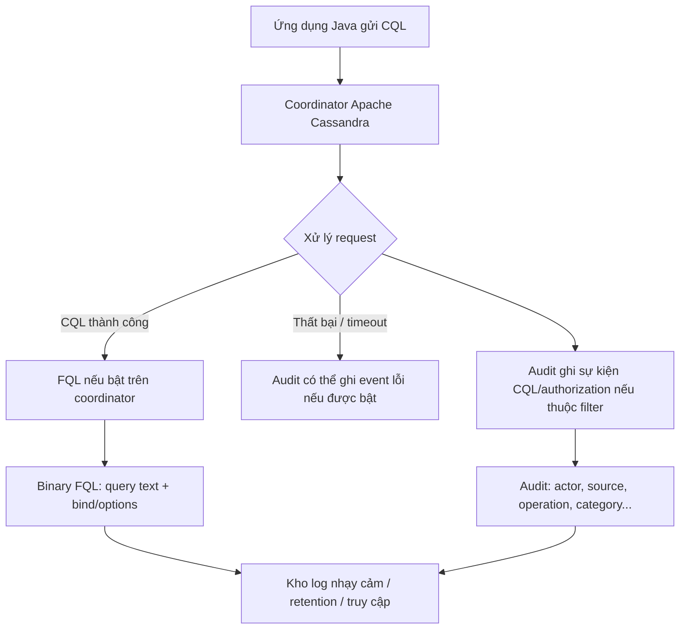
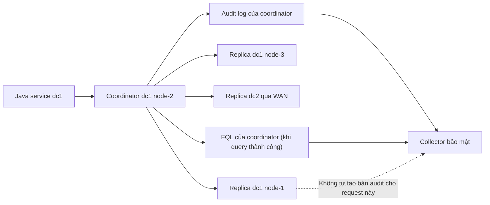
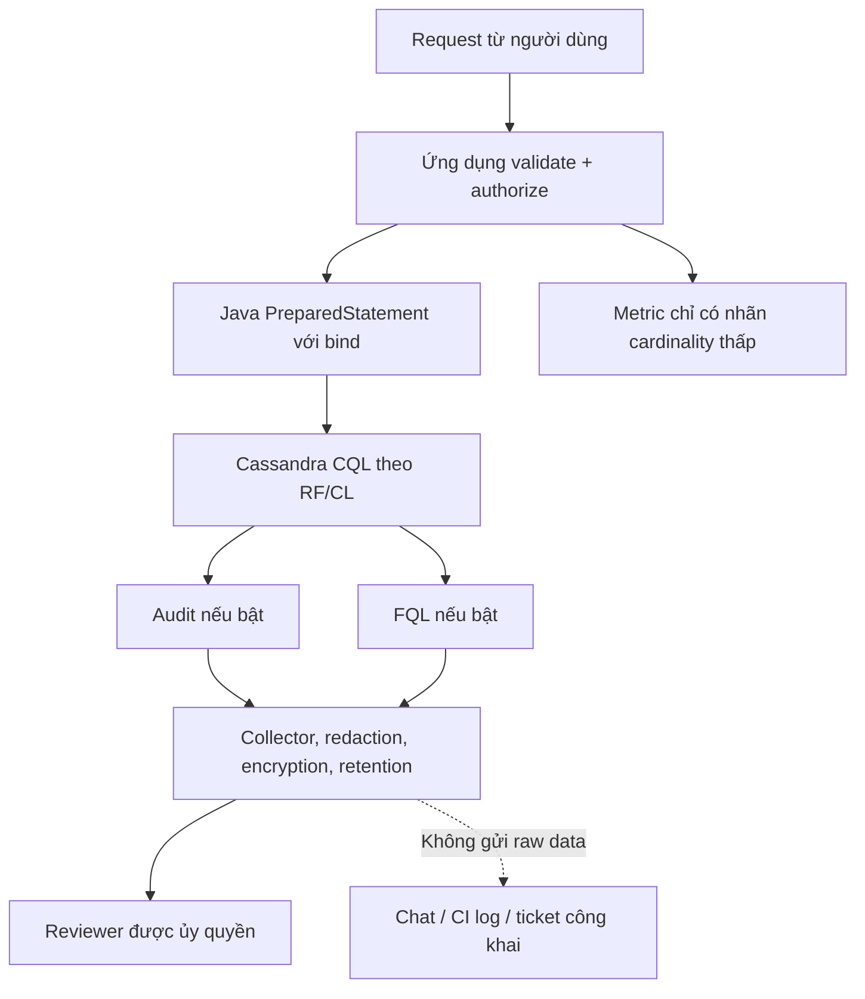

# Audit, full query logging và dữ liệu nhạy cảm theo khả năng hỗ trợ

> **Chương:** Bảo mật  
> **Học phần:** `DATABASE_ENGINE_WIDE_COLUMN_CASSANDRA` — Apache Cassandra

Một ứng dụng Java kết nối Apache Cassandra có thể đọc thông tin khách hàng, cập nhật đơn hàng, thực hiện `DELETE` hoặc gửi truy vấn quản trị. Khi có sự cố rò rỉ dữ liệu hay xóa nhầm, đội vận hành thường hỏi: **Ai đã gọi lệnh? Lệnh chạy qua node nào? Tham số nào được gửi? Lệnh thành công hay thất bại? Có thể phát lại request để tái hiện lỗi không?**

Apache Cassandra cung cấp **Audit Logging** và **Full Query Logging (FQL)** trên các phiên bản hỗ trợ. Hai cơ chế này có mục đích, dữ liệu thu thập và giới hạn khác nhau:

- **Audit Logging** thiên về truy vết hành động CQL, xác thực, phân quyền và lỗi, phục vụ kiểm tra truy cập và phân tích sự cố.
- **Full Query Logging** ghi thông tin truy vấn CQL hoàn tất thành công, gồm các tùy chọn và giá trị bind cần thiết, phục vụ phân tích tải, `dump`, `replay` và so sánh.
- **Cả hai không mặc nhiên là hệ thống giám sát bất biến hay an toàn trước truy cập trái phép**. Log có thể chứa câu lệnh, thông tin nhận dạng, khóa phân vùng, giá trị nghiệp vụ và cả dữ liệu nhạy cảm; ngoài ra log được sinh **trên từng coordinator**, không được replication theo RF của bảng.

Chủ đề thuộc học phần Cassandra phân tán theo mô hình wide-column: một partition key xác định token, replica phụ thuộc `NetworkTopologyStrategy`, còn consistency level quy định xác nhận đọc/ghi. **Cấu hình log không làm thay đổi cơ chế replica, không thay thế RBAC/TLS, backup, repair hay kiểm soát truy vấn ở Java Driver.**

Bài này tập trung vào **khả năng thực sự được hỗ trợ theo phiên bản**, cách lựa chọn Audit/FQL phù hợp nhu cầu, bảo vệ dữ liệu nhạy cảm trong pipeline, ước lượng tài nguyên và xây dựng quy trình triển khai/ứng cứu an toàn.

## 1. Bắt đầu bằng yêu cầu bảo mật, không phải bằng một cờ logging

Một số mục đích thường gặp:

| Mục đích | Dữ liệu tối thiểu cần có | Nguồn ưu tiên | Giới hạn phải công bố |
| --- | --- | --- | --- |
| Phát hiện đăng nhập sai hoặc truy cập trái phép | User, nguồn kết nối, thời điểm, loại lỗi xác thực/phân quyền | **Audit Logging**, cộng log xác thực/hạ tầng | Không phải tất cả hành động JMX, OS hay chỉnh tệp cấu hình đều được audit CQL ghi. |
| Truy vết ai gửi `DROP TABLE`, `TRUNCATE`, `GRANT` | CQL operation, user, thời điểm, coordinator, scope | **Audit Logging** | Cần bật trên các node có thể làm coordinator và lưu log bền vững. |
| Tái hiện query load để benchmark nâng cấp | CQL, bind values, query options, thời gian gần đúng | **FQL** trong thời gian kiểm soát | Không có failed/time-out queries; replay có thể thay đổi dữ liệu và lộ thông tin. |
| Điều tra query chậm hoặc nhiều tombstone | Query ID, latency, CL, table, metrics/tracing | Metrics, Java Driver, tracing có chọn lọc; FQL khi phù hợp | FQL không tự cung cấp p99 nguyên nhân, không thay thế metrics. |
| Đáp ứng quy định lưu dấu dài hạn | Phạm vi sự kiện, integrity, retention, truy cập, chống mất log | Audit + collector/kho bất biến theo chính sách | Log local có thể bị xoay/xóa; audit không đồng nghĩa bằng chứng không thể sửa. |
| Điều tra giá trị tham số cụ thể | Bind values hoặc event payload có quyền kiểm tra | FQL/CDC/event log **nếu được phép** | Giá trị bind chính là dữ liệu nhạy cảm; không thu chỉ vì “để phòng khi cần”. |
| Xác định dữ liệu cuối cùng của một partition | Primary key, CQL read theo CL, replica/repair | CQL, backup, audit/event provenance | Log request **không phải** nguồn dữ liệu logic hiện hành hoặc bằng chứng giao dịch đã durable ở mọi replica. |

Nguyên tắc **data minimization**: chỉ thu **những trường cần thiết, trong thời gian cần thiết, với phạm vi người được phép**. Bật FQL trên toàn cụm và giữ vô thời hạn để trả lời một câu hỏi về DDL thường là quá rộng, tốn kém và làm tăng bề mặt rò rỉ.

## 2. Ma trận phiên bản và môi trường hỗ trợ

Tài liệu Apache Cassandra mô tả **Audit Logging** (CASSANDRA-12151) và **Full Query Logging** (CASSANDRA-13983) là tính năng được giới thiệu trong **Apache Cassandra 4.0**.

| Môi trường | Audit Logging tích hợp | FQL tích hợp | Điều cần kiểm tra |
| --- | --- | --- | --- |
| **Apache Cassandra 3.11 và cũ hơn** | Không phải tính năng tích hợp theo cơ chế 4.0 đang nói đến | Không phải tính năng tích hợp 4.0 | Dùng giải pháp logging/kiểm toán phù hợp bản và ứng dụng; không chạy lệnh 4.0+ theo suy đoán. |
| **Apache Cassandra 4.0 / 4.1** | Có, cấu hình theo bản | Có, `nodetool enablefullquerylog` | Syntax, class logger, path, option, JDK và quyền JMX thực tế. |
| **Apache Cassandra 5.0.x** | Có | Có | Đối chiếu đúng tài liệu release/patch, cấu hình và các giới hạn CLI/JMX. |
| **Phiên bản mới hơn hoặc phân phối vendor/managed** | Có thể có thêm/bớt tính năng hoặc thay đổi cách cấu hình | Có thể bị giới hạn hoặc dùng pipeline riêng | Tài liệu vendor, quyền operator, policy bảo mật và khả năng xuất log. |

**Không dùng tên trang “latest” làm bằng chứng cluster của bạn chạy cùng phiên bản.** Trước khi bật/tắt tính năng:

```bash
# Quan sát, không thay đổi hệ thống:
nodetool version
nodetool status

# Dùng binary đúng phiên bản để xem option thực tế:
nodetool help enableauditlog
nodetool help enablefullquerylog
nodetool help disableauditlog
nodetool help disablefullquerylog
```

Nếu đang rolling upgrade, các node có thể khác version và khác khả năng log. Đừng áp dụng một lệnh quản trị không được bản đó hỗ trợ, rồi kết luận đã có coverage toàn cụm.

## 3. Audit Logging thu những gì?

Audit Logging ghi các sự kiện CQL đã thử/thành công và lỗi, bao gồm các hoạt động **xác thực/ủy quyền** theo khả năng triển khai và bộ lọc đã cấu hình. Mỗi mục có thể mang các trường:

- **User** đã xác thực (nếu có), địa chỉ nguồn/port và coordinator.
- **Timestamp** sự kiện, loại hành động, category và scope (keyspace/table/function...).
- **Operation** hoặc statement CQL; thông tin batch/options tùy sự kiện.
- **AUTH/ERROR** events, chẳng hạn login success/login error hoặc unauthorized attempt, nếu không bị lọc.
- Tập các trường chính xác phụ thuộc vào logger/version và loại sự kiện. Không thiết kế parser theo việc *mọi* dòng đều có đủ mọi thuộc tính.

Nhóm category thường được tài liệu mô tả:

| Category | Một số trường hợp | Vì sao quan trọng? |
| --- | --- | --- |
| `AUTH` | Login thành công/thất bại, truy cập không được phép | Phát hiện abuse, brute force, credentials đã thu hồi. |
| `DCL` | `CREATE ROLE`, `ALTER ROLE`, `GRANT`, `REVOKE` | Thay đổi quyền; phục vụ hậu kiểm đặc quyền. |
| `DDL` | `CREATE TABLE`, `ALTER TABLE`, `DROP`, `TRUNCATE` | Thay schema hoặc xóa dữ liệu diện rộng. |
| `DML` | Cập nhật, xóa, batch và những mutation tương ứng | Điều tra hành động làm thay đổi dữ liệu. |
| `QUERY` | `SELECT` | Kiểm tra đường đọc có truy cập dữ liệu nhạy cảm. |
| `PREPARE` | Chuẩn bị statement | Truy vết truy vấn được prepare, không nhất thiết mỗi giá trị bind. |
| `ERROR` | Request failure | Điều tra thao tác lỗi và các yêu cầu bị từ chối. |
| `OTHER` | Những lệnh CQL phụ trợ | Không nên mặc định mọi loại khác đều không quan trọng. |

Với **prepared statements**, tài liệu audit logging nêu rằng có thể ghi **câu CQL đã prepare nhưng không hiển thị giá trị bind thực tế của mỗi lần EXECUTE**. Ngược lại, câu lệnh dùng **literal trực tiếp** (ví dụ `WHERE email = '...'`) có thể để lộ literal trong operation.

**Audit không ghi mọi thao tác quản trị.** Tài liệu chính thức nêu rõ nó **không** bao gồm sửa `cassandra.yaml` và những lệnh `nodetool`. Vì vậy nếu mục tiêu là kiểm toán cấu hình, JMX, thay đổi hạ tầng hoặc thao tác hệ điều hành, phải bổ sung OS audit logs, change management, secret manager và log công cụ quản trị.

### 3.1. Một audit event có thể nói được điều gì?

Ví dụ dòng **giả lập**, không phải định dạng cố định:

```text
timestamp=2026-11-21T10:00:00Z
user=orders_readonly
source=192.0.2.25
category=QUERY
scope=commerce.orders_by_customer_month
operation=SELECT ... WHERE tenant_id=? AND customer_id=?
coordinator=node-dc1-02
```

Dòng này có ích để xác định **ai/ở đâu/loại lệnh gì**. Nó **không** tự chỉ ra giá trị `customer_id` bind, số hàng trả về, toàn bộ nội dung response, hay dữ liệu đã tồn tại trên mọi replica. Nếu hệ thống dùng `AllowAllAuthenticator` và cho phép anonymous, trường user còn không đủ để quy cho một cá nhân; muốn audit có ý nghĩa phải triển khai authentication/authorization thích hợp.

### 3.2. Mật khẩu có được tự động bảo vệ?

Audit Logging có cơ chế che (*obfuscate*) mật khẩu trong các câu DCL mà parser nhận diện đúng. Tuy nhiên tài liệu cảnh báo **lệnh bị gõ sai hoặc token `password` không được nhận diện đúng có thể xuất hiện mà không bị che**. Không dựa vào biện pháp này để cho phép viết secret vào CQL, query string, thông báo lỗi hoặc comment.

Đây là một trong nhiều lý do log cần được xếp là **dữ liệu nhạy cảm**, dù log không phải bảng chứa nghiệp vụ.

## 4. Full Query Logging ghi những gì và vì sao nhạy cảm hơn?

FQL ghi các request CQL **hoàn tất thành công** sau khi chúng kết thúc, để có thể đọc, replay hoặc so sánh. Theo tài liệu Apache Cassandra, bản ghi có thể chứa:

- CQL **query text** hoặc danh sách queries trong batch.
- **Query options** (ví dụ những thông số cần thiết của request).
- **Bind values** dùng cho các dấu `?` trong prepared statement.
- Query state/timestamp gần đúng và thông tin bổ trợ của single query/batch.
- Phần dữ liệu cần thiết cho các công cụ `fqltool dump`, `fqltool replay`, `fqltool compare`.

FQL không được thiết kế để ghi những CQL request **thất bại hoặc timeout**, và không ghi login failure như Audit Logging. Đây là lý do **không chọn FQL làm bằng chứng duy nhất** cho việc người dùng có cố truy cập trái phép, việc DELETE thất bại ra sao hoặc hệ thống có bỏ lỡ request nào không.



**FQL có thể làm lộ dữ liệu mà Audit cố tình không lưu.** Một request Java:

```sql
SELECT status
FROM commerce.orders_by_customer_month
WHERE tenant_id = ?
  AND customer_id = ?
  AND order_month = ?;
```

Nếu bind gồm tenant/customer ID thật, những giá trị đó có thể xuất hiện trong **FQL**, dù câu CQL hiển thị `?`. Không có bảo đảm mặc định rằng FQL tự băm, ẩn danh hoặc mã hóa mọi trường nghiệp vụ cho bạn.

### FQL không phải CDC hoặc backup

- FQL chỉ phản ánh CQL đã được ghi nhận theo cơ chế của nó, **không phải một changelog bất biến và đầy đủ mọi mutation**.
- Request đã thành công về phía coordinator vẫn cần xem RF/CL, hints và repair nếu muốn xác nhận replica khác đã theo kịp.
- Replay toàn bộ query có thể gửi lại **counter increment**, `INSERT` với TTL mới, `DELETE`, `TRUNCATE`, LWT hoặc các truy vấn được phép sửa dữ liệu; đó không phải lệnh khôi phục.
- FQL **không ghi dữ liệu trong response** và không thay thế snapshot/commit-log archive cho PITR.
- Một số truy vấn có giá trị bind chứa thông tin nhạy cảm hoặc thuộc một người dùng có quyền đã hết hiệu lực; replay có thể tiết lộ dữ liệu hoặc vượt phạm vi phê duyệt ban đầu.

**Quy tắc:** `fqltool replay` phải chỉ chạy trên môi trường **cách ly, dữ liệu đã xử lý nhạy cảm và đã được phê duyệt**, với tài khoản/quyền giới hạn. Không replay raw logs vào production.

## 5. Sự khác nhau quan trọng nhất giữa Audit và FQL

| Khía cạnh | Audit Logging | Full Query Logging |
| --- | --- | --- |
| Giới thiệu trong OSS | Apache Cassandra 4.0+ | Apache Cassandra 4.0+ |
| Mục tiêu chính | Truy vết truy cập/CQL/auth, compliance, investigation | Thu query traffic, benchmark, replay, compare |
| CQL thành công | Có nếu loại sự kiện nằm trong phạm vi audit | Có nếu FQL bật và record được ghi thành công |
| CQL thất bại, bị từ chối | Có theo category/filter/version | **Không phải nguồn để lấy failed/timed-out requests** |
| Authentication events | Có `AUTH` nếu không loại trừ | Không |
| DCL/DDL | Có category/scope/actor | Query CQL thành công có thể xuất hiện |
| Query text | Có operation | Có query text |
| **Prepared bind values** | Thường **không** hiện trong audit của prepared statement | **Có thể được lưu** cho replay |
| Log replication theo RF | **Không**; ghi trên coordinator | **Không**; ghi trên coordinator |
| Công cụ đọc | `auditlogviewer` cho `BinAuditLogger`; text nếu `FileAuditLogger` | `fqltool dump` |
| Công cụ replay | Không phải mục tiêu | `fqltool replay/compare`, **chỉ trên lab/cụm cách ly** |
| Chọn lọc theo user/ks/category | Có filter audit theo tài liệu | FQL chủ yếu theo node; không giả định có filter tương tự Audit |
| Rủi ro dữ liệu nhạy cảm | Query literals, user/IP, role/scope, operation | Query text **và giá trị bind**, có thể giàu dữ liệu hơn |
| Tác động khi queue đầy | `block`: chặn writer hoặc rơi record | `block`: chặn writer hoặc rơi record |
| Độ bền lưu trữ | File local, cần archive/cơ chế bảo vệ riêng | File local, cần archive/retention riêng |

Không có cấu hình “Audit = FQL nhưng an toàn hơn”. Chúng trả lời những câu hỏi khác nhau. Có thể bật cả hai khi cần, nhưng phải tính **gấp đôi nguồn log, chi phí vận hành và chính sách phân quyền khác biệt**.

## 6. Cấu hình Audit Logging an toàn trên phiên bản hỗ trợ

### 6.1. Ví dụ `cassandra.yaml` trên lab

Dưới đây là **mẫu tham khảo cho Cassandra 5.0**, không phải cấu hình mặc định nên chép vào production. Các đường dẫn phải được tạo sẵn với quyền phù hợp và **không chứa dữ liệu có sẵn cần bảo tồn**.

```yaml
# cassandra.yaml — LAB có quyền quản trị, chỉ khi binary hỗ trợ.
audit_logging_options:
    enabled: true
    logger:
      - class_name: BinAuditLogger
    audit_logs_dir: /var/lib/cassandra-secure/audit
    excluded_keyspaces: system, system_schema, system_virtual_schema
    roll_cycle: HOURLY
    block: true
    max_queue_weight: 268435456
    max_log_size: 17179869184
    # archive_command: /path/to/approved-archive-script %path
```

Ý nghĩa:

- `enabled: true` cho phép bật khi khởi động node; `nodetool enableauditlog` có thể bật/override tùy chọn runtime theo phiên bản.
- `BinAuditLogger` là logger binary dựa trên Chronicle Queue, thường phù hợp throughput hơn kiểu file log đồng bộ; `FileAuditLogger` có thể xuất văn bản theo cấu hình `logback.xml` và mang đặc điểm vận hành khác.
- `excluded_keyspaces` thường mặc định loại các keyspace hệ thống; nếu thay đổi filter, cần kiểm tra cả category `AUTH`/`DCL` được ghi theo chính sách.
- `block: true` ưu tiên **không rơi record khi queue đầy** nhưng có nguy cơ **gây backpressure cho query** nếu disk/archive chậm.
- `max_queue_weight` là giới hạn bộ nhớ cho queue (bytes), không phải số hàng CQL.
- `max_log_size` là dung lượng rolled logs giữ cục bộ khi dùng cơ chế xoay/xóa mặc định; nếu thiết lập `archive_command`, theo tài liệu giá trị này có thể **không còn quyết định retention cục bộ**.

**Bảo mật thư mục:** các directory audit/FQL phải thuộc user chạy Cassandra, không được world-readable, có filesystem permission/ACL, có chính sách mã hóa, monitoring và quota phù hợp. Tài liệu hướng dẫn demo đôi khi dùng permission rộng cho tiện thử; **không dùng permission đó trên production**.

### 6.2. Lệnh bật/tắt Audit theo node

```bash
# Lệnh THAY ĐỔI trạng thái logging: chỉ trên lab hoặc change đã phê duyệt.
nodetool enableauditlog

# Khi dừng thu audit theo yêu cầu đã duyệt:
nodetool disableauditlog

# Xem các option và filter chính xác của binary:
nodetool help enableauditlog
```

Cấu hình `cassandra.yaml` và lệnh runtime có thể khác nhau. Nếu audit là control bắt buộc theo compliance, không được tự disable nó để “giảm load” mà không có phương án ghi bằng chứng thay thế và phê duyệt của chủ sở hữu control.

**Nếu rolling restart:** cần xác nhận cấu hình bền vững qua lần khởi động tiếp; thay đổi runtime không luôn đồng nghĩa đã cập nhật file cấu hình và mọi node.

## 7. Cấu hình FQL: đường dẫn log có khả năng bị xóa

Đây là điểm an toàn quan trọng nhất của FQL: tài liệu Apache mô tả rằng **đường dẫn `log_dir` có thể bị xóa nội dung đệ quy khi khởi tạo lại FQL**, và `nodetool enablefullquerylog --path <path>` cũng cảnh báo path **sẽ bị xóa nội dung**.

**Không bao giờ** trỏ `--path` vào:

- Root dữ liệu Cassandra (`data_file_directories`), `commitlog_directory`, hints hay snapshots.
- Thư mục backup, audit log, thư mục home hoặc thư mục log dùng chung.
- Thư mục có symlink dẫn tới dữ liệu khác hoặc nơi lưu bằng chứng forensic cần giữ.
- Đường dẫn chưa được người trực xác nhận là **chỉ dành riêng cho FQL và có thể reset an toàn**.

### 7.1. Mẫu `cassandra.yaml` (tham khảo)

```yaml
# Chỉ cấu hình trên bản hỗ trợ và directory dành riêng cho FQL.
full_query_logging_options:
    log_dir: /var/lib/cassandra-secure/fql
    roll_cycle: HOURLY
    block: true
    max_queue_weight: 268435456
    max_log_size: 17179869184
    # archive_command: /path/to/approved-archive-script %path
```

FQL cần **cấu hình + thao tác enable**:

```bash
# THAO TÁC CÓ TÁC ĐỘNG: chỉ trên lab được phê duyệt,
# khi directory chỉ chứa FQL và không cần giữ nội dung cũ.
nodetool enablefullquerylog --path /var/lib/cassandra-secure/fql

# Tắt FQL sau cửa sổ capture đã định:
nodetool disablefullquerylog

# Dòng sau dùng để xem help, không bật logging:
nodetool help enablefullquerylog
```

Cả `audit_logging_options` và `full_query_logging_options` áp dụng **trên từng node**; để thu đủ request từ cả cluster, phải triển khai/giám sát trên tất cả **coordinator có thể nhận client traffic** theo topology.

### 7.2. Không dùng `resetfullquerylog` như cách dọn đĩa tùy tiện

`nodetool resetfullquerylog` là lệnh quản trị với mục đích xóa/reset dữ liệu FQL trên disk theo phiên bản. Trong incident, nó có thể **xóa bằng chứng cần điều tra**, cũng như mọi thao tác dọn directory thủ công. Chỉ thực hiện khi chủ dữ liệu đã phê duyệt retention, kiểm tra bản archive/backup và có audit trail.

### 7.3. Xem log với công cụ hỗ trợ

```bash
# Dùng bản công cụ tương thích; nên phân tích bản sao log ở khu vực bảo vệ.
auditlogviewer /var/lib/cassandra-secure/audit
fqltool dump /var/lib/cassandra-secure/fql

# Đọc usage trước khi thử các subcommand có khả năng replay:
fqltool --help
```

`auditlogviewer` dùng khi Audit được ghi bằng `BinAuditLogger`; với `FileAuditLogger` thì file là text và xử lý qua pipeline log tương ứng. `fqltool dump` có thể in bind values ra terminal và khiến chúng rò qua shell history, screen recording, tập tin redirect hoặc hệ thống thu log tập trung. **Không dump raw FQL lên CI logs, chat, issue công khai hay kênh hỗ trợ không được phép.**

`fqltool replay` và `compare` có mục tiêu phát lại/đối chiếu workload; bản thân `compare` cũng có thể xử lý query/result file chứa dữ liệu nhạy cảm. Nếu cần sử dụng, phải kiểm tra help đúng version và chạy trong **test cluster cách ly** đã được làm sạch dữ liệu.

## 8. Bảo vệ dữ liệu nhạy cảm: coi log là một cơ sở dữ liệu phụ

### 8.1. Dữ liệu nào có thể lộ?

| Kiểu dữ liệu | Rủi ro trong Audit/FQL | Kiểm soát nên có |
| --- | --- | --- |
| User, source IP, port, thời gian truy cập | Có thể liên kết với một người hoặc thiết bị | Giới hạn người xem, retention và mục đích sử dụng. |
| `tenant_id`, `customer_id`, email trong query | Audit lưu **literal** nếu query viết trực tiếp; FQL có thể lưu **bind values** | Prepared statements, tokenization/masking ở pipeline và FQL chỉ bật khi cần. |
| Password/API token/session key | Có thể xuất hiện trong DCL sai cú pháp, câu CQL, bind, lỗi hoặc trace | Không đưa secret vào query text/log; redaction trước khi export và rotation khi nghi ngờ lộ. |
| Dữ liệu bệnh án/thanh toán/payload cá nhân | Nếu xuất hiện trong `INSERT/UPDATE` bind hoặc literal, FQL có thể ghi | Data classification, quyền tối thiểu, encryption-at-rest, hạn chế dump/replay. |
| Tên bảng, schema, cấu trúc tổ chức | Cho thấy các đối tượng nhạy cảm và surface của ứng dụng | Phân tách production/lab, RBAC cho log, hạn chế chia sẻ. |
| Query response/result set | FQL không được dùng như kho response | Muốn đối soát kết quả cần hệ thống riêng và chính sách dữ liệu riêng. |

**Prepared statements không “ẩn dữ liệu” khỏi FQL.** Chúng giúp tránh ghép literal vào chuỗi CQL và cải thiện an toàn truy vấn, nhưng FQL có thể lưu giá trị tham số để replay. Ngược lại, Audit không đảm bảo che mọi literal do người viết câu query nhúng trực tiếp.

### 8.2. Các kiểm soát tối thiểu trên pipeline

1. **Mã hóa khi truyền/ở nơi lưu:** TLS tới collector, encryption-at-rest và key management của storage. Không mặc định file Chronicle Queue đã tự được mã hóa vì nó ở dạng binary.
2. **RBAC và phân tách nhiệm vụ:** DBA có quyền vận hành cluster không đương nhiên cần xem PII trong FQL. Audit reviewer, incident responder và admin backup có quyền độc lập theo nhu cầu.
3. **Retention cố định:** ngắn cho FQL raw, phù hợp hợp đồng/đòi hỏi compliance cho Audit, có cơ chế purge và legal hold được quản lý.
4. **Tính toàn vẹn:** upload log từ nhiều node về kho bền vững với checksums, time source thống nhất, append-only/WORM nếu cần, và audit mọi thao tác đọc/xóa/export.
5. **Giới hạn nguồn:** filter Audit theo keyspace/category/user; với FQL, cân nhắc chỉ bật **trong cửa sổ capture ngắn trên phạm vi node được phê duyệt** và kiểm tra trước tính đại diện của mẫu.
6. **Không lưu secrets trong query/log:** sử dụng vault/secret manager; hạn chế ghi raw request/exception trong ứng dụng Java.
7. **Quy trình ứng cứu rò rỉ:** phát hiện raw dump, thu hồi chia sẻ, xem ai tải log, rotate secret có khả năng lộ và thông báo theo chính sách.
8. **Xóa an toàn khi hết hạn:** đảm bảo archive, bản sao, backups, object versions và temp files cũng tuân theo retention; “đã xóa log gốc” chưa có nghĩa mọi bản sao biến mất.

### 8.3. Audit không thay thế authorization

Bật Audit Logging **không thực thi quyền**. Để ngăn truy cập trái phép, cần cấu hình authenticator/authorizer thích hợp (ví dụ cơ chế mật khẩu/role theo Cassandra hỗ trợ), RBAC, network isolation, TLS và bảo vệ JMX. Nếu hệ thống vẫn cho phép anonymous hoặc tất cả role đều có đặc quyền rộng, log tốt chỉ giúp nhìn thấy việc truy cập **sau khi đã xảy ra**.

Với CQL, `GRANT`/`REVOKE` giới hạn tài nguyên và loại quyền; điều này là **kiểm soát ngăn ngừa**, Audit là **kiểm soát phát hiện**, còn log retention/integrity là **kiểm soát bằng chứng**. Ba mục tiêu khác nhau, phải được thiết kế cùng nhau.

## 9. Số liệu hóa dung lượng, tài nguyên và đánh đổi `block`

Không nên bật FQL trên tất cả node rồi chỉ kiểm tra dung lượng sau một tuần. Đặt ngân sách trước khi dùng:

\[
V_{\text{log,day}} \approx
QPS_{\text{captured}} \times S_{\text{log-record}} \times 86\,400
\]

Trong đó `QPS_captured` là số event ghi được trên **các coordinator có bật logging**, `S_log-record` là trung bình byte **đã đo** bao gồm query text, bind/options và overhead ghi file.

Ví dụ **minh họa**, tổng 2.000 request/s được ghi, trung bình mỗi FQL record chiếm 600 byte:

\[
2{,}000 \times 600 \times 86\,400
= 103{,}680{,}000{,}000\text{ byte}
\approx 103.68\ \text{GB/ngày}
\]

Nếu giữ bảy ngày, cần khoảng **725,76 GB** trước các hệ số bổ sung cho index/metadata, archive, tốc độ peak và an toàn disk. Đừng xem `max_log_size` như backup/retention guarantee: khi đạt trần, segment cũ có thể bị xóa và archived segments được xử lý theo chính sách khác.

| Tham số | Nếu chọn như thế nào? | Rủi ro |
| --- | --- | --- |
| `block: true` | Producer chờ khi queue không theo kịp, bảo toàn cơ hội ghi event | **Có thể tăng latency hoặc tác động availability** khi disk/archive chậm. |
| `block: false` | Không chặn query vì queue đầy, có thể drop record | **Mất coverage**; không phù hợp nếu compliance yêu cầu đủ sự kiện. |
| `max_queue_weight` | Tăng giúp hấp thụ burst có giới hạn | Ngốn memory, chỉ trì hoãn sự cố disk/network, không giải quyết backlog vô hạn. |
| `max_log_size` | Giới hạn rolled segments khi không dùng archive tương ứng | Có thể xóa bằng chứng cũ; không quyết định retention archive khi `archive_command` bật. |
| `roll_cycle` | Quyết định chu kỳ segment roll | Đổi trên directory Chronicle Queue đã có dữ liệu cần quy trình riêng; không đổi tùy tiện. |
| `archive_command` | Đẩy rolled segments tới nơi lưu bền vững theo script | Archive chậm/lỗi có thể gây backlog, retention và lỗi quản trị; phải test. |

**Theo dõi đúng dữ liệu:** heap/GC, queue fullness, số record rơi nếu collector/logging cung cấp, disk usage/inode, archive command failures, upload latency, timestamp mới nhất, p99 CQL và hoạt động của mọi node. Một dashboard chỉ hiện “logging enabled” không chứng minh có đủ event trong kho tập trung.

### 9.1. `block: true` có phải giải pháp tuân thủ hoàn hảo?

Không. Nó bảo vệ trước việc **tự nguyện rơi record khi queue đầy**, nhưng nếu disk hỏng, node chết hoặc log chưa được archive thì vẫn có rủi ro mất bằng chứng. Đối với compliance nghiêm ngặt, phải thiết kế **end-to-end** từ request → coordinator local log → archive bền vững → kiểm tra integrity → retention, cùng quy trình phản ứng khi một mắt xích hỏng.

Mặt khác, nếu không thể chấp nhận việc log storage làm ngừng giao dịch quan trọng, cần quyết định ranh giới *availability vs completeness* ở cấp chính sách, không tự đổi sang `block: false` lúc incident mà không có phê duyệt.

## 10. Multi-DC: vì sao RF=3 không nhân ba số bản ghi audit?

Trong Cassandra, một request thường đi vào **coordinator**, coordinator phân phối mutation/read tới replica và đợi ACK theo CL. **Audit/FQL được tạo trên coordinator có bật tính năng**, không ghi thêm bản audit trên mỗi replica chỉ vì RF=3.



Hệ quả vận hành:

- **Chỉ bật audit trên một node** không thu tất cả request có thể được driver chọn coordinator trên những node khác.
- **Bật trên tất cả node** tạo coverage rộng hơn, nhưng cần collector gom theo `cluster/DC/host_id`, giữ timestamp và tránh phân tích sai khi request được retry trên coordinator khác.
- Mỗi client retry có thể tạo **nhiều request attempts**, nên audit log có thể chứa nhiều bản ghi cùng query/người dùng. Không dùng số dòng log làm số giao dịch nghiệp vụ duy nhất.
- Nếu một node bị mất disk trước khi archive, **replica của dữ liệu CQL không mang theo audit log tương ứng**. Phải có hệ thống export độc lập.
- Với `LOCAL_QUORUM`, coordinator có thể trả thành công khi chỉ một phần replica local xác nhận, vì thế một audit event “đã gửi lệnh” không chứng minh DC khác đã nhận mọi mutation.
- Nếu có nhiều DC, thiết kế collector **theo yêu cầu cư trú dữ liệu (data residency)**: không tự upload raw FQL chứa PII từ DC này sang region khác chỉ vì nơi lưu rẻ hơn.

## 11. Ví dụ CQL: tạo sự kiện mẫu và phân quyền trong lab

Tài liệu kiểm toán có thể được học bằng một workload **không chứa dữ liệu thật**. Trên cụm LAB Cassandra 4.0+ có Audit/FQL được phê duyệt:

```sql
-- Giả định LAB có ba node dc1. Không dùng nguyên xi trên production.
CREATE KEYSPACE IF NOT EXISTS security_lab
WITH replication = {
    'class': 'NetworkTopologyStrategy',
    'dc1': 3
};

CREATE TABLE IF NOT EXISTS security_lab.events_by_tenant (
    tenant_id text,
    event_day date,
    event_id uuid,
    category text,
    PRIMARY KEY ((tenant_id, event_day), event_id)
);

INSERT INTO security_lab.events_by_tenant
    (tenant_id, event_day, event_id, category)
VALUES (
    'demo-tenant', '2026-11-21',
    11111111-1111-4111-8111-111111111111,
    'demo-access'
);

SELECT category
FROM security_lab.events_by_tenant
WHERE tenant_id = 'demo-tenant'
  AND event_day = '2026-11-21'
  AND event_id = 11111111-1111-4111-8111-111111111111;
```

Thao tác DCL minh họa, chỉ trên lab được cấu hình authenticator/authorizer phù hợp và tài khoản quản trị được cấp quyền:

```sql
-- Role không có LOGIN, dùng để nhóm quyền, không cần mật khẩu.
CREATE ROLE IF NOT EXISTS security_lab_reader WITH LOGIN = false;

GRANT SELECT
ON TABLE security_lab.events_by_tenant
TO security_lab_reader;
```

Những câu này có thể tạo Audit DDL/DML/QUERY/DCL events theo category, user, bộ lọc và vị trí coordinator. FQL sẽ chỉ lưu những **CQL requests thành công** mà nó ghi nhận khi được bật. **Không dùng câu DCL chứa mật khẩu thật để “test masking”**.

Nếu bạn không thấy log, trước tiên kiểm tra:

1. Audit/FQL có bật trên **coordinator thực sự nhận request** không?
2. Category/keyspace/user có bị filter của Audit loại trừ không?
3. CQL request thành công hay lỗi? FQL không phải log failed requests.
4. Đã đạt thời điểm roll/flush log, disk/queue/archiver khỏe, quyền directory đúng chưa?
5. Viewer có dùng đúng version và `roll_cycle` của binary logs không?

## 12. Java Driver 4.x: dùng prepared statements và logging tối thiểu

Ví dụ ứng dụng đọc theo đúng partition key, không ghép literal chứa tenant/customer vào chuỗi CQL:

```java
import java.time.LocalDate;
import java.util.UUID;
import java.util.concurrent.TimeUnit;
import java.util.logging.Level;
import java.util.logging.Logger;

import com.datastax.oss.driver.api.core.CqlSession;
import com.datastax.oss.driver.api.core.DefaultConsistencyLevel;
import com.datastax.oss.driver.api.core.DriverException;
import com.datastax.oss.driver.api.core.cql.PreparedStatement;
import com.datastax.oss.driver.api.core.cql.Row;

public final class SecureAuditProbe {
    private static final Logger LOG =
        Logger.getLogger(SecureAuditProbe.class.getName());

    private final CqlSession session;
    private final PreparedStatement read;

    public SecureAuditProbe(CqlSession session) {
        this.session = session;
        this.read = session.prepare(
            "SELECT category FROM security_lab.events_by_tenant " +
            "WHERE tenant_id = ? AND event_day = ? AND event_id = ?");
    }

    public String readCategory(String tenantId, LocalDate day, UUID eventId) {
        long startedNanos = System.nanoTime();
        try {
            Row row = session.execute(
                read.bind(tenantId, day, eventId)
                    .setConsistencyLevel(DefaultConsistencyLevel.LOCAL_QUORUM)
                    .setIdempotent(true)
            ).one();
            return row == null ? null : row.getString("category");
        } catch (DriverException e) {
            // Không log raw CQL/bind values/tenantId/credential/payload.
            LOG.log(Level.WARNING,
                "Cassandra read failed: " + e.getClass().getSimpleName());
            throw e;
        } finally {
            long elapsedMs = TimeUnit.NANOSECONDS.toMillis(
                System.nanoTime() - startedNanos);
            // Production: histogram/tag query-template-id, không in từng call.
            LOG.log(Level.FINE, "read_by_partition_ms=" + elapsedMs);
        }
    }
}
```

**Giải thích bảo mật:**

- Prepared statement giảm nguy cơ tạo CQL bằng cách nối dữ liệu không tin cậy. Nó **không** làm FQL bỏ qua những bind values cần để replay.
- Java chỉ log **loại lỗi và latency**, không ghi `tenantId`, `eventId`, payload hoặc query raw. Trong thực tế, còn kiểm soát stack trace, request interceptor và tracing tích hợp của driver.
- `LOCAL_QUORUM` là quyết định tính nhất quán; **không** có nghĩa log được nhân bản tới quorum replica.
- `setIdempotent(true)` phù hợp `SELECT` minh họa, không tự áp dụng cho counter, LWT hoặc mutation có side effect.
- `CqlSession` phải cấu hình local DC, authentication và TLS đúng; không hardcode mật khẩu hoặc token trong mã nguồn.
- Log event của ứng dụng có thể cần **correlation ID** được tạo ngoài payload; nếu muốn nối với audit, phải tính khả năng audit không lưu đầy đủ ID ứng dụng.

### Chặn dữ liệu nhạy cảm ở nhiều tầng



Nếu quyền riêng tư yêu cầu không thu raw PII, **đừng chỉ dựa vào redaction sau khi FQL đã ghi trên local disk**: dữ liệu đã từng tồn tại ở đó. Cân nhắc không bật FQL, sử dụng dữ liệu đã giả lập/synthetic, hoặc triển khai giải pháp thu query aggregate không chứa bind values thay thế.

## 13. Runbook triển khai: từ yêu cầu đến bằng chứng hoạt động

### Pha A — thiết kế trước triển khai

1. Xác định **mục tiêu**: audit compliance, DCL investigation hay replay benchmark.
2. Phân loại keyspace và cột nhạy cảm; chốt quyền xem log, storage region, retention, legal hold và cách xóa.
3. Kiểm tra phiên bản Cassandra, binary `nodetool`/viewer, các logger được hỗ trợ, khả năng managed service.
4. Chọn **Audit** nếu cần AUTH/ERROR/DDL/DCL, chỉ chọn **FQL** khi có nhu cầu thực sự với bound values/replay.
5. Tính peak log throughput, disk headroom, queue weight, chi phí archive, tình huống collector không sẵn và chính sách `block`.
6. Chuẩn bị directory **riêng biệt và rỗng**; kiểm tra ownership/ACL, không symlink, encryption, cấu hình backup/archive.
7. Đặt owner, change ticket, thời gian capture, điều kiện dừng, rollback và bằng chứng cần lưu.

### Pha B — canary có kiểm soát

1. Cấu hình một node/lab phù hợp (hoặc phạm vi nhỏ trong production nếu được duyệt) với directory và filter.
2. Bật Audit và/hoặc FQL bằng đúng cơ chế phiên bản.
3. Gửi các request **giả lập**: SELECT theo partition key, INSERT demo, DCL không chứa secret, một lỗi truy vấn có kiểm soát.
4. Đọc **bản sao** audit/FQL logs bằng viewer, xác minh nội dung thành công/thất bại và bind values đúng kỳ vọng.
5. Theo dõi p95/p99 CQL, error rate, disk free, queue/backpressure và exporter.
6. Chỉ mở rộng khi không có secret ngoài dự tính, không mất coverage bắt buộc và có phương án archive bền vững.

### Pha C — rollout toàn cụm

1. Triển khai theo node/DC/rack có tính tới CL/quorum; việc bật logging không nhất thiết cần restart nếu dùng `nodetool` hỗ trợ, nhưng cấu hình bền vững phải được quản lý.
2. Xác nhận những node có thể là coordinator đều bật logging, có directory và collector hoạt động.
3. Đánh giá tỷ lệ event tới kho trung tâm so với request volume và event audit dự kiến; xử lý các trường hợp bị filter/drop.
4. Ghi nhận bản chuẩn của cấu hình, JMX access policy, người được xem log và thời hạn xoay file.
5. Lập lịch kiểm tra thường xuyên tính toàn vẹn, retention và tình trạng archive.

### Pha D — đóng cửa sổ FQL

- Dừng FQL theo change đã phê duyệt bằng `nodetool disablefullquerylog` trên các node liên quan.
- Kiểm tra đã archive đúng segment, integrity và access logs; không `reset`/xóa directory trước khi owner xác nhận.
- Giữ raw data theo retention ngắn nhất hợp lý, dùng kết quả phân tích đã loại PII khi có thể.
- Đánh giá CPU/disk/p99 sau khi tắt; cập nhật runbook và lỗ hổng phát hiện.

## 14. Runbook khi có sự cố bảo mật hoặc logging

### RB-01 — Nghi ngờ `DROP TABLE` hoặc thay quyền trái phép

**Xác minh:** khung thời gian UTC, category `DDL/DCL`, actor, source IP, scope, coordinator, schema history, deployment/change ticket và trạng thái cluster. Không suy chỉ từ một dòng log là người dùng cuối nào chịu trách nhiệm khi role được chia sẻ.

**Ứng cứu:** khóa/thu hồi role/credential bị xâm phạm có phê duyệt; bảo toàn audit logs, schema/backup, ngăn công việc gây hại; đánh giá ảnh hưởng theo keyspace/table và phối hợp team pháp lý/security nếu có PII.

**Không làm:** dùng FQL replay raw để “hoàn tác” DDL; xóa log để giải phóng disk; tự chạy restore trước khi xác định dữ liệu nào cần giữ.

**Đóng:** quyền nguy hiểm đã thu hồi, timeline/actor được đối soát với change system, dữ liệu phục hồi theo RPO và bằng chứng bảo toàn.

### RB-02 — FQL gây disk pressure hoặc p99 tăng

**Xác minh:** `log_dir`, dung lượng/độ tăng rolled files, archive backlog, `block`, queue fullness, disk cùng volume với data/commitlog không, client p99/timeout. Đừng nhìn Cassandra read latency mà bỏ qua disk logger.

**Ứng cứu:** theo chính sách, **dừng FQL** trước khi ảnh hưởng availability lan rộng; offload/archive segment đã roll một cách an toàn; mở rộng disk nếu cần, sửa collector/archiver. Nếu Audit là control bắt buộc, phải phối hợp owner compliance trước khi đổi `block` hay tắt.

**Không làm:** `resetfullquerylog`/`rm -rf` hoặc trỏ lại `--path` vào thư mục đang giữ bằng chứng. Cũng không xóa SSTable để “lấy chỗ” cho log.

**Đóng:** disk headroom ổn, request SLO phục hồi, có báo cáo về log có thể bị mất/ghi thiếu và kế hoạch khắc phục.

### RB-03 — Phát hiện raw FQL dump chứa PII/secret

**Xác minh:** nơi dump xuất hiện, ai có quyền đọc/tải, retention, thời gian phơi bày, loại dữ liệu có thể lộ và địa chỉ chia sẻ. Hạn chế phát tán tiếp khi điều tra.

**Ứng cứu:** cô lập file/dump, thu hồi quyền, rotate credential bị lộ, thu thập access logs, xác định nghĩa vụ thông báo, xóa bản sao không được phép theo chính sách và giữ bằng chứng forensic trong kho kiểm soát.

**Không làm:** copy toàn bộ FQL vào kênh chat để nhờ phân tích, hoặc tuyên bố mọi secret đã an toàn chỉ vì CQL dùng prepared statements.

**Đóng:** phạm vi được xác định, quyền đã sửa, thời hạn giữ log được điều chỉnh, incident review và những cá nhân liên quan được thông báo theo chính sách.

### RB-04 — Có Audit enabled nhưng thiếu sự kiện

**Xác minh:** node coordinator của request mẫu, bộ lọc `included/excluded_keyspaces/categories/users`, event `AUTH/ERROR`, exporter/collector, disk/queue, clock, `block: false` và logger thực tế.

**Ứng cứu:** sửa filter, thêm node coverage, khôi phục archive, bật lại chỉ sau phê duyệt; nếu phát hiện đã rơi event, ghi nhận **khoảng thiếu bằng chứng** thay vì tự giả lập lại.

**Không làm:** kết luận audit là đầy đủ vì có một file mới hoặc vì RF=3; không dùng FQL để tạo lại các failed authentication events mà nó không lưu.

**Đóng:** test matrix có dấu vết từ mọi DC/coordinator cần thiết, tỷ lệ event đạt yêu cầu, alerts cho collector/node log hoạt động.

## 15. Checklist đưa tính năng vào production

| Kiểm tra | Điều kiện PASS |
| --- | --- |
| **Phiên bản** | Binary/node đúng Apache Cassandra có khả năng hỗ trợ; đối chiếu docs theo patch/vendor. |
| **Nhu cầu** | Có use case và chủ sở hữu, chọn Audit/FQL đúng mục tiêu. |
| **Giới hạn** | Đã tài liệu hóa những gì **không ghi**: nodetool/config, failed FQL, result sets, replica không tự audit. |
| **Bảo vệ PII** | Data classification, encryption, RBAC, không cấp quyền dump raw cho người không cần. |
| **Log directory** | Directory chuyên biệt, quyền đúng, không symlink; đặc biệt FQL `--path` có rủi ro xóa nội dung. |
| **Tài nguyên** | Đủ disk/queue/archive, xác định `block`, có cảnh báo backlog/p99. |
| **Retention** | Max local size và archive retention rõ ràng, có kế hoạch xóa/hold/integrity. |
| **Coverage** | Mọi coordinator cần thiết trên các DC có logging, collector không bỏ sót node. |
| **Test thành công/thất bại** | Audit ghi sự kiện đúng category, FQL lưu request thành công; không lộ secret ngoài chủ đích. |
| **Runbook** | Có cách bật/tắt, ứng cứu disk/collector/PII, rollback và owner theo ca. |
| **Đối soát** | Request volume vs logged events; không coi một log event là một transaction/replica ACK hoàn chỉnh. |
| **Đào tạo** | Người trực hiểu `auditlogviewer`, `fqltool dump`, giới hạn replay và quy trình cấp quyền. |

## 16. Bài tập tự kiểm tra

**Câu 1.** Một cụm OSS Cassandra 3.11 muốn dùng `nodetool enablefullquerylog`. Có được giả định lệnh sẽ hoạt động không? Nếu không, cần làm gì?

**Câu 2.** Ứng dụng Java thực hiện `SELECT ... WHERE tenant_id = ?` bằng prepared statement. Audit chỉ thấy statement chứa `?`, nhưng FQL dump hiển thị tenant ID thật. Đây là bug masking hay khác biệt thiết kế?

**Câu 3.** Auditor muốn biết các lần đăng nhập thất bại. Nên dùng Audit hay FQL? Vì sao?

**Câu 4.** Cluster RF=3 trong hai DC, bật audit **chỉ trên một node**. Có thể coi đã ghi đủ tất cả `DELETE` không? Giải thích.

**Câu 5.** Một operator chạy `nodetool enablefullquerylog --path /var/lib/cassandra/data` để “tận dụng đĩa”. Rủi ro đặc biệt nào có thể xảy ra?

**Câu 6.** Với 2.000 request/s và record trung bình 600 byte, lượng log lý thuyết khoảng bao nhiêu GB/ngày? Vì sao không dùng con số này như ngưỡng disk chính xác?

**Câu 7.** Audit `block: false` làm hệ thống bớt latency trong giờ cao điểm. Vì sao một đơn vị compliance có thể không chấp nhận cấu hình này?

**Câu 8.** Team bảo mật phát hiện `fqltool dump` xuất hiện trong job log công khai. Dữ liệu nào có thể lộ và ba hành động đầu tiên?

**Câu 9.** Một yêu cầu Java timeout nhưng mutation sau đó xuất hiện trong CQL read. Có thể dùng FQL để chứng minh chắc chắn toàn bộ lịch sử attempt/replica không? Vì sao?

**Câu 10.** Log audit có sự kiện `DROP TABLE`; nhóm vận hành muốn biết admin đã chạy `nodetool repair` trước hay sau. Chỉ Audit Logging Cassandra có đủ bằng chứng không?

<details>
<summary>Gợi ý đáp án</summary>

1. Không. Audit/FQL tích hợp được giới thiệu trong Cassandra 4.0; với 3.11 phải chọn giải pháp phù hợp phiên bản hoặc nâng cấp có kế hoạch.
2. Là khác biệt mục tiêu. Audit với prepared statement có thể không hiển thị bind values; FQL cần bind values để replay. FQL phải được xem là dữ liệu nhạy cảm.
3. Audit Logging vì ghi `AUTH`/login failure và request bị từ chối; FQL chủ yếu chứa CQL hoàn tất thành công.
4. Không. Log nằm trên **coordinator có bật tính năng**, không được replication cùng dữ liệu RF=3. Driver có thể chọn các node coordinator khác.
5. Path FQL có thể bị **xóa nội dung đệ quy** khi enable/reset theo tài liệu, làm mất SSTable hoặc dữ liệu quan trọng; tuyệt đối chỉ dùng directory FQL riêng.
6. Khoảng **103,68 GB/ngày** theo đơn vị thập phân, chưa tính overhead, peak, segment rolls, archive và retention.
7. Có thể **rơi bản ghi** khi queue đầy, tạo khoảng thiếu bằng chứng dù CQL vẫn phục vụ. Cần quyết định độ đầy đủ vs availability với chủ sở hữu control.
8. Có thể lộ query text, bind values, PII/secret. Cô lập dump và thu hồi quyền, xác định người đã truy cập/phạm vi, rotate secrets liên quan và kích hoạt quy trình security incident.
9. Không. FQL không bảo đảm chứa request failed/timed-out, không là changelog/backup và không chứng minh mọi replica đã đồng bộ.
10. Không. Audit Cassandra không ghi lệnh `nodetool` hoặc chỉnh sửa `cassandra.yaml`; cần OS/JMX/change-management logs độc lập.

</details>

## Ghi nhớ

- **Audit Logging và FQL tích hợp từ OSS Apache Cassandra 4.0**; kiểm tra đúng version/vender và quyền quản trị trước khi triển khai.
- **Audit** phù hợp truy vết user/source/category, auth/authorization và failed events; **FQL** phục vụ thu successful CQL requests với bind/options để dump/replay/compare.
- **FQL có thể chứa dữ liệu nhạy cảm ngay cả khi ứng dụng dùng prepared statements**. Bảo vệ từ lúc ghi local file; đừng chỉ trông chờ masking khi xuất báo cáo.
- Log tạo **trên coordinator**, không replica theo RF của keyspace, không thay thế backup, repair, authn/authz, TLS hoặc audit hệ điều hành.
- FQL `--path` có rủi ro **xóa nội dung directory**; không bao giờ trỏ vào data/commitlog/snapshot/backup hoặc thư mục dùng chung.
- `block: true` và `block: false` là đánh đổi **khả năng phục vụ ↔ nguy cơ thiếu bản ghi**, phải được phê duyệt.
- Một hệ thống kiểm toán chỉ hoàn chỉnh khi có **coverage mọi node, mã hóa, RBAC, archive, integrity, retention, kiểm thử và quy trình ứng cứu**.

### Tài liệu tham khảo chính thức

- [Apache Cassandra — Audit Logging: dữ liệu, cấu hình, durability, bộ lọc và viewer](https://cassandra.apache.org/doc/stable/cassandra/managing/operating/auditlogging.html)
- [Apache Cassandra — Full Query Logging: cấu hình, giới hạn, fqltool và replay](https://cassandra.apache.org/doc/stable/cassandra/managing/operating/fqllogging.html)
- [Apache Cassandra — Audit Logging: phân biệt prepared bind và statement](https://cassandra.apache.org/doc/stable/cassandra/managing/operating/audit_logging.html)
- [Apache Cassandra — nodetool enableauditlog](https://cassandra.apache.org/doc/stable/cassandra/managing/tools/nodetool/enableauditlog.html)
- [Apache Cassandra — nodetool enablefullquerylog và cảnh báo --path](https://cassandra.apache.org/doc/stable/cassandra/managing/tools/nodetool/enablefullquerylog.html)
- [Apache Cassandra — cassandra.yaml: audit_logging_options và full_query_logging_options](https://cassandra.apache.org/doc/stable/cassandra/managing/configuration/cass_yaml_file.html)
- [Apache Cassandra — Security: authentication, authorization, TLS](https://cassandra.apache.org/doc/stable/cassandra/managing/operating/security.html)

