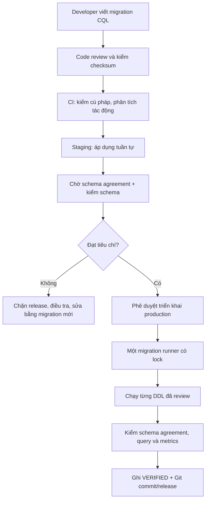

# Quản lý DDL, table option và lịch sử schema bằng version control trong Apache Cassandra

## 1. Vì sao phải quản lý schema như mã nguồn?

Apache Cassandra là cơ sở dữ liệu phân tán **wide-column**: dữ liệu được chia theo **partition key**, nhân bản lên các replica theo replication factor và các bảng thường được thiết kế dựa trên **mẫu truy vấn**. Khi ứng dụng Java, CQL và topology của cluster cùng phát triển, thay đổi schema là một phần của **quy trình phát hành phần mềm**, không chỉ là thao tác nhập lệnh trong `cqlsh`.

Giả sử một dịch vụ đơn hàng có ba môi trường `dev`, `staging` và `production`. Một người thêm cột `status_changed_at` ở dev, người khác đổi chiến lược compaction trong staging, còn production đang chạy phiên bản ứng dụng cũ. Nếu không có lịch sử thay đổi có thể kiểm tra:

- Ứng dụng Java có thể gửi CQL dùng cột chưa được tạo ở production.
- Hai môi trường có cùng tên bảng nhưng khác kiểu cột, `default_time_to_live` hoặc compaction strategy.
- Một lệnh thay đổi tùy chọn có thể làm tăng I/O và disk usage trong lúc cluster đang phục vụ truy vấn.
- Không xác định được ai thay đổi DDL, vì sao, trên phiên bản nào và có được kiểm thử hay không.
- Khi triển khai gặp lỗi giữa chừng, nhóm vận hành không rõ bước nào đã hoàn tất và phải tiếp tục ra sao.

Giải pháp là đưa **DDL và các thay đổi table option vào version control**: mỗi thay đổi có file migration có thứ tự, được review, thử ở môi trường gần production, chạy bằng một quy trình điều phối duy nhất và đối chiếu với **schema thực tế** sau khi áp dụng.

Bài này thuộc module `DATABASE_ENGINE_WIDE_COLUMN_CASSANDRA`, chương **Di chuyển và schema**. Sau khi học, bạn cần biết phân loại DDL, quản lý option trên bảng, thiết kế kho migration bất biến, kiểm tra schema agreement, vận hành thay đổi tương thích với ứng dụng Java và xử lý **schema drift** hoặc migration dang dở.

## 2. Những thành phần nào cần đưa vào lịch sử schema?

Không chỉ `CREATE TABLE` mới thuộc phạm vi quản lý. Các thành phần sau tác động đến tính đúng đắn hoặc hiệu năng hệ thống:

| Nhóm | Ví dụ CQL/cấu hình | Vì sao cần theo dõi |
| --- | --- | --- |
| **Keyspace** | `CREATE KEYSPACE`, `ALTER KEYSPACE` với replication | RF và topology ảnh hưởng khả năng chịu lỗi, read/write consistency và streaming |
| **Bảng và khóa chính** | `CREATE TABLE`, clustering order, partition key | Quyết định dữ liệu nằm ở đâu, truy vấn nào có thể chạy hiệu quả |
| **Cột và kiểu dữ liệu** | `ALTER TABLE ... ADD`, thay đổi cách lưu dữ liệu | Có thể làm phiên bản ứng dụng mới/cũ không tương thích |
| **Table options** | `compaction`, `compression`, `default_time_to_live`, `gc_grace_seconds`, `caching` | Ảnh hưởng I/O, CPU, bộ nhớ, TTL, tombstone, thời gian phục hồi |
| **Đối tượng phụ thuộc** | User-defined types, indexes, materialized views nếu sử dụng | Phải tính thứ tự tạo/xóa và khả năng query/restore |
| **Quyền truy cập** | Role và `GRANT`/`REVOKE` theo chính sách quản trị | Dịch vụ và worker cần quyền đúng bảng, tránh dùng superuser |
| **Chuyển dữ liệu** | Backfill, dual-write, đối soát, tạo bảng `_v2` | CQL DDL không tự chép dữ liệu từ thiết kế cũ sang mới |

Trong phạm vi bài, **version control lưu ý định và lịch sử triển khai**, còn Cassandra lưu trạng thái schema hiện tại. Dữ liệu nghiệp vụ trong SSTable, token ownership, repair và replication cần được vận hành riêng, dù chúng ảnh hưởng đến thành công của migration.

### Schema CQL không giống migration trong RDBMS

Cassandra có cơ chế lan truyền metadata schema trên cluster, nhưng không cung cấp một transaction SQL tổng quát để gom nhiều lệnh DDL thành một lần commit/rollback nguyên tử. Các lệnh DDL áp dụng theo từng thao tác và có thể cần thời gian để các node đồng thuận về schema.

Vì vậy, **không giả định** rằng:

- Tệp `V005.cql` gồm năm câu DDL sẽ được rollback toàn bộ nếu câu thứ tư lỗi.
- Lệnh `ALTER TABLE` có thể thay partition key, clustering key hoặc chuyển kiểu dữ liệu bất kỳ như trong một số hệ RDBMS.
- `IF NOT EXISTS` chứng minh cấu trúc đã tồn tại là đúng với bản migration.
- Schema mới đã lập tức được mọi coordinator và Java Driver thấy sau khi một node trả về thành công.
- Cập nhật RF bằng DDL đồng nghĩa dữ liệu đã streaming tới đúng tất cả replica.

Mỗi thay đổi cần một kế hoạch tương thích ứng dụng, xác nhận cluster và **đường khôi phục tiến lên (forward recovery)**.

## 3. CQL DDL nền tảng: keyspace, table, column

Ví dụ cluster thử nghiệm có datacenter thật tên `dc1` và ít nhất ba node phù hợp. Tên DC/RF là ví dụ để học, **phải thay theo topology thực** khi triển khai.

```sql
CREATE KEYSPACE commerce
WITH replication = {
  'class': 'NetworkTopologyStrategy',
  'dc1': 3
}
AND durable_writes = true;
```

`NetworkTopologyStrategy` giúp khai báo số replica theo datacenter. Đặt RF và mức nhất quán read/write là quyết định riêng nhưng liên quan chặt chẽ: `LOCAL_QUORUM` của RF 3 cần hai replica tại DC đó phản hồi. Nếu thay RF hoặc thêm DC, phải có kế hoạch streaming, repair/đối soát và xác thực; chỉ `ALTER KEYSPACE` không hoàn tất việc di chuyển dữ liệu.

Tạo bảng phục vụ truy vấn theo `order_id`:

```sql
CREATE TABLE commerce.orders_by_id (
  order_id uuid PRIMARY KEY,
  customer_id uuid,
  status text,
  total_amount decimal,
  updated_at timestamp
)
WITH comment = 'Tra cuu don hang theo order_id'
 AND compaction = {'class': 'SizeTieredCompactionStrategy'}
 AND compression = {'class': 'LZ4Compressor'}
 AND default_time_to_live = 0;
```

Trong ví dụ này:

- `order_id` là partition key nên mỗi `SELECT ... WHERE order_id = ?` xác định được partition.
- `PRIMARY KEY` **không có cùng vai trò với foreign key/unique constraint đa bảng** trong RDBMS.
- `default_time_to_live = 0` nghĩa là không đặt TTL mặc định ở cấp bảng; dữ liệu vẫn có thể được ghi với TTL cụ thể khi phù hợp.
- `compaction` và `compression` được ghi rõ để người review biết ý định, nhưng giá trị cần kiểm tra theo phiên bản Cassandra và workload; mặc định của bản phân phối có thể khác.

Nếu cần thêm cột tùy chọn:

```sql
ALTER TABLE commerce.orders_by_id
ADD status_changed_at timestamp;
```

Đây là loại thay đổi thường có thể triển khai theo hướng **expand**: ứng dụng cũ không dùng cột mới vẫn tiếp tục hoạt động; hàng cũ chưa có giá trị sẽ nhận kết quả `null` cho cột đó. Không thể suy ra dữ liệu cũ đã được backfill chỉ vì lệnh DDL thành công.

### Những thay đổi cần thiết kế lại bảng

Khi muốn đổi `order_id` thành partition key ghép, đổi clustering key hoặc chuyển một kiểu cột không hỗ trợ sửa trực tiếp, cần cân nhắc **tạo bảng mới** theo truy vấn mới, di chuyển dữ liệu và chuyển ứng dụng. Trong Cassandra, **thiết kế partition key là quyết định phân phối dữ liệu**, không phải một thao tác đổi tên metadata đơn giản.

`DROP TABLE`, `TRUNCATE` hoặc xóa cột là thao tác có thể mất dữ liệu hoặc khiến ứng dụng cũ hỏng. Luôn có backup, kiểm tra phụ thuộc và cổng review trước khi chạy trên production.

## 4. Table options: cấu hình nào thuộc lịch sử và có tác dụng gì?

Table options cần được review như một thay đổi vận hành có thể ảnh hưởng toàn cụm. Không nên chỉnh trực tiếp bằng `cqlsh` trên production rồi mới cập nhật tài liệu sau.

| Option | Vai trò | Điều phải đánh giá |
| --- | --- | --- |
| `compaction` | Quy định cách SSTable được gom/viết lại | Đặc tính đọc/ghi, SSTable count, write amplification, dung lượng trống, khối lượng I/O khi chuyển chiến lược |
| `compression` | Nén dữ liệu SSTable | CPU, tỉ lệ nén, disk, khả năng tương thích SSTable, tác động compaction |
| `default_time_to_live` | TTL mặc định cho dữ liệu ghi vào bảng | Thời gian lưu nghiệp vụ, dữ liệu đã có, tombstone, query và khả năng khôi phục |
| `gc_grace_seconds` | Khoảng giữ tombstone tối thiểu theo cơ chế xóa/repair | Lịch repair, node offline, nguy cơ dữ liệu đã xóa xuất hiện lại |
| `caching` | Hành vi cache key/row theo phiên bản | Bộ nhớ, hit rate, loại workload |
| `bloom_filter_fp_chance` | Xác suất dương tính giả Bloom filter | RAM và I/O đọc SSTable; phụ thuộc compaction |
| `speculative_retry` | Gửi thêm bản đọc dự phòng trong một số tình huống replica chậm | Tail latency, tải tăng trên replica, khả năng kiểm soát overload |
| `read_repair` (nếu phiên bản hỗ trợ) | Chính sách xử lý bất đồng replica ở đường đọc | Đánh đổi blocking/read behavior; kiểm tra phiên bản cụ thể |
| `comment` | Ghi chú mục đích bảng | Thuận tiện audit, không quyết định dữ liệu/hiệu năng |

**Không có một bộ option tối ưu cho mọi bảng.** Bảng đơn hàng tra cứu theo khóa khác với chuỗi time-series có TTL và ghi liên tục. `TimeWindowCompactionStrategy` (TWCS) có thể phù hợp với dữ liệu theo cửa sổ thời gian, nhưng cần hiểu timestamp, TTL, cập nhật tới dữ liệu cũ và late arrival. Chuyển từ STCS sang LCS hay TWCS không phải “đổi metadata là xong”; quá trình compaction tiếp theo có thể tốn CPU, I/O và disk.

### 4.1. Migration thay đổi option ít rủi ro

Ví dụ chỉ đổi metadata mô tả:

```sql
ALTER TABLE commerce.orders_by_id
WITH comment = 'Order lookup API; owner=orders-team; migration=V003';
```

Đây là thay đổi dễ kiểm chứng, nhưng vẫn phải chờ schema agreement và kiểm tra schema thực tế sau deploy.

### 4.2. Migration thay đổi compaction cần cửa sổ vận hành

Giả sử sau benchmark, nhóm muốn đổi từ STCS sang LCS cho bảng có tải đọc lớn:

```sql
-- Ví dụ thay đổi có tác động vận hành đáng kể; chỉ chạy sau thử tải.
ALTER TABLE commerce.orders_by_id
WITH compaction = {'class': 'LeveledCompactionStrategy'};
```

Trước khi merge cần ghi:

1. Tại sao phải đổi: chỉ số đọc/ghi, p95/p99, SSTable per read, dung lượng và mục tiêu cải thiện.
2. Cassandra version và option được hỗ trợ.
3. Dự báo compaction I/O, CPU, disk headroom, tình trạng repair/snapshot.
4. Cửa sổ triển khai, thời gian ổn định sau thay đổi, tiêu chí giảm tải/tạm dừng.
5. Điều kiện chuyển lại và hậu quả nếu còn SSTable/compaction debt từ chiến lược cũ.

**Đừng đo thành công chỉ bằng việc CQL trả `OK`.** Theo dõi pending compactions, read latency, disk và sự hội tụ sau khi thay đổi.

### 4.3. TTL và tombstone cần được đối chiếu với chính sách dữ liệu

Ví dụ:

```sql
-- Ví dụ bảng lưu sự kiện ngắn hạn, không áp cho bảng đơn hàng vĩnh viễn.
ALTER TABLE commerce.short_lived_events
WITH default_time_to_live = 604800;
```

`604800` giây tương đương 7 ngày. Thay đổi TTL mặc định **không đơn giản làm tất cả dữ liệu cũ hết hạn sau 7 ngày**; cần xác định tác dụng theo mutation mới/ghi lại dữ liệu và quy tắc TTL của bản Cassandra hiện hành. Hãy kiểm thử trên dữ liệu tồn tại trước thay đổi và dữ liệu ghi sau thay đổi.

`gc_grace_seconds` không phải công tắc “dọn tombstone ngay”. Giảm giá trị thiếu cơ sở khi node có thể offline lâu hoặc repair không chạy đủ có thể góp phần gây **zombie data** (dữ liệu đã xóa xuất hiện lại). Thay đổi thời gian giữ phải xem lịch repair, retention/TTL, mức chịu lỗi và topology.

## 5. Tổ chức lịch sử migration trong Git

Một cấu trúc minh họa của **kho ứng dụng**, không phải các file mà bài học này tạo:

```text
orders-service/
  db/
    cassandra/
      README.md
      manifest.yaml
      migrations/
        V001__create_commerce_keyspace.cql
        V002__create_orders_by_id.cql
        V003__add_status_changed_at.cql
        V004__describe_orders_table.cql
      checks/
        expected-schema.md
        validation-queries.cql
  src/
    main/
      java/
        ...
```

Tổ chức cần đáp ứng:

- **Một thay đổi có định danh duy nhất**: `V001`, `V002`,…; không dựa vào thứ tự `ls` hay timestamp sinh tùy ý từ nhiều máy.
- **Migration đã chạy là bất biến**: không sửa nội dung `V002` sau khi đã triển khai; tạo `V005` nếu cần sửa tiếp.
- **Review có ngữ cảnh**: lý do nghiệp vụ, tác động đọc/ghi, phụ thuộc app, expected schema, plan backfill/rollback và chỉ số xác nhận.
- **Checksum**: lưu hash nội dung migration trong manifest và trạng thái triển khai để phát hiện file lịch sử bị sửa.
- **Mapping bản phát hành**: xác định commit/tag ứng dụng nào yêu cầu migration nào.
- **Tách bí mật khỏi Git**: mật khẩu Cassandra, token object storage và thông tin nhạy cảm phải đến từ secret manager/CI secrets.

Ví dụ manifest **mang tính mô hình**, không phải schema mà Cassandra tự hiểu:

```yaml
service: orders-service
database: cassandra
migrations:
  - id: V001
    file: migrations/V001__create_commerce_keyspace.cql
    sha256: "<hash-do-ci-tinh>"
    affects: [keyspace:commerce]
  - id: V002
    file: migrations/V002__create_orders_by_id.cql
    sha256: "<hash-do-ci-tinh>"
    affects: [table:commerce.orders_by_id]
  - id: V003
    file: migrations/V003__add_status_changed_at.cql
    sha256: "<hash-do-ci-tinh>"
    affects: [table:commerce.orders_by_id]
```

Hash dùng để kiểm tra bất biến sau khi nội dung được review; **không** phải cơ chế khóa chống chạy song song. Đường `README.md` ở ví dụ biểu diễn một file tài liệu trong ứng dụng thật, không yêu cầu worker tạo hoặc đọc file đó.

### Đặt lịch sử schema ở đâu?

Có thể dùng hệ thống migration có hỗ trợ Cassandra được tổ chức xác thực, hoặc CI/CD deploy runner có khóa độc quyền và ledger riêng. Nếu dùng ledger, tối thiểu nên ghi:

| Trường | Ý nghĩa |
| --- | --- |
| `migration_id` | Định danh thay đổi được phê duyệt |
| `checksum` | Hash nội dung đã chạy, phát hiện sửa lịch sử |
| `environment` / `cluster_id` | Không trộn trạng thái dev/staging/prod |
| `started_at` / `finished_at` | Theo dõi độ dài và thời điểm triển khai |
| `status` | `PENDING`, `RUNNING`, `APPLIED`, `VERIFIED`, `FAILED` |
| `executor` / `git_commit` | Tác nhân và bản phát hành thực hiện |
| `verification` | Schema agreement, drift check, phép kiểm nghiệm thu |
| `error` / `resolution` | Dữ liệu phục vụ tiếp tục một migration bị ngắt |

**Ledger không có transaction chung với DDL Cassandra.** Nếu runner ghi trạng thái `RUNNING` rồi crash sau khi DDL đã thành công, hệ thống cần kiểm **schema thực tế trước khi chạy lại**. Nếu đánh dấu `VERIFIED` trước khi kiểm schema, ledger có thể báo sai. Ledger giúp kiểm toán và điều phối, không thay thế xác thực trên cluster.

## 6. Quy trình triển khai an toàn: một nguồn sự thật, một runner

Đối với nhiều ứng dụng Java hoặc nhiều pod, không để từng instance chạy DDL mỗi khi khởi động. Nếu mười pod đồng thời `ALTER TABLE`, chúng có thể va chạm, ghi ledger lệch hoặc gây schema disagreement. Hãy dùng một **migration runner được điều phối độc quyền**, tách khỏi vòng đời request thông thường.



Thứ tự tối thiểu:

1. **Preflight:** xác định cluster/DC/version, node khỏe mạnh, quyền quản trị, trạng thái schema và backup gần nhất.
2. **Khóa triển khai:** bảo đảm chỉ một runner thay đổi cùng schema/phạm vi; lock phải có cơ chế hồi phục khi runner crash.
3. **Đọc trạng thái:** so sánh các `migration_id`/checksum đã áp dụng với manifest. Nếu lịch sử bị sửa, **chặn triển khai**.
4. **Kiểm tra điều kiện đầu vào:** bảng/column hiện tại và khả năng tương thích trước khi chạy.
5. **Áp dụng từng câu DDL** theo đúng thứ tự, ghi log thời gian và kết quả.
6. **Chờ schema agreement** ở những node có thể truy cập; kiểm tra schema hiện tại, không chỉ exit code.
7. **Chạy phép thử ứng dụng** và metric liên quan; chỉ đánh dấu `VERIFIED` khi đạt các điều kiện nghiệm thu.
8. **Gỡ khóa và phát hành ứng dụng** theo thứ tự tương thích đã được xác định.

Không có một công cụ cụ thể nào được giả định ở đây. `cqlsh -f` có thể thực thi file CQL, nhưng bản thân nó **không** cung cấp migration ledger, khóa phân tán, rollback tự động và điều phối nhiều môi trường.

### 6.1. Quan sát schema agreement

Tùy phiên bản Cassandra và cách triển khai, có thể kiểm tra bằng các lệnh chỉ đọc:

```bash
nodetool status
nodetool describecluster
nodetool version
```

`nodetool describecluster` thường hiển thị nhóm node theo schema version, giúp nhận biết node chưa đồng thuận hoặc chưa phản hồi. Nhưng một lệnh trên một node chưa bảo đảm cụm không có node bị cô lập; kết hợp danh sách node kỳ vọng, health check và xác thực từ runner/driver.

Trong `cqlsh` có thể kiểm tra metadata:

```sql
DESCRIBE KEYSPACE commerce;

SELECT keyspace_name, table_name
FROM system_schema.tables
WHERE keyspace_name = 'commerce';

SELECT schema_version FROM system.local;
```

`system.local.schema_version` phản ánh trạng thái schema mà node đang được hỏi biết đến; giá trị này **không phải `V003` trong Git**, không là hash của migration và không cung cấp lịch sử thay đổi. `DESCRIBE` cho thấy schema hiện tại và có thể giúp so sánh với định nghĩa kỳ vọng, nhưng không cho biết đầy đủ ai đã thay đổi hay tại sao.

Với Cassandra Driver Java, lớp quản lý schema cũng có thể quan sát metadata/schema agreement theo API phiên bản. Khi phát hành, runner nên có timeout rõ ràng và báo lỗi nếu không đạt sự đồng thuận mong đợi, thay vì chạy tiếp không giới hạn.

## 7. Thay đổi schema tương thích: expand – migrate – contract

Một thay đổi ứng dụng thường phải chạy trong giai đoạn **có cả phiên bản cũ lẫn mới**, nhất là khi rolling deploy hoặc nhiều service dùng chung keyspace. Mô hình an toàn là:

1. **Expand:** thêm schema mới nhưng vẫn cho phần mềm cũ hoạt động.
2. **Migrate:** chuyển/đối soát dữ liệu và đưa ứng dụng sang cách đọc/ghi mới.
3. **Contract:** gỡ bỏ đường cũ sau khi không còn người dùng hoặc dữ liệu cần nó.

### Ví dụ: thêm thời điểm chuyển trạng thái

Phiên bản ứng dụng cũ chỉ ghi `status` và `updated_at`. Phiên bản mới muốn lưu `status_changed_at`:

```sql
-- Migration V003:
ALTER TABLE commerce.orders_by_id
ADD status_changed_at timestamp;
```

**Pha expand:**

- Áp dụng migration schema trước khi triển khai Java code mới.
- Đợi schema agreement và kiểm truy vấn cũ vẫn hoạt động.
- Code mới chấp nhận `status_changed_at = null` trên các hàng cũ.

**Pha migrate:**

- Phát hành worker/Java service ghi thêm `status_changed_at` khi có thay đổi trạng thái.
- Backfill các hàng cũ nếu nghiệp vụ cần, theo partition key và giới hạn tốc độ để tránh quét toàn bảng làm quá tải cluster.
- Đo số hàng/đối tượng đã được đối soát; làm backfill **idempotent** và có checkpoint.

Ví dụ Java Driver 4.x, dùng prepared statement và session tái sử dụng:

```java
import java.time.Instant;
import java.util.UUID;
import com.datastax.oss.driver.api.core.CqlSession;
import com.datastax.oss.driver.api.core.cql.PreparedStatement;
import com.datastax.oss.driver.api.core.cql.BoundStatement;

public final class OrderStatusWriter {
    private final CqlSession session;
    private final PreparedStatement updateStatus;

    public OrderStatusWriter(CqlSession session) {
        this.session = session;
        this.updateStatus = session.prepare(
            "UPDATE commerce.orders_by_id " +
            "SET status = ?, status_changed_at = ?, updated_at = ? " +
            "WHERE order_id = ?");
    }

    public void update(UUID orderId, String status, Instant changedAt) {
        BoundStatement statement = updateStatus.bind(
            status, changedAt, changedAt, orderId);
        session.execute(statement);
    }
}
```

Đoạn code giả định role dịch vụ có quyền `MODIFY` và driver đã được cấu hình cluster/local DC/TLS/consistency phù hợp. **Ghi đồng thời:** phép `UPDATE` thông thường không bảo vệ quy tắc chuyển trạng thái khỏi hai writer tranh chấp; nếu nghiệp vụ cần kiểm tra version/cạnh tranh, hãy thiết kế LWT/`IF` hoặc nguồn điều phối thích hợp. Không dùng migration schema để giải quyết lỗi nghiệp vụ đó.

**Pha contract:**

- Chuyển tất cả reader sang trường mới, xác nhận số ứng dụng còn dùng đường cũ bằng metrics/trace.
- Đợi giai đoạn rolling deploy và tất cả consumer/backfill hoàn tất.
- Nếu cần xóa trường cũ, lập một migration riêng với kiểm soát phá vỡ tương thích; không gộp `ADD` và `DROP` vào cùng đợt phát hành.

### Khi cần đổi partition key hoặc kiểu dữ liệu

Ví dụ ứng dụng muốn liệt kê đơn hàng theo `customer_id` thay vì `order_id`. Không thể giải quyết bằng `ALTER TABLE` thêm một cột rồi dùng nó làm partition key mới. Phải **thiết kế một bảng theo truy vấn mới**:

```sql
CREATE TABLE commerce.orders_by_customer (
  customer_id uuid,
  order_id uuid,
  status text,
  updated_at timestamp,
  PRIMARY KEY ((customer_id), order_id)
);
```

Sau đó backfill từ nguồn sự thật hoặc job đọc theo nguồn hợp lệ, chuyển logic ghi đến cả hai bảng trong giai đoạn chuyển đổi và kiểm tra dữ liệu trước khi cho reader dùng `orders_by_customer`. **Không giả định một query `SELECT * FROM orders_by_id` trên cluster lớn là cách backfill khả thi**; cần giải pháp phân vùng dữ liệu, scan có kiểm soát hoặc pipeline CDC/event có thiết kế.

Cassandra thường chấp nhận denormalization; nhưng không có tính nguyên tử xuyên nhiều partition theo nghĩa RDBMS. Cần đo và xử lý sai lệch/đồng bộ giữa bảng cũ và mới, cũng như trường hợp retry timeout.

## 8. Quy tắc đặc biệt cho thay đổi replication và table option

### 8.1. Đổi replication là một thay đổi dữ liệu phân tán

Ví dụ thêm datacenter `dc2`:

```sql
-- Chỉ là bước cập nhật metadata RF, không phải toàn bộ quy trình mở DC.
ALTER KEYSPACE commerce
WITH replication = {
  'class': 'NetworkTopologyStrategy',
  'dc1': 3,
  'dc2': 3
};
```

Sau DDL, dữ liệu cần được phân bổ tới replica mới bằng quy trình streaming/rebuild/repair phù hợp topology và phiên bản, có lịch, metric và đánh giá dung lượng. Việc thay RF cũng có thể ảnh hưởng `LOCAL_QUORUM`, tình trạng `UNAVAILABLE`, write latency và recovery. Không deploy một migration thay RF rồi lập tức đánh dấu hoàn tất chỉ vì `ALTER KEYSPACE` trả thành công.

### 8.2. Đổi compaction cần kiểm soát hậu triển khai

Khi chuyển compaction strategy, Cassandra sẽ xử lý tập SSTable theo cơ chế của chiến lược mới qua hoạt động compaction theo thời gian. Kiểm tra:

- CPU, heap/GC, disk I/O, pending compactions và ổ đĩa trống.
- Read latency/p99, write throughput, số SSTable/partition, số tombstone.
- Các snapshot cũ dùng hard link vẫn giữ SSTable; disk usage có thể tăng dù migration không thêm dữ liệu logic.
- Repair/backfill chạy đồng thời có thể tranh I/O; điều phối cửa sổ triển khai.

### 8.3. Đổi TTL/retention là thay đổi hợp đồng dữ liệu

Đặt `default_time_to_live` có thể làm dữ liệu mới tự hết hạn. Trước khi merge migration:

1. Xác nhận nghĩa vụ lưu dữ liệu và chính sách xóa.
2. Kiểm thử bản ghi có TTL và không TTL, bản ghi cũ và mới.
3. Đánh giá tombstone, `gc_grace_seconds`, repair và hiệu quả compaction.
4. Kiểm tra điều gì xảy ra sau snapshot/restore khi thời gian thực đã trôi qua.

Một migration hợp lệ về cú pháp CQL vẫn có thể gây **mất dữ liệu ngoài ý muốn theo thời gian** nếu TTL bị cấu hình sai.

## 9. Kiểm thử tự động trong CI và kiểm soát triển khai

Nên có hai loại kiểm tra: **chất lượng migration trên Git** và **độ tương thích schema với cluster thực tế**.

| Giai đoạn | Kiểm tra | Điều kiện chặn |
| --- | --- | --- |
| Pull request | Tên/ID migration duy nhất, checksum của bản cũ bất biến | Migration đã chạy bị chỉnh sửa hoặc trùng ID |
| Review DDL | Phân loại non-breaking/breaking, dependency, table option, quyền | Không có giải thích với `DROP`, đổi RF, TTL, compaction |
| Kiểm tra cú pháp | Chạy với phiên bản Cassandra tương thích trong môi trường thử | CQL không hỗ trợ hoặc option sai phiên bản |
| Schema diff | So sánh DDL kỳ vọng với thực tế của staging | Drift chưa được giải quyết |
| Tải thử | p95/p99, compaction, heap, disk, timeout khi đổi option/backfill | SLO suy giảm hoặc thiếu disk headroom |
| Rolling deploy test | App cũ và mới chạy cùng lúc trên schema chuyển tiếp | Một phiên bản không đọc/ghi được |
| Production preflight | Node/replica, schema agreement, backup, quyền/lock | Cluster bất ổn hoặc đã có runner khác |
| Post-deploy | Schema agreement, quyền, truy vấn CQL/Java, dữ liệu mẫu, metrics | Sai cấu trúc, error rate tăng, backlog compaction |
| Audit | Ghi `migration_id`, checksum, executor, git commit, kết quả | Không đủ bằng chứng xác nhận hoàn thành |

Lưu ý cách đánh giá **backward/forward compatibility**:

- Thêm cột thường cho phép app cũ tiếp tục, miễn truy vấn cũ không trông cậy một schema cố định một cách sai lầm.
- Thêm bảng mới thường là bước mở rộng thuận lợi, nhưng phải cập nhật role/permission tương ứng.
- Xóa/đổi tên cột, xóa bảng hoặc thay đổi cách truy vấn là thay đổi dễ phá vỡ ứng dụng; cần chuyển ứng dụng trước.
- Một số table option không làm CQL đổi hình dạng nhưng vẫn tạo rủi ro hệ thống nghiêm trọng, nên phải chịu cổng review vận hành.

**Không đưa mật khẩu hoặc token vào migration file.** Tài khoản chạy DDL cần quyền có kiểm soát; tài khoản ứng dụng Java không cần `CREATE KEYSPACE`, `ALTER TABLE` hay `DROP TABLE` trong luồng request.

## 10. Kiểm soát schema drift

**Schema drift** là khi schema thực tế của cluster khác với trạng thái kỳ vọng từ migration history mà không có thay đổi được review tương ứng.

Ví dụ:

- Ledger nói `V004` đã đổi `comment`; production lại có `compaction` khác staging.
- Một DBA chạy `ALTER TABLE ... ADD` trực tiếp trên production, nhưng migration Git chưa tồn tại.
- Cùng `V002` có nội dung khác nhau ở hai nhánh release.
- `CREATE TABLE IF NOT EXISTS` bỏ qua bảng đã tồn tại sai định nghĩa, khiến CI ghi nhận chạy thành công giả.

Phương pháp phát hiện:

1. Lấy expected schema từ **lịch sử migration bất biến** và manifest của release.
2. Đọc schema đang chạy qua `DESCRIBE KEYSPACE` và metadata `system_schema`.
3. Chuẩn hóa những khác biệt không có ý nghĩa (thứ tự trình bày, default option phụ thuộc version) trước khi so sánh; tránh diff chuỗi thô rồi báo giả.
4. Kiểm tra những phần mang nghĩa: partition/clustering key, column type, indexes/views, compaction, compression, TTL, replication và quyền cần thiết.
5. Mở incident/change request nếu thấy drift; tìm ai, lúc nào, vì sao trước khi sửa.

**Không tự động “đồng bộ” schema bằng cách xóa bảng lạ hoặc DROP cột không có trong Git.** Trước tiên phải xác định đó là thay đổi hợp lệ chưa được ghi nhận hay là sai lệch cần xử lý. Dùng migration mới hoặc quy trình reconciliation đã review.

### Sự khác nhau giữa Cassandra schema version và migration version

| Mục | Cassandra schema version | Migration version trong Git |
| --- | --- | --- |
| Nguồn | Metadata schema cluster/node | File migration + manifest/ledger |
| Mục đích | Phát hiện tình trạng schema giữa node | Theo dõi lịch sử thay đổi có thứ tự và review |
| Đọc ở đâu | `nodetool describecluster`, `system.local`, API driver tùy phiên bản | Git commit, release tag, migration ledger |
| Có ghi tác giả/lý do? | Không đầy đủ | Có thể thông qua PR/commit/changelog |
| Có dùng thay nhau được? | **Không** | **Không** |

Để tránh nhầm lẫn, dashboard migration nên hiển thị **hai trạng thái riêng**: schema agreement của cluster và version/checksum đã được deploy.

## 11. Xử lý migration lỗi hoặc bị gián đoạn

Thay đổi DDL có thể bị gián đoạn bởi mạng, node chậm, hết quyền hoặc runner crash sau khi lệnh đã áp dụng. Không được đoán “thất bại nghĩa là chưa thay đổi gì”.

| Tình huống | Điều có thể đã xảy ra | Cách xử lý |
| --- | --- | --- |
| Runner timeout sau `ALTER TABLE ADD` | Cột có thể đã được thêm nhưng client không nhận ACK | Đọc schema hiện tại trên các node, kiểm schema agreement, rồi quyết định resume |
| `CREATE TABLE IF NOT EXISTS` trả thành công | Bảng có thể đã tồn tại với thiết kế khác | So sánh primary key, columns và options với expected schema |
| Hai pipeline deploy cùng lúc | DDL va chạm, ledger sai thứ tự | Khóa/serialize triển khai; dừng một runner và reconcile |
| Một node chậm nhận schema | Ứng dụng có thể gặp `UNPREPARED`/unknown column tạm thời | Chờ agreement, kiểm trạng thái node, retry có kiểm soát; không chạy tiếp hàng loạt |
| Thay compaction xong, p99 tăng | Compaction I/O và disk pressure | Giảm backfill/traffic nền, xem metric và phương án điều chỉnh option theo runbook |
| Migration backfill dừng giữa chừng | Một số partition đã chuyển, một số chưa | Dựa trên checkpoint, dữ liệu idempotent và đối soát để chạy tiếp |
| Đổi TTL gây mất dữ liệu kỳ vọng | Mutation mới đã có thời hạn hết hạn | Dừng tác nhân gây lỗi, xác định phạm vi, khôi phục từ backup theo kế hoạch |
| DROP nhầm bảng | Dữ liệu/schema có thể đã mất | Dừng thay đổi, xác định snapshot/backup và diễn tập restore phù hợp; không tùy tiện tái tạo schema rồi coi đã khôi phục |

### Rollback và forward fix

Nhiều migration **không thể đảo ngược an toàn** chỉ bằng một câu CQL. Ví dụ sau khi xóa bảng, `CREATE TABLE` cùng tên không khôi phục SSTable đã mất; thêm cột đã dùng trong ghi không thể đơn giản `DROP COLUMN` mà không ảnh hưởng dữ liệu mới. Với option như `comment` có thể tạo migration mới để thay lại, nhưng vẫn phải kiểm schema agreement.

Với mỗi thay đổi cần ghi:

- **Điều kiện dừng** và người ra quyết định khi cluster có lỗi.
- **Backup** trước thao tác phá vỡ, cùng xác nhận dữ liệu có thể restore.
- **Cách phục hồi**: forward migration, chuyển app trở lại code cũ tương thích, restore cô lập hoặc backfill.
- **Điểm không thể quay lại**: khi dữ liệu đã ghi theo schema mới, hợp đồng cũ có còn đúng không?
- **Kịch bản lỗi một phần**: liệu có thể resume idempotent và tái kiểm chứng hay không?

## 12. Runbook phát hành minh họa

**Bối cảnh:** đội muốn thêm cột `status_changed_at` vào `commerce.orders_by_id` để phục vụ API mới mà không dừng toàn bộ dịch vụ.

### Trước khi chạy

- Chốt Git commit chứa `V003__add_status_changed_at.cql`, checksum và người phê duyệt.
- Xác nhận schema production chưa có cột hoặc cột hiện có khớp đúng kiểu/ý nghĩa nếu từng retry migration.
- Đánh giá cluster health, RF/CL, schema agreement, disk, repair và backup.
- Đảm bảo phiên bản Java cũ vẫn hoạt động nếu cột mới tồn tại.
- Đảm bảo migration runner có quyền `ALTER` còn role ứng dụng chỉ có permission nghiệp vụ.

### Khi chạy

```bash
# Đọc trạng thái trước, chạy trên môi trường và node đã chọn:
nodetool status
nodetool describecluster

# Ví dụ một runner đã giữ khóa triển khai và chọn đúng phiên bản CQL.
# cqlsh -f không tự quản lý lock/ledger/checksum.
cqlsh -f db/cassandra/migrations/V003__add_status_changed_at.cql
```

Sau khi chạy, runner phải chờ/kiểm tra schema agreement, rồi xác nhận định nghĩa mới:

```sql
DESCRIBE TABLE commerce.orders_by_id;

SELECT keyspace_name, table_name
FROM system_schema.tables
WHERE keyspace_name = 'commerce';
```

`DESCRIBE TABLE` giúp kiểm tra cột mới nhưng cần đối chiếu cả application contract, nhất là các câu CQL đã được prepare. Khi cluster agreement chưa hoàn tất, **chưa phát hành binary yêu cầu cột mới**.

### Sau khi chạy

- Chạy smoke test Java Driver với `SELECT`/`UPDATE` theo partition key trên môi trường phù hợp.
- Deploy code mới có khả năng đọc giá trị `null` với hàng cũ.
- Bật feature flag/rollout từng phần nếu hệ thống có cơ chế đó.
- Khởi động backfill với concurrency giới hạn; đo timeout, p99, compact, disk, dữ liệu đã đối soát.
- Sau khi đạt tiêu chí, ledger ghi `V003` ở trạng thái `VERIFIED` kèm checksum và commit.
- Nếu có drift hoặc lỗi bất thường, dừng rollout, giữ bằng chứng, thực hiện quy trình phục hồi đã định nghĩa.

## 13. Bài tập tình huống

Một nhóm đang quản lý cluster Cassandra hai datacenter, `RF(dc1)=3` và `RF(dc2)=3`. Hệ thống đặt hàng có bảng `commerce.orders_by_id` theo `order_id`. Họ định triển khai ba thay đổi trong cùng một ngày:

1. Thêm cột `status_changed_at timestamp` để API Java mới ghi thời gian thay đổi.
2. Đổi `compaction` từ STCS sang LCS vì p99 đọc đang cao.
3. Thay cách truy vấn danh sách đơn từ `order_id` sang `customer_id`.

Đồng thời, một kỹ sư đã chạy `ALTER TABLE` ở staging nhưng chưa commit vào Git.

**Câu hỏi:**

1. Thay đổi nào có thể làm theo `ALTER TABLE ADD`? Thay đổi nào cần bảng mới theo truy vấn?
2. Vì sao không nên gộp ba thay đổi vào một file migration và deploy tất cả ngay lúc cao điểm?
3. Đề xuất thứ tự expand/migrate/contract cho API Java cũ và mới.
4. Với đổi compaction, hãy nêu ít nhất bốn chỉ số cần theo dõi và một điều kiện dừng.
5. Nếu `cqlsh -f` timeout ở cuối câu `ALTER TABLE ADD`, làm sao biết cần chạy lại hay resume?
6. Làm sao xử lý staging drift khi Git thiếu một migration?
7. Nếu thêm DC mới, sửa `NetworkTopologyStrategy` đã đủ để dữ liệu được phục vụ chính xác ở DC đó chưa?

**Gợi ý đáp án:**

- Cột `status_changed_at` có thể được thêm trước và ứng dụng cũ tiếp tục dùng; phải kiểm dữ liệu cũ có `null` và backfill.
- Đổi compaction là migration table option cần benchmark/cửa sổ vận hành và theo dõi I/O/disk/p99; nên tách khỏi thay đổi schema phục vụ chức năng để dễ chẩn đoán.
- Truy vấn theo `customer_id` thường cần thiết kế bảng mới `orders_by_customer`, backfill/dual-write và đối soát, vì `order_id` là partition key hiện tại.
- Chờ schema agreement; đọc schema thực tế, xác nhận định nghĩa và ledger trước khi retry. Không đồng nhất timeout client với DDL không áp dụng.
- Đưa schema staging về trạng thái có lịch sử: điều tra thay đổi thủ công, tạo migration có review/checksum phù hợp hoặc reconcile có kiểm soát; không sửa file lịch sử đã chạy.
- Thay RF/DC cần thêm bước streaming/rebuild/repair và kiểm xác nhận read/write CL, không chỉ cập nhật metadata.

## 14. Checklist quản lý schema trước production

- [ ] Mỗi thay đổi DDL/table option có migration ID, mục đích, chủ sở hữu, PR review và checksum.
- [ ] File migration đã chạy được giữ bất biến; không sửa lịch sử để “làm đẹp” Git.
- [ ] Đã tách trách nhiệm migration runner khỏi tài khoản Java dùng cho truy vấn nghiệp vụ.
- [ ] Đã kiểm Cassandra version, topology, RF, schema agreement và table options đang chạy.
- [ ] Đã kiểm tra expected-vs-actual schema, kể cả primary key, columns, compaction, TTL và replication.
- [ ] Đã đánh giá quyền, TTL/tombstone, compaction/repair, hot partition và tác động đến dữ liệu.
- [ ] Migration có kế hoạch thứ tự triển khai, idempotency khi retry, lock/ledger và cách xử lý crash.
- [ ] App cũ và mới có thể chạy cùng schema chuyển tiếp trong rolling deploy.
- [ ] Data backfill/dual-write được điều tiết tải, có checkpoint và phép đối soát.
- [ ] Có backup đủ điều kiện restore trước migration phá vỡ, kèm thời điểm và phạm vi.
- [ ] Đã thử trên staging gần production, đo CQL timeout, latency p95/p99 và disk/compaction.
- [ ] Đã ghi kết quả sau triển khai: agreement, schema diff, migration ID/checksum, commit và smoke test.
- [ ] Có forward fix/rollback ứng dụng và người chịu trách nhiệm xử lý lỗi.

**Ghi nhớ:** Trong Cassandra, **schema là giao diện chung giữa mô hình dữ liệu phân tán, CQL và ứng dụng Java**. Git giữ lịch sử DDL/table option có review; migration runner áp dụng tuần tự; cluster xác nhận schema hiện tại; và ứng dụng phải chuyển đổi bằng các bước tương thích. Chỉ tuyên bố migration hoàn tất khi đã kiểm tra **schema agreement, dữ liệu liên quan và tác động vận hành**, chứ không chỉ khi một lệnh CQL trả thành công.
