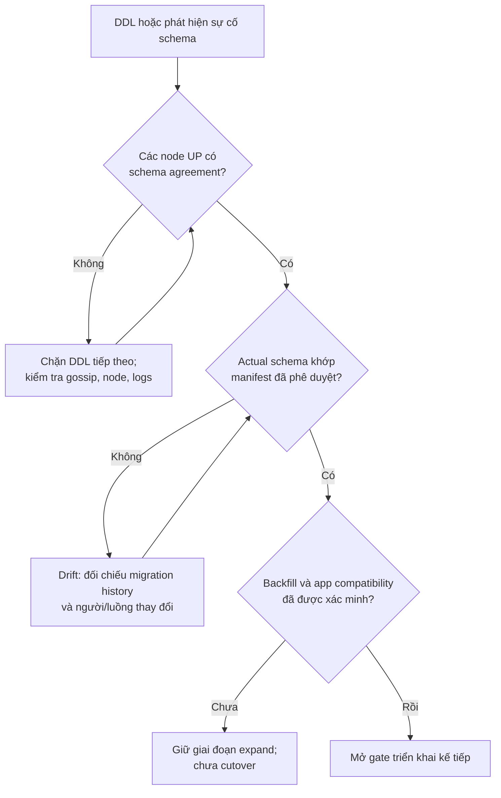
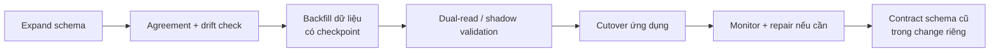

# Phát hiện schema drift và kiểm tra schema agreement

**Chương:** Di chuyển và schema  
**Module:** `DATABASE_ENGINE_WIDE_COLUMN_CASSANDRA` — Apache Cassandra

Trong Apache Cassandra, schema không phải một tệp cấu hình nằm trên một máy duy nhất. Các định nghĩa **keyspace, table, column, index, materialized view, user-defined type/function** được lan truyền giữa các node của cụm. Khi chạy một câu `ALTER TABLE`, coordinator có thể cập nhật schema trước khi toàn bộ peer biết thay đổi. Nếu ứng dụng ngay lập tức gửi request qua một coordinator chưa kịp nhận schema, nó có thể gặp lỗi *unconfigured table*, *unknown column* hoặc prepared statement cần được chuẩn bị lại.

Vấn đề còn khó hơn khi một người thay đổi table trực tiếp ngoài pipeline migration. Toàn bộ node có thể đã đồng thuận về schema mới, nhưng schema ấy **không giống cấu hình đã phê duyệt trong Git**. Đó là **schema drift**.

Bài học thuộc module `DATABASE_ENGINE_WIDE_COLUMN_CASSANDRA`, kết nối kiến thức kiến trúc phân tán và mô hình wide-column, partition key, thiết kế bảng theo truy vấn, replication/consistency level, compaction/repair, CQL, xử lý lỗi và Java Driver. Ta sẽ xây dựng một quy trình **hai lớp**: kiểm tra cluster có schema agreement hay chưa, sau đó kiểm tra schema đã hội tụ có khớp *desired schema* hay không. Cuối cùng là runbook để triển khai thay đổi schema mà không vô tình mất dữ liệu hoặc làm đứt khả năng đọc/ghi trong giai đoạn chuyển đổi.

> **Phạm vi:** Ví dụ hướng tới Apache Cassandra 4.1/5.x, Java Driver 4.x và `cqlsh`/`nodetool` tương ứng. Một số system table, flag và metadata API khác giữa phiên bản/bản phân phối. Chỉ chạy DDL thí nghiệm trên **cluster disposable**; không thử gây bất đồng schema bằng cách cô lập node hoặc sửa trực tiếp system tables trên production. Thao tác sửa schema thật cần runbook, backup, kiểm tra tương thích và phê duyệt.

## 1. Mục tiêu học tập

Sau bài này, bạn có thể:

1. Phân biệt **schema agreement**, **schema drift** và **schema/data migration chưa hoàn tất**.
2. Giải thích quá trình lan truyền schema và ý nghĩa của **schema version UUID** mà Cassandra báo.
3. Kiểm tra trạng thái node bằng `nodetool status`, `describecluster`, `gossipinfo`, `system.local` và `system.peers_v2`.
4. Kiểm tra keyspace/table/column/index/options qua `system_schema` và `DESCRIBE`, không nhầm output của một coordinator với toàn cluster.
5. Tạo desired-schema manifest, chuẩn hóa các thuộc tính quan trọng và so sánh với schema thực tế.
6. Thiết kế migration **expand → backfill/dual-read → cutover → contract**, tránh phá khả năng tương thích của ứng dụng cũ.
7. Xử lý timeout của schema agreement trong Java Driver bằng `ExecutionInfo.isSchemaInAgreement()` và `session.checkSchemaAgreement()`.
8. Hiểu vì sao schema agreement thành công **không bảo đảm** dữ liệu đã được backfill, RF mới đã được stream, hoặc index/view đã sẵn sàng.
9. Chẩn đoán các lỗi do node Down, gossip/network, DDL cạnh tranh, driver metadata cache, sai tên DC hoặc schema khác với manifest.
10. Xây dựng checklist CI/CD, alert và biên bản migration an toàn, có khả năng dừng và phục hồi.

**Kết luận học tập quan trọng nhất:** Cụm có thể **agreement = true** nhưng **drift = true** cùng lúc. Hai kiểm tra trả lời hai câu hỏi khác nhau; không được thay thế cho nhau.

## 2. Ba trạng thái dễ bị nhầm lẫn

### 2.1. Schema agreement — mọi node đã nhận cùng định nghĩa chưa?

Schema agreement là trạng thái các node đang được cơ chế kiểm tra xét đến đều công bố cùng **schema version**. Nó thường xuất hiện trong:

- `nodetool describecluster` dưới phần schema versions.
- Metadata/diagnostic tại `system.local`, `system.peers_v2` hoặc gossip.
- Cơ chế chờ sau DDL của Java Driver.
- Logs có thông tin schema pull/push, migration hoặc disagreement.

Cassandra lan truyền schema bất đồng bộ qua cơ chế nội bộ/gossip. Khi một node nhận đủ thay đổi, nó tính và quảng bá version đại diện cho schema hiện tại.

**Schema version không phải mã semantic version của ứng dụng**, không phải số migration `001`/`002` và cũng không phải tổng số bảng. Nó là một dấu hiệu để so trạng thái schema giữa các node trong điều kiện phiên bản hỗ trợ. Hai UUID khác nhau cần điều tra, nhưng một UUID thống nhất **không nói rằng cấu hình được triển khai là đúng theo Git**.

### 2.2. Schema drift — thực tế đã lệch nguồn chân lý chưa?

Schema drift là sai lệch giữa **desired schema** do tổ chức kiểm soát và **actual schema** của cluster:

- Có cột mới được thêm thủ công ngoài migration.
- Cột từ bản migration dự kiến chưa xuất hiện.
- `default_time_to_live`, `gc_grace_seconds` hoặc compaction đổi ngoài kế hoạch.
- Replication factor của keyspace thay mà không có quyết định topology.
- Index/view/type/function khác manifest.
- Quyền schema hoặc công cụ migration chạy ở nhầm môi trường.
- Cluster staging và production cùng mang tên table nhưng định nghĩa khác nhau ngoài những sai khác đã được cho phép.

**Ví dụ:** Cả A, B, C đều báo cùng schema UUID sau khi DBA trực tiếp đổi `default_time_to_live` của bảng từ 0 thành 86400. Agreement có thể đúng 100%, nhưng nếu desired-schema trong Git vẫn ghi TTL = 0, đây là drift có rủi ro tự hết hạn dữ liệu.

### 2.3. Data migration chưa xong — dữ liệu có theo kịp schema mới không?

Thêm cột thành công **không tự điền giá trị** cho các hàng lịch sử. Đổi RF/ thêm datacenter **không tự bảo đảm** mọi replica mới đã nhận dữ liệu cũ. Tạo bảng mới để thay đổi partition key **không chuyển dữ liệu** từ bảng cũ sang bảng mới.

Đó là một trạng thái thứ ba: **data-readiness** hoặc migration readiness. Nó cần kiểm tra backfill, token ranges, shadow reads, dual-write/snapshot/CDC theo thiết kế, không chỉ kiểm tra schema version.

| Kiểm tra | Câu hỏi trả lời | Không chứng minh |
| --- | --- | --- |
| Agreement | Các node được xét có cùng schema UUID không? | Schema đó đúng với manifest; node Down đã hội tụ |
| Drift | Actual schema có khớp desired schema không? | Dữ liệu cũ đã chuyển đầy đủ |
| Data readiness | Backfill/replica/data validation có đạt không? | Tất cả ứng dụng đã chuyển sang phiên bản tương thích |
| Application readiness | Driver, prepared statements, code cũ/mới chạy ổn? | Node nào cũng khỏe nếu chỉ test một coordinator |

### 2.4. Sơ đồ chẩn đoán hai trục



Không cố chữa drift bằng việc “đợi schema agreement” thêm một lần. Nếu một thay đổi ngoài Git đã được mọi node nhận, chờ tiếp không đưa cấu hình trở về desired state.

## 3. Cơ chế phiên bản schema trong cluster phân tán

### 3.1. DDL không phải transaction chung cho mọi node

Một câu DDL như:

```sql
ALTER TABLE lab_schema.orders_by_id
ADD reconciliation_tag text;
```

được xử lý qua coordinator và lan truyền. Sau DDL có thể tồn tại khoảng ngắn:

```text
T0   A, B, C: schema S1

T1   Coordinator A chấp nhận ALTER TABLE
     A: schema S2
     B: schema S1
     C: schema S1

T2   Gossip/schema propagation
     A: S2
     B: S2
     C: S1

T3   Schema agreement
     A: S2
     B: S2
     C: S2
```

Đây là sơ đồ khái niệm. Cassandra có logic migration, version và chờ khác nhau theo phiên bản; **không bảo đảm** thứ tự A→B→C trong mọi cluster. Một coordinator có thể trả thành công DDL trước khi tất cả peers đã cập nhật. Driver Java có cơ chế chờ agreement sau DDL để giảm race condition, nhưng hết timeout không nhất thiết đồng nghĩa DDL đã rollback.

### 3.2. Các lỗi nếu ứng dụng triển khai quá sớm

Giả sử A đã biết cột `reconciliation_tag` và ứng dụng mới gửi:

```sql
SELECT order_id, reconciliation_tag
FROM lab_schema.orders_by_id
WHERE order_id = 20000000-0000-4000-8000-000000000201;
```

Nếu request đến B chưa cập nhật schema, có thể nhận lỗi liên quan cột chưa được nhận biết. Nếu DDL là `CREATE TABLE` và request đến coordinator chưa nhận bảng, lỗi có thể là *unconfigured table*. Prepared statement được tạo khi schema mới chưa xuất hiện trên một số node cũng có thể cần prepare lại.

**Quy tắc:** Không gửi DDL song song rồi ngay lập tức triển khai code đòi schema mới mà không có gate agreement và kiểm tra metadata.

### 3.3. Node Down: agreement có thể nhìn ổn nhưng chưa đầy đủ

Driver thường kiểm tra schema versions của các node mà nó coi là **UP**. Nếu C Down, A/B cùng S2, `session.checkSchemaAgreement()` có thể trả `true`. Điều này **không chứng nhận C đã nhận S2**; khi C quay lại, node phải đồng bộ schema và có thể có giai đoạn chuyển tiếp.

Vì vậy, trong cửa sổ migration:

- Ghi chính xác số node dự kiến, node Up/Down và datacenter/rack.
- Định nghĩa rõ “agreement giữa tất cả nodes đang Up” và “toàn bộ các node dự kiến đã Up và agree”.
- Đừng đánh dấu migration hoàn tất nếu node mất liên lạc chưa có kế hoạch xử lý.
- Nếu cluster đang rolling upgrade nhiều server versions, tránh DDL theo runbook và xem lưu ý khác biệt cách tính schema version giữa các phiên bản.

## 4. Bằng chứng quan sát: `nodetool`, CQL và logs

### 4.1. Kiểm tra health trước tiên

Trên từng node được chọn trong lab:

```bash
nodetool status
nodetool describecluster
nodetool gossipinfo
nodetool version
```

**`nodetool status`** cho biết Up/Down và trạng thái membership/topology; **không trực tiếp chứng minh schema giống nhau**.

**`nodetool describecluster`** hiển thị cluster name, snitch, partitioner và các schema versions theo thông tin node quản lý đang biết. Nếu có nhiều version UUID trong phần này, hãy điều tra trước khi triển khai thêm DDL.

**`nodetool gossipinfo`** giúp xem endpoint state và schema version/gossip khi phiên bản hiển thị. Output có thể rất dài; lưu riêng phục vụ incident, không tự parse theo vị trí cố định của một dòng mà chưa kiểm tra định dạng thực tế.

**`nodetool version`** giúp ghi version node; nếu có rolling upgrade, việc so schema version phải đọc cùng runbook hỗ trợ.

### 4.2. Quan sát schema version bằng CQL

Trong `cqlsh` **trên node đang quan sát**:

```sql
SELECT host_id, release_version, data_center, schema_version
FROM system.local;

SELECT peer, peer_port, host_id, data_center, rack, schema_version
FROM system.peers_v2;
```

Trong Cassandra 4.x/5.x, `system.local` phản ánh thông tin local node, còn `system.peers_v2` là **góc nhìn về các peers mà node đó biết**. Trên môi trường cũ hơn có thể dùng `system.peers` với tập cột khác.

Điểm quan trọng:

- Truy vấn `system.peers_v2` trên A là **góc nhìn của A**, không phải kết quả transaction nhất quán toàn cluster.
- Có thể tồn tại peer chưa được khám phá hoặc trạng thái stale khi mạng lỗi.
- Một node Down có thể không cập nhật cột schema_version đúng thời điểm hiện tại.
- Tên `peer`/`peer_port` cần đối chiếu với endpoint internode và token/host ID thực.
- Không lấy các giá trị từ cùng một coordinator rồi tuyên bố đã “hỏi độc lập” mọi node.

Để có bằng chứng mạnh hơn, thực hiện truy vấn tương tự **trực tiếp từ từng node/endpoint đại diện**, lưu timestamp UTC và đối chiếu `host_id`; đồng thời xem `nodetool status` để phát hiện node bị bỏ sót.

### 4.3. Ma trận kết quả agreement

| Quan sát | Nhận định hợp lý | Việc làm |
| --- | --- | --- |
| Tất cả nodes dự kiến `UN`, cùng schema version trên nhiều góc nhìn | Có cơ sở tin schema đã hội tụ tại thời điểm đo | Tiếp tục so với desired schema |
| Hai version xuất hiện ngay sau DDL | Có thể là giai đoạn lan truyền bình thường | Chờ có giới hạn, giám sát logs; không chạy DDL kế tiếp |
| Hai version còn sau khoảng chờ hợp lý | Có thể là network/gossip/schema migration bị kẹt | Điều tra peers, logs, coordinator, node health |
| Node C Down, A/B cùng version | Agreement trong nhóm Up có thể đạt | Không kết luận C cũng có schema mới |
| Schema UUID giống nhau nhưng table option sai | Schema drift thật so với manifest | Xem lịch migration và thay đổi ngoài luồng |
| DDL báo timeout nhưng cuối cùng version hội tụ | Outcome của DDL cần được xác minh | Kiểm tra schema thực tế trước khi retry |
| Hai phiên bản server khác nhau đang rolling upgrade | Schema-version comparison có thể nhiễu/không tương thích | Hoãn DDL, theo runbook mixed-version |

**Không chạy `nodetool repair` như phản xạ khi schema version lệch.** Repair dùng cho dữ liệu replica/token ranges; không phải công cụ “ép schema cùng UUID”. Không trực tiếp sửa `system_schema` hoặc `system.local` để đổi version UUID.

## 5. Đọc actual schema ở mức keyspace/table

### 5.1. `DESCRIBE` của cqlsh

`cqlsh` có lệnh riêng (không phải CQL chạy qua driver):

```text
DESCRIBE KEYSPACE lab_schema
DESCRIBE TABLE lab_schema.orders_by_id
DESCRIBE SCHEMA
```

`DESCRIBE` hữu ích để tạo bản DDL tham khảo và kiểm tra bằng mắt. Nhưng output chịu ảnh hưởng công cụ/phiên bản/sắp xếp/tùy chọn và phụ thuộc schema mà coordinator được kết nối nhận biết. Do đó **không lấy diff thô toàn bộ DESCRIBE** làm cơ chế phát hiện drift duy nhất.

### 5.2. `system_schema.keyspaces`

```sql
SELECT keyspace_name, replication, durable_writes
FROM system_schema.keyspaces
WHERE keyspace_name = 'lab_schema';
```

Lưu ý map replication:

```text
{'class': 'org.apache.cassandra.locator.NetworkTopologyStrategy',
 'datacenter1': '3'}
```

Đây là **ví dụ biểu diễn khái niệm**, không phải chuỗi mà mọi phiên bản chắc chắn in ra. Khi so desired/actual, chuẩn hóa tên strategy, DC và giá trị RF theo semantics; đừng báo drift chỉ vì output có tên class đầy đủ hoặc thứ tự map thay đổi. **Không tự bỏ một DC** khi chuẩn hóa — đó có thể là thay đổi dữ liệu nghiêm trọng.

### 5.3. `system_schema.tables` và `columns`

```sql
SELECT keyspace_name, table_name, comment,
       compaction, compression, caching,
       default_time_to_live, gc_grace_seconds
FROM system_schema.tables
WHERE keyspace_name = 'lab_schema'
  AND table_name = 'orders_by_id';

SELECT keyspace_name, table_name, column_name,
       kind, position, type
FROM system_schema.columns
WHERE keyspace_name = 'lab_schema'
  AND table_name = 'orders_by_id';
```

Các thuộc tính có giá trị kiểm soát khác nhau:

| Thuộc tính | Vì sao quan trọng | Ví dụ rủi ro drift |
| --- | --- | --- |
| Partition key columns và thứ tự `position` | Quyết định token ownership và mô hình truy vấn | Bảng mới có khóa phân vùng khác, code cũ lookup sai |
| Clustering columns/order | Quyết định thứ tự và range scan | API đọc sự kiện theo thứ tự khác |
| Column `type` | Serialization/deserialization trong driver | Driver không thể decode hoặc prepared statement sai |
| `default_time_to_live` | Retention của mutation mới | Dữ liệu tự hết hạn ngoài mong muốn |
| `gc_grace_seconds` | Khoảng bảo vệ tombstone | Rủi ro resurrection khi node offline/repair kém |
| `compaction` | Đặc điểm đọc/ghi và TTL handling | I/O amplification/p99 thay đổi |
| `compression` | Dung lượng và I/O/CPU | Disk tăng hoặc latency xấu |
| `caching` | Memory/read performance | Node thiếu bộ nhớ/cache kém hiệu quả |
| `comment` | Metadata mô tả | Drift về tài liệu, mức nghiêm trọng thấp hơn |

**Không chỉ kiểm tra tên cột** rồi bỏ qua type, partition/clustering key và table options. Những thay đổi options có thể âm thầm làm thay đổi retention hoặc hiệu năng mà không làm DDL thất bại.

### 5.4. Index, materialized view, type, function

Tùy các feature thực sự dùng, đối chiếu:

```sql
SELECT keyspace_name, table_name, index_name, kind, options
FROM system_schema.indexes
WHERE keyspace_name = 'lab_schema';

SELECT keyspace_name, view_name, base_table_name
FROM system_schema.views
WHERE keyspace_name = 'lab_schema';

SELECT keyspace_name, type_name, field_names, field_types
FROM system_schema.types
WHERE keyspace_name = 'lab_schema';

SELECT keyspace_name, function_name, argument_types
FROM system_schema.functions
WHERE keyspace_name = 'lab_schema';
```

Các bảng hệ thống này có thể có nhiều loại metadata; cú pháp/columns cần kiểm tra ở phiên bản thực tế. Nếu cluster dùng SAI/index đặc thù, UDT/UDF/aggregate hoặc materialized view, **manifest phải bao phủ chúng**. Một table giống nhau nhưng index thiếu cũng là drift ảnh hưởng query path. Một index vừa tạo có thể cần xây dữ liệu/index state riêng; **schema agreement không đồng nghĩa index đã phục vụ ổn mọi dữ liệu**.

## 6. Desired-schema manifest: nguồn chân lý phải được định nghĩa rõ

### 6.1. Không thể xác định drift nếu không biết “đúng” là gì

Một hệ thống nên có:

- DDL migrations đã review và versioned trong Git.
- Manifest/schema snapshot mong muốn cho từng môi trường.
- Danh sách ngoại lệ được phê duyệt (RF theo DC, table options theo workload, provider-specific).
- Change ID, người/tác nhân triển khai, commit hash, phiên bản ứng dụng và thời điểm.
- Chính sách ai được chạy `ALTER`/`CREATE`, ai được rollback và quyền CQL admin.

Cassandra không tự lưu **migration history ứng dụng** theo thứ tự như một công cụ schema migration. Cần một migration registry bên ngoài hoặc một bảng tracking riêng được thiết kế cẩn thận, có concurrency control. **Schema UUID không phải số migration tuần tự**.

### 6.2. Ví dụ manifest minh họa

```yaml
# Manifest cho cluster lab, không phải cấu hình Cassandra.
manifest_version: orders-schema-v2
environment: lab
keyspace: lab_schema
replication:
  class: NetworkTopologyStrategy
  datacenters:
    datacenter1: 3
durable_writes: true
tables:
  orders_by_id:
    partition_key: [order_id]
    clustering_key: []
    columns:
      order_id: uuid
      tenant_id: text
      state: text
      updated_at: timestamp
      reconciliation_tag: text
    options:
      default_time_to_live: 0
      gc_grace_seconds: 864000
      comment: "orders schema v2"
    indexes: []
```

Các giá trị là **chủ ý của lab**, không phải khuyến nghị giữ grace hoặc RF cụ thể trong production. Cần đảm bảo manifest phản ánh thực tế DDL đã được thiết kế. Nếu `gc_grace_seconds` khác nhưng được phê duyệt theo retention/repair policy, manifest/exception phải ghi lý do, không để một drift-check tự động “sửa” option.

### 6.3. Chuẩn hóa trước khi so

| Vấn đề | Chuẩn hóa an toàn | Không được bỏ qua |
| --- | --- | --- |
| Thứ tự map replication/compaction | So theo key-value, không theo thứ tự in | DC, RF, class và các option thực |
| Tên strategy viết ngắn/đầy đủ | Chuẩn hóa canonical class khi xác định tương đương | Không coi NTS và SimpleStrategy là tương đương |
| Tên identifier | Phân biệt CQL unquoted lowercase với quoted case-sensitive | `Orders` và `"Orders"` có thể khác |
| Numeric/string encoding | Ép kiểu có kiểm tra (ví dụ RF `"3"` vs `3`) | Không chuyển giá trị không hợp lệ thành 0 |
| Table options | So kiểu dữ liệu và default có chủ đích | TTL/grace/compaction nguy hiểm khi drift |
| Trật tự columns | So set đối với regular columns, so position với PK/clustering | Không sắp xếp PK rồi làm mất nghĩa thứ tự |
| Môi trường | Có exceptions được phê duyệt theo DC/region | Không hợp nhất staging/prod vào một baseline vô điều kiện |
| Schema version UUID | Dùng cho agreement, không so với commit hash | Không coi UUID khác là “migration thiếu” ngay |

### 6.4. Độ nghiêm trọng của drift

| Drift phát hiện | Độ ưu tiên gợi ý | Hướng phản ứng |
| --- | --- | --- |
| Sai partition/clustering key của bảng mục tiêu | Rất cao | Dừng cutover; cần bảng mới/backfill, không sửa PK tại chỗ |
| Sai RF/DC/keyspace replication | Rất cao | Đánh giá nguồn replica, streaming/repair, consistency |
| TTL/grace giảm ngoài kế hoạch | Rất cao | Đánh giá nguy cơ mất dữ liệu/tombstone; không sửa mù |
| Column type khác | Cao | Dừng app rollout; kiểm tra compatibility/migration |
| Cột cần thiết không có | Cao | Chặn release phụ thuộc cột; xác minh agreement và DDL |
| Index/view thiếu | Cao/trung bình | Kiểm tra query và index build/readiness |
| Compaction/compression thay | Trung bình/cao | Đo I/O, disk và rollout |
| Comment khác | Thấp trong đa số trường hợp | Điều tra thay đổi ngoài luồng và cập nhật đúng nguồn |

Không dùng auto-remediation cho mọi loại drift. Một `ALTER KEYSPACE` hoặc `ALTER TABLE ... WITH default_time_to_live` có hậu quả về dữ liệu, streaming và khả năng phục hồi; yêu cầu change review riêng.

## 7. Preflight trước DDL hoặc kiểm tra drift

### 7.1. Topology và an toàn

Trên cluster thử nghiệm đã được phép:

```bash
nodetool status
nodetool describecluster
nodetool gossipinfo
nodetool version
```

Ghi: cluster name, DC/rack, số node dự kiến, trạng thái Up/Down, schema versions, binary versions, có migration đang chạy hay không. Không nên thực hiện DDL khi một node đang bootstrap/replace, mất liên lạc kéo dài hoặc rolling version chưa kết thúc, trừ runbook chuyên biệt đã xét rủi ro.

### 7.2. Bảo vệ schema và dữ liệu

- Có backup/snapshot/schema export theo chính sách của environment.
- Có manifest và migration script đã phê duyệt, không chỉ ảnh screenshot cqlsh.
- Có quyền CQL `CREATE`/`ALTER` cần thiết nhưng không mặc định `SUPERUSER`.
- Có cửa sổ quản trị và một chủ sở hữu **migration lock** để tránh hai pipeline chạy đồng thời.
- Có danh sách ứng dụng cũ/mới và cách triển khai không làm lỗi prepared statements.
- Có policy khi DDL timeout: **kiểm tra actual state trước khi chạy lại**.
- Có ngưỡng dừng: schema disagreement, error rate `unconfigured/invalid`, node Down, p99 vượt SLO.
- Có kế hoạch xử lý nếu migrate schema xong nhưng backfill chưa hoàn tất.

### 7.3. Một source of truth, không để drift-check thành chủ DDL thứ hai

Schema inventory/monitoring nên **đọc và cảnh báo**, không mặc định thi hành `ALTER` để sửa. Chỉ một migration controller/change owner có quyền tạo DDL; nếu hai hệ cùng “tự sửa drift”, chúng có thể liên tục đảo qua lại table options.

## 8. Lab CQL: baseline, migration, agreement, drift

Lab sử dụng **ba node trong một datacenter** tên giả định `datacenter1`, RF=3. Nếu chỉ có một node, điều chỉnh RF/CL theo topology thực tế và đánh dấu **không kiểm chứng lan truyền giữa nhiều node**. Không dựng cluster mới hoặc gây network partition trên production để làm lab.

### 8.1. Tạo keyspace và bảng có khóa phân vùng xác định

Trong `cqlsh` (đăng nhập bằng tài khoản admin lab):

```sql
CREATE KEYSPACE IF NOT EXISTS lab_schema
WITH replication = {
    'class': 'NetworkTopologyStrategy',
    'datacenter1': 3
}
AND durable_writes = true;

CREATE TABLE IF NOT EXISTS lab_schema.orders_by_id (
    order_id uuid PRIMARY KEY,
    tenant_id text,
    state text,
    updated_at timestamp
) WITH comment = 'orders schema v1'
  AND default_time_to_live = 0;

CONSISTENCY ALL

INSERT INTO lab_schema.orders_by_id
    (order_id, tenant_id, state, updated_at)
VALUES (
    20000000-0000-4000-8000-000000000201,
    'tenant-a', 'CREATED', '2026-11-21T00:00:00Z'
);

INSERT INTO lab_schema.orders_by_id
    (order_id, tenant_id, state, updated_at)
VALUES (
    20000000-0000-4000-8000-000000000202,
    'tenant-b', 'CREATED', '2026-11-21T00:01:00Z'
);
```

Chỉ tiếp tục nếu keyspace/table được tạo thành công, schema đã đồng thuận và hai INSERT được ACK ở `ALL`. `ALL` trong RF=3 yêu cầu cả ba replica đáp ứng; nếu lỗi hoặc timeout, **không tự tuyên bố tất cả đã nhận baseline**. Khi cluster khỏe trở lại, kiểm tra actual state trước khi retry trên bộ khóa riêng.

### 8.2. Chụp baseline schema trước thay đổi

```text
DESCRIBE KEYSPACE lab_schema
DESCRIBE TABLE lab_schema.orders_by_id
```

```sql
SELECT keyspace_name, replication, durable_writes
FROM system_schema.keyspaces
WHERE keyspace_name = 'lab_schema';

SELECT table_name, comment, default_time_to_live, gc_grace_seconds
FROM system_schema.tables
WHERE keyspace_name = 'lab_schema'
  AND table_name = 'orders_by_id';

SELECT column_name, kind, position, type
FROM system_schema.columns
WHERE keyspace_name = 'lab_schema'
  AND table_name = 'orders_by_id';
```

Từ terminal:

```bash
nodetool describecluster
nodetool status
```

Ghi actual schema của **ít nhất hai node độc lập** cùng schema version/UTC. Điều kiện chấp nhận là cùng schema UUID trong nhóm node Up, và desired baseline v1 khớp actual. Nếu chưa khớp, **không** tiếp tục migration.

### 8.3. Migration expand: thêm cột tùy chọn

Chỉ trong lab:

```sql
ALTER TABLE lab_schema.orders_by_id
ADD reconciliation_tag text;
```

Một cột thường nullable được thêm mà không sửa partition key. Các row cũ **không tự có** giá trị `reconciliation_tag`; khi SELECT, giá trị cột mới thường là null cho các hàng chưa cập nhật.

Đợi agreement rồi kiểm tra:

```bash
nodetool describecluster
```

```sql
SELECT column_name, kind, position, type
FROM system_schema.columns
WHERE keyspace_name = 'lab_schema'
  AND table_name = 'orders_by_id';
```

Nếu vẫn có hai schema versions, giữ ứng dụng cũ và đợi/điều tra thay vì chạy migration kế tiếp. **Không** giả định DDL thất bại chỉ vì client báo agreement timeout.

### 8.4. Ghi dữ liệu mới và đối soát trạng thái

Sau khi schema đã được xác nhận trên các peers khỏe:

```sql
CONSISTENCY LOCAL_QUORUM

UPDATE lab_schema.orders_by_id
SET reconciliation_tag = 'batch-001'
WHERE order_id = 20000000-0000-4000-8000-000000000201;

SELECT order_id, state, reconciliation_tag
FROM lab_schema.orders_by_id
WHERE order_id = 20000000-0000-4000-8000-000000000201;

SELECT order_id, state, reconciliation_tag
FROM lab_schema.orders_by_id
WHERE order_id = 20000000-0000-4000-8000-000000000202;
```

Kỳ vọng trong điều kiện lab không có ghi cạnh tranh: hàng `201` có `batch-001`; hàng `202` có `null`. **Đây là data-readiness**, khác agreement: schema có cột mới nhưng job backfill chưa làm cho mọi hàng đều có giá trị.

### 8.5. Tạo một drift cấu hình có thể hoàn tác, không phá dữ liệu

**Chỉ trong cluster disposable**, sau khi xác minh không có migration khác đang chạy, thay đổi `comment` — thuộc tính ít ảnh hưởng dữ liệu nhất trong ví dụ:

```sql
ALTER TABLE lab_schema.orders_by_id
WITH comment = 'manual-hotfix-unreviewed';
```

Đợi schema agreement, rồi đọc:

```sql
SELECT table_name, comment
FROM system_schema.tables
WHERE keyspace_name = 'lab_schema'
  AND table_name = 'orders_by_id';
```

Giả sử manifest đã phê duyệt muốn comment là `orders schema v2`. Lúc này:

```text
Schema agreement: TRUE (ví dụ A/B/C cùng schema UUID S3)
Desired comment:   orders schema v2
Actual comment:    manual-hotfix-unreviewed
Schema drift:      TRUE
```

**Không có mâu thuẫn:** Cassandra có thể đã lan truyền thành công một thay đổi *không được phê duyệt*. Lab này không cần cô lập node hay sửa system tables để minh họa drift.

Khôi phục trạng thái **chỉ sau khi đã kiểm tra không có thay đổi của người khác**:

```sql
ALTER TABLE lab_schema.orders_by_id
WITH comment = 'orders schema v2';
```

Đợi agreement, xác nhận actual match desired. Đừng dùng một lệnh “đảo lại v1” bừa bãi trên production: nếu thay đổi thật có tác động dữ liệu hoặc tương tác migration khác, rollback phải có thiết kế riêng.

### 8.6. Kết quả thí nghiệm cần ghi

| Mốc | Schema version/metadata | Desired | Actual | Agreement | Drift |
| --- | --- | --- | --- | --- | --- |
| T0 — Baseline | S1 | v1 | v1 | Kỳ vọng true | Kỳ vọng false |
| T1 — Sau ADD column | S2 | v2 | v2 | Có thể transient false rồi true | Kỳ vọng false |
| T2 — Sau đổi comment ngoài luồng | S3 | v2 | comment khác | Có thể true | **True** |
| T3 — Sau sửa comment có kiểm soát | S4 | v2 | v2 | Kỳ vọng true | Kỳ vọng false |

`S1…S4` là **nhãn sơ đồ**, không phải UUID thật. Phải ghi schema UUID thực và kết quả thực tế; không điền “true” theo kỳ vọng nếu không quan sát được.

## 9. Thuật toán phát hiện drift trong CI/CD

### 9.1. Hai bước bắt buộc

**Bước A — Gate agreement và cluster health:**

1. Từ quản trị/driver, lấy danh sách node và DC/rack dự kiến.
2. Chắc chắn các node cần thiết đang `UN`, không có DDL khác đang diễn ra.
3. Kiểm tra schema agreement với thời hạn có giới hạn.
4. Nếu còn disagreement, **không** chụp một schema snapshot rồi kết luận drift; khi đó actual state đang biến động.
5. Nếu node Down, báo rõ phạm vi kiểm tra chỉ trong nhóm node đang Up.

**Bước B — So actual với desired:**

1. Lấy schema từ `system_schema` qua coordinator được chọn.
2. Khi cần an toàn cao, đối chiếu thêm từ các node/region độc lập.
3. Chuẩn hóa identifiers, maps, loại cột, PK order, options; không bỏ qua differences có ý nghĩa.
4. So với manifest đúng environment và revision.
5. Phân loại drift: missing, extra, wrong type, wrong PK, wrong replication, wrong options.
6. Lưu diff có phiên bản/timestamp/approval, không log dữ liệu nhạy cảm.
7. **Chặn migration/cutover** nếu drift nghiêm trọng hoặc chưa được giải thích.

### 9.2. Pseudocode so sánh

```text
expected = load_approved_manifest(env="lab", revision="orders-v2")
nodes    = discover_expected_nodes_from_inventory()
health   = query_nodetool_status_and_versions()

if not all_required_nodes_healthy(health, nodes):
    report("HEALTH_INCOMPLETE", affected_nodes)
    stop_migration()

if not schema_agreement_with_bounded_wait():
    report("SCHEMA_DISAGREEMENT", versions_by_endpoint)
    stop_migration()

actual = read_system_schema_from_selected_coordinators()
diff   = compare_canonical(expected, actual)

if diff.non_empty:
    report("SCHEMA_DRIFT", diff)
    require_human_review()
else:
    report("SCHEMA_MATCHED")

# Sau gate schema, vẫn còn gate backfill và application compatibility.
```

Đây là **pseudocode**, không phải API Cassandra có sẵn. Một hệ thống quản lý drift phải biết rõ các *intentional differences* như RF giữa DC hay các keyspace do nhà cung cấp quản lý. Không tự tính diff rồi phát `DROP TABLE`/`ALTER KEYSPACE` để “chữa” khi không có change owner.

### 9.3. Vì sao không so thô output `DESCRIBE SCHEMA`?

- Thứ tự phần tử và định dạng có thể khác theo phiên bản `cqlsh`.
- Một số thuộc tính mặc định được in/ẩn khác nhau.
- Managed service có thể có extension.
- Quoted identifiers và map string representation dễ tạo false positive.
- Schema của keyspace `system_*` do Cassandra quản lý có thể khác giữa server versions.
- `DESCRIBE` trên một coordinator chưa đạt agreement cho kết quả chưa đại diện cluster.

Có thể dùng `DESCRIBE SCHEMA` để lưu bằng chứng review thủ công, nhưng drift automation nên so cấu trúc có kiểu/semantics khi có thể.

## 10. Java Driver 4.x: schema agreement và metadata guard

Apache Cassandra Java Driver 4.x có cơ chế kiểm tra schema agreement sau DDL và khi làm mới schema metadata. Cách kiểm tra phải phân biệt **DDL execution success**, **agreement result** và **desired-schema validation**.

### 10.1. Ví dụ kiểm tra không thay đổi dữ liệu

```java
import com.datastax.oss.driver.api.core.CqlIdentifier;
import com.datastax.oss.driver.api.core.CqlSession;
import com.datastax.oss.driver.api.core.metadata.schema.KeyspaceMetadata;
import com.datastax.oss.driver.api.core.metadata.schema.TableMetadata;

public final class CassandraSchemaGuard {
    public static boolean check(CqlSession session) {
        // Chỉ kiểm tra các nodes mà driver nhận là UP.
        if (!session.checkSchemaAgreement()) {
            System.err.println("SCHEMA_DISAGREEMENT");
            return false;
        }

        // Refresh khi cần một snapshot schema sau migration.
        // Đây là API blocking: không gọi trên thread I/O của driver.
        session.refreshSchema();

        KeyspaceMetadata keyspace = session.getMetadata()
            .getKeyspace(CqlIdentifier.fromCql("lab_schema"))
            .orElse(null);

        if (keyspace == null) {
            System.err.println("MISSING_KEYSPACE: lab_schema");
            return false;
        }

        TableMetadata table = keyspace
            .getTable(CqlIdentifier.fromCql("orders_by_id"))
            .orElse(null);

        if (table == null) {
            System.err.println("MISSING_TABLE: orders_by_id");
            return false;
        }

        boolean hasColumn = table.getColumns().containsKey(
            CqlIdentifier.fromCql("reconciliation_tag")
        );
        if (!hasColumn) {
            System.err.println("MISSING_COLUMN: reconciliation_tag");
            return false;
        }

        System.out.println("Agreement and sample metadata gate passed");
        return true;
    }
}
```

**Lưu ý quan trọng:**

- `checkSchemaAgreement()` chỉ kiểm tra **agreement của các node đang Up theo driver**, không so manifest trong Git.
- `refreshSchema()` cập nhật driver metadata; nó **không ép Cassandra node thay schema**.
- `getMetadata()` cung cấp snapshot immutable theo thời điểm; không giữ một `Metadata` cũ rồi dùng lại để xác minh sau DDL.
- Kiểm tra `containsKey` chỉ là **một điều kiện**, không thay việc so tất cả columns, PK, types, options, indexes và replication.
- Driver có thể tắt/giới hạn schema metadata bằng cấu hình; khi đó cần kiểm tra trạng thái metadata hoặc dùng `system_schema` trực tiếp.
- Mẫu này không kiểm tra node Down, không chạy CQL data validation và không phải cơ chế khôi phục.

### 10.2. Sau một câu DDL, xem `ExecutionInfo`

Mã ví dụ sau chỉ dùng **trong pipeline migration lab** mà chủ sở hữu đã cấp quyền DDL:

```java
import com.datastax.oss.driver.api.core.CqlSession;
import com.datastax.oss.driver.api.core.cql.ResultSet;

public final class SchemaMigrationStep {
    public static void expand(CqlSession session) {
        ResultSet result = session.execute(
            "ALTER TABLE lab_schema.orders_by_id " +
            "ADD reconciliation_tag text"
        );

        if (!result.getExecutionInfo().isSchemaInAgreement()) {
            System.err.println(
                "DDL accepted, schema agreement not reached in wait window"
            );

            if (!session.checkSchemaAgreement()) {
                throw new IllegalStateException(
                    "Stop migration: schema still disagrees"
                );
            }
        }
    }
}
```

**Không chạy lại nguyên DDL chỉ vì `isSchemaInAgreement()==false`.** DDL có thể đã được áp dụng rồi nhưng các peers chưa đồng thuận; phải đọc lại actual schema. Nếu chạy `ADD reconciliation_tag` hai lần, lần sau có thể thất bại vì cột đã tồn tại. Retry tự động không được làm thay đổi một bài toán **unknown outcome** thành lỗi khó chẩn đoán hơn.

**Cạm bẫy:** `ExecutionInfo.isSchemaInAgreement()` chỉ có ý nghĩa đặc biệt sau **schema-altering query**. Với SELECT/INSERT thông thường, driver có thể trả `true` vì **không hề thực hiện schema check** cho request đó. Không lấy `isSchemaInAgreement()` của một `SELECT` rồi dùng làm health gate.

### 10.3. Bounded polling thay vì ngủ vô hạn

Nếu `checkSchemaAgreement()` chưa đạt:

- Dừng pipeline ở trạng thái `PENDING_AGREEMENT`.
- Ghi endpoint/version và thời điểm UTC.
- Chờ một khoảng ngắn có **deadline** do runbook quy định.
- Kiểm tra lại node health/logs, không spam DDL hoặc poll cực nhanh.
- Nếu quá deadline, báo incident/escalation; giữ source of truth và khóa migration.
- Không tăng timeout vô hạn để “giấu” node bị network partition.

Driver có cấu hình schema-agreement check interval/timeout; xác minh theo Java Driver 4.x bản đang dùng. Việc giảm timeout trong ứng dụng hay tắt schema metadata có thể cải thiện tốc độ DDL về mặt báo cáo nhưng **không làm cluster hội tụ nhanh hơn**.

### 10.4. Driver metadata cache và prepared statements

Driver giữ metadata về keyspace/table ở client và nhận schema change events qua control connection. Khi một prepared statement được tạo từ trước:

- Một số thay đổi schema làm prepared statement cần prepare lại hoặc gây lỗi decode/mapping.
- Đổi tên/type cột phá code đọc `Row.getXxx()` nếu chưa rollout tương thích.
- Driver schema metadata có thể đã cập nhật nhưng binary ứng dụng cũ vẫn dùng query cũ.
- Định danh CQL có case-sensitive khi dùng dấu ngoặc kép; so manifest phải tính đến điều đó.

**Không** coi `session.refreshSchema()` là giải pháp cho mọi `InvalidQueryException`. Kiểm tra query, cột/type thật và version ứng dụng.

## 11. Triển khai schema an toàn: expand, backfill, cutover, contract

### 11.1. Vì sao cần nhiều pha?

Thay đổi schema **không đồng nghĩa thay dữ liệu và ứng dụng cùng lúc**. Nếu code mới đọc cột vừa thêm, nhưng backfill chưa xong, nó có thể thấy null; nếu code cũ không biết cột mới, có thể vẫn hoạt động. Chọn trình tự đảm bảo khoảng thời gian hai phiên bản ứng dụng có thể cùng tồn tại.



### 11.2. Pha 1 — Expand

- Thêm bảng/cột mới hoặc index phù hợp schema migration.
- Tránh xóa/đổi ngay những cột mà code cũ đang sử dụng.
- Ghi migration ID và DDL chính xác.
- Chờ agreement trong deadline; lưu `nodetool describecluster`/versions và diff actual.
- Chỉ cho code mới dùng schema mới sau khi qua gate.

### 11.3. Pha 2 — Backfill và xử lý dual-write

Ví dụ thêm cột `reconciliation_tag` không tự điền giá trị cho những row lịch sử. Nếu nghiệp vụ cần dữ liệu:

- Đọc theo partition key/range có giới hạn, không `SELECT *` toàn table để quét thô.
- Dùng batch/backfill worker idempotent có checkpoint, rate limit và giám sát p99/disk.
- Tránh logged batch qua nhiều partition với mục tiêu tăng throughput.
- Có cơ chế xử lý ghi đồng thời (watermark/CDC/dual-write hoặc source-of-truth) để backfill không ghi đè mutation mới.
- Theo dõi số lượng record đã xử lý, lỗi, dữ liệu chưa xác minh và consistency level.
- Chỉ gọi backfill hoàn tất khi có **bằng chứng coverage**, không chỉ “job exit code 0”.

### 11.4. Pha 3 — Cutover

Sau khi dữ liệu đạt readiness:

- Canary ứng dụng mới trên một phần traffic.
- Đọc/ghi theo schema mới và đo invalid query, unprepared, timeout, p95/p99.
- Nếu cần dual-read, so với bảng/schema cũ trên **khóa và time window tương đương**.
- Không xóa cột/bảng cũ khi phiên bản ứng dụng cũ vẫn có thể đọc/ghi vào đó.
- Giữ rollback ứng dụng có thể hoạt động với schema đã expand.

### 11.5. Pha 4 — Contract

Bỏ schema cũ **sau** khi:

- Không còn producer/consumer cũ.
- Dữ liệu cần giữ đã được di chuyển/backup/kiểm chứng.
- TTL/tombstone/repair windows đã được đánh giá.
- Đã kiểm tra index/view/function dependencies.
- Có phê duyệt việc xóa và kế hoạch phục hồi nếu rollback cần.

**Cẩn trọng:** Trong Cassandra, thay đổi **partition key** hoặc **clustering key** của bảng hiện hữu không phải một `ALTER COLUMN` thông thường để đổi thiết kế truy vấn. Thường cần **bảng mới với primary key mới**, backfill và cutover. Nếu xóa một cột rồi tạo lại cùng tên/type, một số phiên bản có ràng buộc do schema/tombstone/kiểu dữ liệu; không coi đó là rollback an toàn mặc định.

## 12. Drift khi thay replication, compaction hoặc TTL

### 12.1. Replication factor / datacenter

```sql
-- Ví dụ chỉ nhằm kiểm tra metadata, không tự chạy ALTER thật:
SELECT keyspace_name, replication
FROM system_schema.keyspaces
WHERE keyspace_name = 'lab_schema';
```

Nếu desired `datacenter1:3` nhưng actual `datacenter1:2`:

- Đó là **schema drift nghiêm trọng** vì ảnh hưởng replica placement và CL.
- Điều chỉnh RF có thể yêu cầu full repair/rebuild/streaming theo topology và phiên bản.
- Schema agreement có thể true ngay sau `ALTER KEYSPACE`, trong khi **dữ liệu lịch sử chưa nằm đủ trên các replica mới**.
- Không dùng drift auto-fix chạy `ALTER KEYSPACE` rồi coi nhiệm vụ hoàn thành khi UUID hội tụ.

Tương tự, khi thêm datacenter mới, phải có quy trình bootstrap/rebuild từ nguồn, repair và chuyển traffic có kiểm soát. DDL xác nhận RF mới chỉ là **mốc schema**, không phải mốc data convergence.

### 12.2. TTL và gc grace

Nếu drift-check thấy `default_time_to_live` bị đổi từ 0 sang 86400, các mutation mới có thể hết hạn theo policy khác. Nếu `gc_grace_seconds` bị hạ, có thể tăng rủi ro tombstone resurrection khi replica bỏ lỡ DELETE rồi quay lại.

Khôi phục option về giá trị trước **không tự làm sống lại dữ liệu đã hết TTL**, cũng không hồi sinh tombstone đã bị loại. Vì vậy drift liên quan retention cần **điều tra ảnh hưởng dữ liệu và lịch sử mutation**, không chỉ chạy câu ALTER sửa option.

### 12.3. Compaction và compression

Đổi compaction strategy hoặc compression có thể không lập tức viết lại toàn bộ SSTables. Đọc `system_schema.tables` có thể thấy option mới, nhưng file vật lý đang ở nhiều giai đoạn. Đừng tuyên bố tài nguyên/performance đã ổn chỉ vì desired=actual. Cần theo dõi `nodetool compactionstats`, SSTable count, disk I/O và p99.

## 13. Phát hiện và xử lý schema disagreement

### 13.1. Triệu chứng thường gặp

- `nodetool describecluster` hiển thị hai hay nhiều schema versions.
- Java Driver báo chờ schema agreement đã hết timeout.
- Request mới nhận `unconfigured table` hoặc `unknown column` tùy coordinator.
- DDL/metadata của các node khác nhau trong giai đoạn thay đổi.
- Node vừa restart/upgrade, gossip hoặc schema pull có cảnh báo.
- Có nhiều migration controller chạy DDL cạnh tranh.

Không tự suy từ một thông báo “schema disagreement” rằng dữ liệu SSTable bị hỏng. Đây là vấn đề schema propagation/metadata; cần xác định nguyên nhân trước.

### 13.2. Runbook chẩn đoán từng bước

**Bước 1 — Dừng các thao tác DDL mới.** Khóa migration CI/CD, ghi danh sách lệnh vừa chạy, thời điểm và source-of-truth. Không khởi động thêm các `ALTER` “để làm nó đồng bộ”.

**Bước 2 — Thu health/topology:**

```bash
nodetool status
nodetool describecluster
nodetool gossipinfo
nodetool version
```

**Bước 3 — Kiểm tra góc nhìn nhiều node:** so `system.local.schema_version`, `system.peers_v2.schema_version`, host ID và trạng thái gossip trên A/B/C.

**Bước 4 — Đọc logs theo thời điểm UTC:** migration manager, schema pull/push, transport errors, network partition, GC pauses, mismatch version, pending peer. Không dán log chứa dữ liệu nhạy cảm vào ticket công khai.

**Bước 5 — Phân loại:**

- Transient sau một DDL hợp lệ: chờ có deadline rồi kiểm tra lại.
- Node Down hoặc tách mạng: xử lý availability/gossip trước, **không** ép DDL khi node chưa khỏe.
- Có hai DDL cạnh tranh: xác định **thứ tự thực tế** và expected version, tránh retry mù.
- Mixed server versions: kiểm tra compatibility; thường hoãn schema change trong rolling upgrade.
- Một node có schema metadata không cập nhật kéo dài: xem runbook phiên bản; chỉ cân nhắc các lệnh quản trị schema chuyên biệt sau khi đã có backup/approval.

**Bước 6 — Chứng minh agreement sau xử lý:** xác nhận đủ nodes Up, cùng UUID trên nhiều góc nhìn, sau đó diff actual với manifest và test app.

### 13.3. Không lạm dụng lệnh sửa metadata

Một số phiên bản Cassandra cung cấp `nodetool reloadlocalschema` để nạp lại local schema từ system tables. Đây **không phải nút sửa chung** cho mọi disagreement; lệnh không thay source of truth và có thể không xử lý nguyên nhân gốc như gossip/network. Chỉ dùng nếu tài liệu đúng phiên bản và runbook đã xác định rõ trường hợp áp dụng.

**Không** trực tiếp `UPDATE system_schema.tables`, xóa `system.local`, sửa schema UUID hay chép system keyspace giữa nodes. Những cách đó có thể làm metadata/host identity nghiêm trọng hơn và không phải đường migration được hỗ trợ.

## 14. Những tình huống dễ báo động sai

### A. Cụm có cùng schema UUID, nhưng file DDL khác Git

Đây là **schema drift**. Một coordinator/admin đã thực hiện thay đổi ngoài pipeline và các peers đều nhận. Thu manifest/actual diff, log DDL/audit nếu có, xác định trách nhiệm thay đổi. Không chờ agreement thêm.

### B. Vừa `ALTER TABLE` nên trong 1–2 giây có hai UUID

Có thể là lan truyền bình thường; nhưng **không có cam kết thời gian 1–2 giây** cho mọi môi trường. Chờ trong deadline của migration tool, theo dõi metadata và lỗi. Không gửi DDL tiếp khi chưa đạt gate.

### C. C Down nhưng A/B giống schema

Driver có thể báo agreement giữa nodes Up, nhưng C chưa được kiểm chứng. Nếu production cần đủ ba nodes, giữ gate trạng thái **PARTIAL_HEALTH**, không tuyên bố toàn bộ ring hoàn tất.

### D. Sau rolling upgrade, schema versions khác nhau

Mixed Cassandra versions có thể khác cách tính schema UUID; một số driver không đạt agreement dù schema logic tương thích. Theo dõi runbook upgrade, tránh chạy DDL trong cửa sổ mixed-version và đối soát schema khi nâng cấp hoàn tất.

### E. `CREATE TABLE IF NOT EXISTS` trả success, nhưng table không đúng type

`IF NOT EXISTS` chỉ giúp tránh lỗi khi table đã tồn tại; nó **không tự bảo đảm định nghĩa đang có trùng DDL mong muốn**. Drift checker phải so đầy đủ columns/PK/options sau câu lệnh.

### F. Pipeline gặp DDL timeout rồi chạy lại tất cả

Outcome DDL có thể không rõ: server đã cập nhật nhưng client không nhận response hoặc schema agreement timeout. Đọc actual metadata/schema version và migration registry trước khi chạy lại. Không cố drop/recreate table để “reset” nếu có dữ liệu thật.

### G. Java Driver metadata vẫn chưa có cột dù cluster đã agree

Driver giữ snapshot metadata cũ hoặc schema metadata filtering/refresh chưa xong. Kiểm tra `session.getMetadata()` **mới**, `refreshSchema()` nếu phù hợp, cấu hình schema enabled và actual `system_schema`. Đừng xem metadata cache stale là chắc chắn cluster drift.

### H. Cột có tên chữ hoa và kiểm tra `"State"` thất bại

CQL unquoted identifiers được chuẩn hóa về lowercase, quoted identifiers phân biệt chữ hoa/thường. Một manifest so `State` và `state` như chuỗi tùy tiện có thể báo drift sai hoặc bỏ sót đối tượng. Dùng canonical CQL identifiers.

### I. Chạy `ALTER KEYSPACE` thêm DC, agreement true nhưng đọc từ DC mới không thấy hàng cũ

Đó là **data readiness chưa hoàn tất**. Cần rebuild/repair và kiểm tra phạm vi replication, không dùng thêm DDL để sửa.

### J. TTL/grace bị thay ngoài luồng rồi đã chỉnh lại

Dù actual đã trở lại desired, tác động lên mutation trong khoảng sai có thể vẫn còn. Cần xem timestamp/TTL/tombstone, backup/retention và điều tra dữ liệu, không chỉ đóng alert drift.

### K. Một index đã được tạo nhưng query p99 vẫn cao

Schema agreement của index definition không chứng nhận index được build/ready trên mọi dữ liệu và replica. Kiểm tra build status, logs, read plan và performance theo loại index/phiên bản.

### L. DDL chỉ chạy qua một coordinator nên cho rằng toàn cluster đã có

Cassandra lan truyền schema, nhưng điều đó cần được **quan sát**; query một `system.local` hoặc một `DESCRIBE` không đủ. Đối chiếu node health, describecluster và nhiều góc nhìn.

## 15. Giám sát và cảnh báo

### 15.1. Các tín hiệu tối thiểu

| Tín hiệu | Nguồn | Ý nghĩa |
| --- | --- | --- |
| Nhiều schema versions trong nhóm nodes Up | `nodetool describecluster`/gossip | Có khả năng disagreement |
| Node Down/missing | `nodetool status`, inventory, driver events | Agreement có thể chỉ bao phủ một phần |
| Driver DDL schema agreement timeout | Java Driver logs/metrics, `isSchemaInAgreement` | DDL đã chạy nhưng chờ agreement không đạt |
| Invalid/unconfigured column/table errors | Client/server logs | Code/schema chưa tương thích hoặc propagation chậm |
| Drift diff actual-vs-manifest | CI/CD inventory checker | Thay đổi ngoài pipeline hoặc migration thiếu |
| Migration version/checkpoint | Migration registry | Xác định scripts đã áp dụng, không thay schema UUID |
| Index/view/backfill readiness | Job metrics và query samples | Schema tồn tại nhưng dữ liệu chưa sẵn sàng |
| JMX/CQL auth errors | Logs/audit | Tool không thể đọc metadata; không phải schema mismatch |
| Read/write p99 và timeouts | App + Cassandra metrics | Tác động thực tế tới SLO |

### 15.2. Không đưa schema UUID làm cảnh báo duy nhất

Schema version đổi trong một lần migration hợp lệ là chuyện bình thường. Alert có ích cần xét:

- **Khoảng thời gian:** disagreement kéo dài ngoài ngưỡng chờ đã định.
- **Phạm vi:** có node Up còn version cũ, hay chỉ một peer Down chưa kiểm chứng?
- **Bối cảnh:** có DDL/rolling upgrade/change đang được phê duyệt không?
- **Ảnh hưởng:** invalid query, code deploy bị chặn, app lỗi hay chỉ metadata chưa đồng bộ?
- **Desired schema:** sau hội tụ, actual có đúng commit/schema manifest không?

Một ví dụ quy tắc giám sát theo ý tưởng:

```text
IF any_expected_node_down:
    status = HEALTH_INCOMPLETE
ELSE IF multiple_schema_versions_up_for_longer_than(deadline):
    status = SCHEMA_DISAGREEMENT
ELSE IF actual_schema_differs_from_approved_manifest:
    status = SCHEMA_DRIFT
ELSE IF backfill_or_compatibility_gate_failed:
    status = DATA_OR_APP_NOT_READY
ELSE:
    status = READY_FOR_NEXT_MIGRATION_STEP
```

Không biến pseudocode thành một PromQL duy nhất nếu exporter không cung cấp đủ dữ liệu và labels. Lưu schema snapshots/metadata trong kho có phân quyền; tránh push secret/role credentials vào dashboard.

### 15.3. Cấu hình cửa sổ chờ

Java Driver 4.x có schema-agreement check interval và timeout, ví dụ từ tài liệu driver:

```hocon
datastax-java-driver.advanced.control-connection.schema-agreement {
  interval = 200 milliseconds
  timeout = 10 seconds
  warn-on-failure = true
}
```

Đây là **ví dụ cấu hình driver**, không phải `cassandra.yaml`, và không phải timeout phù hợp tuyệt đối. Việc tăng timeout có thể giúp client chờ đủ lâu cho propagation bình thường, nhưng không sửa node bị mất gossip hoặc một drift ngoài pipeline.

**Không tắt hoàn toàn kiểm tra agreement trong pipeline migration chỉ để nhanh hơn** nếu code mới phụ thuộc schema mới ở nhiều coordinator.

## 16. Phân chia trách nhiệm và bảo mật

### 16.1. Quản lý quyền thay schema

- Application service nên có `SELECT`/`MODIFY` đúng bảng, không có `ALTER`/`CREATE` hoặc superuser mặc định.
- Migration role tách khỏi app role, chỉ có quyền cần thiết trên keyspace/table và được sử dụng bởi pipeline có review.
- Drift scanner chỉ cần khả năng đọc metadata; **không** tự có quyền sửa schema.
- Nếu dùng `cqlsh DESCRIBE`/system schema, kiểm tra quyền/metadata visibility của provider và phiên bản.
- CQL audit logging theo coordinator cần tập trung log từ các nodes liên quan; lịch sử migration cũng lưu change ID/commit.
- Secrets cho database migration cần được quản lý bởi vault, không nhúng trong script Git hoặc CI output.

### 16.2. Vì sao DDL cạnh tranh nguy hiểm?

Nếu hai pipeline cùng chạy:

```text
Pipeline A: ALTER TABLE orders_by_id ADD reconciliation_tag text
Pipeline B: ALTER TABLE orders_by_id WITH default_time_to_live = 86400
```

Cassandra sẽ xử lý/lưu truyền schema changes theo cơ chế phiên bản, nhưng thứ tự và điều kiện deploy không được quản lý như transaction nghiệp vụ đa bước. Pipeline A có thể nghĩ schema chỉ thêm cột, trong khi pipeline B đã đổi retention. **Cùng một UUID sau hội tụ không chứng minh hai change requests đã được review cùng nhau**.

Đặt migration lock/owner ở lớp CI/CD, kiểm tra manifest sau **mỗi bước**, và không để drift scanner/auto-correct là writer thứ hai.

## 17. Runbook sự cố schema drift/disagreement

### P0 — Đóng băng thay đổi

- Dừng DDL tiếp theo và rollout app phụ thuộc schema mới.
- Ghi ticket/change ID, thời gian UTC, migration commit, người/chương trình đã triển khai.
- Không chạy `DROP`/`CREATE`/`ALTER` khẩn cấp để “đưa về đồng bộ” khi chưa thu bằng chứng.

### P1 — Thu bằng chứng cluster

```bash
nodetool status
nodetool describecluster
nodetool gossipinfo
nodetool version
```

Trên nhiều endpoints, truy vấn:

```sql
SELECT host_id, schema_version, release_version FROM system.local;
SELECT peer, peer_port, host_id, schema_version FROM system.peers_v2;
```

Ghi node/DC/rack Up/Down, phần bị mất liên lạc, schema UUID và binary version.

### P2 — Phân loại nguyên nhân

| Kết quả P1 | Nhóm lỗi | Hướng tiếp |
| --- | --- | --- |
| Hai schema versions tại nodes Up | Agreement chưa đạt | Kiểm tra DDL gần nhất, gossip, network, logs |
| Cùng version, manifest diff | Drift thực tế | Kiểm tra lịch sử DDL/audit và tạo change được phê duyệt |
| Cùng version, manifest khớp, app vẫn lỗi | App/driver compatibility | Kiểm tra prepared statements, client metadata, code version |
| Cùng schema nhưng dữ liệu thiếu | Data migration/readiness | Kiểm tra backfill, RF, streaming/repair |
| Node Down hoặc rolling upgrade | Health/mixed-version | Hoàn tất recovery/upgrade trước DDL tiếp |

### P3 — Chọn biện pháp theo lớp

- **Transient agreement:** đợi có deadline và xác nhận đa node.
- **Network/gossip:** khắc phục connectivity/peer health, không sửa raw schema tables.
- **Drift:** xem diff và migration registry, soát hậu quả dữ liệu, ra change sửa đúng scope.
- **Driver stale:** refresh metadata/đánh giá session và prepared statements, không ép DDL.
- **Data readiness:** hoàn tất backfill/rebuild/repair phù hợp, không dùng UUID làm proxy.
- **Destructive schema change:** ưu tiên forward fix/restore với backup và app compatibility; không tự rollback bằng drop/recreate.

### P4 — Xác minh và đóng sự kiện

Chỉ đánh dấu đã xử lý khi:

1. Các node bắt buộc khỏe, cùng schema UUID trong phạm vi quan sát.
2. Actual schema khớp desired manifest có phê duyệt.
3. DDL pipeline/migration registry nhất quán với state thực.
4. Job backfill/data validation đạt theo phạm vi, error rate và p99 đạt SLO.
5. Ứng dụng cũ/mới hoạt động đúng với prepared statements/schema.
6. Đã ghi scope chưa kiểm chứng (node Down, datacenter chưa kết nối, keyspace ngoài phạm vi).
7. Có owner/monitoring follow-up, không còn DDL song song chưa được xử lý.

## 18. Biên bản kiểm tra và bàn giao

```text
CHANGE_ID / INCIDENT_ID:
CASSANDRA_VERSION / JAVA_DRIVER_VERSION:
CLUSTER / DATACENTERS / NODE_INVENTORY:
UTC_START / UTC_END:
DESIRED_MANIFEST_REVISION:
MIGRATION_ID / COMMIT_HASH:
MIGRATION_OWNER / EXECUTOR:
DDL_ACTUALLY_EXECUTED:
EXPECTED_NODES:
NODE_STATUS_PER_ENDPOINT:
SCHEMA_VERSION_PER_NODE:
SCHEMA_AGREEMENT_RESULT / TIMEOUT:
SYSTEM_SCHEMA_CAPTURED_FROM:
KEYSPACE_REPLICATION_DIFF:
TABLE_COLUMN_AND_PK_DIFF:
TABLE_OPTIONS_DIFF:
INDEX_VIEW_TYPE_FUNCTION_DIFF:
INTENTIONAL_ENVIRONMENT_EXCEPTIONS:
MIGRATION_REGISTRY_STATE:
BACKFILL_STATUS_AND_CHECKPOINTS:
VALIDATION_KEYS / CONSISTENCY_LEVEL / RESULTS:
APP_VERSION_COMPATIBILITY:
INVALID_QUERY / UNCONFIGURED_TABLE_ERRORS:
READ_P99 / WRITE_P99 / ERROR_RATE:
BACKUP / ROLLBACK_OR_FORWARD_FIX:
OPEN_RISKS_AND_UNVERIFIED_NODES:
APPROVAL / NEXT_ACTION:
```

Không điền “PASS” nếu chỉ nhìn một node hoặc chưa đọc manifest. Những mục thiếu phải ghi **“không quan sát được”** và lý do, không thay bằng số giả định.

## 19. Câu hỏi tự kiểm tra

1. Schema agreement và schema drift khác nhau về câu hỏi cần trả lời như thế nào?
2. Có thể vừa `agreement=true` vừa `drift=true` không? Hãy nêu ví dụ thay đổi TTL/comment.
3. Vì sao `system.local.schema_version` khác với số migration `001/002` của ứng dụng?
4. Tại sao đọc `system.peers_v2` trên A không chứng minh đã hỏi trực tiếp các node B/C?
5. Khi C Down, Java Driver có thể trả `checkSchemaAgreement()==true` không? Khi đó còn điều gì chưa biết?
6. `nodetool status` và `nodetool describecluster` bổ sung bằng chứng cho nhau thế nào?
7. Vì sao sau `CREATE TABLE IF NOT EXISTS` vẫn cần đối chiếu actual schema với desired?
8. Những trường nào trong `system_schema.columns` xác định khóa phân vùng/clustering và thứ tự?
9. Vì sao không được coi khác biệt thứ tự map replication là drift, nhưng khác biệt DC/RF lại nghiêm trọng?
10. `DESCRIBE SCHEMA` có đủ để kiểm tra drift tự động trong mọi phiên bản không?
11. Nếu driver metadata không có cột vừa thêm dù cluster đã agree, bạn điều tra gì?
12. Vì sao `isSchemaInAgreement()` từ một SELECT không phải phép kiểm tra agreement đáng tin?
13. Vì sao sau DDL timeout không nên tự động retry nguyên câu `ALTER TABLE ... ADD`?
14. Thêm cột thành công có làm tất cả hàng lịch sử có giá trị cột đó không?
15. Thay partition key của bảng hiện tại nên được thiết kế migration thế nào?
16. Vì sao tăng RF hoặc thêm datacenter cần thêm bước ngoài schema agreement?
17. Nếu schema UUID hội tụ nhưng `default_time_to_live` khác Git, cách xử lý phù hợp là gì?
18. Vì sao rollback một thay đổi TTL không tự phục hồi dữ liệu đã hết hạn?
19. Khi hai pipeline DDL chạy cùng lúc, nên kiểm soát ownership/lock ở lớp nào?
20. Những đặc điểm nào của mixed-version cluster khiến việc chờ agreement có thể gây hiểu lầm?
21. Tại sao `nodetool repair` không phải công cụ sửa disagreement của schema?
22. Khi cqlsh `DESCRIBE` đúng nhưng app vẫn lỗi *unconfigured table*, cần kiểm tra gì?
23. Hãy đưa ra bộ metric/alert phân biệt disagreement, drift, data-not-ready và app-incompatible.
24. Viết timeline của lab với S1–S4 và đánh dấu thời điểm drift tồn tại dù agreement đạt.
25. Lập runbook migrate từ bảng khóa `order_id` sang bảng theo `(tenant_id, bucket_day)`, có backfill và cutover an toàn.

### Checklist trước khi phê duyệt migration

- [ ] Có manifest/DDL đã review, đúng môi trường và commit hash.
- [ ] Có owner/migration lock, không có DDL writer song song.
- [ ] Node/cluster health, DC/rack và binary version đã ghi.
- [ ] `nodetool describecluster` không còn disagreement kéo dài trong nhóm node bắt buộc.
- [ ] Node Down hoặc mixed-version đã được xử lý như trường hợp **chưa xác minh**, không bỏ qua.
- [ ] Đã kiểm tra `system_schema` ở phạm vi phù hợp, không chỉ `DESCRIBE` từ một coordinator.
- [ ] Có canonical comparison của keyspace/table/PK/types/options/index/view.
- [ ] Actual schema khớp manifest, không có drift ngoài danh sách ngoại lệ được phê duyệt.
- [ ] Driver DDL agreement result và metadata refresh được xử lý đúng; không retry DDL mù.
- [ ] App cũ và mới có thể cùng tồn tại trong pha expand.
- [ ] Backfill/dual-read/cutover có checkpoint và test dữ liệu.
- [ ] Thay RF/DC, TTL/grace hoặc compaction đã có đánh giá riêng về dữ liệu và tài nguyên.
- [ ] Không đổi partition key tại chỗ; có read model mới nếu cần.
- [ ] Có metrics query errors, p95/p99, node health và cảnh báo drift.
- [ ] Có backup, forward-fix/rollback policy và ngưỡng dừng.
- [ ] Đã lưu schema agreement và desired-schema diff làm bằng chứng.
- [ ] Báo cáo nêu rõ những gì chưa chứng minh; không tuyên bố hoàn tất từ một UUID.

**Ghi nhớ:** **Schema agreement** xác nhận những node được kiểm tra đang có **cùng schema version**. **Schema drift detection** đối chiếu schema ấy với **định nghĩa được phê duyệt**. **Data readiness** tiếp tục xác minh dữ liệu và ứng dụng đã tương thích. Một migration Cassandra đáng tin cậy phải đi qua cả ba lớp; không dùng UUID giống nhau để thay thế Git manifest, và không dùng DDL thành công để thay thế backfill/replication validation.

## Tài liệu đối chiếu

- [Apache Cassandra — nodetool describecluster](https://cassandra.apache.org/doc/latest/cassandra/managing/tools/nodetool/describecluster.html).
- [Apache Cassandra — cqlsh DESCRIBE SCHEMA](https://cassandra.apache.org/doc/latest/cassandra/managing/tools/cqlsh.html).
- [Apache Cassandra — nodetool và các công cụ chẩn đoán](https://cassandra.apache.org/doc/latest/cassandra/managing/tools/nodetool/nodetool.html).
- [Apache Cassandra Java Driver 4.x — Schema metadata và schema agreement](https://apache.github.io/cassandra-java-driver/4.18.1/core/metadata/schema/).
- [Apache Cassandra Java Driver 4.x — ExecutionInfo.isSchemaInAgreement()](https://apache.github.io/cassandra-java-driver/4.18.1/api/com/datastax/oss/driver/api/core/cql/ExecutionInfo.html).
- [Apache Cassandra Java Driver 4.x — Session.checkSchemaAgreement()](https://apache.github.io/cassandra-java-driver/4.18.1/api/com/datastax/oss/driver/api/core/session/Session.html).

Đường dẫn là tài liệu tham khảo cho Cassandra OSS/Java Driver 4.x. Trước khi đưa một lệnh vào runbook vận hành, hãy đối chiếu cú pháp, hành vi và trường metadata với **phiên bản Cassandra/driver đang thực sự triển khai**.

