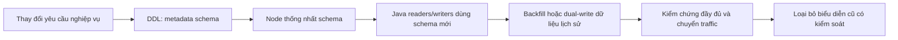
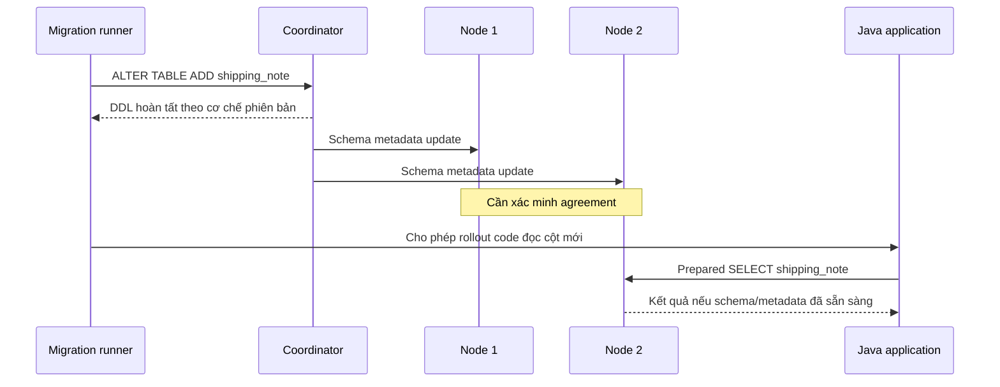
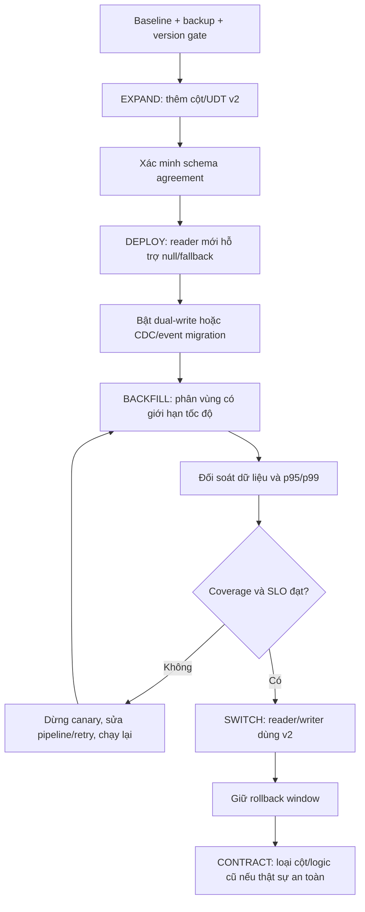

# Thêm cột, thay UDT hoặc đổi thuộc tính theo điều kiện phiên bản trong Apache Cassandra

## 1. Vì sao migration schema Cassandra cần kế hoạch riêng?

Apache Cassandra là cơ sở dữ liệu **wide-column phân tán**: **partition key** quyết định nơi dữ liệu được lưu, **clustering columns** quyết định thứ tự trong partition, dữ liệu được nhân bản theo **replication factor (RF)** và ứng dụng Java đọc/ghi CQL với **consistency level (CL)**. Một cluster đang phục vụ production có thể chứa nhiều phiên bản ứng dụng, nhiều node và nhiều datacenter cùng lúc.

Khi sản phẩm yêu cầu thêm ghi chú giao hàng, mở rộng kiểu địa chỉ hoặc đổi cấu hình TTL/compaction, thao tác trông có vẻ đơn giản:

- `ALTER TABLE ... ADD` một cột.
- `ALTER TYPE ... ADD` một trường của **user-defined type (UDT)**.
- `ALTER TABLE ... WITH ...` để sửa thuộc tính bảng.

Tuy nhiên, **schema được công bố không đồng nghĩa dữ liệu lịch sử đã được chuyển đổi**, và **DDL thành công không đồng nghĩa tất cả ứng dụng đang chạy tương thích ngay lập tức**. CQL, codec của Java Driver, trạng thái schema giữa node, SSTable cũ, TTL/tombstone và công cụ sao lưu đều cần được xem xét.

Mục tiêu sau bài:

1. Nhận biết thay đổi **additive** có thể rollout dần và thay đổi **breaking** cần tạo biểu diễn dữ liệu mới.
2. Tạo cột mới mà không giả định hàng cũ đã có giá trị.
3. Hiểu cách tiến hóa UDT và ranh giới **frozen/non-frozen** theo phiên bản.
4. Đổi thuộc tính bảng mà không nhầm metadata với việc viết lại mọi SSTable.
5. Thực hành quy trình **expand → deploy → backfill → switch → contract** cùng CQL và Java Driver 4.x.
6. Đặt **version gate, schema agreement, rollback và observability** trước khi thay đổi production.

> Nguyên tắc: hãy coi mỗi schema migration là **một thay đổi giao thức giữa dữ liệu và các phiên bản ứng dụng**, không phải chỉ một câu lệnh quản trị.

## 2. Phân loại thay đổi trước khi viết DDL

| Yêu cầu nghiệp vụ | Thao tác có thể cân nhắc | Mức rủi ro | Điều cần xác minh |
| --- | --- | --- | --- |
| Thêm `shipping_note text` có thể null | `ALTER TABLE ... ADD` | Thường tương thích với reader cũ | Phiên bản, tên cột, mapper/driver, dữ liệu cũ |
| Thêm `postal_code` vào UDT | `ALTER TYPE ... ADD` nếu được hỗ trợ | Phụ thuộc cách UDT được lưu và codec | Frozen/non-frozen, nested UDT, tất cả client |
| Đổi type `text` thành `bigint` | Tạo `amount_v2` hoặc bảng mới | Breaking | Chuyển đổi dữ liệu, backfill, dual-read |
| Thay partition/clustering key | Tạo bảng mới theo query | Breaking, ảnh hưởng placement | RF/CL, data migration, traffic cutover |
| Đổi `comment` của bảng | `ALTER TABLE ... WITH comment` | Thường ít ảnh hưởng dữ liệu | Cú pháp và quyền DDL |
| Đổi `default_time_to_live` | `ALTER TABLE ... WITH ...` | Ảnh hưởng ghi tương lai | Retention, tombstone, backfill |
| Đổi compaction strategy | `ALTER TABLE ... WITH compaction` | Tác động I/O và latency | Version, backlog, disk headroom, runbook |
| Đổi `gc_grace_seconds` | `ALTER TABLE ... WITH ...` | Rủi ro tính đúng đắn dữ liệu | Repair, delete, replica offline |
| Xóa cột hoặc đổi tên cột | Quy trình contract có kiểm soát | Có thể breaking | Prepared CQL, clients, schema history |

Không coi các tên lệnh trong bảng là cam kết hỗ trợ giống nhau trên mọi bản Cassandra. Các tính năng sửa schema đã thay đổi giữa các phiên bản; một số thao tác bị hạn chế hoặc không còn khuyến nghị.

### DDL metadata khác với data migration



`ALTER TABLE ADD` có thể được Cassandra áp dụng nhanh do chủ yếu là thay đổi schema, **không quét toàn bộ SSTable để tự tạo giá trị cột mới cho mọi hàng**. Những bước còn lại thuộc trách nhiệm migration và deployment.

## 3. Version gate: điều kiện bắt buộc trước khi chạy lệnh

Đối với bài này, không giả định một cú pháp có thể áp dụng nguyên vẹn trên Apache Cassandra 3.x, 4.x và 5.x, cũng không coi Cassandra được đóng gói bởi một nền tảng quản lý là giống hệt upstream.

### Những khả năng thường cần kiểm tra

| Chủ đề | Nhận định định hướng | Cách kiểm chứng |
| --- | --- | --- |
| Thêm cột thông thường | Có ở nhiều phiên bản bằng `ALTER TABLE ... ADD` | `nodetool version`, cú pháp CQL của bản đang dùng |
| Đổi type của cột hiện hữu tại chỗ | Có nhiều hạn chế/lịch sử thay đổi; **không coi là cách migration an toàn** | Tạo cột/bảng v2 nếu không có hướng dẫn tương thích rõ |
| `ALTER TYPE ... ADD` | Có trong các bản hỗ trợ UDT evolution | Test trên lab cùng version, xem frozen/nested references |
| Đổi tên trường UDT | Có thể được hỗ trợ có điều kiện, ảnh hưởng consumer | Không dùng như bước đổi tên không downtime khi chưa xác minh |
| Thay kiểu trường UDT hoặc bỏ trường | Không mặc định có thao tác sửa tại chỗ an toàn | Tạo type v2 và migration dữ liệu |
| `ALTER TABLE ... WITH` | Nhiều thuộc tính có thể đổi, nhưng key/tác động khác nhau | Schema docs/help của phiên bản, benchmark khi ảnh hưởng storage |
| Schema agreement/DDL propagation | Là trạng thái cluster cần xác minh | Trạng thái node/schema, driver metadata, logs |
| Java Driver 4.x với UDT | Có hỗ trợ UDT/codec theo metadata | Kiểm thử prepared statements và UDT serialization thực tế |

### Bộ lệnh quan sát ban đầu

```bash
nodetool version
nodetool status
nodetool describecluster
```

Trong `cqlsh`:

```text
DESCRIBE KEYSPACE migration_lab;
DESCRIBE TABLE migration_lab.orders_by_id;
```

Hai câu `DESCRIBE` chỉ có ý nghĩa **sau khi schema lab đã tồn tại** (được tạo ở mục 5). `DESCRIBE` là tiện ích của `cqlsh`, **không phải câu truy vấn DML thông thường từ Java Driver**.

Trước khi rollout, ghi lại **phiên bản từng node, compatibility matrix với Java Driver, tính năng được distribution hỗ trợ, phiên bản schema ban đầu và plan rollback**. Trong cluster đang nâng cấp rolling, không đưa vào DDL phụ thuộc tính năng mới khi còn node không hiểu định dạng đó.

## 4. Preflight: biết ai đang dùng schema và ai sẽ bị ảnh hưởng

Một checklist nền trước thao tác:

1. **Schema hiện tại:** keyspace, table, UDT, index, materialized view (nếu có), column type và table options.
2. **Contract ứng dụng:** service nào `SELECT *`, service nào nêu cột tường minh, ORM/mapper nào dùng mapping cố định và version nào đang triển khai.
3. **Partition model:** partition key/clustering key có phù hợp query shape sau thay đổi không?
4. **Tải và dung lượng:** QPS, p95/p99, disk free, compaction backlog, repair/streaming đang chạy.
5. **Topology/CL:** RF theo DC, local/global CL và khả năng chịu lỗi node trong maintenance window.
6. **Rollback:** có thể quay lại reader/writer cũ trong khi schema đã mở rộng không? Khi nào mới được xóa cột cũ?
7. **Backfill:** số hàng/partition, cách quét token ranges, giới hạn tốc độ và cơ chế resume.
8. **Quyền:** role triển khai có quyền `ALTER`/`CREATE` cần thiết nhưng không phải mật khẩu superuser đặt trong script.

Trong môi trường production, không nên gom đổi schema, tăng RF, chuyển compaction strategy và restart nhiều node vào cùng một đợt. Nếu có timeout, việc tìm nguyên nhân và rollback sẽ trở nên khó khăn.

### Bảo vệ DDL

- Chỉ chạy **một luồng migration được điều phối** cho cùng tài nguyên; tránh nhiều service cùng startup rồi tranh nhau `ALTER TABLE`.
- Ghi mã thay đổi, schema version ban đầu, time window, operator và kết quả **không kèm secret**.
- Thử cú pháp và hành vi trên **cluster staging cùng version/topology**.
- Cân nhắc backup/snapshot khi migration có bước xóa dữ liệu, chuyển type hoặc backfill lớn.
- Tránh dựa vào `IF NOT EXISTS` để che mismatch: tên cột đã tồn tại nhưng có **type sai** vẫn cần phát hiện.

## 5. Lab CQL: dựng schema có partition key rõ ràng

Giả sử lab có datacenter tên `dc1` và đủ replica cho RF3. Nếu lab chỉ có một node, chỉnh RF và CL theo môi trường; đừng thử `LOCAL_QUORUM` RF3 rồi coi `Unavailable` là lỗi DDL.

### Bước 1 — Tạo keyspace và UDT ban đầu

```sql
CREATE KEYSPACE IF NOT EXISTS migration_lab
WITH replication = {
    'class': 'NetworkTopologyStrategy',
    'dc1': 3
}
AND durable_writes = true;

CREATE TYPE IF NOT EXISTS migration_lab.delivery_address (
    line1 text,
    city text
);
```

### Bước 2 — Tạo bảng khóa theo `order_id`

```sql
CREATE TABLE IF NOT EXISTS migration_lab.orders_by_id (
    order_id uuid PRIMARY KEY,
    customer_id text,
    status text,
    shipping_address delivery_address,
    updated_at timestamp
) WITH comment = 'Order lookup by id - initial schema';
```

`shipping_address` ở ví dụ này là UDT được khai báo **không dùng `frozen<>` tại cột**, để minh họa khả năng cập nhật field trong những phiên bản hỗ trợ non-frozen UDT. Không biến lựa chọn này thành mặc định cho mọi nested collection hoặc primary key.

Thử tạo một hàng:

```sql
INSERT INTO migration_lab.orders_by_id (
    order_id, customer_id, status, shipping_address, updated_at
) VALUES (
    11111111-1111-4111-8111-111111111111,
    'customer-42',
    'CREATED',
    {line1: '12 Nguyen Hue', city: 'Ho Chi Minh City'},
    '2026-11-20 09:00:00+0000'
);

SELECT order_id, customer_id, status, shipping_address
FROM migration_lab.orders_by_id
WHERE order_id = 11111111-1111-4111-8111-111111111111;
```

Kết quả có thể cho thấy UDT có hai trường ban đầu. Cấu trúc UDT không làm Cassandra tự hiểu địa chỉ: đó vẫn là dữ liệu của **một row theo partition key `order_id`**.

## 6. Thêm cột bằng `ALTER TABLE ... ADD`

Yêu cầu sản phẩm: lưu ghi chú giao hàng tùy chọn, không cần thay khóa phân vùng.

```sql
ALTER TABLE migration_lab.orders_by_id
ADD shipping_note text;
```

Sau khi schema đã được áp dụng và kiểm tra agreement, truy vấn cột mới:

```sql
SELECT order_id, status, shipping_note
FROM migration_lab.orders_by_id
WHERE order_id = 11111111-1111-4111-8111-111111111111;
```

Hàng tạo trước DDL thường đọc `shipping_note` là **`null`**, vì chưa có mutation nào ghi cho cột này. **Thêm cột không tự backfill** ghi chú cho dữ liệu lịch sử.

Cập nhật một partition cụ thể:

```sql
UPDATE migration_lab.orders_by_id
SET shipping_note = 'Call before delivery'
WHERE order_id = 11111111-1111-4111-8111-111111111111;
```

### Những điều `ADD` không làm

| Điều mong đợi | Thực tế cần hiểu |
| --- | --- |
| “Mọi hàng cũ có giá trị mặc định” | Không có backfill tự động; reader phải xử lý null |
| “Ứng dụng cũ tự đọc thêm cột an toàn” | Chỉ an toàn nếu query/mapper/codec của ứng dụng cũ tương thích |
| “Thêm cột tạo partition mới” | Partition key vẫn như cũ; không thay phân bố token |
| “Thêm cột tự tạo index” | Không, nếu cần index phải thiết kế riêng và tính hiệu năng |
| “`status` ở Java đã đổi sang schema mới” | Metadata/prepared statements có vòng đời riêng; phải kiểm thử |
| “DDL tạo dữ liệu trên mọi replica ngay lập tức” | Schema propagation khác việc ghi mutation và replica synchronization |

### Null không phải một giá trị mặc định nghiệp vụ

Tùy trường hợp, `null` có thể nghĩa là:

- Hàng được tạo trước khi có cột `shipping_note`.
- Hàng mới không cung cấp ghi chú.
- Một thao tác đã xóa/đặt null theo semantics CQL.
- Bản ghi chưa qua backfill hoặc projection chưa theo kịp.

Nếu nghiệp vụ cần phân biệt bốn trường hợp, **một cột nullable có thể chưa đủ**. Có thể thêm `schema_version` hoặc trạng thái migration được thiết kế cụ thể; không suy ra “null tức là chưa backfill” khi ứng dụng mới cũng có thể chủ động không có giá trị.

### Không dùng `ADD` để đổi primary key

Partition key và clustering columns thuộc **mô hình placement và query**. Nếu chuyển từ `order_id` sang `(customer_id, month_bucket)` để đọc theo khách hàng/tháng, phải tạo **bảng theo truy vấn mới**, backfill và chuyển endpoint; không có một `ALTER TABLE ADD` đơn giản có thể biến phân vùng cũ thành phân vùng mới.

## 7. Thay type cột: tại sao nên tạo cột phiên bản mới?

Ví dụ cột `total_cents text` của một hệ thống cũ chứa `'125000'`, nhưng model mới muốn dùng `bigint` để so sánh số.

Đừng giả định câu lệnh kiểu:

```sql
-- KHÔNG phải hướng dẫn chạy; cú pháp/đổi kiểu tại chỗ
-- có thể bị từ chối hoặc không an toàn theo phiên bản.
-- ALTER TABLE migration_lab.orders_by_id
-- ALTER total_cents TYPE bigint;
```

Một cách migration rõ ràng hơn:

1. Thêm cột `total_cents_v2 bigint`.
2. Deploy reader biết đọc v2 nếu có, fallback v1 trong giai đoạn chuyển.
3. Writer mới ghi cả v1/v2 nếu còn consumer cũ; kiểm soát concurrency và timestamp.
4. Backfill v2 từ dữ liệu v1 bằng chuyển đổi có kiểm soát.
5. Đo coverage, chuyển hoàn toàn reader/writer sang v2.
6. Chỉ sau khi hết rollback window mới cân nhắc loại bỏ v1.

Ví dụ thêm cột mới trong **lab có sẵn cột `total_cents` kiểu text**, không áp dụng trực tiếp lên bảng lab ở mục 5 vì bảng đó chưa có cột nguồn:

```sql
-- Áp dụng cho bảng thực sự có total_cents text.
ALTER TABLE migration_lab.orders_by_id
ADD total_cents_v2 bigint;
```

Nếu dùng chính bảng lab trên, cột mới vẫn có thể được tạo nhưng **không có dữ liệu cũ để chuyển**. Điều quan trọng là minh họa quy trình chứ không phải tự ý chạy quét dữ liệu toàn cluster.

### Đổi tên cột cũng là thay đổi contract

Khả năng `RENAME` và ràng buộc cột được đổi khác nhau theo phiên bản; nhiều thay đổi tên cột không có semantics metadata-only an toàn cho mọi client. Với cột dữ liệu đang được nhiều service dùng, **add new → dual-read/write → backfill → contract** thường kiểm soát được hơn một lần đổi tên khiến prepared CQL lập tức thất bại.

Không thay đổi **column type, column name và primary key** trong cùng một release khi chưa có phép thử/khả năng rollback từng phần.

## 8. UDT: một kiểu dữ liệu có cấu trúc, không phải bảng độc lập

**User-defined type (UDT)** cho phép nhóm các trường có ý nghĩa chung, chẳng hạn địa chỉ:

```sql
CREATE TYPE IF NOT EXISTS migration_lab.delivery_address (
    line1 text,
    city text
);
```

Một hàng có thể chứa UDT trong cột `shipping_address`. UDT không có partition key hay replication riêng; dữ liệu của nó gắn với row/table chứa nó.

### Frozen và non-frozen khác nhau ở đâu?

| Đặc tính | `frozen<delivery_address>` | `delivery_address` không frozen |
| --- | --- | --- |
| Cách xem giá trị | Một giá trị được mã hóa như một đơn vị | Có thể hỗ trợ thao tác theo field |
| Cập nhật một field | Thường phải ghi lại toàn bộ giá trị | Có thể cập nhật field cụ thể theo phiên bản |
| Dùng trong nested collection/khóa | Có các quy tắc frozen riêng | Bị hạn chế hơn tùy chỗ tham chiếu |
| Thay schema UDT | Cần đánh giá khả năng đọc dữ liệu cũ và codec | Cần đánh giá dữ liệu field, codec và version |
| Khả năng tương thích | Không tự bảo đảm mọi driver cũ đọc được field mới | Cũng không tự bảo đảm các mapper cũ tương thích |

**Đừng hiểu “non-frozen” là có transaction độc lập cho từng field trên nhiều replica.** Field vẫn nằm trong mô hình consistency, timestamp, TTL và tombstone của Cassandra.

### Khi nào UDT có ích?

- Nhóm thông tin địa chỉ/metadata có schema rõ và thường được đọc cùng row.
- Giảm số cột top-level không liên quan khi một object có cấu trúc tương đối ổn định.
- Có thể dùng với prepared CQL và UDT codec của Java Driver.

Khi object thay đổi thường xuyên, lồng nhiều loại collection hoặc cần query/filter độc lập trên từng trường, phải đánh giá xem UDT có phù hợp hơn cột top-level/bảng theo truy vấn hay không.

## 9. Thêm trường UDT bằng `ALTER TYPE ... ADD`

Yêu cầu: bổ sung mã bưu chính cho địa chỉ:

```sql
ALTER TYPE migration_lab.delivery_address
ADD postal_code text;
```

Đây là ví dụ **UDT evolution dạng additive**. Nó chỉ được dùng sau khi đã kiểm tra bản Cassandra hỗ trợ thao tác và các tham chiếu tới UDT (đặc biệt `frozen`/nested) không bị ràng buộc cấm.

Ở những phiên bản cho phép cập nhật field của **non-frozen UDT**:

```sql
UPDATE migration_lab.orders_by_id
SET shipping_address.postal_code = '700000'
WHERE order_id = 11111111-1111-4111-8111-111111111111;

SELECT shipping_address
FROM migration_lab.orders_by_id
WHERE order_id = 11111111-1111-4111-8111-111111111111;
```

Trong lab, hàng cũ chưa được gán `postal_code` có thể cho trường mới là `null`. **Schema mới không tự suy ra mã bưu chính** từ `city`; nếu nghiệp vụ cần mã đó, phải dùng dữ liệu nguồn đáng tin cậy để backfill.

### Ranh giới tương thích quan trọng

- **Vị trí/định nghĩa field trong UDT** có thể ảnh hưởng serialization và codec; các client Java cũ phải được thử với dữ liệu có field mới.
- Khi UDT được **frozen** hoặc nằm trong collection/UDT lồng nhau, một số thao tác thay đổi có thể bị cấm hoặc có ràng buộc cụ thể theo phiên bản.
- Thêm field UDT **không tương đương** thay field cũ từ `text` sang `int` hoặc xóa field.
- Một field đã tồn tại với kiểu khác không được “sửa” bằng cách chạy lại `ALTER TYPE ADD`.
- Nếu Java mapper kỳ vọng chính xác hai field, cần kiểm thử decode cả giá trị cũ và giá trị mới; không dựa vào giả định mọi mapper tự bỏ qua trường mới.

**Nếu `ALTER TYPE` bị từ chối trong lab, không cố né bằng cách sửa system tables hoặc SSTable trực tiếp.** Chuyển sang thiết kế UDT phiên bản mới được mô tả ở mục tiếp theo.

## 10. UDT breaking change: tạo type v2 và column v2

Giả sử địa chỉ không chỉ thêm mã bưu chính mà còn đổi cấu trúc:

- `line1 text` được tách thành `street_name` và `building_number`.
- Nhiều consumer cũ vẫn hiểu `delivery_address`.
- Một số cột đã dùng UDT frozen trong các cấu trúc lồng nhau.

Trong trường hợp này, thay đổi UDT tại chỗ có thể vừa khó hỗ trợ về CQL vừa **không tương thích với codec cũ**. Phương án an toàn hơn là tạo phiên bản mới:

```sql
CREATE TYPE IF NOT EXISTS migration_lab.delivery_address_v2 (
    street_name text,
    building_number text,
    city text,
    postal_code text
);

ALTER TABLE migration_lab.orders_by_id
ADD shipping_address_v2 frozen<delivery_address_v2>;
```

Viết một giá trị v2 sau khi đã có type/column:

```sql
UPDATE migration_lab.orders_by_id
SET shipping_address_v2 = {
    street_name: 'Nguyen Hue',
    building_number: '12',
    city: 'Ho Chi Minh City',
    postal_code: '700000'
}
WHERE order_id = 11111111-1111-4111-8111-111111111111;
```

Ứng dụng có thể giữ v1 và v2 trong cùng row trong thời gian chuyển đổi. Khi đọc:

1. Nếu v2 có dữ liệu và hợp lệ, dùng v2.
2. Nếu v2 chưa có, đọc v1 và chuyển đổi theo chính sách nghiệp vụ.
3. Với writer mới, quyết định có **dual-write** hay cần một nguồn chuẩn và event/projection riêng.
4. Sau khi toàn bộ consumer mới ổn định, loại bỏ logic v1 trong một release khác.

### Không phải lúc nào cũng chuyển đổi được dữ liệu

Từ `line1 = '12 Nguyen Hue'` không thể luôn tách chắc chắn `building_number = '12'` và `street_name = 'Nguyen Hue'` cho mọi quốc gia. **Backfill là phép biến đổi nghiệp vụ**, không chỉ thay type CQL.

Cần quản lý dữ liệu lỗi/thiếu, trạng thái “không chuyển đổi được”, số lượng bản ghi đã kiểm chứng và cách sửa thủ công. Không biến một giá trị không chắc chắn thành dữ liệu chính xác giả.

## 11. Đổi thuộc tính bằng `ALTER TABLE ... WITH`

Thay thuộc tính bảng là một nhóm thao tác khác với thêm cột. Không phải mọi property đều có cùng tác động lên dữ liệu hiện hữu.

### 11.1. Thuộc tính metadata ít rủi ro: `comment`

```sql
ALTER TABLE migration_lab.orders_by_id
WITH comment = 'Order lookup by id - schema migration v2';
```

Comment giúp ghi mô tả nhưng không thay partition key hoặc backfill bất kỳ dữ liệu nào. Dù ít rủi ro, DDL vẫn cần quyền phù hợp và schema propagation.

### 11.2. TTL mặc định: thay đổi chính sách dữ liệu mới

Một ví dụ chỉ nên kiểm thử trên bảng **lab dùng cho dữ liệu hết hạn**:

```sql
-- KHÔNG dùng tùy tiện cho bảng đơn hàng production.
ALTER TABLE migration_lab.orders_by_id
WITH default_time_to_live = 604800;
```

`604800` giây = 7 ngày. TTL mặc định chủ yếu ảnh hưởng **các mutation sau thay đổi** theo semantics phiên bản; **không tự thêm TTL cho toàn bộ cell lịch sử**. Các giá trị được ghi mới, update và TTL được đặt tường minh có thể tương tác; không giả định chỉnh property làm tất cả hàng cũ hết hạn ngay.

Đặc biệt:

- Với đơn hàng cần giữ lâu để đối soát, **không áp dụng TTL 7 ngày** chỉ vì muốn giảm dung lượng.
- TTL/DELETE sinh tombstone; compaction chỉ loại khi điều kiện an toàn được đáp ứng.
- Quản trị viên phải hiểu ảnh hưởng lên **repair, replica offline và `gc_grace_seconds`**.
- Đặt lại `default_time_to_live = 0` về sau không làm sống lại dữ liệu đã hết hạn.

### 11.3. Compaction strategy

```sql
-- Ví dụ CQL của một thay đổi chiến lược, chỉ đánh giá ở lab.
ALTER TABLE migration_lab.orders_by_id
WITH compaction = {
    'class': 'SizeTieredCompactionStrategy'
};
```

Compaction strategy ảnh hưởng cách SSTable được gộp. Đổi property **không lập tức viết lại mọi SSTable cũ theo hình dạng mới**, nhưng có thể làm phát sinh compaction backlog, I/O lớn và thay đổi read/write/space amplification về sau. Cần đo `nodetool compactionstats`, disk headroom, read/write p99 và số SSTables/read.

STCS, LCS, TWCS và UCS (nếu version hỗ trợ) có các đánh đổi khác nhau. Không đổi từ STCS sang TWCS chỉ vì bảng có cột timestamp; phải xét time window, TTL, late writes và khả năng loại bỏ SSTable.

### 11.4. Những thuộc tính cần thận trọng hơn

| Property thường gặp | Rủi ro cần phân tích |
| --- | --- |
| `gc_grace_seconds` | Nếu giảm quá sớm khi replica offline/repair không bảo đảm, dữ liệu xóa có thể xuất hiện lại |
| `compression` | Tác động I/O/CPU và cách SSTable được nén về sau; không tự biến đổi tức thời mọi tệp |
| `caching` | Thay cách dùng cache, ảnh hưởng RAM và độ trễ theo workload |
| `bloom_filter_fp_chance` | Đánh đổi memory với I/O lookup; áp dụng lên SSTable theo cơ chế phiên bản |
| `speculative_retry` | Có thể thay tải đọc phụ trội/tail latency nếu được hỗ trợ và cấu hình phù hợp |
| `default_time_to_live` | Thay retention và tombstone cho mutation tương lai |
| `compaction` | Thay lịch và cường độ I/O công việc nền |

Danh sách tên option là **các ví dụ phổ biến, không bảo đảm có mặt ở mọi phiên bản hoặc distribution**. Đọc schema docs của bản đang dùng, kiểm thử cú pháp và chỉ đổi **một nhóm tham số mỗi đợt** để phân biệt nguyên nhân.

## 12. Schema agreement: DDL chạy xong chưa đủ

Schema là metadata cần được lan truyền trong cluster. Khi đổi type/column:



Sơ đồ được đơn giản hóa. Cassandra có cơ chế schema propagation/cluster metadata khác nhau theo version; **không suy ra các thông điệp DDL đi đúng như sơ đồ trên mọi bản**.

### Cần xác minh gì?

- Mọi node cần thiết đã nhận schema mới; không có schema disagreement kéo dài.
- Node bị Down trong lúc DDL có kế hoạch trở lại, bắt kịp schema và kiểm tra dữ liệu.
- `DESCRIBE TABLE` / `system_schema.columns` phản ánh tên/type dự kiến từ node phù hợp.
- Java Driver phát hiện metadata/schema update và có thể prepare truy vấn mới.
- Không có lỗi `InvalidQuery`, `Unknown column` hoặc UDT codec mismatch tăng sau rollout.

Một số lệnh quan sát:

```bash
nodetool status
nodetool describecluster
```

Trong `cqlsh`:

```sql
SELECT column_name, kind, type
FROM system_schema.columns
WHERE keyspace_name = 'migration_lab'
  AND table_name = 'orders_by_id';
```

`system_schema` là metadata để **đọc**, không phải nơi operator được phép sửa bằng `UPDATE`. Kết quả có thể khác theo phiên bản; nếu cần schema agreement cụ thể, dùng công cụ/driver đã được chứng thực cho version đó.

## 13. Ứng dụng Java 4.x: prepared statements và compatibility window

Java Driver 4.x sử dụng prepared statements, metadata và codec để gửi/đọc CQL. Khi schema thay đổi, một phiên bản ứng dụng cũ và mới có thể cùng chạy:

| Ứng dụng | CQL/mapper | Khả năng tương thích |
| --- | --- | --- |
| v1 chỉ đọc `order_id, status` | Cột mới chưa được nhắc tới | Thường vẫn chạy sau khi thêm nullable column |
| v2 đọc `shipping_note` | Cần schema đã có cột mới | Nếu deploy quá sớm có thể lỗi unknown column |
| v2 dùng `delivery_address_v2` | Cần type/column mới và codec phù hợp | Phải kiểm tra UDT mapping trên nhiều phiên bản driver |
| v1 dùng `SELECT *`/mapper cứng | Có thể bất ngờ thấy thêm column | Không mặc định luôn backward compatible |
| Writer mới dùng TTL/option khác | Có thể tạo data semantics khác | Cần test TTL, timestamp, backfill, đọc của app cũ |

**Khuyến nghị:** dùng danh sách cột tường minh, chuẩn bị câu `SELECT` mới sau khi schema agreement; không coi `SELECT *` là hợp đồng API ổn định.

### Ví dụ Java Driver 4.x sau bước thêm cột

```java
import java.util.Optional;
import java.util.UUID;

import com.datastax.oss.driver.api.core.CqlSession;
import com.datastax.oss.driver.api.core.DefaultConsistencyLevel;
import com.datastax.oss.driver.api.core.cql.BoundStatement;
import com.datastax.oss.driver.api.core.cql.PreparedStatement;
import com.datastax.oss.driver.api.core.cql.Row;

public final class OrderShippingNoteRepository {
    private final CqlSession session;
    private final PreparedStatement selectNote;
    private final PreparedStatement updateNote;

    public OrderShippingNoteRepository(CqlSession session) {
        this.session = session;
        // Chuẩn bị sau khi DDL và schema agreement đã được xác minh.
        this.selectNote = session.prepare(
            "SELECT shipping_note FROM migration_lab.orders_by_id " +
            "WHERE order_id = ?"
        );
        this.updateNote = session.prepare(
            "UPDATE migration_lab.orders_by_id " +
            "SET shipping_note = ? WHERE order_id = ?"
        );
    }

    public Optional<String> findNote(UUID orderId) {
        BoundStatement stmt = selectNote.bind(orderId)
            .setConsistencyLevel(DefaultConsistencyLevel.LOCAL_QUORUM)
            .setIdempotent(true);
        Row row = session.execute(stmt).one();
        if (row == null || row.isNull("shipping_note")) {
            return Optional.empty();
        }
        return Optional.of(row.getString("shipping_note"));
    }

    public void putNote(UUID orderId, String note) {
        BoundStatement stmt = updateNote.bind(note, orderId)
            .setConsistencyLevel(DefaultConsistencyLevel.LOCAL_QUORUM);
        session.execute(stmt);
    }
}
```

Lớp Java này là ví dụ tối giản, giả định kết nối `CqlSession` đã được cấu hình **TLS/auth, local DC và contact points** phù hợp. `LOCAL_QUORUM` cần đủ replica theo RF của DC; không đổi xuống `ONE` chỉ để migration pass. Session nên được dùng lại trong lifecycle service, không mở mới theo từng request.

`putNote` cố ý **không** gắn `setIdempotent(true)` một cách mù quáng: tính idempotent của write còn phụ thuộc timestamp, thao tác đồng thời, retry và side effect nghiệp vụ. Một write timeout có thể có outcome chưa xác định; hệ thống thật cần operation ID/reconciliation nếu có retry.

### UDT từ Java: field mới cần codec/metadata mới

Ví dụ phần đọc một UDT sau khi mở rộng type:

```java
import com.datastax.oss.driver.api.core.data.UdtValue;
import com.datastax.oss.driver.api.core.cql.Row;

// Đặt đoạn này bên trong method đọc row đã query shipping_address.
UdtValue address = row.getUdtValue("shipping_address");
String postalCode = null;
if (address != null && !address.isNull("postal_code")) {
    postalCode = address.getString("postal_code");
}
```

Đây là **trích đoạn**, không phải Java class hoàn chỉnh. Trước khi sử dụng cần bảo đảm type đã được thay đổi, driver đã nhận metadata mới, query thực sự select cột `shipping_address` và codec không bị cố định vào hình dạng UDT cũ. Với `frozen<...>` hoặc UDT v2, phải test serialization riêng.

## 14. Expand → deploy → backfill → switch → contract

Một migration đáng tin cậy nên cho phép **phiên bản cũ và mới cùng hoạt động** trong một cửa sổ có kiểm soát.



### Giai đoạn 1 — Expand

- Chạy `ALTER TABLE ADD`, `ALTER TYPE ADD` được hỗ trợ hoặc tạo type/table v2.
- Chờ schema agreement và xác minh tất cả node cần thiết.
- Chưa đọc bắt buộc từ cột mới nếu dữ liệu lịch sử còn null.
- Ghi lại thời điểm DDL và cấu hình để phục vụ rollback logic.

### Giai đoạn 2 — Deploy ứng dụng tương thích kép

- Reader cũ vẫn hoạt động; reader mới **null-safe** và có fallback khi v2 thiếu.
- Writer mới ghi dữ liệu v2, có thể vẫn ghi v1 nếu còn consumer v1.
- Feature flag bảo đảm có thể tắt đường đọc v2 mà không yêu cầu xóa DDL ngay.
- Không thay đổi query shape/CL một cách ngẫu nhiên trong cùng đợt.

### Giai đoạn 3 — Backfill lịch sử

- Quét nguồn dữ liệu theo token range hoặc khóa/manifest có kiểm soát, **không scan vô hạn bằng CQL `ALLOW FILTERING` trên production**.
- Giới hạn concurrent requests, page size, băng thông, retries và throughput.
- Ghi theo **partition key đầy đủ**, không dùng một batch khổng lồ gom hàng triệu partition.
- Có checkpoint/idempotency key và log kết quả theo lô; restart job không được làm sai dữ liệu.
- Xác định rõ thứ tự với **writes đang diễn ra**, tránh backfill giá trị cũ đè lên giá trị mới.

### Giai đoạn 4 — Switch và contract

- Đối chiếu dữ liệu v1/v2, đo hiệu năng ở peak và thử restart/rollout.
- Chuyển read path, sau đó mới ngừng cập nhật v1 theo chính sách.
- Giữ bản cũ trong một rollback window đã định.
- Chỉ xóa cột/UDT cũ sau khi chắc chắn không còn clients, prepared CQL, jobs và backups đang cần nó.

**Schema rollback khác data rollback:** Có thể tắt feature flag để client đọc lại v1, nhưng một khi đã xóa cột hoặc viết lại dữ liệu dưới semantics mới, việc “chạy ngược DDL” không bảo đảm tái tạo dữ liệu cũ.

## 15. Backfill an toàn: đừng đánh mất cập nhật mới

Giả sử trường `shipping_address_v2` cần được suy ra từ v1, trong khi đơn hàng vẫn có thể cập nhật địa chỉ.

```text
T1  Backfill job đọc address_v1 = A
T2  Ứng dụng mới ghi address_v2 = B (địa chỉ mới)
T3  Backfill job dùng dữ liệu đọc từ T1, ghi address_v2 = A

Kết quả: B có nguy cơ bị A ghi đè nếu timestamp/quy tắc ghi cho phép.
```

Cassandra dùng timestamp để hòa giải mutation trong nhiều trường hợp; nếu job backfill gửi giá trị **cũ với timestamp mới hơn**, nó có thể thắng một cập nhật nghiệp vụ mới.

Một pipeline cần thiết kế rõ:

1. **Nguồn chân lý:** v1 hay v2 đang là bản chính trong mỗi giai đoạn?
2. **Thời điểm sự kiện:** dùng version/sequence/timestamp thế nào để phân biệt update mới?
3. **Idempotency:** chạy lại một lô không làm thay đổi ý nghĩa dữ liệu.
4. **Conflict resolution:** nếu v1 và v2 thay đổi đồng thời, ai được ưu tiên?
5. **Checkpoint:** đã đi qua những partition/token ranges nào, số bản ghi lỗi cần sửa thủ công.
6. **Resume:** job có thể tiếp tục sau timeout, node outage hoặc deploy hay không?
7. **Rate limit:** tránh tăng compaction/disk pressure đến mức API p99 vượt SLO.

Không tùy tiện dùng `USING TIMESTAMP` với timestamp quá cũ/mới để “giải quyết” race. Timestamp do client cấp có thể khác wall-clock, tương tác TTL/tombstone và LWT; muốn dùng nó phải có một **mô hình phiên bản dữ liệu nhất quán**.

### LWT có phải lời giải chung không?

LWT (`IF`) hỗ trợ conditional mutation theo semantics Paxos cho phạm vi nhất định, nhưng có latency và availability tradeoffs. Nó **không** tạo một transaction ACID tùy ý cho hàng loạt bảng/partition trong backfill. Nếu cần bảo vệ một row khỏi overwrite, phải thiết kế điều kiện cụ thể, hiểu serial consistency và benchmark trên workload.

### Kiểm tra coverage

Đừng chỉ đếm “backfill đã gửi N UPDATE”. Nên theo dõi:

- Tổng partition/row dự kiến xử lý theo một nguồn thống kê đáng tin.
- Đã đọc/ghi thành công và **được xác nhận theo CL yêu cầu**.
- Số hàng mới đọc được v2 và số hàng vẫn dùng fallback v1.
- Số bản ghi có lỗi parse/type conversion hoặc thiếu dữ liệu nguồn.
- Sai lệch khi so v1↔v2 theo mẫu đại diện và theo tenant/time bucket.
- Error rate, p95/p99, compaction backlog và disk space trong suốt backfill.

Một số counter là **ước lượng hoặc thay đổi theo compaction**, không nên coi mọi con số `nodetool tablestats` là số hàng chính xác để xác nhận backfill.

## 16. Sơ đồ phối hợp với replication và nhiều DC

Thay đổi schema thuộc metadata cluster, nhưng mutation backfill vẫn đi qua **replica placement** và **CL**. Với `NetworkTopologyStrategy` mỗi DC có RF riêng:

```text
             Java migration service
                    |
              Coordinator dc1
                    |
       +------------+------------+
       |            |            |
       R1           R2           R3     (RF(dc1)=3)

Schema phải tương thích trên node đang phục vụ.
Mutation backfill cần đạt CL đã chọn.
DC khác có thể tạm trễ replication nếu WAN lỗi.
```

Nếu client dùng `LOCAL_QUORUM` ở dc1, một UPDATE được xác nhận khi đủ replica dc1 phản hồi; nó **không chứng minh mọi replica ở dc2 đã nhận mutation**. Sau khi topology ổn định, cần anti-entropy repair theo runbook cho các replica/ranges bị lệch; schema agreement **không thay thế dữ liệu hội tụ**.

Với migration nhiều DC:

- Triển khai schema trước các client v2 tại tất cả DC liên quan.
- Kiểm chứng read/write từ từng local DC, không chỉ từ một coordinator.
- Tính thời gian WAN, token range, số replica và khả năng DC khác đang gặp sự cố.
- Không chạy backfill ồ ạt ở hai DC với quy tắc timestamp xung đột.
- Nếu một node vắng mặt lâu, kiểm tra hinted handoff/repair trước khi tuyên bố mọi v2 đã được đồng bộ.

**Đổi RF hoặc chuyển node/DC không phải một bước phụ của thêm cột.** Nếu mục tiêu thật là di chuyển dữ liệu sang keyspace khác, phải lập runbook replication/streaming riêng.

## 17. Quan sát migration bằng `nodetool` và Java metrics

Các lệnh hữu ích trên **node đang được hỏi**:

```bash
nodetool status
nodetool describecluster
nodetool tpstats
nodetool compactionstats
nodetool tablestats migration_lab.orders_by_id
nodetool tablehistograms migration_lab orders_by_id
nodetool netstats
```

| Nguồn quan sát | Chỉ số | Câu hỏi |
| --- | --- | --- |
| Schema/driver | InvalidQuery, unknown column/type, UDT codec errors | Có ứng dụng chuẩn bị/đọc query trước schema agreement không? |
| `nodetool status` | Up/Down, DC/rack, joining/leaving | Node nào chưa tham gia đầy đủ lúc DDL/backfill? |
| `tpstats` | Pending tasks, dropped messages | Backfill có làm hàng đợi quá hạn tăng không? |
| `compactionstats` | Active/pending compactions | Ghi v2 có làm SSTable/compaction backlog tăng không? |
| `tablestats` | SSTable count, memtable, local latency, tombstones | Một bảng có chịu write amplification/hot partition không? |
| `tablehistograms` | p95/p99, partition size, cells, SSTables/read | Đuôi đọc có xấu đi sau v2 không? |
| `netstats` | Streaming/network activity theo version | Có bootstrap/repair tranh tài nguyên cùng migration không? |
| Java Driver/API | QPS, p99, retries, timeouts, new/old reader ratio | Người dùng có gặp lỗi/latency không? |
| Migration job | Checkpoint, converted, skipped, conflicts, failures | Backfill có hoàn thành và đúng không? |

Các metric `nodetool` thường là **cục bộ theo node** và tên/đơn vị thay đổi theo phiên bản. Không lấy một node `UN` hay một truy vấn `SELECT` thành công làm bằng chứng toàn cluster đã migrate xong.

### Mẫu canary dashboard

| Tín hiệu | Baseline giả định | Sau canary giả định | Hành động |
| --- | ---: | ---: | --- |
| Read p99 API | 45 ms | 50 ms | Xem xu hướng/SLO |
| Write p99 API | 30 ms | 110 ms | Điều tra dual-write/backfill |
| Schema errors | 0/phút | 12/phút | Dừng rollout v2 |
| Backfill conflicts | 0 | 25 | Dừng job và xử lý quy tắc ghi |
| Compaction pending | 20 | 145 | Kiểm tra tốc độ/đĩa |
| Disk free | 40% | 22% | Đánh giá headroom trước khi tiếp tục |

Các số này **chỉ minh họa cách phát hiện vấn đề**, không phải ngưỡng áp dụng cho mọi cluster. Ngưỡng rollout phải gắn với SLO và dung lượng dự phòng thực tế.

## 18. Quy trình rollback theo mức độ phá vỡ

| Thay đổi | Rollback tương đối an toàn | Điều không nên làm |
| --- | --- | --- |
| Thêm cột nullable | Tắt writer/reader v2, giữ cột thừa trong thời gian điều tra | DROP cột ngay vì một canary lỗi |
| Thêm UDT field | Chuyển client về cách đọc cũ nếu tương thích | Giả định có thể DROP field/đảo encoding đơn giản |
| Thêm type/column v2 | Ngừng đọc/ghi v2, giữ v1 để đối soát | Xóa v2 trước khi biết có dữ liệu mới chỉ tồn tại ở đó |
| Đổi `comment` | Sửa lại comment theo DDL | Coi đó là khôi phục dữ liệu |
| Đổi TTL | Dừng cấu hình sai cho mutation mới; kiểm tra dữ liệu bị ảnh hưởng | Tin rằng đổi TTL về 0 sẽ hoàn tác expiry |
| Đổi compaction | Tuning/rollback strategy có runbook và headroom | Mong mọi SSTable trở lại trạng thái cũ ngay |
| DROP column/type/table | Phục hồi theo backup/migration thiết kế sẵn | Chạy `ADD` lại rồi tin dữ liệu cũ tự xuất hiện |

### Về `DROP COLUMN` và tái dùng tên

Xóa cột là thao tác **destructive** về mặt schema/data contract. Cassandra có metadata về cột bị xóa và timestamp để xử lý dữ liệu cũ trên SSTable; việc thêm lại cột có cùng tên, đặc biệt với type khác, có thể bị hạn chế hoặc dẫn tới hành vi không như mong đợi tùy version.

**Không dùng DROP/ADD cùng tên như cách đổi type tại chỗ.** Nếu thực sự phải contract:

1. Backup/snapshot và xác minh restore.
2. Dừng tất cả consumer cũ, kể cả batch/reporting jobs.
3. Chứng minh không còn dữ liệu cần giữ chỉ ở cột cũ.
4. Kiểm tra tác động của TTL/tombstone và rollback window.
5. Áp dụng DDL trong cửa sổ được phê duyệt và giám sát.

Nếu muốn thay đổi **partition key**, phải thiết kế bảng mới; một `DROP`/`ADD` trên cùng table không di chuyển SSTable sang token ownership mới một cách thần kỳ.

## 19. Tình huống thực hành và đáp án định hướng

### Tình huống A — Thêm cột nhưng dữ liệu cũ là null

Bạn chạy `ALTER TABLE orders_by_id ADD shipping_note text` thành công. Ứng dụng Java mới cho rằng mọi row đều có ghi chú và ném exception khi đọc row cũ. Cassandra có lỗi không?

**Gợi ý:** Không. Schema mới chưa tự backfill. Reader phải xử lý null/optional, có thể dùng fallback hoặc backfill khi nghiệp vụ có dữ liệu nguồn.

### Tình huống B — Thêm trường UDT nhưng client cũ lỗi decode

Cluster cho phép `ALTER TYPE delivery_address ADD postal_code text`, nhưng một service cũ dùng mapper UDT cố định. Điều cần làm?

**Gợi ý:** Dừng rollout, thử lại với metadata/codec của version cũ, nâng mapper hoặc chuyển sang UDT v2. DDL thành công không thay thế kiểm thử compatibility trên tất cả consumer.

### Tình huống C — Đổi TTL để tiết kiệm đĩa

Operator đổi `default_time_to_live = 604800` trên bảng đơn hàng lưu trữ pháp lý. Một tuần sau dữ liệu mới hết hạn. Đổi TTL về 0 có làm dữ liệu trở lại không?

**Gợi ý:** Không. TTL mới có thể ảnh hưởng dữ liệu được ghi sau DDL; thay property không tự khôi phục dữ liệu đã hết hạn. Cần backup/recovery và xem xét chính sách retention trước.

### Tình huống D — Backfill đè lên update thật

Job đọc address v1 ở T1, ứng dụng ghi address v2 mới ở T2, job cập nhật v2 từ dữ liệu cũ ở T3. Vì sao sai?

**Gợi ý:** Timestamp/cơ chế hòa giải có thể khiến mutation backfill mới hơn ghi đè update thật. Cần version/sequence/conditional update hoặc cơ chế replay có thứ tự; không chỉ tăng retry.

### Tình huống E — Schema agreement nhưng DC khác đọc dữ liệu cũ

`ALTER TABLE ADD` đã lan tới cả hai DC; update v2 ghi tại dc1 với `LOCAL_QUORUM`. Ngay sau đó dc2 đọc giá trị cũ khi WAN chập chờn. Mâu thuẫn không?

**Gợi ý:** Không. Schema agreement là metadata; data replication và CL địa phương là hai vấn đề khác. Phải kiểm tra WAN, replica catch-up/repair và ứng dụng đọc đúng DC.

### Tình huống F — Đổi type bằng DROP/ADD cùng tên

Đội vận hành định `DROP total_cents` rồi `ADD total_cents bigint` để thay cột text. Tại sao nguy hiểm?

**Gợi ý:** Dữ liệu cũ có thể bị xóa/không còn truy cập được; tái dùng tên/type bị hạn chế; prepared queries/codec đang chạy có thể lỗi. Dùng `total_cents_v2` hoặc bảng v2 và backfill có kiểm soát.

### Tình huống G — Giảm `gc_grace_seconds` ngay khi chuyển schema

Trong rollout, có một replica offline kéo dài; team muốn giảm grace để compaction “dọn tombstone nhanh”. Có an toàn không?

**Gợi ý:** Không mặc định. Grace và anti-entropy repair bảo vệ delete khi replica vắng mặt; giảm quá sớm có thể làm dữ liệu đã xóa xuất hiện lại. Đừng gộp tuning này với migration.

## 20. Checklist triển khai production

**Trước thay đổi**

- [ ] Xác minh chính xác **Cassandra version/distribution** và cú pháp được hỗ trợ trên toàn cluster.
- [ ] Có schema baseline, owner, change window, bảng/cột/UDT references và danh sách Java consumers.
- [ ] Hiểu partition/clustering key, RF, DC, CL và contract query trước/sau DDL.
- [ ] Đã thử trên staging, kể cả dữ liệu cũ, null, UDT frozen/non-frozen và mapper cũ.
- [ ] Có backup/restore plan cho thay đổi breaking và đủ disk/CPU/compaction headroom.
- [ ] Không đổi đồng thời DDL, RF, compaction strategy, GC grace và nhiều node.

**Khi expand và chuyển ứng dụng**

- [ ] Ưu tiên **thêm cột/type v2** thay vì đổi type/xóa field không tương thích.
- [ ] Xác minh schema agreement và node/driver metadata trước khi prepare CQL mới.
- [ ] Reader mới null-safe; writer có chính sách dual-write và concurrency rõ ràng.
- [ ] Backfill có rate limit, checkpoint, idempotency, phân vùng và xử lý lỗi parse.
- [ ] Tránh race giữa backfill và update thật; có một quy tắc nguồn chân lý.
- [ ] Đo p95/p99, timeout, read/write throughput, SSTable/compaction và disk free.
- [ ] Thử từ mỗi DC theo CL cần thiết; không nhầm schema agreement với replica catch-up.

**Sau khi chuyển**

- [ ] Đối soát dữ liệu theo nhiều partitions/tenants và logic nghiệp vụ, không chỉ một row.
- [ ] Không còn consumers cũ hoặc prepared statements phụ thuộc schema cũ.
- [ ] Đã giữ rollback window và kiểm chứng phương án đọc lại v1.
- [ ] Chỉ DROP dữ liệu/UDT cũ khi đã xác minh backup, retention và impact.
- [ ] Ghi nhận schema/driver version mới, metric baseline và kết quả migration.

**Ghi nhớ:** Trong Cassandra, `ALTER TABLE ADD` thường **mở rộng metadata nhưng không tự sinh dữ liệu cho hàng cũ**; `ALTER TYPE` đòi kiểm tra giới hạn **UDT frozen/non-frozen và phiên bản**; `ALTER TABLE WITH` thay đổi thuộc tính có thể gây tác động về **TTL, compaction và tính đúng đắn**. Cách an toàn để đổi schema đang sống là **version gate → expand → triển khai reader/writer tương thích → backfill/đối soát → switch → contract**, luôn giữ khả năng rollback và quan sát p99, replica, schema agreement và dữ liệu thực tế.
