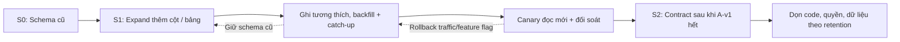
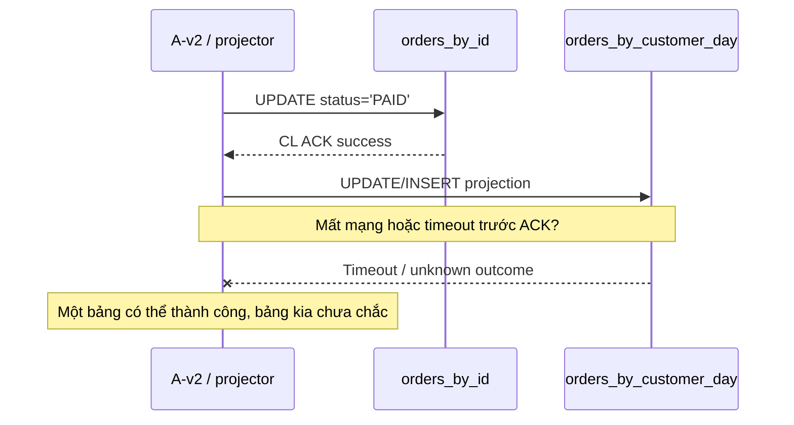

# Expand/contract với nhiều phiên bản ứng dụng cùng hoạt động

## 1. Bài toán thực tế: Cassandra không được phép “đợi ứng dụng nâng cấp hết”

Trong một hệ thống Java triển khai rolling deployment, bản ứng dụng **A-v1** và **A-v2** có thể cùng xử lý request trong vài phút, vài giờ hoặc lâu hơn: pod cũ chưa bị rút, consumer xử lý message còn tồn, tác vụ batch chạy lịch cũ, một vùng/DC chưa nâng cấp hoặc cần rollback sau canary. Trong thời gian đó, các phiên bản cùng đọc/ghi dữ liệu trên Apache Cassandra.

Một thay đổi tưởng nhỏ như “đổi `status` thành `status_detail`”, “chuyển `order_id` sang partition key có bucket ngày” hoặc “bỏ trường `legacy_code`” có thể làm A-v1 gặp lỗi CQL khi A-v2 còn hoạt động bình thường. Một thay đổi bảng theo truy vấn không chỉ là chuyện DDL: dữ liệu phải được chuyển, ghi phát sinh trong thời gian chuyển phải được giữ, và rollback phải có đường dữ liệu để quay lại.

Bài thuộc chương **Di chuyển và schema** của mô-đun `DATABASE_ENGINE_WIDE_COLUMN_CASSANDRA`, gắn với kiến trúc phân tán/wide-column, thiết kế bảng theo partition key và query, consistency đọc/ghi, CQL, replication, compaction, repair, xử lý sự cố và Java Driver.

**Mục tiêu:** lập một quy trình **expand → migrate → contract** trong đó *tất cả phiên bản ứng dụng đang được phép chạy* vẫn đọc/ghi theo hợp đồng, dữ liệu cũ và dữ liệu mới không lệch âm thầm, DDL được triển khai an toàn và điều kiện xóa cấu trúc cũ dựa trên bằng chứng.

Sau bài, người học sẽ:

1. Xác định các **bất biến tương thích** khi A-v1/A-v2 chạy song song.
2. Phân biệt **thêm cột trên cùng bảng** với **thay đổi primary key/query pattern phải tạo bảng mới**.
3. Thiết kế **dual write/CDC hoặc replay, backfill, kiểm tra đầy đủ, cutover và rollback**.
4. Hiểu tác động của schema agreement, prepared statements, TTL, tombstones, timestamp và consistency level (CL).
5. Thực hành CQL/Java Driver trên dữ liệu giả và đặt tiêu chí đóng từng pha không dựa vào cảm tính.

## 2. Nguyên tắc expand/contract: tương thích trước, dọn dẹp sau

**Expand** là thêm khả năng mới mà **không phá hợp đồng cũ**: cột tùy chọn, bảng mới, luồng ghi mới hoặc logic đọc fallback. **Migrate** đưa dữ liệu/luồng xử lý sang cấu trúc mới. **Contract** chỉ gỡ cấu trúc cũ khi không còn phiên bản nào cần nó và đã qua cửa sổ rollback.



**Bất biến trung tâm:** không có bước triển khai nào buộc A-v1 thực thi câu CQL, giải mã dữ liệu hoặc diễn giải business state mà nó chưa từng hỗ trợ. Tương tự A-v2 phải đọc được dữ liệu được tạo bởi A-v1 trong suốt giai đoạn hai phiên bản chung sống.

### Hai trục trạng thái độc lập

- **App version:** A-v1 chỉ biết bảng/cột cũ; A-v1.5 có thể ghi thêm cấu trúc mới nhưng còn đọc cũ; A-v2 có thể đọc mới và fallback; A-v3 bỏ đường cũ.
- **Schema/data version:** S0 chứa bảng cũ; S1 có thêm tài nguyên mới nhưng chưa đầy đủ dữ liệu; S1-ready đã backfill/catch-up; S2 đã loại bỏ cấu trúc cũ.

Không đồng nhất “ứng dụng deploy thành công” với “dữ liệu mới đã đầy đủ”, cũng không coi “DDL thành công” là tín hiệu cho phép xóa code cũ.

## 3. Ma trận tương thích phải được viết trước khi chạy DDL

Giả sử A-v1 truy cập `orders_by_id(order_id, customer_id, status)`; A-v2 muốn đọc thêm `status_note`.

| Trạng thái schema | A-v1 đọc/ghi cột cũ | A-v2 chỉ đọc thêm cột mới | A-v2 có fallback khi cột mới null | Rollback A-v2 → A-v1 |
| --- | --- | --- | --- | --- |
| **S0: chưa có `status_note`** | Có | **Không**, query tham chiếu cột chưa tồn tại | Chỉ khi **feature đọc cột mới chưa được bật** | Có |
| **S1: đã `ADD status_note`** | Có, nếu A-v1 dùng CQL tường minh và không cần cột mới | Có thể, nhưng hàng cũ trả null | Có | Có, nếu A-v2 vẫn ghi dữ liệu cũ A-v1 cần |
| **S1-ready: đã backfill dữ liệu cần thiết** | Có | Có thể chuyển dần sau khi kiểm chứng | Có, nên giữ trong cửa sổ chuyển | Có theo điều kiện ghi tương thích |
| **S2: đã `DROP status`** | **Không** | **Không với A-v2 còn SELECT status**; chỉ bản mới đã bỏ mọi tham chiếu cột cũ có thể chạy | Không cứu bất kỳ phiên bản nào vẫn hỏi cột `status` | **Không** nếu chỉ rollback binary |

**Cột mới = null** ở hàng cũ là trạng thái bình thường của additive migration; không được tự diễn giải null thành “đã hoàn tất” hoặc làm đổi ý nghĩa nghiệp vụ. A-v2 phải có định nghĩa rõ về giá trị mặc định/fallback, kể cả null hợp lệ là dữ liệu thật.

### Cửa sổ đồng tồn tại

```text
Thời gian  ------------------------------------------------------------>

Schema:      S0 |------------- S1 (mở rộng) --------------| S2 contract
A-v1 pods:   ██████████████████───────────────(0 instance)─────────────
A-v1 jobs:   ████████████████████████─────────(0 job)─────────────────
A-v2 pods:              █████████████████████████████████████████████
Old writers: ███████████████████████████──────(0 writer)────────────────
Backfill:                    █████████████████
Catch-up:                             ██████████████
Read cutover:                                       ███████████████████
Rollback window:          <------------------------->
```

**Đóng được cửa sổ A-v1** chỉ khi có bằng chứng rằng mọi API instance, worker, cron job, consumer, region, chương trình nội bộ và client chạy phiên bản cũ đã ngừng **ghi hoặc đọc** những trường sắp xóa. Đừng chỉ kiểm tra deployment hiện tại mà bỏ qua retry queue và batch jobs ngủ đến ngày hôm sau.

## 4. Trường hợp A — Thêm cột trên cùng bảng: expand đơn giản nhất

### 4.1. Tạo schema và dữ liệu lab

Ví dụ một DC `dc1` có đủ node cho RF = 3. Chỉ chạy trên **cluster lab**; khi tên DC hoặc topology khác, điều chỉnh tương ứng.

```sql
CREATE KEYSPACE migration_lab_ks
WITH replication = {'class': 'NetworkTopologyStrategy', 'dc1': 3}
AND durable_writes = true;

CREATE TABLE migration_lab_ks.orders_by_id (
    order_id uuid PRIMARY KEY,
    customer_id text,
    created_at timestamp,
    status text,
    updated_at timestamp
);

INSERT INTO migration_lab_ks.orders_by_id
    (order_id, customer_id, created_at, status, updated_at)
VALUES (
    11111111-2222-4333-8444-555555555555,
    'synthetic-customer-1',
    '2026-11-21T08:00:00+0000',
    'CREATED',
    '2026-11-21T08:00:00+0000'
);
```

Đối với query đọc theo order ID, `order_id` là **partition key**; việc thêm cột thông thường không thay token placement hay RF.

### 4.2. Expand trước khi deploy A-v2

```sql
ALTER TABLE migration_lab_ks.orders_by_id
ADD status_note text;

-- Xem schema đã được khai báo:
SELECT column_name, kind, type
FROM system_schema.columns
WHERE keyspace_name = 'migration_lab_ks'
  AND table_name = 'orders_by_id';
```

Thêm cột **không tự backfill** giá trị cho các hàng cũ; nếu chưa được ghi, `status_note` trả null. DDL phải chạy bởi **schema migrator** có quyền thích hợp, không đặt “tự ALTER TABLE mỗi lần app start” trong mọi pod.

A-v1 tiếp tục truy vấn bằng projection tường minh:

```sql
SELECT order_id, customer_id, status, updated_at
FROM migration_lab_ks.orders_by_id
WHERE order_id = 11111111-2222-4333-8444-555555555555;
```

A-v2 đọc thêm cột tùy chọn:

```sql
SELECT order_id, customer_id, status, status_note, updated_at
FROM migration_lab_ks.orders_by_id
WHERE order_id = 11111111-2222-4333-8444-555555555555;
```

**Hợp đồng trong S1:** `status` vẫn là trường trạng thái chuẩn mà A-v1 hiểu, `status_note` chỉ là thuộc tính bổ sung. A-v2 có thể bỏ qua null. Nếu biến `status_note` thành trường bắt buộc với nghĩa nghiệp vụ mới, phải có pha điền dữ liệu và kiểm chứng riêng trước khi bật.

### 4.3. Tại sao không dùng `SELECT *` trong prepared statement?

Khi thay đổi schema, danh sách/kiểu cột trả về có thể khác metadata đã cache trong driver. **Đặc biệt ở Cassandra 3.x và native protocol cũ**, prepared `SELECT *` sau khi ADD/DROP column có nguy cơ giải mã kết quả sai hoặc lỗi. Driver/protocol mới có cơ chế cập nhật result metadata tốt hơn ở những tổ hợp phiên bản, nhưng thực hành an toàn trong rolling deploy vẫn là **liệt kê rõ cột mà mỗi app hiểu**.

Không dùng cùng một prepared statement có thứ tự/kiểu cột đầu ra thay đổi tùy thời điểm trong code A-v1. Sau DDL, quan sát schema agreement, metadata refresh, lỗi `UNPREPARED`/schema và test đọc trên các coordinator.

## 5. Trường hợp B — Đổi partition key/query pattern: phải tạo bảng mới

Giả sử ứng dụng cần liệt kê đơn hàng của khách theo ngày; bảng cũ `orders_by_id` partition theo `order_id` chỉ tối ưu truy vấn lấy một đơn hàng. Cassandra **không cho thay primary key của bảng hiện hữu bằng `ALTER TABLE`** để đổi partitioning tại chỗ. Vì vậy cần tạo **bảng theo truy vấn mới**:

```sql
CREATE TABLE migration_lab_ks.orders_by_customer_day (
    customer_id text,
    bucket_day date,
    created_at timestamp,
    order_id uuid,
    status text,
    updated_at timestamp,
    PRIMARY KEY ((customer_id, bucket_day), created_at, order_id)
) WITH CLUSTERING ORDER BY (created_at DESC, order_id DESC);
```

```text
Legacy read (A-v1):
  GET /orders/{orderId}
         -> orders_by_id
            partition key = order_id

New read (A-v2):
  GET /customers/{customerId}/orders?day=...
         -> orders_by_customer_day
            partition key = (customer_id, bucket_day)
            clustering = (created_at DESC, order_id DESC)

Old + new tables may contain the same business order,
but Cassandra does not magically keep them synchronized.
```

**Hệ quả mô hình wide-column:** bảng mới là một **projection/denormalized table** được duy trì bởi ứng dụng hoặc pipeline. Cassandra không tự chuyển mọi mutation của bảng cũ sang bảng mới chỉ vì hai bảng có `order_id` giống nhau.

Đổi kiểu cột, đổi nghĩa khóa, gộp/tách partition hoặc thay clustering order cũng cần xem như **một bài toán dữ liệu mới**, không giả định `ALTER TABLE` cho phép đổi datatype/primary key an toàn tại chỗ.

## 6. Lộ trình chuẩn cho bảng mới khi A-v1 và A-v2 cùng chạy

### Pha E0 — Chốt hợp đồng và khởi tạo khả năng rollback

Trước khi viết:

- Liệt kê toàn bộ app/job/consumer phiên bản cũ và các câu CQL đang dùng.
- Xác định bảng nguồn đáng tin cậy, khóa logic `order_id`, cơ chế cập nhật/xóa/TTL và **ai được phép ghi**.
- Lập **ma trận tương thích A-v1/A-v2** với từng schema/data state.
- Chốt RF/CL, multi-DC routing và policy retry. Đổi CL cùng migration có thể làm so sánh tính đúng đắn sai lệch.
- Chọn event log/CDC/outbox hoặc cách capture mutation từ **mọi writer**, đặc biệt A-v1.
- Có snapshot/backup hợp lệ và kế hoạch rollback *logic*; backup không thay thế kiểm soát dual-write.

### Pha E1 — Expand schema và quyền

Tạo bảng mới, DDL/keyspace/table settings và quyền cho migration worker. A-v1 vẫn chỉ dùng bảng cũ; A-v2 chưa chuyển đọc mới. Chờ schema agreement qua các node đang UP và kiểm tra rằng A-v1 vẫn thực hiện được prepared CQL cũ.

### Pha E2 — Đảm bảo bắt được toàn bộ thay đổi mới phát sinh

Có ba cách phổ biến, nhưng không cách nào “miễn phí”:

1. **Compatibility writers:** nâng cấp **tất cả writer** lên A-v1.5, luôn ghi nguồn cũ và tạo projection mới, rồi mới cho phép đọc mới. Khi còn A-v1 cũ chưa nâng, nó vẫn có thể ghi chỉ vào bảng cũ.
2. **Log/outbox/CDC:** mọi thay đổi có nguồn event bền vững; một projector độc lập áp dụng mutation tới bảng mới, kể cả mutation do A-v1 tạo. Cần kiểm chứng CDC thực sự bắt đủ writes/DELETE/TTL trong topology và giới hạn retention.
3. **Backfill + catch-up có ranh giới:** lấy baseline tại một mốc, sau đó replay **mọi thay đổi kể từ mốc đó**, xử lý retry và deletion. Không tự coi scan bảng nguồn một lần là đủ khi writers đang chạy.

**Quy tắc vàng:** trong khi A-v1 vẫn có thể ghi **chỉ vào bảng cũ**, không được kết luận bảng mới luôn mới nhất nếu không có cơ chế capture/đối soát writes của A-v1. Nâng A-v2 lên dual-write chỉ giải quyết những request A-v2 xử lý.

### Pha M1 — Backfill lịch sử theo phạm vi

Đọc dữ liệu cũ, xác định `bucket_day` từ `created_at` theo timezone quy ước (ví dụ UTC), ghi idempotent vào bảng mới. Tách tiến trình thành token ranges và checkpoints, giới hạn rate/concurrency, bảo đảm disk/headroom và chuẩn hóa row types.

### Pha M2 — Catch-up và chống data race

Trong lúc backfill, các phiên bản vẫn có thể UPDATE/DELETE. Cần replay mutation theo **nguồn có thứ tự/phiên bản** hoặc cơ chế reconciliation đủ chặt để backfill dữ liệu cũ không ghi đè giá trị mới đã có trong projection.

### Pha R1 — Shadow reads rồi canary

A-v2 vẫn trả dữ liệu từ bảng cũ, đồng thời đọc mới trong một tỷ lệ request được phép để **so sánh khóa/giá trị** ở cùng một cutoff hợp lý. Sau khi coverage đạt tiêu chí, chuyển từng phần traffic sang đọc mới (feature flag), giữ fallback có chính sách rõ.

### Pha R2 — Chỉ còn writer mới; đánh giá rollback

Xác minh không còn A-v1 hoặc job cũ; ngừng dual-write **chỉ nếu** cửa sổ rollback đã kết thúc và dữ liệu cũ không còn cần làm nguồn. Không được dừng ghi nguồn cũ sớm nếu có khả năng quay lại A-v1.

### Pha C — Contract thật sự

Sau khi tất cả phiên bản đang chạy, queues và rollback process đều không cần cấu trúc cũ, mới xem xét thu hồi quyền, dừng code đọc/ghi cũ và lập lịch drop/cleanup theo retention. Việc xóa bảng/cột là **thay đổi khó hoàn nguyên**: rollback binary **không tái tạo** cột, SSTable, tombstone và schema đã xóa.

## 7. Chìa khóa thứ nhất: dual-write không phải giao dịch atomic giữa các bảng

Giả sử A-v2 xử lý event “order đổi từ CREATED sang PAID”:



**Hai câu CQL riêng không tạo transaction atomic**. Cassandra có batch CQL nhưng batch không phải một công cụ tạo giao dịch nghiệp vụ phân tán với isolation và điều kiện trên nhiều partition; dùng **logged batch nhiều partition** như cơ chế “2-phase commit” để che nhu cầu projector bền vững là sai. Batch còn có chi phí coordinator/batchlog và có thể gây hotspot.

### Những trường hợp phải xử lý

| Trường hợp | Hậu quả | Biện pháp |
| --- | --- | --- |
| Write cũ success, write mới fail | Projection thiếu hoặc stale | Retry idempotent từ event log/outbox với checkpoint |
| Write mới success, write cũ fail | A-v1 có thể đọc dữ liệu cũ | Giữ nguồn cũ làm chuẩn trong cửa sổ; báo lỗi/đối soát |
| Timeout sau write mới nhưng server đã ghi | Retry có thể chạy lại một mutation | Dùng business event ID, idempotent upsert với timestamp/version hợp lệ |
| A-v1 write chỉ nguồn cũ | Projection không thấy mutation | Upgrade toàn writer hoặc CDC/replay bắt A-v1 |
| Backfill ghi snapshot cũ sau live update | Có thể ghi đè trạng thái mới | Có ordering/version guard, replay từ log, đối soát sau backfill |
| DELETE ở nguồn nhưng không tới projection | Bản ghi đã xóa vẫn hiển thị | Capture tombstone/delete event, xóa projection theo primary key |
| Queue/projector lag kéo dài | Read mới không đáp ứng freshness | Monitor lag, trì hoãn cutover, fallback có chính sách |

### Tại sao timestamp và TTL làm dual-write khó hơn?

Cassandra giải quyết xung đột nhiều cell theo **write timestamp và quy tắc reconciliation**, không dùng trực tiếp giá trị `updated_at` của ứng dụng như một version CAS toàn hàng. Đồng hồ lệch, explicit `USING TIMESTAMP` sai hoặc replay với timestamp khác có thể làm dữ liệu cũ thắng mới, hay vô tình làm sống lại trạng thái không phù hợp.

- `updated_at timestamp` là **cột nghiệp vụ**; không phải nguyên tắc cuối cùng để Cassandra chọn cell thắng.
- `WRITETIME(column)` có thể hỗ trợ điều tra **timestamp thực của một cell**, không phải commit sequence cho toàn bộ nghiệp vụ; với một số kiểu dữ liệu/tùy chọn không áp dụng như nhau.
- Nếu TTL được dùng, backfill không được reset thời hạn tồn tại bằng cách ghi một TTL đầy đủ mới. Phải giữ **thời điểm hết hạn ban đầu** hoặc tính TTL còn lại theo chính sách.
- DELETE cần được coi là **event nghiệp vụ** chứ không đơn giản là “không thấy row nên không làm gì”. Một record bị xóa giữa lúc backfill scan có thể bị hồi sinh ở projection nếu không chống stale writes.
- Với LWT/`IF ...`, hiểu riêng consistency serial và phạm vi partition; **không** giả định LWT trên hai bảng khác partition biến chúng thành giao dịch atomic.

**Giải pháp thiết kế thường bền hơn:** một nguồn sự kiện có sequence/version nghiệp vụ được kiểm soát, projector idempotent với checkpoint, retry, DLQ và đối soát định kỳ. Cách áp dụng conditional update vào bảng projection phải được kiểm chứng trên đúng version/CQL semantics — không suy một `IF updated_at < ?` trên dữ liệu phức tạp là đủ cho mọi race.

## 8. Chìa khóa thứ hai: backfill phải hội tụ với dòng ghi sống

### 8.1. Vấn đề một lượt quét

```text
t0: backfill đọc order-42 = CREATED
t1: A-v1 UPDATE order-42 = PAID ở bảng cũ
t2: projector nhận event PAID, ghi PAID vào bảng mới
t3: backfill (chậm) ghi CREATED vào bảng mới

Nếu hệ thống không có version/timestamp và chống ghi cũ thích hợp,
projection cuối cùng có thể quay về CREATED.
```

Đây là **race dữ liệu**, không phải lỗi schema agreement. Đọc một bảng theo CL cao hơn không tự sửa race khi cách copy/replay không có thứ tự/phiên bản.

### 8.2. Thiết kế checkpoint

| Thành phần | Mục đích | Điều kiện cần |
| --- | --- | --- |
| Range/partition checkpoint | Biết đã đọc phạm vi nào | Không tự đánh dấu thành công khi write target chưa xác nhận |
| Event offset/watermark | Biết các writes từ nguồn đã được replay đến đâu | Lưu bền vững, rollback được, có quy tắc cho ordering |
| Idempotency key | Retry không tạo nhân đôi dữ liệu/hành động | Dựa vào business event ID hoặc key bất biến |
| Failure queue / dead letter | Bắt được bản ghi lỗi kiểu dữ liệu/TTL/permission | Không “skip rồi báo completed” |
| Rate limiter | Không đẩy disk/compaction/GC production quá SLO | Theo dõi coordinator, source và destination replicas |
| Validation manifest | Phạm vi backfill và đối soát cuối | So key set, values, deletes và cutoff, không chỉ row count |

### 8.3. CQL không nên dùng để full-scan bừa bãi

Với Cassandra, `SELECT * FROM huge_table`, `ALLOW FILTERING` vô tội vạ và `COUNT(*)` trên hàng tỷ row thường gây chi phí lớn, không tạo một snapshot logic toàn cluster. Để backfill toàn bảng:

- Chia **token ranges** có checkpoints; dùng công cụ bulk/Spark/export được kiểm chứng với data size, schema/driver version và giới hạn mạng.
- Dùng **paging có kiểm soát** và concurrency thấp đủ để tránh đuối replica; biết rằng paging không đồng nghĩa snapshot transaction.
- Nếu dữ liệu đang ghi, cần capture sự kiện **trước khi bắt đầu quét**, kết hợp catch-up và xác minh sau cùng.
- Dữ liệu denormalized có thể thay khóa đích theo `customer_id/bucket_day`; bảo đảm không bỏ bucket/timezone, trùng event ID hoặc mất DELETE.
- Ghi kết quả theo batch hợp lý; không dùng batch khổng lồ để “tăng tốc” migration.

Không tự định nghĩa một token query cho mọi kiểu partition key nếu chưa kiểm thử `token(...)`, partitioner và hiệu năng đọc của môi trường. Backfill là tác vụ vận hành có SLO tài nguyên riêng.

## 9. Schema agreement và Java Driver: DDL đã trả success chưa chắc mọi node thấy ngay

Cassandra là hệ phân tán; DDL cập nhật metadata được lan tới các node. Giữa hai thời điểm, coordinator A có thể nhận biết cột mới còn coordinator B chưa biết, gây `Undefined column name`/`unconfigured table` hoặc lỗi metadata trong một số tình huống.

**Thứ tự khuyến nghị:** chạy DDL một lần ở schema migrator → kiểm tra schema agreement trên các node UP → kiểm tra metadata/table columns → smoke test A-v1 → mới cho phép A-v2 dùng cột/bảng mới. Tránh phát hàng loạt ALTER TABLE song song từ nhiều pod.

```bash
# Quan sát cluster và phân bố schema version từ node lab:
nodetool status
nodetool describecluster
```

```sql
SELECT column_name, type
FROM system_schema.columns
WHERE keyspace_name = 'migration_lab_ks'
  AND table_name = 'orders_by_id';
```

Với Java Driver 4.x, có API kiểm tra schema agreement:

```java
// session là CqlSession của migration controller,
// không thực thi DDL từ mỗi pod ứng dụng.
boolean agreed = session.checkSchemaAgreement();
if (!agreed) {
    throw new IllegalStateException(
        "Schema agreement chưa đạt; không bật feature đọc mới");
}
```

Đây là **một gate cần thiết, không phải chứng nhận data backfill đã hoàn tất**. Khi node DOWN, driver có thể chỉ kiểm tra các node đang UP; schema vẫn cần hội tụ khi node đó quay lại. Tương tự client metadata refresh/cache và Cassandra versions có thể ảnh hưởng việc quan sát. **Không nên thay đổi schema giữa lúc cluster đang rolling upgrade các phiên bản server khác nhau**, nếu chưa chứng minh khả năng tương thích cụ thể.

### Prepared statement và phiên bản ứng dụng

Một binary A-v1 có thể giữ prepared statement trong bộ nhớ lâu hơn quá trình deploy. Đặc biệt với Cassandra 3.x/protocol cũ, `SELECT *` có nguy cơ result metadata bị stale khi thêm/bớt cột; ngay cả khi version mới xử lý tốt hơn, dùng **explicit projection** vẫn giúp API contract ổn định.

Không cho A-v1 gửi query tham chiếu cột chỉ có từ S1, và không cho A-v2 gọi cột mới **trước khi** schema gate đạt. Nếu có lỗi `UNPREPARED` sau DDL hoặc reconnect, quan sát driver reprepare/retry có giới hạn; không giải quyết bằng retry vô hạn làm quá tải cluster.

## 10. Java Driver 4.x: giữ hai đường đọc/ghi trong cửa sổ chuyển

Mã minh họa sau giả sử đã có `CqlSession session` kết nối đúng local DC, bảng lab và imports `UUID`/API Java Driver. Đây là **logic chuyển đổi minh họa**, không phải một hệ thống outbox đầy đủ.

### 10.1. Prepared statements có projection tường minh

```java
PreparedStatement oldRead = session.prepare(
    "SELECT order_id, customer_id, created_at, status, updated_at " +
    "FROM migration_lab_ks.orders_by_id WHERE order_id = ?"
);

PreparedStatement newRead = session.prepare(
    "SELECT order_id, customer_id, created_at, status, status_note, updated_at " +
    "FROM migration_lab_ks.orders_by_id WHERE order_id = ?"
);

PreparedStatement newList = session.prepare(
    "SELECT created_at, order_id, status, updated_at " +
    "FROM migration_lab_ks.orders_by_customer_day " +
    "WHERE customer_id = ? AND bucket_day = ? LIMIT 50"
);
```

Chỉ chuẩn bị `newRead` và `newList` khi schema S1 đã được tạo và metadata/permissions được kiểm chứng; nếu chạy code cả hai phiên bản song song, A-v1 nên tiếp tục dùng `oldRead`. Khi migrate code, cố định `LOCAL_QUORUM` nếu đó là hợp đồng trước đó, không đổi CL để “giảm timeout migration”.

### 10.2. A-v2 fallback trên cột bổ sung

```java
UUID id = UUID.fromString("11111111-2222-4333-8444-555555555555");
Row row = session.execute(
    newRead.bind(id)
        .setConsistencyLevel(DefaultConsistencyLevel.LOCAL_QUORUM)
).one();

if (row != null) {
    String canonicalStatus = row.getString("status"); // A-v1 vẫn biết.
    String note = row.getString("status_note");          // Có thể null.
    String visibleNote = note == null ? "" : note;
    System.out.println(canonicalStatus + " / " + visibleNote);
}
```

Null fallback trong ví dụ chỉ mang nghĩa **note tùy chọn**, không phải quy tắc chung cho mọi cột. Nếu cột mới thay thế trạng thái chuẩn, cần một mapping versioned rõ ràng để A-v2 không hiểu sai dữ liệu A-v1.

### 10.3. Ghi hai bảng: minh họa giới hạn, không khẳng định atomic

```java
PreparedStatement updateLegacy = session.prepare(
    "UPDATE migration_lab_ks.orders_by_id " +
    "SET status = ?, updated_at = ? WHERE order_id = ?"
);
PreparedStatement upsertProjection = session.prepare(
    "INSERT INTO migration_lab_ks.orders_by_customer_day " +
    "(customer_id, bucket_day, created_at, order_id, status, updated_at) " +
    "VALUES (?, ?, ?, ?, ?, ?)"
);

// Các biến customerId, bucketDay, createdAt, updatedAt được lấy
// từ event nghiệp vụ đã được xác minh; không lấy Date.now tùy tiện.
session.execute(
    updateLegacy.bind(status, updatedAt, orderId)
        .setConsistencyLevel(DefaultConsistencyLevel.LOCAL_QUORUM)
);
session.execute(
    upsertProjection.bind(customerId, bucketDay, createdAt, orderId, status, updatedAt)
        .setConsistencyLevel(DefaultConsistencyLevel.LOCAL_QUORUM)
);

// Nếu bước hai timeout, hai bảng có thể lệch.
// Cần outbox/event log + projector retry/idempotency ngoài đoạn mã.
```

Đoạn này cố tình **không** “nuốt” exception sau khi một write thành công; ứng dụng thật phải thiết kế **trạng thái kết quả không xác định, outbox, retry và reconciliation** trước khi triển khai. Nếu A-v1 vẫn có quyền cập nhật bảng cũ, projector phải **bắt được các mutation đó** để bảng mới không tụt hậu.

### 10.4. Đọc bảng mới chỉ sau gate

```java
ResultSet page = session.execute(
    newList.bind(customerId, bucketDay)
        .setConsistencyLevel(DefaultConsistencyLevel.LOCAL_QUORUM)
        .setPageSize(50)
);

for (Row order : page) {
    UUID orderId = order.getUuid("order_id");
    // Validate/read business fields; không chỉ kiểm tra ResultSet không rỗng.
}
```

Nếu đổi page size hoặc query limit trong cùng đợt migration, phải đo thêm **độ đúng kết quả và latency khi đọc hết các page**; `pageSize` khác `LIMIT`. Không coi việc một page thành công là coverage mọi order.

## 11. Đối soát dữ liệu: hai bảng không cần đồng nhất về cột, phải đồng nhất theo nghiệp vụ

Mục tiêu không phải so raw SSTable bytes của bảng cũ và bảng mới. Chúng có **primary key khác nhau** và clustering order khác nhau; cần xác định ánh xạ logic:

```text
Source row:
  orders_by_id
  key = order_id
  data = customer_id, created_at, status, updated_at

Target row:
  orders_by_customer_day
  partition = (customer_id, UTC_date(created_at))
  clustering = (created_at, order_id)
  data = status, updated_at

Invariant:
  Với mọi order hợp lệ tại cutoff và thuộc phạm vi chuyển,
  phải có đúng một target row với cùng order_id/status/updated_at.
  Mọi DELETE/TTL hợp lệ cũng phải được phản ánh theo policy.
```

### Các phép kiểm tra theo giai đoạn

| Giai đoạn | Kiểm chứng | Không đủ để kết luận |
| --- | --- | --- |
| E1 schema | `DESCRIBE TABLE`/schema agreement, A-v1 vẫn chạy | Không chứng minh target chứa dữ liệu |
| Backfill | Key/range checkpoint, hàng thành công/thất bại, target writes ACK | Một counter “99% rows copied” |
| Catch-up | Event offset/watermark, lag và replay failures bằng 0 trong cửa sổ | Chỉ nhìn queue rỗng trong một giây |
| Shadow read | So order ID set, status, timestamps theo cùng cutoff và tenant/day | So row count của một page |
| Canary | p95/p99, error, success QPS, fallback/mismatch rate, DC/CL | Một success test từ một client |
| Contract gate | Không còn A-v1 writer/reader, rollback window kết thúc, backup/retention phù hợp | Chỉ thấy deployment mới đang healthy |

Một chuỗi test phải bao gồm: order mới, order cũ, update liên tục, hai sự kiện cùng timestamp, delete, TTL hết hạn, partition vắng mặt, retry gây duplicate, backlog kéo dài và một vùng/DC tạm không truy cập. Cassandra cho phép đọc dữ liệu cũ theo CL khác nhau nên so sánh phải giữ **cùng CL/local DC**, hoặc ghi rõ mức stale được chấp nhận.

### Tránh những phép đo kiểm chứng gây quá tải

`SELECT COUNT(*)` trên bảng rất lớn có thể quét dữ liệu rộng và không cho ảnh chụp nhất quán. Tốt hơn: **manifest theo token range/checkpoint, sampling phân tầng, hashes chuẩn hóa theo khóa** và đối soát nguồn event. Digest/hash cần ổn định về cách serialize UUID, timestamp, decimal, null và thứ tự; hash bằng nhau không chứng minh không có lỗi ngoài phạm vi đã kiểm.

## 12. Dữ liệu xóa, TTL và bảng mới: rủi ro silent corruption

### 12.1. UPDATE trên khóa khác có thể tạo row “mồ côi”

Giả sử `customer_id` hoặc `bucket_day` được sửa: target primary key thay đổi. Cassandra không “chuyển row” theo sự thay đổi giá trị khóa như thao tác UPDATE trên cột thường. Cần **xóa target cũ theo đầy đủ key** và ghi target mới, đồng thời xử lý trường hợp một bước thất bại và replay.

### 12.2. DELETE là sự kiện, không chỉ là thiếu bản ghi

Nếu một order bị xóa lúc backfill đang chạy, projector phải nhận DELETE, có đủ **target primary key** để xóa row mới. Backfill không được ghi lại trạng thái cũ khi các replica/commitlog/tombstone đã cho biết dữ liệu bị xóa.

Đặc biệt, một replica offline lâu hơn vòng đời tombstone/repair có thể gây zombie data trong một số điều kiện. Migration không thay thế repair; phục hồi topology phải tuân theo kế hoạch anti-entropy và `gc_grace_seconds`.

### 12.3. TTL không được vô tình làm mới

Nếu row nguồn có TTL còn 1 giờ, backfill ghi target với TTL 30 ngày sẽ làm dữ liệu tồn tại lâu hơn chính sách. Nếu không ghi TTL, target có thể tồn tại vô thời hạn. Hãy tính **remaining TTL tại thời điểm ghi target**, hoặc bảo tồn expiry từ event store, và định nghĩa cách xử lý những row gần hết hạn. Chú ý TTL có phạm vi **cell** trong Cassandra, không đơn giản là thuộc tính một row bất biến.

### 12.4. CQL write timestamps và wall clock

Các LWW timestamps có thể bị ảnh hưởng bởi đồng hồ client/coordinator và những lần replay. Không dùng timestamp “hiện tại” khi retry backfill cũ nếu điều đó khiến dữ liệu cũ thắng bản mới. Định nghĩa rõ chiến lược version/order và cách sửa khi source/target khác nhau; kiểm tra hậu quả trước khi chọn `USING TIMESTAMP` hay LWT.

## 13. Contract là một hoạt động nguy hiểm, không phải “dọn code”

Trong Cassandra, lệnh `ALTER TABLE ... DROP column` có thể làm dữ liệu cột không còn truy vấn được; việc xóa vật lý diễn ra theo storage/compaction sau đó. **DROP rồi ADD lại cùng tên không tự khôi phục giá trị cũ**; tái sử dụng tên với type khác có rủi ro nghiêm trọng đối với SSTable/commitlog.

```sql
-- CẢNH BÁO: chỉ là VÍ DỤ CONTRACT trong lab đã hoàn thành mọi gate.
-- Không chạy nếu A-v1 vẫn đọc 'status' hoặc rollback còn cần cột cũ.
-- ALTER TABLE migration_lab_ks.orders_by_id DROP status;

-- Với bảng denormalized cũ, DROP TABLE còn phá đường phục hồi.
-- Chỉ thực hiện sau approval, retention và backup đã kiểm chứng.
-- DROP TABLE migration_lab_ks.orders_by_id;
```

**Không** thay đổi partition key bằng cách drop/re-add các cột khóa, vì nó xác định token placement và key shape. **Không** rollback database schema bằng cách DROP bảng mới nếu A-v2 còn ghi và có event chưa được chiếu về bảng cũ. Trong nhiều trường hợp, contract nên được thực hiện **một release hoặc một chu kỳ backup/retention sau cutover**, không ngay khi canary 100%.

### Ba điều kiện loại trừ đặc biệt

1. **Ứng dụng cũ còn sống:** worker, cron, canary cũ hoặc một region chưa nâng vẫn đọc/ghi cột cũ.
2. **Có khả năng rollback A-v1:** rollback binary sau contract sẽ lỗi ngay vì schema không còn tương thích.
3. **Dữ liệu cũ là nguồn khôi phục duy nhất:** xóa nó trước khi đánh giá backup/retention, catch-up và những request chưa xử lý sẽ tạo lỗ hổng phục hồi.

## 14. Rollback theo từng pha

| Pha gặp lỗi | Phản ứng ưu tiên | Vì sao an toàn hơn? |
| --- | --- | --- |
| S1 đã ADD cột/bảng, chưa có data migration | Tắt feature, giữ schema additive; A-v1 tiếp tục chạy | Không cần DROP vội, tránh làm rung schema |
| Dual-write/projector mới lỗi | Ngừng read cutover, đưa traffic về nguồn cũ, sửa projector, replay từ log | Nguồn cũ còn giữ write hợp lệ |
| Backfill chỉ đạt một phần | Tiếp tục A-v1 reads, sửa checkpoint/rate và chạy bù | Không làm người dùng đọc target thiếu |
| Shadow-read mismatch | Giữ reads cũ, điều tra theo order ID/cutoff, kiểm tra update/delete/TTL | Không che lỗi bằng fallback vô hạn |
| Canary A-v2 lỗi nhưng schema chưa contract | Rollback binary/feature flag, **giữ các writers tương thích** | A-v1 vẫn được hỗ trợ |
| A-v2 đã ngừng ghi nguồn cũ, rollback muốn về A-v1 | **Không rollback binary đơn thuần**; cần replay target→source hoặc chuyển về writer tương thích trước | Nguồn cũ có thể mất các mutation mới |
| Đã DROP cột/bảng cũ | Rollback là **data recovery/migration riêng**, có RPO/RTO/backup | Lệnh ADD cùng tên không tái tạo dữ liệu |

**Không dùng database restore toàn cluster như phản xạ mặc định** để rollback một deploy: phục hồi backup cũ có thể làm mất những writes hợp lệ sau thời điểm backup và ảnh hưởng các ứng dụng khác. Ưu tiên rollback chức năng/traffic khi schema vẫn mở rộng, hoặc replay có kiểm soát nếu đã đi quá xa.

## 15. Runbook triển khai nhiều phiên bản ứng dụng

### P0 — Kiểm kê phiên bản và đường dữ liệu

Ghi A-v1/A-v2, tất cả API/consumer/batch jobs, CQL statements, CL/RF/local DC, vai trò/permission và các nguồn replay. Liệt kê cả service ở vùng dự phòng, retry queue và client cũ chưa nâng. Đặt **rollback deadline** và chủ sở hữu quyết định contract.

### P1 — Đặt tiêu chí nghiệm thu và giới hạn tài nguyên

Chốt correctness (key/status/TTL/delete), completeness theo range/offset, allowed projector lag, p95/p99, successful QPS, error rate, disk free, compaction backlog và lịch repair. Chốt giới hạn **concurrent backfill tasks** để không tranh disk/CPU với foreground queries.

### P2 — Backup và expand DDL có một owner

Kiểm tra snapshot/backup/restore phù hợp; chạy DDL tuần tự bằng schema migrator, không từ mỗi Java pod. Theo dõi schema agreement, metadata trên các coordinator, quyền của role mới và smoke test câu CQL A-v1.

### P3 — Deploy compatibility writers/capture

Nâng writers hoặc bật log/CDC để **mọi phiên bản** còn hoạt động có đường mutation vào target, bao gồm deletes/TTL. Trước khi bắt đầu backfill, cần có **mốc capture/offset bền vững** và kế hoạch xử lý downtime.

### P4 — Backfill có checkpoint

Chia token ranges, copy có rate limit, lưu checkpoint sau ACK đúng CL, ghi failures vào queue và theo dõi disk/GC/compaction. Không chặn ứng dụng hàng giờ trừ khi runbook đã phê duyệt maintenance window; nếu có writes, áp catch-up để xử lý race.

### P5 — Catch-up và đối soát

Khi projector lag và failures đạt ngưỡng, so tập khóa/giá trị theo cutoff; kiểm tra update/delete, TTL, moved key, hàng null và những lỗi idempotency. Truyền thông rằng “backfill 100%” **không đồng nghĩa** “projection đã theo kịp mutations hiện tại”.

### P6 — Shadow reads và canary

Bật A-v2 đọc mới cho một phần traffic, có metric mismatch/fallback/timeout theo query shape. Giữ CL/driver local DC đã thỏa thuận, so với A-v1 trên dữ liệu hợp lệ và có khả năng quay lại read path cũ.

### P7 — Chặn tất cả old writers, kết thúc rollback window

Đếm active instances và message consumers của A-v1 bằng kiểm chứng vận hành; yêu cầu các job chạy một lần, release thủ công và dự phòng đều được nâng. Nếu còn một writer cũ, **không** dừng capture hay drop nguồn.

### P8 — Contract có phê duyệt

Chỉ xóa cột/bảng và quyền cũ khi không ai dùng, dữ liệu target và backup đạt yêu cầu, và chi phí rollback được chấp nhận. Triển khai DDL contract riêng để dễ xác định nguyên nhân; quan sát schema agreement, slow queries, client error và storage.

### P9 — Đóng migration bằng bằng chứng

Lưu manifest mốc schema, commit/release ID, số range/offset đã xử lý, row/key mismatch, lag, số retries, chi phí backfill, p99 và tình trạng backup. Rà cron/feature flags cũ, giữ audit/retention theo chính sách, cập nhật runbook cho deploy tiếp theo.

## 16. Các tình huống chẩn đoán dễ gặp

| Triệu chứng | Câu hỏi cần đặt | Hành động |
| --- | --- | --- |
| A-v2 query báo `Undefined column` sau ADD | Schema agreement chưa đạt? Query chạy trước DDL? Metadata/driver cũ? | Tắt feature, kiểm tra schema versions, CQL và driver cache |
| A-v1 lỗi ngay sau DROP | Còn old reader/writer trong hệ thống? | Dừng contract, ưu tiên khôi phục đường cũ theo backup/runbook, không tự ADD lại tùy tiện |
| Target thiếu vài order dù backfill báo completed | A-v1 chỉ ghi nguồn cũ? Event replay lag? Checkpoint skip? | Kiểm tra all-writers capture, offsets và so key set |
| Target trả status cũ sau live update | Backfill ghi đè; timestamp/version ordering sai? | Kiểm tra source event, write timestamps, sửa replay/idempotency |
| Order đã xóa vẫn xuất hiện trong bảng mới | DELETE không được capture hoặc backfill hồi sinh | Sửa tombstone/delete pipeline, audit trước cutover |
| Bảng mới có record trùng khi fan-out | Event ID không ổn định, key mapping sai, retry khác key | Chuẩn hóa business key và dedup, xác minh bucket UTC |
| Error tăng ở `LOCAL_QUORUM` | Vấn đề replica/CL hoặc backfill quá tải? | So metrics coordinator/replica, disk/CPU/compaction, điều tiết backfill |
| Canary đọc mới nhanh nhưng thiếu dữ liệu | LIMIT/page size hoặc projection/mapping thay đổi? | Chặn rollout bằng correctness gate; đừng chọn latency trước |
| Backfill và repair chạy cùng lúc, p99 xấu | I/O/CPU cạnh tranh, TTL/compaction backlog | Giảm concurrency, đặt lịch không chồng, theo dõi SLO |
| Rollback A-v1 xong nhưng mất writes gần đây | Nguồn cũ đã ngừng được ghi ở A-v2 | Phục hồi projection→source từ event log trước khi rollback reads |
| Driver `UNPREPARED` hàng loạt | Schema change/restart, server prepare cache và client retry? | Kiểm tra version, prepared statement policy, hạn chế retry bão |

## 17. Bài lab có kiểm chứng: từ S0 đến S1, chưa phá cấu trúc cũ

> Lab này dùng bảng `migration_lab_ks.orders_by_id` và `orders_by_customer_day` của mục trước. Không thực thi DDL trên production. Các UUID/ID đều là dữ liệu giả. **Không chạy DROP COLUMN/DROP TABLE** để hoàn thành bài học.

**Bước A — Baseline của A-v1:**

```sql
CONSISTENCY LOCAL_QUORUM
SELECT order_id, customer_id, created_at, status, updated_at
FROM migration_lab_ks.orders_by_id
WHERE order_id = 11111111-2222-4333-8444-555555555555;
```

**Bước B — Expand:** thực hiện `ALTER TABLE ... ADD status_note text` một lần, `CREATE TABLE orders_by_customer_day`, xác nhận schema agreement và chạy lại câu SELECT A-v1. A-v1 không cần biết bảng mới tồn tại.

**Bước C — Ghi bổ sung hợp lệ:**

```sql
UPDATE migration_lab_ks.orders_by_id
SET status_note = 'lab-only'
WHERE order_id = 11111111-2222-4333-8444-555555555555;

INSERT INTO migration_lab_ks.orders_by_customer_day
    (customer_id, bucket_day, created_at, order_id, status, updated_at)
VALUES (
    'synthetic-customer-1',
    '2026-11-21',
    '2026-11-21T08:00:00+0000',
    11111111-2222-4333-8444-555555555555,
    'CREATED',
    '2026-11-21T08:00:00+0000'
);
```

**Bước D — So old/new theo business ID:**

```sql
SELECT order_id, customer_id, created_at, status, status_note, updated_at
FROM migration_lab_ks.orders_by_id
WHERE order_id = 11111111-2222-4333-8444-555555555555;

SELECT order_id, created_at, status, updated_at
FROM migration_lab_ks.orders_by_customer_day
WHERE customer_id = 'synthetic-customer-1'
  AND bucket_day = '2026-11-21';
```

Quan sát:

- A-v1 vẫn đọc được `status` theo partition key cũ.
- A-v2 thấy `status_note` nhưng không bắt A-v1 biết cột này.
- Target chứa đúng `order_id/status/updated_at` theo ánh xạ.
- Việc **hai lệnh INSERT/UPDATE trên hai bảng cùng thành công trong lab** không chứng minh dual-write luôn atomic trước timeout.

**Bước E — Giả lập lỗi trên giấy:** đặt tình huống một A-v1 cập nhật `status='PAID'` khi projector tạm ngừng. Hãy mô tả sự kiện/offset cần replay, cách target được ghi bù và điều kiện cho phép mở read canary. Không tạo thao tác hỏng cluster thật để “kiểm thử migration”.

## 18. Câu hỏi kiểm tra và bài tập tình huống

1. Vì sao một release chỉ có A-v2 trong deployment chính vẫn chưa đủ cho phép DROP cột cũ? Hãy kể những nơi A-v1 có thể còn chạy.
2. Vì sao `ALTER TABLE ADD status_note` là bước expand nhưng `DROP status` là bước contract?
3. Cassandra có cho đổi partition key của `orders_by_id` sang `(customer_id, bucket_day)` bằng `ALTER TABLE` không? Vậy phải thiết kế bảng theo truy vấn thế nào?
4. Vì sao prepared `SELECT *` có rủi ro khi schema thay đổi, đặc biệt ở Cassandra/protocol cũ?
5. Một A-v1 writer vẫn cập nhật bảng cũ nhưng A-v2 writer đã dual-write. Thiết kế hiện tại có đủ để bật read mới 100% không? Còn thiếu gì?
6. Đơn hàng đã được backfill là CREATED, sau đó live write cập nhật PAID, rồi backfill retry ghi CREATED. Tại sao `updated_at` đơn thuần chưa bảo đảm PAID thắng?
7. Nêu sự khác biệt giữa “backfill scan 100%” và “catch-up event log 100% đến watermark”.
8. Vì sao logged batch nhiều partition không được xem là giao dịch đầy đủ để thay outbox/projector?
9. TTL còn 30 phút ở bảng cũ; backfill không đặt TTL cho bảng mới. Điều gì sai về retention?
10. Nếu một row đổi `customer_id` thì phải xử lý khóa chính target cũ/mới như thế nào?
11. `schema agreement = true` chứng minh được những gì? Nó có chứng minh data backfill hoàn tất không?
12. Một feature flag đọc mới gây mismatch 0,1%; p99 tốt hơn 50%. Có được rollout không? Bạn sẽ điều tra theo những dimension nào?
13. A-v2 đã ngừng ghi bảng cũ trong một giờ, sau đó cần rollback A-v1. Những dữ liệu nào phải được replay trước?
14. Vì sao `ALTER TABLE DROP` rồi `ADD` lại cùng cột không thể coi là rollback schema an toàn?
15. Hãy viết ma trận A-v1/A-v2 với S0/S1/S2 và chỉ ra “cửa sổ deploy được phép” của từng trạng thái.

**Tiêu chí hoàn thành:** người học vẽ được thứ tự **expand DDL → compatible writers/capture → backfill → catch-up → shadow reads/canary → dừng old writers → kết thúc rollback window → contract**, có nguồn chân lý và cơ chế kiểm chứng consistency giữa bảng cũ/mới, tránh làm thay primary key tại chỗ, biết rollback phù hợp theo pha và không xóa cấu trúc cũ khi còn nhiều phiên bản ứng dụng.

## 19. Tài liệu tham khảo

- [Apache Cassandra 5.0 — ALTER TABLE](https://cassandra.apache.org/doc/latest/cassandra/reference/cql-commands/alter-table.html): ADD/DROP/RENAME restrictions, khóa chính và rủi ro re-add cột.
- [Apache Cassandra — Data modeling](https://cassandra.apache.org/doc/stable/cassandra/data_modeling/): bảng theo truy vấn, partition key/clustering và thiết kế denormalized.
- [Apache Cassandra — CQL DDL](https://cassandra.apache.org/doc/stable/cassandra/developing/cql/ddl.html): giới hạn thay schema và hệ quả của DDL.
- [Apache Cassandra — CQL DML](https://cassandra.apache.org/doc/stable/cassandra/developing/cql/dml.html): mutation, batch, TTL, timestamp và SELECT.
- [Apache Cassandra Java Driver 4.x — Schema metadata/agreement](https://apache.github.io/cassandra-java-driver/4.18.1/core/metadata/schema/): cập nhật metadata và kiểm tra schema agreement.
- [Apache Cassandra Java Driver 4.x — Prepared statements](https://apache.github.io/cassandra-java-driver/4.18.1/core/statements/prepared/): result metadata, reprepare và rủi ro `SELECT *` với phiên bản cũ.
- [Apache Cassandra Java Driver 4.x — Paging](https://apache.github.io/cassandra-java-driver/4.18.1/core/paging/): đọc đủ result set khi kiểm chứng dữ liệu.
- [Apache Cassandra — Repair](https://cassandra.apache.org/doc/stable/cassandra/managing/operating/repair.html): replica anti-entropy, khác với migration/projection backfill.

**Kết luận:** Expand/contract an toàn trong Cassandra không phải “ALTER TABLE rồi deploy app mới”, mà là một **giao thức tương thích theo thời gian** giữa schema, dữ liệu và tất cả phiên bản ứng dụng đang chạy. Hãy **thêm trước, đảm bảo mọi writer được capture, backfill và catch-up có kiểm chứng, chuyển đọc dần, giữ đường rollback, rồi mới xóa sau khi không còn old readers/writers**. Dữ liệu denormalized, token placement, CL, TTL/tombstone và schema agreement quyết định migration có hội tụ đúng hay chỉ chạy qua được happy path.
