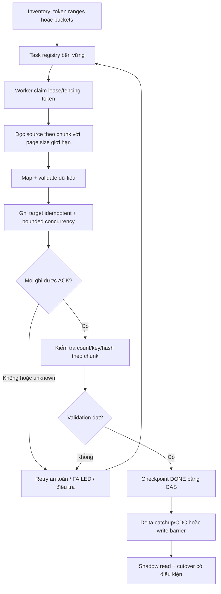
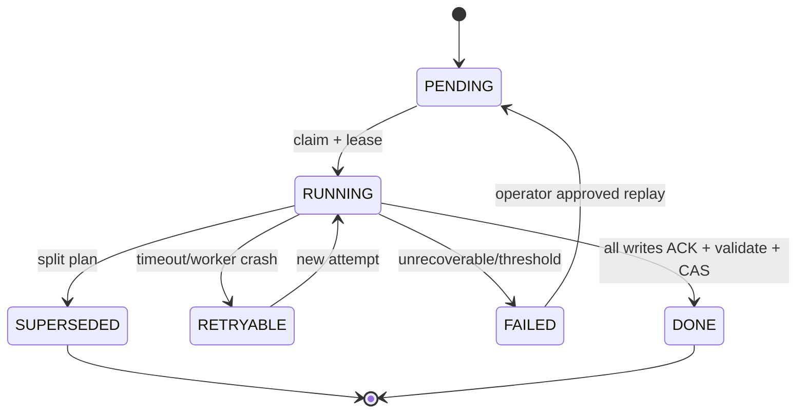
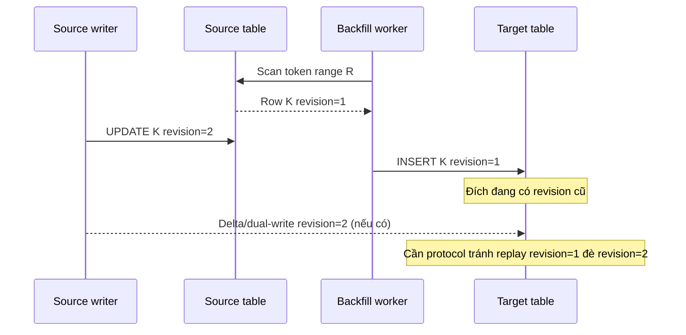
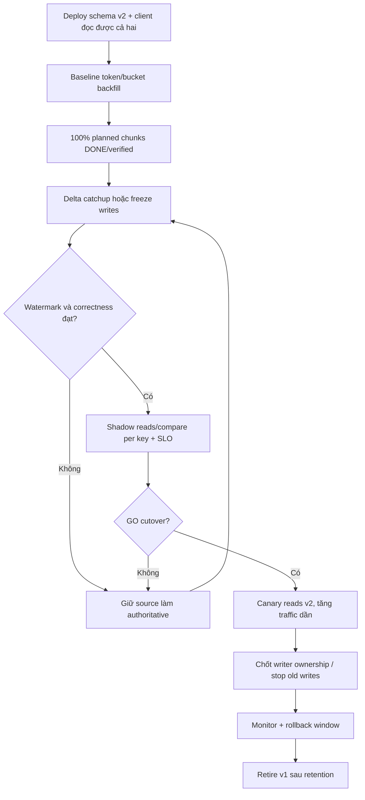

# Backfill theo khoảng token/bucket và khả năng tiếp tục sau lỗi trong Apache Cassandra

## 1. Bài toán: di chuyển hàng tỷ bản ghi mà không phải bắt đầu lại từ đầu

Giả sử một ứng dụng Java đang lưu sự kiện IoT theo bảng `events_by_id`, partition key là `event_id`. Các yêu cầu mới cần truy vấn nhanh tất cả sự kiện của một tenant trong một ngày. Vì **Apache Cassandra thiết kế bảng theo truy vấn**, nhóm phát triển tạo bảng mới `events_by_tenant_day` có partition key `(tenant_id, event_day)` và clustering keys `(event_time, event_id)`.

Nhóm cần chuyển dữ liệu lịch sử từ bảng cũ sang bảng mới trong lúc hệ thống vẫn phục vụ ghi. Một job quét toàn bảng mất nhiều giờ, có thể dừng vì node restart, timeout, deploy worker hay mất kết nối. Nếu job chỉ ghi “đã đọc 78%” vào log, sau lỗi đội vận hành không biết:

- 78% là **token space**, **số hàng** hay **số byte**?
- Những bản ghi nào đã **ghi thành công** ở bảng đích?
- Lặp lại một chunk có gây **duplicate, overwrite sai phiên bản, hồi sinh dữ liệu đã xóa** không?
- Có dữ liệu **ghi mới hoặc cập nhật trong lúc scan** bị bỏ sót không?
- Sau khi worker chết, worker mới bắt đầu từ đâu mà **không để hở token range hoặc bucket**?

Đó là lý do cần thiết kế backfill như một **workflow có tập công việc hữu hạn, checkpoint bền vững, idempotent replay, kiểm chứng dữ liệu và quy trình cutover riêng**.

Bài thuộc chương **Di chuyển và schema** của mô-đun `DATABASE_ENGINE_WIDE_COLUMN_CASSANDRA`. Bối cảnh kiến thức gồm kiến trúc phân tán/wide-column, partition key và thiết kế bảng theo truy vấn, CQL, replication, mức nhất quán, compaction/repair, xử lý lỗi và Java Driver. **Trọng tâm** là chia backfill theo **khoảng token** hoặc **bucket**, đồng thời chứng minh khả năng **tiếp tục sau lỗi** mà không làm hỏng dữ liệu.

### Mục tiêu học tập

Sau bài này, bạn có thể:

1. Phân biệt **backfill biến đổi mô hình dữ liệu** với repair/streaming replica và schema migration thông thường.
2. Lập danh sách chunk **phủ hết token ring, không chồng lấn**, lưu ý token âm/dương và điểm biên.
3. Chia việc theo **bucket nghiệp vụ** và clustering range, kiểm soát partition lớn/hot.
4. Thiết kế checkpoint/lease/fencing, cơ chế retry **at-least-once** và thao tác ghi đích **idempotent**.
5. Xử lý ghi đồng thời, delete/TTL, timestamps, paging và các tình huống kết quả ghi **không rõ**.
6. Dùng CQL/Java Driver 4.x để chạy backfill với concurrency và page size có giới hạn.
7. Xây dựng kiểm chứng coverage, dữ liệu, SLO và quy trình cutover/rollback có điều kiện.

## 2. Backfill là gì? Không phải mọi cơ chế chuyển dữ liệu đều giống nhau

| Cơ chế | Mục đích | Có biến đổi partition key/data model không? |
| --- | --- | --- |
| **CQL schema change** | `ALTER TABLE`/`CREATE TABLE` thay metadata | Không tự quét rồi ghi lại dữ liệu lịch sử theo partition key mới |
| **Backfill ứng dụng** | Đọc dữ liệu nguồn, biến đổi và ghi vào bảng/mô hình đích | **Có thể**, đây là nội dung bài |
| **Replica repair** | Anti-entropy đối soát các replica của cùng dữ liệu và token ranges | **Không** thay ứng dụng chuyển row sang bảng thiết kế khác |
| **Bootstrap/streaming** | Chuyển ownership và SSTable data theo topology | Không tự thực hiện projection/repartition nghiệp vụ |
| **Snapshot/restore SSTable** | Khôi phục dữ liệu theo tệp/format tương thích | Không tự thực hiện ETL, có hạn chế schema/table ID |
| **CDC / event log** | Ghi nhận mutation/delta để đồng bộ đích trong khi nguồn còn thay đổi | Có thể hỗ trợ backfill, nhưng cần consumer và replay semantics |
| **Dual writes** | Ứng dụng ghi nguồn và đích trong thời gian chuyển tiếp | Có lỗi từng phần; không tự tạo transaction xuyên hai bảng |

**Ví dụ:** tăng RF từ 2 lên 3 cho *cùng keyspace* thường cần full repair để replica mới nhận dữ liệu lịch sử. Nhưng đổi từ bảng `events_by_id` sang `events_by_tenant_day` là **backfill ứng dụng**: repair không tự tính `event_day` hay xây clustering key mới.

## 3. Hai cách chia việc: token ranges và business buckets

### 3.1. Token ranges

Cassandra dùng **partitioner** để ánh xạ partition key thành token. Với `Murmur3Partitioner` thường gặp, token được biểu diễn bằng số nguyên **có dấu 64-bit**. Chia không gian token thành các khoảng rời nhau cho phép worker đọc nhiều partition theo nhiệm vụ độc lập.

Ví dụ khái niệm:

```text
R1 = [MIN_TOKEN, t1)
R2 = [t1, t2)
R3 = [t2, t3)
R4 = [t3, MAX_TOKEN]    # cuối cùng bao gồm MAX_TOKEN
```

Tổng các khoảng bao trùm toàn bộ token space, mỗi token thuộc **đúng một chunk**. Sử dụng khoảng **half-open** `[start, end)` giúp tránh chồng lấn ở ranh giới, còn chunk cuối dùng `<= MAX_TOKEN` hoặc điều kiện cuối tương đương để không bỏ mất token lớn nhất.

### 3.2. Business buckets

Nếu bảng nguồn đã tổ chức theo khóa `(tenant_id, day_bucket)` hoặc `(device_id, hour_bucket)`, có thể chia thành các task theo bucket: **một partition hoặc một partition cộng clustering window**. Bucket dễ gắn với nhu cầu nghiệp vụ và có thể đo coverage theo ngày/tenant.

```text
B1 = tenant_A / 2026-11-19
B2 = tenant_A / 2026-11-20
B3 = tenant_B / 2026-11-19
B4 = tenant_B / 2026-11-20
...
```

**Không** tự giả định có thể tìm mọi tenant/day bằng `SELECT DISTINCT` quét cả cluster rồi coi đó là inventory đầy đủ. Nên dùng bucket registry, nguồn metadata tin cậy, event catalog hoặc danh sách được xây dựng có kiểm chứng.

### 3.3. Chọn cách nào?

| Tiêu chí | Token range | Bucket |
| --- | --- | --- |
| Bảng nguồn có partition key phân tán, không có inventory bucket | Thường phù hợp để đọc/khám phá | Khó nếu không biết bucket tồn tại |
| Nguồn đã có partition key theo tenant/ngày | Có thể dùng, nhưng không tận dụng được tính cục bộ của key | **Rất phù hợp** |
| Một partition cực lớn | Token split **không** chia nhỏ partition | Clustering-range split có thể giúp |
| Cần theo dõi theo SLA từng tenant/ngày | Phải nhóm lại sau quét | Trực tiếp theo business bucket |
| Dữ liệu lệch nhiều theo key | Token space bằng nhau **không** đồng nghĩa byte/rows bằng nhau | Bucket size cũng có thể lệch; chia window tiếp |
| Phục hồi sau lỗi | Retry chunk/range từ checkpoint | Retry bucket/window từ checkpoint |
| Nhiều worker độc lập | Task queue + lease, hạn mức per-node | Task queue + fairness per tenant |

Có thể **kết hợp**: dùng token ranges để đọc bảng cũ, rồi sắp ghi theo bucket đích; hoặc dùng bucket để chia job và split các bucket rất lớn theo clustering time windows.

## 4. Vì sao không chỉ dùng LIMIT, OFFSET hoặc một SELECT toàn bảng?

Trong Cassandra, `LIMIT` giới hạn số row trả về, **không cung cấp phân trang OFFSET như cơ sở dữ liệu quan hệ**. Dùng `SELECT *` không có partition key trên bảng nhiều TB sẽ dẫn tới cluster-wide scan đắt và khó phục hồi.

Những vấn đề của một lần scan kéo dài:

- Một paging cursor không phải **snapshot giao dịch ổn định** của toàn bảng.
- Request có thể timeout ở page thứ 150; nếu không ghi checkpoint, phải chạy lại hoặc cố suy vị trí từ log.
- Node thay topology, schema thay đổi hoặc driver/statement đổi có thể khiến paging state cũ không còn hợp lệ.
- Dữ liệu nguồn vẫn thay đổi trong lúc scan; một row insert/update/delete có thể không xuất hiện ở đúng lượt bạn mong đợi.
- Một large partition có thể chiếm hầu hết thời gian dù token range có độ rộng nhỏ.

**Chia việc có chủ đích** và **lặp lại idempotent** thường dễ kiểm chứng hơn cố lưu một “offset” duy nhất.

## 5. Kiến trúc pipeline backfill có thể phục hồi



Một pipeline production có ít nhất **ba mặt phẳng trạng thái**:

1. **Nguồn và đích:** dữ liệu CQL thực tế, được Cassandra nhân bản theo RF/CL.
2. **Control plane:** task ownership, lease, attempt/epoch, checkpoint, thống kê và lỗi.
3. **Cutover/delta plane:** nguồn mutation mới sau khi backfill bắt đầu, mốc đồng bộ và tiêu chí chuyển traffic.

Không thể suy plane 2 hoặc 3 chỉ từ việc đếm tổng số row hiện có ở target.

## 6. Thiết kế CQL ví dụ: từ truy vấn theo ID sang truy vấn tenant/ngày

Giả định **source event là immutable**: mỗi `event_id` được tạo một lần, không cập nhật/xóa, không dùng TTL. Điều kiện này giúp minh họa idempotent backfill một cách kiểm chứng được. Những dữ liệu **mutable, TTL, delete** được xử lý riêng ở các phần sau.

```sql
-- Lab có ít nhất ba node tại dc1 nếu dùng RF=3.
CREATE KEYSPACE IF NOT EXISTS migrate_lab
WITH replication = {
    'class': 'NetworkTopologyStrategy',
    'dc1': 3
};

-- Bảng cũ: tra theo event ID.
CREATE TABLE IF NOT EXISTS migrate_lab.events_by_id (
    event_id uuid PRIMARY KEY,
    tenant_id text,
    event_time timestamp,
    payload text
);

-- Bảng mới: partition theo tenant/ngày, sort theo thời gian.
CREATE TABLE IF NOT EXISTS migrate_lab.events_by_tenant_day (
    tenant_id text,
    event_day date,
    event_time timestamp,
    event_id uuid,
    payload text,
    PRIMARY KEY ((tenant_id, event_day), event_time, event_id)
) WITH CLUSTERING ORDER BY (event_time DESC, event_id ASC);

INSERT INTO migrate_lab.events_by_id
    (event_id, tenant_id, event_time, payload)
VALUES (
    11111111-1111-1111-1111-111111111111,
    'tenant_lab',
    '2026-11-21T08:30:00Z',
    'immutable-event-payload'
);
```

Phép biến đổi:

```text
source.event_id                 -> target.event_id (giữ nguyên)
source.tenant_id                -> target.tenant_id
UTC date(source.event_time)     -> target.event_day
source.event_time               -> target.event_time
source.payload                  -> target.payload
```

**Chọn UTC để tính bucket** hoặc quy tắc timezone nghiệp vụ cố định. Nếu worker này lấy ngày theo UTC nhưng Java ứng dụng ghi ngày theo timezone khác, cùng sự kiện có thể đi vào hai partition khác nhau. Hãy viết quy tắc chuyển đổi thành một **data contract được version hóa**.

## 7. CQL token-range scan và những điểm biên dễ lỗi

Với `Murmur3Partitioner`, có thể dùng `token(<partition_key>)` trong điều kiện CQL để quét một đoạn của không gian partition token:

```sql
-- Đọc chunk half-open [startToken, endToken).
-- Bind two bigint token boundaries; KHÔNG coi đây là query OLTP thông thường.
SELECT event_id, tenant_id, event_time, payload
FROM migrate_lab.events_by_id
WHERE token(event_id) >= ?
  AND token(event_id) < ?;
```

Trong task cuối, cần bao gồm token `Long.MAX_VALUE`; tùy cách biểu diễn boundary, dùng điều kiện riêng:

```sql
-- Chunk cuối [startToken, MAX_TOKEN], gồm cả MAX_TOKEN.
SELECT event_id, tenant_id, event_time, payload
FROM migrate_lab.events_by_id
WHERE token(event_id) >= ?;
```

Nếu dùng kiểu boundary khác hoặc partitioner khác Murmur3, phải xây và thử bộ chia token đúng với partitioner đó. **Không tự áp dụng `Long.MIN_VALUE`/`Long.MAX_VALUE` cho RandomPartitioner** hoặc một partitioner có token representation khác.

### 7.1. Bốn điều kiện coverage

1. **Exhaustive:** hợp của mọi task bằng toàn bộ token domain trong phạm vi nguồn.
2. **Disjoint:** các khoảng không chồng lấn theo quy ước `[start,end)`; riêng chunk cuối có điểm biên đã định nghĩa.
3. **Stable inventory:** danh sách task và boundaries được lưu bền vững trước khi chạy; mọi split/merge có lịch sử.
4. **Correct partition expression:** `token(event_id)` đúng source PK; với composite key phải dùng **đầy đủ các cột partition key theo đúng thứ tự**, ví dụ `token(tenant_id, event_day)`.

### 7.2. Wrap-around trên vòng token

Một khoảng có điểm đầu lớn hơn điểm cuối theo thứ tự số là **wrap-around** trên ring. Không viết một predicate `token(pk) >= start AND token(pk) < end` với `start > end` rồi cho rằng Cassandra sẽ tự xử lý đúng theo ý định. Thay thành **hai khoảng không quấn** hoặc tạo danh sách range đã chuẩn hóa. Lưu token dưới dạng số **signed**; đừng vô tình sort như string khiến `-100` đứng sai vị trí so với `-2`.

### 7.3. Equal token-space ≠ equal data

Quét 1/1000 token-space không có nghĩa đọc 1/1000 dung lượng. Token distribution có thể khá đều nhưng table skew, partition sizes, compression và TTL khác nhau. Lập kế hoạch dựa trên **observed rows/bytes/time per chunk** và tự chia nhỏ những chunk nặng **trước khi ghi DONE**, không mặc định mọi range mất thời gian giống nhau.

## 8. Chia task bằng token range mà không mất điểm biên

Một bản inventory minh họa:

| Task | Token interval | Ước lượng | Trạng thái |
| --- | --- | --- | --- |
| R00 | `[MIN_TOKEN, T1)` | 120 MiB | PENDING |
| R01 | `[T1, T2)` | 480 MiB | PENDING |
| R02 | `[T2, T3)` | 72 MiB | PENDING |
| R03 | `[T3, MAX_TOKEN]` | 310 MiB | PENDING |

**Các số liệu là giả định**, không phải đo thật. `T1,T2,T3` phải là token boundaries thật đã được tính và kiểm tra. Đừng tạo chunk bằng cách dùng trực tiếp `nodetool status` load percentage rồi đoán boundaries.

### 8.1. Khi một chunk quá nặng

Giả sử R01 chạy lâu hơn hẳn. Có thể chia:

```text
R01: [T1,T2) -> SUPERSEDED
R01a: [T1,Tmid) -> PENDING
R01b: [Tmid,T2) -> PENDING
```

Điều kiện:

- Dừng hoặc bảo đảm worker cũ không tiếp tục đánh dấu R01 `DONE`.
- Ghi **parent→children** trong control plane bằng thao tác có điều kiện/transaction phù hợp.
- Chứng minh hai khoảng con phủ đúng R01, không hole/overlap.
- Không đếm kết quả parent cùng hai children thành **ba chunk độc lập hoàn tất**.
- Dữ liệu đã ghi dở từ R01 có thể tồn tại tại target; vì vậy replay các children cần idempotent.

**Token-range split không chia nhỏ một partition duy nhất** vì toàn bộ partition gắn với cùng token. Nếu một wide partition là bottleneck, cân nhắc split theo clustering range hoặc sửa thiết kế bucket.

## 9. Backfill theo business bucket và clustering window

Khi bảng **nguồn** vốn có partition key như `(tenant_id, month_bucket)` hoặc `(device_id, event_day)`, chia theo bucket sẽ tự nhiên hơn so với token scan.

Ví dụ một bảng nguồn khác:

```sql
CREATE TABLE IF NOT EXISTS migrate_lab.events_v1_by_tenant_month (
    tenant_id text,
    month_bucket text,
    event_time timestamp,
    event_id uuid,
    payload text,
    PRIMARY KEY ((tenant_id, month_bucket), event_time, event_id)
) WITH CLUSTERING ORDER BY (event_time ASC, event_id ASC);
```

Một task theo bucket và time slice:

```sql
SELECT event_time, event_id, payload
FROM migrate_lab.events_v1_by_tenant_month
WHERE tenant_id = ?
  AND month_bucket = ?
  AND event_time >= ?
  AND event_time < ?;
```

**Các tham số đầu tiên là đầy đủ partition key**; phần sau giới hạn clustering range. Ví dụ một bucket tháng có 40 triệu sự kiện thì chia thành 30–31 ngày hoặc nhiều window giờ nếu cần. Với **clustering key trùng timestamp**, event ID là tie-breaker, giúp định danh row; khi khôi phục không chỉ lưu timestamp rồi bỏ các event có cùng giờ.

### 9.1. Inventory bucket phải đầy đủ

Nguồn inventory có thể là **control table**, domain service catalogue hoặc index công việc được duy trì từ lúc ghi. Kiểm chứng:

- Danh sách tất cả tenant và bucket có dữ liệu theo snapshot/log nguồn nào?
- Có bucket cũ xuất hiện muộn do late-arriving events không?
- Tenant mới có thể tạo bucket trong lúc backfill không?
- Bucket đã hết TTL/deleted có còn xuất hiện trong inventory nhưng không có rows không?
- Nếu chạy lại ngày hôm sau, boundary/timezone/transform version còn giống nhau không?

**Empty bucket** là một kết quả hợp lệ nếu đã xác minh; không coi mọi empty result là lỗi. Nhưng **missing bucket khỏi inventory** là lỗ hổng coverage và phải được giải quyết trước cutover.

## 10. Control plane: task registry, lease và checkpoint

Một job có thể chạy nhiều worker Java/Kubernetes pods. Để phục hồi, task phải có định danh và trạng thái bền vững, **không chỉ dựa vào memory/HTTP request của worker**.

### 10.1. Trạng thái tối thiểu



Mỗi task lưu ít nhất:

| Field | Ý nghĩa |
| --- | --- |
| `job_id`, `task_id` | Định danh bất biến xuyên retry; không tái sử dụng cho migration version khác |
| `source_table`, `target_table`, `transform_version` | Chặn replay một task cũ bằng transform mới mà không kiểm soát |
| `start_token/end_token` hoặc `tenant/bucket/window` | Phạm vi chính xác, convention inclusive/exclusive |
| `status` | PENDING, RUNNING, DONE, RETRYABLE, FAILED, SUPERSEDED |
| `owner`, `lease_until`, `epoch` | Worker có quyền tiếp tục; epoch là fencing generation |
| `attempt`, `last_error` | Lịch sử retry và lý do dừng |
| `started_at/finished_at` | Timeline UTC để điều tra |
| `rows_read/rows_acked/bytes` | Counters **quan sát**, không tự chứng minh correctness |
| `validation_status/hash` | Bằng chứng kết quả chunk đã được kiểm chứng |

### 10.2. CQL bảng tiến độ (lab)

```sql
CREATE TABLE IF NOT EXISTS migrate_lab.backfill_tasks (
    job_id text,
    shard smallint,
    task_id text,
    start_token bigint,
    end_token bigint,
    status text,
    owner text,
    lease_until timestamp,
    epoch bigint,
    attempts int,
    rows_read bigint,
    rows_acked bigint,
    updated_at timestamp,
    PRIMARY KEY ((job_id, shard), task_id)
);
```

Shard phân chia control-plane partitions để một job hàng trăm nghìn task không dồn vào một Cassandra partition quá lớn. `backfill_tasks` đặt trong cùng keyspace ở đây để **giải thích**, nhưng trong production có thể tách control plane ra một hệ thống **được vận hành độc lập** khỏi cluster đang migrate, để giữ khả năng điều phối khi source cluster lỗi. Không để table progress bị chính job scan quá tải.

### 10.3. Claim bằng thao tác có điều kiện

Ví dụ một task **đã được tạo** với `status='PENDING'`:

```sql
-- CQL minh họa claim có điều kiện LWT, không phải đầy đủ lease scheduler.
UPDATE migrate_lab.backfill_tasks
SET status = 'RUNNING',
    owner = 'worker-07',
    lease_until = '2026-11-21T09:10:00Z',
    epoch = 12,
    attempts = 3,
    updated_at = '2026-11-21T09:00:00Z'
WHERE job_id = 'job-events-v2'
  AND shard = 4
  AND task_id = 'R0042'
IF status = 'PENDING';
```

Nếu `[applied]=false`, worker **không sở hữu task**; phải đọc trạng thái hiện tại rồi xử lý theo scheduler. Với lease expiry, cần điều kiện cập nhật `owner/epoch/lease_until` có kiểm soát, đồng hồ và CAS thích hợp; **không** chỉ chạy `UPDATE` vô điều kiện sau khi thấy đồng hồ của mình đã quá hạn.

Nếu LWT timeout, kết quả claim **không rõ**; đọc lại trạng thái/owner/epoch và áp chính sách retry an toàn. Không giả định timeout có nghĩa CAS chưa được áp dụng.

### 10.4. Đánh dấu hoàn thành

```sql
-- Chỉ sau khi đọc hết chunk, ghi đích đã ACK và validation đạt.
UPDATE migrate_lab.backfill_tasks
SET status = 'DONE',
    rows_read = 12500,
    rows_acked = 12500,
    updated_at = '2026-11-21T09:07:30Z'
WHERE job_id = 'job-events-v2'
  AND shard = 4
  AND task_id = 'R0042'
IF status = 'RUNNING'
   AND owner = 'worker-07'
   AND epoch = 12;
```

Nếu `[applied]=false`, task có thể đã được worker khác nhận sau lease expiry. Worker cũ **không được ghi DONE**. Trên thực tế, ghi dữ liệu đích và ghi checkpoint là **hai thao tác khác nhau**, không có distributed transaction bao trùm toàn bộ rows và progress table. Vì vậy thiết kế phải chịu được **dữ liệu đã ghi nhưng task vẫn PENDING/RUNNING**.

## 11. At-least-once + idempotent replay: nguyên tắc nền tảng

Trong một workflow có failure, “mỗi row chỉ được gửi đúng một lần” gần như không thể bảo đảm chỉ bằng retry của client.

Giả sử worker:

1. Gửi `INSERT` vào target.
2. Coordinator đã ghi đủ `LOCAL_QUORUM` nhưng response bị mất.
3. Client nhận timeout và không biết ghi đã thành công.
4. Worker crash trước khi cập nhật checkpoint.

Khi khởi động lại, **phải có quyền thử lại** chunk. Nếu thao tác ghi idempotent, thử lại cùng key/value đưa target về cùng trạng thái mong muốn.

### 11.1. Mô hình dữ liệu immutable giúp replay đơn giản

Với `events_by_id` immutable và target PK `((tenant_id,event_day), event_time,event_id)`:

```sql
INSERT INTO migrate_lab.events_by_tenant_day
    (tenant_id, event_day, event_time, event_id, payload)
VALUES (?, ?, ?, ?, ?);
```

Gửi lại **cùng full primary key và cùng giá trị** không tạo thêm một row khác. Nhưng **đừng đồng nhất** điều đó với idempotence tuyệt đối cho dữ liệu mutable:

- Cassandra áp dụng **last-write-wins theo timestamp**; retry sau có timestamp mới có thể **ghi đè một mutation mới hơn về nghiệp vụ**.
- `COUNTER` increments không idempotent: retry có thể tăng hai lần.
- Một phép ghi có tính phụ thuộc trạng thái (read-modify-write) không tự idempotent.
- TTL có thể **được bắt đầu lại** nếu INSERT mới dùng TTL mới, làm thay đổi thời điểm hết hạn.
- Tombstones và xung đột concurrent writers cần được xử lý rõ.

Do đó phải mô tả **idempotence theo ngữ nghĩa của migration**, không chỉ theo cú pháp `INSERT`.

### 11.2. Vì sao không “checkpoint trước khi write”?

```text
SAI:
  mark chunk DONE
  -> write rows
  -> worker chết giữa chừng
  => chunk bị bỏ qua, target thiếu dữ liệu

ĐÚNG VỚI AT-LEAST-ONCE:
  read chunk
  -> write target and await ACK
  -> validate chunk
  -> CAS mark DONE
  -> worker chết bất kỳ lúc nào trước DONE: replay chunk an toàn
```

Khi DONE, đó là chứng cứ job **đã thực hiện và kiểm chứng phạm vi** tại thời điểm task chạy, **không** chứng minh source sẽ không còn phát sinh mutation mới. Đồng bộ delta và cutover là bước riêng.

## 12. Checkpoint ở mức chunk hay mức page?

### 12.1. Chunk-level checkpoint: mặc định đơn giản

Lưu mỗi task là **một token interval nhỏ hoặc bucket window**. Sau crash, chạy lại toàn task. Ưu điểm:

- Không cần dựa vào paging state lâu dài.
- Dễ kiểm tra tập task DONE phủ đủ phạm vi.
- Retry idempotent dễ hiểu, ít điểm lỗi control plane.

Nhược điểm: nếu chunk quá lớn, replay tốn thời gian. Hãy **chọn chunk nhỏ vừa phải** dựa trên bytes/rows/duration được đo.

### 12.2. Page-level checkpoint: cần nhiều giả định

Java Driver có paging state dùng để lấy trang tiếp theo. Nhưng paging state là **trạng thái giao thức truy vấn**, có thể phụ thuộc phiên bản, statement, bind values, schema/topology và thời gian. Nó **không phải một durable business offset** đảm bảo đọc đúng từng row khi nguồn thay đổi.

Nếu nhất định checkpoint theo page:

- Lưu đúng query fingerprint, bind parameters, CL, page size, schema version, driver/server version và paging-state representation theo API hỗ trợ.
- Ghi page DONE **sau khi** tất cả target rows của page đã ACK.
- Khi paging state không hợp lệ hoặc môi trường thay đổi, phải có fallback **replay chunk từ đầu**.
- Không dùng paging state như cách thay consistency/snapshot semantics của nguồn.
- Có thể cần cursor theo **full primary key/clustering order** nếu thiết kế bảng cho phép, không chỉ timestamp hoặc token.

**Khuyến nghị học thuật của bài:** ưu tiên **small chunks + idempotent replay**. Đây là chiến lược phục hồi dễ chứng minh và vận hành hơn việc chỉ lưu `pagingState`.

## 13. Java Driver 4.x: worker backfill một token chunk

Ví dụ Java 17+ sau minh họa **nguồn immutable**, dùng source/target `CqlSession` riêng có thể trỏ hai cluster, với credentials/TLS/local DC được cấu hình qua ứng dụng. Session được tạo **một lần và tái sử dụng**, không tạo mỗi row.

```java
import com.datastax.oss.driver.api.core.CqlSession;
import com.datastax.oss.driver.api.core.DefaultConsistencyLevel;
import com.datastax.oss.driver.api.core.cql.BoundStatement;
import com.datastax.oss.driver.api.core.cql.PreparedStatement;
import com.datastax.oss.driver.api.core.cql.ResultSet;
import com.datastax.oss.driver.api.core.cql.Row;
import java.time.Instant;
import java.time.LocalDate;
import java.time.ZoneOffset;
import java.util.UUID;

public final class ImmutableEventBackfill {
    private final CqlSession source;
    private final CqlSession target;
    private final PreparedStatement scanRange;
    private final PreparedStatement scanFinalRange;
    private final PreparedStatement insertTarget;

    public ImmutableEventBackfill(CqlSession source, CqlSession target) {
        this.source = source;
        this.target = target;
        this.scanRange = source.prepare("""
            SELECT event_id, tenant_id, event_time, payload
            FROM migrate_lab.events_by_id
            WHERE token(event_id) >= ? AND token(event_id) < ?
            """);
        this.scanFinalRange = source.prepare("""
            SELECT event_id, tenant_id, event_time, payload
            FROM migrate_lab.events_by_id
            WHERE token(event_id) >= ?
            """);
        this.insertTarget = target.prepare("""
            INSERT INTO migrate_lab.events_by_tenant_day
                (tenant_id, event_day, event_time, event_id, payload)
            VALUES (?, ?, ?, ?, ?)
            """);
    }

    // endExclusive là null duy nhất cho chunk CUỐI bao gồm Long.MAX_VALUE.
    // Claim lease + persist checkpoint do scheduler bên ngoài đảm nhiệm.
    public long copyChunk(long startInclusive, Long endExclusive) {
        BoundStatement read = (endExclusive == null
            ? scanFinalRange.boundStatementBuilder().setLong(0, startInclusive)
            : scanRange.boundStatementBuilder()
                .setLong(0, startInclusive)
                .setLong(1, endExclusive))
            .setPageSize(500)
            .setConsistencyLevel(DefaultConsistencyLevel.LOCAL_QUORUM)
            .build();

        long rowsAcked = 0;
        ResultSet result = source.execute(read);
        for (Row row : result) { // Driver có thể fetch tiếp các page.
            UUID eventId = row.getUuid("event_id");
            String tenant = row.getString("tenant_id");
            Instant eventTime = row.getInstant("event_time");
            String payload = row.getString("payload");
            if (eventId == null || tenant == null || eventTime == null) {
                throw new IllegalStateException("Source row violates migration contract");
            }
            LocalDate day = eventTime.atZone(ZoneOffset.UTC).toLocalDate();

            BoundStatement write = insertTarget.boundStatementBuilder()
                .setString(0, tenant)
                .setLocalDate(1, day)
                .setInstant(2, eventTime)
                .setUuid(3, eventId)
                .setString(4, payload)
                .setConsistencyLevel(DefaultConsistencyLevel.LOCAL_QUORUM)
                .build();

            // Đơn giản để dễ hiểu: chờ ACK từng row.
            // Production dùng concurrency giới hạn, không gửi vô hạn.
            target.execute(write);
            rowsAcked++;
        }
        return rowsAcked; // KHÔNG tự đánh dấu chunk DONE ở đây.
    }
}
```

**Điều kiện tiên quyết quan trọng của code:**

- **Murmur3Partitioner** và boundaries dạng signed `long`; partitioner khác cần sửa chiến lược token.
- Dữ liệu nguồn **immutable, no TTL, no delete**, mỗi sự kiện được xác định duy nhất bằng `event_id` và các target values ổn định. Nếu source mutable, đoạn code **không đủ an toàn**.
- `ResultSet` iteration có thể tự fetch page; lỗi ở page sau sẽ làm task thất bại. Việc đã ghi một số row trước đó là bình thường với **at-least-once**.
- `target.execute` thành công nghĩa là request đạt CL của nó, **không** xác minh đủ replica lịch sử hoặc business correctness.
- Không có `LIMIT` để cắt task: **token boundary** mới là giới hạn phạm vi; page size kiểm soát lượng fetch mỗi lần.
- Không có concurrency limiter, scheduler, retry/backoff, progress CAS hay validation logic trong đoạn mã này. Các lớp ấy phải được bổ sung trước production.
- Nếu target DC khác source, kiểm tra `LOCAL_QUORUM` của từng session được định tuyến đến DC phù hợp. Không mặc định CL/placement giống nhau.
- Khi event time có thể null hoặc source values không hợp lệ, đặt quarantine/error policy; không âm thầm bỏ row và vẫn mark DONE.

### 13.1. Tối ưu throughput mà không làm nghẽn Cassandra

Trong sản phẩm thật, có thể dùng `executeAsync` và một **bounded semaphore / queue** thay vì gửi tuần tự:

```text
max_global_inflight_writes = 200      # ví dụ cấu hình thử nghiệm
max_per_target_node        = 30       # phải đo theo cluster thực
page_size                  = 500
retry_backoff              = bounded + jitter
max_chunk_duration         = theo budget đo thực tế
```

Các con số **minh họa**, không phải khuyến nghị cố định. Điều chỉnh theo p95/p99 Java, timeout/unavailable, CPU, GC, disk I/O, network, compaction backlog và workload nghiệp vụ. Khi server throughput đứng yên nhưng in-flight tăng, **giảm concurrency/backpressure**, không tiếp tục đẩy thêm retry.

## 14. Ghi đang diễn ra: scan không cung cấp global consistent snapshot

Một scan chạy hàng giờ không có một mốc “tất cả row ở trạng thái tại t0” mà Cassandra tự bảo đảm. Xét timeline:



Hai race khác:

1. **Insert mới sau lúc range đã được quét:** row có token thuộc range đã DONE nhưng **không bao giờ được scan lại**, nếu không có delta capture.
2. **Delete sau lúc row được đọc:** worker ghi lại row cũ sau khi delete đã đến target, làm dữ liệu đã xóa **xuất hiện trở lại** nếu write timestamp/ordering không được kiểm soát.

Vì vậy **DONE ở baseline scan không đủ để cutover** khi source vẫn ghi. Cần một trong các mô hình đồng bộ sau.

## 15. Ba chiến lược nhất quán trong migration

### 15.1. Chiến lược A — tạm ngừng ghi tại nguồn

Giản lược nhất khi maintenance window cho phép:

1. Đưa source vào **read-only hoặc stop-writes có kiểm chứng**.
2. Đợi mọi request đang in-flight hoàn tất hoặc giải quyết unknown outcomes.
3. Xác định mốc barrier/time và kiểm tra nguồn ổn định.
4. Chạy backfill chunks, validate, chuyển read/write sang target.
5. Mở ghi ở target sau cutover thành công.

**Ưu điểm:** ít race; dễ chứng minh coverage. **Nhược điểm:** downtime hoặc giới hạn availability, có thể không phù hợp sản phẩm 24/7.

### 15.2. Chiến lược B — CDC/outbox/change log + catchup

Thường phù hợp dữ liệu mutable:

1. Bật hoặc triển khai nguồn **mutation log đáng tin cậy**, có version/order/idempotency theo khóa và retention đủ lâu.
2. Chốt mốc `L0`; bảo đảm capture mutation từ mốc đó trước/bắt đầu baseline scan.
3. Scan lịch sử bằng token/bucket chunks để có baseline.
4. Áp các deltas/mutations **đúng thứ tự theo key**, bao gồm update/delete và TTL semantics.
5. Theo dõi lag và watermark, chặn/cô lập write rất ngắn nếu cần để đạt cutover barrier.
6. Chỉ switch reads sau khi target đã qua mốc đồng bộ và validation đạt.

**Không nhầm CDC Cassandra với một ordered transaction log toàn cụm**: CDC của Cassandra là cơ chế cụ thể theo phiên bản/commit log, việc extract/dedup/order/checkpoint và giữ delete semantics cần pipeline được thiết kế riêng. Một “event_time” từ client **không tự tạo** ordering hoàn hảo giữa concurrent writers.

### 15.3. Chiến lược C — dual-write + reconciliation

Ứng dụng ghi cả source và target trong giai đoạn migration:

- Tạo **deterministic target primary key** và mutation ID/sequence để retry.
- Ghi nhận **partial failure**: source success/target failure hoặc ngược lại.
- Có hàng đợi/retry hoặc job reconcile nguồn–đích để bù mutation thiếu.
- Khi timeout, xem trạng thái **UNKNOWN**, không mặc định write chưa được apply.
- Đánh giá thứ tự phiên bản khi backfill chạy đồng thời với dual-writes.

**Không dùng CQL BATCH như lời hứa transaction toàn hệ thống** cho các bảng/partition khác nhau, đặc biệt giữa hai cluster: batch không thay giao thức idempotence, audit, order và reconciliation của migration.

### Bảng chọn theo workload

| Dữ liệu nguồn | Chiến lược an toàn tương đối | Điểm phải chứng minh |
| --- | --- | --- |
| **Immutable append-only**, ghi mới liên tục | Backfill + đồng bộ writes mới qua log/dual-write hoặc cutover barrier | Không mất event tới muộn trong range DONE |
| **Mutable status**, concurrent writers | CDC/outbox hoặc protocol versioned writes + reconciliation | Version cũ không overwrite version mới |
| **Deletes/TTL phổ biến** | Mutation capture gồm tombstone/expiry semantics và xác minh | Không zombie, không reset TTL |
| **Counters, read-modify-write** | Chuyên biệt hóa migration logic và dedup/aggregation | Retry không làm nhân đôi thao tác |
| **Có downtime được duyệt** | Stop writes + baseline scan + validate + cutover | Barrier thật sự chặn mọi writer |

## 16. Timestamp, TTL và tombstone: các bẫy khi backfill mutable

Cassandra thường hòa giải các phiên bản cell theo **write timestamp**, không phải “job nào chạy sau về mặt đồng hồ tường” là dữ liệu đúng nghiệp vụ. Đây là nguồn lỗi nghiêm trọng khi replay.

### 16.1. Bản ghi mới hơn bị backfill cũ ghi đè

```text
t0: nguồn status=CREATED, version=1
t1: backfill đọc version=1 nhưng chưa ghi target
t2: dual-write status=PAID, version=2 vào target
t3: backfill INSERT status=CREATED với timestamp CQL mới hơn
=> target có thể trở lại CREATED dù PAID mới hơn về nghiệp vụ
```

Để tránh, cần **một quy tắc thứ tự thống nhất**: mutation log theo key, version fence được cập nhật nguyên tử, writer ownership/cutover barrier hoặc giữ source write timestamps được chứng minh an toàn. **Không** chỉ đặt số `revision` trong một cột rồi trông chờ Cassandra tự chọn giá trị có revision lớn; Cassandra không so revision trước khi ghi cell thông thường.

### 16.2. Khi nào dùng `WRITETIME`/`TTL`?

Trên cột thích hợp, CQL có thể xem:

```sql
SELECT payload, WRITETIME(payload), TTL(payload)
FROM migrate_lab.events_by_id
WHERE event_id = 11111111-1111-1111-1111-111111111111;
```

`WRITETIME` và `TTL` có giới hạn áp dụng tùy loại cột, Cassandra version và table configuration. Chúng có thể giúp xây chiến lược bảo toàn per-cell timestamp/remaining TTL, nhưng **không phải lệnh sao chép đầy đủ toàn bộ tombstone history**. Không tự dùng `USING TIMESTAMP` tùy ý cho mọi cột khi không hiểu xử lý per-cell timestamps, LWT và concurrency.

### 16.3. TTL không tự “đặt lại” an toàn

Nếu source ghi một event với TTL 7 ngày, worker migrate sau 5 ngày rồi INSERT target `USING TTL 604800`, event sẽ sống thêm 7 ngày tính từ lần migrate: **sai hạn sử dụng**. Muốn giữ expiry, cần tính từ metadata được xác thực hoặc thiết kế một chính sách chuyển đổi TTL rõ ràng; nếu TTL còn lại không hợp lệ/đã hết, không tái tạo row đã expired.

### 16.4. Tombstone và zombie data

DELETE cần được chuyển dưới dạng **sự kiện xóa** hoặc bảo đảm đích không còn row; không chỉ “scan ra rows còn sống”. Khi một row đã bị xóa ở source nhưng baseline cũ còn trên target, nếu không có delete propagation thì nó trở thành zombie ở bảng mới. `gc_grace_seconds` và repair liên quan an toàn purge tombstone ở replicas **của mỗi bảng**, không tự đồng bộ deletion xuyên hai bảng khác schema.

## 17. Validation: số lượng row không đủ chứng minh thành công

Một migration có thể có cùng `COUNT(*)` nhưng sai business keys, giá trị hoặc TTL. Ngược lại, source có TTL/đã xóa và target được thiết kế projection nên tổng số row hai bảng **không nhất thiết bằng nhau**.

### 17.1. Ba cấp kiểm chứng

| Lớp | Câu hỏi | Bằng chứng |
| --- | --- | --- |
| **Coverage** | Mọi token range/bucket cần xử lý đều có task DONE/valid? | Inventory bền vững, không hole/overlap, task states, split lineage |
| **Content correctness** | Bản ghi tương ứng đúng key, value, version, delete và TTL? | Deterministic sampled keys, per-bucket aggregates/digests, mismatch report |
| **Serving readiness** | Ứng dụng Java đọc/ghi target đúng SLO và CL, không có lỗi hot partition? | Shadow reads, p95/p99, error rate, successful RPS, replica availability |

### 17.2. Checksum/mismatch report

Với một token range hoặc bucket, có thể tính digest trên **canonical business representation**, ví dụ sorted tuples `(event_id,tenant_id,event_day,event_time,payload_hash)` đã loại trừ metadata không thuộc contract. Quan trọng:

- Cả source/target phải dùng **cùng transform version**, normalization, timezone và cách xử lý null.
- Hash toàn chunk phải stable theo thứ tự hoặc dùng aggregation chống phụ thuộc order; không lấy hash theo thứ tự page ngẫu nhiên.
- Digest/counters có thể giúp phát hiện sai khác nhưng **không giải thích** key nào sai; cần sample/reconcile key-level.
- `COUNT(*)` xuyên hàng tỷ partition là query tốn kém; không dùng full-table count liên tục trên production. Dùng counters từ job + kiểm tra mẫu/aggregation offline và phương án có thể phân phối.
- Nếu nguồn vẫn ghi, validation cần gắn **watermark/snapshot contract**; nếu không, mismatch có thể là race hợp lệ thay vì bug transform.

### 17.3. Sampling không thay coverage

Một triệu sample keys đều đúng **không chứng minh** hai token ranges bỏ sót đã được backfill. Ngược lại, task ledger DONE 100% nhưng worker ghi sai timezone vẫn tạo sai bucket. **Coverage và correctness là hai bằng chứng độc lập**.

## 18. Quan sát tốc độ, lỗi và tác động lên Cassandra

| Nhóm | Chỉ số phải thu | Cách dùng |
| --- | --- | --- |
| **Progress** | Planned/DONE/FAILED ranges, buckets, bytes, rows | Phân biệt tiến độ theo task với tiến độ dữ liệu thực |
| **Throughput** | Source rows read/s, target writes ACK/s, bytes/s | Tính ETA thận trọng và phát hiện nghẽn |
| **Retry** | Attempt counts, transient/permanent errors, timeout/unknown | Nhận diện retry storm và replay quá lớn |
| **Driver** | Per-node in-flight, request throttle, pool, p50/p95/p99, CL | Xem queue ở client |
| **Cassandra** | `tpstats`, `proxyhistograms`, `tablestats`, compaction, repair | Tìm bottleneck coordinator/replica |
| **Infrastructure** | CPU/heap/GC, disk latency/free, network, cross-DC throughput | Giữ headroom production |
| **Validation** | Missing/extra/mismatched keys, digest failures, delete/TTL mismatch | Tiêu chí cutover |
| **Business** | API successful RPS, read/write p99, timeout, tenant impact | Không “đạt backfill” bằng cách làm hỏng dịch vụ |

```bash
# Lệnh quan sát, chạy ở source và target nodes tương ứng.
nodetool status
nodetool tpstats
nodetool proxyhistograms
nodetool tablestats migrate_lab.events_by_id
nodetool tablestats migrate_lab.events_by_tenant_day
nodetool compactionstats
nodetool netstats
```

`netstats` phản ánh streaming/bootstrap/repair, **không phải một thước đo mặc định của mọi CQL INSERT từ backfill worker**. `status` cho biết node up/down nhưng không chứng minh p99 hoặc target data correctness. Phải đối chiếu metrics của Java worker và ứng dụng.

### 18.1. Chọn rate limiter

Mỗi worker nên có giới hạn in-flight và tốc độ theo **source read, target write, DC/node**, cùng circuit breaker/backoff khi p99 hoặc error vượt threshold. Giới hạn toàn cục phải xét **số pod worker** và autoscaling: 20 pod × 100 in-flight có thể đẩy thành 2.000 requests, dù mỗi pod tự giới hạn 100.

Giữ ưu tiên workload nghiệp vụ. Nếu Cassandra đang repair/compaction hoặc node mất capacity, pause/giảm backfill và bảo toàn checkpoint; đừng cố “xong trước deadline” bằng cách chiếm hết disk I/O.

## 19. Thời gian ước lượng và tránh “tiến độ 99% mãi không xong”

Tỷ lệ task DONE chỉ có ý nghĩa khi các task có công suất tương đối giống nhau. Ví dụ:

```text
1000 token-range tasks:
  990 tasks nhỏ, mỗi task 10 MiB
   10 tasks rất lớn, mỗi task 100 GiB

DONE count = 990/1000 = 99%
Nhưng dữ liệu đã xử lý có thể chỉ là phần rất nhỏ tổng bytes.
```

Vì thế dashboard cần ít nhất:

- `tasks_done / tasks_total`, có chú thích split lineage;
- `bytes_read / estimated_total_bytes` nếu ước lượng đáng tin;
- `rows_acked`, `retry/replay_bytes`, failed/leased/expired tasks;
- throughput trung bình trên cửa sổ và p99;
- long-tail chunk durations, top 10 slowest buckets/ranges;
- thời gian catchup delta và validation còn lại.

**ETA là ước lượng**, không phải bằng chứng hoàn tất. Khi split một chunk, cập nhật mẫu số và nguồn gốc parent, không double-count rows cũ.

## 20. Failure matrix: nếu lỗi tại từng bước thì làm gì?

| Failure point | Target có thể đã ghi? | Checkpoint hợp lệ | Recovery an toàn |
| --- | --- | --- | --- |
| Worker chết trước khi claim | Chưa | PENDING | Worker khác claim |
| Claim LWT timeout | Chưa chắc có owner | UNKNOWN | Readback owner/epoch; không double-claim mù |
| Đọc source ở page 2 timeout | Có rows page 1 | RUNNING/RETRYABLE | Replay chunk nếu idempotent |
| INSERT target trả timeout | **Có thể có** trên replica | RUNNING | Retry theo idempotency/unknown policy |
| Worker chết sau write ACK, trước DONE | Có | RUNNING | Replay chunk, CAS completion |
| Worker cũ sống lại sau lease expired | Có thể đang ghi | Epoch cũ | Không mark DONE; immutable replay cho phép, mutable cần fencing ở đích |
| Job ghi DONE trước validate | Có thể thiếu rows | **Sai thiết kế** | Reconcile/audit, không tin checkpoint |
| Schema target đổi giữa job | Có thể mixed transform | Dừng | Version fence, kiểm tra tương thích, tạo job mới nếu cần |
| Một node/source DC mất | Có thể đọc thiếu theo CL | Task fail/paused | Restore availability, retry theo topology/CL được duyệt |
| Delta consumer lag vượt retention | Baseline có, updates thiếu | Baseline DONE không đủ | Không cutover; rebuild/catchup từ nguồn tin cậy |
| Worker lặp DELETE/counter không idempotent | Có thể hỏng nghiệp vụ | Không xác minh | Dừng, dùng protocol chuyên biệt và reconcile |
| Target p99/timeout vượt SLO | Data có thể đang chuyển một phần | Tasks paused | Backpressure, giảm concurrency, giữ lease/checkpoint rõ |

**Một queue/lease không tự bảo đảm exactly-once data transformation.** Hệ thống cần **at-least-once + idempotent data operations + validation**, hoặc protocol mạnh hơn phù hợp từng loại mutation.

## 21. Cutover: tách hoàn thành baseline và sẵn sàng đọc/ghi



### 21.1. Những checkpoint cutover bắt buộc

1. **Schema:** bảng/UDT/keyspace target đã tồn tại, RF/CL và placement đúng; schema agreement đạt.
2. **Data coverage:** toàn bộ task coverage được chốt và không còn `FAILED`/`RETRYABLE` chưa giải quyết.
3. **Data correctness:** kiểm chứng có căn cứ cho từng chunk/bucket, including deletes/TTL nếu áp dụng.
4. **Catchup:** mọi mutation source cần giữ đã đến target theo watermark/barrier được chứng minh.
5. **Application:** Java Driver routing/local DC, prepared statements, page sizes, query shape, latency và error rate đạt SLO.
6. **Operational:** backup/restore, monitoring, rollback và owner đã được phê duyệt.

### 21.2. Rollback cần gì?

**Trước khi chuyển writer ownership:** có thể quay lại đọc nguồn cũ nếu source vẫn authoritative và mọi ghi đã được ghi/đồng bộ tới nó.

**Sau khi target trở thành nơi ghi chính:** rollback **không** chỉ đổi feature flag đọc về source. Nếu có writes chỉ ở target, phải reverse-reconcile trước hoặc chặn writes rồi đưa dữ liệu về nguồn đúng thứ tự. Vì vậy đặt rõ:

- Điểm nào còn **rollback đơn giản**?
- Điểm nào cần **forward-fix** hoặc reverse migration?
- Khi nào được **drop source**? Thường chỉ sau thời gian giữ đủ an toàn và restore drill.

Không phá bỏ bảng cũ ngay khi mới canary một tỷ lệ đọc nhỏ.

## 22. Quy trình vận hành 12 bước cho backfill resumable

| Bước | Hành động | Bằng chứng |
| --- | --- | --- |
| 1 | Chốt data contract: source/target schema, transform version, TTL/delete/concurrency | Contract được duyệt |
| 2 | Chọn token ranges hay bucket/window, inventory exhaustive/disjoint | Task set và boundary test |
| 3 | Xác định mô hình thay đổi nguồn: freeze/CDC/dual-write | RPO/cutover agreement |
| 4 | Tạo source/target keyspaces/tables và backup trước migration | DDL/RF/CL, backup verify |
| 5 | Tạo control-plane registry và schedule nhỏ | Task IDs, owner, lease/epoch |
| 6 | Chạy canary vài ranges/buckets | Row mapping, qps/p99, retry behavior |
| 7 | Tăng parallelism có giới hạn | Source/target resource headroom |
| 8 | Persist DONE **sau** ACK + chunk validation | CAS results, checksum/audit |
| 9 | Retry FAILED/expired, split slow chunks khi an toàn | Không holes/duplicate coverage |
| 10 | Catchup deltas, xử lý delete/TTL và unknown outcomes | Watermark, mismatch=0 theo contract |
| 11 | Shadow reads/canary cutover rồi tăng traffic | Business SLO, query results |
| 12 | Giữ rollback window, restore drill, sau đó retire source có duyệt | Final report, owner, retention |

Nếu một bước thất bại, giữ job `INCOMPLETE` và nêu rõ chunk/bucket không đạt. **Không lấy số task DONE nhiều làm lý do bỏ validation**.

## 23. Mẫu manifest/checkpoint report

```yaml
job_id: events-v1-to-v2-20261121
service: DATABASE_ENGINE_WIDE_COLUMN_CASSANDRA
language: vi
environment: staging
source_table: migrate_lab.events_by_id
target_table: migrate_lab.events_by_tenant_day
transform_version: 3
partitioner: Murmur3Partitioner
time_zone_rule: UTC
source_contract: immutable_append_only_no_ttl
source_change_capture: mutation_log_from_L0
chunk_strategy: token_range
boundaries:
  ordinary: "[startInclusive,endExclusive)"
  last: "[startInclusive,MAX_TOKEN]"
inventory:
  version: 1
  total_tasks: 1024
  done: 1000
  failed: 2
  pending: 22
checkpoint:
  durable: true
  lease_epoch_fencing: true
  completion_requires_ack_and_validation: true
client:
  read_cl: LOCAL_QUORUM
  write_cl: LOCAL_QUORUM
  page_size: 500
  concurrency_limit: "RECORD_ACTUAL_LIMIT"
progress:
  rows_read: "RECORD_MEASURED_VALUE"
  rows_acked: "RECORD_MEASURED_VALUE"
  bytes_streamed: "RECORD_MEASURED_VALUE"
validation:
  verified_chunks: 1000
  mismatched_keys: "RECORD_MEASURED_VALUE"
  deletion_ttl_checked: false
  delta_watermark_caught_up: false
cutover:
  decision: NO_GO
  reason: "Tasks và delta catchup chưa xong"
owner_role: migration_oncall
```

Đây là **mẫu minh họa**. Các field `done`/`verified_chunks` chỉ được ghi từ control plane có thể kiểm chứng; không sao chép số giả rồi báo job đã chạy. Một manifest production cần đủ mapping source/target cluster/DC, UTC start/end, task failures, source snapshot/barrier và vị trí artifact an toàn.

## 24. Bài tập thực hành và tình huống

### Bài tập A — lỗ hổng token boundary

Worker R1 dùng `token(id) > -100 AND token(id) < 0`; worker R2 dùng `token(id) > 0 AND token(id) < 100`.

1. Hai task có cover token `-100`, `0` và `100` không?
2. Hãy thiết kế lại hai khoảng half-open không chồng và không hole.
3. Muốn scan toàn Murmur3 ring, cần xử lý `Long.MIN_VALUE`/`Long.MAX_VALUE` ra sao?
4. Nếu token range có một partition cực lớn, việc split token có giúp không?

### Bài tập B — worker chết sau khi target đã nhận write

Source immutable, worker ghi 8.000/10.000 rows vào target và crash **trước** khi đánh dấu DONE.

1. Vì sao retry toàn chunk an toàn về số **row** nếu target PK và values ổn định?
2. Vì sao “ghi lại chỉ làm update timestamp” vẫn cần lưu ý nếu row có TTL, delete hoặc concurrent updates?
3. Nếu code đánh dấu DONE trước khi ghi đủ rows, hậu quả là gì?
4. Thiết kế thứ tự ACK, validation, CAS progress và failure state.

### Bài tập C — source vừa có update vừa có delete

Backfill đọc `status=CREATED`, nguồn đổi `status=PAID` rồi `DELETE` trước khi worker ghi vào target.

1. Vì sao row cũ có thể “sống lại” ở target?
2. Tại sao chỉ lặp scan nhiều lần không cung cấp bảo đảm mạnh cho mọi mutation?
3. Thiết kế CDC/outbox hoặc barrier/version-fence, kể cả delete.
4. Những chỉ số nào chứng minh target đã bắt kịp nguồn trước cutover?

### Bài tập D — bucket lớn và skew

98% bucket theo tenant/ngày có dưới 100.000 rows; 2% bucket có hơn 10 triệu rows. Mỗi worker nhận một bucket.

1. Vì sao job có thể hiển thị 98% task DONE nhưng vẫn còn phần lớn byte?
2. Hãy chia bucket lớn theo clustering time windows và phân biệt các hàng cùng `event_time` bằng `event_id`.
3. Làm thế nào lưu lineage parent/children và không tính DONE hai lần?
4. Khi load test p99 tăng trong lúc backfill, giảm workload bằng cơ chế nào?

### Bài tập E — migration giữa hai DC

Source keyspace RF=3 tại dc1, target RF=3 tại dc2, Java worker ghi target dùng `LOCAL_QUORUM`. WAN có packet loss.

1. `LOCAL_QUORUM` của worker phụ thuộc local DC của session nào?
2. Write timeout tại target có chứng minh dữ liệu **chưa được ghi** không?
3. Phải thu metrics/timeout ở source, target, WAN và driver như thế nào?
4. Vì sao không được hạ CL xuống `ONE` một cách tùy tiện để job chạy nhanh?

## 25. Câu hỏi tự kiểm tra

1. Backfill theo token khác repair sau thay RF ở mục tiêu và cơ chế nào?
2. Với composite partition key, `token(...)` phải nhận những cột nào?
3. Vì sao khoảng `[start,end)` dễ kiểm tra coverage hơn việc dùng cả hai đầu `>`?
4. Token ranges cân bằng về độ rộng có đảm bảo cân bằng số byte không?
5. Vì sao split token không giải quyết một partition cực lớn?
6. Bucket inventory thiếu một tenant/ngày gây hậu quả gì?
7. Một page cursor có thể làm checkpoint bền vững cho dữ liệu mutable không?
8. LWT claim timeout có cho phép hai worker đều tin mình là owner không?
9. Vì sao task DONE phải ghi sau target ACK và validation?
10. At-least-once và idempotent replay giúp gì khi write timeout không rõ kết quả?
11. Vì sao `INSERT` dùng TTL mới có thể làm dữ liệu sống quá hạn?
12. Replay backfill có thể ghi đè một dual-write mới hơn bằng cách nào?
13. Vì sao `COUNT(*)` nguồn và đích bằng nhau chưa đủ chứng minh correctness?
14. Vì sao baseline 100% DONE chưa đủ cho cutover nếu nguồn tiếp tục ghi?
15. Những dữ liệu nào phải có trong báo cáo để chẩn đoán worker crash/chunk timeout?

## 26. Tài liệu tham khảo và lưu ý theo phiên bản

- Apache Cassandra CQL documentation: **`SELECT`**, partition-key predicates, `token()`, paging, timestamps, `WRITETIME` và `TTL`.
- Apache Cassandra architecture documentation: **partitioner, tokens, replica placement và tunable consistency**.
- Apache Cassandra Java Driver 4.x documentation: **prepared/bound statements, execution paging, retry, idempotence, async execution và local datacenter**.
- Apache Cassandra operations documentation: **`nodetool status`, `tpstats`, `tablestats`, repair, compaction**.
- Apache Cassandra documentation về **CDC, TTL và tombstones**, cần kiểm tra điều kiện/cú pháp theo phiên bản thực tế.

CQL, driver behavior, paging state, CDC và consistency/repair implementation có thể đổi giữa Cassandra versions/bản phân phối. Luôn xác nhận `Murmur3Partitioner`, cluster topology, driver API và các option thực có trước khi chạy job trên production. Bài dùng CQL/Java minh họa và **không coi mã mẫu là framework migration production hoàn chỉnh**.

## 27. Kết luận

**Backfill theo token range hoặc business bucket biến một lần scan lớn thành các task nhỏ, có biên rõ, có thể chạy song song và khởi động lại.** Nhưng khả năng tiếp tục sau lỗi không chỉ là lưu “đã đọc tới đâu”: cần **inventory phủ đủ phạm vi, task lease/epoch, ghi target idempotent theo ngữ nghĩa, checkpoint DONE sau ACK và validation, cùng retry có giới hạn**.

Token-range scan hữu ích khi bảng nguồn không có bucket inventory; bucket/window phù hợp khi source đã partition theo khóa nghiệp vụ, đặc biệt với wide partitions. **Token space không đồng nghĩa số byte; page size không phải durable checkpoint; một INSERT đã timeout có thể đã được apply; một batch baseline DONE không đồng nghĩa dữ liệu mutable đã hội tụ.**

Để cutover an toàn, hãy chứng minh **coverage + content correctness + delta catchup/write barrier + Java application SLO**, đồng thời xử lý rõ TTL, tombstones, concurrent writes, rollback và môi trường nhiều DC. Nếu bất kỳ phạm vi hay watermark nào chưa xác minh, trạng thái phù hợp là **INCOMPLETE**, không phải “gần 100% nên chuyển traffic được”.
