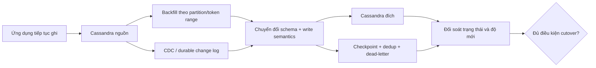
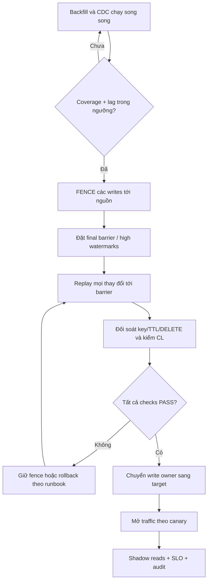

# Đồng bộ thay đổi tăng thêm trong lúc hệ nguồn tiếp tục ghi

> **Chương:** Di chuyển và schema  
> **Mô-đun:** `DATABASE_ENGINE_WIDE_COLUMN_CASSANDRA` — kiến trúc phân tán và wide-column của Apache Cassandra, partition key, thiết kế bảng theo truy vấn, mức nhất quán đọc/ghi, CQL, replication, compaction, repair, xử lý lỗi và Java Driver.  
> **Trọng tâm:** Di chuyển dữ liệu sang bảng/cụm Cassandra đích khi hệ nguồn vẫn nhận `INSERT`, `UPDATE`, `DELETE`. Kết hợp **quét dữ liệu nền (backfill)** với **thu nhận và áp dụng thay đổi tăng thêm (CDC/change stream)**, bảo toàn semantics timestamp, TTL và tombstone, đo độ trễ đồng bộ, chuyển traffic có kiểm soát và có phương án rollback.

Một lần copy toàn bộ bảng từ Cassandra nguồn sang Cassandra đích hiếm khi là toàn bộ bài toán migration trực tuyến. Giả sử công cụ bắt đầu quét 100 triệu hàng lúc 09:00 và hoàn tất lúc 12:00. Trong ba giờ đó ứng dụng vẫn ghi: có hàng mới, hàng bị cập nhật, dữ liệu hết TTL hoặc bị DELETE. Nếu chuyển ứng dụng sang hệ đích ngay sau lúc copy, một phần thay đổi có thể **không nằm trong dữ liệu đã sao chép**, dù job báo “100% ranges hoàn thành”.

Vấn đề cốt lõi không chỉ là *chép bao nhiêu byte*, mà là **duy trì trạng thái logic của dữ liệu qua thời gian** và **chứng minh được đích đã theo kịp nguồn đến một mốc xác định**. Quy trình đúng phải thiết kế từ đầu cho sự đồng thời giữa ghi mới, quét nền, retry, node Down, schema evolution, tombstone, và tính nhất quán đọc/ghi của Cassandra.

## 1. Kết quả học tập

Sau bài này, bạn có thể:

1. Giải thích vì sao backfill một lần không tạo ra snapshot nhất quán toàn cụm khi Cassandra vẫn nhận ghi.
2. Phân biệt **change capture từ commit log/CDC**, **event log ở ứng dụng**, **dual-write**, và quét định kỳ theo `updated_at`.
3. Thiết kế pipeline **bắt đầu capture trước → backfill → replay changes → đối soát → chuyển traffic**.
4. Hiểu giới hạn của Cassandra CDC: phạm vi theo bảng/node, log retention, duplicate/ordering, thiếu before-image và tài nguyên `cdc_raw`.
5. Xử lý **write timestamp (microseconds)**, last-write-wins, TTL còn lại, tombstone và các hàng bị xóa.
6. Thiết kế **idempotency, dedup, checkpoint và retry** cho từng partition/token range.
7. Xây dựng phương pháp đo **replication lag, high-watermark và coverage**, không nhầm “consumer chạy” với “đã bắt kịp”.
8. Dùng CQL và Java Driver 4.x để minh họa backfill, prepared statements và truy vấn đối soát.
9. Lập runbook chuyển traffic có **fencing/write freeze**, rollback và điều kiện dừng.
10. Nhận biết khi nào cần dịch vụ streaming/CDC chuyên dụng, hệ thống xử lý sự kiện hoặc downtime ngắn để bảo đảm tính đúng đắn.

## 2. Mô hình vấn đề: “copy xong” vẫn có thể thiếu dữ liệu

### 2.1. Timeline một migration đang có ghi

Giả sử nguồn có bảng `orders_by_tenant_day` và đích đang được nạp dữ liệu:

```text
09:00  Bắt đầu backfill (quét lần lượt các token ranges)
09:05  Backfill đọc order A: state=CREATED
09:07  Ứng dụng UPDATE A thành PAID ở nguồn
09:08  Ứng dụng INSERT order B
09:10  Ứng dụng DELETE order C
11:59  Backfill kết thúc
12:00  Ứng dụng chuyển đọc/ghi sang đích
```

Nếu chỉ có backfill, đích có thể:

- Vẫn giữ `A=CREATED` thay vì `A=PAID`.
- Thiếu order B nếu range liên quan đã được quét trước 09:08.
- Giữ order C nếu bản copy đã lấy C trước DELETE.
- Có trạng thái các partition tương ứng **nhiều thời điểm khác nhau**.

Ngay cả việc quét một bảng dưới `LOCAL_QUORUM` cũng **không** tạo ra transaction snapshot toàn bảng tại 09:00. Mỗi page, partition hoặc token range có thể được đọc ở thời điểm khác nhau.

### 2.2. Vì sao chỉ chạy lại backfill không đủ tốt?

Quét lặp lại toàn bảng có thể đồng bộ phần lớn bản ghi đang tồn tại, nhưng:

- Chi phí đọc/stream rất cao khi bảng lớn.
- Không biết delete nào đã xảy ra nếu row **không còn xuất hiện** ở nguồn.
- Giữa hai vòng quét vẫn có ghi mới.
- Quét dài có thể vượt cửa sổ TTL/retention.
- Việc ghi lại một phiên bản cũ có thể xung đột với phiên bản mới ở đích nếu xử lý timestamp sai.
- Số lượng token ranges và trạng thái repair/replica có thể đổi khi topology đang thay đổi.

Giải pháp trực tuyến cần một **luồng thay đổi liên tục** song song với backfill, cộng với quy trình chứng minh đã hội tụ trước cutover.

### 2.3. Hai luồng dữ liệu hội tụ ở đích



**Điều kiện không thể bỏ qua:** phải có cách xác định **nguồn thay đổi không bị mất giữa mốc bắt đầu backfill và mốc đích bắt kịp**, kể cả khi workers/servers restart.

## 3. Phân biệt bốn cách lấy thay đổi tăng thêm

| Phương pháp | Nguồn thay đổi | Lợi ích | Rủi ro/giới hạn |
|---|---|---|---|
| **Cassandra CDC** | Commit log dành cho tables bật CDC | Bắt mutation gắn với đường ghi Cassandra | Node-local, cần parser/connector, retention/disk pressure, duplicate và thứ tự |
| **Durable event log từ ứng dụng** | Kafka/Pulsar/outbox hoặc business event stream có độ bền | Có event ID, partition key, schema và workflow rõ | Phải bảo đảm nguồn sự kiện là đầy đủ, không có đường ghi ngoài log |
| **Dual-write** | App gửi write tới nguồn và đích | Dễ thử với số ít writers; độ trễ thấp | Partial success, không có atomic commit giữa hai clusters, retry làm lệch |
| **Polling theo `updated_at`** | Query rows có timestamp cập nhật | Không cần CDC nếu schema hỗ trợ | Không thấy DELETE vật lý, TTL, late writes, clock skew và thiếu index phù hợp |

Không có “một dòng CQL SELECT CHANGES” tiêu chuẩn cho mọi bảng Cassandra tương tự hệ thống SQL có transaction log CDC. Cần chọn kiến trúc dựa trên **độ chính xác**, **nguồn write** và **khả năng vận hành**.

### 3.1. Khi nên chọn gì?

- Có **event log nghiệp vụ đầy đủ**, mọi write đều đi qua một pipeline: cân nhắc replay từ log đó.
- Nguồn là **Cassandra**, có nhiều writers và muốn bắt cả mutation xảy ra trong DB: đánh giá CDC theo Cassandra version và connector phù hợp.
- Migration nhỏ, có thể **ngừng ghi ngắn** và đối soát range: downtime/fencing ngắn đôi khi an toàn hơn hệ CDC tự viết.
- Yêu cầu không được mất **DELETE/TTL**: không dùng polling `updated_at` làm nguồn duy nhất nếu không có tombstone/deletion event rõ ràng.
- Dùng dual-write: phải có **reconciliation và idempotent retry**; không gọi nó là giao dịch hai pha giữa clusters.

## 4. Các bất biến dữ liệu phải viết ra trước khi migrate

Một kế hoạch tốt định nghĩa các **invariants** trước khi chọn công cụ:

1. **Coverage:** mọi partition/range cần di chuyển đều được backfill hoặc được tạo bởi change stream.
2. **Change completeness:** mọi mutation trong khoảng [bắt đầu capture, cutover] có đường ghi đáng tin cậy vào đích.
3. **Ordering:** những thay đổi cùng logical entity/partition có quy tắc quyết định phiên bản thắng.
4. **Idempotency:** phát lại cùng sự kiện không tạo thêm row logic, double count hoặc side effect không mong muốn.
5. **Deletes:** DELETE/tombstone không bị mất chỉ vì bản ghi vắng mặt trong kết quả SELECT.
6. **TTL:** một giá trị ở đích không được sống lâu hơn dự kiến chỉ vì migrate.
7. **Schema mapping:** sự thay đổi partition key, kiểu dữ liệu, defaults và denormalized projections là xác định.
8. **Read validation:** dữ liệu đích trả các truy vấn nghiệp vụ quan trọng đúng theo mốc cam kết.
9. **Cutover fencing:** sau chuyển quyền ghi, không có hai nơi cùng là nguồn sự thật không được điều phối.
10. **Rollback:** biết dữ liệu ghi sau cutover nằm ở đâu và cần replay theo chiều nào khi quay lại.

Các bất biến nên biến thành **tiêu chí pass/fail đo được**, không chỉ diễn giải trên slide dự án.

## 5. Cassandra CDC hoạt động ở mức nào?

### 5.1. CDC gắn với mutation và commit log

Trong Apache Cassandra, CDC có thể bật theo bảng:

```sql
ALTER TABLE app.orders_by_tenant_day WITH cdc = true;
```

Với bảng có CDC bật, Cassandra đánh dấu/ghi những mutation liên quan trong commit log và giữ các segment có CDC data để consumer có thể xử lý, thường qua thư mục `cdc_raw` và metadata/index tương ứng tùy phiên bản.

**CDC này không phải tự động publish JSON messages lên Kafka.** Một agent/connector phải đọc đúng format commit log và trạng thái node, biến các mutations thành sự kiện có metadata, rồi đẩy vào pipeline có checkpoint. Tính năng bật CDC đơn thuần không chứng minh đã thu mọi thay đổi vào kho bền vững ngoài cluster.

### 5.2. Node-local, không phải log toàn cụm có thứ tự tuyệt đối

Cassandra có replication factor (RF). Một logical write thường được xử lý ở nhiều replicas, do đó:

- CDC có thể được tạo trên **nhiều node** cho cùng một mutation.
- Các node giữ những commit-log segments riêng; không có một global commit sequence chuẩn cho toàn cụm.
- Một node có thể Down và bỏ lỡ writes; nếu chỉ đọc CDC của node đó, nguồn thay đổi không đầy đủ.
- Một mutation có thể đến các replica ở những thời điểm khác nhau hoặc được phát lại qua hints/repair theo cơ chế khác.
- Chạy hai CDC agents hoặc retry có thể tạo events trùng.

**Không suy “CDC có một event cho mỗi CQL statement, đúng thứ tự toàn cluster”.** Consumer cần dedup, nguồn coverage phù hợp RF/DC, và xử lý conflict theo semantics Cassandra/tầng nghiệp vụ.

### 5.3. Giới hạn dung lượng và backpressure

CDC giữ segments cần consumer xử lý và chiếm dung lượng đĩa. Cấu hình như `cdc_total_space_in_mb` (tên/semantics theo phiên bản) giới hạn ngân sách local CDC; khi backlog quá lớn, write vào CDC-enabled table có thể bị từ chối hoặc lỗi do CDC space budget.

Đây là **rủi ro availability**: một migration CDC consumer bị dừng lâu không chỉ tạo lag mà còn có thể ảnh hưởng write traffic nguồn. Cần theo dõi:

- CDC raw directory used/free và số segments chưa xử lý.
- Tuổi đoạn log già nhất chưa được consumer xác nhận.
- Lỗi parsing, connector restarts, checkpoint delay, upload/Kafka lag.
- Cassandra commit log/disk pressure và write timeouts.
- Mỗi node/replica có đủ coverage theo chiến lược CDC không.
- Ngưỡng dừng/giảm tải migration **trước** khi CDC budget cạn.

Đừng xóa file trong `cdc_raw` bằng tay chỉ để chữa disk-full; điều đó có thể làm mất các mutation chưa được đồng bộ. Cleanup phải do connector và runbook quản lý.

### 5.4. CDC không tự cung cấp before-image

Một `UPDATE` hoặc `DELETE` trong Cassandra có thể mang **chỉ primary key và những column mutations được thay đổi**, không có đầy đủ row “trước khi sửa”. Điều này đặc biệt nguy hiểm khi chuyển từ bảng nguồn theo `order_id` sang bảng đích theo `tenant_id, event_day`:

- DELETE nguồn chỉ nêu `order_id` có thể **không chứa tenant_id/event_day cũ**.
- Nếu target partition key phụ thuộc non-PK column trước đó, consumer có thể không biết xóa row nào ở đích.
- UPDATE thay tenant/day cần xóa **khóa đích cũ** và ghi **khóa đích mới**, không chỉ insert lại.

Phải có **state store, mapping index, before-image từ event log, lookup lịch sử đáng tin cậy hoặc quy trình rebuild/đối soát**. Không hứa rằng mọi schema migration có đổi partition key đều được thực hiện bằng cách “copy một CDC event sang bảng mới”.

### 5.5. CDC và commit log archiving không giống nhau

| Khái niệm | Mục tiêu | Có thể dùng làm migration stream? |
|---|---|---|
| **CDC-enabled table** | Expose mutations cho consumer qua commit-log-based mechanism | Có, nếu có connector đúng version và coverage |
| **Commit log archiving** | Lưu segments phục vụ recovery/PITR theo quy trình | Có thể là nguồn cho hệ chuyên dụng, không mặc định CDC decoded stream |
| **Repair/streaming** | Đồng bộ replica/token ownership | Không phải audit log thứ tự thay đổi |
| **Hinted handoff** | Gửi lại mutation đã bỏ lỡ tới replica | Không phải nguồn event log đầy đủ |
| **SSTable incremental backup** | Giữ file SSTable sau flush/stream | Không phải row-level change stream |

Không dùng thời điểm flush hoặc tệp backup SSTable làm “offset mutation” thay cho CDC checkpoint.

## 6. Bắt đầu capture **trước** khi quét nền

### 6.1. Khoảng trống nguy hiểm

Giả sử:

```text
10:00  Bắt đầu full export
10:05  Source DELETE row X
10:08  Bật CDC
11:00  Full export kết thúc
```

DELETE ở 10:05 có thể xảy ra **sau khi range chứa X đã được export**, nhưng **trước khi CDC bắt đầu**. Khi đó target vẫn có X và CDC không thể tái tạo DELETE từ một event chưa từng được capture.

Điều kiện an toàn phải là:

\[
T_{\mathrm{capture\ ready}} \le T_{\mathrm{backfill\ start}}
\]

và việc capture phải giữ được toàn bộ mutations liên quan từ mốc này tới cutover. *Ready* nghĩa là **bật trên tất cả nguồn cần thiết, consumer có đường nhận dữ liệu bền vững, không còn vùng mù**, không đơn giản là đã chạy lệnh cấu hình.

### 6.2. Quy trình khởi động theo “barrier”

1. Kiểm kê tất cả writers/hosts/keys/tables liên quan.
2. Bật CDC hoặc bảo đảm source event log đã là con đường ghi đầy đủ.
3. Khởi chạy consumer, xác minh nhận **một mutation thử** và commit checkpoint.
4. Ghi lại mốc bắt đầu capture \(C_0\) trong manifest.
5. Kiểm tra CDC disk budget, lag, Node Up/Down và version.
6. Bắt đầu backfill theo token/partition ranges.
7. Chạy replay tăng thêm song song theo quy tắc merge/version.
8. Đối soát coverage của range đã copy và stream changes sau \(C_0\).
9. Chỉ sau khi capture vẫn liên tục và target đủ mới mới xét cutover.

**Lưu ý:** Nếu dùng event log ứng dụng, mốc \(C_0\) thường là **durable offset** theo từng partition/topic, chứ không chỉ timestamp máy. Với Cassandra CDC node-local, checkpoint có thể bao gồm node/segment/position và mapping topology; phải dùng format/connector thực hỗ trợ.

### 6.3. Có cần đóng băng ghi ngắn lúc bắt đầu?

Nếu không có cách chứng minh CDC đã bao phủ toàn bộ writers ngay trước backfill, một **short write fence** để đặt barrier và xác nhận consumer có thể là lựa chọn an toàn. Độ dài thời gian cần đo, không phải giả định phải downtime nhiều giờ.

## 7. Backfill: sao chép trạng thái nền nhưng không lấn át thay đổi mới

### 7.1. Quét theo partition key và token ranges

Với dataset lớn, backfill có thể dùng:

- Job theo **known partition keys** nếu nguồn có danh mục khóa đáng tin.
- **Token-range scans** có các ranges disjoint, bao phủ toàn ring.
- Công cụ như DSBulk unload, Spark Cassandra Connector hoặc migration tool được hỗ trợ, có rate limiting/metrics.
- Snapshot-based export nếu có protocol nhất quán và khả năng khôi phục phù hợp.

Với table có composite partition key:

```sql
-- Ví dụ minh họa; chỉ chọn non-wrap token range có bounds thật.
SELECT tenant_id, event_day, event_id, event_type
FROM app.events_by_tenant_day
WHERE token(tenant_id, event_day) > ?
  AND token(tenant_id, event_day) <= ?;
```

Hai dấu `?` là bounds token tương ứng partitioner. Với `Murmur3Partitioner`, token là số nguyên 64-bit có dấu; phải xử lý wrap-around và boundaries để không thiếu/trùng ranges.

**Một token range không tương ứng một số byte bằng nhau.** Large partitions, tombstones và vnodes có thể làm phân bố tải lệch mạnh; cần checkpoint/progress theo byte/rows và health.

### 7.2. Backfill có paging không có global snapshot

Page size 500 giúp giới hạn số hàng mỗi lần fetch. Nó **không**:

- Bảo đảm job chỉ đọc 500 rows.
- Chụp nhất quán toàn bộ bảng tại thời điểm đầu.
- Bảo đảm không có row được cập nhật giữa hai pages.
- Giải quyết INSERT/DELETE xảy ra trong lúc quét.

Nếu cần snapshot tại cutoff mạnh hơn semantics Cassandra cung cấp, phải có **application write barrier, immutable partitions, event log replay hoặc protocol đặc biệt**.

### 7.3. Race: bản cũ đến sau bản mới

Một race quan trọng:

```text
10:00  Backfill đọc X=CREATED, source write timestamp = 100
10:01  CDC nhận UPDATE X=PAID, write timestamp = 200
10:02  CDC ghi X=PAID vào target
10:03  Backfill ghi X=CREATED vào target
```

Nếu backfill dùng **timestamp mới do target coordinator cấp lúc 10:03**, Cassandra có thể coi `CREATED` mới hơn `PAID`, làm trạng thái **quay lùi** dù CDC đúng.

**Cách khắc phục**: bảo toàn/cấp lại **version/timestamp semantics** hoặc triển khai merge có kiểm tra version, không được ghi ngẫu nhiên theo thứ tự đến.

### 7.4. Không chỉ dựa vào “CDC luôn chạy sau backfill”

Ngay cả khi dự định “quét xong mới replay”, pipeline có thể có nhiều workers, retries, gaps, marker sai hoặc page processing kéo dài. Không thể bảo đảm thứ tự tác vụ đơn giản bằng một cờ chung khi các node/partitions hoạt động đồng thời.

Thiết kế an toàn phải cho phép:
- Một mutation CDC được phát lại nhiều lần.
- Một trang backfill đến chậm hơn CDC.
- Một worker restart và retry range.
- Một DELETE đến trước INSERT cũ.
- Một node/repartition thay đổi trong khi job đang chạy.

## 8. Timestamp reconciliation của Cassandra

### 8.1. Cassandra giải quyết cell conflicts bằng timestamps

Cassandra dùng **write timestamp** ở mức cell/tombstone để reconcile các versions, thông thường theo quy tắc **last-write-wins trên timestamp** cùng các quy tắc tie-break và tombstone. Timestamp đơn vị **microsecond từ Unix epoch** trong CQL `USING TIMESTAMP`; không phải Java milliseconds.

Ví dụ:

```sql
-- Lab: minh họa timestamp có thể được đặt tường minh.
UPDATE lab_migrate.orders_by_tenant_day
USING TIMESTAMP 1795255200000000
SET order_state = 'PAID'
WHERE tenant_id = 11111111-1111-1111-1111-111111111111
  AND order_day = '2026-11-21'
  AND order_id = 22222222-2222-2222-2222-222222222222;
```

**Chú ý:** timestamp trên chỉ là ví dụ. Trong một pipeline thật, phải lấy timestamp có thẩm quyền từ mutation/row source; không tạo timestamp dựa trên `System.currentTimeMillis() * 1000` một cách tùy tiện cho backfill nếu cần không lấn át CDC.

### 8.2. Có thể đọc `WRITETIME` của một column

Với một regular column đơn giản:

```sql
SELECT order_state, WRITETIME(order_state) AS state_writetime
FROM lab_migrate.orders_by_tenant_day
WHERE tenant_id = 11111111-1111-1111-1111-111111111111
  AND order_day = '2026-11-21'
  AND order_id = 22222222-2222-2222-2222-222222222222;
```

Nhưng đây không phải “row timestamp” phổ quát:

- Mỗi non-key column có thể có **timestamp khác nhau**.
- Static columns, collections/UDTs và counter tables có semantics khác.
- Tombstoned row có thể không xuất hiện trong SELECT, nên không có `WRITETIME` của DELETE từ query này.
- Một `INSERT` có thể ghi nhiều columns; một `UPDATE` chỉ thay một column.
- Không thể khôi phục toàn bộ lịch sử mutations chỉ từ current `WRITETIME` values.

Khi cần bảo toàn conflicts chính xác, consumer nên có **mutation metadata đầy đủ**, hoặc thiết kế migration theo **business version** thay vì đoán từ một cột.

### 8.3. Timestamps không phải global event order

Hai writers có clock skew hoặc custom timestamps có thể phát sinh:

```text
Real time:
10:00 writer A ghi state=CREATED với ts=5000
10:01 writer B ghi state=PAID    với ts=4000
```

Theo LWW, Cassandra có thể giữ `CREATED` do timestamp lớn hơn, dù thời điểm thực `PAID` đến sau. Migration phải phản ánh **semantics source** hoặc định nghĩa phiên bản nghiệp vụ riêng; không suy “event đến sau” luôn thắng.

**Không dùng thời gian consumer nhận event làm timestamp mới** nếu cần bảo toàn trạng thái nguồn.

## 9. TTL, expiration và DELETE trong đồng bộ tăng thêm

### 9.1. TTL là thời điểm hết hạn, không phải chỉ số giây tùy ý

Ví dụ:

```sql
UPDATE lab_migrate.orders_by_tenant_day
USING TTL 3600
SET temporary_note = 'needs-review'
WHERE tenant_id = 11111111-1111-1111-1111-111111111111
  AND order_day = '2026-11-21'
  AND order_id = 22222222-2222-2222-2222-222222222222;
```

Nếu giá trị có TTL 3.600 giây tại nguồn lúc 10:00, nhưng job backfill đọc nó lúc 10:40:

- Nếu target ghi lại với `TTL 3600` vào 10:40, dữ liệu có thể tồn tại tới 11:40 thay vì 11:00.
- Nếu target dùng **remaining TTL** khoảng 1.200 giây, nó hết hạn gần mốc mong muốn hơn.
- Nếu đã hết hạn ở nguồn nhưng target còn bản copy cũ, cần bảo đảm tombstone/delete semantics không bị đánh mất.

### 9.2. Đọc TTL còn lại

```sql
SELECT temporary_note,
       TTL(temporary_note) AS note_ttl_seconds,
       WRITETIME(temporary_note) AS note_writetime
FROM lab_migrate.orders_by_tenant_day
WHERE tenant_id = 11111111-1111-1111-1111-111111111111
  AND order_day = '2026-11-21'
  AND order_id = 22222222-2222-2222-2222-2222-222222222222;
```

`TTL(column)` trả thời gian còn lại cho cell khi có TTL, hoặc null nếu không áp TTL (và còn tùy trường hợp null/expired). Khi export có độ trễ, tính lại phần **remaining** tại lúc ghi target; cần đồng bộ đồng hồ và chú ý seconds granularity.

**Không thể dùng `TTL()` trên một row đã bị xóa để tái tạo chính xác tombstone lịch sử.**

### 9.3. DELETE có thể là hàng vắng mặt trong SELECT

Giả sử backfill ghi row X vào target. Sau đó source DELETE X. Nếu consumer chỉ poll:

```sql
SELECT * FROM lab_migrate.orders_by_tenant_day
WHERE ...;
```

và thấy “không còn X”, điều đó không chứng minh consumer biết **X đã bị xóa, khi nào xóa và timestamp nào cần đặt ở target**. Muốn replay DELETE đúng cần:

- CDC mutation chứa key và deletion timestamp.
- Business delete event có primary key trước/after nếu cần.
- Một state store/history mapping để biết key đích cũ.
- Quy trình reconciliation theo tập khóa, trong các trường hợp được phép.

Dữ liệu xóa có thể còn tombstones trong SSTables nhiều ngày theo `gc_grace_seconds`; không giảm grace chỉ để giảm chi phí migration.

### 9.4. Cẩn trọng với thay primary key

Nếu target PK khác source, việc đọc source row rồi ghi target row có thể dễ, nhưng **UPDATE hoặc DELETE** phức tạp:

| Thao tác tại nguồn | Mục tiêu ở đích | Điều kiện cần biết |
|---|---|---|
| INSERT | Chèn row theo target PK | Đủ mọi thành phần target partition/clustering key |
| UPDATE regular column | Cập nhật row ở đúng target PK | Mapping từ source PK tới target PK |
| UPDATE field tham gia target PK | Xóa target key cũ, ghi target key mới | **Before-image** hoặc history mapping |
| DELETE row nguồn | Xóa target row tương ứng | Source PK và **target PK trước DELETE** |
| TTL expire | Bảo đảm row/column đích hết hạn tương đương | Expiry timestamp hoặc propagated tombstone |

Nếu các giá trị cần để tạo target PK **không nằm trong delete event**, không thể xây target deletion chỉ từ row đang vắng mặt. Thiết kế schema change phải giải quyết điều này **trước** khi bắt đầu migration.

## 10. Idempotency và duplicate handling

### 10.1. Vì sao consumer có thể xử lý trùng?

Trong hệ phân tán, consumer có thể:

1. Đọc CDC event.
2. Ghi event vào target thành công.
3. Crash trước khi commit checkpoint.
4. Restart và đọc lại event.
5. Ghi cùng event lần hai.

Cơ chế **at-least-once delivery** như vậy thường thực tế hơn “mỗi event được xử lý đúng một lần” trên toàn bộ source/queue/target. Đích phải chịu được replay.

### 10.2. Với CQL upsert, “cùng key” chưa chắc đủ

Nếu replay cùng một `INSERT` vào cùng primary key:

- Nếu cùng **write timestamp**, columns/value và TTL semantics đúng, thường có thể tránh sinh bản ghi logic trùng.
- Nếu lần replay gán **write timestamp mới**, nó có thể lấn át một UPDATE/DELETE tới sau.
- Nếu dùng `USING TTL` lại từ đầu, thời gian hết hạn có thể bị kéo dài.
- Với **counter increment**, retry có thể cộng lần hai.
- Nếu một event cập nhật nhiều bảng denormalized, phải biết partial success/compensation.

Do đó idempotency nên dựa trên **event ID/source offset, deterministic mapping, version logic và target writes có semantics ổn định**.

### 10.3. Event ID và khóa bền

Ví dụ một business event:

```json
{
  "event_id": "7e3601d4-8b6e-4ca1-8ee3-91a94b348b01",
  "entity_key": {
    "tenant_id": "11111111-1111-1111-1111-111111111111",
    "order_day": "2026-11-21",
    "order_id": "22222222-2222-2222-2222-222222222222"
  },
  "operation": "UPDATE",
  "column": "order_state",
  "value": "PAID",
  "source_write_timestamp_us": 1795255200000000,
  "source_partition": 12,
  "source_offset": 982311
}
```

**Đây là định dạng event do hệ migration thiết kế**, không phải format JSON Cassandra CDC tự xuất. Dùng `event_id` và `source_partition + source_offset` để dedup/checkpoint; dùng timestamp/sequence metadata cho quy tắc merge.

Nếu một logical write xuất hiện từ nhiều replica CDC sources, cùng source segment offset **không đủ** dedup xuyên node. Phải có logical mutation fingerprint/event ID phù hợp; timestamp + PK + value có thể giúp nhưng **không luôn phân biệt hai mutations có cùng payload/timestamp**, đặc biệt với counters hay thao tác không idempotent.

### 10.4. Tránh “exactly once” trên nhãn quảng cáo

Một connector có thể quảng bá exactly-once trong một thành phần (ví dụ commit offset vào queue), nhưng **ghi Cassandra target và commit offset** không tự nằm trong một atomic transaction xuyên hai hệ. Cần:

- Idempotent writes.
- Checkpoint durable và có thứ tự rõ.
- Retry/reconcile.
- Phương án lỗi xảy ra *sau target write nhưng trước checkpoint*.
- Audit dữ liệu nghiệp vụ.

Nếu yêu cầu exactly-once mạnh cho nghiệp vụ tài chính, hãy thiết kế **ledger/event-source-of-truth** với invariant chuyên biệt, không chỉ dựa vào CQL batch.

## 11. Ordering và phân vùng của event stream

### 11.1. Thứ tự theo logical entity quan trọng hơn thứ tự toàn cụm

Không có một thứ tự toàn cục đáng tin cho mọi Cassandra mutations. Nhưng thường muốn các thay đổi liên quan cùng một entity/partition được xử lý có kiểm soát.

Nếu dùng Kafka hoặc queue:

- Chọn key routing như `(tenant_id, order_id)` để các events của một entity đi vào cùng ordered partition **nếu producer semantics cho phép**.
- Gắn business version hoặc write timestamp rõ.
- Không giả định timestamp hệ thống của connector bằng write timestamp CQL.
- Khi rebalances/retries, consumer vẫn cần dedup.
- Với events từ nhiều writers, xử lý tie/clock skew bằng quy tắc nguồn.

### 11.2. Backfill và CDC dùng chung merge policy

Một giải pháp phổ biến:

```text
Source row/cell snapshot:
  value = CREATED
  source timestamp = 100

CDC update:
  value = PAID
  source timestamp = 200

Target:
  Bất kể bản nào đến trước, version=200 phải thắng.
```

Nhưng nếu source có nhiều cell với timestamp khác nhau, replay cả row như **một write timestamp duy nhất** có thể phá logic reconciliation. Cần chọn một trong hai:

1. Áp dụng **cell-level mutations/timestamps** đúng khả năng connector.
2. Dùng **business-level version** cho toàn entity, với logic so sánh/phê duyệt version.
3. Tạm dừng/đặt hàng rào ghi và sao chép trạng thái tại một mốc để tránh conflict khó giải quyết.
4. Với trường hợp không thể bảo toàn trạng thái, đưa vào **manual reconciliation/quarantine** thay vì ép ghi.

### 11.3. CQL batch không tạo atomicity xuyên cluster

Một `BEGIN BATCH` trên Cassandra target có các semantics atomicity riêng trong Cassandra; nó không liên kết với một write vào Cassandra source hoặc một checkpoint bên ngoài. Đừng dùng:

```sql
BEGIN BATCH
  ...;
  ...;
APPLY BATCH;
```

rồi tuyên bố có transaction xuyên hai clusters. Đặc biệt, **unlogged batches trên nhiều partition** có thể tăng coordination overhead mà không có lợi ích tương xứng. Thiết kế event application và kiểm chứng theo từng partition/aggregate nhất quán với use case.

## 12. Checkpoint và tiến độ không bị mất khi restart

### 12.1. Hai loại checkpoint

**Backfill checkpoint** cho biết những token ranges/partitions nào đã được đọc và output commit:

```yaml
backfill:
  job_id: migrate-orders-2026-11
  ranges:
    - id: r001
      start_exclusive: "-9223372036854775808"
      end_inclusive: "-5000000000000000000"
      status: VERIFIED
      rows: 120034
      checksum_manifest: "sha256:example-placeholder"
    - id: r002
      status: RUNNING
```

**CDC/change-stream checkpoint** cho biết những source positions nào đã được xử lý và apply:

```yaml
change_stream:
  source: durable-event-log
  topic: orders-mutations
  offsets:
    "0": 912340
    "1": 892331
    "2": 902200
  status: RUNNING
  target_apply_verified_until: null
```

**Hai YAML trên chỉ là ví dụ manifest**, không phải cấu hình Cassandra. Checkpoint không tự chứng minh toàn bộ dữ liệu đúng nếu thiếu idempotent writes và cơ chế verify.

### 12.2. Lúc nào được checkpoint một event?

Quy tắc cơ bản với at-least-once:

1. Nhận event E từ nguồn.
2. Validate schema, khóa và thông tin version.
3. Áp dụng mutation vào đích **thành công với CL mong muốn**.
4. Ghi nhận E đã apply trong state store (nếu dùng).
5. **Sau đó** commit source offset/checkpoint.

Nếu checkpoint **trước khi** target write bền vững, crash có thể làm **mất event không bao giờ được replay**. Nếu checkpoint sau, crash có thể tạo **replay trùng**, vì vậy idempotency là bắt buộc.

### 12.3. Checkpoint riêng theo shard/range

Một worker xử lý 10 ranges không nên đánh dấu toàn bộ job DONE khi mới hoàn thành range đầu. Manifest nên có:

- Cluster, keyspace, table, schema version và partitioner.
- Token boundaries với quy tắc inclusive/exclusive.
- Worker/attempt, last complete offset, row/byte count.
- Status `PENDING / RUNNING / VERIFIED / FAILED`.
- Checksum hoặc sample reconciliation evidence.
- Cutoff/CDC coverage tương ứng với ranges đã backfill.
- Output staging location và commit marker.

Nếu retry, có thể chạy lại **toàn bộ range** dưới idempotent mapping thay vì giữ một “last token” đơn giản có nguy cơ bỏ sót partition collisions hoặc rows giữa partition.

### 12.4. Không đánh dấu `VERIFIED` chỉ từ một file tồn tại

Một file export/target table có thể chứa **một phần** dữ liệu khi network timeout. Phải phân biệt:

- `SCANNED`: source range đã được đọc.
- `APPLIED`: các writes tương ứng được target ACK.
- `RECONCILED`: đối soát theo chiến lược đã chọn.
- `VERIFIED`: manifest/checkpoints và coverage đầy đủ, không còn unresolved errors.

Đừng dùng phần trăm “data copied” để suy “target ready for cutover”.

## 13. Lag và watermarks: biết đích đã bắt kịp chưa

### 13.1. Một loại lag không đủ

Các độ trễ cần quan sát:

| Loại | Ý nghĩa | Cách đo |
|---|---|---|
| **Source-to-capture lag** | Mutation từ nguồn tới connector/queue | Source commit/event time → capture time theo clock/offset đáng tin |
| **Queue backlog** | Events chưa được consume | High watermark minus committed offsets theo từng shard |
| **Apply lag** | Event đã được consume nhưng target chưa ACK | Consumer processing, retries, DLQ |
| **End-to-end visibility lag** | Source data đã ghi nhưng target query còn chưa thấy | Probe/sentinel events và read target CL |
| **Backfill coverage** | Phần data/ranges đã scan/verify | Per-range manifest, rows/bytes và checks |
| **Deletion/TTL convergence** | Deletes/expiries đã có kết quả đúng ở đích | Tombstone/reconciliation/negative checks |

Không cộng bừa offset của các source partitions thành một “offset chung” nếu chúng có tốc độ và phạm vi khác nhau.

### 13.2. High watermark là một mốc **có phạm vi**

Giả sử stream có ba shards:

```text
At barrier B:
  shard 0 high watermark = 1,000,000
  shard 1 high watermark =   900,000
  shard 2 high watermark = 1,100,000

Target applied checkpoints:
  shard 0 = 1,000,000
  shard 1 =   899,995
  shard 2 = 1,100,000
```

Tuy chỉ còn 5 messages ở shard 1, **chưa được tuyên bố đã bắt kịp barrier B**. Cần mọi shard/producer/CDC source thuộc scope được apply tới ít nhất watermark tương ứng, không có DLQ unresolved, và phép đối soát thành công.

### 13.3. Timestamp lag có thể đánh lừa

Sử dụng:

\[
\mathrm{lag}_{\mathrm{time}}
= t_{\mathrm{now}} - t_{\mathrm{source\ event}}
\]

dễ hiểu, nhưng:

- Đồng hồ writers có thể lệch.
- Source timestamps đôi khi được client đặt tường minh/giữ từ quá khứ.
- Không có events mới trong một shard không có nghĩa shard đã hỏng.
- Một batch cũ được replay có thể khiến max age lớn dù backlog sắp hết.

Vì vậy nên đo **offset lag + oldest-unapplied event age + heartbeat/sentinel freshness** và chiếu theo DC/table/shard.

### 13.4. Đặt ngưỡng cutover dựa trên yêu cầu nghiệp vụ

Ví dụ mục tiêu migration cho phép target trễ tối đa 30 giây:

- CDC consumer còn đầy đủ, không thiếu segments.
- Backfill ranges 100% VERIFIED.
- All relevant shards at/above barrier watermarks.
- End-to-end lag p99 trong cửa sổ ổn định dưới 30 giây.
- DLQ/poison events đã xử lý; không bỏ qua DELETE.
- Data reconciliation cho các partition nóng và records đã xóa đạt tiêu chí.
- Source/target CQL p95/p99 và CL health trong SLO.

Đây là ví dụ ngưỡng theo **SLO giả định**, không phải yêu cầu Cassandra mặc định. Một cutover với **nguồn vẫn tiếp tục ghi** không thể dựa duy nhất vào độ trễ nhỏ; để khép khoảng hở cuối, cần fence hoặc một cơ chế atomic write ownership transfer rõ ràng.

## 14. Chiến lược chuyển traffic có điều phối

### 14.1. Kế hoạch “fence → drain → verify → cutover”

Một trình tự an toàn thường là:



### 14.2. Vì sao cần write fencing?

Trong cutover, có thể xảy ra:

```text
T0  CDC lag = 0 theo mẫu đã đo
T1  Ứng dụng ghi order X vào source
T2  Chuyển đọc sang target
T3  CDC mới đưa write T1 đến target
```

Dù lag = 0 tại T0, **không có bảo đảm** write T1 đã đến trước T2. Nếu nghiệp vụ yêu cầu không đọc thiếu ngay sau cutover, cần:

- Tạm chặn hoặc queue writes đến source.
- Chờ toàn bộ writers xác nhận đã ngừng/đã hoàn tất in-flight requests.
- Ghi final barrier có durable offsets.
- Chờ target apply barrier.
- Sau đó đổi write/read owner sang target.
- Mở traffic có canary và giám sát.

**Fencing ở application/gateway hoặc quyền ghi** phải đủ mạnh; chỉ “gửi thông báo dừng ghi” không bảo đảm một legacy worker không còn viết.

### 14.3. “Không downtime” đòi protocol phức tạp hơn

Nếu không được dừng ghi dù vài giây, cần cơ chế **duy nhất chủ ghi theo epoch/lease**, queue buffer hoặc transactionally ordered source event log có khả năng chuyển ownership. Không có transaction nguyên tử xuyên Cassandra A và B mặc định.

Một quy trình zero-downtime đáng tin có thể gồm:

- Writes vào một durable log trước; các sinks source/target consume theo offset.
- Active writer epoch/fencing tokens.
- Idempotent application.
- Reads được canary/shadow và theo watermark.
- Cơ chế read-your-write khi target chưa bắt kịp.
- Xử lý DLQ, retries và rollback ngay cả khi source unreachable.

**Không dùng cụm từ “zero downtime” nếu chưa chứng minh được end-to-end semantics trong fault injection.**

### 14.4. Cutover rollback là một migration ngược

Sau khi target nhận writes mới, source có thể đã **trở nên cũ**. Nếu cần rollback về source:

- Phải có **reverse CDC** hoặc mechanism replay writes từ target về source.
- Hoặc phải **fence target writes** và copy delta ngược có kiểm soát.
- Hoặc chấp nhận mất các writes sau cutover theo RPO đã được phê duyệt.

Không tự đổi DNS/trỏ Java Driver trở về source khi source chưa nhận changes mới. “Rollback ứng dụng” và “rollback trạng thái dữ liệu” là **hai tác vụ khác nhau**.

## 15. Schema evolution trong thời gian migration

### 15.1. Schema version phải được quản lý riêng với data

Khi sửa schema Cassandra:

- `ALTER TABLE` có thể thêm một số cột theo quy tắc CQL, nhưng **không** biến một partition key đã có thành khóa mới tùy ý.
- Khi đổi primary key hoặc denormalization theo truy vấn, thường cần **bảng mới + backfill + dual/change stream**.
- Schema agreement trong cluster không xảy ra tức thời trên mọi node trong mọi trạng thái.
- CDC event decoder và target mapper phải hiểu **schema của mutation lúc nó được tạo**.
- Mixed source/target versions có thể dẫn tới value/type incompatibility.

Vì vậy deployment nên tách **expand → migrate → cutover → contract**.

### 15.2. Trình tự expand/migrate/contract

| Giai đoạn | Thao tác | Điều phải xác minh |
|---|---|---|
| **Expand** | Tạo bảng đích, thêm columns/compatibility logic, bật capture | CQL clients cũ vẫn hoạt động |
| **Migrate** | Backfill + replay CDC, mapping + reconciliation | Data, deletes, TTL và lag đúng |
| **Cutover** | Fence source, drain, đổi read/write owner | Không còn nguồn ghi cũ |
| **Contract** | Tắt đường ghi cũ, deprecate schema cũ sau retention | Rollback window đã đóng, backup an toàn |

**Không drop bảng nguồn ngay sau khi chỉ một canary đọc đúng.** Cần thời gian đối soát, backup, rollback window và phê duyệt retention.

### 15.3. Đổi primary key cần hiểu mọi query

Ví dụ hệ nguồn lưu `orders_by_id` với PK `order_id`; đích phục vụ `orders_by_tenant_day` với PK `((tenant_id,order_day), order_id)`:

```sql
CREATE TABLE IF NOT EXISTS lab_migrate.orders_by_id (
    order_id uuid PRIMARY KEY,
    tenant_id uuid,
    order_day date,
    order_state text
);

CREATE TABLE IF NOT EXISTS lab_migrate.orders_by_tenant_day (
    tenant_id uuid,
    order_day date,
    order_id uuid,
    order_state text,
    PRIMARY KEY ((tenant_id, order_day), order_id)
);
```

Backfill từ `orders_by_id` có thể đọc tenant/day rồi ghi bảng đích. Nhưng CDC DELETE `orders_by_id` có thể chỉ chứa `order_id`, **không chứa tenant/day**. Phải có index/mapping lịch sử hoặc một business delete event mang đủ target key. Nếu tenant/day đổi theo update, cần xóa key cũ trước khi insert key mới.

Cassandra **không có JOIN ngầm** để consumer tự tìm hàng đích theo regular columns nếu bảng đó không được thiết kế cho truy vấn tìm tương ứng.

## 16. Phòng thực hành CQL: nguồn và đích cùng khóa

Để tránh làm nhiễu bài lab bởi đổi primary key, ví dụ đầu dùng **hai bảng với cùng PK** trong một keyspace lab. Production có thể là hai cluster độc lập, nhưng lệnh CQL cần chạy qua session đúng nguồn/đích.

### 16.1. Chuẩn bị keyspace và tables

Giả sử môi trường lab có DC tên `dc1`, đủ full replicas cho RF=3:

```sql
CREATE KEYSPACE IF NOT EXISTS lab_migrate
WITH replication = {
  'class': 'NetworkTopologyStrategy',
  'dc1': 3
};

CREATE TABLE IF NOT EXISTS lab_migrate.orders_source (
    tenant_id uuid,
    order_day date,
    order_id uuid,
    order_state text,
    temporary_note text,
    PRIMARY KEY ((tenant_id, order_day), order_id)
) WITH cdc = true;

CREATE TABLE IF NOT EXISTS lab_migrate.orders_target (
    tenant_id uuid,
    order_day date,
    order_id uuid,
    order_state text,
    temporary_note text,
    PRIMARY KEY ((tenant_id, order_day), order_id)
);
```

`cdc=true` chỉ để minh họa bảng nguồn có thể ghi CDC. **Lab không tự có consumer**; cần công cụ đọc CDC phù hợp version mới thấy stream events. Nếu môi trường không có connector và budget cho CDC, có thể dùng event log mô phỏng ở ứng dụng để thực hành mapping/replay.

### 16.2. Ghi dữ liệu nguồn

```sql
CONSISTENCY LOCAL_QUORUM;

INSERT INTO lab_migrate.orders_source (
    tenant_id, order_day, order_id, order_state, temporary_note
) VALUES (
    11111111-1111-1111-1111-111111111111,
    '2026-11-21',
    22222222-2222-2222-2222-222222222222,
    'CREATED',
    'temporary'
) USING TIMESTAMP 1795255200000000 AND TTL 3600;

SELECT tenant_id, order_day, order_id,
       order_state,
       WRITETIME(order_state) AS state_writetime,
       TTL(order_state) AS state_ttl
FROM lab_migrate.orders_source
WHERE tenant_id = 11111111-1111-1111-1111-111111111111
  AND order_day = '2026-11-21';
```

**Lưu ý về ví dụ:** `USING TIMESTAMP` chỉ phục vụ học semantics, không khuyến nghị đặt giá trị tùy tiện trên production. `TTL 3600` ở câu INSERT áp cho regular columns phù hợp; khi lab kéo dài, dữ liệu có thể hết hạn.

### 16.3. Sao chép một trạng thái đã đọc

Một backfill kiểm soát có thể đọc `WRITETIME(order_state)` và `TTL(order_state)`, sau đó ghi target với **timestamp và remaining TTL** thích hợp. Với statement đơn giản:

```sql
-- Minh họa, timestamp và TTL phải lấy từ source tại thời điểm xử lý.
INSERT INTO lab_migrate.orders_target (
    tenant_id, order_day, order_id, order_state
) VALUES (
    11111111-1111-1111-1111-111111111111,
    '2026-11-21',
    22222222-2222-2222-2222-222222222222,
    'CREATED'
) USING TIMESTAMP 1795255200000000 AND TTL 3500;
```

Số `3500` **không phải kết quả đo thật**; ví dụ chỉ minh họa TTL đã giảm từ 3600. Nếu một column khác có TTL/timestamp khác, không được gộp tất cả columns vào một lệnh INSERT với một timestamp/TTL rồi tuyên bố bảo toàn hoàn toàn semantics nguồn.

### 16.4. UPDATE rồi DELETE tại nguồn

```sql
UPDATE lab_migrate.orders_source
USING TIMESTAMP 1795255260000000
SET order_state = 'PAID'
WHERE tenant_id = 11111111-1111-1111-1111-111111111111
  AND order_day = '2026-11-21'
  AND order_id = 22222222-2222-2222-2222-222222222222;

DELETE FROM lab_migrate.orders_source
USING TIMESTAMP 1795255320000000
WHERE tenant_id = 11111111-1111-1111-1111-111111111111
  AND order_day = '2026-11-21'
  AND order_id = 22222222-2222-2222-2222-222222222222;
```

Trong pipeline thật, CDC/deletion event phải được **apply sang target** với semantics thời gian phù hợp. Chỉ SELECT source sau DELETE sẽ không cung cấp đủ thông tin để viết lại timestamp của tombstone.

### 16.5. Phát hiện lỗi “backfill làm sống lại dữ liệu”

Sau DELETE đã được apply vào target, thử **trong lab** ghi lại giá trị cũ với timestamp *thấp hơn*:

```sql
INSERT INTO lab_migrate.orders_target (
    tenant_id, order_day, order_id, order_state
) VALUES (
    11111111-1111-1111-1111-111111111111,
    '2026-11-21',
    22222222-2222-2222-2222-222222222222,
    'CREATED'
) USING TIMESTAMP 1795255200000000;
```

Nếu tombstone tại target có timestamp `1795255320000000` và còn hiệu lực, bản ghi cũ không được làm sống lại row. **Không khẳng định điều này sẽ luôn đúng nếu tombstone đã bị purge**, keyspace/replica bị thay hoặc write timestamp nguồn sai. Cần hiểu `gc_grace_seconds` và timeline repair.

Không thử bằng cách thay timestamp lên rất cao rồi kết luận Cassandra có bug; custom timestamps cao có thể che các writes hợp lệ về sau.

## 17. Java Driver 4.x: backfill có kiểm soát và preserving timestamp

Đoạn mã dưới đây đọc **một partition** ở nguồn, sao chép **một regular column** vào target với write timestamp và TTL (nếu có) tương ứng. Nó dùng hai bảng trong cùng cluster lab để minh họa; khi di chuyển giữa hai clusters, tạo **hai CqlSession riêng** với contact points, DC, auth và TLS phù hợp.

Mã cố ý **không** tuyên bố đã giải quyết CDC, DELETE, multi-column timestamp hay full-ring checkpoint. Đó là công việc của hệ migration toàn diện.

```java
import com.datastax.oss.driver.api.core.CqlSession;
import com.datastax.oss.driver.api.core.DefaultConsistencyLevel;
import com.datastax.oss.driver.api.core.cql.PreparedStatement;
import com.datastax.oss.driver.api.core.cql.BoundStatement;
import com.datastax.oss.driver.api.core.cql.Row;
import java.net.InetSocketAddress;
import java.time.LocalDate;
import java.util.UUID;

public final class SinglePartitionBackfill {
    public static void main(String[] args) {
        UUID tenant = UUID.fromString(
            "11111111-1111-1111-1111-111111111111");
        LocalDate day = LocalDate.of(2026, 11, 21);

        try (CqlSession session = CqlSession.builder()
                .addContactPoint(new InetSocketAddress("127.0.0.1", 9042))
                .withLocalDatacenter("dc1")
                .build()) {

            PreparedStatement read = session.prepare(
                "SELECT tenant_id, order_day, order_id, order_state, " +
                "WRITETIME(order_state) AS wt, " +
                "TTL(order_state) AS ttl_remaining " +
                "FROM lab_migrate.orders_source " +
                "WHERE tenant_id = ? AND order_day = ?");

            PreparedStatement writeNoTtl = session.prepare(
                "INSERT INTO lab_migrate.orders_target " +
                "(tenant_id, order_day, order_id, order_state) " +
                "VALUES (?, ?, ?, ?) USING TIMESTAMP ?");

            PreparedStatement writeWithTtl = session.prepare(
                "INSERT INTO lab_migrate.orders_target " +
                "(tenant_id, order_day, order_id, order_state) " +
                "VALUES (?, ?, ?, ?) USING TIMESTAMP ? AND TTL ?");

            BoundStatement query = read.bind(tenant, day)
                .setConsistencyLevel(DefaultConsistencyLevel.LOCAL_QUORUM)
                .setPageSize(200);

            for (Row row : session.execute(query)) {
                if (row.isNull("order_state") || row.isNull("wt")) {
                    continue; // NOT a substitute for replaying tombstones.
                }

                UUID orderId = row.getUuid("order_id");
                String state = row.getString("order_state");
                long sourceWriteTimestampUs = row.getLong("wt");

                BoundStatement command;
                if (row.isNull("ttl_remaining")) {
                    command = writeNoTtl.bind(
                        tenant, day, orderId, state,
                        sourceWriteTimestampUs);
                } else {
                    int remaining = row.getInt("ttl_remaining");
                    // TTL near expiry is a race; production needs
                    // an expiry/deletion policy, not silent skipping.
                    if (remaining <= 0) continue;
                    command = writeWithTtl.bind(
                        tenant, day, orderId, state,
                        sourceWriteTimestampUs, remaining);
                }

                session.execute(command.setConsistencyLevel(
                    DefaultConsistencyLevel.LOCAL_QUORUM));
            }
        }
    }
}
```

### 17.1. Những giới hạn cần đọc trước khi dùng

- **Single partition**: chỉ chuyển một `tenant/day`, không quét cả ring.
- **Single-column semantics**: chỉ bảo toàn timestamp/TTL của `order_state`; các columns khác cần policy riêng.
- **Không thấy tombstones**: row/column đã xóa có thể vắng khỏi SELECT; CDC hoặc business event vẫn cần để xóa target.
- **TTL race**: `remaining` được tính lúc source đọc; target write xảy ra sau đó nên expiry bị trễ nếu không trừ thời gian chuyển thêm. Với TTL sát 0 cần xử lý expiration chính xác.
- **CL**: `LOCAL_QUORUM` của source và target là hai phép kiểm chứng riêng nếu dùng hai clusters; không tạo transaction xuyên cụm.
- **Retry**: nếu execute timeout, write có thể đã được một số target replicas áp dụng. Phải dùng idempotent timestamp/value và checkpoint.
- **Paging**: page size giới hạn response/memory, không giới hạn tổng load. Cần rate limiter/worker concurrency và checkpoint khi quét nhiều partitions.
- **Credentials/TLS**: production cần auth, truststore/keystore và local DC đúng từng cluster.
- **Consistency**: version source có thể đổi trong lúc page được đọc; chỉ migration + CDC/reconcile giải quyết full state.

### 17.2. Không lấy `currentTimeMillis()` làm source write timestamp

Một sai lầm phổ biến:

```java
// KHÔNG DÙNG làm nguồn version bảo toàn lịch sử.
long wrongTimestampUs = System.currentTimeMillis() * 1000L;
```

Nếu dùng giá trị này cho backfill, mutation cũ có thể **thắng** CDC update vừa apply với timestamp nguồn nhỏ hơn. Khi dùng timestamp thủ công, xác minh nó đúng **đơn vị microseconds** và chính sách source/dest. Nếu cần version ứng dụng thay cho CQL timestamps, phải có đầy đủ logic compare/update và xử lý cạnh tranh riêng.

## 18. Dual-write: khi nào có thể và không thể

### 18.1. Hai writes không phải một giao dịch nguyên tử

Giả sử một API ghi cùng order tới hai clusters:

```text
App ----> SOURCE: SUCCESS
  |
  +-----> TARGET: TIMEOUT
```

Có ít nhất ba khả năng:

1. Target hoàn toàn chưa ghi.
2. Target đã nhận ở một replica, nhưng chưa đủ CL.
3. Target đã ghi đủ nhưng response mất trên network.

Nếu ứng dụng chỉ retry target một cách tùy tiện, có thể nhân side effects hoặc phiên bản timestamp khác nhau. Nếu API trả success sau source write, vẫn cần một **durable intent/retry queue** để đảm bảo target eventually nhận mutation.

### 18.2. Hai patterns thực tế

**Pattern A — Source-of-truth + durable event log**

```text
Client → App → durable event log (event ID)
                     ├──> Source writer
                     └──> Target writer
```

Có thể dễ kiểm soát replay hơn nếu event log thật sự là nơi mọi writes đi qua và ordering/idempotency đã thiết kế. Nhưng CQL writes tới hai clusters vẫn có thể **partial success**; cần reconciliation.

**Pattern B — Dual-write best-effort + repair jobs**

```text
App → Source write → Target write (best-effort)
                           ↘ failure log + retry
Nightly range reconciliation → repair target gaps
```

Phù hợp hơn khi cho phép eventual lag và mismatch tạm thời. Không thích hợp cho nghiệp vụ yêu cầu zero-loss nếu failure log không bền vững/complete.

### 18.3. Khi không nên chọn dual-write

- Có nhiều writers không thể kiểm soát và một số ghi thẳng CQL bỏ qua app.
- Mutation có counters hoặc thao tác không idempotent khó replay.
- Schema target đòi before-image mà app không lưu.
- Không có durable failure queue hoặc checkpoint.
- Khó xác định source of truth trong lúc hai clusters khác nhau.
- Yêu cầu rollback chắc chắn nhưng không có luồng dữ liệu ngược.

Chỉ “bật feature flag ghi hai nơi” **không** giải quyết các điều kiện này.

## 19. Đối soát nguồn và đích mà không làm nghẽn cluster

### 19.1. Không chỉ so tổng `COUNT(*)` toàn bảng

Một bảng có 10 triệu rows ở cả source và target **vẫn có thể khác nội dung**: một row thiếu và một row thừa làm counts bằng nhau. COUNT toàn bảng còn tạo scan rất nặng.

Nên đối soát theo cấp:

1. **Manifest coverage:** ranges/buckets đã được quét và apply.
2. **Key identity:** sets of full primary keys trong những buckets đã đóng.
3. **Content:** hash theo canonical representation, không phụ thuộc thứ tự cột/serialization.
4. **Temporal semantics:** timestamp, TTL remaining, DELETE và tombstone states trong phạm vi cần.
5. **Business invariants:** tổng tiền, event states, relations giữa các bảng query-first.
6. **Read-path validation:** truy vấn thực của ứng dụng tại CL dự kiến.

### 19.2. Dữ liệu đang ghi không thể so ở hai thời điểm tùy ý

Nếu nguồn thay đổi trong lúc đối soát:

- Source read lúc T1 và target read lúc T2 có thể hợp lệ nhưng khác nhau do lag.
- TTL có thể hết hạn giữa hai reads.
- Backfill và CDC có thể đang apply một số keys.
- Clocks và read consistency có thể tạo quan sát lệch.

Để có kết quả meaningful, so theo **closed time buckets / durable barrier / write-fenced sample** hoặc quy tắc lag tolerance. Đừng coi mọi mismatch trong cửa sổ đang ghi là mất dữ liệu.

### 19.3. Hash theo logical row, không hash file SSTable

SSTables của hai clusters có thể khác format, compaction state, compression, generation và replica coverage dù **logical data giống nhau**. So checksums SSTable files không tương đương so semantic row.

Một logical digest cần chuẩn hóa:

- Key/column order và NULL handling.
- Data types/UUID/timestamp precision.
- Collections/UDT serialization.
- TTL/expiration và delete semantics theo scope.
- Mốc dữ liệu so sánh.

Một mismatch nên được drill down tới **full primary key và column-level version**, không tự chạy full repair/overwrite cả table.

## 20. Giám sát tải và tính sẵn sàng khi migrate

Migration online tiêu thụ tài nguyên Cassandra giống một workload lớn:

| Lớp | Chỉ số nên đo | Tình huống rủi ro |
|---|---|---|
| Backfill | Ranges DONE, rows/s, bytes/s, page latency, retries | Range nóng/partition lớn, tiến độ ảo |
| CDC capture | cdc_raw used, oldest unconsumed segment age, capture errors | Source writes bị ảnh hưởng khi backlog |
| Queue/consumer | Offsets, backlog, DLQ, apply failures | Mutation mất/trùng, target stale |
| Target | Write p95/p99, timeouts, queue depth, compaction pending | Replay gây bão ghi |
| Source | Read p95/p99, read amplification, tombstones, GC | Backfill chiếm I/O của ứng dụng |
| Disk | SSTable/compaction/CDC free space per node | Disk-full và mất availability |
| Network | Cross-DC MiB/s, retransmission, ingress/egress | Streaming cạnh tranh RF replication |
| Data | Reconciliation mismatches, lost deletes, TTL drift | Migration “xong” nhưng sai |
| Topology | `UN/DN/UJ/UL`, vnodes, RF/CL, repair sessions | Node Down làm coverage thiếu |
| Application | Request success, read-your-write, retry counts | Cutover gây lỗi trải nghiệm |

### 20.1. Bộ công cụ Cassandra

```bash
nodetool status
nodetool describecluster
nodetool netstats
nodetool compactionstats
nodetool tpstats
nodetool tablestats lab_migrate.orders_source
```

Các công cụ trên giúp quan sát node/streaming/compaction và table stats, **không tự cung cấp end-to-end CDC consumer offsets hay target migration watermark**. Phần đó phải có metrics của connector/queue/backup/migration orchestration.

### 20.2. Ngưỡng ví dụ để dừng hoặc giảm tải

Một cluster có read p99 SLO = 80 ms, bình thường 30 ms:

- Khi backfill khiến p99 lên 60–70 ms, không nên tự tăng workers; kiểm tra backlog và I/O.
- Khi p99 vượt 80 ms, timeout tăng hoặc disk free dưới ngưỡng chính sách, pause/giảm concurrency.
- Khi CDC backlog tăng nhanh hoặc thiếu segments, **ưu tiên bảo toàn change capture**, không tiếp tục full scan chỉ để phần trăm đẹp.
- Khi repair/topology change lớn, tạm hoãn migration theo runbook nếu risk vượt ngân sách.
- Khi lag/capture gap không thể chứng minh khép kín, **không cutover**.

Các số chỉ minh họa; ngưỡng phải dựa trên SLO và capacity thực.

## 21. Các kịch bản lỗi và cách xử lý

### 21.1. CDC consumer Down 30 phút

**Triệu chứng:** offsets đứng, CDC directory tăng, source vẫn ghi.

**Hướng xử lý:**
1. Xác minh connector/queue lỗi, nguồn log có đủ từ last checkpoint không.
2. Kiểm tra CDC disk headroom, write timeouts và các node bị ảnh hưởng.
3. Khôi phục consumer từ durable checkpoint.
4. Giảm backfill nếu tranh tài nguyên, ưu tiên drain backlog.
5. Nếu phát hiện segment đã mất, đánh dấu **GAP**, không tự skip.
6. Reconcile/reseed phạm vi bị gap hoặc dùng nguồn event log khác đáng tin.
7. Chỉ tiếp tục cutover sau khi coverage/lag đạt yêu cầu.

### 21.2. CDC UPDATE tới target trước bản backfill cũ

**Triệu chứng:** target tạm đúng rồi quay về trạng thái cũ.

**Nguyên nhân:** backfill dùng target-assigned timestamp mới hơn source UPDATE.

**Khắc phục:** sửa mapper để giữ source cell timestamps hoặc business versions, rebuild/reconcile những keys đã bị ảnh hưởng. Không chỉ “chạy lại CDC” khi backfill vẫn có thể ghi timestamp lớn hơn.

### 21.3. DELETE bị bỏ sót khi đổi primary key

**Triệu chứng:** row biến mất ở source nhưng còn ở target query-first.

**Nguyên nhân:** CDC delete chỉ có source PK, không có đủ fields tạo target PK trước DELETE.

**Khắc phục:** bổ sung source-to-target key mapping bền vững, before-image/business event, và reconciliation; sau đó reprocess những deletes bị thiếu. Không tạo query quét toàn target theo regular column để chữa tạm trên production lớn.

### 21.4. TTL hết hạn chậm hơn ở target

**Triệu chứng:** source không còn `temporary_note`, target vẫn còn.

**Nguyên nhân:** backfill dùng `TTL 3600` từ đầu thay vì remaining expiry, hoặc đồng hồ/cutoff sai.

**Khắc phục:** lưu absolute expiry/remaining TTL và reprocess theo policy, kiểm tra source `WRITETIME/TTL`, dedup và timestamp. Khi rất gần expiry, cần logic bỏ qua hoặc delete tương ứng, không chỉ đặt TTL lại.

### 21.5. Dual-write chỉ thành công một bên

**Triệu chứng:** API success nhưng target thiếu row, hoặc source lỗi nhưng target đã ghi.

**Khắc phục:** xác định source of truth, kiểm durable retry queue và idempotency key, reconcile writes theo event IDs; không phát lại counter increment vô hạn.

### 21.6. Offset “đã bằng high watermark” nhưng dữ liệu vẫn lệch

**Triệu chứng:** consumer checkpoints báo sạch, đối soát còn mismatch.

**Khả năng:** backfill thiếu token range, CDC capture gap trước barrier, poisoned event bỏ DLQ, schema mapper sai, tombstone không được apply, source itself inconsistent hoặc checkpoint commit trước write.

**Xử lý:** audit cả **capture-start barrier, range manifest, per-shard offsets, DLQ, destination writes và content reconciliation**. Lag=0 là điều kiện hữu ích, **không phải chứng nhận dữ liệu đúng**.

### 21.7. Rollback sang source làm mất writes mới

**Triệu chứng:** sau cutover target đã nhận order D, rollback DNS tới source và không tìm thấy D.

**Nguyên nhân:** chưa đồng bộ target→source trong rollback window.

**Khắc phục:** fence target, replay delta ngược hoặc có event log trung gian, verify barrier rồi mới đổi read/write owner trở lại. Không rollback bằng cách đổi endpoint đơn thuần.

## 22. Runbook triển khai migration online

### Giai đoạn A — Khảo sát và chọn kiến trúc

- [ ] Ghi rõ nguồn và đích, Cassandra version, schema, partitioner, RF/DC, CL và query patterns.
- [ ] Xác định các writers: app, batch jobs, cqlsh, ETL, background services; không có đường ghi ẩn.
- [ ] Đo dữ liệu live theo partition/range, large partitions, tombstones và tốc độ write.
- [ ] Xác định mutation types: INSERT, UPDATE, DELETE, TTL, counters, LWT, collections, schema changes.
- [ ] Chọn CDC/event log/dual-write và chứng minh tính đầy đủ của nguồn changes.
- [ ] Định nghĩa event ID, source version, PK mapping (cả before/after khi đổi key) và retry semantics.
- [ ] Có bảo vệ source CDC disk/retention và target compaction/write capacity.
- [ ] Xác định RPO/RTO, downtime/fencing window, rollback strategy và backup recovery points.

### Giai đoạn B — Expand và khởi động capture

- [ ] Tạo target schema phù hợp truy vấn, kiểm schema agreement.
- [ ] Bật/kiểm CDC theo phạm vi node/table, hoặc xác thực durable app event log.
- [ ] Khởi động consumer và nhận event thử; commit checkpoint thành công.
- [ ] Lưu capture-start durable barrier/offsets và topology/version metadata.
- [ ] Đo lag, queue backlog, DLQ, source write latency và cdc_raw headroom.
- [ ] Không bắt đầu backfill nếu còn capture gap chưa giải thích.

### Giai đoạn C — Backfill và apply song song

- [ ] Chia token ranges/partitions, có manifest, retry và stop/pause policy.
- [ ] Giới hạn concurrency, page size và MiB/s theo client SLO.
- [ ] Áp dụng CQL mappings bảo toàn source timestamps/versions và TTL/deletes.
- [ ] Xử lý duplicate/out-of-order và checkpoint chỉ sau target ACK.
- [ ] Theo dõi source/target p95/p99, disk, GC, compaction, repair/topology.
- [ ] Đánh dấu range VERIFIED sau đối soát, không chỉ sau SELECT/export.
- [ ] Giảm tải backfill khi CDC backlog quá lớn; ưu tiên giữ change capture liên tục.

### Giai đoạn D — Đối soát và chuẩn bị cutover

- [ ] 100% ranges/partitions trong scope VERIFIED hoặc có exception rõ.
- [ ] Change stream offsets/high watermarks đạt barrier đã chọn; không có DLQ unresolved.
- [ ] Mismatch hashes/full PK/values/TTL/DELETE nằm trong ngưỡng đã phê duyệt.
- [ ] Shadow reads ở target cho các query thực tế, nhất là hot tenants và deletes.
- [ ] App/driver config và TLS/auth/CL ở đích sẵn sàng.
- [ ] Rollback có luồng target→source hoặc downtime/RPO được chấp thuận.
- [ ] Đã diễn tập write fencing và xử lý in-flight writes.

### Giai đoạn E — Cutover

1. Fence tất cả writes vào nguồn bằng cơ chế có thể chứng minh.
2. Chờ in-flight writes hoàn tất hoặc ghi lại trạng thái chưa chắc kết quả.
3. Lấy final barrier/durable offsets cho mọi source/shard.
4. Drain và apply changes tới final barrier, không có poison/unresolved failures.
5. Đối soát dữ liệu/queries theo cutoff đã thống nhất.
6. Chuyển write owner và read traffic sang target theo canary.
7. Theo dõi read-your-write, CL success, p99, retries và data correctness.
8. Không xóa/alter source schema ngay; giữ rollback/retention theo chính sách.

### Giai đoạn F — Hậu kiểm và contract

- [ ] Mọi writers chuyển đúng hướng; legacy jobs không còn ghi source.
- [ ] Target RF/CL, repair, backup và security được cấu hình theo runbook.
- [ ] CDC/queue backlog được đóng hoặc chuyển chế độ hợp lệ; không xóa file thô tùy tiện.
- [ ] Dữ liệu mới sau cutover được backup và có đường rollback/tracing.
- [ ] Có báo cáo source→target end-to-end lag, mismatch, DLQ, retries và outage.
- [ ] Chỉ drop bảng/cụm cũ khi hết rollback window, đủ backup và có phê duyệt.

## 23. Bài tập tính toán và thiết kế

### Bài 1 — Khoảng trống capture

Backfill bắt đầu lúc 10:00. Source DELETE row X lúc 10:05, CDC bật lúc 10:10. Backfill đã đọc X lúc 10:03. Điều gì xảy ra ở target? Cần đổi thứ tự workflow thế nào?

### Bài 2 — Timestamp race

Backfill đọc `state=CREATED, writetime=100`, CDC áp `state=PAID, writetime=200` vào target. Backfill tới sau lúc 10:15. Nếu backfill sử dụng timestamp 300, kết quả ra sao? Nếu dùng timestamp 100?

### Bài 3 — TTL remaining

Một giá trị được source ghi lúc 11:00 với TTL=3.600 giây. Backfill đọc lúc 11:40, apply ở đích lúc 11:42. Có nên dùng TTL 3.600 giây ở target? Giá trị remaining khoảng bao nhiêu theo thời gian thực?

### Bài 4 — CDC từ nhiều replica

RF=3, một logical write có thể xuất hiện trong các CDC logs của A/B/C. Tại sao không thể chỉ sum số events để suy “số logical orders” và làm sao dedup?

### Bài 5 — DELETE khi đổi primary key

Source PK=`order_id`, target PK=`(tenant_id, day, order_id)`. CDC DELETE nguồn chỉ mang `order_id`. Thiếu gì để xóa đúng bản ghi đích?

### Bài 6 — At-least-once replay

Consumer apply event E thành công vào target rồi crash trước commit offset. Sau restart E được đọc lại. Làm sao thiết kế không làm sai dữ liệu khi retry?

### Bài 7 — Watermark theo shards

Barrier offsets: `[100, 200, 300]`; target applied: `[100, 200, 299]`. Có được tuyên bố bắt kịp không, dù chỉ thiếu một event?

### Bài 8 — Hai câu lệnh CQL và consistency

Một app ghi source ở `LOCAL_QUORUM`, target ở `LOCAL_QUORUM`. Vì sao điều đó vẫn không biến dual-write thành transaction giữa hai Cassandra clusters?

### Bài 9 — Reconciliation

Source và target đều có 5 triệu rows theo một bảng COUNT. Có được khẳng định dữ liệu giống nhau không? Nêu các mức đối soát khác.

### Bài 10 — Cắt ghi vào nguồn

Ở thời điểm T, consumer lag báo 0 nhưng application vẫn ghi source. Vì sao không thể cutover ngay nếu yêu cầu read-your-write mạnh? Thiết kế final fence/barrier.

### Bài 11 — Rollback

Sau cutover, target nhận 10.000 writes. Ứng dụng muốn quay về source vì performance. Nếu source đã ngừng nhận writes, phải làm gì trước khi chuyển traffic về?

### Bài 12 — Kế hoạch khi CDC disk đầy

CDC connector dừng, cdc_raw used tăng và source write timeouts xuất hiện. Ưu tiên điều gì? Có được xóa commit-log/CDC files thủ công không?

### Gợi ý trả lời

1. Target có thể giữ X vì DELETE xảy ra trong gap; bật và **xác minh** capture trước backfill, giữ durable offset/barrier.
2. Timestamp 300 làm CREATED ghi đè PAID; timestamp 100 không thắng phiên bản 200 theo reconciliation, giả định tombstone/metadata nhất quán.
3. Không. TTL phải xấp xỉ thời hạn còn lại tới 12:00, khoảng 18 phút lúc 11:42 (1.080 giây), có xét độ trễ/độ chính xác giây.
4. CDC có thể trùng theo replica và retries; dùng logical event identity/PK+version và quy tắc de-dup, không cộng raw counts.
5. Cần mapping lịch sử/before-image mang `tenant_id/day` cũ; current SELECT sau DELETE thường không cung cấp.
6. Dùng stable event ID, idempotent version/timestamp target write, checkpoint sau apply và reconciliation.
7. Chưa; shard thứ ba chưa tới barrier 300.
8. Không có atomic commit xuyên cluster; mỗi request có thể thành công/thất bại độc lập.
9. Không; counts bằng có thể che row thiếu/thừa/giá trị khác. So ranges, full keys, canonical hashes, deletes, TTL và nghiệp vụ.
10. Ghi mới có thể xảy ra sau mẫu lag=0; phải fence, drain in-flight, lấy final offsets, chờ apply, verify rồi mới chuyển owner.
11. Fence target và replay delta về source hoặc dùng shared durable event log, đối soát barrier; không chỉ đổi DNS.
12. Bảo vệ nguồn writes và dữ liệu CDC, khôi phục consumer, kiểm backpressure/space; không xóa file chưa consume bằng tay.

## 24. Tài liệu để tiếp tục học

Tham khảo theo **đúng phiên bản Cassandra/driver và connector thực tế**:

- [Apache Cassandra — Change Data Capture (CDC)](https://cassandra.apache.org/doc/latest/cassandra/managing/operating/cdc.html): `cdc=true`, dữ liệu mutation trong commit log và cấu hình CDC.
- [Apache Cassandra — Storage Engine](https://cassandra.apache.org/doc/latest/cassandra/architecture/storage-engine.html): commit log, memtable, SSTable và compaction.
- [Apache Cassandra — CQL Data Manipulation](https://cassandra.apache.org/doc/latest/cassandra/developing/cql/dml.html): `USING TIMESTAMP`, `USING TTL`, `WRITETIME`, `TTL` và DELETE.
- [Apache Cassandra — Data Modeling](https://cassandra.apache.org/doc/latest/cassandra/developing/data-modeling/): thiết kế partition key, query-first và denormalization.
- [Apache Cassandra — Repair](https://cassandra.apache.org/doc/latest/cassandra/managing/operating/repair.html): anti-entropy repair, tombstone và replica consistency.
- [Apache Cassandra — Monitoring metrics](https://cassandra.apache.org/doc/latest/cassandra/managing/operating/metrics.html): read/write latency, range scans, GC/compaction.
- [Apache Cassandra Java Driver 4.x — Core Manual](https://apache.github.io/cassandra-java-driver/4.19.0/): prepared statements, paging, token-aware routing, retry và consistency level.

Các phiên bản/cấu hình như Cassandra 4.x, 5.x, các bản phân phối và công cụ CDC ngoài Apache có thể khác nhau về commit-log format, khả năng connector và ngữ nghĩa retry. **Không áp dụng ví dụ hoặc một tên option của phiên bản khác mà chưa thử trong lab.**

## 25. Những điều cần ghi nhớ

- **Backfill khi nguồn tiếp tục ghi không tạo snapshot toàn bảng.** Muốn target hội tụ phải có luồng thay đổi tăng thêm đầy đủ và một quy tắc cutover.
- **Capture phải sẵn sàng trước khi bắt đầu backfill**; một khoảng gap trước CDC có thể bỏ sót DELETE không thể tìm lại bằng SELECT thông thường.
- **CDC Cassandra không phải dòng JSON có thứ tự toàn cluster.** Nó dựa trên commit logs theo node/table, cần connector, disk budget, dedup và kiểm soát coverage.
- **Backfill đến sau không được ghi đè CDC đến trước.** Bảo toàn source timestamps hoặc business versions và hiểu per-cell LWW/tombstone reconciliation.
- **TTL và DELETE cần được xử lý như dữ liệu.** Đặt lại TTL từ đầu có thể kéo dài dữ liệu; thiếu tombstone có thể hồi sinh row đã xóa.
- **Đổi primary key làm khó replay DELETE/UPDATE.** Cần before-image hoặc mapping history, không chỉ copy row current state.
- **Checkpoint chỉ được commit sau target apply**, nhưng vì crash vẫn có thể làm replay trùng, cần idempotency và reconciliation.
- **Lag=0 chưa đủ để cutover.** Phải có range coverage, high watermark mọi shard, DLQ sạch, kiểm chứng dữ liệu và **write fencing** để khép khoảng hở cuối.
- **Rollback là đồng bộ thay đổi theo chiều ngược lại**, không chỉ cấu hình Java Driver quay về source.
- **Giữ source SLO và CDC headroom** trong cả quá trình. Một migration gây disk-full, mất quorum hoặc chặn repair không phải migration thành công.
- Mục tiêu cuối là **nguồn và đích thống nhất theo một mốc đã chứng minh, ứng dụng phục vụ đúng truy vấn tại CL mong muốn, và có phương án khôi phục khi một bước thất bại**.
