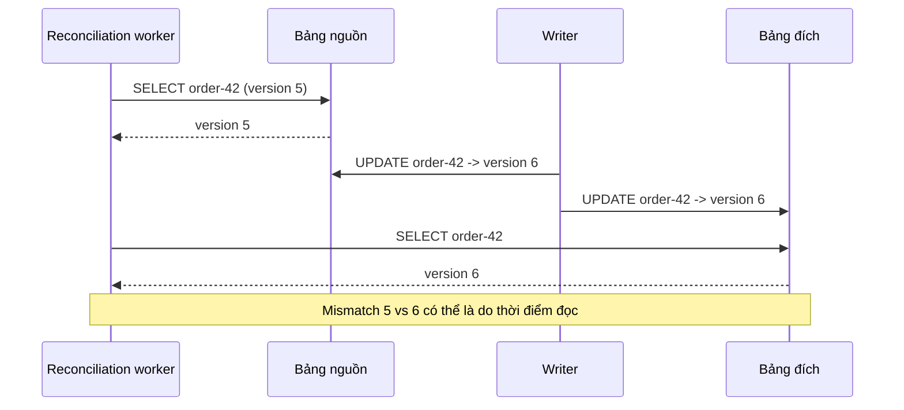
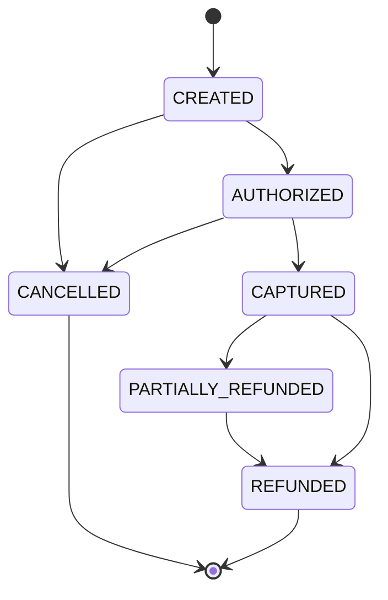
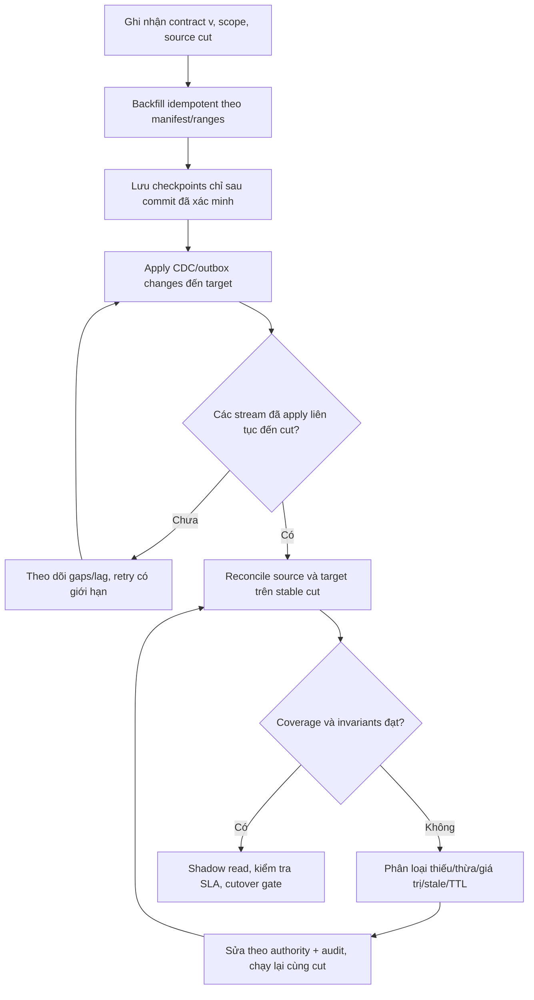
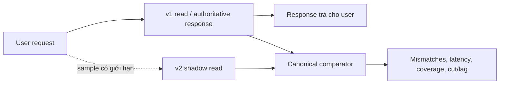
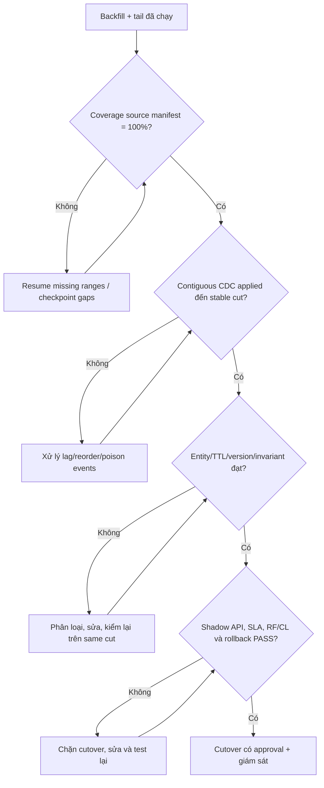

# Đối soát dữ liệu nguồn/đích và các bất biến nghiệp vụ

Di chuyển dữ liệu sang bảng Cassandra mới, đổi partition key, tách dữ liệu thành nhiều bảng phục vụ truy vấn hoặc chuyển từ hệ thống nguồn khác sang Cassandra đều có một câu hỏi quyết định: **“Bằng chứng nào cho thấy dữ liệu đích đầy đủ, đúng và đáp ứng cùng các quy tắc nghiệp vụ như nguồn?”** Một job backfill báo `SUCCESS` hoặc hai bảng có cùng số hàng chưa đủ để trả lời. Đích có thể thiếu một phân vùng, giữ giá trị cũ do ghi đè theo timestamp, nhân đôi một giao dịch, làm sai TTL hoặc trả trạng thái đơn hàng không hợp lệ.

Bài thuộc chương **Di chuyển và schema** của mô-đun **DATABASE_ENGINE_WIDE_COLUMN_CASSANDRA**. Trọng tâm là thiết kế **đối soát (reconciliation) có thể lặp lại**, phân biệt độ đầy đủ và độ đúng, kiểm chứng các **bất biến nghiệp vụ (business invariants)**, xử lý dữ liệu thay đổi đồng thời và xây điều kiện **cutover/rollback** có thể kiểm toán. Ví dụ sử dụng CQL, `NetworkTopologyStrategy`, partition/clustering key, consistency đọc/ghi, SSTable/tombstone/repair và Java Driver 4.x.

> **Nguyên tắc:** “Không thấy chênh lệch” chỉ có ý nghĩa khi biết **đối tượng nào đã được kiểm**, **mốc dữ liệu nào được so**, **quy tắc chuyển đổi nào áp dụng**, **phần dữ liệu nào chưa có bằng chứng** và **cách các ghi đang diễn ra được xử lý**.

## 1. Mục tiêu học tập

Sau bài này, bạn có thể:

1. Định nghĩa phạm vi nguồn/đích, khóa thực thể, ánh xạ schema và phép chiếu dữ liệu dự kiến của một migration Cassandra.
2. Phân biệt **coverage, completeness, value equality, semantic equivalence, integrity và business invariant**.
3. So sánh theo khóa/partition và canonical representation thay vì tin vào `COUNT(*)` hoặc checksum toàn bảng đơn lẻ.
4. Xây **watermark/checkpoint** và chiến lược backfill + CDC/dual-write để kiểm chứng khi dữ liệu vẫn được cập nhật.
5. Nhận diện tác động của **LWW timestamp**, clock skew, TTL, tombstone, consistency level, replica convergence và chuyển đổi khóa.
6. Viết CQL kiểm chứng các bản ghi cụ thể và Java Driver 4.x reconciliation có ngân sách partition, rate và retry.
7. Thiết kế tập bất biến về số tiền, trạng thái, định danh duy nhất, tổng hợp, quan hệ nghiệp vụ và bảo mật.
8. Phân loại chênh lệch, sửa có kiểm soát, đo lỗi còn tồn và đưa ra quyết định cutover/rollback dựa trên bằng chứng.

## 2. “Nguồn đúng bằng đích” có nghĩa gì?

Một migration không nhất thiết sao chép nguyên xi schema. Ví dụ nguồn lưu mỗi đơn hàng theo khóa `(tenant_id, order_id)`, còn đích phục vụ truy vấn “đơn hàng theo ngày” bằng khóa `(tenant_id, order_day)` với `order_id` là clustering column. Hai bảng **không có cùng hình dạng partition**, nhưng có thể biểu diễn **cùng tập đơn hàng nghiệp vụ**.

Để so sánh, xác định một hàm chuyển đổi được phiên bản hóa:

\[
T_v: \text{SourceRecord} \longrightarrow
      \text{ExpectedTargetRecord(s)}
\]

Với cùng tập input và phiên bản `v`, hàm phải **deterministic** hoặc nêu rõ dữ liệu ngoại sinh/điều kiện thời điểm. Đối soát một record đích theo `T_v(source)`, chứ không nhất thiết so sánh từng byte/column với bảng nguồn.

### Sáu tầng kiểm chứng

| Tầng | Câu hỏi | Ví dụ sai lệch |
| --- | --- | --- |
| **Scope / coverage** | Đã xem hết các tenant, token ranges, ngày, shard và nguồn change log cần thiết chưa? | Job chỉ quét 95/100 ranges nhưng báo không có mismatches. |
| **Completeness** | Mọi thực thể **đáng lẽ tồn tại** có ở đích? Có “extra rows” không? | Thiếu order-42 hoặc còn order đã bị xóa. |
| **Field equivalence** | Giá trị sau chuyển đổi, kiểu dữ liệu, precision, null có khớp không? | `amount_cents` 12.500 thành 1.250; timezone lệch ngày. |
| **Temporal correctness** | Thứ tự cập nhật, version, TTL và deletion có đúng “as of” mốc kiểm tra? | Replay ghi cũ với timestamp mới làm status lùi. |
| **Business invariant** | Dữ liệu có thỏa quy tắc nghiệp vụ dù từng record trông hợp lệ? | Tổng capture vượt authorization, đơn CANCELLED có shipment active. |
| **Operational readiness** | Đích đọc/ghi đúng SLA/CL, replica hội tụ, có thể rollback không? | Tất cả record so sánh khớp nhưng query đích phải `ALLOW FILTERING`, p99 vượt SLA. |

**Mỗi tầng có thể PASS/FAIL/INCOMPLETE riêng**. Ví dụ đã kiểm 1 triệu bản ghi trong 10 triệu bản ghi mà không thấy chênh lệch là **sample PASS / coverage INCOMPLETE**, không phải migration VERIFIED toàn phần.

## 3. Các giả định Cassandra cần khai báo trước khi đối soát

### Không có transaction/snapshot nguyên tử xuyên bảng và partition

Cassandra là hệ phân tán theo partition/token; một lần đọc nguồn và một lần đọc đích thường xảy ra **tại hai thời điểm khác nhau** và trên các coordinator/replica khác nhau. Không có tính năng mặc định để chụp snapshot giao dịch nguyên tử của **toàn bộ keyspace** bằng hai câu `SELECT`. Một `LOGGED BATCH` cũng **không** biến các mutation xuyên partition thành giao dịch với isolation kiểu RDBMS.



Nếu đối soát ngay lúc có ghi, **mismatch thoáng qua không luôn là lỗi migration**. Tuy nhiên không nên bỏ mọi mismatch với lý do “eventual consistency”: phải có **watermark, retry có hạn, lag budget** và một điểm mà sự khác biệt phải biến mất.

### Replica consistency khác tính đúng đắn nghiệp vụ

- `LOCAL_QUORUM` với RF=3 trong DC có ít nhất 3 replica thường cần 2 phản hồi cục bộ. Nó không tự tạo snapshot toàn cục hay xác nhận DC khác đã bắt kịp.
- Khi Cassandra `ReadTimeout`/`WriteTimeout`, kết quả mutation có thể **không biết chắc**; đối soát cần thực hiện lại theo idempotency/commit log, không tạo ID mới rồi ghi nhân đôi.
- **Repair** giúp replica hội tụ theo mô hình Cassandra; nó **không** sửa `amount_cents` tính sai từ hàm chuyển đổi, thiếu record do job bỏ range hay vi phạm quy tắc business.
- Dữ liệu trong SSTable có **last-write-wins (LWW)** theo timestamp và tombstone; thứ tự nhận request không nhất thiết quyết định phiên bản cuối cùng.

### Cần một nguồn danh sách thực thể có thể kiểm toán

Cassandra tối ưu truy vấn theo partition key, **không phải công cụ để thường xuyên quét toàn bảng bằng `SELECT *`**. Danh sách `(tenant_id, order_id, order_day)` để reconcile có thể đến từ change log/outbox có tính bền vững, manifest backfill, snapshot export, job theo token ranges hoặc hệ thống nguồn có index phù hợp. **Đừng giả định** có thể liệt kê đầy đủ và rẻ mọi partition chỉ từ một câu CQL.

## 4. Hợp đồng migration: từ schema nguồn sang schema đích

Ví dụ nguồn và đích đều ở Cassandra nhưng thay partition key cho access pattern. Đây là **hai bảng minh họa**, không dùng DDL dưới đây trên production.

### Bảng nguồn v1 — truy vấn một order theo định danh

```sql
CREATE KEYSPACE IF NOT EXISTS migration_lab
WITH replication = {
  'class': 'NetworkTopologyStrategy',
  'dc1': 3
}
AND durable_writes = true;

CREATE TABLE IF NOT EXISTS migration_lab.orders_by_id_v1 (
  tenant_id text,
  order_id uuid,
  order_day date,
  amount_cents bigint,
  currency text,
  status text,
  version bigint,
  updated_at timestamp,
  PRIMARY KEY ((tenant_id, order_id))
);
```

Khóa partition gồm `tenant_id` và `order_id`, nên tìm đúng một đơn hàng có thể bằng hai giá trị này, không cần quét theo tenant.

### Bảng đích v2 — truy vấn order theo tenant/ngày

```sql
CREATE TABLE IF NOT EXISTS migration_lab.orders_by_tenant_day_v2 (
  tenant_id text,
  order_day date,
  order_id uuid,
  amount_cents bigint,
  currency text,
  status text,
  version bigint,
  updated_at timestamp,
  PRIMARY KEY ((tenant_id, order_day), order_id)
) WITH CLUSTERING ORDER BY (order_id ASC);
```

Đích đặt một nhóm đơn cùng ngày trong partition `(tenant_id, order_day)` và xếp `order_id` trong partition đó. **Khóa này không phù hợp truy vấn “order_id duy nhất trên toàn hệ thống” khi thiếu tenant/day**. Nếu nghiệp vụ vẫn cần lookup theo `order_id`, phải giữ read model/lookup riêng, không tìm bằng `ALLOW FILTERING` trên mọi partition.

### Hợp đồng ánh xạ bắt buộc

| Trường/điều kiện | Source v1 | Expected target v2 | Quy tắc |
| --- | --- | --- | --- |
| Identity | `tenant_id, order_id` | `tenant_id, order_day, order_id` | Order ID thuộc tenant, ngày lấy theo quy tắc cố định. |
| Day | `order_day` | Thành phần partition key | Không tự diễn giải bằng timezone của máy chạy job. |
| Amount | `amount_cents bigint` | `amount_cents bigint` | Giữ số nguyên cents, không chuyển float thiếu precision. |
| Currency | `currency text` | `currency text` | Chuẩn hóa mã ISO được nghiệp vụ cho phép, ví dụ `VND/USD`. |
| Status | `status text` | `status text` | Bảo toàn trạng thái hoặc chuyển theo bảng mapping có version. |
| Version | `version bigint` | `version bigint` | Version tăng có kiểm soát, dùng để nhận biết stale projection. |
| Updated at | `updated_at timestamp` | `updated_at timestamp` | Cùng instant UTC, precision đã định nghĩa; không lấy thời gian backfill làm business update time. |
| Deleted/expired | Tombstone/TTL theo policy v1 | Trạng thái đích theo migration contract | Không tự hồi sinh record bị xóa hoặc kéo dài TTL không chủ đích. |

**Quan trọng:** Cassandra không tự thực thi các ràng buộc như `amount_cents >= 0`, `status in allowed set` hoặc “order_id duy nhất toàn tenant”. Những bất biến đó phải có owner ở domain/application và được đối soát độc lập.

## 5. Xác định khóa đối soát và phạm vi không mất dữ liệu

Đối soát phải có **khóa thực thể ổn định**, không chỉ khóa partition của một trong hai bảng. Với ví dụ:

```text
Business entity key: (tenant_id, order_id)
Source locator:      (tenant_id, order_id)
Target locator:      (tenant_id, order_day, order_id)

Expected:
  mỗi business entity đủ điều kiện -> đúng một projection row ở v2
  v2 row phải map về đúng một entity nguồn theo contract

Không được ngầm bỏ:
  - order đã DELETE hoặc có TTL
  - order chuyển day bucket theo bug/timezone
  - tenant có rất nhiều orders / token range nóng
  - duplicate target do order_day bị thay đổi
  - event được cập nhật sau mốc backfill
```

### Một record có thể biến thành nhiều record đích

Không phải mọi migration có quan hệ 1:1. Ví dụ từ nguồn đơn hàng có `items[]` sang bảng đích `order_items_by_order`, một order biến thành N rows. Khi đó định nghĩa **cardinality contract**: expected count theo entity, key của mỗi item, xử lý `items=[]` và tombstone. So global `source_count == target_count` là sai ngay từ mô hình.

### Một record đổi partition khi cột ngày thay đổi

Với đích `(tenant_id, order_day)`, `order_day` phải được định nghĩa là **ngày tạo immutable** hoặc có quy trình di chuyển key cũ → key mới. Nếu ứng dụng cập nhật `order_day`, Cassandra **không tự chuyển row** giữa hai partition: phải ghi mới và xóa bản cũ theo workflow có kiểm soát. Reconciliation phải bắt được **extra target row ở bucket cũ**, không chỉ thấy row mới hợp lệ.

## 6. Những bất biến nghiệp vụ cần viết thành phép kiểm

Một bảng có thể có đầy đủ rows nhưng chứa dữ liệu sai. Hãy bắt đầu bằng bảng yêu cầu cụ thể và người chịu trách nhiệm:

| Bất biến | Ví dụ kiểm tra | Mức độ | Owner |
| --- | --- | --- | --- |
| **Identity** | Mỗi `(tenant_id, order_id)` chỉ đại diện một đơn. | Critical | Order domain |
| **Existence / no orphan** | Target order phải có source entity hoặc sự kiện tạo hợp lệ trong log. | Critical | Migration |
| **Amount nonnegative** | `amount_cents >= 0` với đơn được phép; currency hợp lệ. | High | Billing |
| **Totals** | Tổng item line cents + shipping - discount = order total theo chính sách rounding. | Critical | Billing |
| **Payment cap** | `captured_total <= authorized_total` và tiền hoàn trả không vượt phần được phép. | Critical | Payments |
| **State machine** | `CREATED → AUTHORIZED → CAPTURED` hoặc các nhánh CANCELLED hợp lệ. | Critical | Orders |
| **Version monotonicity** | Projection không lùi `version` khi replay/sửa lỗi. | High | Platform |
| **Temporal semantics** | `updated_at` và TTL không bị reset vì giờ backfill. | High | Platform |
| **Tenant isolation** | Không map order của tenant A sang tenant B. | Critical | Security |
| **Query readiness** | API mới trả đúng tập hàng, thứ tự, phân trang trong SLA. | High | API |

**Mỗi bất biến phải có mô tả ngoại lệ**. Ví dụ một đơn được giảm giá có thể ghi adjustment âm ở bảng kế toán, nhưng `amount_cents` của chính order vẫn có thể yêu cầu không âm. Nếu domain cho phép partial refund, `refunded_total <= captured_total` cần xét đơn vị tiền, trạng thái giao dịch và các điều chỉnh đã được ghi nhận, không chỉ cộng mọi event `REFUND` mù quáng.

### Kiểm tra state machine



Sơ đồ là ví dụ, **không phải chuẩn thanh toán toàn ngành**. Một bản ghi `status=CAPTURED` có thể hợp lệ về enum nhưng sai nếu không có sự kiện authorization tương ứng. Nếu chỉ có trạng thái hiện tại ở hai bảng, đối soát **không thể chứng minh lịch sử chuyển trạng thái**; cần event log/audit trail hoặc nguồn nghiệp vụ đáng tin.

## 7. Source of truth: “nguồn” có thật sự là thẩm quyền?

Trước khi so, chỉ định **nguồn dữ liệu chuẩn** theo từng giai đoạn:

| Giai đoạn | Thẩm quyền ghi | Đích được dùng để làm gì? |
| --- | --- | --- |
| Chuẩn bị | v1 hoặc hệ thống nguồn ngoài Cassandra | Đích chưa phục vụ production. |
| Backfill | v1 vẫn là authority | v2 nhận dữ liệu quá khứ, được kiểm tra mẫu. |
| Tail/CDC | v1 + log sự kiện bền vững theo chính sách | v2 bắt kịp thay đổi sau backfill. |
| Shadow read | v1 trả kết quả cho người dùng; v2 so song song | Phát hiện mismatch theo query/partition, không làm sai response. |
| Cutover | v2 trở thành authority **sau gate** | v1 có thể giữ đồng bộ tạm thời phục vụ rollback theo kế hoạch. |
| Sau cutover | v2 authority | v1 được retire chỉ khi rollback window/retention kết thúc. |

Không viết chung chung “dual-write cả hai là đồng bộ”: hai lần ghi CQL tới **hai partition/table** có thể thành công/thất bại khác nhau. **Logged batch không cung cấp isolation xuyên partition** và không biến logic nghiệp vụ nhiều bước thành giao dịch ACID. Nếu cần guarantee theo thứ tự, sử dụng cơ chế outbox/CDC/event log và idempotent projector theo domain; kiểm thử các tình huống timeout/retry/duplicate/reorder.

## 8. Backfill + thay đổi đang diễn ra: watermark và high-water mark

Giả sử job backfill đã đọc dữ liệu đến sự kiện `offset=5000`, trong khi luồng ghi vẫn nhận sự kiện mới. Nếu job kiểm hàng nguồn tại `offset=6000` nhưng đích mới tới `offset=5500`, mismatch không nhất thiết chứng minh đích mất dữ liệu; nó có thể đang **lag**. Ngược lại, nếu stream lỡ mất offset 5400 nhưng chỉ nhìn “last seen offset=6000”, ta có thể bỏ sót một gap.

### Các khái niệm cần tách

| Khái niệm | Nội dung | Cảnh báo |
| --- | --- | --- |
| **Backfill cursor** | Vị trí cuối cùng job đã **đọc/ghi và checkpoint an toàn** trong tập nguồn. | Không checkpoint trước khi các ghi liên quan được xác nhận theo chính sách. |
| **Source watermark** | Mốc sự kiện/thời gian nguồn đã được **đóng và bền vững**, có quy tắc ordering. | Thời gian `now()` hoặc `updated_at` không tự là offset tổng thứ tự. |
| **Target applied watermark** | Các thay đổi đã **được áp dụng đầy đủ liên tục** tới mốc nào. | “Offset lớn nhất đã nhìn thấy” không chứng minh không thiếu offset trước nó. |
| **Reconciliation cut** | Tập thực thể/changes đã chắc chắn thuộc cả hai phía để đối soát. | Nếu không có cut ổn định, phép so bị ảnh hưởng concurrent writes. |
| **Lag budget** | Khoảng chậm được nghiệp vụ chấp nhận trong giai đoạn tail. | Không bỏ qua mismatches quá lâu mà không có ngưỡng và deadline. |

Một CDC stream phân vùng theo khóa thường chỉ bảo đảm ordering **trong partition/stream** theo cơ chế nó cung cấp, không nhất thiết có một số offset toàn cục cho mọi tenant. Đừng “lấy max offset toàn cluster” rồi đánh dấu mọi partition đã kịp. Nếu dùng nhiều streams, lưu **vector checkpoint theo stream/partition** và xác nhận không có gaps.

### Quy trình hội tụ có thể kiểm chứng



### Khi không thể tạo stable cut

Có thể dùng **windowed convergence**: so tại mốc `t`, ghi mismatch, chờ đến khi source update window/CDC lag đã qua, re-read sau một khoảng hữu hạn. Báo cáo riêng **transient mismatch** và **persistent mismatch**. Với business critical, cần nguồn event/transaction log có checkpoint đáng tin hoặc tạm quiesce writes qua cơ chế ứng dụng được duyệt; không “đóng băng” chỉ bằng việc dừng job backfill.

## 9. Timestamps và LWW: tại sao replay có thể làm dữ liệu lùi?

Cassandra sử dụng **last-write-wins** cho các giá trị với timestamp: trong cạnh tranh cập nhật cùng cell, giá trị có timestamp chiến thắng theo các quy tắc Cassandra. Một mutation “đến sau” trên mạng không nhất thiết mới hơn theo nghiệp vụ, và timestamp do client/driver gán có thể lệch nếu clock skew.

### Ví dụ stale replay

```text
t1: source order=42 status=AUTHORIZED, version=4
t2: business update status=CAPTURED, version=5
t3: backfill chậm đọc snapshot version=4 và ghi vào v2

Nếu backfill ghi timestamp LỚN hơn update version=5:
  giá trị version=4 có thể ghi đè theo LWW
  dù nghiệp vụ biết version 4 đã cũ.
```

**Không** coi trường `version` do ứng dụng lưu là điều kiện CAS tự động: Cassandra không tự từ chối `UPDATE version = 4` nếu đang có `version = 5`. Muốn bảo vệ không lùi, có thể:

- Áp dụng updates qua **một projector có ordering và checkpoint** theo entity; backfill phải đi trước tail updates.
- Dùng client write timestamp nhất quán từ nguồn theo hợp đồng, kiểm soát tie-breaking, TTL và các giới hạn timestamp; **không phải** thay thế cho ordering business nếu nhiều columns/collections/delete có semantics khác nhau.
- Dùng **LWT/CAS trên cùng partition** khi phù hợp để kiểm version, nhưng phải phân tích throughput/latency và cách chuyển giữa nhiều bảng.
- Reconcile liên tục sau mỗi nhóm replay, ghi nhận version không monotonic và sửa từ source of truth.

**Cảnh báo:** `USING TIMESTAMP` trong CQL tác động timestamp lưu trữ, không phải `updated_at` nghiệp vụ. Dùng timestamp quá mới/cũ có thể kéo dài hoặc ngăn tombstone/TTL hoạt động như dự định. Không dùng timestamp tương lai để “ép giá trị mới thắng” khi đang sửa mismatch.

## 10. TTL, tombstone, DELETE và tính tương đương theo thời gian

TTL và DELETE làm đối soát khó hơn vì **hàng vắng mặt** có thể đúng hoặc sai:

| Trạng thái nguồn | Trạng thái đích | Có thể là gì? |
| --- | --- | --- |
| Nguồn còn sống, đích vắng | Backfill missing, CDC lag, routing sai ngày, hoặc đích expired quá sớm. |
| Nguồn vắng, đích còn sống | Extra/stale target, TTL bị reset, không áp dụng DELETE hoặc nguồn đã expired. |
| Hai phía vắng | Có thể đúng expiry, **nhưng** chưa đủ nếu phải chứng minh “đã từng tồn tại” để audit. |
| Cùng value, TTL khác nhiều | Đích có thể tồn tại lâu hơn/ít hơn ý định bảo mật/retention. |
| Cùng key, timestamp/version khác | Có thể chưa hội tụ hoặc replay sai; cần cut và mutation history. |

### TTL không được tự “làm mới” khi backfill

Giả sử record nguồn được ghi lúc `t0` với TTL 30 ngày, backfill chạy ở ngày thứ 20. Nếu đích ghi lại cùng row với `USING TTL 2592000` (30 ngày tính bằng giây theo CQL) ở ngày thứ 20, đích sẽ sống **thêm 30 ngày kể từ backfill**, thay vì chỉ còn **10 ngày** theo hợp đồng nguồn. Đây là lỗi retention có thể gây vi phạm dữ liệu và làm sai đối soát.

Muốn bảo toàn expiry:

1. Xác định **expiry instant** hoặc remaining TTL từ nguồn/metadata có độ chính xác/độ trễ cho phép.
2. Khi projector ghi đích, tính TTL còn lại theo **mốc thống nhất** và cách Cassandra làm tròn TTL, kèm giới hạn sai số đã định.
3. Nếu TTL đã hết, xử lý absence/tombstone theo contract, **không** tái tạo dữ liệu hết hạn.
4. Với cột có TTL khác nhau, đối soát **per-column**; một row có thể còn một phần columns.
5. Lưu evidence của deletion nếu nghiệp vụ cần chứng minh xóa, thay vì coi `SELECT` trả `null` là đầy đủ lịch sử.

`TTL(column)` trong CQL chỉ xem **remaining TTL hiện hành** đối với cột phù hợp; nó không phải timestamp hết hạn tuyệt đối không đổi giữa hai lần đọc. `WRITETIME(column)` cho timestamp ghi cell (microseconds) khi hỗ trợ; **không** lấy hai kết quả `TTL()` cách nhau vài giây rồi yêu cầu bằng nhau tuyệt đối.

### Tombstone và repair

Tombstone bảo vệ dữ liệu đã xóa khỏi xuất hiện trở lại khi replica lỗi/đến muộn. Giảm `gc_grace_seconds` để “tối ưu tốc độ migration” có thể gây **zombie data** khi replica chưa nhận deletion. Repair giúp replica Cassandra hội tụ, nhưng **không tự đồng bộ dữ liệu giữa bảng v1 và v2**. Reconciler cần có bước áp dụng DELETE tới target theo contract và kiểm tra sau thời gian CDC lag.

## 11. Canonicalization: so “ý nghĩa” thay vì bytes tùy ý

Hai records tương đương nghiệp vụ có thể có cách biểu diễn khác:

- `updated_at` là instant UTC; một hệ thống xuất ISO-8601 `Z`, hệ khác xuất `+07:00`.
- Số tiền phải là **số nguyên cents theo currency**, không dùng `double` và phép cộng float.
- Chuỗi Unicode có thể khác normalization NFC/NFD; `trim/lowercase` chỉ nếu domain quy định.
- `null`, missing field, empty string và unset mutation có **ngữ nghĩa khác nhau**.
- Các collections/maps/sets có thể không có thứ tự trình bày ổn định; cần sắp theo key **nếu domain coi thứ tự không quan trọng**.
- `timeuuid`, UUID, `timestamp`, `date` phải canonical theo kiểu dữ liệu, không theo string format của tool.
- Columns do target tự sinh (`indexed_at`, `migration_run_id`) không nên so như dữ liệu business nếu contract không yêu cầu bằng nguồn.

### Hợp đồng canonical record

```text
CanonicalOrder/v3:
  entity_key: tenant_id + order_id  (có length-prefix)
  order_day: ISO local date theo UTC business policy
  amount_cents: signed 64-bit integer, non-null
  currency: uppercase ISO 4217
  status: enum được định nghĩa trong contract v3
  version: signed 64-bit integer, non-null
  updated_at: epoch milliseconds UTC
  deleted: tombstone/expiry semantic theo cut

Không include:
  - coordinator, host_id, token, last_scanned_at
  - migration_job_start_time, index metadata
  - query latency hay ngẫu nhiên từ thời điểm chạy job
```

**Đừng** ghép các fields đơn giản bằng delimiter `|` mà không escape/length-prefix: các giá trị `a|b` và hai fields `a`/`b` có thể gây collision trong serialization. Chỉ dùng hashing trên **canonical bytes được đặc tả**; cần gắn version `CanonicalOrder/v3` và migration transformation version vào mỗi kết quả so sánh.

## 12. Hash/checksum và đối chiếu theo token ranges

Checksum giúp phát hiện chênh lệch nhanh trên tập lớn nhưng **không thay** kiểm bất biến nghiệp vụ. Một record có thể mang SHA-256 giống nhau giữa nguồn/đích mà vẫn có trạng thái không hợp lệ ở cả hai.

### Các phương pháp và giới hạn

| Phương pháp | Ưu điểm | Rủi ro |
| --- | --- | --- |
| **Pointwise exact compare** theo business key | Nêu rõ trường nào sai, dễ sửa có mục tiêu. | Tốn I/O nhiều nếu hàng tỉ keys; cần manifest và bounded concurrency. |
| **Sampling có phân tầng** | Nhanh phát hiện nhóm lỗi lớn, phù hợp giai đoạn sớm. | Không chứng minh mọi record đúng; phải báo tỷ lệ/seed/strata. |
| **Count theo bucket/tenant/day** | Bắt missing/extras quy mô lớn, cung cấp dashboard. | Bằng count không chứng minh values/keys; COUNT toàn bảng Cassandra đắt. |
| **Per-record canonical SHA-256** | So value không cần truyền mọi field lên dashboard. | Hash phải cùng schema/version; không thay kiểm unique, temporal hay business invariants. |
| **Sorted chunk/Merkle-style digest** | Khoanh vùng chunk khác nhau để kiểm sâu; hỗ trợ re-run. | Cần boundaries/cut ổn định; duplicate keys/order khác làm digest sai lệch. |
| **Token-range scan bằng công cụ phù hợp** | Có thể phủ toàn dữ liệu nguồn/đích theo partitions khi đã có pipeline quét. | Token mapping/partition key v1 và v2 khác; ranges nguồn không tương ứng trực tiếp ranges đích. |

### Khi partition key đổi, đừng so token range như cùng khóa

V1 hash `(tenant_id, order_id)`; v2 hash `(tenant_id, order_day)`. Một order có thể chuyển sang **token khác hoàn toàn**. Vì vậy không so “checksum token range X ở v1” với “checksum token range X ở v2” rồi đòi bằng nhau. Phải ánh xạ **source entity key → expected target key**, sau đó mới gom checksum theo bucket/key do workflow định nghĩa.

### Công thức tập hợp cơ bản

Gọi `S` là tập thực thể nguồn hợp lệ theo cut, `E = T_v(S)` là multiset expected target rows, `D` là dữ liệu đích đã chuẩn hóa:

\[
\text{Missing}=E\setminus D,\qquad
\text{Extra}=D\setminus E.
\]

Với multiset, cần bảo toàn **số lần xuất hiện theo identity**; một bảng Cassandra không có hai row cùng đầy đủ primary key nhưng có thể có **hai projection rows cho cùng business entity** dưới hai partition keys khác nhau. Nếu chỉ set theo `order_id`, vấn đề duplicate bucket có thể bị che.

### Không lạm dụng `COUNT(*)`

`SELECT COUNT(*) FROM keyspace.table` trên Cassandra thường phải duyệt dữ liệu rộng và có thể gây timeout/tải lớn. Tương tự, `ALLOW FILTERING` không làm một bảng thiếu khóa truy vấn thành index đầy đủ. Với bài toán rất lớn, dùng export/token-range scan qua công cụ có giới hạn tài nguyên (ví dụ Spark/Cassandra connector tương thích), logs/outbox, read model/aggregate được thiết kế từ trước và đối chiếu offline.

## 13. Bộ số liệu đối soát đủ để ra quyết định

Một dashboard chỉ hiển thị `mismatch_rate=0.1%` dễ gây hiểu nhầm nếu mẫu quá nhỏ hoặc toàn bộ nhóm lỗi bị bỏ qua. Ghi rõ các mẫu số:

```text
expected_entities          số thực thể nguồn trong scope/cut
manifest_entities          số business keys đã lên kế hoạch kiểm
attempted_entities         số keys đã thử truy vấn nguồn/đích
completed_comparisons      số keys có kết quả so tin cậy
matched_entities           số keys có semantic match
missing_target             đích không có row dự kiến
extra_target               đích có row không thuộc expected projection
value_mismatch             key có mặt, field value lệch
stale_version              version đích thấp hơn expected
ttl_mismatch               expiry lệch quá tolerance
invariant_violations       dữ liệu vi phạm business rules
inconclusive               timeout, partial scan, unknown cut, CDC lag

coverage = completed_comparisons / expected_entities
mismatch_rate = các key có mismatch thực / completed_comparisons

Không công bố coverage=100% nếu expected_entities chưa xác định
hoặc một nhóm bucket/token range bị loại khỏi denominator.
```

Các counters phải phân theo `tenant_tier`, partition-size bucket, ngày, loại order/status, phiên bản schema/transform và luồng backfill/CDC. **Không dùng raw tenant ID/order ID làm Prometheus labels** gây cardinality cao và lộ PII; lưu identity vào logs/chi tiết reconciliation có RBAC và retention.

### Ngưỡng lỗi theo mức độ

| Loại | Cách xử lý trước cutover |
| --- | --- |
| Missing/extra order của giao dịch tiền tệ | Thường là **zero tolerance** theo business owner. |
| Amount/currency/status/tenant invariant vi phạm | **Chặn cutover**, điều tra nguồn và đích. |
| CDC lag trong ngân sách | Cho phép quan sát tiếp nhưng chưa tuyên bố caught-up. |
| `INCONCLUSIVE` do timeout/scan thiếu range | Không quy đổi thành PASS; phải retry hoặc báo không đủ coverage. |
| Khác biệt noncritical metadata chỉ phục vụ đích | Áp dụng explicit allowlist/versioned transform, không bỏ qua mọi khác biệt. |
| Bản ghi TTL sắp hết hạn | So theo expiry window/cut và policy, tách transient với persistent. |

**Ngưỡng số liệu phải do domain/SLO đặt**, không tự chọn 1% lỗi cho mọi migration: 1% trên 10 triệu giao dịch là 100.000 giao dịch sai, có thể không thể chấp nhận.

## 14. CQL lab: tạo mismatch có thể quan sát và sửa đúng phạm vi

Lab cần DC tên `dc1` và **ít nhất ba node** nếu dùng RF=3 với `LOCAL_QUORUM`. Nếu lab một node, điều chỉnh RF cho đúng thực tế **trên lab**, không thay keyspace production để học. Các UUID và số tiền chỉ là dữ liệu mẫu, không có giao dịch thanh toán thật.

### Bước 1 — Tạo schema

Thực hiện hai lệnh `CREATE TABLE` và `CREATE KEYSPACE` ở mục 4. Sau đó kiểm tra:

```sql
DESCRIBE KEYSPACE migration_lab;
CONSISTENCY LOCAL_QUORUM;
```

Không bắt đầu backfill trước khi schema agreement/DDL và quyền role được xác nhận trên cluster lab. Với Cassandra 5.x hoặc bản khác, cách metadata hội tụ có thể khác; sử dụng công cụ kiểm chứng version phù hợp.

### Bước 2 — Nạp hai thực thể nguồn

```sql
INSERT INTO migration_lab.orders_by_id_v1
  (tenant_id, order_id, order_day, amount_cents,
   currency, status, version, updated_at)
VALUES (
  'tenant-lab', 11111111-1111-4111-8111-111111111111,
  '2026-11-21', 12500, 'VND', 'CAPTURED', 4,
  '2026-11-21T08:00:00+0000'
);

INSERT INTO migration_lab.orders_by_id_v1
  (tenant_id, order_id, order_day, amount_cents,
   currency, status, version, updated_at)
VALUES (
  'tenant-lab', 22222222-2222-4222-8222-222222222222,
  '2026-11-21', 7500, 'VND', 'AUTHORIZED', 2,
  '2026-11-21T08:30:00+0000'
);
```

### Bước 3 — Nạp đích có một bản ghi sai có chủ đích

```sql
INSERT INTO migration_lab.orders_by_tenant_day_v2
  (tenant_id, order_day, order_id, amount_cents,
   currency, status, version, updated_at)
VALUES (
  'tenant-lab', '2026-11-21',
  11111111-1111-4111-8111-111111111111,
  12500, 'VND', 'CAPTURED', 4,
  '2026-11-21T08:00:00+0000'
);

-- Sai có chủ đích: amount 7000 thay vì 7500 và version 1 thay vì 2.
INSERT INTO migration_lab.orders_by_tenant_day_v2
  (tenant_id, order_day, order_id, amount_cents,
   currency, status, version, updated_at)
VALUES (
  'tenant-lab', '2026-11-21',
  22222222-2222-4222-8222-222222222222,
  7000, 'VND', 'AUTHORIZED', 1,
  '2026-11-21T08:30:00+0000'
);
```

### Bước 4 — Đọc đúng từng source partition và target row

```sql
SELECT order_day, amount_cents, currency, status, version, updated_at
FROM migration_lab.orders_by_id_v1
WHERE tenant_id = 'tenant-lab'
  AND order_id = 22222222-2222-4222-8222-222222222222;

SELECT amount_cents, currency, status, version, updated_at
FROM migration_lab.orders_by_tenant_day_v2
WHERE tenant_id = 'tenant-lab'
  AND order_day = '2026-11-21'
  AND order_id = 22222222-2222-4222-8222-222222222222;
```

Kỳ vọng lab: cả hai rows tồn tại nhưng `amount_cents` và `version` không khớp. Một phép `COUNT(*)` của hai bảng cùng trả 2 **vẫn không phát hiện lỗi này**. Hai SELECT trên đi theo đầy đủ primary key; không cần `ALLOW FILTERING`.

### Bước 5 — So timestamp/TTL ở một cột thường

```sql
SELECT amount_cents, version,
       WRITETIME(amount_cents), TTL(status)
FROM migration_lab.orders_by_tenant_day_v2
WHERE tenant_id = 'tenant-lab'
  AND order_day = '2026-11-21'
  AND order_id = 22222222-2222-4222-8222-222222222222;
```

`WRITETIME(amount_cents)` trả storage timestamp của cell (thường ở microseconds), **khác** với `updated_at` của nghiệp vụ. `TTL(status)` không chứng minh toàn row có TTL; với cột không đặt TTL, giá trị thường là `null`. Không dùng `WRITETIME` trên primary key columns.

### Bước 6 — Phân tích rồi sửa mismatch trên lab

Trước khi sửa ở production, phải **xác nhận v1 là authority và không có ghi mới** làm version tăng. Trong lab đang dừng ghi, sửa v2:

```sql
UPDATE migration_lab.orders_by_tenant_day_v2
SET amount_cents = 7500,
    currency = 'VND',
    status = 'AUTHORIZED',
    version = 2,
    updated_at = '2026-11-21T08:30:00+0000'
WHERE tenant_id = 'tenant-lab'
  AND order_day = '2026-11-21'
  AND order_id = 22222222-2222-4222-8222-222222222222;
```

Chạy lại hai SELECT. **Không coi UPDATE cố định này là remediation production**: nếu v2 đã có version 3 từ write mới, câu UPDATE có storage timestamp lớn hơn có thể ghi đè dữ liệu hợp lệ. Production cần serialized projector/conditional update theo đúng contract, kiểm tra source version/watermark và có audit.

### Bước 7 — Kiểm tra đọc theo query mới

```sql
SELECT order_id, amount_cents, currency, status, version
FROM migration_lab.orders_by_tenant_day_v2
WHERE tenant_id = 'tenant-lab'
  AND order_day = '2026-11-21'
LIMIT 100;
```

Đây là query đúng access pattern ngày của v2. Nếu tenant có hàng triệu orders/ngày, partition `(tenant_id, order_day)` có thể rất lớn; migration correctness PASS chưa đủ để đưa query vào production. Phải benchmark partition-size distribution, paging, p99, tombstone/SSTable scans và cân nhắc bucket/sharding theo workload.

## 15. Java Driver 4.x: đối soát pointwise theo business key

Ví dụ dưới đây sử dụng **Java Driver 4.x** và một `CqlSession session` đã cấu hình local DC, authentication và TLS phù hợp lab. Nó so một order theo **đầy đủ primary key nguồn/đích** và trả về cấu trúc khác biệt, không sửa dữ liệu.

### Kiểu dữ liệu và phép so

```java
import java.time.Instant;
import java.time.LocalDate;
import java.util.Objects;
import java.util.UUID;

record OrderKey(String tenantId, UUID orderId) {}

record OrderProjection(
    String tenantId,
    UUID orderId,
    LocalDate orderDay,
    long amountCents,
    String currency,
    String status,
    long version,
    Instant updatedAt) {}

record ReconcileResult(
    OrderKey key,
    String category,
    String detail) {}

static ReconcileResult compare(OrderKey key,
                               OrderProjection source,
                               OrderProjection target) {
    if (source == null && target == null) {
        return new ReconcileResult(key, "INCONCLUSIVE",
            "Cần chứng minh entity thuộc scope và expected absence");
    }
    if (source != null && target == null) {
        return new ReconcileResult(key, "MISSING_TARGET",
            "Không có row tại target locator expected");
    }
    if (source == null) {
        return new ReconcileResult(key, "EXTRA_OR_UNKNOWN",
            "Target tồn tại nhưng source không có theo cut");
    }
    if (source.version() != target.version()) {
        return new ReconcileResult(key, "VERSION_MISMATCH",
            "Target/source version khác nhau");
    }
    if (!source.equals(target)) {
        return new ReconcileResult(key, "VALUE_MISMATCH",
            "Các business fields không khớp canonical contract");
    }
    return new ReconcileResult(key, "MATCH", "Canonical projection khớp");
}
```

Trong workflow thật, `OrderProjection source` cần là **kết quả của phép chuyển đổi `T_v(source)`**; code mẫu đơn giản vì v1/v2 có cùng business columns. `equals()` của record đủ cho kiểu ở ví dụ với `Instant/LocalDate/UUID/long/String`, nhưng không phù hợp nếu domain yêu cầu normalize timezone/Unicode/decimal hay so TTL với tolerance.

### Fetch bằng prepared statements

```java
import com.datastax.oss.driver.api.core.CqlSession;
import com.datastax.oss.driver.api.core.ConsistencyLevel;
import com.datastax.oss.driver.api.core.cql.PreparedStatement;
import com.datastax.oss.driver.api.core.cql.ResultSet;
import com.datastax.oss.driver.api.core.cql.Row;

// Giả định session sẵn có; tạo prepared statements một lần ở init.
PreparedStatement sourceStmt = session.prepare(
    "SELECT tenant_id, order_id, order_day, amount_cents, " +
    "currency, status, version, updated_at " +
    "FROM migration_lab.orders_by_id_v1 " +
    "WHERE tenant_id = ? AND order_id = ?");

PreparedStatement targetStmt = session.prepare(
    "SELECT tenant_id, order_day, order_id, amount_cents, " +
    "currency, status, version, updated_at " +
    "FROM migration_lab.orders_by_tenant_day_v2 " +
    "WHERE tenant_id = ? AND order_day = ? AND order_id = ?");

static OrderProjection decode(Row row) {
    if (row == null) return null;
    // Trường này bắt buộc theo business contract.
    if (row.isNull("amount_cents") || row.isNull("version") ||
        row.isNull("order_day") || row.isNull("updated_at") ||
        row.isNull("currency") || row.isNull("status")) {
        throw new IllegalStateException("Required business field is null");
    }
    return new OrderProjection(
        row.getString("tenant_id"),
        row.getUuid("order_id"),
        row.getLocalDate("order_day"),
        row.getLong("amount_cents"),
        row.getString("currency"),
        row.getString("status"),
        row.getLong("version"),
        row.getInstant("updated_at"));
}

static ReconcileResult reconcileOne(
    CqlSession session, PreparedStatement sourceStmt,
    PreparedStatement targetStmt, OrderKey key) {

    ResultSet sourceResult = session.execute(
        sourceStmt.bind(key.tenantId(), key.orderId())
            .setConsistencyLevel(ConsistencyLevel.LOCAL_QUORUM)
            .setIdempotent(true));

    OrderProjection source = decode(sourceResult.one());
    if (source == null) {
        // Không thể tự biết target locator nếu chỉ có source row.
        // Cần locator từ manifest/canonical keys hoặc audit deletion.
        return new ReconcileResult(key, "INCONCLUSIVE",
            "Source absent; cần manifest/order_day và deletion semantics");
    }

    ResultSet targetResult = session.execute(
        targetStmt.bind(
            source.tenantId(), source.orderDay(), source.orderId())
            .setConsistencyLevel(ConsistencyLevel.LOCAL_QUORUM)
            .setIdempotent(true));

    OrderProjection target = decode(targetResult.one());
    return compare(key, source, target);
}
```

### Giới hạn của đoạn Java

- `session.execute()` đọc nguồn rồi đích **không có snapshot isolation** xuyên hai bảng. Chỉ kết luận mismatches sau **stable cut**, hoặc dùng recheck với lag window.
- Khi `source == null`, không thể biết target row “extra” hay dữ liệu nguồn đã TTL/DELETE, vì target partition key chứa `order_day` mà request không biết. Cần manifest giữ `order_day` và bản ghi deletion.
- Một `ResultSet.one()` ở đây hợp lý vì query có đủ primary key định vị tối đa một row. Truy vấn vùng/range lớn cần paging và ngân sách riêng.
- `LOCAL_QUORUM` trong cùng DC mang semantics consistency của Cassandra nhưng không chứng minh mọi replica/remote DC hội tụ.
- Không log `tenant_id`, `order_id` hoặc dữ liệu payment raw vào dashboard Prometheus. Ghi `run_id`, hashed entity locator và mismatch category trong kênh có phân quyền.
- Ví dụ phát hiện giá trị sai, **không tự động UPDATE** trong vòng đọc so sánh: sửa dữ liệu phải có owner, CAS/ordering và audit riêng.

## 16. Quét đối soát lớn: bounded concurrency và checkpoint đúng

Một job reconciliation không được lấy hàng triệu entity keys rồi tạo hàng triệu `CompletableFuture` cùng lúc. Điều này có thể bão hòa driver pools, coordinator, disk I/O và làm tăng timeouts, khiến kết quả so sánh kém tin cậy.

### Pseudocode orchestration có giới hạn

```java
// Mã minh họa, OrderKey/Result/manifest đọc từ phần đã chuẩn bị.
// Source of keys: manifest có thể resume, không phải SELECT * online.
final int MAX_IN_FLIGHT = 8;
ExecutorService pool = Executors.newFixedThreadPool(MAX_IN_FLIGHT);
List<Future<ReconcileResult>> inFlight = new ArrayList<>();

try {
    while (manifest.hasNext() || !inFlight.isEmpty()) {
        while (manifest.hasNext() && inFlight.size() < MAX_IN_FLIGHT) {
            OrderKey key = manifest.next();
            inFlight.add(pool.submit(() ->
                reconcileOne(session, sourceStmt, targetStmt, key)));
        }

        // Drain một kết quả rồi mới nạp thêm; không giữ mọi Future trong RAM.
        Future<ReconcileResult> oldest = inFlight.remove(0);
        ReconcileResult result = oldest.get();
        auditSink.record(result);

        // Checkpoint chỉ sau khi result và evidence đã được lưu bền vững;
        // nếu cần per-key offset, ghi cursor cùng với trạng thái đã commit.
        checkpointStore.markCompleted(result.key());
    }
} finally {
    pool.shutdown();
}
```

Mã thể hiện **nguyên tắc giới hạn**, không là thư viện production hoàn chỉnh: các biến `manifest/auditSink/checkpointStore` là các dependency giả định, cần có triển khai thật trước khi biên dịch. Một executor fixed pool vẫn có **queue nội bộ không giới hạn nếu producer submit vô hạn**; vòng lặp ở đây chỉ cho tối đa `MAX_IN_FLIGHT` task chưa drain. Mỗi task có thể có retry nội bộ của driver, nên tổng request tới Cassandra có thể lớn hơn số task.

### Quy tắc vận hành

1. Giới hạn **rPS và in-flight**, chia theo DC/table/token bucket; tránh nhắm hot partitions cùng lúc.
2. Thêm request deadline và retry/backoff theo error class; **timeout thuộc INCONCLUSIVE**, không mặc định MISSING.
3. Lưu checkpoint **sau khi evidence được ghi bền vững**; khi crash, chạy lại có thể xuất hiện duplicate comparison, nên audit sink phải idempotent theo `run_id + entity_key + cut`.
4. Tách mismatch reports khỏi raw PII; giới hạn retention và phân quyền.
5. Có cơ chế **pause/resume** khi Cassandra p99, pending tasks, disk I/O, repair/compaction hoặc GC vượt ngưỡng.
6. Nếu error rate tăng, giảm concurrency thay vì tự động tăng timeout/retry vô hạn.
7. Không đặt SLA “toàn bộ đủ coverage” khi chưa xác định số entity/chunks nguồn và đích cần quét.

### CQL CL và driver routing

Prepared statements biết partition key có thể giúp token-aware routing. Một lookup v1 `(tenant,orderId)` và v2 `(tenant,day)` có **tập replica khác nhau**. Nếu cần xác nhận đa DC, chạy phép kiểm theo DC/CL và scope riêng; một phép so ở `dc1 LOCAL_QUORUM` không là bằng chứng `dc2` đã hội tụ.

## 17. Phân loại mismatch và remediation có kiểm soát

| Loại | Dấu hiệu | Nguyên nhân có thể | Cách phản ứng |
| --- | --- | --- | --- |
| `MISSING_TARGET` | Source có, target không có. | Range bị bỏ, CDC gap, target partition key sai, TTL expired sớm. | Tìm manifest/watermark, xác định version, replay idempotent qua projector. |
| `EXTRA_TARGET` | Target có row không có expected source. | Key/bucket cũ, delete chưa truyền, TTL kéo dài, source scan thiếu. | Xác nhận cut/scope, không DELETE trước khi hiểu nguồn authority. |
| `VALUE_MISMATCH` | Cùng entity, field sai. | Transform bug, precision/timezone, replay stale, field mapping nhầm. | So raw/canonical với spec, sửa code và chạy lại chunk. |
| `STALE_VERSION` | Target version thấp. | CDC lag, backfill ghi đè update mới, out-of-order apply. | Xem gap/lag và LWW timestamps, bảo đảm apply đúng ordering. |
| `FUTURE_VERSION` | Target version cao hơn source. | Source read lag, dual-write lỗi, target nhận mutation mới trước. | Chờ cut/re-read, kiểm tra authority; không “sửa lùi” theo nguồn cũ. |
| `TTL_MISMATCH` | Expiry quá dài/ngắn. | Backfill reset TTL, thiếu USING TTL, khác clock/cell TTL. | Chỉnh policy và projector, so expiry theo mốc/độ dung sai. |
| `DUPLICATE_PROJECTION` | Cùng order có hai target rows ở hai day buckets. | Day đổi, delete old key thất bại. | Quét reverse index/manifest, sửa key migration có audit. |
| `INVARIANT_VIOLATION` | Tổng tiền/trạng thái/tenant sai. | Logic nghiệp vụ hoặc source corruption, không nhất thiết lỗi copy. | Escalate domain owner, ngăn cutover tới khi resolved. |
| `INCONCLUSIVE` | Timeout, scan chưa đủ, unknown cut. | Load/replica/network/CDC gaps. | Retry giới hạn, mở rộng bằng chứng, không tính là MATCH. |

### Sửa dữ liệu phải có chứng cứ

Một remediation plan nên ghi **source authority, expected version, target current version, field delta, storage timestamps nếu cần, operation ID, người duyệt và post-fix verification**. Sửa bằng `UPDATE ... USING TIMESTAMP` một cách mù quáng có thể thắng các update mới không chủ đích. Xóa một `extra row` không đúng cut cũng có thể xóa đơn hàng vừa được tạo hợp lệ.

### Vì sao một logged batch không đủ

Nếu cần cùng lúc xóa projection ở bucket cũ và thêm projection vào bucket mới, một `LOGGED BATCH` có cơ chế bảo đảm đưa batch mutation tới các replica theo thiết kế, nhưng **không có isolation hay ràng buộc duy nhất xuyên partition**. Người đọc có thể quan sát trạng thái trung gian. Thiết kế idempotent migration với trạng thái chuyển tiếp, version/authority và reconciler, không hứa tính chất transaction mà Cassandra không cung cấp.

## 18. Bất biến tổng hợp: “đếm đúng” chưa phải “tổng tiền đúng”

Ví dụ một bảng target phục vụ dashboard `order_totals_by_tenant_day` có tổng `amount_cents`. Phải kiểm:

1. **Tập order eligible**: exclude cancelled/refunded hay không, theo điều kiện nào?
2. **Tỷ giá/đơn vị**: không cộng VND và USD thành một số tùy ý.
3. **Duplication**: hai events replay hoặc double-write không được tính hai lần.
4. **Late arrival**: event cập nhật sau khi đóng cửa sổ ngày có được tính backfill không?
5. **Rounding**: tiền số nguyên cents, quy tắc phân bổ discount/shipping, thuế và refund.
6. **Reconciliation key**: tenant/day/currency/status/semantic version, không chỉ ngày.

### Ví dụ lý thuyết

```text
Ngày 2026-11-21, currency=VND:
  order A: CAPTURED 12500
  order B: AUTHORIZED 7500

Nếu dashboard "captured_amount_cents":
  expected = 12500 (không cộng AUTHORIZED)

Nếu dashboard "open_order_value_cents":
  expected tùy định nghĩa trạng thái business (khác captured).

Target tổng 20000 có thể đúng cho một metric nhưng SAI cho metric khác.
```

Một bảng Cassandra không tự duy trì tổng chính xác xuyên partitions nếu ứng dụng ghi hai bảng tách biệt. Nếu dùng counters, cần xét **non-idempotent retry semantics**; không giả định cộng lại counter từ log có at-least-once delivery sẽ đúng. Reconciliation tổng hợp nên xuất phát từ **nguồn sự kiện/entity authoritative** và idempotency keys, phân tách pending/captured/refunded theo contract.

## 19. Kiểm tra tính duy nhất và quan hệ không có foreign key

Cassandra không áp dụng foreign key hay unique constraint toàn cluster giống RDBMS. Với unique username/order number trong **phạm vi xác định**, có thể cần bảng claim riêng và LWT:

```sql
CREATE TABLE IF NOT EXISTS migration_lab.order_reference_claims (
  tenant_id text,
  external_ref text,
  order_id uuid,
  PRIMARY KEY ((tenant_id, external_ref))
);

-- Khi thiết kế dịch vụ đặt claim, LWT có thể ngăn trùng trong
-- chính partition claim này:
INSERT INTO migration_lab.order_reference_claims
  (tenant_id, external_ref, order_id)
VALUES ('tenant-lab', 'ref-lab-001',
        11111111-1111-4111-8111-111111111111)
IF NOT EXISTS;
```

**Giới hạn:** `IF NOT EXISTS` bảo vệ conditional insert của **một partition key claim**, không tự biến ghi `order_reference_claims` và ghi `orders_by_tenant_day_v2` thành một giao dịch nguyên tử. Workflow phải xử lý claim thành công nhưng order projection lỗi, timeout có unknown outcome, retry cùng external_ref và cơ chế giải phóng claim khi rollback.

### Kiểm tra quan hệ orphan

Nếu migration tạo bảng `shipments_by_order` và `payments_by_order`, mỗi shipment/payment phải tham chiếu một order hợp lệ theo contract. Không có foreign key tự động, nên reconciler cần:

- Tập keys từ authoritative orders và streams của shipment/payment.
- So existence và status/timestamp cross-entity tại stable cut.
- Phát hiện orphan, duplicate external references, unexpected tenant ID.
- Tách **eventually consistent transitional states** (được phép trong khoảng lag) khỏi violation persistent.

## 20. Shadow reads: kiểm chứng API mới thay vì chỉ kiểm bảng

Đối soát raw entities là cần nhưng chưa đủ khi thay đổi schema nhằm phục vụ query. Trong **shadow mode**, service tiếp tục trả kết quả từ v1, đồng thời đọc v2 trên một tỷ lệ request và so theo contract:



**Điều kiện bắt buộc:**

- Không để shadow read phá SLA của request chính; có bulkhead, timeout và sampling rate.
- So **same business parameters** và hiểu khác biệt version do hai reads không nguyên tử.
- Có kiểm thử **pagination, sort order, filter, sparse data, TTL/tombstone**; không chỉ query một record.
- Đo p95/p99 và Cassandra read amplification theo tenant/partition-size bucket.
- Không ghi data source/target raw trong logs metrics thông thường.
- Nếu shadow read v2 fail, đánh dấu `SHADOW_INCONCLUSIVE/ERROR`, **không** tự coi là match hay cho request chính thất bại nếu policy không yêu cầu.

### Query parity

V1 có thể trả kết quả theo lookup một order, còn v2 theo tenant/day. Muốn chứng minh endpoint ngày chạy đúng, phải có **expected results từ source of truth** (ví dụ qua batch export / event log), không dùng query v1 quét bằng `ALLOW FILTERING` để tạo expected response trong production.

## 21. Nghiệm thu cutover: các cổng cần PASS

| Gate | Bằng chứng bắt buộc | Nếu không đạt |
| --- | --- | --- |
| **Schema/contract** | DDL/RF/DC/partition key và transform version đã chốt, schema agreement. | Không chuyển client; sửa schema/contract có kiểm soát. |
| **Source coverage** | Tất cả manifest keys/token ranges/tenants dự kiến đã xử lý, không có gaps/failed chunks ẩn. | `INCOMPLETE`, resume backfill. |
| **CDC catch-up** | Target applied liên tục tới source cut cho mọi stream, lag trong SLA, không thiếu offsets. | Tiếp tục tail/repair pipeline, không dùng max offset thay coverage. |
| **Entity correctness** | Missing/extra/field/version/TTL diffs trong ngân sách đã duyệt. | Phân loại/sửa và chạy lại reconciliation. |
| **Business invariants** | Không có vi phạm critical về amount, currency, status, uniqueness, tenant isolation, payments. | Chặn cutover, domain owner đánh giá. |
| **Read/query parity** | Shadow API đúng filters/sort/paging; p95/p99 đạt mục tiêu. | Sửa data model/query/driver. |
| **Replica health** | Node topology, CL/RF, repair/streaming trạng thái hợp lệ, disk/compaction headroom. | Không cutover nếu dữ liệu đích không khả dụng. |
| **Rollback readiness** | v1 còn đáng tin, reverse catch-up/dual-write và decision window đã được thử. | Không chuyển write authority vội. |
| **Security/audit** | Roles, TLS, PII redaction, backup/restore point, approval và evidence retention. | Hoàn thành kiểm soát trước. |

### Tách trạng thái “PASS” và “INCONCLUSIVE”

```text
BACKFILL: PASS / FAILED / INCOMPLETE
CDC_CATCH_UP: PASS / LAGGING / GAP / UNKNOWN
ENTITY_COMPARE: PASS / MISMATCH / INCONCLUSIVE
INVARIANT_CHECKS: PASS / VIOLATION / NOT_TESTED
SHADOW_READ: PASS / REGRESSION / INCOMPLETE
REPLICA_HEALTH: PASS / DEGRADED / UNKNOWN
ROLLBACK_READY: PASS / FAILED / NOT_TESTED

CUTOVER_READY = PASS chỉ nếu mọi gate bắt buộc đã PASS
theo tiêu chí nghiệm thu được business/DBA/SRE duyệt.
```

Không có ngưỡng “mismatch < 1%” chung cho tất cả migrations. Với dữ liệu tiền tệ/identity, **một lỗi critical** có thể phải chặn. Với metadata không trọng yếu, domain có thể chấp nhận sai lệch đã có owner và xử lý sau, nhưng phải được ghi rõ và không che coverage thiếu.

## 22. Rollback: không chỉ là đổi feature flag

Giả sử sau cutover, hệ thống đã ghi **chỉ vào v2** trong hai giờ rồi phát hiện bug. Nếu chuyển Java API về v1 mà **không** đưa những mutation mới về v1, ứng dụng sẽ thấy dữ liệu cũ và có thể ghi đè các thay đổi đúng.

### Ba lựa chọn thiết kế rollback

1. **Giữ v1 được cập nhật** trong cửa sổ rollback: projector v2 → v1 (hoặc event source chung) chạy bền vững, checkpoint đúng và có reconciliation ngược.
2. **Quiesce writes có kiểm soát**, thực hiện reverse backfill từ một authority mới về v1, đối soát và mới đổi routing.
3. **Forward-fix** thay vì rollback nếu v1 không còn bảo đảm phục vụ đúng; quyết định theo mức độ lỗi/SLA, không tự quay lại một schema không còn dữ liệu đầy đủ.

### Rollback gate

```text
BEFORE_ROLLBACK:
  - Chốt authority và source cut mới
  - Ghi lại mutation interval v2-only
  - Xác nhận pipeline/replay ngược hỗ trợ schema v1
  - Đối soát v1 theo cut mới, không còn gaps/critical mismatches
  - Xác định TTL/tombstone/LWW impact
  - Kiểm tra RF/CL/replica và quyền ứng dụng
  - Có kế hoạch chuyển traffic và rollback rollback nếu cần
```

Rollback không phải là xóa table v2, hạ schema hay phục hồi snapshot cũ trực tiếp vào cluster đang hoạt động. **SSTable timestamps/tombstones** có thể khiến dữ liệu cũ cạnh tranh với mutation mới; mọi hoạt động restore phải theo runbook đã thử trên cluster cách ly.

## 23. Kịch bản lỗi thực tế và cách chẩn đoán

### A — Hai bảng cùng row count nhưng amount sai

Nguồn 10.000 đơn, đích 10.000 đơn; một `amount_cents` bị nhân 100 do xử lý đơn vị. **Count PASS, field equality FAIL, business invariant FAIL**. Cần kiểm canonical money, phân loại currency, kiểm theo keys, sửa transform version rồi chạy lại toàn bộ chunk bị ảnh hưởng.

### B — Target thiếu một ngày

Backfill chỉ ghi tenant ngày 20–21 nhưng manifest còn ngày 19. Mẫu random chỉ chọn hai ngày mới nên không thấy lỗi. **Coverage FAIL**, ngay cả khi sampled mismatch rate 0%. Giải pháp là coverage ledger theo tenant/day/token range, không chỉ request counters.

### C — CDC đã thấy offset lớn nhưng thiếu event giữa

Consumer dùng maximum observed offset thay **contiguous applied offset**. Khi event 5010 lỗi nhưng 5011–5020 vẫn apply, dashboard báo caught-up. Reconciliation thấy một order stale. Cần retry/dead-letter/repair cho **gap 5010**, không tăng max offset rồi bỏ qua.

### D — Target có bản ghi đã bị xóa

Source DELETE, target projector bỏ lỡ tombstone; khi so sau lag window, source absent nhưng target còn. Reconciler **không** nên tái tạo source từ target: phải xác nhận deletion event, TTL và business retention, sau đó xóa ở target theo semantics đúng.

### E — Backfill làm version lùi

V2 nhận status CAPTURED version 5 từ live writes, sau đó backfill gửi AUTHORIZED version 4 với timestamp cao hơn. Cassandra có thể cho version 4 thắng. Cần đảm bảo ordering hoặc conditional projector; backfill không được override newer target.

### F — One-DC checks PASS, remote DC vẫn lag

Application ở dc1 dùng `LOCAL_QUORUM` và reconciliation chỉ đọc dc1. DC2 gặp WAN gap. Kết quả dc1 PASS không chứng minh dc2 đã hội tụ. Cần kiểm tra per-DC/RF/CL, hints/repair và ngưỡng lag theo DR contract.

### G — Shadow read sai vì sorting/paging

V1 và v2 có cùng records nhưng v2 clustering key thay đổi, API dùng `LIMIT 50` trước khi sắp xếp nên trả top-K sai. Entity equality PASS nhưng **query parity FAIL**. Phải thiết kế bảng đích theo access pattern và kiểm thứ tự/tie-break/cursor-based paging.

## 24. Runbook 15 bước đối soát migration

1. **Khóa phạm vi:** cluster/DC, keyspace/tables, nhóm tenant, token ranges, ngày/shard, RPO và thời gian cutover.
2. **Xác định owner:** bảng/hệ thống nào là authority tại từng giai đoạn; ai quyết định exception.
3. **Version hóa hợp đồng:** mapping nguồn → đích, normalization, cardinality, TTL/deletes, money/status rules.
4. **Xác nhận schema:** DDL, partition/clustering key, RF/CL, schema agreement và application read patterns.
5. **Lập nguồn keys/coverage:** manifest, token-range scan/export, event log; không bỏ range thất bại.
6. **Chụp source cut:** event/CDC checkpoints liên tục theo streams; không lấy wall clock làm offset toàn cục.
7. **Backfill theo chunks:** bounded rate/parallelism, idempotent projector, audit per range và watermark.
8. **Tail changes:** apply CDC/outbox events, xử lý duplicate/reorder/gaps và TTL/deletion.
9. **Đợi stable cut:** các streams áp dụng đầy đủ tới cut, lag trong ngân sách; phân biệt unknown.
10. **Đối soát entity:** existence, extra, canonical values, version, timestamps/TTL theo tolerance.
11. **Đối soát business:** uniqueness, amounts/currencies, state transition, relation/orphans, aggregates.
12. **Shadow reads:** API filters/sort/paging, performance theo hot partitions và consistency DC.
13. **Sửa có kiểm soát:** phân loại root cause, sửa code/record theo authority, re-run đúng chunk.
14. **Gate cutover/rollback:** coverage, zero critical violations, SLA/replica/backup/security và reverse path.
15. **Lưu evidence:** run ID, schema/transform version, manifest checksums, completed/failed/inconclusive counts, approvals và biên bản hậu kiểm.

### Luồng ra quyết định



## 25. Bài tập thực hành

### Bài A — Viết hợp đồng và keys

Một bảng v1 dùng `PRIMARY KEY ((tenant_id, order_id))`, v2 dùng `PRIMARY KEY ((tenant_id, order_day), order_id)`.

1. Định nghĩa business entity key và source/target locators.
2. Khi `order_day` đổi từ 20 sang 21 do sửa timezone, những rows nào cần xóa/thêm?
3. Vì sao so token-range checksum v1 và v2 có thể khác dù dữ liệu business đúng?
4. Thiết kế manifest cho phép phát hiện **extra projection** ở bucket cũ.

### Bài B — Reconcile hai hàng lab

Thực hiện mục 14:

1. Tạo schema và nạp hai rows nguồn/đích với một mismatch.
2. Chạy SELECT pointwise, báo `MATCH`/`VALUE_MISMATCH`/`VERSION_MISMATCH`.
3. Giải thích vì sao `COUNT(*)` bằng 2 ở hai bảng không chứng minh đúng.
4. Sau khi xác nhận nguồn là authority và dừng writes trong lab, sửa v2 và đọc lại.
5. Ghi bảng evidence: `entity_key, field, source_value, target_value, status` (không dùng dữ liệu thật).

### Bài C — Lỗi do concurrent write

Reconciler đọc source version 7, sau đó writer cập nhật cả hai bảng lên version 8, rồi reconciler đọc target version 8.

1. Có thể kết luận migration làm đích sai không?
2. Stable cut/watermark hoặc recheck nào giúp phân biệt transient với persistent?
3. Nếu target liên tục lag trong 10 phút dù SLA cho phép 30 giây, gate nào fail?
4. Nếu stream có offsets 100–105 nhưng 103 bị lỗi, vì sao max observed=105 chưa đủ?

### Bài D — TTL/DELETE và privacy

Một cell nguồn có TTL 30 ngày, đã sống 20 ngày khi backfill. Projector ghi lại ở đích với TTL 30 ngày.

1. Đích kéo dài dữ liệu bao lâu so với nguồn?
2. Hãy thiết kế logic remaining TTL và tolerance.
3. Nếu nguồn đã DELETE, còn target row, cần bằng chứng gì để phân loại?
4. Tại sao giảm `gc_grace_seconds` hoặc sửa timestamp tương lai không phải cách giải quyết?
5. Quy tắc bảo vệ dữ liệu cá nhân/retention nào phải được kiểm chứng?

### Bài E — Bất biến payment

Một order có captured=120.000 cents, authorized=100.000 cents, refunded=10.000 cents. Source/target projection có cùng giá trị.

1. Entity equality có PASS không?
2. Invariant `captured <= authorized` có PASS không?
3. Việc cả hai bảng giống nhau có khiến bạn cho cutover qua không?
4. Những chứng từ/event nào cần làm nguồn authority để xử lý vi phạm?

### Bài F — Scaling reconciliation

Bạn cần đối soát 80 triệu orders từ một Cassandra cluster đang phục vụ traffic online. Nhóm định chạy `SELECT COUNT(*)` toàn bảng, `ALLOW FILTERING` theo tenant và tạo 80 triệu futures.

1. Nêu rủi ro read amplification, tombstone, coordinator load, memory và retry storm.
2. Đề xuất manifest/token-range scan được chia chunks, bounded concurrency, rate limit và pause condition.
3. Viết bảng `expected/attempted/completed/matched/mismatch/inconclusive` không nhập nhằng denominator.
4. Thiết kế dry-run và checkpoint để job có thể resume sau lỗi node.

### Bài G — Cutover/rollback

Mọi entity comparisons trong dc1 PASS, nhưng dc2 đang chậm 20 phút, một CDC partition có gap, và tính năng query mới vẫn có p99 gấp ba nguồn.

1. Những gate nào fail?
2. Vì sao không chỉ nhìn dc1 rồi hạ CL để chuyển traffic?
3. Nếu cutover đã xảy ra và v1 không nhận writes mới hai giờ, cần làm gì trước khi rollback?
4. Lập biên bản bằng chứng để domain owner/DBA/SRE quyết định.

### Bài H — Tranh luận về “không có mismatch”

Một báo cáo ghi “10.000 random samples, không mismatch, migration 100% accurate”.

1. Bằng chứng này chứng minh được gì và **không** chứng minh được gì?
2. Cần phân tầng sample thế nào để bắt hot tenant, TTL-dense, long-tail status và DC khác?
3. Có thể tính confidence interval không nếu phương pháp chọn mẫu có thiên lệch?
4. Khi nào cần full-scan/offline reconcile và reverse target scan?

### Tiêu chí đạt

Học viên phải trình bày được **một migration run có thể kiểm toán**, gồm:

- Schema mapping/version và business entity locators chính xác.
- Coverage ledger và cut/checkpoints đáng tin, không che unknown.
- Canonical field checks và business invariants có owner, mức độ nghiêm trọng.
- Chiến lược TTL/tombstone/LWW, lag/retries, per-DC consistency rõ.
- Remediation/cutover/rollback gates với evidence từ CQL, driver và metrics.

## 26. Câu hỏi tự kiểm tra

1. Vì sao `COUNT(*)` bằng nhau không chứng minh source/target có cùng records?
2. Điều gì khác nhau giữa `coverage=100%` và `mismatch_rate=0%`?
3. Nếu partition key đổi, token range đối soát v1 có tương ứng trực tiếp v2 không?
4. Tại sao hai `SELECT` trên hai bảng không tạo snapshot giao dịch nguyên tử?
5. `LOCAL_QUORUM` có xác nhận dữ liệu đã hội tụ ở DC khác không?
6. Khi nào reconciliation nên trả `INCONCLUSIVE` thay vì `MISSING_TARGET`?
7. Clock skew, LWW timestamp và version nghiệp vụ có liên quan thế nào?
8. Vì sao backfill với TTL gốc có thể kéo dài thời gian tồn tại dữ liệu?
9. `WRITETIME(column)` khác `updated_at` thế nào?
10. Cần nguồn bằng chứng gì để nhận diện một DELETE đã bỏ lỡ?
11. Vì sao SHA-256 của hai records giống nhau chưa chứng minh chúng hợp lệ nghiệp vụ?
12. “Max observed offset” khác “contiguous applied checkpoint” thế nào?
13. Vì sao `LOGGED BATCH` không thay thế transaction isolation xuyên partition?
14. Khi dùng LWT `IF NOT EXISTS` cho bảng claim, nó bảo đảm unique ở phạm vi nào?
15. Tại sao `order_day` thay đổi có thể tạo hai target projection rows?
16. Khi nào shadow read nên bị coi là `INCONCLUSIVE`?
17. Phải đo gì ngoài entity equality để tuyên bố query mới sẵn sàng?
18. Những lý do nào khiến rollback về v1 không an toàn sau hai giờ v2-only writes?
19. Tại sao `repair` không chữa transformation bug giữa v1/v2?
20. Gate nào phải PASS trước khi cutover dữ liệu payment critical?

## 27. Tài liệu tham khảo và xác nhận theo phiên bản

- [Apache Cassandra — Data modeling](https://cassandra.apache.org/doc/latest/cassandra/developing/data-modeling/): partition/clustering keys, bảng theo truy vấn và denormalization.
- [Apache Cassandra — CQL](https://cassandra.apache.org/doc/latest/cassandra/developing/cql/): `SELECT`, `WRITETIME`, `TTL`, `IF NOT EXISTS`, `USING TIMESTAMP`, DDL và consistency.
- [Apache Cassandra — Consistency](https://cassandra.apache.org/doc/latest/cassandra/architecture/dynamo.html): replication, quorum, coordinator và eventual consistency.
- [Apache Cassandra — Tombstones](https://cassandra.apache.org/doc/latest/cassandra/managing/operating/compaction/tombstones.html): TTL/DELETE, grace và nguy cơ resurrection.
- [Apache Cassandra — Repair](https://cassandra.apache.org/doc/latest/cassandra/managing/operating/repair.html): replica reconciliation **trong cùng bảng**, khác migration source/target.
- [Apache Cassandra — Storage engine](https://cassandra.apache.org/doc/latest/cassandra/architecture/storage_engine.html): commit log, SSTable, timestamps và compaction.
- [Apache Cassandra — CDC](https://cassandra.apache.org/doc/latest/cassandra/managing/operating/cdc.html): cơ chế change data capture và các giới hạn cần kiểm tra theo phiên bản.
- [Apache Cassandra Java Driver 4.x](https://apache.github.io/cassandra-java-driver/): prepared statements, consistency levels, paging, retry policy, node metrics và request tracing.

**Ghi nhớ:** đối soát migration Cassandra không phải là “đếm hàng rồi so hai số”. Cần chứng minh **đúng phạm vi nguồn/đích, đúng entity keys và phép biến đổi, có stable cut/CDC checkpoints, tôn trọng LWW/TTL/tombstone, kiểm từng giá trị lẫn bất biến nghiệp vụ**, sau đó xác nhận query parity/SLA/replica health và rollback readiness. Một hệ thống có thể có hai bảng trùng nhau nhưng **cùng sai nghiệp vụ**; vì vậy chỉ cutover khi **coverage, correctness, business invariants và khả năng vận hành** đều có bằng chứng PASS theo tiêu chuẩn đã phê duyệt.
